# 周报 9_28 S1 IE_lab 周报

- 归档编号：`01a0d285-e929-7640-9594-986823dfbd00`
- 项目：S1 IE_lab 拆垛
- 创建时间：2026-09-24T16:26:26.477000+08:00
- 更新时间：2026-09-28T12:42:23.441000+08:00
- 状态：活动
- 导出范围：用户可见消息与助手可见回复；不含隐藏推理和工具原始输出

## 1. 用户

给我看下“周报 规划9\_21周报实验内容” 这个内容，现在我需要更新一版 9\_21 -  9\_28 的周报，给我看看怎么写？ 就是 S1 IE\_lab 拆垛 的这个项目

## 2. 助手（进展）

我先找一下“周报 规划9_21周报实验内容”和 S1 IE_lab 拆垛项目的记录，再根据已有进展整理一版 9/21—9/28 周报，区分已完成内容和后续计划。

## 3. 助手（进展）

找到了原来的“周报 规划9_21周报实验内容”。上一版主线是初值消融、ROI 提速、标定板对比和 Orin FDP 优化；这次的新重点可以放在“1 秒级定位、Orin/4090 结果差异排查、6DoF ICP 新方案”上。

目前记录更新到 9/24，我会把 9/25—9/28 的内容写为计划。另外，已有亚秒级 FDP 结果和最新精度修正来自不同配置，不能合并写成“速度、精度已同时达标”。

## 4. 助手

看过“周报 规划9_21周报实验内容”了。上一版主要讲 **B/C/M 初值消融 → ROI 快路径 → 标定板定位对比 → FDP Orin 提速**。

这次建议承接上一版，把重点放在：**端侧定位继续提速、Orin 与 4090 结果差异定位、轻量级 6DoF ICP 验证**。这样能讲清楚这周新增了什么，以及距离拆垛项目实际使用还差什么。

现在是 **9/24**，下面先按“9/21—9/28 周报草稿，截至 9/24 的进展”写；剩余日期列为计划。

---

**S1 IE_lab 拆垛项目周报｜9/21—9/28**

本周围绕拆垛箱体定位的端侧部署，推进 FDP 推理加速、跨平台结果一致性排查及轻量级几何定位方案验证。目标是在降低机器人端定位耗时的同时，控制位置与姿态偏差，为后续拆垛流程集成提供依据。

**1. FDP 端侧加速：完成五种方案的统一对照**

在统一网络输入尺寸、精修轮数和深度格式后，完成原版及四种优化方案的对比，覆盖 **28 帧数据，每帧 5 次正式运行，共 700 次正式测试**。

| 方案 | 优化内容 | 定位耗时中位数 | 相对 Orin 原版的结果 |
|---|---|---:|---|
| A0 | 原版完整候选计算 | 6.598 s | 基准 |
| A1 | 等价优化 | 3.226 s | 位姿完全一致 |
| A2 | 保留全部候选的加速 | 2.601 s | 位姿完全一致 |
| A3 | 首轮后筛选至 16 个候选 | 1.941 s | 23/28 帧满足偏差阈值 |
| A4 | 竖直先验与分阶段候选筛选 | 0.709 s | 23/28 帧满足偏差阈值 |

A2 在本批数据上将耗时降低约 **61%**，未引入额外位姿变化。A4 的全部 140 次正式运行均低于 1 秒，但部分帧定位偏差超限，仍需优化候选筛选和评分策略。

这里的耗时为 FDP `register` 阶段，不包含分割、深度处理及完整感知链路；通过阈值为相对参考中心差不超过 10 mm、逐轴角度差不超过 4°。[实验依据](../../assets/88a706a8f833d234--REPORT.md)

**2. Orin／4090 一致性：定位到关键数值计算配置差异**

针对 Orin 与 4090 对相同输入产生不同位姿的问题，完成输入、模型、配置及中间计算结果的逐阶段对照。

先核查并对齐网络输入尺寸、精修轮数和深度格式，随后通过单因素实验确认：**矩阵乘法 TF32 开关是本轮跨平台差异的重要影响因素**。在 Orin 独立实验进程中关闭该开关后，结果如下：

| 指标 | 修正前 | 修正后 |
|---|---:|---:|
| 满足跨平台偏差阈值的帧数 | 26/28 | 28/28 |
| 中心差中位数 | 4.518 mm | 0.165 mm |
| 最大中心差 | 10.937 mm | 7.765 mm |

此次修正后验证为每帧 1 次预热、1 次正式运行，尚需补齐重复验收。修正后原版定位耗时中位数约 **4.667 s**，后续需要在统一数值配置下重新测试 A1—A4。

因此，现阶段可以汇报“跨平台一致性明显改善”，还不能将该结果与此前 0.709 s 的加速结果合并为“亚秒级且精度全部达标”。上述偏差以 4090 输出为参考，不代表绝对定位误差。[实验依据](../../assets/fd13ff7da813fa81--REPORT.md)

**3. 轻量级 6DoF ICP：完成亚秒级定位的首轮验证**

在此前几何定位方案基础上，新增完整六自由度 ICP 方案，结合多尺度点到面配准、深度尺度约束及质量判定，验证低算力成本下的箱体定位能力。

完成 **32 帧、raw／LingBot 两种深度分支，共 384 次计算**。当前统一采用 raw 深度的结果为：

- **计算速度：**正式运行中位数 **0.125 s**、最大 **0.547 s**；包含首轮运行的最大值为 **0.569 s**。
- **输出覆盖：**32 帧中 31 帧通过几何质量检查，1 帧被拒绝。
- **板参考对照：**11 个具有现有标定板参考的帧全部满足中心差不超过 10 mm、逐轴角度差不超过 3°；最大中心偏差 **8.888 mm**。

该方案具备继续作为端侧快速定位后端验证的价值。目前只有 11 帧具备板参考，且板与箱体的水平安装关系仍待独立核验，**不能将 31/32 的几何输出率写成定位精度成功率**。[实验依据](../../assets/cc0785a29109c795--REPORT.md)

**4. 当前问题及 9/25—9/28 计划**

| 当前问题 | 后续工作 | 预期产出 |
|---|---|---|
| FDP 的速度与一致性尚未在修正后的同一配置下同时验证 | 固定 TF32 等配置，复测 A0—A4 | 同配置速度、偏差及通过率对比 |
| 候选筛选在部分帧引入较大偏差 | 对照候选保留数量、筛选时机和评分结果 | 超限帧原因及优化方案 |
| ICP 的独立精度证据不足 | 核验板安装关系，补充独立参考和未参与调参的数据 | 新数据精度与拒绝案例分析 |
| 算法耗时与实际感知耗时存在口径差异 | 梳理分割、深度、定位和通信的分阶段耗时 | 感知链路耗时预算及集成建议 |

本期新增成果集中在离线定位计算与评测，尚未形成新的整套拆垛闭环验收结论。

---

如果沿用上一版图文报告的风格，建议排成 **5 页**：本周进展概览、FDP 五方案对比、跨平台差异排查、ICP 与标定板对比、问题及计划。上一版的 B/C/M 和 ROI 消融用一小段背景承接即可，把主要篇幅留给本周新增结果。

[附件：88a706a8f833d234--REPORT.md](../../assets/88a706a8f833d234--REPORT.md)

[附件：fd13ff7da813fa81--REPORT.md](../../assets/fd13ff7da813fa81--REPORT.md)

[附件：cc0785a29109c795--REPORT.md](../../assets/cc0785a29109c795--REPORT.md)

## 5. 用户

给我生成一份PDF报告，一页到两页就行，最好需要表格和图标数据分析，最好直观一些

## 6. 助手（进展）

我会用 PDF 技能整理成两页报告，突出 FDP 提速、跨平台偏差改善和 ICP 验证结果，配上对比图与简明表格，并明确已完成进展和后续计划。

## 7. 助手（进展）

两页报告已生成，包含 FDP 五方案耗时图、TF32 修正前后偏差图，以及 ICP 结果对照表。我正在检查中文显示和表格排版，确认数据、注释都能清晰阅读。

## 8. 助手

_工具输出图片（原始工具文本未纳入归档）。_

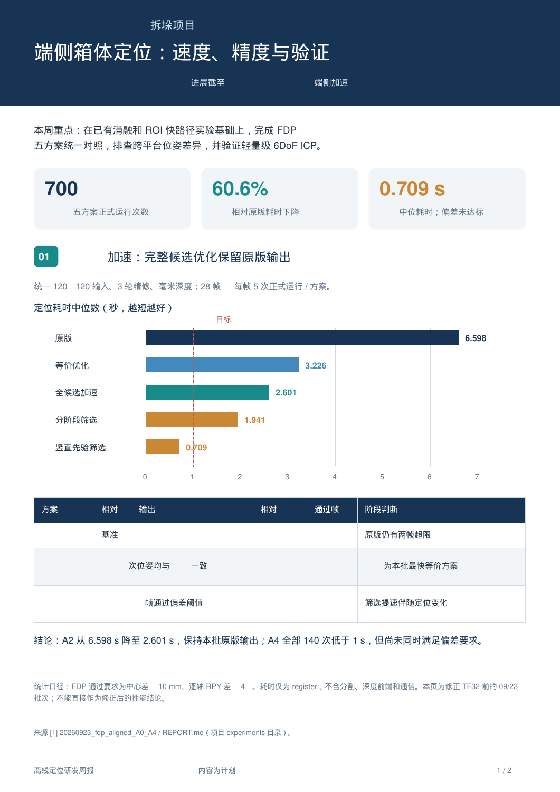

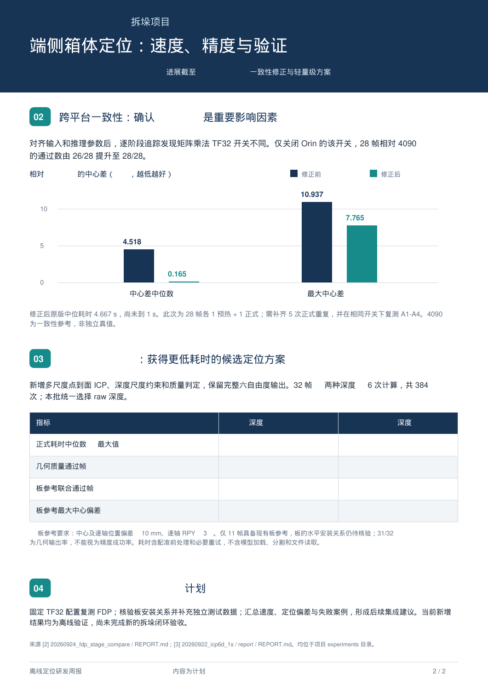

## 9. 助手

_工具输出图片（原始工具文本未纳入归档）。_

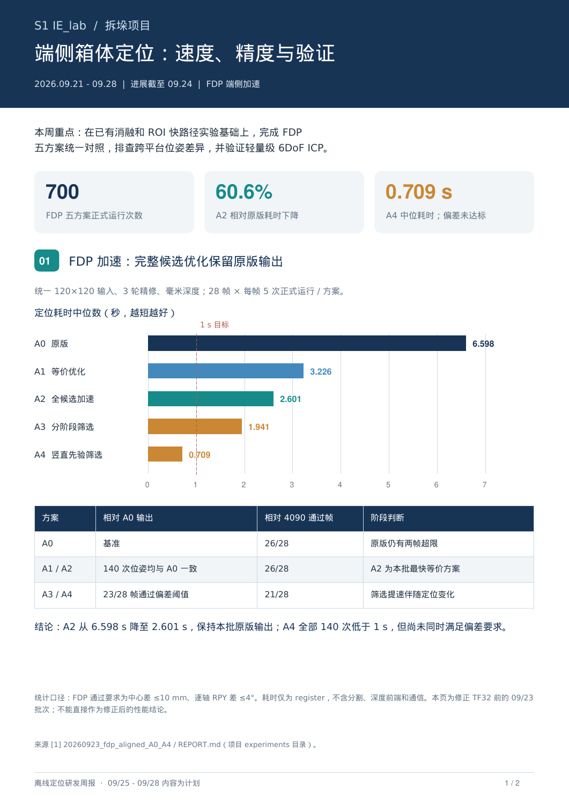

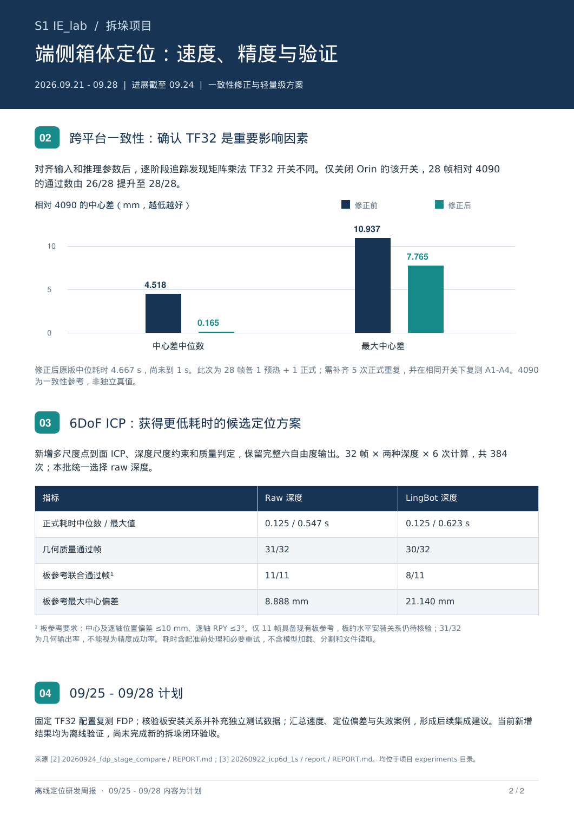

## 10. 助手

已生成 **2 页 PDF**，包含耗时对比图、偏差改善图和结果表格，已逐页检查排版，并区分截至 9/24 的进展与后续计划。

:codex-file-citation{path="/home/lsy03/文档/ChatGPT/S1/output/pdf/S1_IE_lab_拆垛周报_2026-09-21至09-28_两页版.pdf" purpose="output"}

- :codex-followup[准备汇报讲稿]{prompt="根据这份两页 PDF，写一份 2 分钟的口头汇报稿。"}
- :codex-followup[压缩为一页]{prompt="将这份周报压缩成一页，保留关键图表、结论和验证边界。"}
- :codex-followup[更新到 9/28]{prompt="核对项目截至 9/28 的新增实验记录，更新这份两页 PDF 周报，区分完成与未完成事项。"}

[附件：ed39a4615c3565fd--S1_IE_lab_拆垛周报_2026-09-21至09-28_两页版.pdf](../../assets/ed39a4615c3565fd--S1_IE_lab_%E6%8B%86%E5%9E%9B%E5%91%A8%E6%8A%A5_2026-09-21%E8%87%B309-28_%E4%B8%A4%E9%A1%B5%E7%89%88.pdf)

## 11. 用户

看了一下，这一版我感觉不太能用，我们先来回顾一下9\_21 -9\_28 我们的实验和思路流程是什么样子的？ 给我画个图展示一下。

我的报告思路大概是：

1.继续上周的FDP优化思路，本周的优化思路是什么，实验流程是什么，是如何对比 4090FDP和 docker 中 FDP的，更新了几个版本，结果如何？

2. 后面的我还没想好

## 12. 助手（进展）

我先按时间线核对 9/21—9/28 的实验记录，重点梳理“为什么做下一步、各版改了什么、怎样与 4090 对比、结果如何”。这次先画实验思路流程图，把报告主线理清楚。

## 13. 助手（进展）

发现了上一版没有覆盖的关键后续结果：TF32 修正后，我们又把 A4 从“64→16→16”改为“64→64→64”，最终在已有 28 帧、每帧 5 次测试中全部通过相对 4090 的偏差阈值，耗时中位数为 0.850 秒。

所以这周的主线应当讲到这个结果：先提速，再发现跨平台差异，统一配置并定位 TF32 问题，最后修正候选筛选。流程图会用可视化技能呈现这条因果链。

## 14. 助手

这次应当按 **“遇到什么问题 → 为什么这样改 → 怎样验证 → 最后得到什么”** 来讲。上一版只展示了阶段数据，没有把实验推进过程讲清楚，也没覆盖 **A4 保留 64 个候选后的最终结果**。

我重新核对了记录：本周已归档的 FDP 关键实验集中在 **9/21—9/24**；**9/28 继续推进的是 ICP 优化，目前仍在进行**。

**先看这一周的实验思路流程**

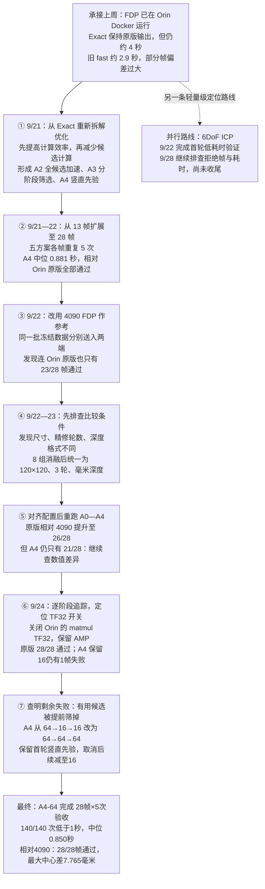

图中 FDP 的“通过”统一指 **中心差 ≤10 mm，roll、pitch、yaw 每轴差 ≤4°**。前半段参考是 Orin 原版，后半段参考是 4090；这个变化正是本周实验的重要转折。

**1. 本周到底优化了什么、更新了几个版本？**

优化分成两层：

- **计算效率优化：**不减少候选，尽量保持输出不变，包括等价数据处理、网络分批计算及 cuDNN 算法选择。
- **候选数量优化：**减少进入精修网络的姿态候选，包括首轮后筛选，以及利用箱体近直立的先验减少首轮候选。

按方法路线，整理为 **A0—A4 五个主线版本**：A0 原版和 A1 Exact 是沿用起点，**本周新增 A2、A3、A4 三条主线方案**；最后又形成 **A4-64 修订方案**。这些共用原 FDP 网络和权重，没有重新训练模型，也不是六个官方版本或六个 Docker 镜像。

下面这张表最适合成为新版周报的结果表，使用 **TF32 修正后的结果**：

| 方案 | 核心变化 | 三轮候选数 | 耗时中位数 | 相对 4090 通过帧 |
|---|---|---|---:|---:|
| A0 原版 | 完整计算，作为基线 | 252→252→252 | 5.801 s | 28/28 |
| A1 Exact | 等价数据处理优化 | 252→252→252 | 2.810 s | 28/28 |
| A2 全候选加速 | 增加微批次与 cuDNN 优化 | 252→252→252 | 2.167 s | 28/28 |
| A3 分阶段筛选 | 首轮后只保留 16 个 | 252→16→16 | 1.678 s | 26/28 |
| A4 竖直先验 | 首轮选 64 个，再缩减至 16 个 | 64→16→16 | 0.596 s | 27/28 |
| **A4-64 修订方案** | **保留首轮 64 个，后续不再减量** | **64→64→64** | **0.850 s** | **28/28** |

每个方案均为 **28 帧×5 次正式运行**；A4-64 是后续独立批次，负载并非同时控制。A1/A2 在本批数据上与 A0 的输出矩阵完全一致。[五方案复验报告](../../assets/7fa8a9598b7c6793--REPORT.md) · [A4-64 修订报告](../../assets/adfc5ebc5f7790ce--A4_16_vs_64_REPORT.md)

**最值得讲的实验结论是：候选越少不一定越好。**
A4 保留 16 个时虽然更快，但提前丢掉了一个关键候选；保留 64 个后，耗时增加到 0.850 秒，仍低于 1 秒，同时补齐了本批的一致性要求。

此外还试过稀疏方向网格、几何预筛、评分前置和候选融合。这些可以作为“探索与排除”的补充，不必全部放进正文。

**2. 我们是怎样比较 4090 FDP 与 Orin Docker FDP 的？**

这里比较的是 **4090 上的服务部署**与 **Orin 上 Docker 内的部署**，实验不能直接证明差异由 Docker 引起。

比较过程分三步：

1. **固定数据。**使用同一批 28 帧：D 组 12 帧、H 组 3 帧、ChArUco 组 13 帧，固定 RGB、mask、深度和相机参数，不用两次实时拍摄的数据互相比较。
2. **固定比较条件。**先通过 HTTP 获取 4090 同帧参考输出；后续 Orin 实验对照归档结果。核查模型权重和 mesh，并逐步对齐输入尺寸、精修轮数、毫米深度及 TF32 设置。
3. **分开评价。**相对 Orin A0，检查“优化引入了多少变化”；相对 4090，检查“两个部署是否一致”。同时统计中心差、逐轴角度差、重复性和耗时。

耗时也要分清：**4090 服务自报约 0.483 秒，S1 完整客户端调用约 1.018 秒，Orin A4-64 的 register 约 0.850 秒**，三者计时范围不同，不能直接画成同口径的硬件速度排名。

最终可以写：

> 在已有近直立箱体的 28 帧数据上，通过推理配置对齐、TF32 数值差异修正及候选保留策略调整，Orin Docker 内 FDP 达到中位 0.850 秒，140 次正式运行均低于 1 秒，且全部满足相对 4090 输出的中心及角度偏差阈值。

这里的 **4090 是部署参考，不是独立真值**；结果也还不代表新场景、任意倾斜箱体或完整拆垛闭环验收。

**3. 你的报告后半部分怎么接？**

建议先把 FDP 拆成两个有连续关系的部分，这样不用急着寻找第二个独立主题：

| 报告部分 | 要回答的问题 | 推荐展示 |
|---|---|---|
| **一、承接上周：FDP 端侧提速** | 优化了哪里，形成哪些方案？ | A0—A4 演进流程＋耗时 |
| **二、跨平台对照与最终修正** | 为什么快了还不能用，怎样修正？ | 配置对齐→TF32→A4-64；最终通过率 |
| **三、可选：ICP 轻量级路线** | 除 FDP 外，还有什么低耗时方案？ | 已完成的板参考结果；9/28 工作标为进行中 |

如果仍控制在 **两页**，我建议 **第一页讲优化路线，第二页讲对照排查和最终结果**。ICP 可以等 9/28 这一轮收尾后，再决定是否放入，避免冲淡这周已经完整的 FDP 实验主线。

[附件：7fa8a9598b7c6793--REPORT.md](../../assets/7fa8a9598b7c6793--REPORT.md)

[附件：adfc5ebc5f7790ce--A4_16_vs_64_REPORT.md](../../assets/adfc5ebc5f7790ce--A4_16_vs_64_REPORT.md)

## 15. 用户

ICP 优化 报告中就先别提

| 报告部分要回答的问题推荐展示      |                 |                       |
| ------------------- | --------------- | --------------------- |
| **一、承接上周：FDP 端侧提速** | 优化了哪里，形成哪些方案？   | A0—A4 演进流程＋耗时         |
| **二、跨平台对照与最终修正**    | 为什么快了还不能用，怎样修正？ | 配置对齐→TF32→A4-64；最终通过率 |

**最值得讲的实验结论是：候选越少不一定越好。**\
A4 保留 16 个时虽然更快，但提前丢掉了一个关键候选；保留 64 个后，耗时增加到 0.850 秒，仍低于 1 秒，同时补齐了本批的一致性要求。

先按照这个给我写一版报告

## 16. 助手（进展）

我会按这两个部分重做两页 PDF：第一页讲 A0—A4 的优化思路与耗时，第二页讲配置对齐、TF32 排查和 A4-64 的最终验证。重点突出“候选越少不一定越好”，并用已归档的最终数据支撑结论。

## 17. 助手（进展）

两页会用同一套最新参数展示结果，避免混淆不同批次。关键对比是：A4 保留 16 个候选时，0.596 秒、27/28 帧通过；保留 64 个后，0.850 秒、28/28 帧通过。报告会同时交代这一步为什么有效，以及 4090 对照的判定标准。

## 18. 助手

_工具输出图片（原始工具文本未纳入归档）。_

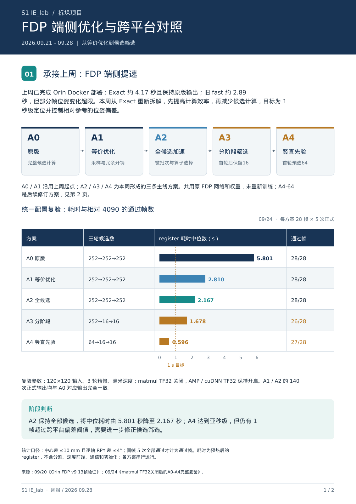

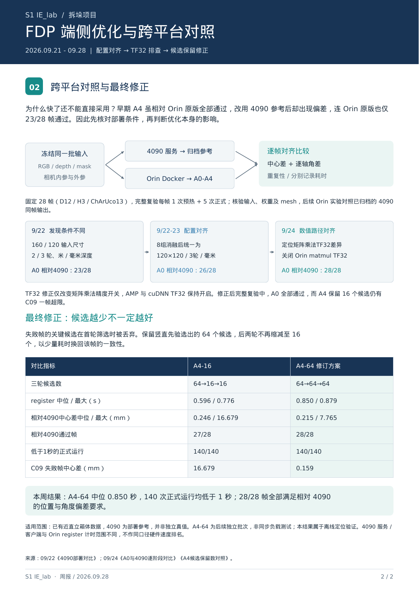

## 19. 助手（进展）

新版已排成两页：第一页是版本演进图和耗时对照，第二页是跨平台实验流程与 A4-16／A4-64 结果表。已逐页检查排版，最终结论落在“0.850 秒、28/28 帧通过”，并注明了数据范围和比较口径。

## 20. 助手

已按确定的结构生成 **两页新版报告**，包含版本演进图、耗时对比和跨平台修正流程，突出 **“候选越少不一定越好”**，已检查排版与数据。

:codex-file-citation{path="/home/lsy03/文档/ChatGPT/S1/output/pdf/S1_IE_lab_周报_2026-09-21至09-28_FDP优化与对照_v2.pdf" purpose="output"}

- :codex-followup[准备两分钟讲稿]{prompt="根据这份 FDP 两页周报，写一份两分钟的口头汇报稿。"}
- :codex-followup[补充关键帧对比图]{prompt="从现有实验产物中查找 C09 在 A4-16 和 A4-64 下的定位对比图，核对后加入报告。"}
- :codex-followup[整理汇报问答]{prompt="针对这份 FDP 周报，整理关于 TF32、候选筛选和 4090 对照的常见追问及回答。"}

[附件：15e17683f4be1f99--S1_IE_lab_周报_2026-09-21至09-28_FDP优化与对照_v2.pdf](../../assets/15e17683f4be1f99--S1_IE_lab_%E5%91%A8%E6%8A%A5_2026-09-21%E8%87%B309-28_FDP%E4%BC%98%E5%8C%96%E4%B8%8E%E5%AF%B9%E7%85%A7_v2.pdf)

## 21. 用户

给我讲一下，各个版本的算法原理是什么？ 最好结果和FDP本身的原理来画个流程图

## 22. 助手（进展）

我会先核对 FDP 原版和各个优化版本的实现，把共同流程与每版改动对应起来，再配上结果画成流程图，解释这些改动为什么会影响速度和位姿。

## 23. 助手（进展）

核对代码后，有两个区别需要在图里讲清楚：A2 的“64”是每批计算 64 个候选，252 个仍全部保留；A4 的“64”才是首轮只选 64 个候选。A4-64 则保留这 64 个候选完成三轮精修，避免首轮评分后过早淘汰有用候选。

## 24. 助手

可以。**A0—A4 都沿用 FDP 的“生成候选 → 精修 → 评分选优”流程，共用同一套网络和权重。我们主要改了三个地方：数据处理方式、网络计算方式、参与计算的候选数量。**

下面统一按本周最终的 **120×120 网络输入、3 轮精修、TF32 修正后**来解释，避免把早期两轮配置混进来。

**一、先理解 FDP 本身在做什么**

FDP 要估计的是箱体的 **三维位置和朝向**。它的核心思路是：**先提出多种可能的摆放姿态，让网络逐步修正，再选出最可信的一种。** 这对应 FoundationPose 的候选初始化、精修网络和位姿评分模块。[官方原理说明](https://nvlabs.github.io/FoundationPose/)

这里先明确三个概念：

| 名称 | 含义 |
|---|---|
| **候选姿态** | 对同一个箱体位置与朝向的一种猜测。本项目原始配置生成 252 个候选 |
| **RefineNet 精修网络** | 对每个候选预测平移、旋转修正量，让模型与实际观测更匹配 |
| **ScoreNet 评分网络** | 比较精修后的候选，给出排序，选择最终输出 |

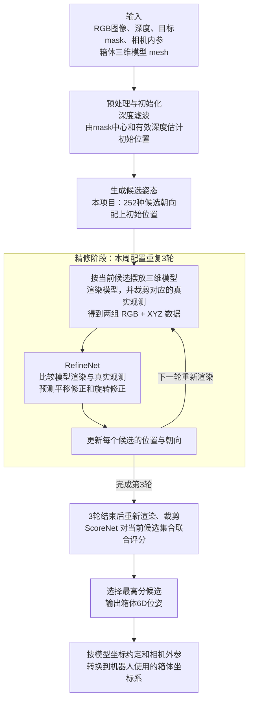

这里“渲染并比较”的意思是：**假设箱子处于某个候选姿态，先计算相机应该看到什么，再与实际拍到的图像和三维信息比较。** 网络根据差异判断“应该往哪里移动、应该转多少”。

原版比较耗时，是因为 **许多候选都要反复经历渲染、裁剪、网络精修，最后还要评分**。[本项目原版实现](/home/lsy03/文档/ChatGPT/S1/experiments/20260922_fdp_4090_service/source_audit/orin/FoundationPose/estimater.py:170)

**二、各版本分别改了哪一步？**

先把版本关系与最终结果放在一张图里。图中的数字表示 **第一、第二、第三轮分别精修多少个候选**；通过帧数均相对 4090 参考。

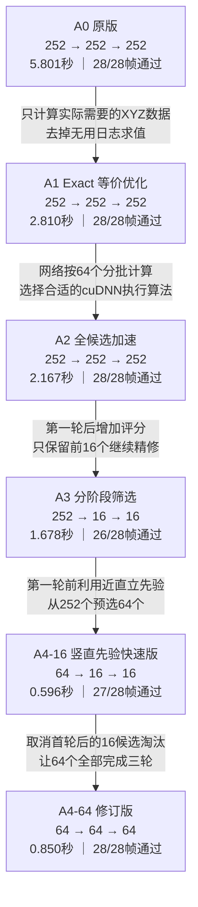

**A0：完整搜索，作为对照基线**

252 个候选全部完成三轮精修，随后对全部候选评分，选出最高分。

它保留较广的初始朝向覆盖，但计算量较大。这一配置下，三轮共有 **252×3＝756 次候选精修**。这里是候选处理次数，网络可以批量执行。

**A1：计算相同的数据，减少中间工作**

A1 保留候选数量、精修轮数和网络：

- 在评分网络的深度转 XYZ 路径中，**只计算最终裁剪图实际用到的位置**，保留原来的采样、取整和边界处理规则。
- 去掉无用的日志表达式求值，减少读取 GPU 张量等操作引起的同步等待。

可以理解为：原来需要生成较大的中间数据，再取出局部；现在直接算出所需部分。

本批 140 次正式输出都与 A0 对应输出完全一致，耗时降至 **2.810 秒**。[等价采样实现](/home/lsy03/文档/ChatGPT/S1/experiments/20260918_fdp_orin_optimization/fast_xyz.py:1)

**A2：候选全部保留，调整网络的执行方式**

在 A1 基础上，主要增加：

- **微批次 64：**将 252 个候选分成 `64＋64＋64＋60`，依次进行精修网络计算和评分特征提取。
- **cuDNN 算法选择：**为固定输入形状选择更合适的网络执行方式，保留确定性要求。

评分特征提取后会重新合并，候选仍然一起参与联合评分。

**A2 的“64”是每批处理量；候选总数始终是 252。** 本批输出仍与 A0 完全一致，中位耗时降至 **2.167 秒**。[网络计算优化实现](/home/lsy03/文档/ChatGPT/S1/experiments/20260918_fdp_orin_optimization/net_opt.py:70)

**A3：先粗修一轮，再淘汰候选**

A3 开始改变搜索过程：

> 252 个候选精修一轮 → 提前调用评分网络 → 保留前 16 个 → 完成剩余两轮 → 最终评分。

这样可以减少后两轮的渲染、裁剪和网络计算，但引入一个假设：

**第一轮评分靠后的候选，后面也不太可能成为好结果。**

这个假设在部分帧上不成立。某个初始候选可能需要继续精修才表现出优势，提前淘汰后就失去了机会。本批降至 **1.678 秒**，但通过数为 **26/28**。[分阶段筛选实现](/home/lsy03/文档/ChatGPT/S1/experiments/20260924_fdp_no_tf32_A0_A4/candidate_inline.py:47)

**A4-16：利用箱体近直立条件，进一步减少第一轮计算**

A3 的第一轮仍处理 252 个候选。A4 将优化提前到第一轮之前：

1. 根据相机到机器人基座的变换，把候选的箱体朝向换算到基座坐标系。
2. 优先选择箱体竖直轴接近基座竖直方向的候选。
3. 同时覆盖 12 个水平朝向扇区，保留 64 个候选。
4. 第一轮后再按评分保留 16 个。

因此形成 **64→16→16**。

它依赖“箱体大致直立、基座 Z 轴可代表竖直方向”的场景条件。这个先验只影响候选选择，**后续仍然估计完整六自由度，roll、pitch 仍可变化**。

结果是 **0.596 秒、27/28 帧通过**。[竖直先验实现](/home/lsy03/文档/ChatGPT/S1/experiments/20260924_fdp_no_tf32_A0_A4/upright_prior.py:13)

**A4-64：保留有效先验，取消过早淘汰**

A4-64 保留“从 252 个中预选近直立的 64 个”，然后让这 64 个候选全部完成三轮：

> 近直立预选 64 个 → 全部精修三轮 → 对 64 个候选最终评分。

因此形成 **64→64→64**。实现中也跳过了原来用于淘汰候选的首轮中间评分。

它的三轮候选精修总量为 **64×3＝192**，仍明显少于 A0/A2 的 756；同时给初期评分不高的候选保留了继续改善的机会。

最终达到 **0.850 秒、28/28 帧通过**。

**三、为什么“候选越少不一定越好”？看 C09 这一帧**

在 C09 中，原版最终胜出候选在首轮评分时还排不到前 16。于是两种策略出现了不同结果：

| 策略 | 发生了什么 | C09 相对 4090 的中心差 |
|---|---|---:|
| A4-16 | 第一轮后淘汰该候选，后续无法继续修正它 | 16.679 mm |
| A4-64 | 保留该候选继续精修，最终恢复接近参考的结果 | 0.159 mm |

所以这一轮得到的经验是：**精修过程尚未完成时，早期评分不足以可靠判断所有候选的最终潜力。**

此外，ScoreNet 对候选集合联合评分，改变集合也可能影响排序。因此，筛选带来的变化既要检查“有没有丢掉有用候选”，也要检查“保留下来的候选如何被重新评分”。[最终对照结果](../../assets/adfc5ebc5f7790ce--A4_16_vs_64_REPORT.md)

**四、TF32 在这里属于哪一部分？**

TF32 是作用于这些版本的**数值计算设置**。我们发现 Orin 与 4090 的矩阵乘法开关不同，差异会影响几何计算和图像裁剪，再传递到精修与评分结果。

因此，先统一为 **matmul TF32 关闭，AMP 与 cuDNN TF32 保持开启**，再比较 A0—A4，才能更清楚地判断各项优化引入了多少变化。上图使用的就是修正后的完整复验结果。[TF32 排查报告](../../assets/fd13ff7da813fa81--REPORT.md)

以上耗时均为预热后的 `register` 中位数，每方案 **28 帧×5 次正式运行**；通过要求为相对 4090 中心差 ≤10 mm、逐轴角度差 ≤4°。最终结论适用于这批近直立箱体数据，衡量的是部署间一致性。

[附件：adfc5ebc5f7790ce--A4_16_vs_64_REPORT.md](../../assets/adfc5ebc5f7790ce--A4_16_vs_64_REPORT.md)

[附件：fd13ff7da813fa81--REPORT.md](../../assets/fd13ff7da813fa81--REPORT.md)

## 25. 用户

报告里面给我加上原始方案的直方图和修正方案的直方图数据对比，不需要太多的直方图，最多两张

## 26. 助手（进展）

我会把“原始方案”按 A0 原版、“修正方案”按最终 A4-64 来对比：一张图看定位耗时，一张图看相对 4090 的中心偏差，控制在两张图内，并注明两者的参数配置。

## 27. 助手（进展）

数据已核对：A0 和 A4-64 的耗时中位数分别为 5.801 秒、0.850 秒，两者都通过了 28/28 帧的相对 4090 偏差要求。耗时图会统计各 140 次正式运行；中心偏差图会按 28 个独立帧统计，避免把重复运行当作新样本。原有表内耗时条形图会改成纯表格，使整份报告总共只有两张统计图。

## 28. 助手

_工具输出图片（原始工具文本未纳入归档）。_

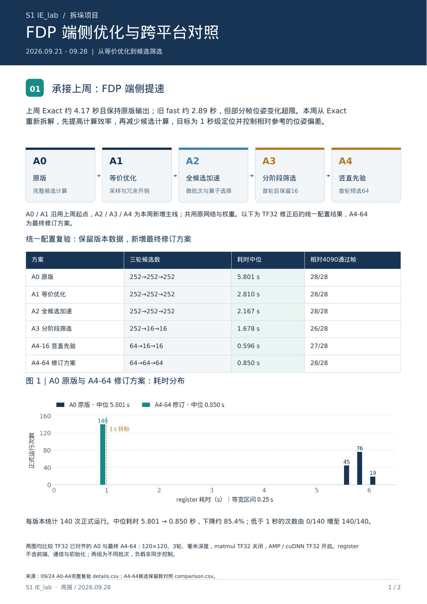

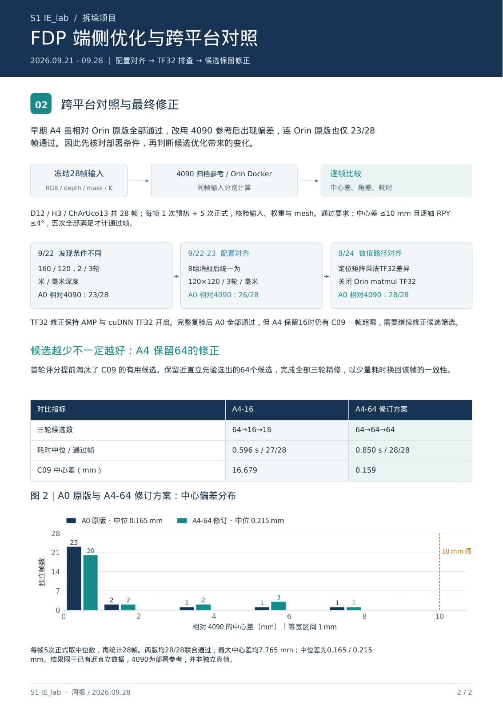

## 29. 助手（进展）

两张直方图已加入，报告仍为两页。它们展示的是：A4-64 的耗时分布明显缩短，而中心偏差仍满足本批阈值。我正在做最后的图例、标签和样本数检查。

## 30. 助手

_工具输出图片（原始工具文本未纳入归档）。_

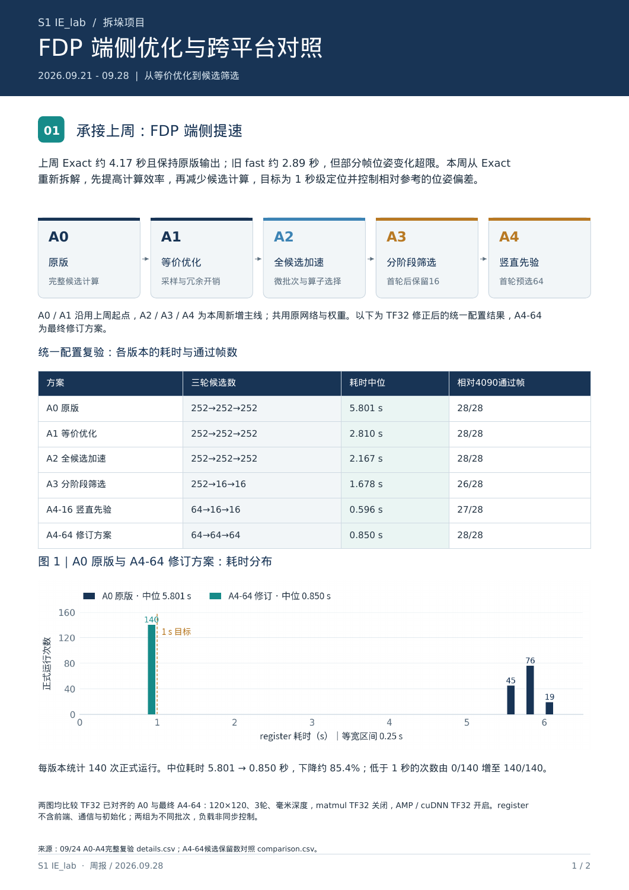

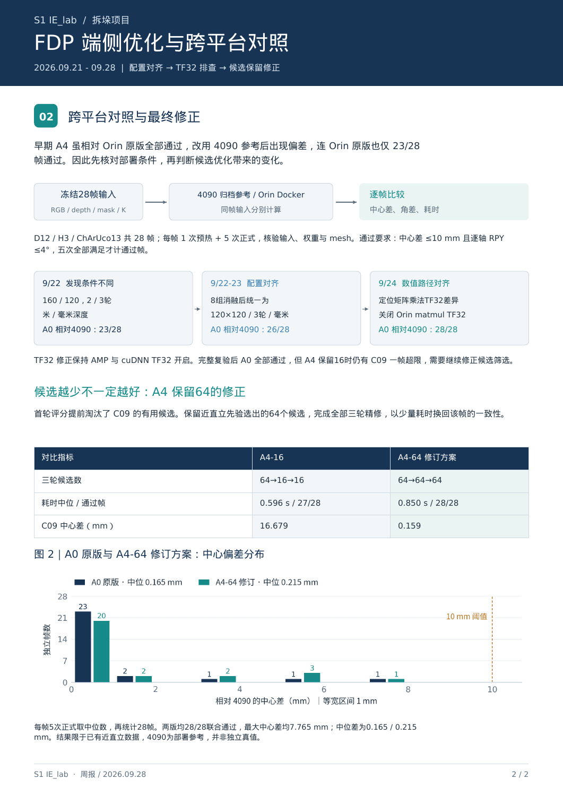

## 31. 助手

已更新，报告仍为 **两页**，包含两张 **A0 原版与 A4-64 修订方案**对比直方图：

- 定位耗时分布。
- 相对 4090 的中心偏差分布。

已核对数据并检查排版。

:codex-file-citation{path="/home/lsy03/文档/ChatGPT/S1/output/pdf/S1_IE_lab_周报_2026-09-21至09-28_FDP优化与对照_双直方图_v3.pdf" purpose="output"}

- :codex-followup[导出高清图表]{prompt="将报告中的两张直方图导出为适合放入 PPT 的高清图片。"}
- :codex-followup[准备汇报讲稿]{prompt="根据新版报告，写一份两分钟讲稿，解释两张直方图的结论。"}
- :codex-followup[查看逐帧差异]{prompt="列出 A0 与 A4-64 相对 4090 偏差变化最大的几个帧，并解释其对结论的影响。"}

[附件：5c4310d7514ff106--S1_IE_lab_周报_2026-09-21至09-28_FDP优化与对照_双直方图_v3.pdf](../../assets/5c4310d7514ff106--S1_IE_lab_%E5%91%A8%E6%8A%A5_2026-09-21%E8%87%B309-28_FDP%E4%BC%98%E5%8C%96%E4%B8%8E%E5%AF%B9%E7%85%A7_%E5%8F%8C%E7%9B%B4%E6%96%B9%E5%9B%BE_v3.pdf)
