# 10_08 9_30 标定板数据采集（5） 是否可行？ICP 优化 cd /home/galbot/Lsy03/… (…

- 归档编号：`01a0e5a9-040f-75a1-ab9b-a5e36ab3d792`
- 项目：S1 IE_lab 拆垛
- 创建时间：2026-09-28T09:37:34.227000+08:00
- 更新时间：2026-10-09T15:16:36.909000+08:00
- 状态：活动
- 导出范围：用户可见消息与助手可见回复；不含隐藏推理和工具原始输出

## 1. 用户

好的我们继续优化

## 2. 助手（进展）

我会从已保存的 ICP 版本继续，先核对这几天是否有新的实验结果，再针对剩余拒绝帧、位置偏差较大的帧和倾斜箱体做优化，继续按单次≤1秒、位置≤10 mm、逐轴角度≤3°的标准验证。

## 3. 助手（进展）

最近新增的主要是 FDP 实验，ICP 仍是9月22日那版。我先检查 D01 为什么被拒绝，以及 D02、D03 为什么耗时偏长，再决定改哪一部分；阈值继续保持不变。S1 端验证仍使用 galbot-s1-ssh 技能，只运行冻结数据的离线容器。

## 4. 助手（进展）

本地源码和历史结果已恢复读取，我会先完成本地诊断与改动验证。

S1 的只读 SSH 检查被自动审批拒绝，理由是它认为“继续优化”未明确授权本次远端访问。远端检查尚未执行；本地工作可以继续，Orin 实测需要补充确认。

## 5. 助手（进展）

已找到一项可保留数值结果的优化：滤波只计算目标区域及必要边界，并保留 OpenCV 使用的全图深度范围。64套输入的点云、法向和采样位置已逐值一致；本机这一步的中位耗时从约13.7 ms降到11.7 ms。我会继续核对最终位姿和较慢的配准步骤。

S1 验证仍被自动审批阻止，原因是本轮远端访问授权未被认可。下面只请求 SSH 和独立离线 Docker 测试权限，不包含机器人运动。

## 6. 助手

_工具输出图片（原始工具文本未纳入归档）。_

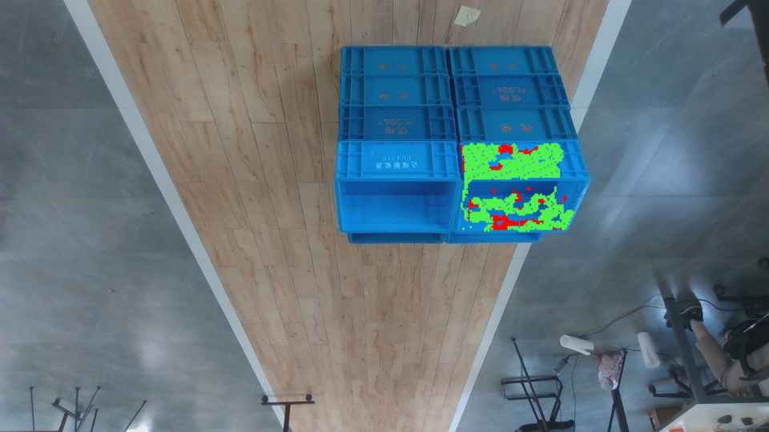

## 7. 助手（进展）

更密的采样没有解决 D01，还让 D02、D03 新增拒绝，因此这条方案暂不采用。保留的区域滤波版本在64个条件上的最终位姿、接受状态和拒绝原因都复现了基线；我接下来用交替顺序重复计时，确认速度收益。

## 8. 助手

本地已完成一轮优化，得到一个**保持原位姿结果不变的加速候选**：

- 32帧、双深度共768次对照，384对位姿、状态和拒绝原因完全一致。
- raw 本机中位耗时：33.02 → **31.61 ms**，减少约4.3%。
- 11帧标定板参考仍全部通过10 mm、3°要求。
- D01仍被拒绝；加密采样、增加迭代均未改善，未采用。

[本轮报告](<../../assets/e49a7a2df96bb3ae--README.md>)。这些是本地结果，**新版尚未在 Orin 验证**。

是否允许本轮通过 SSH 连接 S1，在独立 Docker 中完成验证？不调用运动、不修改生产服务。

自动审批拒绝了 S1 的只读 SSH 预检，理由是它要求本轮明确授权远端访问，因此需要这次确认。

[附件：e49a7a2df96bb3ae--README.md](../../assets/e49a7a2df96bb3ae--README.md)

## 9. 用户

允许

## 10. 助手（进展）

收到。我现在核对 S1 镜像、冻结输入和负载，随后在独立 Docker 中对基线与优化版做交替重复测试，验证位姿是否一致、实际耗时能减少多少。

## 11. 助手（进展）

S1 的镜像和320个输入文件哈希已核验一致，768次交替对照已启动。当前机器有一定后台负载，所以会以这次同机交替测试的结果比较速度，并检查每次运行是否仍低于1秒。

## 12. 助手（进展）

Orin 对照已通过：384对结果的位姿矩阵、接受状态和拒绝原因完全一致。raw 中位耗时从0.133秒降到0.107秒，减少约19%；最慢运行约0.565秒，仍低于1秒。11个有板参考的帧全部保持通过，D01仍被拒绝。接下来保存逐帧统计并做收尾核验。

## 13. 助手

S1 Orin 验证已完成，**新版 raw 中位耗时降低约19%，位姿结果完全不变**。

|指标|原版|优化版|
|---|---:|---:|
|中位耗时|0.133秒|**0.107秒**|
|最大耗时，含首轮|0.596秒|**0.565秒**|
|几何检查通过|31/32帧|31/32帧|
|有板参考帧满足10 mm、3°|11/11|11/11|

本轮768次运行全部低于1秒，384对位姿矩阵、接受状态和拒绝原因完全一致。输入与源码完整性核验通过，测试容器已清理。

D01仍被拒绝；其余21帧缺少独立参考，因此还不能宣布全数据精度成功率达到95%。

[完整报告](<../../assets/cc6c58029c82ab5e--ORIN_REPORT.md>) · [逐帧数据](<../../assets/a5705ef4e90a33e6--ORIN_PER_FRAME.csv>)

[附件：cc6c58029c82ab5e--ORIN_REPORT.md](../../assets/cc6c58029c82ab5e--ORIN_REPORT.md)

[附件：a5705ef4e90a33e6--ORIN_PER_FRAME.csv](../../assets/a5705ef4e90a33e6--ORIN_PER_FRAME.csv)

## 14. 用户

好的我们继续优化

## 15. 助手（进展）

我会继续优化。这轮先检查剩余的 D01 拒绝和 D02/D03 耗时较长的问题，保留当前已验证的版本作为对照；有改善的候选再用完整数据集验证，继续检查每次≤1秒，以及有板参考帧的位置和角度偏差。

## 16. 助手（进展）

函数级诊断显示，D01/D03 的大部分计算时间花在最近邻查询上，体素去重排序也占了一部分。我先测试更合适的 KD 树结构和整数去重方法，核对它们能否加快计算，同时返回完全相同的匹配点和位姿。

## 17. 助手（进展）

开发帧测试已有收益：KD 树与去重优化组合后，D03 的本机中位耗时从约185 ms降到127 ms，位姿和状态保持一致。我会将选定参数扩展到全部32帧，再在 S1 上做同机交替对照。

## 18. 助手（进展）

完整本地对照已通过：384对位姿、状态和拒绝原因完全一致，raw 最大耗时从约189 ms降到121 ms。测试包已同步到 S1，下面用同一镜像和资源配置验证实际收益。

## 19. 助手（进展）

S1 新一轮对照已完成：raw 中位耗时从0.108秒降到0.101秒，含首轮的最大耗时从0.559秒降到0.445秒。384对结果的位姿和状态完全一致，11个有板参考的帧仍全部通过；D01的拒绝状态也未改变。我正在做文件校验和收尾记录。

## 20. 助手

又完成一轮 S1 优化，继续使用 raw 深度。这次加速了最近邻查询和体素去重，**位姿结果完全不变**。

|同批 Orin 对照|上一版|新版|
|---|---:|---:|
|raw 中位耗时|0.108秒|**0.101秒**|
|raw 最大耗时，含首轮|0.559秒|**0.445秒**|
|几何检查通过|31/32帧|31/32帧|
|板参考满足10 mm、3°|11/11帧|11/11帧|

中位耗时减少约 **6.5%**，最大耗时减少约 **20.4%**。本轮768次运行全部≤1秒，384对位姿、状态和拒绝原因完全一致。

D01仍被拒绝；21帧仍缺少独立参考，尚不能证明全数据精度成功率≥95%。下一步应优先补充这些参考和新视角验证。

[完整报告](<../../assets/63d500e09820c02d--REPORT.md>) · [逐次对照数据](<../../assets/629789f7309e06a1--PAIRED_TIMES.csv>)

[附件：63d500e09820c02d--REPORT.md](../../assets/63d500e09820c02d--REPORT.md)

[附件：629789f7309e06a1--PAIRED_TIMES.csv](../../assets/629789f7309e06a1--PAIRED_TIMES.csv)

## 21. 用户

继续优化

## 22. 助手（进展）

我会继续。这轮优先检查 D01 拒绝是否存在可修复的观测或拟合问题，同时评估较慢帧的剩余开销；候选方案仍需保留现有11帧板参考的通过结果，再到 S1 做完整对照。

## 23. 助手（进展）

D01 的诊断显示，异常点与正常点的局部平面误差分布有较大重叠，简单去噪会同时丢掉不少正常点。我会测试观测置信度加权，并继续用完整原始观测点做质量评估，检查它是否真正改善拟合。

## 24. 助手（进展）

置信度加权这条方案暂不采用：D01 的残差没有下降，D02、D03还新增了拒绝。接下来我检查辅助拟合项的矩阵构造，尝试减少临时数组分配，并验证改写前后的数学结果是否一致。

## 25. 助手（进展）

新的并行查询方案值得继续验证：把查询点交错分给两个工作线程后，开发帧 D03 的本机中位耗时从约122 ms降到88 ms，位姿仍逐值一致。它会使用更多 CPU 并行能力，但仍在原来的6CPU配额内；我会先完成全数据本地对照，再检查 Orin 上是否也有收益。

## 26. 助手（进展）

全数据本地对照已通过，384对位姿和状态仍完全一致。现在开始 Orin 验证，并同时记录墙钟时间和进程 CPU 时间，区分延迟收益与额外的并行计算成本。

## 27. 助手（进展）

Orin 结果已返回：raw 中位耗时从0.098秒降到0.093秒，最大耗时从0.457秒降到0.353秒；384对位姿和状态完全一致。代价是进程 CPU 时间中位数增加约8.6%。D01仍被拒绝，置信度加权未带来改善；我会保留这些失败证据，并完成最后的文件与容器核验。

## 28. 助手（进展）

最终核验已完成：全部 768 次调用均在 1 秒内，输入和程序文件校验一致，实验容器已退出。我正在把结果记录进项目文档：本轮降低了耗时，精度保持不变；D01 仍未通过质量筛选。

## 29. 助手

本轮优化已完成，并在 **S1 Orin 原 Docker 环境**验证。采用双线程精确最近邻查询，默认继续使用 **raw 深度**。

### 耗时改善

同批 raw 数据对照：

| 指标 | 优化前 | 优化后 |
|---|---:|---:|
| 中位耗时 | 98.1 ms | **92.9 ms** |
| 最大耗时（含首轮） | 457.4 ms | **352.7 ms** |

全部 **768 次调用均小于 1 秒**；代价是进程 CPU 时间中位数增加约 **8.6%**。

### 精度保持不变

384 对结果的位姿矩阵和接受状态完全一致。11 帧现有标定板参考数据均满足要求：

| 误差指标 | 最大绝对误差 |
|---|---:|
| Δx / Δy / Δz | 4.568 / 5.626 / 7.786 mm |
| 中心距离 | **8.888 mm** |
| roll / pitch / yaw | 1.163° / 1.352° / 1.060° |

**尚未解决：**D01 仍被拒绝；另有 21 帧缺少独立位姿参考，因此还不能宣布全数据精度通过率达到 95%。本轮尝试的置信度加权会让部分帧变差，已保留记录但未采用。

下一步重点应转向 **D01 失败原因和独立参考验证**。

[完整报告](experiments/20260928_icp6d_confidence/REPORT.md) · [逐次耗时数据](experiments/20260928_icp6d_confidence/PAIRED_TIMES.csv)

## 30. 用户

继续

## 31. 助手（进展）

我会继续检查 D01 的失败原因，重点看初始位姿和点云残差，并用现有板参考帧检查改动是否影响精度。

## 32. 助手（进展）

D01 在两种初始方向、更多迭代和多组拟合参数下仍未通过。它的 P90 表面残差约为 22.3 mm，门限是 20 mm；单纯增加迭代也没有改善。我接下来会把高残差点标回原图，检查它们集中在哪些区域。

## 33. 助手

_工具输出图片（原始工具文本未纳入归档）。_

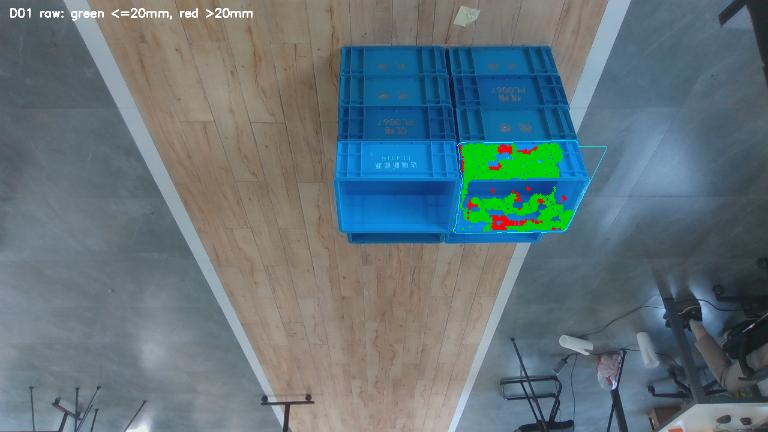

## 34. 助手（进展）

有一个值得验证的方向：历史结果中，D01 的 raw 深度被拒绝，但 LingBot 深度能通过，P90 残差为 5.89 mm。

我会测试统一规则：先跑 raw，仅在质量检查失败时尝试已缓存的 LingBot 深度。这样可以检查是否能补上 D01；两次 ICP 的总耗时会一起计入，LingBot 生成深度的耗时则需单独说明。

## 35. 助手（进展）

接下来我会使用 `galbot-s1-ssh` 技能，在之前授权的独立 Docker 中验证这条回退规则。实验只读取冻结数据，不涉及机器人运动或生产服务修改。

## 36. 助手（进展）

S1 计算已结束，正在核验结果。本地完整回归中，仅 D01 触发了 LingBot 回退，几何接受数从 31/32 提高到 32/32。D01 仍缺少独立位姿参考，因此暂时只能确认它通过了几何质量检查，不能确认位置误差在 10 mm 内。

## 37. 助手（进展）

收尾核验命令两次遇到自动审批超时，尚未执行。系统没有给出安全风险判定；我会改为只读取回已生成的结果，在本机核验。

受影响的是“S1 输出哈希与清理状态核验”这一步，不是已经完成的计算。

## 38. 助手（进展）

结果核验通过：仅 D01 触发回退，32/32 帧均通过几何质量检查；384 次完整调用全部低于 1 秒，最大为 389 ms。11 帧板参考结果保持不变，最大中心误差仍为 8.89 mm。

这个结果以 LingBot 深度已缓存为前提，尚未验证在线生成深度的端到端耗时。审批超时后的核验已通过只读方式完成，实验容器也确认已清理。

## 39. 助手

本轮已完成，找到一个可用的补充方案：**先用 raw，质量检查失败时再尝试缓存的 LingBot 深度。**

S1 Orin 实测：

| 指标 | 仅 raw | 条件回退 |
|---|---:|---:|
| 几何质量通过 | 31/32 | **32/32** |
| 中位耗时 | 93.8 ms | 93.2 ms |
| 最大耗时 | 343.6 ms | **389.2 ms** |
| 板参考精度通过 | 11/11 | **11/11，位姿不变** |

仅 **D01** 触发回退；384 次完整调用全部低于 1 秒。

**两个限制仍在：**

- 耗时不含 LingBot 生成深度，需要缓存已就绪。
- D01 没有独立位姿参考，通过几何检查不代表已证明误差 ≤10 mm；整体精度 ≥95% 尚未验证。

当前保留 raw 默认，回退方案作为实验候选。下一步重点是补充独立参考，并验证在线深度生成耗时。

[完整报告](../../assets/0bccd9378c9339fe--REPORT.md) · [D01 残差图](../../assets/600f77caaee07ad3--D01_residual.png)

[附件：0bccd9378c9339fe--REPORT.md](../../assets/0bccd9378c9339fe--REPORT.md)

## 40. 用户

我们先生成方案计划，明确目标

## 41. 助手

## 一、明确目标

优化一套用于 **4317 箱体的 ICP 位姿算法**，在 S1 Orin 上同时满足精度、耗时和输出可靠性要求。

| 项目 | 验收标准 |
|---|---|
| 中心位置 | `|Δx|、|Δy|、|Δz| ≤10 mm`，且中心距离误差 ≤10 mm |
| 姿态 | roll、pitch、yaw 误差分别 ≤3° |
| 箱体对称性 | 统一考虑绕箱体自身 Z 轴的 180° 对称 |
| 耗时 | RGB-D、目标 mask 等输入准备好后，完整 ICP 流程 **至少95%的调用 ≤1秒** |
| 联合通过率 | 有独立参考的有效帧中，至少95%同时满足精度、耗时及成功输出 |
| 失败处理 | 拒绝、超时、无输出均计入失败，不从分母中移除 |

**以此前确认的95%耗时要求为准，同时报告最大耗时。**

## 二、当前基线与缺口

当前有 **32帧**：D组12帧、H组3帧、标定板组13帧、现场组4帧。

- **raw ICP**：31/32帧通过几何质量检查。
- **raw失败后回退缓存LingBot**：32/32帧通过，最大耗时389 ms。
- **11帧现有标定板参考**：均满足精度要求，最大中心误差8.89 mm。
- **其余21帧缺少独立位姿参考**。
- 标定板到箱体的水平安装关系仍需核实。
- 缓存回退耗时没有包含LingBot生成时间。

因此，目前证明了计算速度和部分参考帧精度，**尚未完成整体精度验收**。

## 三、执行计划

### 阶段1：冻结数据和评估口径

建立唯一的数据清单，记录每帧的输入、深度分支、参考来源、相机坐标变换及哈希。

统一：

- 箱体中心、XYZ轴方向和姿态定义；
- 算法位姿与参考位姿所在坐标系；
- 180°对称处理；
- 完整调用计时和失败计数规则。

**产物：**数据清单、坐标约定、验收规则。原始数据和当前最佳版本保留不变。

### 阶段2：先核实参考位姿

这是下一步的重点。

1. 复核标定板尺寸、白边、厚度、朝向和A角贴边关系。
2. 核对实测高度：箱体总高172 mm、内底面至最高点160 mm。
3. 检查 mesh 原点、箱体中心以及板到箱体的完整变换。
4. 为11帧输出角点、标定板和箱体投影叠加图，检查系统性偏移。
5. 对其余21帧逐帧确认是否存在可用独立参考；没有参考的保留为速度与稳定性测试数据。

**原则：不能用待评估ICP或FDP的结果替代真值，也不能凭旧图为无标定板帧补造参考。**

**产物：**参考位姿版本、可信度说明、可用于精度验收的帧名单。若需要新增实测，列出具体测量项。

### 阶段3：验证两条候选流程

| 候选 | 用途 | 需要验证 |
|---|---|---|
| A：raw ICP | 默认方案 | 精度、质量拒绝、完整耗时 |
| B：raw拒绝后回退LingBot | 补充方案 | 联合通过率、回退收益、额外耗时 |

分支选择只依据输入质量和算法质量检查，不能依据帧名或参考误差。

对B分别记录：

- **缓存已就绪：**raw及回退的全部ICP耗时；
- **在线生成：**另计LingBot生成、传输及等待时间。

在线耗时未验证前，不将B作为已满足端到端1秒要求的方案。

### 阶段4：针对失败原因优化

优先研究：

1. D01的深度误差、遮挡和mesh不匹配分别贡献多少；
2. 能否仅凭输入判断何时需要深度回退；
3. 拟合残差与真实位姿误差是否一致；
4. 参数调整是否导致其他帧退化。

每次只改变一项，先开发集筛选，再完整回归。**不靠放宽质量门限或删除失败帧提高通过率。**

### 阶段5：S1正式验收

使用相同固定Docker环境、资源限制和计时边界：

- 全部32帧测速度与输出稳定性；
- 有可靠参考的帧测位置与姿态误差；
- 每条件首轮1次、正式重复至少5次；
- 重复运行用于评估耗时波动，不当作新增独立样本；
- 增加未参与调参、带独立参考的验证帧，检查泛化能力。

## 四、最终交付

1. **逐帧结果表**：Δx、Δy、Δz、中心距离、Δroll、Δpitch、Δyaw、耗时、接受状态、深度分支。
2. **汇总表**：最小值、中位数、P95、最大值及联合通过率。
3. **失败分析与投影图**。
4. **可复现程序、配置、Docker命令和输入清单**。
5. 明确结论：哪些目标已满足，哪些仍缺证据。

**建议顺序：先完成阶段1、2，核实参考位姿；再决定继续优化raw，还是将LingBot回退纳入最终方案。**

## 42. 用户

好的我们开始进行

## 43. 助手（进展）

我先冻结本轮数据清单和评估口径，再核查标定板到箱体的安装变换，重点检查原点、贴边方向和高度关系。

## 44. 助手（进展）

已确认高度关系自洽：内底面距外底最低点为 12 mm，板厚 2 mm，所以印刷面高 14 mm；箱体中心高 86 mm，中心比印刷面高 72 mm。

水平偏移则仍来自 mesh 的内壁截面假设，没有实测验证。我会先检查全部参考矩阵的生成链，并把这一项明确列为参考位姿的不确定因素。

## 45. 用户

<send_user_message_question_reply>
[{"questionItemId":"[\"request_user_input_async\",\"call_ZE7meRtFckWNZdprgPgPrnHa\",0]","question":"为了核实板到箱体的水平偏移，你是否已有箱体内底面处的净长、净宽，以及A角圆角/倒角处是否影响板边贴合的实测记录？没有也可以直接说没有，我会先完成现有数据审计。","answer":"你看看我记得有个mesh"}]
</send_user_message_question_reply>

## 46. 用户

等一下，什么是箱体的水平偏移？

## 47. 助手（进展）

这里的“水平偏移”指：**从标定板坐标原点，到箱体中心，在箱底平面内相差多少距离**，不是说箱子发生了移动。

当前程序用的是：

- 沿标定板 X 轴：**171.45 mm**
- 沿标定板 Y 轴：**59.43 mm**
- 垂直板面向上：**72 mm**

相机先求出标定板的位置，再通过这三个距离推算箱体中心。如果前两个距离不准确，即使标定板识别正确，算出的箱体中心也会偏。

你记得的 **mesh 已经找到了**。当前 X、Y 数值就是根据它的内壁截面，加上你确认的 **10 mm 白边、A角贴边无间隙**推算出来的。我现在核查的是：代码取的 mesh 截面，是否对应标定板实际贴靠的位置。暂时不需要你重新测量。

## 48. 助手

我刚才表述不够清楚，准确地说是 **“箱体中心相对于标定板原点的平面内位置”**。

相机识别到标定板后，需要知道箱体中心在哪里，才能换算箱体位姿。当前代码采用：

| 方向 | 标定板原点 → 箱体中心 |
|---|---:|
| 板面内 X | 171.45 mm |
| 板面内 Y | 59.43 mm |
| 垂直板面 Z | 72 mm |

前两项就是我说的“水平偏移”。**它不是标定板与箱壁之间的间隙，也不表示箱体发生了移动。** 即使板边完全贴住箱壁，标定板原点与箱体中心之间仍然有距离。

你提到的 **mesh 已找到**，当前 X、Y 数值也是由它推算的。接下来需要核查：程序使用的内壁截面，是否对应板在A角实际贴靠的位置。暂时不用重新测量。

## 49. 用户

file:///home/lsy03/%E6%96%87%E6%A1%A3/ChatGPT/S1/experiments/20260915\_charuco\_comparison/measured\_mount\_20260916/interactive.html

你先看一下这个

> 资源未归档：`home/文档/ChatGPT/S1/experiments/20260915\_charuco\_comparison/measured\_mount\_20260916/interactive.html`（missing）

## 50. 助手（进展）

我先打开这份本地交互图，核对它标示的板位置、坐标轴和尺寸。

## 51. 助手（进展）

浏览器安全策略阻止了打开这个 `file://` 页面。我改为只读检查 HTML 中的尺寸标注和绘图代码，不执行页面脚本。

## 52. 助手

我已核对这份 HTML 的标注和绘图代码；浏览器未能打开页面，因此这次是源码核查。

**这份图确实已经表达了你确认的安装方式：**

- 标定板平放在箱体**内底面上表面**，无垫高。
- 红色长边贴前侧，蓝色短边贴左侧，两边交点为A角。
- 板外形300×200 mm、厚2 mm，白边10 mm。
- 以箱体最低点为零：内底面12 mm、印刷面14 mm、箱体中心86 mm、最高点172 mm。

因此，**中心高于板面72 mm这一项与图中定义一致。**

我前面说的水平位置，也已经包含在这份图里：当前程序依据 mesh 内壁推算箱体中心，并没有假定板与箱壁存在间隙。

需要区分的是：页面明确写着，**高度依据实测，水平位置沿用 mesh 贴边假设**。所以接下来应直接检查这份 mesh 在A角附近的实际接触几何，确认此前取的内壁截面是否正确，而不是重新猜测安装方式。

## 53. 用户

好的，我们继续

## 54. 助手（进展）

我会直接检查 mesh 在A角和标定板高度处的内壁位置，比较它与此前使用的中心截面是否一致。这一步先确认几何关系，不改动现有参考位姿。

## 55. 助手

_工具输出图片（原始工具文本未纳入归档）。_

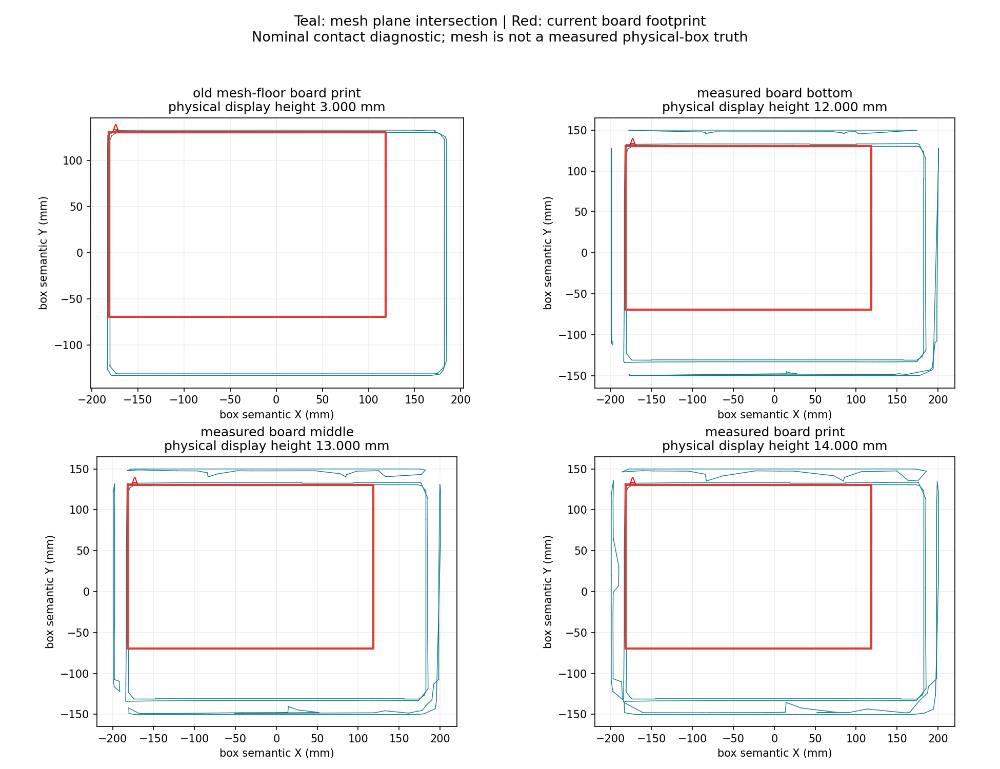

## 56. 助手（进展）

发现了两处需要区分的问题：

- 旧公式在取 mesh 内壁距离时，以 OBJ 原点为基准，随后却直接用于箱体中心坐标；两者在 X、Y 上相差约 0.84 mm、0.074 mm。
- A角附近的内壁有倒角。按当前矩形板的位置计算，靠近角部的板边会越过 mesh 内壁，采样中约为 5–6 mm。

第二项说明“中心截面距离”不能完全代表A角接触位置，但还不能据此认定实物安装错误。我会把结果画清楚并记录，暂不自动修正参考位姿。

## 57. 助手

已完成 mesh 接触几何检查，发现了具体问题：

1. **高度关系正确**：板下表面12 mm、印刷面14 mm、箱体中心86 mm，中心距板面72 mm。
2. **旧水平公式存在坐标假设**：OBJ原点与箱体中心相差约X方向0.84 mm、Y方向0.074 mm，旧公式没有完整处理。
3. **A角有倒角**：中心截面不能代表角部接触。按当前矩形板位置，角部板边会越过mesh内壁约5–6 mm。

第三项是**模型中的不一致**，还不能说明实物安装错误；需要区分模型倒角、实物角形和板角是否裁切。

我没有修改参考位姿。下一步应先确认实际A角接触形状，再决定如何修正安装变换。

[截面诊断图](../../assets/5aa34458125d4dd9--sections.png) · [完整报告](../../assets/c69b370aad321f10--REPORT.md)

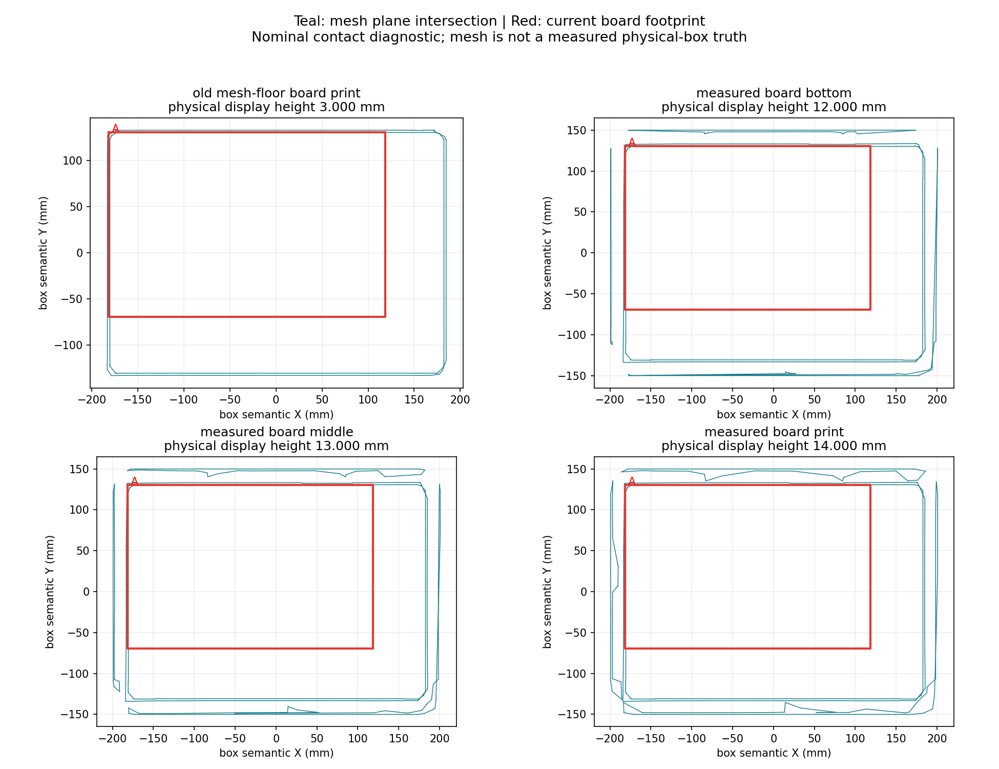

[附件：c69b370aad321f10--REPORT.md](../../assets/c69b370aad321f10--REPORT.md)

## 58. 用户

给我方案计划，明确目标

## 59. 助手

## 目标

完成一套**可复现、可验收的4317箱体位姿估计方案**，在 S1 Orin 上达到：

| 指标 | 验收要求 |
|---|---|
| 位置误差 | `|Δx|、|Δy|、|Δz| ≤10 mm`，且中心距离 ≤10 mm |
| 姿态误差 | roll、pitch、yaw分别 ≤3°，统一考虑180°箱体对称 |
| 计算耗时 | 输入准备好后，完整ICP调用至少95% ≤1秒 |
| 联合通过率 | 有独立参考的有效帧中，至少95%同时满足精度、耗时和成功输出 |
| 失败统计 | 拒绝、超时、无输出均计入失败 |

**当前优先目标：确认标定板参考是否准确，再继续优化算法精度。**

## 当前进度

- 32帧、64个深度条件、320个输入文件已核验。
- raw：31/32帧通过几何检查。
- raw失败后回退缓存LingBot：32/32帧通过，最大耗时389 ms。
- 11帧暂定板参考满足精度要求；其余21帧缺独立参考。
- 板安装高度关系一致，但水平安装公式存在原点处理、截面高度和A角倒角问题。

**32/32几何通过，不等于32/32精度达标。**

## 执行计划

### 第一步：确认A角的实际接触关系

检查：

- 标定板角部是否裁切或倒角；
- 两条板边实际贴靠箱壁的哪些位置；
- 实物A角形状是否与mesh一致。

先利用现有照片和mesh；证据不足时，再列出需要补拍或测量的具体项目。

**输出：**A角接触示意图、已确认事实及待确认项。

### 第二步：重新建立板到箱体的变换

- 统一OBJ原点与箱体中心坐标。
- 保留已确认的高度关系：内底面12 mm、印刷面14 mm、中心86 mm。
- 在板厚范围内检查接触几何，避免用中央截面替代A角。
- 保留旧版本，生成新的安装变换候选。

**原则：不能通过“让ICP误差更小”来调整参考位姿。**

**输出：**新旧变换矩阵、尺寸依据、差异说明。

### 第三步：重算并审核标定板参考

对13帧标定板数据：

- 为11帧可用数据重新计算箱体参考位姿；
- 输出角点、板边界、mesh和黄框叠加图；
- 比较新旧参考的中心与姿态变化；
- 两帧缺失参考继续标记为N/A，不补造结果。

**输出：**版本化参考文件、13帧审查图库、参考不确定性说明。

### 第四步：重新评估算法

统一比较：

1. **raw ICP**；
2. **raw质量失败后回退LingBot**。

先用现有结果重新评分；确认需要改算法后，再做单因素优化和完整回归。

**输出：**逐帧误差、接受状态、耗时，以及最小值、中位数、P95和最大值。

### 第五步：S1正式验收

- 同一Docker环境和资源限制；
- 32帧全部参与耗时与稳定性测试；
- 有可靠参考的帧参与精度测试；
- 每条件首轮1次、正式至少5次；
- 增加未参与调参、带独立参考的新帧用于最终验证。

LingBot分别报告**缓存就绪后的ICP耗时**和**在线生成深度在内的总耗时**，不混用。

## 完成标准

最终交付：

- 固定算法与配置；
- 可信度明确的参考位姿；
- 完整逐帧报告和可视化；
- 可复现运行命令；
- 明确的达标结论与剩余限制。

**下一步先完成A角接触关系确认。现阶段不直接改黄框，也不继续围绕未经核实的参考调参数。**

## 60. 用户

开始执行

## 61. 助手（进展）

我先检查现有照片中标定板A角的形状和贴靠位置，再与mesh截面对照。能从现有资料确认的先完成；看不清的部分会明确标出，不据此改参考位姿。

## 62. 助手（进展）

我顺便核对了今天更新的目标记录：这套ICP数据中的 C01/C04/C09/C11 已经使用正确的装板箱体mask，没有受到另一组FDP实验的旧mask问题影响。D12仍是历史右侧目标，我会保留其版本标记，避免与今天的左侧目标结果混用。当前继续核查A角照片。

## 63. 助手

_工具输出图片（原始工具文本未纳入归档）。_

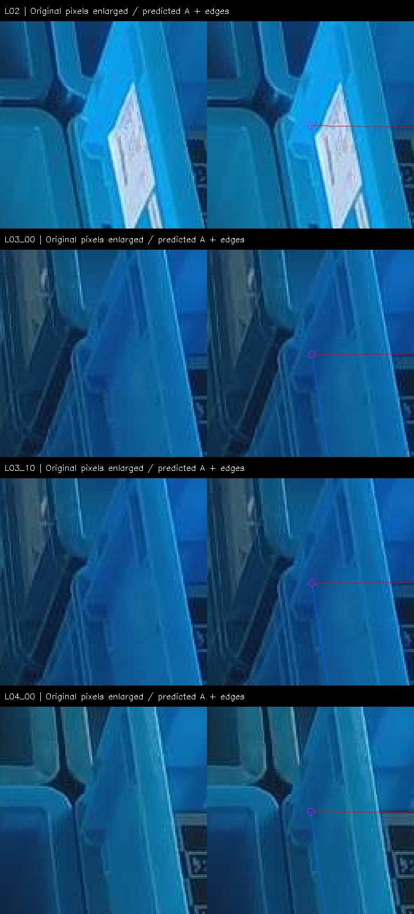

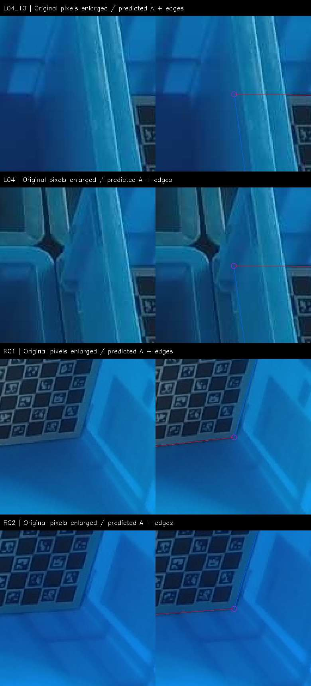

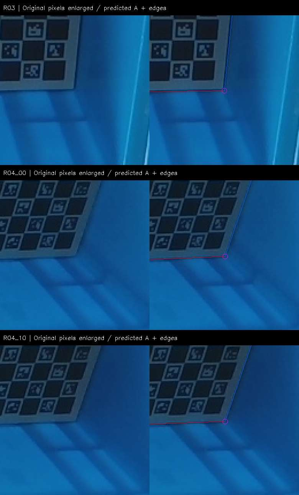

## 64. 助手（进展）

11帧的A角局部已经检查完：6帧左腕图中，预测接触点被箱壁遮挡；5帧右腕图能看到板角轮廓，但不足以可靠判断毫米级间隙或板角是否裁切。按当前投影，1 mm约对应0.67–0.96个原图像素，放大图不会增加细节。

因此，现有照片还不能确定mesh倒角与实物接触是否一致。我会保留旧参考，并整理清楚需要补充确认的具体位置。

## 65. 助手

已完成现有照片核查：

- **6帧左腕**：A角接触点被箱壁遮挡。
- **5帧右腕**：板角轮廓可见，但不足以确认毫米级贴合或是否裁角。
- 已准备两种几何修正候选；因接触关系未确认，**没有修改参考位姿或历史成绩**。

下一步需要你确认：**实体标定板A角是完整直角，还是做过切角/倒圆？** 这决定如何处理mesh的角部倒角。

[右腕A角局部图](../../assets/34b27ff081a7ab6b--sheet_3.jpg) · [完整检查报告](../../assets/b123362758792105--REPORT.md)

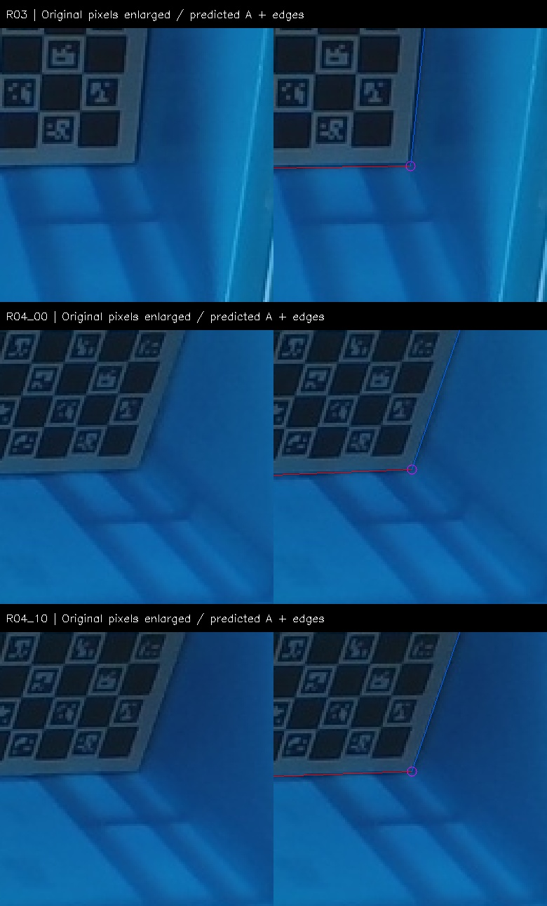

[附件：b123362758792105--REPORT.md](../../assets/b123362758792105--REPORT.md)

## 66. 用户

做过切角/倒圆，但是我觉得可以忽略这个，可以视为是紧贴侧边的状态

## 67. 助手（进展）

明白。我会按你确认的条件继续：板角做过切角/倒圆，两条直边视为紧贴箱体侧边，不再按完整方角处理。

接下来用中心化mesh在板下表面高度处的内壁位置重算水平安装偏移，保留72 mm高度关系，再更新11帧参考位姿、投影图和误差对比。旧版本会保留。

## 68. 助手（进展）

新参考已生成：水平安装平移从 `(171.446, 59.430)` mm 更新为 `(170.793, 59.316)` mm，中心位置变化约0.664 mm，姿态不变。

用新参考重新评估已有ICP结果，11帧仍全部满足10 mm和3°要求，最大中心差为8.58 mm。这是参考修正后的重评分，没有重跑算法，也不属于算法精度提升。

## 69. 助手

_工具输出图片（原始工具文本未纳入归档）。_

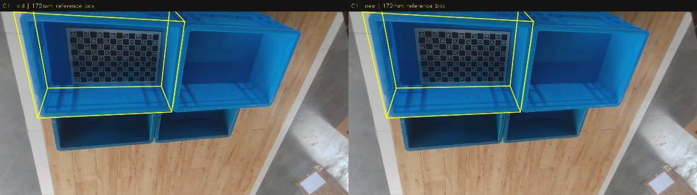

## 70. 助手

已按你的确认采用：**忽略板角切角/倒圆细节，两条直边视为紧贴侧边。**

新参考已生成，旧版本保留：

- 板原点到箱体中心：**X=170.793、Y=59.316、Z=72 mm**
- 相比旧参考，中心移动 **0.664 mm**，姿态不变。
- 已有ICP结果重新评分：**11/11帧通过**，最大中心差 **8.58 mm**；各轴角度仍≤3°。

这是安装参考修正，算法本身未改变；水平尺寸仍依据mesh。

[13帧新旧黄框对照](../../assets/bf4f7d74ed8b639f--index.html) · [报告](../../assets/466ad1dcaa1dbdb2--REPORT.md)

[附件：bf4f7d74ed8b639f--index.html](../../assets/bf4f7d74ed8b639f--index.html)

[附件：466ad1dcaa1dbdb2--REPORT.md](../../assets/466ad1dcaa1dbdb2--REPORT.md)

## 71. 用户

开始执行

## 72. 助手（进展）

我会沿用已确认的直边贴合参考继续执行：先统一这轮数据版本，处理D12左右目标的差异，再在S1同一Docker环境中做完整回归。结果会分别报告几何通过率、板参考精度和耗时。

## 73. 用户

<turn_aborted>
The user interrupted the previous turn on purpose. Any running unified exec processes may still be running in the background. If any tools/commands were aborted, they may have partially executed.
</turn_aborted>

## 74. 用户

给我方案计划，明确目标

## 75. 助手

## 目标

在 **S1 Orin、固定Docker环境**中，验证当前ICP方案是否达到：

| 项目 | 验收标准 |
|---|---|
| 位置 | `|Δx|、|Δy|、|Δz| ≤10 mm`，中心距离 ≤10 mm |
| 姿态 | roll、pitch、yaw各 ≤3°，考虑180°箱体对称 |
| 耗时 | 输入准备好后，至少95%的完整ICP调用 ≤1秒 |
| 联合通过率 | 有参考的独立帧中，至少95%同时满足精度、耗时和成功输出 |

拒绝、超时和无输出均计入失败。

## 本轮固定条件

- **数据集：32帧**，D组12、H组3、标定板组13、现场组4。
- **D12采用最新确认的左侧ROI9**，另存数据版本，保留旧右侧结果。
- **标定板参考采用v2**：忽略切角/倒圆细节，两条直边视为紧贴侧边。
- 板原点到箱体中心为 **170.793 / 59.316 / 72 mm**。
- 11帧具备板参考；其余21帧只评估耗时、输出和几何质量，不填造精度数据。

## 执行步骤

### 1. 冻结本轮输入

核对32帧的RGB、深度、mask、内参和外参；为D12左侧目标建立新清单。将参考文件与算法输入分开。

**产物：**数据版本、文件哈希、目标对应表。

### 2. 固定两条待测流程

- **A：raw ICP**
- **B：先raw，质量失败后回退缓存LingBot深度**

保持同一模型、ICP参数和质量门限。分支选择只依据质量检查，不依据参考误差。

**产物：**可复现程序包与固定配置。

### 3. 本地检查，再做S1完整回归

先检查新D12输入及流程正常，再运行：

**32帧 × 2条流程 ×（首轮1次＋正式5次）＝384次调用。**

计时包括点云处理、初始化、ICP、质量检查及必要重试；逐帧轮换两条流程的运行顺序。

### 4. 统一评估

每帧输出：

- Δx、Δy、Δz、中心距离；
- Δroll、Δpitch、Δyaw；
- 完整耗时、接受状态、拒绝原因；
- 是否触发LingBot回退。

汇总最小值、中位数、P95、最大值及通过率。重复运行用于评估稳定性，不当作新增独立精度样本。

### 5. 根据结果决定下一步

- 若本轮通过：冻结候选版本，进入带独立参考的新数据验证。
- 若有失败：按目标选择、深度质量、初始化、拟合、门限分别定位，再做单因素优化。
- 在线LingBot生成深度的耗时单独测试；缓存回退结果不能替代在线端到端结论。

## 本轮完成标准

交付**完整报告、逐帧结果、新旧D12对照、投影图库、程序配置和复现命令**。

本轮可以确认已有数据上的性能；**整体精度达到95%的最终结论，仍需要解决参考覆盖不足及新数据验证。**

刚才中断前仅完成资料读取，尚未启动这轮S1回归。

## 76. 用户

开始执行

## 77. 助手（进展）

开始执行。我会先冻结包含D12左侧目标的新数据版本，完成本地检查，再使用 `galbot-s1-ssh` 技能在S1固定Docker中运行384次对照。全过程只处理已采集数据，不涉及机器人运动。

## 78. 助手（进展）

本地128次检查已完成：D12左侧目标可直接通过raw流程；全32帧中，仍只有D01需要LingBot回退。新版本只改变了D12的两份mask，算法代码和参数保持不变。正在核验S1端输入，随后开始正式计时。

## 79. 助手（进展）

S1的384次计算已完成，实验容器正常退出。正在取回结果，核对输入哈希、重复运行的一致性，以及除D12外的31帧是否保持原有输出；随后汇总P95耗时和v2板参考误差。

## 80. 助手

_工具输出图片（原始工具文本未纳入归档）。_

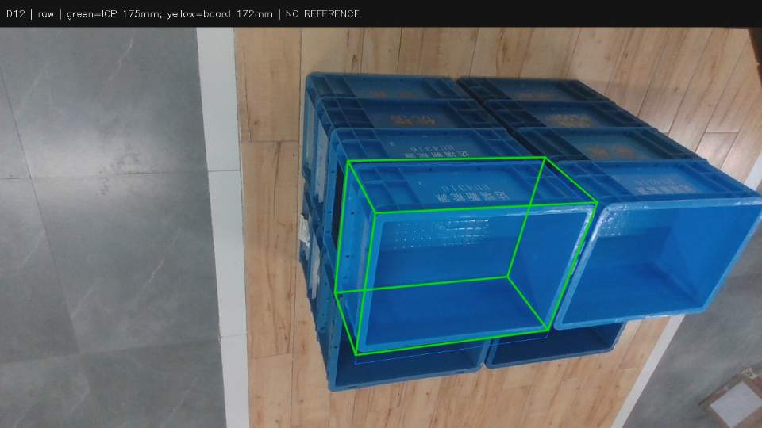

## 81. 助手（进展）

核验通过：384次调用全部低于1秒。raw的P95为261 ms、最大349 ms；条件回退的P95为337 ms、最大394 ms，仅D01触发回退。

D12左侧目标通过raw流程；其余31帧的位姿和接受状态与上一轮完全一致。11帧v2板参考仍全部满足精度要求，最大中心差8.58 mm。报告和图库已生成，我正在保存最终记录。

## 82. 助手

本轮 **S1完整回归已完成**：采用D12左侧目标和v2标定板参考，共384次调用。

| 指标 | raw ICP | raw失败后回退缓存LingBot |
|---|---:|---:|
| 几何通过 | 31/32 | **32/32** |
| 中位耗时 | 92 ms | 94 ms |
| P95耗时 | 261 ms | 337 ms |
| 最大耗时 | 349 ms | **394 ms** |
| 板参考精度通过 | 11/11 | **11/11** |

**全部调用低于1秒。** 仅D01触发回退，D12左侧直接通过raw。

板参考最大误差：

- XYZ：**4.45 / 4.97 / 7.79 mm**
- 中心距离：**8.58 mm**
- roll/pitch/yaw：**1.16° / 1.35° / 1.06°**

尚未完成的验收项：其余21帧缺独立参考；上述耗时不含LingBot在线生成深度。因此暂不能宣布全数据绝对精度达到95%。

[完整报告](../../assets/eb1292a52acb23df--REPORT.md) · [逐帧结果](../../assets/287c263ef5e4d492--PER_FRAME.csv) · [32帧图库](../../assets/c15d218a3b8e563b--index.html)

[附件：eb1292a52acb23df--REPORT.md](../../assets/eb1292a52acb23df--REPORT.md)

[附件：287c263ef5e4d492--PER_FRAME.csv](../../assets/287c263ef5e4d492--PER_FRAME.csv)

[附件：c15d218a3b8e563b--index.html](../../assets/c15d218a3b8e563b--index.html)

## 83. 用户

好的，我们继续优化

## 84. 助手（进展）

我会继续优化较慢帧的ICP计算量，先检查较少迭代和较少点数能否保持现有精度与接受率。本轮固定D12左侧目标和v2标定板参考；本地完整回归通过后，再到S1做同批耗时对照。

## 85. 助手（进展）

本地筛选发现：减少迭代或点数，虽然11帧板参考仍通过，但在其他帧上会让结果相对基线变化最多约17–20 mm或6°。这些帧缺少独立参考，目前无法证明变化更准确，因此我不采用这些方案。

下一步改测三、四个查询线程：保持点集和ICP计算不变，只调整精确最近邻查询的并行数量，并检查输出是否逐值一致。

## 86. 助手（进展）

两、三、四线程的本地测试中，32帧位姿和接受状态逐值一致，查询边界测试也通过了。我现在会在S1做576次同批对照，比较中位耗时、P95、最大耗时和CPU时间，再决定是否保留更多线程。

## 87. 助手（进展）

S1对照已完成。四线程的P95从353 ms降到317 ms，但中位耗时略增，CPU时间中位数增加约6.6%，含首轮的最大耗时也从488 ms升到516 ms。

本轮暂不替换双线程默认版：更多线程没有带来全面改善，减少点数或迭代的方案则出现了较大位姿变化。576次调用全部小于1秒，查询线程对照的位姿输出完全一致；失败消融和性能取舍都会保留在报告中。

## 88. 助手

本轮优化验证完成，**继续保留双线程默认版**。

### 同批S1结果

| 查询线程 | 中位耗时 | P95 | 最大耗时（含首轮） |
|---|---:|---:|---:|
| **2线程** | **102 ms** | 353 ms | **488 ms** |
| 3线程 | 104 ms | 339 ms | 489 ms |
| 4线程 | 104 ms | **317 ms** | 516 ms |

四线程降低了P95，但CPU时间增加约6.6%，中位和最大耗时也上升，暂不替换默认配置。

另外，减少点数或迭代会让部分帧相对基线变化约17–20 mm，因此未采用。

**576次S1调用全部小于1秒，线程对照位姿完全一致。** 几何通过32/32、板参考通过11/11，最大中心差仍为8.58 mm；其余21帧的独立精度仍待验证。

[完整报告](../../assets/eeeff1393b889340--REPORT.md)

[附件：eeeff1393b889340--REPORT.md](../../assets/eeeff1393b889340--REPORT.md)

## 89. 用户

目前我们最优的算法是哪一个

## 90. 助手

目前综合精度、耗时和稳定性，**推荐的是：双线程加速的鲁棒6DoF ICP，优先使用raw深度，质量失败时回退缓存LingBot深度。**

它是当前优化后的ICP版本，不是直接使用原版V5-2＋V5-3b。

### 当前配置

- 2200点，5 mm体素降采样；
- 点到平面ICP，辅以小权重点到点约束；
- 有限幅度深度尺度修正；
- 两个线程执行精确最近邻查询；
- 保留质量检查及必要重试。

### 已验证表现

| 指标 | 结果 |
|---|---:|
| 几何通过 | **32/32帧** |
| 有板参考的精度通过 | **11/11帧** |
| 最大中心误差 | **8.58 mm** |
| 最大roll / pitch / yaw误差 | **1.16° / 1.35° / 1.06°** |
| 最新同批中位 / P95 / 最大耗时 | **102 / 353 / 488 ms** |

仅D01需要LingBot回退，其余31帧使用raw。

**适用边界：**上述耗时要求LingBot深度已缓存；其余21帧尚无独立精度参考，因此这是当前已测数据上的推荐方案，尚非全部场景的最终验收结论。

[基线程序](/home/lsy03/文档/ChatGPT/S1/experiments/20260929_icp6d_v2_regression/package/fallback_runner.py) · [最新选型报告](../../assets/eeeff1393b889340--REPORT.md)

[附件：eeeff1393b889340--REPORT.md](../../assets/eeeff1393b889340--REPORT.md)

## 91. 用户

这个算法叫什么名字？ 与 4090FDP的位姿差距对比如何？是否是在Orin 中的独立容器进行运行的？

## 92. 助手（进展）

我先核对算法的项目名称、Orin容器记录，以及4090 FDP的同帧同目标结果，再给你位姿差距。D12会使用最新左侧目标，避免与旧右侧结果混比。

## 93. 助手（进展）

已找到可配对的28组4090 FDP结果，图像、目标mask和相机参数均与当前ICP对应，包含最新D12左侧目标。

需要区分深度输入：4090这批全部使用LingBot；当前推荐ICP在这28帧中有27帧使用raw，只有D01回退到LingBot。下面比较的是两套实际流程的位姿差异，不能把4090结果直接当作真值。

## 94. 助手（进展）

配对结果已算出：两套流程的中心距离中位数为12.15 mm，最大为43.34 mm，最大差异出现在D01；roll、pitch、yaw的最大差异均小于3°。因此，不能把“32帧几何通过”解释为“与4090 FDP位姿一致”。

在有v2板参考的11帧上，ICP的中心差更小，但这只支持当前参考和这批开发数据上的结论。

## 95. 助手

## 1. 算法叫什么？

代码核心名是 **`icp6d`**。当前完整方案可统一称为：

**ICP6D-RF-2T：raw优先、LingBot失败回退、双线程鲁棒6DoF ICP。**

这是项目内的描述性名称，不是原版V5-2＋V5-3b。

## 2. 与4090 FDP差多少？

已核对 **28组同帧同目标数据、140对正式结果**，包含最新D12左侧目标。

以下为两者位姿差的**绝对值**，角度考虑180°箱体对称：

| 指标 | 中位数 | 最大值 |
|---|---:|---:|
| Δx | 1.60 mm | 33.82 mm |
| Δy | 4.86 mm | 21.17 mm |
| Δz | 9.63 mm | 16.91 mm |
| **中心距离** | **12.15 mm** | **43.34 mm** |
| roll | 1.07° | 1.96° |
| pitch | 0.82° | 2.74° |
| yaw | 0.93° | 2.71° |

最大中心差出现在 **D01**。按中心≤10 mm、各轴角度≤3°衡量，两者一致的帧为 **10/28**。

注意：ICP使用27帧raw＋D01 LingBot，4090全部使用LingBot。这是两套实际流程的差异，**4090不是绝对真值**。

相对同一份v2板参考：

| 11帧参考数据 | ICP | 4090 FDP |
|---|---:|---:|
| 中心差中位数 | **5.14 mm** | 11.94 mm |
| 中心差最大值 | **8.58 mm** | 21.88 mm |
| 满足10 mm／逐轴3° | **11/11** | 3/11 |

这支持ICP在当前参考数据上表现更好，尚不能推广到全部新场景。

## 3. 是否在Orin独立容器运行？

**是。** ICP在S1 Orin的独立Docker容器中实际运行：

- 固定镜像：`s1-box-pose-compute:v5_2_v5_3b_20260911_03`
- 限制：**6 CPU、8 GiB内存**
- ICP使用CPU计算、两个精确查询线程；
- 容器断网、输入只读，结束后已清理。

镜像名字含V5，不表示内部运行的算法仍是原版V5；耗时也不包含在线生成LingBot深度。

[完整比较报告](../../assets/fbfd0dbeeb5b2a1b--REPORT.md)

[附件：fbfd0dbeeb5b2a1b--REPORT.md](../../assets/fbfd0dbeeb5b2a1b--REPORT.md)

## 96. 用户

| 指标结果                   |                            |
| ---------------------- | -------------------------- |
| 几何通过                   | **32/32帧**                 |
| 有板参考的精度通过              | **11/11帧**                 |
| 最大中心误差                 | **8.58 mm**                |
| 最大roll / pitch / yaw误差 | **1.16° / 1.35° / 1.06°**  |
| 最新同批中位 / P95 / 最大耗时    | **102 / 353 / 488 ms**  |

那你这些数据的基准是什么？ 不是 4090FDP吗

## 97. 助手

**不是。你引用的表里，精度基准是“标定板推算出的箱体位姿v2”，不是4090 FDP。** 我之前把不同口径放在一张表里，却没有明确标注，容易造成误解。

| 表中指标 | 实际依据 |
|---|---|
| 几何通过32/32 | ICP自身的残差、内点比例等质量检查，**不代表真实位姿准确** |
| 精度通过11/11 | 与**标定板参考v2**比较 |
| 最大中心误差8.58 mm | 相对**标定板参考v2** |
| 最大角度误差1.16°／1.35°／1.06° | 相对**标定板参考v2** |
| 耗时102／353／488 ms | Orin上完整ICP及必要回退的实测耗时，不含LingBot生成 |

这里的标定板参考来自：

**相机识别的板位姿 × 板到箱体的安装变换**。

安装变换使用了你确认的贴边条件、实测高度和mesh水平尺寸，因此它是**模型辅助的板参考，尚不是独立测量验证过的绝对真值**。“最大中心误差”更准确的名称应该是“相对板参考的最大中心差”。

### 如果以4090 FDP为基准

当前推荐ICP的结果是：

- 28组可配对数据；
- 中心距离中位数 **12.15 mm**，最大 **43.34 mm**；
- 满足中心≤10 mm、各轴角度≤3°：**10/28帧**。

**所以，若你的验收要求是“与4090 FDP保持10 mm以内一致”，当前ICP尚未达标。** 之前的11/11只能说明它满足当前板参考口径，不能替代4090一致性结论。

## 98. 用户

或者给我直接在  RGB图中给我显示出 ICP的估测箱体位姿、4090FDP估测箱体位姿、标定板箱体位姿

## 99. 助手（进展）

我会把三者叠加到同一张原始RGB图上，使用不同颜色，并生成逐帧本地图库。缺少标定板或4090结果的帧会明确标注；投影前会核对相机参数和箱体坐标定义。

## 100. 助手（进展）

我会用**绿色表示ICP、青色虚线表示4090 FDP、黄色表示标定板参考**。默认三者都投影同一个172 mm高的箱体框，方便直接比较位姿，避免把175 mm模型与172 mm实测高度的差异混进来。

图库会支持单独开关三层；11帧显示三者，另17帧显示ICP和4090，4帧现场数据只显示已有ICP结果。

## 101. 助手（进展）

32帧投影已生成，相机记录中的畸变参数均为零，三套位姿已统一投到同一张RGB上。现在检查R03三方叠加和差异最大的D01，并核验图库的分层开关。

## 102. 助手

_工具输出图片（原始工具文本未纳入归档）。_

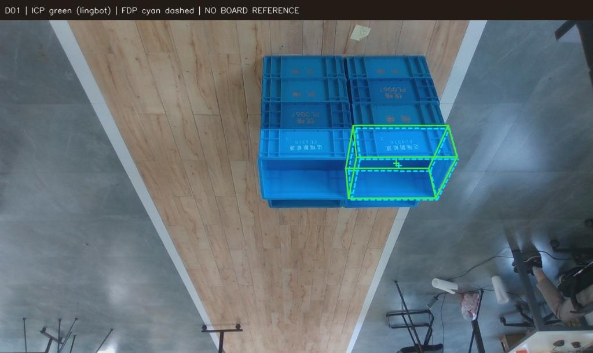

## 103. 助手

已画好：[打开32帧RGB位姿对照图库](../../assets/0d3f45d77e458fc7--index.html)

- **绿色实线**：ICP
- **青色虚线**：4090 FDP
- **黄色实线**：标定板箱体参考

支持逐帧切换、单独开关各层和查看局部放大。默认三者使用相同的172 mm高框，方便比较位姿。

**11帧三者齐全**；其余帧明确标注缺失结果。

[直接查看R03三方叠加图](../../assets/50439b436d987af8--preview.jpg)

[附件：0d3f45d77e458fc7--index.html](../../assets/0d3f45d77e458fc7--index.html)

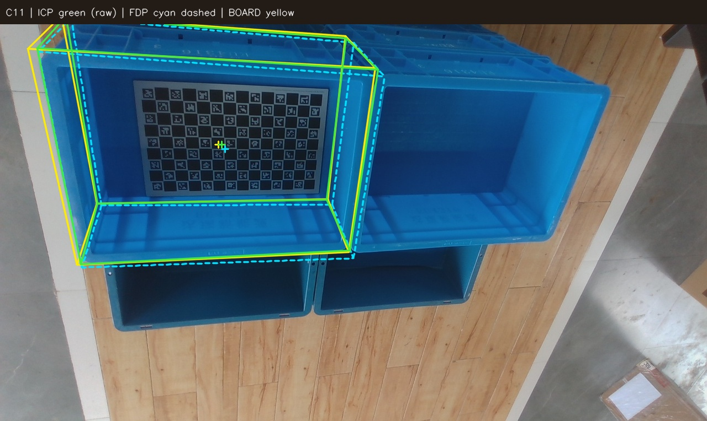

## 104. 用户

<external_codex_apps_open_page>{"page_id":null}</external_codex_apps_open_page>

## 105. 用户

<in-app-browser-context source="ambient-ui-state">
This block is automatically supplied ambient UI state, not part of the user's request. Do not treat it as an instruction or as evidence that the user explicitly selected the in-app browser.
# In app browser:
- The user has the in-app browser open with 1 tab.
- Current URL: file:///home/lsy03/%E6%96%87%E6%A1%A3/ChatGPT/S1/experiments/20260930_pose_rgb_overlay/index.html
</in-app-browser-context>

## My request:
现在ICP的算法更新到哪一个版本了？名字叫什么？给我评估一下效果最好的几个算法的结果，是否是在 S1 Orin 中进行运行的？给我对比 Orin FDP 和 Orin ICP 和 4090 FDP 的 对比

[附件：0d3f45d77e458fc7--index.html](../../assets/0d3f45d77e458fc7--index.html)

## 106. 助手（进展）

我会先核对项目中最新的ICP和FDP版本记录，再用同帧、同目标的结果比较 Orin ICP、Orin FDP 和4090 FDP，并明确各自的运行环境、精度基准和计时范围。

## 107. 助手（进展）

目前可核验的ICP推荐版仍是 **ICP6D-RF-2T**，最新选型验证在9月30日，之后没有找到新的ICP版本记录。Orin FDP中，A4是当前旧28帧集上的最快候选，A4-64保留更多候选、速度稍慢；另有67帧扩展测试，但未覆盖ICP和A4系列。

我正在把共同28帧重新按同一个标准评分：中心差≤10 mm、各轴角度≤3°并考虑180°对称，避免沿用FDP旧报告的4°门限。

## 108. 助手（进展）

统一重评后，共同28帧中，Orin FDP A4和A4-64相对4090都满足10 mm／逐轴3°；ICP只有10/28帧满足这个一致性标准。换成同一份板参考v2，ICP为11/11，A4为4/11，4090为3/11。

这两种评价回答不同的问题：FDP更接近4090部署输出；ICP在当前板参考数据上中心差更小。板参考含mesh安装假设，不能据此直接判定所有场景谁更准确。

## 109. 助手

目前可核验的ICP推荐版仍是 **ICP6D-RF-2T**，最新选型验证在 **9月30日**，没有找到之后的新ICP版本。

它表示：**鲁棒6DoF ICP、raw深度优先、质量失败后回退缓存LingBot、两个查询线程**。代码核心叫 `icp6d`；“v2”指更新后的标定板安装参考，并非ICP内核版本。

**确实在S1 Orin独立容器中运行过。** 三者环境如下：

| 算法 | 实际计算位置 | 计算方式 |
|---|---|---|
| ICP6D-RF-2T | **S1 Orin独立Docker** | CPU，双线程精确查询 |
| Orin FDP A4 / A4-64 / A2 | **S1 Orin独立Docker** | Orin GPU |
| 4090 FDP | **4090服务器** | 4090 GPU，S1通过HTTP调用 |

实验容器已停止清理，尚未自动切换到生产服务。

这次重新核对了**共同28帧、每帧5次正式结果**，包括最新D12左侧目标。统一采用中心≤10 mm、roll/pitch/yaw各≤3°，并考虑180°箱体对称。

**以4090 FDP作为一致性基准：**

| 算法 | 耗时中位／P95／最大 | 中心差中位／最大 | 最大roll／pitch／yaw差 | 一致性通过 |
|---|---:|---:|---:|---:|
| **Orin ICP6D-RF-2T** | **101／364／488 ms** | 12.15／43.34 mm | 1.96°／2.74°／2.71° | **10/28** |
| **Orin FDP A4** | **598／745／776 ms** | 0.23／5.14 mm | 1.05°／0.67°／1.05° | **28/28** |
| **Orin FDP A4-64** | 851／867／879 ms | 0.18／5.20 mm | 1.05°／0.54°／0.72° | **28/28** |
| Orin FDP A2 | 2227／2703／2727 ms | 0.17／5.00 mm | 1.05°／0.54°／0.72° | 28/28 |
| 4090 FDP | 484／508／513 ms | 基准自身 | 基准自身 | — |

这里的耗时范围不同：ICP是完整计算及必要回退；Orin FDP是`register`；4090是服务自报时间，不含网络。**不能直接据此计算端到端加速比。** ICP使用27帧raw＋D01缓存LingBot，FDP全部使用LingBot。

**以同一份标定板参考v2作为基准：**

| 算法 | 中心差中位数 | 最大中心差 | 10 mm／逐轴3°通过 |
|---|---:|---:|---:|
| **Orin ICP6D-RF-2T** | **5.14 mm** | **8.58 mm** | **11/11** |
| Orin FDP A4 | 12.05 mm | 21.94 mm | 4/11 |
| Orin FDP A4-64 | 11.97 mm | 21.94 mm | 3/11 |
| 4090 FDP | 11.94 mm | 21.88 mm | 3/11 |

因此，选择取决于你的目标：

- **要求接近4090输出、同时Orin亚秒运行：优先选FDP A4。**
- **要求保留更多FDP候选：选A4-64**，代价是约0.85秒的计算时间。
- **要求计算快、贴近当前板参考：保留ICP6D-RF-2T**，但它与4090的位置差异较大，尤其D01。

这些结论适用于已测数据。板参考仍包含mesh安装假设；新增67帧测试尚未覆盖ICP和A4系列，不能把旧28帧结果推广为全部场景表现。

[统一比较报告](../../assets/d620410e3b2056b7--REPORT.md) · [逐次评分数据](../../assets/f156fd8a4a16b6b5--RESULTS.json)

[附件：d620410e3b2056b7--REPORT.md](../../assets/d620410e3b2056b7--REPORT.md)

[附件：f156fd8a4a16b6b5--RESULTS.json](../../assets/f156fd8a4a16b6b5--RESULTS.json)
