# 9_28 9_23 9_22 9_21 9_18 新的数据集 缺少信息 ！！ 评估同样参数FDP A0 原版 和 40…

- 归档编号：`01a0e716-2a0e-7be1-a05d-cf4b2ba61aa7`
- 项目：S1 IE_lab 拆垛
- 创建时间：2026-09-28T16:16:24.593000+08:00
- 更新时间：2026-09-30T14:58:24.094000+08:00
- 状态：活动
- 导出范围：用户可见消息与助手可见回复；不含隐藏推理和工具原始输出

## 1. 用户

/home/lsy03/Lsy03\_document/FDP 优化/interactive\_rgbd\_capture/  这里面还有一些另外的新的数据，你看看能不能用来再验证一下？

## 2. 助手（进展）

我先检查这批新数据是否包含配套的 RGB、深度、相机内参和目标信息，再判断能否接入现有的 Orin／4090 同帧对比流程。

## 3. 助手（进展）

目录中有67组左腕RGB-D，图像都能读取，深度元信息标明毫米单位。不过尚未发现相机内参、目标mask或逐帧相机外参；其中A4的竖直先验需要相机相对基座的方向。我也发现部分帧的RGB与深度时间戳不同，正在核查这会涉及多少帧。

## 4. 助手

_工具输出图片（原始工具文本未纳入归档）。_


## 5. 助手

**可以作为新增验证数据，但还需要补齐配套信息，才能公平比较A0–A4和4090。**

我检查到了：

| 项目 | 结果 |
|---|---|
| 数据量 | **67组左腕RGB-D**，9月23日采集 |
| 分辨率 | RGB、深度均为 **1280×720** |
| 深度格式 | **16位毫米PNG**，除以1000转换为米 |
| 完整性 | 全部可读取，未发现完全重复的RGB或深度文件 |
| 场景 | 蓝色料箱，不同堆叠数量、视角、遮挡及边缘截断 |
| 时间同步 | 66组时间戳一致；1组相差 **66.717ms**，需单列检查 |

**目前目录里缺少三个关键输入：**

- **相机内参及深度配准说明**：需要确认深度是否对齐RGB，不能直接套用旧左腕内参。
- **目标实例mask及料箱模型确认**：多箱场景必须指定比较哪一个箱体，两端使用同一mask和模型。
- **逐帧相机外参**：A4／A4-64的竖直先验需要相机相对基座的方向；旧报告中的基座坐标XYZ和三个角度也需要它。

建议先用代表性帧做 **4090＋A0＋A4-64** 对照，通过输入核验后再扩展全部可用帧。新数据独立统计，继续检查 **中心差≤10mm、三个角度各≤4°、耗时接近1秒**。当前仅完成数据检查，还未运行推理。

[查看67帧缩略图](../../assets/706856e08ebcfb06--contact_sheet.jpg) · [完整检查报告](../../assets/301d6bf1984386d3--REPORT.md)

**这批数据是由哪台机器人、哪个采集脚本保存的？是否还有配套的标定文件或当时的TF／关节记录目录？**

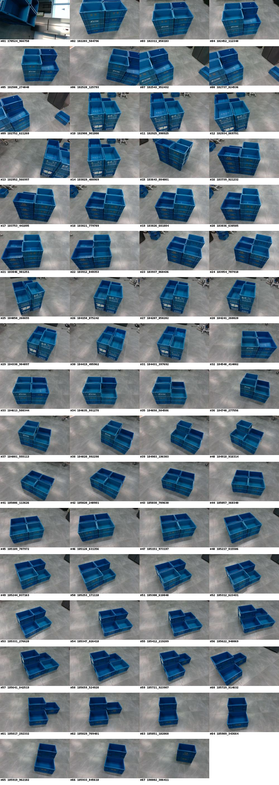

[附件：301d6bf1984386d3--REPORT.md](../../assets/301d6bf1984386d3--REPORT.md)

## 6. 用户

是否是缺少拍摄的时候各个关节的位置是吧，旧的内参为什么不能用？

## 7. 助手

对，**主要缺的是拍摄那一刻“相机相对机器人基座的姿态”**，但不一定非得保存所有关节位置。

可以通过两种方式获得：

- **直接保存当时的 `base_from_camera` 变换矩阵**：最直接，不需要再用关节位置计算。
- **保存当时影响相机姿态的关节位置**，结合正确的机器人运动学模型和相机安装标定，计算出相机相对基座的位置、方向。

这对 **A4／A4-64** 尤其重要：它们需要知道“竖直方向在相机坐标系里朝哪里”，才能挑选64个旋转候选。现在读取机器人的关节位置，不能代替拍摄时的历史位置。

**旧内参不是不能用，而是需要确认属于同一套相机配置。** 内参描述焦距和成像中心，手臂运动通常不会改变它。满足下面条件时，旧内参通常可以沿用：

| 条件 | 原因 |
|---|---|
| 同一台物理相机 | 仅标注“左腕”不代表一定是同一相机 |
| 同一成像模式、分辨率 | 分辨率、裁剪或缩放变化可能需要调整内参 |
| 同一图像处理方式 | 原始图、去畸变图、对齐后的深度可能对应不同内参 |
| 标定没有变更 | 需要确认没有换相机或重新标定 |

所以，**如果这67帧确实来自之前同一台左腕相机、同一采集配置，旧内参很可能就能用。**

即使找不到历史关节位置，补齐内参、配准信息和目标mask后，**A0–A3仍可先与4090在相机坐标系下比较**；但A4／A4-64还需要可信的竖直方向，不能随意套用旧外参。

## 8. 用户

这一套数据是否不是我之前使用的“数据采集脚本命令


\`\`\`bash
cd /home/galbot/Lsy03/fdp\_baseline && \\
FDP\_CAPTURE\_ID="left\_wrist\_H01\_$(date +%Y%m%d\_%H%M%S\_%N)" && \\
/home/galbot/ie\_lab/bin/s1-python \\
&#x20; scripts/capture\_left\_wrist\_rgbd\_once.py \\
&#x20; \--output-dir "captures/$FDP\_CAPTURE\_ID" \\
&#x20; \--settle-s 3 \\
&#x20; \--timeout-s 15 \\
&#x20; \--acknowledge-readonly-live-s1 && \\
python3 -m json.tool \\
&#x20; "captures/$FDP\_CAPTURE\_ID/capture\_result.json"
\`\`\`


**#  左腕采集&#x20;**

\`\`\`bash
cd /home/galbot/Lsy03/fdp\_baseline && \\
FDP\_CAPTURE\_ID="L01\_wrist\_charuco\_00\_$(date +%Y%m%d\_%H%M%S\_%N)" && \\
/home/galbot/ie\_lab/bin/s1-python \\
&#x20; scripts/capture\_left\_wrist\_rgbd\_once.py \\
&#x20; \--output-dir "captures/$FDP\_CAPTURE\_ID" \\
&#x20; \--settle-s 3 \\
&#x20; \--timeout-s 15 \\
&#x20; \--acknowledge-readonly-live-s1 && \\
python3 -m json.tool \\
&#x20; "captures/$FDP\_CAPTURE\_ID/capture\_result.json"
\`\`\`&#x20;


**# 右腕采集**

\`\`\`bash
cd /home/galbot/Lsy03/fdp\_baseline && \\
FDP\_CAPTURE\_ID="R01\_wrist\_charuco\_00\_$(date +%Y%m%d\_%H%M%S\_%N)" && \\
/home/galbot/ie\_lab/bin/s1-python \\
&#x20; scripts/capture\_right\_wrist\_rgbd\_once.py \\
&#x20; \--output-dir "captures/$FDP\_CAPTURE\_ID" \\
&#x20; \--settle-s 3 \\
&#x20; \--timeout-s 15 \\
&#x20; \--acknowledge-readonly-live-s1 && \\
python3 -m json.tool \\
&#x20; "captures/$FDP\_CAPTURE\_ID/capture\_result.json"”

这一套脚本的记录的结构？ 是有些数据缺失的

## 9. 助手（进展）

我核对一下这两个采集脚本的本地副本及旧数据目录，确认它们原本保存哪些文件，再与这67组新数据逐项对照。

## 10. 助手

**是的，新目录并不是你贴出的这套脚本的完整输出结构，缺少了内参、拍摄时的外参和关节状态等信息。** 我已核对本地脚本及9月15日旧采集记录。

这套左右腕脚本共用同一个采集实现，正常成功后，每帧应该保存：

| 内容 | 旧脚本保存位置 | 新67组数据 |
|---|---|---|
| RGB图像 | `rgb.png` | 有，带时间戳文件名 |
| 深度数据 | `depth_raw_m.npy`，米单位 | 有，改为毫米PNG |
| 相机内参 | `intrinsics.npy`；元信息中另有完整标定信息 | **缺少** |
| 拍摄时相机→基座变换 | `base_from_camera.npy` | **缺少** |
| 采集附近读取的17个关节状态 | `capture_meta.json` → `capture_time_joint_state` | **缺少** |
| 相机坐标系、TF时间戳及检查结果 | `capture_meta.json` | **缺少** |
| 成功状态、文件SHA256校验 | `capture_result.json` | **缺少** |

旧脚本还会按**深度帧时间戳查询TF**。关节状态则是采集附近读取的，并记录时间差，两者不是严格同步的同一种记录。保存逻辑见 [live_capture.py](/home/lsy03/文档/ChatGPT/S1/experiments/20260903_fdp_baseline/fdp_baseline/live_capture.py:274)。

还有一个明显区别：**旧脚本会拒绝RGB与深度时间差超过50ms的帧**，新数据中却有一帧相差66.717ms。因此，这批文件不能视为该脚本未经处理的完整成功输出。

不过，**目前只能确定“你提供的目录里缺少”，不能确定“采集时没有保存”**。可能用了另一套简化采集脚本，也可能只是导出、拷贝时只留下了图像和简化meta。

另外，**mask本来就不是这套采集脚本的输出**，它需要后续分割生成，不属于这次丢失的采集记录。

最值得先找的是机器人上这批数据的原始目录：如果还有对应的 `capture_meta.json` 和 `base_from_camera.npy`，关键历史信息就可能补回来，不必重新拍摄。

## 11. 用户

拍摄时相机→基座变换 这个是否是相机外参？

## 12. 助手

**是的，“拍摄时相机→基座变换”就是相机相对于机器人基座的外参。**

我们保存的 `base_from_camera.npy` 是一个 **4×4变换矩阵**，包含：

- **旋转**：相机坐标轴相对基座的朝向。
- **平移**：相机原点在基座坐标系中的位置。

它把相机坐标系中的点转换到基座坐标系：

\[
p_{\text{基座}}=T_{\text{基座}\leftarrow\text{相机}}\;p_{\text{相机}}
\]

对腕部相机，需要区分两种外参：

| 外参 | 是否随手臂运动变化 |
|---|---|
| 相机相对安装它的末端／法兰的变换（手眼标定） | 安装不变时，通常固定 |
| **相机相对机器人基座的变换** | **随手臂等相关关节运动变化** |

所以，这67帧缺少的关键记录是**每帧拍摄时的相机→基座外参**。仅有固定的手眼标定，还需要当时的机器人姿态才能算出它。

## 13. 用户

相机内参 中的数据包含什么？

## 14. 助手

**相机内参描述相机如何把三维点投影到图像像素上**，主要包括焦距和成像中心；配套标定信息还会包含畸变参数、图像尺寸等。

| 参数 | 含义 | 常见单位 |
|---|---|---|
| `fx、fy` | 水平、垂直方向的等效焦距 | 像素 |
| `cx、cy` | 主点位置，即光轴与成像平面的交点 | 像素 |
| `D` | 镜头畸变系数，具体含义取决于畸变模型 | 通常无量纲 |
| `width、height` | 对应标定的图像宽、高 | 像素 |
| `distortion_model` | 畸变模型名称 | — |

其中，**`intrinsics.npy` 保存的是3×3内参矩阵 `K`**：

\[
K=
\begin{bmatrix}
f_x & 0 & c_x\\
0 & f_y & c_y\\
0 & 0 & 1
\end{bmatrix}
\]

我们刚核查的 **9月15日L01左腕旧数据**中，数值为：

```text
图像尺寸：1280 × 720

fx = 911.9766
fy = 911.7082
cx = 648.1232
cy = 360.4127

D = [0, 0, 0, 0, 0]
distortion_model = "plumb_bob"
```

这些值来自旧帧的 [capture_meta.json](../../assets/f0be589816ec014d--capture_meta.json)。其中`D=0`表示该记录提供的畸变系数为零，不能单凭它判断物理镜头没有畸变。

在已去畸变、深度与图像对齐的情况下，利用像素位置 `(u,v)` 和深度 `Z`，可以还原相机坐标：

\[
X=(u-c_x)\frac{Z}{f_x},\qquad
Y=(v-c_y)\frac{Z}{f_y}
\]

**内参里不包含关节位置，也不包含相机相对基座的位置和朝向；后者属于外参。**

[附件：f0be589816ec014d--capture_meta.json](../../assets/f0be589816ec014d--capture_meta.json)

## 15. 用户

内参不同到底会影响什么？内参在使用图像位置估计的过程中的流程占据哪个位置，给我画个流程图展示一下？我指导外参的座标变换会影响像素点相对位置到baselink的绝对位置的计算

## 16. 助手

你的理解基本正确，不过中间还差一步：**像素坐标必须先通过“内参＋深度”还原为相机坐标系下的三维位置，再通过外参转换到 `base_link`。外参不能直接把像素转换成三维位置。**

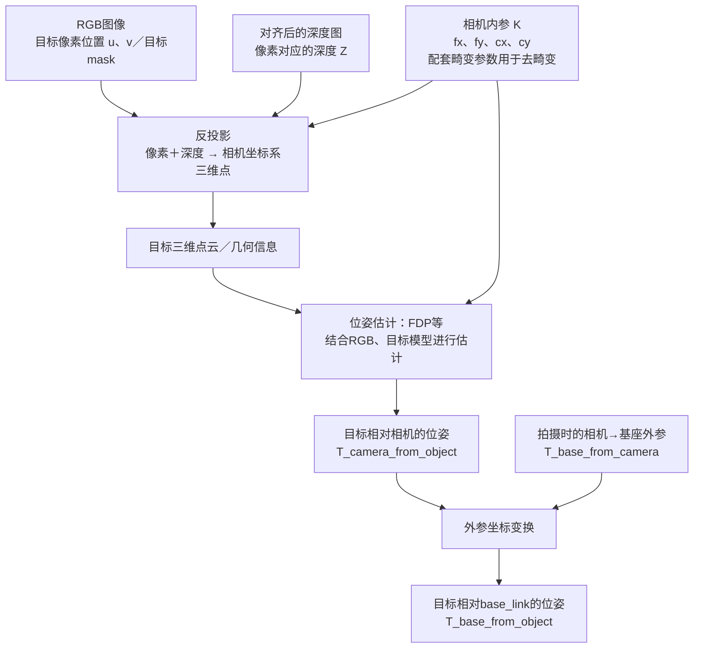

在FDP中，**内参不仅参与深度反投影，还参与模型投影、候选位姿对应的图像裁剪等处理**，所以它会影响后面的位姿精修和候选评分。

**内参不同，具体会改变什么？**

对于已去畸变、深度对齐的图像：

\[
X=\frac{u-c_x}{f_x}Z,\qquad
Y=\frac{v-c_y}{f_y}Z
\]

| 内参变化 | 对三维重建的直接影响 | 对位姿估计的可能影响 |
|---|---|---|
| `fx、fy`不正确 | 横向、纵向尺度被拉伸或压缩 | 目标位置、尺寸观测及姿态可能偏移 |
| `cx、cy`不正确 | 像素对应的空间射线方向偏移 | 三维位置产生偏移，且随深度变化 |
| 畸变参数不正确 | 图像不同区域的射线方向出现不一致偏差 | 边缘区域几何变形，姿态也可能受影响 |
| 缩放／裁剪图像后未更新内参 | 像素位置与内参不再匹配 | 可能出现明显的系统性偏差 |

这里说的是**内参与实际图像不匹配**。不同相机有不同内参是正常的，只要各自使用正确的内参即可。

例如，取焦距约 **912像素**、目标深度 **1米**：

- `cx`用错了 **10像素**，重建的`X`就会偏约 **11毫米**，已经超过你的1厘米目标。
- 对位于主点右侧 **300像素**的点，`fx`用大 **5%**，重建的`X`会从约329毫米变为313毫米，偏约 **16毫米**。

这是单点反投影示例；FDP最终误差还会受到模型约束和精修过程影响，不能直接等同于这两个数。

**内参错误与外参错误的区别：**

| | 内参错误 | 外参错误 |
|---|---|---|
| 出错阶段 | 从图像恢复三维、进行位姿估计时 | 将相机位姿转换到基座时 |
| 典型表现 | 点云可能拉伸、变形，偏差随像素和深度变化 | 对正确的相机系结果施加了错误的整体旋转／平移 |
| 换一个正确外参能否修好 | **通常不能**，上游几何已经错误 | 相机系结果正确时，可以重新转换 |

对我们当前实验还有一个特殊点：**A4／A4-64提前使用了相机→基座外参中的旋转来筛选“接近竖直”的候选**。因此，这两个版本的外参不仅影响最终坐标转换，也会影响前面的候选选择。

## 17. 用户

筛选“接近竖直”的候选 是什么意思？

## 18. 助手

**意思是：优先尝试“箱口朝上、箱体大致直立”的旋转姿态，减少FDP需要计算的候选数量。**

FDP首帧不知道箱体的朝向，会先生成许多旋转假设。例如：

| 旋转假设 | 是否接近竖直 |
|---|---|
| 箱口朝上，箱体在地面上转了30° | 是 |
| 箱口朝上，箱体在地面上转了90° | 是 |
| 箱体稍微倾斜 | 可能保留 |
| 箱体侧躺，箱口朝侧面 | 通常不优先保留 |
| 箱体倒扣，箱口朝下 | 通常不优先保留 |

**“竖直”约束的是箱体的上下方向，不是要求它正对相机。** 箱体仍可以绕竖直方向旋转，也就是保留不同的yaw朝向。

我们当前A4的具体做法是：

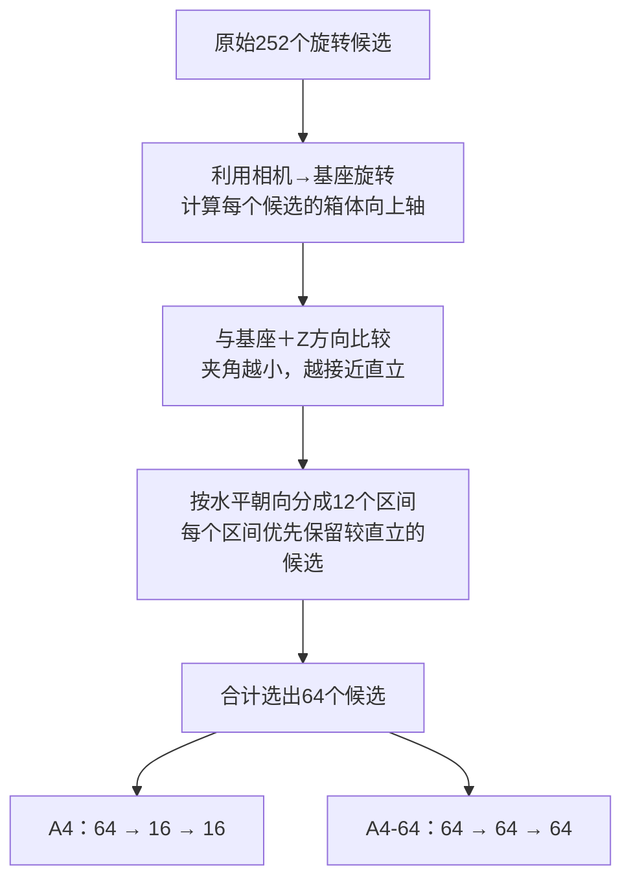

这里有两个关键点：

- **它是“优先选较直立”的软先验**，不是把箱体的roll、pitch强制设为0；之后的网络精修仍然可以调整完整的六自由度位姿。
- **它假设基座＋Z代表竖直方向，且目标箱体大致直立。** 如果箱体实际侧躺、倒扣或倾斜很大，正确方向可能在最开始就被排除，后续精修不一定能找回来。

所以A4-64虽然保留了三轮全部64个候选，**仍然存在“252个先筛到64个”的限制**。它在此前28帧上通过了验收，但新场景仍需要验证。

## 19. 用户

| 内容旧脚本保存位置新67组数据  |                                                  |                |
| ---------------- | ------------------------------------------------ | -------------- |
| RGB图像            | `rgb.png`                                        | 有，带时间戳文件名      |
| 深度数据             | `depth_raw_m.npy`，米单位                            | 有，改为毫米PNG      |
| 相机内参             | `intrinsics.npy`；元信息中另有完整标定信息                    | **缺少**         |
| 拍摄时相机→基座变换       | `base_from_camera.npy`                           | **缺少**         |
| 采集附近读取的17个关节状态   | `capture_meta.json` → `capture_time_joint_state` | **缺少**         |
| 相机坐标系、TF时间戳及检查结果 | `capture_meta.json`                              | **缺少**         |
| 成功状态、文件SHA256校验  | `capture_result.json`                            | **缺少**<br><br> |

请问这些量缺少，但是是不是也可以拿来计算4090 FDP和 Orin FDP的对比？

## 20. 助手

**可以，但要分清：哪些版本能比、在哪个坐标系下比，以及比较结果能证明什么。缺少这些数据，并不意味着完全不能测试。**

| 缺少的信息 | 对4090与Orin对比的影响 |
|---|---|
| **内参** | 两端FDP都需要。若确认是同一相机、同一成像配置，可复用旧内参 |
| **相机→基座外参** | **A0–A3可以不依赖它，在相机坐标系下对比**；A4／A4-64的竖直筛选需要其中的方向信息 |
| **17个关节状态** | FDP本身不需要；主要用于恢复或核查相机→基座外参 |
| **坐标系、TF时间戳** | 不阻止相机系对比，但必须确认两端输入与输出的坐标约定一致 |
| **成功状态、SHA256** | 不阻止计算；可以现在重新检查文件、生成校验值，但不能补回历史采集状态 |

因此，**这67组数据可以先用于“4090原版FDP vs Orin A0／A1／A2／A3”**。需要统一：

- 同一张RGB、同一份深度、同一目标mask。
- 同一内参、同一目标模型和模型坐标定义。
- 此前对齐的120尺寸、3轮、毫米深度及TF32配置。

输出直接在**相机坐标系**下比较：

\[
\Delta t=t_{\text{Orin}}-t_{\text{4090}}
\]

仍然可以统计有正负号的ΔX、ΔY、ΔZ、中心距离和三个角度差，以及耗时。**中心距离不受共同坐标系变换影响，但相机系的XYZ及三个欧拉角差，不能与此前基座系的分量直接混为一张统计表。**

**A4／A4-64则不能原样跳过外参。** 如果关闭竖直筛选或换一种方式估计竖直方向，就属于新的实验变体，不能直接当成此前已经验证的A4-64。

还有一点：**两端使用同一个错误内参，也可能得到很接近的结果。** 这能说明两端输出一致，却不能说明它们的位置估计准确。因此，优先确认旧内参可以复用，再开始新数据对比最有意义。

## 21. 用户

如果单纯按照相机座标系来进行，是否可以对比 FDP 4090 和 FDP Orin的结果？

## 22. 助手

**可以。单纯在相机坐标系下，就能对比4090 FDP与Orin FDP的结果，不需要相机→基座外参，也不需要关节位置。**

前提是两端使用相同的 **RGB、深度、相机内参、目标mask和模型**，并统一输出的模型坐标定义。

可以比较：

| 指标 | 计算方式 |
|---|---|
| ΔX、ΔY、ΔZ | Orin输出位置 − 4090输出位置，保留正负号 |
| 中心距离差 | 两个位置之间的三维距离 |
| roll、pitch、yaw差 | 在同一角度约定下相减，并处理±180°跨界 |
| 耗时 | 分别统计推理耗时，保持计时范围一致 |

**A0–A3可以这样验证。A4／A4-64仍需要竖直方向信息**：这是算法筛选候选所需的输入，与最终选择在哪个坐标系对比无关。

因此，这67组数据可以先开展 **4090与Orin A0–A3的相机系对比**；当前需要补齐或确认可复用的内参，再生成一致的目标mask。结果衡量的是两端的一致性，4090仍作为参考，并非绝对真值。

## 23. 用户

那是否还需要相机内参？

## 24. 助手

**需要。即使只在相机坐标系下对比，4090和Orin运行FDP时仍然需要相机内参。**

- **内参**：用于把像素＋深度还原为相机系三维点，以及模型投影、位姿估计。
- **外参**：用于相机系与基座系之间的转换；只比较相机系结果时，A0–A3可以不需要它。

**不一定需要重新标定。** 如果这67组数据来自之前同一台相机，且分辨率、裁剪、缩放及配准方式一致，就可以复用已确认匹配的旧内参，两端使用同一份。

另外，如果只是比较**已经生成的两份位姿结果**，计算差值本身不需要内参；但现在要从这67组RGB-D重新运行FDP，就需要。

## 25. 用户

是不是已经有深度图了，就不需要内参了？

## 26. 助手

**不是。深度图告诉你“这个像素有多深”，内参告诉你“这个像素对应哪个空间方向”。两者结合，才能得到三维位置。**

例如像素 `(u,v)` 的深度为 `Z`，需要内参才能计算：

\[
X=\frac{u-c_x}{f_x}Z,\qquad
Y=\frac{v-c_y}{f_y}Z
\]

其中 `fx、fy、cx、cy` 就来自相机内参。**只有Z，还不能确定X和Y。**

你这批毫米PNG，每个像素只存一个深度值，没有保存完整的XYZ，因此运行FDP仍然需要匹配的内参。

如果保存的已经是**XYZ三维点云**，从点云读取三维位置就不需要再用内参反投影；但我们当前这套FDP还需要内参做模型投影、图像裁剪等操作。

## 27. 用户

当前深度数据是什么类型的点云？ 不是xyz点云吗？

## 28. 助手

**这67组数据中的深度文件是“深度图”，不是已经保存好的XYZ点云。**

我们检查到的格式是：

| 项目 | 当前数据 |
|---|---|
| 文件 | `*_depth.png` |
| 格式 | 16位单通道PNG |
| 尺寸 | 1280×720 |
| 每个像素保存 | 一个深度数值，单位毫米 |
| 示例 | 数值`1000`表示深度1米；`0`通常表示无有效深度 |

它保存的是：

```text
像素位置(u, v) → 深度Z
```

而XYZ点云保存的是：

```text
点 → (X, Y, Z)
```

**当前数据可以通过相机内参转换成XYZ点云，但文件本身还不是XYZ点云。** 像素的行、列只是图像位置，不能直接当成以米为单位的X、Y。

另外，旧数据的 `depth_raw_m.npy` 也是二维深度图，只是以米为单位保存；`.npy`这个扩展名本身不代表它是点云。

## 29. 用户

是否是深度图需要内参才能进行变换得到三维 xyz点云？

## 30. 助手

**是的。深度图需要结合匹配的相机内参，才能转换为相机坐标系下的XYZ点云。**

对于已去畸变、与内参对应的像素 `(u,v)`：

\[
Z=\frac{\text{深度值（毫米）}}{1000},\qquad
X=\frac{u-c_x}{f_x}Z,\qquad
Y=\frac{v-c_y}{f_y}Z
\]

这样得到的 `(X,Y,Z)` 单位都是**米**。对每个有效深度像素执行一次，就得到三维点云。

**这一步不需要外参；将点云进一步转换到 `base_link`，才需要相机→基座外参。**

## 31. 用户

你现在是否能找到内参？

## 32. 助手（进展）

我先查本地保存的标定文件和采集记录，看看有没有这批9月23日数据对应的内参，并与旧左腕内参区分清楚。

## 33. 用户

就直接上S1里找找好了

## 34. 助手（进展）

我使用 `galbot-s1-ssh` 技能到S1上查找这批数据的采集脚本、原始目录和配套内参，只做文件读取。

## 35. 用户

左腕和右腕的内参数据你可以都找找

## 36. 助手（进展）

好的，左右腕都查。我已经在S1找到了这67组数据的原始目录 `/home/galbot/interactive_rgbd_capture`，接下来核对两侧已有的标定记录，并查找对应采集程序。

## 37. 助手（进展）

左右腕的内参都找到了：S1保存的12份左腕记录数值一致，19份右腕记录也一致，分辨率均为1280×720。我已取回内参副本；同时确认新数据的134张RGB／深度图与S1原文件完全一致，S1原目录也没有额外保存内参。

## 38. 用户

现在给我指定计划方案，明确目标

## 39. 助手

**本轮目标：使用新增67组RGB-D，验证Orin FDP在新场景中相对4090的位姿一致性，并检查能否保持接近1秒。先做相机坐标系对比。**

| 项目 | 明确要求 |
|---|---|
| 参考 | 同帧、同输入的4090 FDP输出 |
| 位置 | 三维中心距离差 **≤10mm** |
| 角度 | roll、pitch、yaw绝对差分别 **≤4°** |
| 速度 | 目标为每次正式运行的 `register` 耗时 **≤1秒**，同时报告最小／中位／最大 |
| 验收范围 | 对冻结的有效测试样本逐一判定；失败、超时和输入缺项全部列出 |
| 结论边界 | 验证相对4090的一致性，不把4090当绝对真值；`register`不代表端到端耗时 |

**分五步推进：**

| 阶段 | 具体工作 | 完成条件 |
|---|---|---|
| **1. 固定输入** | 为67帧编号；确认使用找到的左腕内参；核查RGB与深度配准、深度来源及料箱模型；生成目标mask并制作覆盖图审核 | 每帧目标明确，两端使用相同RGB、深度、K、mask和mesh |
| **2. 小批试验** | 预先选约12帧，覆盖不同视角、堆叠、遮挡、截边；先跑4090与Orin A0 | 确认单位、投影和输出坐标定义一致，建立新数据的原版基线 |
| **3. 加速验证** | 同批加入A1、A2、A3，测量耗时及相对4090／A0的变化 | 分清基线差异与加速算法新增差异 |
| **4. 扩展全量** | 输入检查通过后，扩展至全部可用帧；每条件每帧 **1次预热＋5次正式** | 完成逐帧结果、重复稳定性和超限统计 |
| **5. 形成结论** | 输出有符号XYZ／角度差表、直方图、速度—偏差对比、超限帧覆盖图 | 明确最快达标版本；没有达标版本也如实报告 |

**A4／A4-64单独设置进入条件。** 它们依赖竖直方向，目前缺少这批数据的历史外参，因此暂不纳入原版验收。如果补回相机相对基座的方向，就按原算法加入；如果改用场景平面估计竖直方向，则作为**新变体**单独验证，不能沿用原A4名称和结论，也不能用4090输出反推先验。

执行时固定此前对齐的 **120×120、3轮、毫米深度、关闭matmul TF32**。先使用现有深度；如果需要LingBot，作为独立分支，两端共用同一份增强结果。只需一条深度分支达标。

需要保留两个特殊处理：

- **N39的RGB／深度时间差为66.717ms**，单列同步风险，不静默删除。
- 新67帧单独报告，不混入旧28帧；相似连续帧不能当成67个独立场景。

**当前下一步就是固定输入：核实找到的旧左腕内参适用于本批采集配置，并完成目标mask覆盖图。** 左右腕内参已找到，但“找到旧标定”与“确认匹配这批图像”仍是两件事。当前授权的S1查找已完成；真正开始远程GPU实验前，再确认本轮冻结帧离线计算的范围。

## 40. 用户

目标mask覆盖图 要不你自己看着办选一个最高的最近的箱体。我们先明确一下需要对比验证的算法有哪些？

## 41. 助手

可以，mask目标我按 **“优先选堆叠最上层箱体；同层有多个时，选距离相机最近的箱体”** 处理。最高指堆叠层级，不是图像里位置最靠上。遮挡、截边或选择不明确的帧会标记，目标固定后所有算法共用同一mask。

本轮算法名单如下：

| 算法 | 核心方式 | 本轮是否验证 |
|---|---|---|
| **4090原版FDP** | 252候选、3轮精修 | **参考基准** |
| **Orin A0 原版** | 252→252→252 | **必测**，确认原版跨设备差异 |
| **Orin A1 Exact** | 保留全部候选，采用数值等价优化 | **必测**，验证结果保持与提速 |
| **Orin A2 全候选加速** | 保留全部候选，进一步加速 | **必测**，验证完整候选方案 |
| **Orin A3 分阶段筛选** | 252→16→16 | **必测**，检验候选裁减的速度与偏差 |
| **Orin A4 竖直先验** | 64→16→16 | **条件加入**，需要可信竖直方向 |
| **Orin A4-64 保留64** | 64→64→64 | **条件加入**，同样需要可信竖直方向 |

**因此，当前确定先对比5种：4090基准＋Orin A0、A1、A2、A3。** 补齐竖直方向后，扩展为全部7种。

A4和A4-64是此前冲刺1秒的重点，所以仍保留在最终验证目标里；缺少外参时，不能将它们按原算法直接运行。若新增“从深度估计竖直方向”的方案，需要另设版本、单独验收。

## 42. 用户

可信竖直方向

| 算法核心方式本轮是否验证      |                 |                     |
| ----------------- | --------------- | ------------------- |
| **4090原版FDP**     | 252候选、3轮精修      | **参考基准**            |
| **Orin A0 原版**    | 252→252→252     | **必测**，确认原版跨设备差异    |
| **Orin A1 Exact** | 保留全部候选，采用数值等价优化 | **必测**，验证结果保持与提速    |
| **Orin A2 全候选加速** | 保留全部候选，进一步加速    | **必测**，验证完整候选方案     |
| **Orin A3 分阶段筛选** | 252→16→16       | **必测**，检验候选裁减的速度与偏差 |

好的，那我们先测这几个，开始执行

## 43. 助手（进展）

开始执行这5种算法的验证。我先整理67帧的统一输入、按“最上层优先、同层最近”选择目标，并核查内参和分割流程；随后先做小批对照，再扩展全量。所有计算使用冻结数据，4090服务代码保持不变。

## 44. 助手（进展）

SAM分割上传暂时被自动审批拦截，我已提交一个明确的授权选项。等待期间，我先准备相机坐标系的实验代码、统一毫米深度输入和统计口径。

自动审批拒绝的动作是向 `10.34.216.11:7861` 上传67张RGB图像，理由是现有授权未明确包含该服务的数据传输。

## 45. 助手

已开始准备，**4090＋Orin A0/A1/A2/A3的相机坐标系实验代码已就绪**，两端将使用相同的毫米深度、内参、模型和mask。

目前停在生成mask这一步：**是否允许把67张冻结RGB发送到已有SAM服务 `10.34.216.11:7861`，用于分割箱体？** 获准后，我会按“最上层优先、同层最近”选目标，检查覆盖图，再执行小批及全量测试。

自动审批已拒绝这次上传，理由是现有授权未明确包含向该服务传输图像。因此目前尚未开始这批数据的FDP推理。

## 46. 用户

允许

## 47. 助手（进展）

收到，已授权向SAM服务上传这67张冻结RGB用于分割。我会继续生成并检查目标mask，然后运行4090与Orin A0–A3的小批对照。

## 48. 助手（进展）

SAM服务需要认证，首次请求返回了401，尚未生成mask。我正在接入项目已有的安全凭据；内参和相机系对比代码已准备好，不需要重新采集图像。

## 49. 助手（进展）

67帧的SAM分割已完成。接下来检查覆盖图，确认选中的是最上层、同层最近的完整箱体；分割候选还不能直接当作最终目标。

## 50. 助手

_工具输出图片（原始工具文本未纳入归档）。_

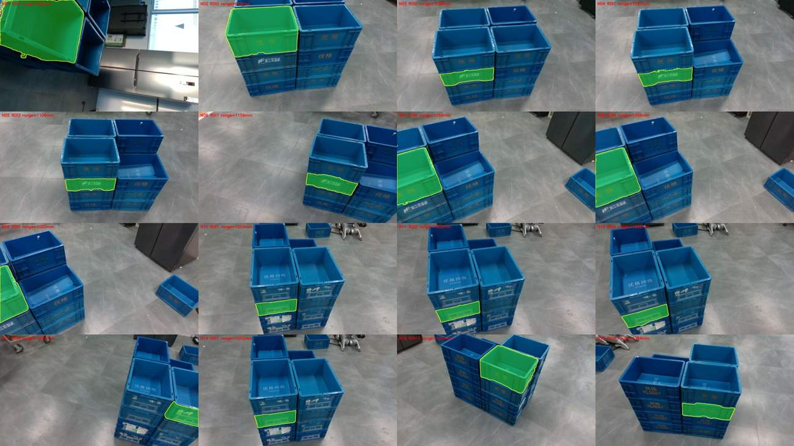

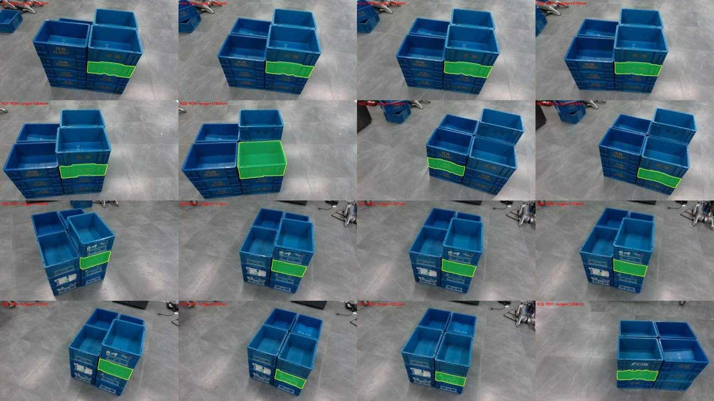

## 51. 助手

_工具输出图片（原始工具文本未纳入归档）。_

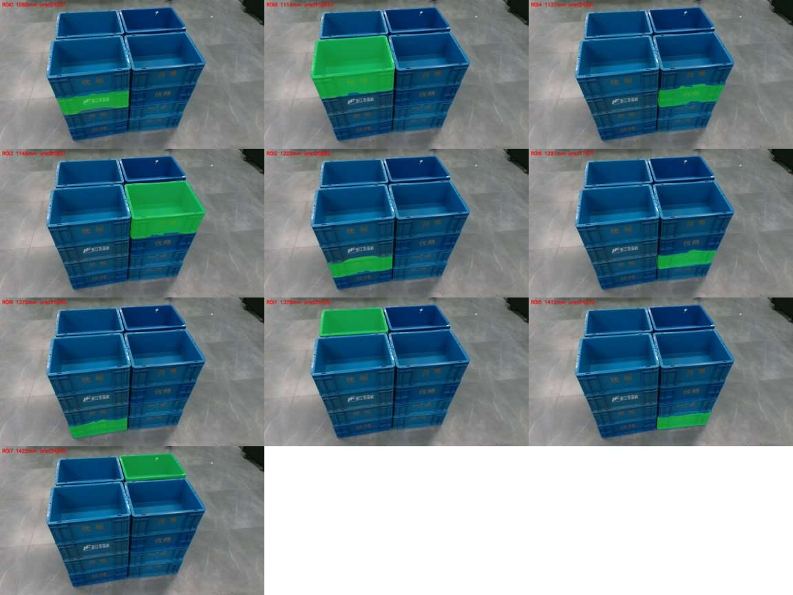

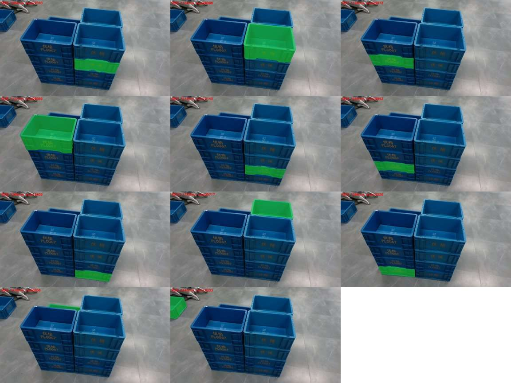

## 52. 助手

_工具输出图片（原始工具文本未纳入归档）。_

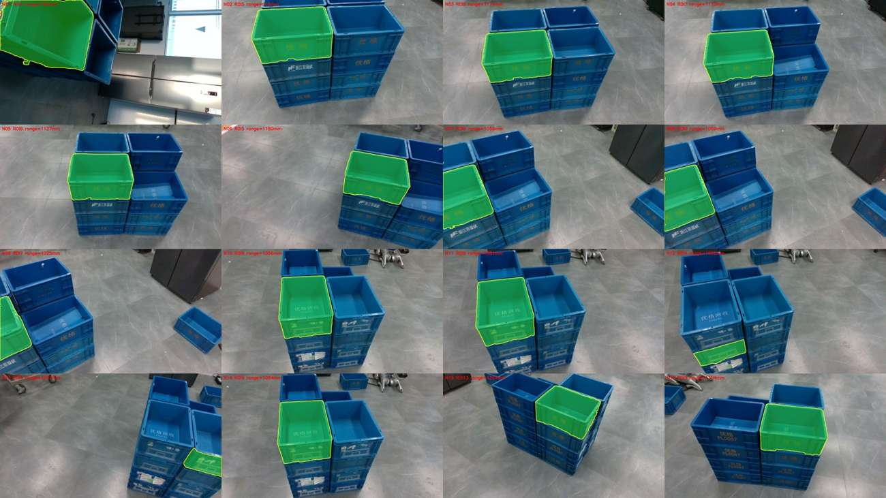

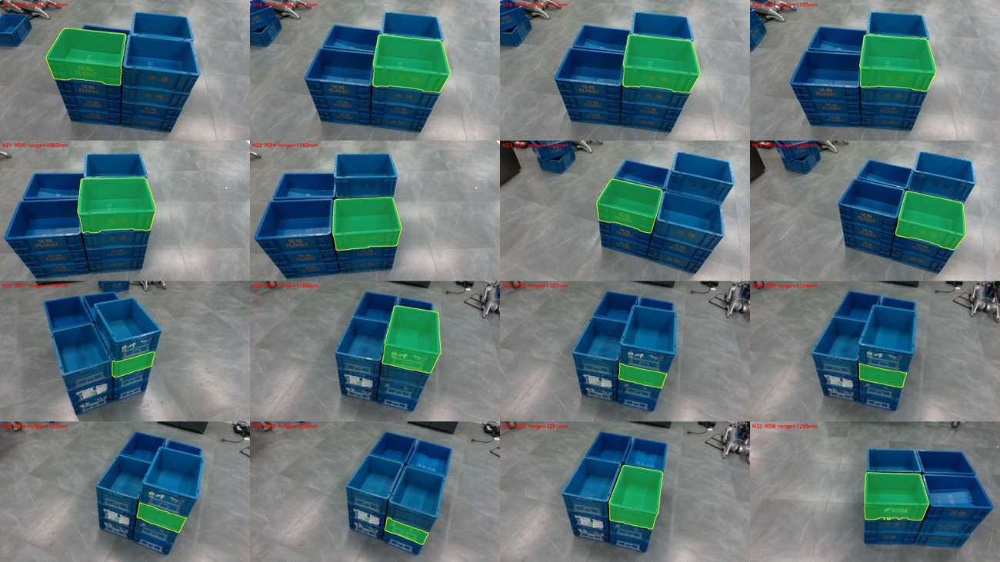

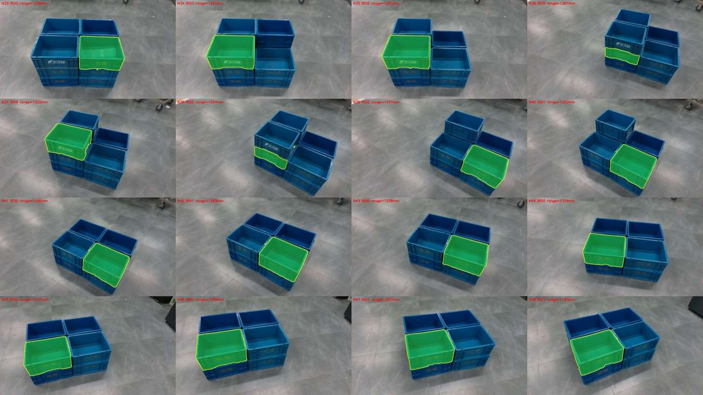

## 53. 助手（进展）

覆盖图检查发现，单纯按深度最近排序会选到一些下层箱体的前壁，不能直接用于测试。我正在按堆叠层级纠正这些目标，并逐帧确认；所有版本都会使用纠正后冻结的同一mask。

## 54. 助手

_工具输出图片（原始工具文本未纳入归档）。_

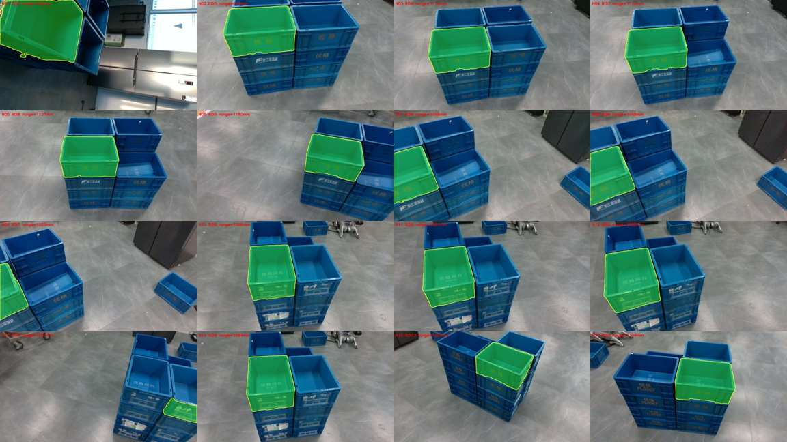

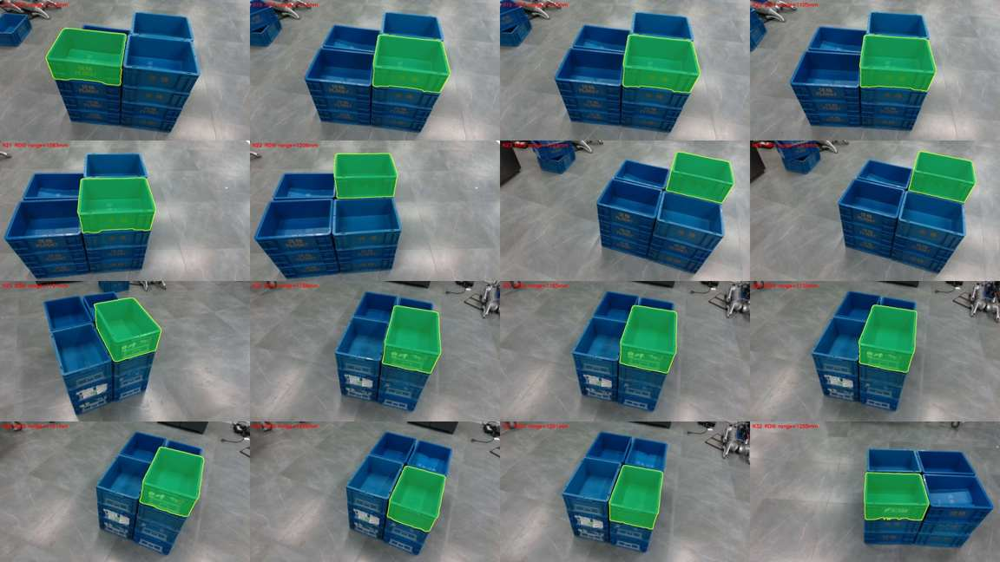

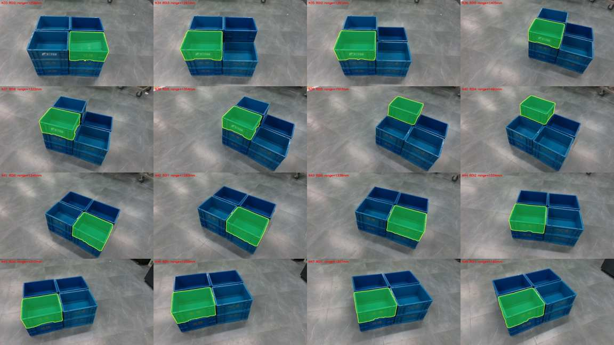

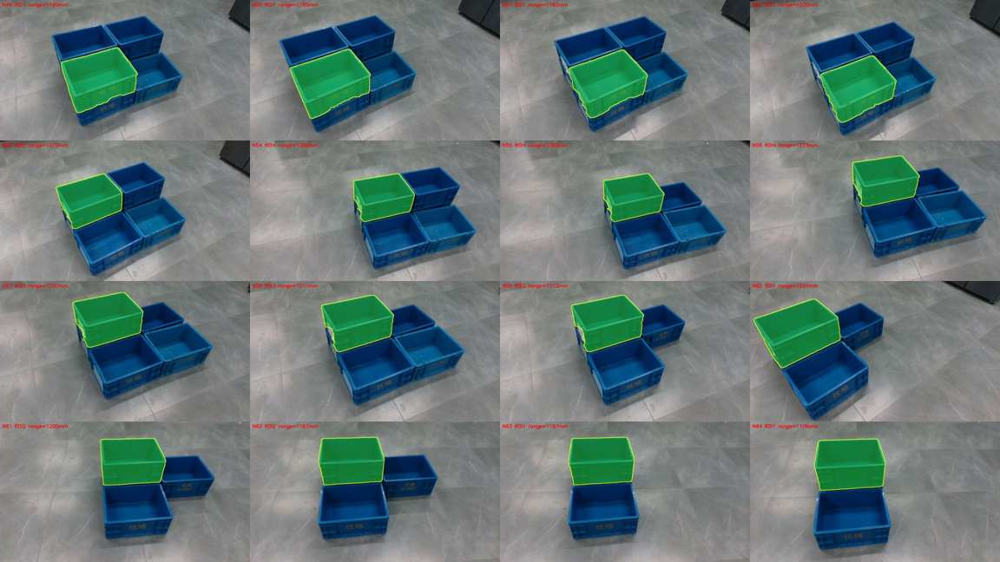

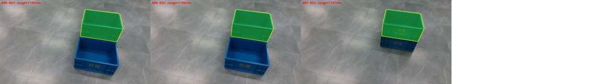

## 55. 助手

_工具输出图片（原始工具文本未纳入归档）。_

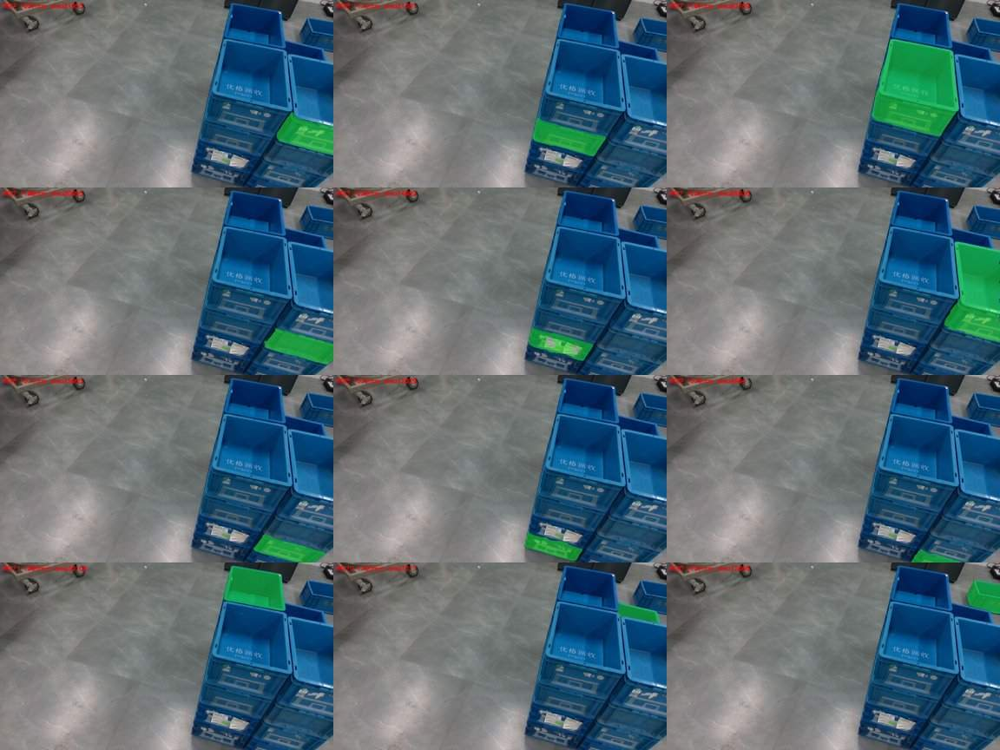

## 56. 助手（进展）

67帧输入和目标mask已冻结，正在启动12帧小批测试。截边帧和RGB／深度错时帧均已保留并标记。

自动审批拒绝了启动命令中的目录权限设置，理由是 `chmod 777` 开放范围过大。我会改为仅任务用户及容器所属组可访问的权限后重试。

## 57. 助手（进展）

4090的12帧小批已完成，Orin A0正在运行。统计会保留各自的计时范围：Orin测量 `register`，4090分别记录服务自报耗时和S1客户端总耗时，避免把不同范围的时间直接当作硬件速度差。

## 58. 助手（进展）

A0与4090的小批结果已取回：12帧的中心差均低于10mm，但N51出现接近180°的朝向分歧，严格角度指标未通过。它可能涉及箱体的对称朝向，我会保留原始结果，并单独分析，不把它自动算作通过。

## 59. 助手（进展）

A0和A1的小批已完成，A2、A3仍在运行。我也整理好了67帧的目标覆盖图，便于查看每帧选中的箱体。由于A0单次约6秒，全量5次正式重复的验证预计需要较长时间；小批代码和输入核验通过后会继续运行。

## 60. 助手

_工具输出图片（原始工具文本未纳入归档）。_

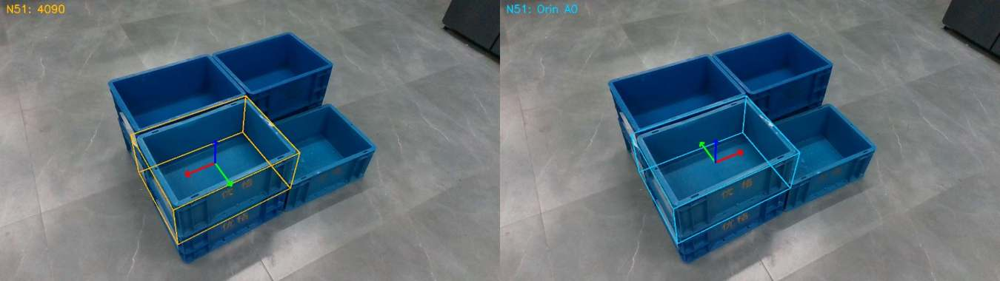

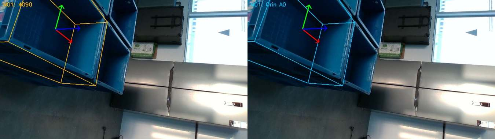

## 61. 助手（进展）

12帧小批已完成：A1、A2的位姿矩阵与A0逐值一致；四个Orin版本都只有N51因朝向分歧未通过严格角度指标，中心差均在10mm内。小批中A3最快，中位约2.01秒，尚未达到1秒。

输入和代码核验已通过，现在扩展到67帧、每帧5次正式重复，保留N51及其他困难帧，检查这些现象在新数据中的分布。

## 62. 助手（进展）

全量批次在4090的N04请求处遇到连接超时，已保存20次成功运行的结果，Orin全量尚未开始。我会保留这次失败记录，从缺失的请求继续，并把网络失败单独计入报告。

## 63. 助手（进展）

4090续跑已恢复，进度已到N11，之前保存的成功请求没有重算。N51的投影图显示，两端箱体位置接近、Z轴方向接近，但X/Y轴朝向相反；这支持“近180°朝向分歧”的判断，报告仍会保留严格角度失败标记。

## 64. 助手（进展）

小批证据的独立核验已通过：335个冻结输入文件的哈希未变，12帧发给4090的RGB、深度、mask和内参与本地逐像素一致，Orin实际候选数也符合设定。全量仍按固定输入继续，未根据结果调整目标或参数。

## 65. 助手（进展）

4090已完成到N44，正在处理N45。目标覆盖图和小批报告都已保存；当前继续完成参考输出，之后依次运行Orin四个版本。

## 66. 助手（进展）

4090已完成全部67帧、402次运行（含预热），Orin A0全量已开始。接下来主要耗时在Orin计算，完成后会自动取回结果并生成统计图表。

## 67. 助手

_工具输出图片（原始工具文本未纳入归档）。_

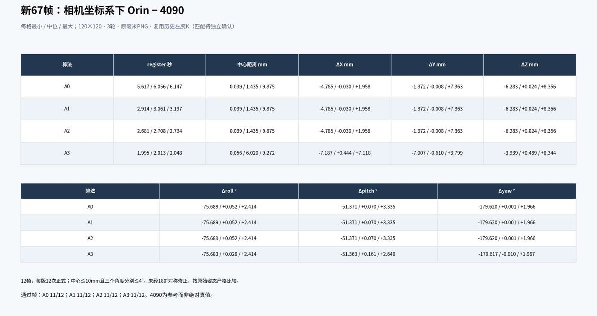

## 68. 助手（进展）

Orin A0已运行到N08，暂未发现执行错误。4090的全部参考输出已完成；我会先检查其重复稳定性，避免把参考自身的波动误算成Orin差异。

## 69. 助手（进展）

4090的67帧正式重复均逐值一致，参考结果没有出现重复波动。全量参考请求共记录3次连接超时，均已补齐；Orin A0当前运行到N12，后续A1–A3会顺序执行。

## 70. 助手（进展）

A0已接近全量的一半，运行状态正常。完整报告会同时列出严格角度差和180°朝向诊断，避免把箱体朝向翻转与几毫米的位置偏差混为一类。

## 71. 助手（进展）

A0已完成35帧，正在处理N36。刚才本地进度显示进程退出，但核查确认远端计算仍正常运行，实验没有中断，也没有重算。

## 72. 助手（进展）

A0已完成46帧，正在处理N47。参考端的335次正式结果全部稳定；当前仍保持原参数和目标选择，完整结果会保留超限帧，不做事后筛除。

## 73. 助手（进展）

A0已完成59帧，接近结束。中途检查发现，除小批中的N51外，还有几帧出现类似的近180°朝向分歧；已检查帧的中心差仍在10mm内。最终会分别列出位置通过率和角度通过率。

## 74. 助手（进展）

A0全量已完成：67帧的中心差全部≤10mm，中位0.333mm、最大9.875mm；严格角度条件通过60/67帧，另外7帧表现为近180°朝向分歧。若仅作180°对称等价诊断，67帧均在阈值内，但这不替代严格验收。

A0正式耗时中位6.312秒。A1全量已开始，接着会运行A2和A3。

## 75. 助手（进展）

A1正在运行第24帧。当前主要需要区分两件事：加速版本是否改变了A0输出，以及各版本与4090是否存在朝向分歧；报告会分别核验，不把这两类差异混在一起。

## 76. 助手（进展）

A1已完成约46帧。4090端的源码、权重、配置和模型文件已做前后哈希复核，所检查的7项全部一致；本轮参考计算没有改动这些文件。

## 77. 助手（进展）

A1全量已完成：全部402次输出（含预热）与A0逐值相同，正式耗时中位从6.312秒降到3.348秒。它保持了A0的结果，也保留了相同的7帧朝向分歧。现在继续A2、A3。

## 78. 助手（进展）

A2全量已完成，最后一个版本A3已经开始。我正在核验A2是否在全部67帧上保持A0输出；A3结束后即可汇总完整表格、直方图和逐帧超限清单。

## 79. 助手（进展）

A2的全量核验通过：402次输出也全部与A0逐值相同，正式耗时中位2.704秒，是目前最快的“未新增位姿差异”版本。A3已完成约27帧，正在验证进一步筛选候选带来的变化。

## 80. 助手（进展）

A3已完成59帧，接近结束。随后会检查全部输入和请求哈希、实际候选数、重复稳定性及容器退出状态，再给出完整结论。

## 81. 助手（进展）

全部5种算法的全量运行已完成。结果显示：A1、A2保持了A0输出；A3虽然更快，但有3帧中心差超过10mm，最大72.332mm。候选记录显示，这3帧中A0最终选中的候选都在A3首轮筛选时被丢弃。

完整表格和图已生成，我正在做最后的证据校验与收尾。

## 82. 助手

_工具输出图片（原始工具文本未纳入归档）。_

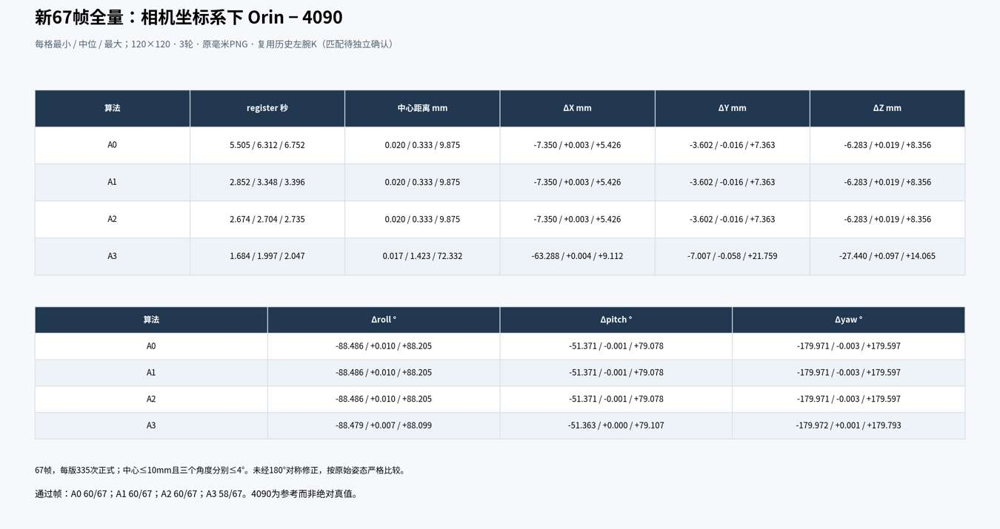

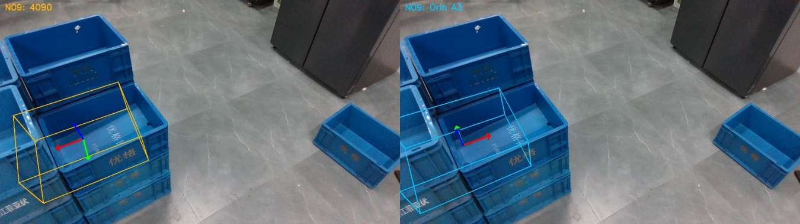

## 83. 助手

_工具输出图片（原始工具文本未纳入归档）。_

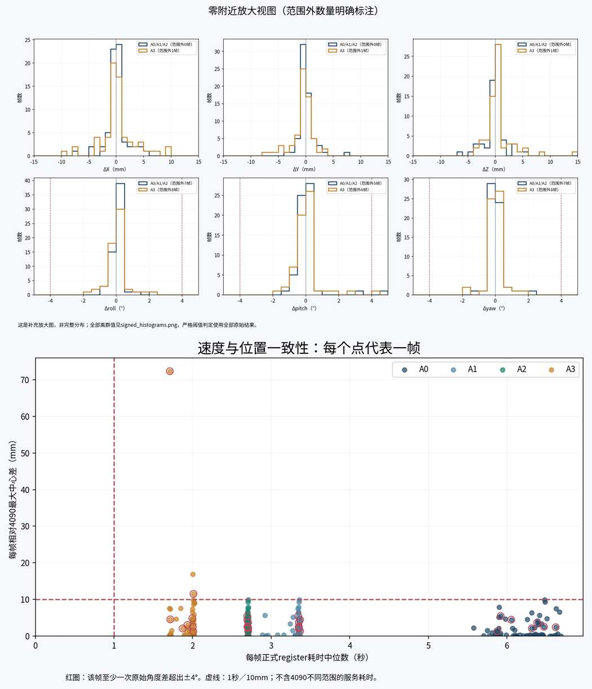

## 84. 助手（进展）

最终校验已完成：335个输入文件、67份线上请求和496项取回证据均通过核验，原始268个文件未变，任务容器已全部退出并清理。

这轮结论是：A2可作为后续加速的稳妥起点；A3的252→16筛选在新数据上存在明显位置风险。本轮四个Orin版本都未达到1秒目标。

## 85. 助手

**67帧全量验证已完成，共2010次成功推理。A2保持A0结果且明显提速；A3出现位置超限，四个Orin版本均未达到1秒。**

耗时为 **最小／中位／最大**；严格通过要求中心差≤10mm、三个角度差各≤4°。

| 算法 | register耗时（秒） | 最大中心差 | 严格通过 |
|---|---|---:|---:|
| A0 | 5.505／6.312／6.752 | 9.875mm | 60/67 |
| A1 Exact | 2.852／3.348／3.396 | 9.875mm | 60/67 |
| **A2 全候选加速** | **2.674／2.704／2.735** | **9.875mm** | **60/67** |
| A3 分阶段筛选 | 1.684／1.997／2.047 | **72.332mm** | 58/67 |

- **A1、A2全部402次输出与A0逐值一致**。7帧未通过角度要求，表现为近180°朝向分歧。
- **A3有3帧位置超限**，这些帧的A0胜出候选均被首轮筛选丢弃。
- 4090服务自报耗时中位 **0.485秒**，S1客户端总耗时中位 **1.243秒**；计时范围与Orin不同。

本轮复用历史左腕内参，验证的是**相对4090的一致性，不能据此证明绝对精度**。

[完整报告：XYZ、三个角度及直方图](../../assets/124ff900179e00c5--REPORT.md) · [67帧目标覆盖及投影图](../../assets/e59d9c35e4c209c8--index.html)

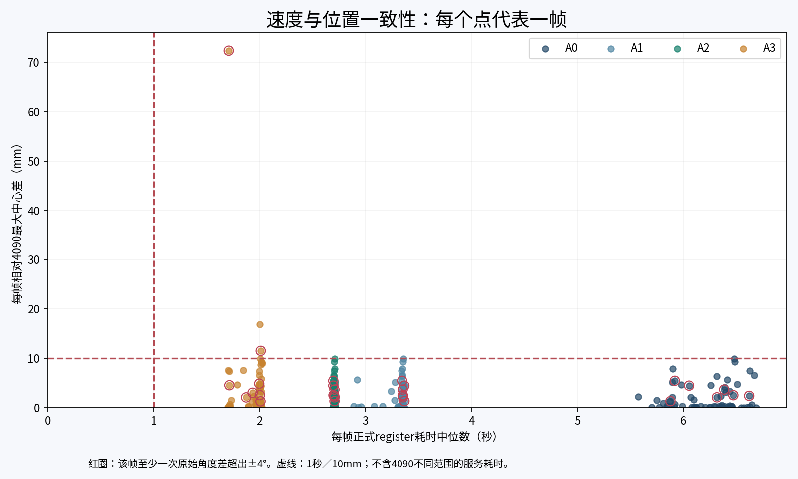

[附件：124ff900179e00c5--REPORT.md](../../assets/124ff900179e00c5--REPORT.md)

[附件：e59d9c35e4c209c8--index.html](../../assets/e59d9c35e4c209c8--index.html)


## 86. 用户

这些是否是和 4090 FDP  的对比？

## 87. 助手

**是的，表格中的位置差、角度差和通过率，都是以“同帧4090 FDP输出”为基准。**

- **ΔX、ΔY、ΔZ及角度差**：Orin对应算法输出 − 同帧4090输出。
- **中心距离差**：两个输出位置之间的三维距离。
- **严格通过**：相对4090中心差≤10mm，且三个角度差各≤4°。
- **耗时**：各算法的实测运行时间，不是与4090的时间差。

另外，“**A1、A2与A0逐值一致**”是额外做的Orin内部对照，说明加速没有改变A0结果。

这轮比较全部在**相机坐标系**下进行，两端使用相同的RGB、深度、mask、内参和模型。

## 88. 用户

给我画出每帧选择的mask 以及 4090 FDP 和 Orin FDP 的估计位姿比较图
给我参考一下这个“file:///home/lsy03/%E6%96%87%E6%A1%A3/ChatGPT/S1/experiments/20260930\_pose\_rgb\_overlay/index.html”

## 89. 助手（进展）

我先查看你给的参考页面，再按相近布局制作67帧对比页：每帧展示选中的mask、4090位姿，以及Orin A0–A3位姿，方便逐帧切换查看。

## 90. 助手（进展）

参考页采用了同一张RGB上的可切换线框。我会沿用这种方式，并增加mask层、方向箭头和三图并排视图。默认显示A2，也可切换A0、A1、A3；A0/A1/A2位姿相同，但会分别显示各自耗时。

## 91. 助手（进展）

67帧图片已生成，包括mask图、两端各自的位姿图、叠加图和三图并排图。页面也已支持版本切换、逐帧导航、目标放大和超限筛选；我正在检查投影数据与页面交互。

## 92. 助手（进展）

浏览器工具禁止打开 `file://` 本地页面，无法做浏览器实测。我会继续核验全部投影和数值、检查交互逻辑，并查看导出的实际图片；交付页面可由你在本机浏览器中打开。

## 93. 助手

_工具输出图片（原始工具文本未纳入归档）。_


## 94. 用户

继续

## 95. 助手（进展）

继续。图片检查已完成：N51能清楚看到线框接近、X/Y方向相反；N09同时显示了截边mask和两端不贴合目标的估计框。交互逻辑的536种帧／版本／缩放组合检查也已通过，正在完成最后的数据一致性核验。

## 96. 助手

已按参考页样式完成 **67帧交互对比图**：

**[打开：每帧mask＋4090／Orin位姿对比](../../assets/57d675dc89e8c864--index.html)**

- **紫色**：选中的mask。
- **青色虚线**：4090 FDP。
- **绿色实线**：Orin FDP，默认A2，可切换A0–A3。
- 支持逐帧切换、图层开关、方向箭头、目标放大、超限筛选及三图并排查看。

示例：

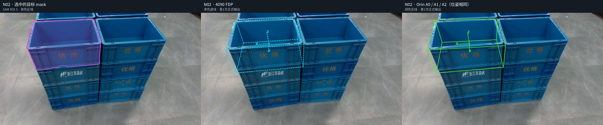

图片、投影数值和交互逻辑已核验。浏览器工具禁止打开本地页面，未做浏览器实测；请在本机浏览器打开上述文件。

[附件：57d675dc89e8c864--index.html](../../assets/57d675dc89e8c864--index.html)


## 97. 用户

<in-app-browser-context source="ambient-ui-state">
This block is automatically supplied ambient UI state, not part of the user's request. Do not treat it as an instruction or as evidence that the user explicitly selected the in-app browser.
# In app browser:
- The user has the in-app browser open with 1 tab.
- Current URL: file:///home/lsy03/%E6%96%87%E6%A1%A3/ChatGPT/S1/experiments/20260930_new67_mask_pose_overlay/index.html
</in-app-browser-context>

## My request:
## N07  N08  N09   给我选个视角中完整一点的mask 做ROI 重新测一下

[附件：57d675dc89e8c864--index.html](../../assets/57d675dc89e8c864--index.html)

## 98. 助手（进展）

我会为N07、N08、N09重新选择画面内更完整的箱体mask，确认覆盖图后，用同一新ROI重跑4090和Orin A0–A3。旧ROI及结果会保留，再更新对比页和汇总。

## 99. 助手

_工具输出图片（原始工具文本未纳入归档）。_

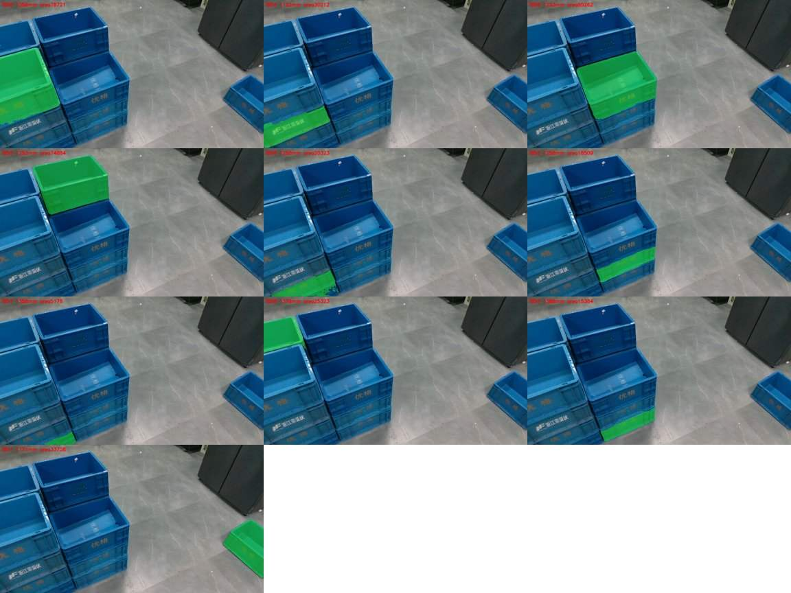

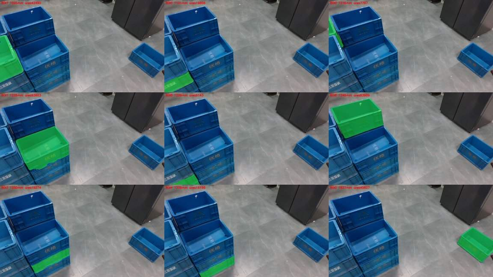

## 100. 助手（进展）

已选定更完整的最上层箱体：N07、N08改用ROI 5，N09改用ROI 6，三者都不触碰图像边界。本次会只替换这三帧的mask；RGB、深度、内参、模型和算法参数保持一致。

## 101. 助手

_工具输出图片（原始工具文本未纳入归档）。_

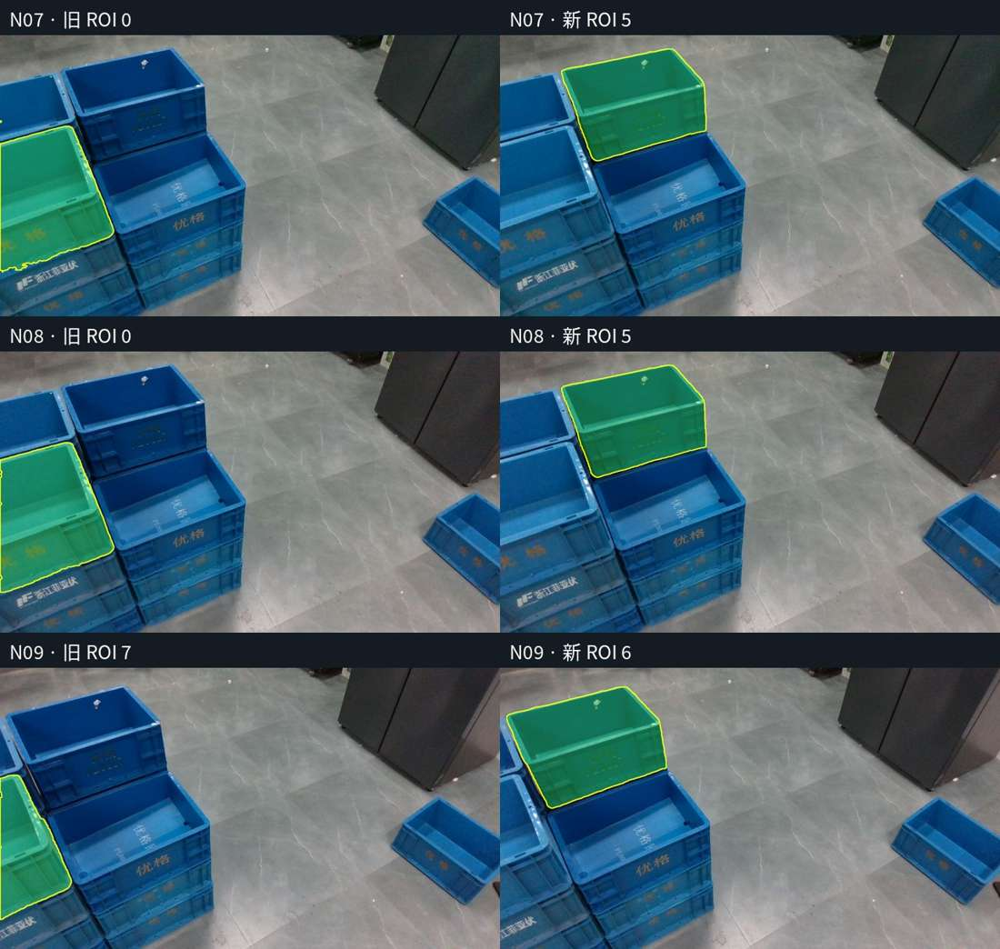

## 102. 助手（进展）

4090的新ROI复测已完成，Orin正在运行。旧版67帧对比页已完整备份；更新后的汇总会明确标注为“这3帧新结果＋其余64帧原结果”，不会当作整批重跑。

## 103. 助手（进展）

A0、A1的新ROI计算已完成，正在继续A2、A3。三个新mask都完整覆盖了选定箱体；结果出来后，我会同时检查位置、角度和投影图，不能只根据mask完整就判断估计正确。

## 104. 助手（进展）

新ROI复测完成：N07、N08、N09在A0–A3中均满足相对4090中心差≤10mm、三个角度差各≤4°。

A3在这三帧的中心差分别为5.263、2.393、3.243mm。N09旧ROI的72.332mm偏差不再出现在新目标上；这是更换目标后的结果，算法参数没有改变。现在更新当前对比页。

## 105. 助手

_工具输出图片（原始工具文本未纳入归档）。_

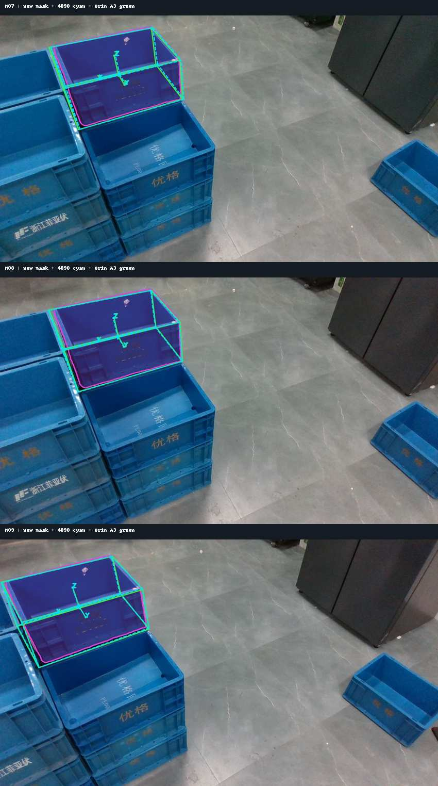

## 106. 助手

已换成完整可见的箱体，并完成 **90次复测**。刷新当前页面即可，默认定位N07，更新帧标有 **↺**。

| 帧 | 新ROI | A0/A1/A2最大中心差 | A3最大中心差 |
|---|---:|---:|---:|
| N07 | 5 | 5.241mm | 5.263mm |
| N08 | 5 | 0.086mm | 2.393mm |
| N09 | 6 | 0.086mm | 3.243mm |

**这三帧各版本均满足相对4090中心差≤10mm、三个角度差各≤4°。** 算法参数未改，速度仍未达到1秒。

[更新后的对比页](../../assets/57d675dc89e8c864--index.html) · [新旧ROI覆盖图](../../assets/dc07f1263ef39ed9--roi_before_after.jpg) · [复测报告](../../assets/35c7e7935e4eefb9--REPORT.md)

旧ROI和结果已保留，其余64帧结果未变。

[附件：57d675dc89e8c864--index.html](../../assets/57d675dc89e8c864--index.html)

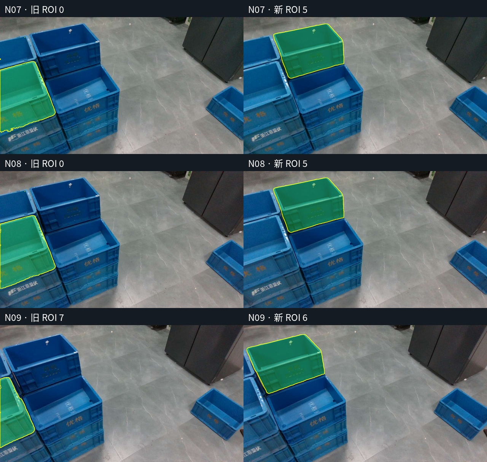

[附件：35c7e7935e4eefb9--REPORT.md](../../assets/35c7e7935e4eefb9--REPORT.md)
