# 9_28 9_23 9_22 9_21 9_18 画图对比 评估同样参数FDP A0 原版 和 4090 (… (2)…

- 归档编号：`01a0e717-8c6c-7591-b24d-cbde7c9ffbe1`
- 项目：S1 IE_lab 拆垛
- 创建时间：2026-09-28T16:17:55.311000+08:00
- 更新时间：2026-10-09T16:21:49.105000+08:00
- 状态：活动
- 导出范围：用户可见消息与助手可见回复；不含隐藏推理和工具原始输出

## 1. 用户

现在速度和效果最好的DockerFDP方案是哪个？能否找到所有数据的RGB图，来给我框出来4090FDP 和 它对比？

## 2. 助手（进展）

目前已验证的最佳折中是 **A4-64（64→64→64）**：中位耗时0.850秒，28帧全部满足相对4090中心差≤10mm、三个角度差各≤4°。我会查找这28帧的RGB和对应位姿，把4090与A4-64的三维框投影到同一张图上，逐帧对比。

## 3. 助手（进展）

已找到28帧RGB的归档请求，能恢复当时送给4090的原始图像。接下来会用相同相机内参和箱体尺寸画三维框，并提供单独显示、双框叠加和局部放大，避免两者接近时被线条遮住。

## 4. 助手（进展）

28帧的RGB和相机外参已全部匹配，正在生成逐帧对比图。最佳方案需要固定Docker镜像配合 **A4-64代码与参数** 才能复现；此前验证的是离线实验容器，尚未部署为常驻服务。图中会用蓝色实线表示4090、橙色虚线表示A4-64。

## 5. 助手

_工具输出图片（原始工具文本未纳入归档）。_

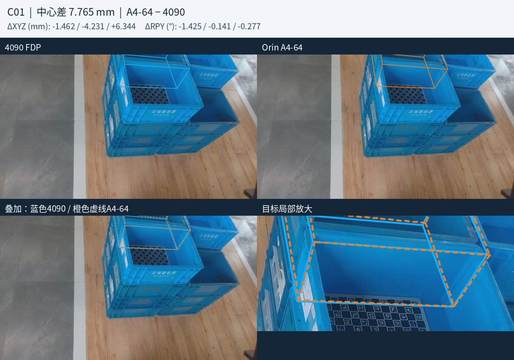

## 6. 助手（进展）

28帧对比图已全部生成，RGB像素和输入哈希核验通过。最大中心差是C01，约7.765mm；该帧已检查单框、叠加和放大图。画廊还支持切换原图、仅4090、仅A4-64，便于查看几乎重合的框。

## 7. 助手

_工具输出图片（原始工具文本未纳入归档）。_

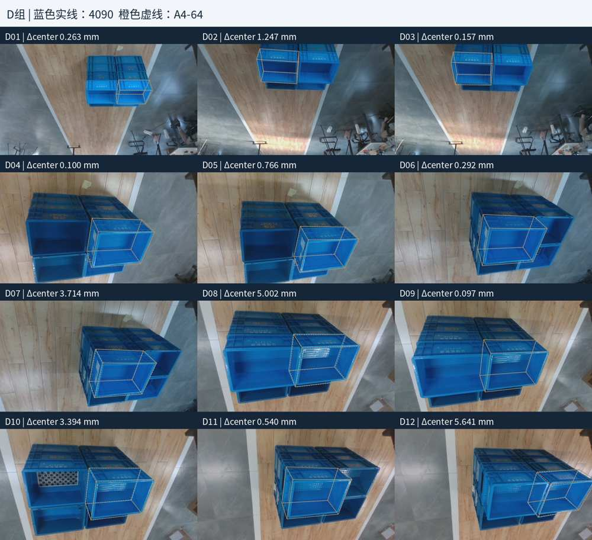

## 8. 助手

当前推荐 **Orin Docker中的A4-64（64→64→64）**，它是已测FDP方案中，满足精度要求的最快方案。

| 指标 | A4-64 |
|---|---:|
| 耗时最小／中位／最大 | **0.823／0.850／0.879秒** |
| 相对4090最大中心差 | **7.765mm** |
| 最大绝对 roll／pitch／yaw 差 | **1.491°／0.538°／1.249°** |
| 满足中心≤10mm、各角度≤4° | **28／28帧** |

配置是 **120×120、3轮、毫米LingBot深度、关闭matmul TF32**。这是固定Docker镜像加A4-64实验代码的组合，尚未部署为常驻服务；上述耗时仅为`register`，不包含深度生成等前端流程。

**28帧RGB已全部找到并画框完成**：D组12帧、H组3帧、ChArUco13帧。原图像素与归档4090请求逐一核验一致。

- **蓝色实线：4090 FDP**
- **橙色虚线：Orin A4-64**
- 每帧提供两版单独框、双框叠加、局部放大和原始RGB。

[打开全部28帧对比画廊](../../assets/30167a3acf36670a--index.html) · [下载完整图片包](/home/lsy03/文档/ChatGPT/S1/experiments/20260928_fdp_rgb_comparison/all_28_frames.zip)

下面是差距最大的 **C01帧，中心差7.765mm**：

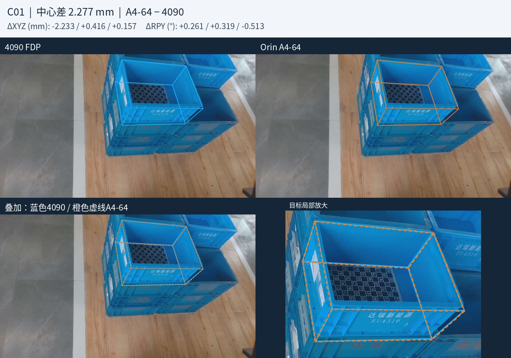

分组总览：[D组12帧](../../assets/3fda48eebae4b78a--overview_D.jpg) · [H组3帧](../../assets/010013c997d0bf3d--overview_H.jpg) · [ChArUco13帧](../../assets/a418f8216a70a10c--overview_C.jpg)

这些图展示的是两版输出的一致性；4090本身不是绝对真值。

[附件：30167a3acf36670a--index.html](../../assets/30167a3acf36670a--index.html)

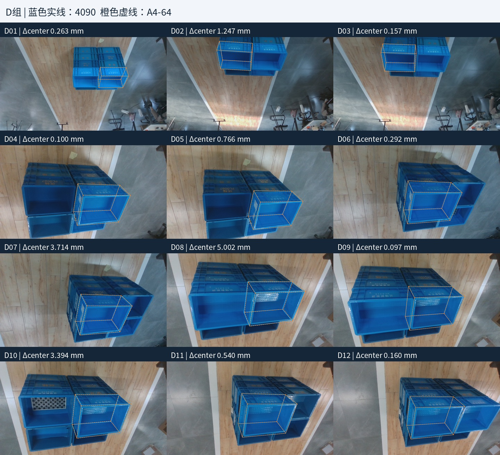

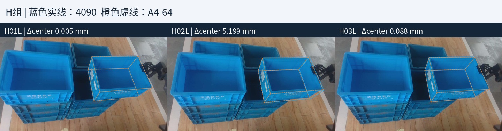

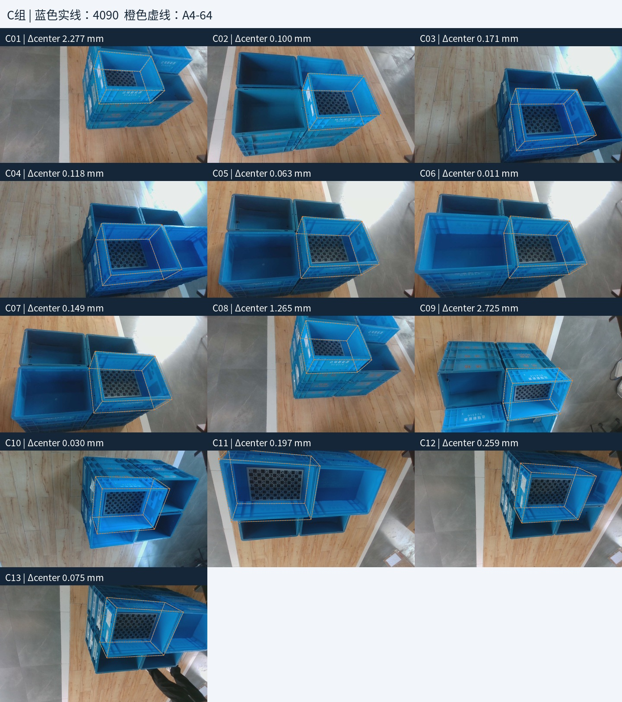

> 资源未归档：`home/文档/ChatGPT/S1/experiments/20260928_fdp_rgb_comparison/all_28_frames.zip`（too_large）

## 9. 用户

<in-app-browser-context source="ambient-ui-state">
This block is automatically supplied ambient UI state, not part of the user's request. Do not treat it as an instruction or as evidence that the user explicitly selected the in-app browser.
# In app browser:
- The user has the in-app browser open with 1 tab.
- Current URL: file:///home/lsy03/%E6%96%87%E6%A1%A3/ChatGPT/S1/experiments/20260928_fdp_rgb_comparison/index.html
</in-app-browser-context>

## My request:
C01帧 是否是由于之前ROI出了问题？ 导致后续的FDP有问题？

[附件：30167a3acf36670a--index.html](../../assets/30167a3acf36670a--index.html)

## 10. 助手（进展）

我会核对C01当时的ROI、分割mask和输入记录，区分“ROI选错导致两端都偏”和“同一输入下两端输出有差异”这两种情况。

## 11. 助手

_工具输出图片（原始工具文本未纳入归档）。_

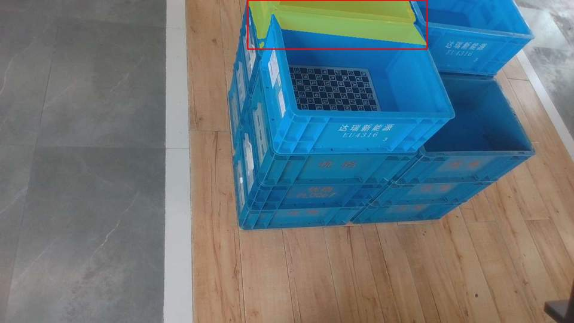

## 12. 用户

<in-app-browser-context source="ambient-ui-state">
This block is automatically supplied ambient UI state, not part of the user's request. Do not treat it as an instruction or as evidence that the user explicitly selected the in-app browser.
# In app browser:
- The user has the in-app browser open with 1 tab.
- Current URL: file:///home/lsy03/%E6%96%87%E6%A1%A3/ChatGPT/S1/experiments/20260928_fdp_rgb_comparison/index.html
</in-app-browser-context>

## My request:
先这样吧，明天再来

[附件：30167a3acf36670a--index.html](../../assets/30167a3acf36670a--index.html)

## 13. 助手

好的，今天先停在这里。

刚核查到：**C01实际输入mask只覆盖图像顶部区域，没有覆盖装板目标箱的主体**，确实存在目标选择或mask异常的迹象。4090和Orin共用了这份输入，因此两者接近不能证明目标定位正确。

明天从C01的ROI／mask来源继续追查，再决定修正后的复测。

## 14. 用户

<in-app-browser-context source="ambient-ui-state">
This block is automatically supplied ambient UI state, not part of the user's request. Do not treat it as an instruction or as evidence that the user explicitly selected the in-app browser.
# In app browser:
- The user has the in-app browser open with 1 tab.
- Current URL: file:///home/lsy03/%E6%96%87%E6%A1%A3/ChatGPT/S1/experiments/20260928_fdp_rgb_comparison/index.html
</in-app-browser-context>

## My request:
我们继续

[附件：30167a3acf36670a--index.html](../../assets/30167a3acf36670a--index.html)

## 15. 助手（进展）

继续追查C01的ROI／mask来源。我会先核对前端选箱记录，确认是选错箱体还是mask不完整，再判断需要修正哪一步。

## 16. 助手（进展）

找到关键线索：9月17日正式对比使用的是**已按标定板所在箱体选出的ROI 5 mask**；后续FDP加速实验的打包脚本却从更早的`case/input`复制mask，没有使用这份审核后的mask。

C01两份mask的区域明显不同：旧实验输入只在顶部，审核后的mask覆盖装板箱体。我会继续核对13帧，确认这个问题的影响范围。

## 17. 助手

_工具输出图片（原始工具文本未纳入归档）。_

## 18. 助手（进展）

确认不止C01：**C01、C04、C09、C11共4帧**的加速实验mask与9月17日审核目标不一致，其余9帧逐像素相同。C01对照图已经确认，审核后的mask才覆盖装板箱体。

因此，之前“28/28通过”只能说明Orin与4090在同一批旧输入下接近，不能作为28帧目标定位正确的验收。我会给旧报告加上这项更正，并单独准备4帧修正输入，保留原始结果。

## 19. 助手

已查清：**C01确实存在mask来源错误，而且同类问题影响4帧。**

9月17日已选好装板箱体并生成审核mask，但后续FDP加速实验打包时，复制了旧`case/input`里的mask，没有采用审核后的版本。

| 帧 | 应使用的审核ROI | 新旧mask重叠率 |
|---|---:|---:|
| C01 | 5 | 10.25% |
| C04 | 6 | 4.63% |
| C09 | 0 | 7.56% |
| C11 | 6 | 0% |

其余9帧mask逐像素一致。C01对比如下：**左侧是加速实验实际输入，右侧是审核后的目标mask。**

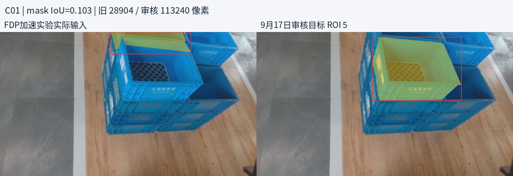

因此需要更正之前的结论：**A4-64的“28/28通过”仅证明与同样使用旧mask的4090输出接近，不代表28帧目标都定位正确。** 7.765mm也不是ROI错误造成的绝对误差。

我已保存4帧修正输入，只替换mask，其余输入哈希保持一致，并给旧报告加了更正提示。尚未重新推理。下一步应使用修正输入对比 **4090、A0、A4-64**，重新确认速度与效果。

[完整调查报告](../../assets/25b232b4f75458c7--REPORT.md)

[附件：25b232b4f75458c7--REPORT.md](../../assets/25b232b4f75458c7--REPORT.md)

## 20. 用户

<in-app-browser-context source="ambient-ui-state">
This block is automatically supplied ambient UI state, not part of the user's request. Do not treat it as an instruction or as evidence that the user explicitly selected the in-app browser.
# In app browser:
- The user has the in-app browser open with 1 tab.
- Current URL: file:///home/lsy03/%E6%96%87%E6%A1%A3/ChatGPT/S1/experiments/20260928_fdp_rgb_comparison/index.html
</in-app-browser-context>

## My request:

| 帧应使用的审核ROI新旧mask重叠率 |   |        |              |
| ------------------- | - | ------ | ------------ |
| C01                 | 5 | 10.25% |              |
| C04                 | 6 | 4.63%  |              |
| C09                 | 0 | 7.56%  |              |
| C11                 | 6 | 0%  | 这四帧是不是得重新计算？ |

[附件：30167a3acf36670a--index.html](../../assets/30167a3acf36670a--index.html)

## 21. 助手

**是，这四帧需要重新计算，而且4090和Orin都要使用修正后的同一份mask。** 不能只重算Orin，再与旧4090结果比较。

建议先对 **C01、C04、C09、C11** 重跑：

- **4090 FDP**：生成正确目标的新参考。
- **Orin A0**：检查参数对齐后的基线。
- **Orin A4-64**：重新验证中心差≤10mm、各角度差≤4°，耗时接近1秒。

每帧先预热1次，再正式运行5次；RGB、深度、内参、外参和模型保持不变，仅替换mask。完成后更新表格和画框图。

其余24帧输入未因本次修正变化，可保留已有结果；最终验收时再统一跑一遍28帧。

## 22. 用户

<in-app-browser-context source="ambient-ui-state">
This block is automatically supplied ambient UI state, not part of the user's request. Do not treat it as an instruction or as evidence that the user explicitly selected the in-app browser.
# In app browser:
- The user has the in-app browser open with 1 tab.
- Current URL: file:///home/lsy03/%E6%96%87%E6%A1%A3/ChatGPT/S1/experiments/20260928_fdp_rgb_comparison/index.html
</in-app-browser-context>

## My request:
给我制定计划，明确方案和目标

[附件：30167a3acf36670a--index.html](../../assets/30167a3acf36670a--index.html)

## 23. 助手

本轮目标是：**先修正4帧选错目标的问题，再确认Orin上的FDP能否在正确目标上，同时达到接近1秒和精度要求。** 当前A4-64作为首选候选，最终结论以修正后的复测为准。

### 1. 固定输入和验收标准

先复测 **C01、C04、C09、C11**，分别使用审核ROI **5、6、0、6**。

仅替换mask；RGB、LingBot深度、相机内外参、mesh保持不变，并核对哈希。推理前逐帧检查mask确实覆盖装板箱体。

| 项目 | 验收目标 |
|---|---|
| 目标选择 | mask和输出三维框对应正确箱体 |
| 中心距离差 | 相对同帧、修正mask后的4090结果 **≤10mm** |
| 三个角度差 | roll、pitch、yaw分别 **≤4°**，取绝对值判断 |
| 速度 | 以Orin `register` **≤1秒**为目标，报告最小／中位／最大 |
| 重复性 | 每帧预热1次、正式5次，检查每次结果及波动 |

位置和角度报告保留正负号，统一为 **Orin − 4090**。4090是部署参考；这项验收衡量一致性，不等同于绝对精度。

### 2. 四帧对照实验

| 方案 | 配置与作用 |
|---|---|
| **4090 FDP** | 使用修正mask，重新生成参考；不修改生产源码、配置 |
| **Orin A0** | 参数对齐的252候选基线，确认正确输入下的两端一致性 |
| **Orin A4-64** | 64→64→64，验证目前首选亚秒方案 |
| **Orin A4-16，条件追加** | 若A4-64通过，再试64→16→16，检查修正mask后是否可以进一步提速 |

Orin沿用 **120×120、3轮精修、毫米深度、关闭matmul TF32、开启cuDNN TF32和AMP**，在独立Docker中运行冻结帧。

前三组共 **72次调用**：4帧 × 3方案 ×（1次预热＋5次正式）。

### 3. 根据结果决定下一步

- **A0通过、A4-64通过**：A4-64进入完整验证；可追加A4-16短测。
- **A0通过、A4-64不通过**：重点检查竖直先验、候选覆盖和评分，做单项消融。
- **A0也不通过**：先排查输入、参数和两端数值差异，暂不继续压缩候选。
- **两端框都未对应正确箱体**：先解决目标输入或估计问题，不能仅凭两端接近判定通过。

不通过放宽10mm／4°阈值解决问题，也不按帧名手工选择算法。

### 4. 完整28帧验收

四帧通过后，将修正mask合入一个**新版冻结数据集**，保留旧版：

**D组12帧＋H组3帧＋ChArUco13帧。**

对最终候选完成28帧、每帧预热1次＋正式5次验证。最终验收要求：**所有正式运行均满足中心及角度阈值**；若只有中位耗时低于1秒、最大耗时超过1秒，明确报告，不能称为全部亚秒。

### 5. 交付结果

1. 新版速度与精度表：耗时、中心差、带符号XYZ及RPY，均列最小／中位／最大。
2. 更新28帧RGB画框对比、直方图及逐帧通过情况。
3. 固定可复现的Docker镜像ID、实验代码、参数、输入清单。
4. 明确最终推荐：**A4-64是否继续采用、A4-16是否可替代，以及剩余限制**。

本轮只做冻结帧离线计算。时间统计不包含LingBot深度生成、分割、网络传输等前端成本；生产部署与端到端耗时另行验证。

## 24. 用户

<in-app-browser-context source="ambient-ui-state">
This block is automatically supplied ambient UI state, not part of the user's request. Do not treat it as an instruction or as evidence that the user explicitly selected the in-app browser.
# In app browser:
- The user has the in-app browser open with 1 tab.
- Current URL: file:///home/lsy03/%E6%96%87%E6%A1%A3/ChatGPT/S1/experiments/20260928_fdp_rgb_comparison/index.html
</in-app-browser-context>

## My request:
不用这么麻烦，重新跑完四帧 **C01、C04、C09、C11**，分别使用审核ROI **5、6、0、6，然后替换掉之前的结果就行，然后更新数据，和file:///home/lsy03/%E6%96%87%E6%A1%A3/ChatGPT/S1/experiments/20260928\_fdp\_rgb\_comparison/index.html 给我结果就行**

[附件：30167a3acf36670a--index.html](../../assets/30167a3acf36670a--index.html)

> 资源未归档：`home/文档/ChatGPT/S1/experiments/20260928\_fdp\_rgb\_comparison/index.html`（missing）

## 25. 助手（进展）

按你说的缩小范围：只重跑这4帧，使用审核ROI 5、6、0、6；替换汇总中的对应结果并更新原画廊。其余24帧沿用已有结果，旧数据保留备份。我会使用S1和4090的SSH技能完成冻结帧计算。

## 26. 助手（进展）

S1和4090服务都已连通，四帧复测已启动。为让原表格保持完整，我会补算其中已有的A0–A4和A4-64四帧记录；不增加新算法，也不重跑其余24帧。

## 27. 助手（进展）

4090的4帧新参考已完成。Orin正在固定镜像中初始化和编译推理组件，随后开始计时；初始化时间不会混入`register`耗时。报告替换脚本也已准备好，完成后仍使用你给的原画廊地址。

## 28. 助手（进展）

Orin启动时发现实验包缺少毫米深度校验清单，已在推理前停止，没有产生计时结果。我会补齐清单后继续；4090已完成的结果无需重跑。

## 29. 助手（进展）

补齐清单后，恢复脚本被上次留下的未完成结果文件拦住了。我会先核实并归档这份失败记录，再继续计算，避免把不完整结果混入更新。

## 30. 助手（进展）

Orin已进入正常推理阶段，开始生成有效样本。所有计算仍只使用这4帧冻结数据；完成后会更新原表格、直方图和RGB画框页。

## 31. 助手（进展）

A0正在完成四帧重复运行，随后依次运行加速版本。旧结果已保留，合并时会检查每个版本恰好替换4帧、每帧保留5次正式记录。

## 32. 助手（进展）

A0的四帧复测已完成，正在补算A1及后续版本。当前没有新增输入错误，最终统计会明确标注“四帧新结果＋24帧历史结果”的合并口径。

## 33. 助手（进展）

修正mask后的A0与新4090参考已核对：四帧中心差约为 **2.277、0.118、2.725、0.197mm**，三个角度差也均在4°以内。接下来重点看A4-64是否保持这个范围和亚秒耗时。

## 34. 助手（进展）

A0、A1已完成，A2正在运行。四帧修正后的参考和输入已固定，剩余工作是完成加速版本、合并统计并检查更新后的画框图。

## 35. 助手（进展）

A0到A3均已完成，正在运行A4，最后是A4-64。所有版本都只补算了指定四帧。

## 36. 助手（进展）

A4正在收尾。结果更新会保留原画廊路径，并标明四帧已修正，避免旧图与新统计混用。

## 37. 助手（进展）

四帧全部重跑完成，A0–A4和A4-64均正常结束。现在取回结果并替换原统计中的四帧，随后检查表格和画廊。

## 38. 助手（进展）

更新后的结果有一项变化：**原A4（64→16→16）现在也达到28/28通过，中位耗时约0.598秒**；A4-64仍通过，中位约0.851秒。之前A4超限的C09使用了旧mask，修正后已恢复到阈值内。我正在核对更新后的图像和页面。

## 39. 助手

_工具输出图片（原始工具文本未纳入归档）。_

## 40. 助手

_工具输出图片（原始工具文本未纳入归档）。_

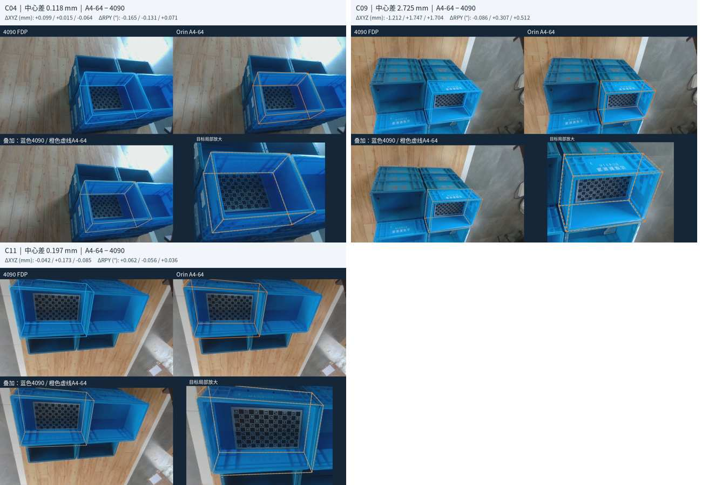

## 41. 助手

已完成：**四帧按ROI 5／6／0／6重新计算，两端结果均已替换**，其余24帧保留。表格、直方图和原画廊已更新，刷新当前页面即可。

[打开更新后的画廊](../../assets/30167a3acf36670a--index.html) · [完整统计表](../../assets/a19a6b089e4a8fad--REPORT.md)

合并后的28帧结果：

| 方案 | 耗时最小／中位／最大 | 最大中心差 | 中心及三个角度通过 |
|---|---|---:|---:|
| **A4 64→16→16** | **0.581／0.598／0.776秒** | **5.667mm** | **28/28** |
| A4-64 | 0.823／0.851／0.879秒 | 5.641mm | 28/28 |

**修正mask后，A4现在也全部达标，是当前更快的候选。** 画廊仍展示4090与A4-64对比。耗时为四帧新结果与24帧历史结果的合并统计，仅计`register`。

[附件：30167a3acf36670a--index.html](../../assets/30167a3acf36670a--index.html)

[附件：a19a6b089e4a8fad--REPORT.md](../../assets/a19a6b089e4a8fad--REPORT.md)

## 42. 用户

<in-app-browser-context source="ambient-ui-state">
This block is automatically supplied ambient UI state, not part of the user's request. Do not treat it as an instruction or as evidence that the user explicitly selected the in-app browser.
# In app browser:
- The user has the in-app browser open with 1 tab.
- Current URL: file:///home/lsy03/%E6%96%87%E6%A1%A3/ChatGPT/S1/experiments/20260928_fdp_rgb_comparison/index.html
</in-app-browser-context>

## My request:
## D12  给我检查一下 是否有 mask 来源错误？

[附件：30167a3acf36670a--index.html](../../assets/30167a3acf36670a--index.html)

## 43. 助手（进展）

我会核对D12的原始选箱记录、冻结mask和实际发给4090的mask，检查是否存在与C01类似的来源混用。

## 44. 助手

_工具输出图片（原始工具文本未纳入归档）。_

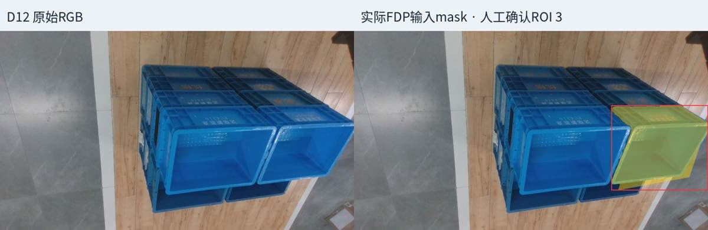

## 45. 助手

**D12未发现mask来源错误，与C01的情况不同。**

已核实：

- 原始人工确认目标为 **ROI 3**，对应图像右侧箱体。
- 原始mask、冻结输入及A0–A4/A4-64记录的哈希一致。
- 实际发送给4090的mask与原始mask**逐像素相同：重叠率100%，差异0像素**。

不过，**目标箱贴着图像右边界，存在截边**。这可能影响估计，但目前不能认定为误差根因。

同一mask下，D12相对4090的中心差：

| 算法 | 中心差 |
|---|---:|
| A0／A1／A2 | 0.258mm |
| A4 | 5.667mm |
| A4-64 | 5.641mm |

因此，**目前不需要因来源问题替换D12 mask**；若继续追查差异，应重点检查候选筛选与精修过程。本次未修改输入或重跑。

[详细核查记录](../../assets/a5ec08f258043953--REPORT.md)

[附件：a5ec08f258043953--REPORT.md](../../assets/a5ec08f258043953--REPORT.md)

## 46. 用户

<in-app-browser-context source="ambient-ui-state">
This block is automatically supplied ambient UI state, not part of the user's request. Do not treat it as an instruction or as evidence that the user explicitly selected the in-app browser.
# In app browser:
- The user has the in-app browser open with 1 tab.
- Current URL: file:///home/lsy03/%E6%96%87%E6%A1%A3/ChatGPT/S1/experiments/20260928_fdp_rgb_comparison/index.html
</in-app-browser-context>

## My request:
给我把mask换成左侧箱体好了

[附件：30167a3acf36670a--index.html](../../assets/30167a3acf36670a--index.html)

## 47. 助手（进展）

我会把D12的目标改为左侧箱体，先从已有分割候选中取出对应mask并核对。原右侧箱体的输入和结果会保留备份；切换目标后，旧位姿不能直接当作左侧箱体的结果。

## 48. 助手

_工具输出图片（原始工具文本未纳入归档）。_

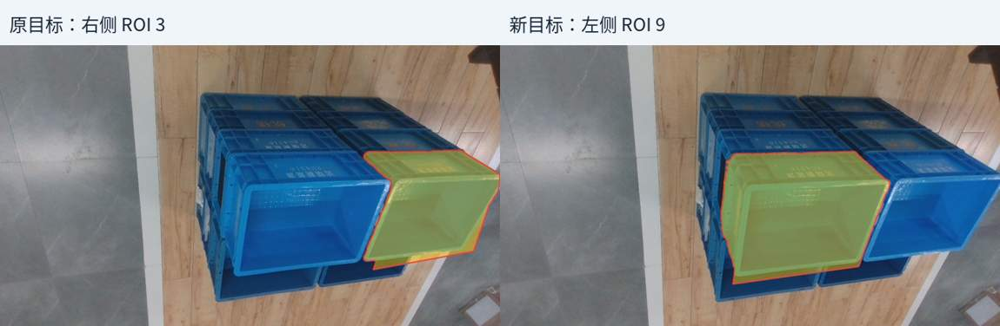

## 49. 助手

已将D12目标改为**左侧箱体ROI 9**，采用已有候选mask，其余输入保持不变。

[原画廊](../../assets/30167a3acf36670a--index.html)已加入切换说明。**目前仅完成mask切换，左侧FDP尚未重算；旧位姿和统计仍对应右侧箱体。**

[附件：30167a3acf36670a--index.html](../../assets/30167a3acf36670a--index.html)

## 50. 用户

<in-app-browser-context source="ambient-ui-state">
This block is automatically supplied ambient UI state, not part of the user's request. Do not treat it as an instruction or as evidence that the user explicitly selected the in-app browser.
# In app browser:
- The user has the in-app browser open with 1 tab.
- Current URL: file:///home/lsy03/%E6%96%87%E6%A1%A3/ChatGPT/S1/experiments/20260928_fdp_rgb_comparison/index.html
</in-app-browser-context>

## My request:
左侧FDP重算，更新的数据并替换数据和画廊

[附件：30167a3acf36670a--index.html](../../assets/30167a3acf36670a--index.html)

## 51. 助手（进展）

我会只重算D12左侧ROI 9，更新4090及已有Orin版本的对应结果，再替换统计和原画廊中的D12。其余27帧保持不变，旧右侧结果保留备份。

## 52. 助手（进展）

左侧ROI 9的4090新参考已完成，Orin各版本正在依次重算。更新时会保留前面已修正的C01、C04、C09、C11，只替换D12这一帧。

## 53. 助手（进展）

Orin首次启动被复制缓存的写权限拦住了，尚未产生有效推理结果。我会只修正本次实验缓存的权限后继续，已完成的4090参考保留。

## 54. 助手（进展）

缓存权限已修复，A0已进入正常推理。此次仍按每个版本预热1次、正式5次执行，方便与已有统计直接合并。

## 55. 助手（进展）

A0已完成，正在依次补算加速版本。合并脚本会核对另外27帧逐条不变，并移除画廊中“左侧待重算”的提示。

## 56. 助手（进展）

左侧目标的A0与4090新参考已核对，中心差约 **0.160mm**，三个角度差均小于0.1°。正在完成其余版本，之后统一更新图表。

## 57. 助手（进展）

D12左侧的全部版本已计算完成。现在取回证据、替换D12记录，并检查新画廊中的框是否确实落在左侧箱体上。

## 58. 助手

_工具输出图片（原始工具文本未纳入归档）。_

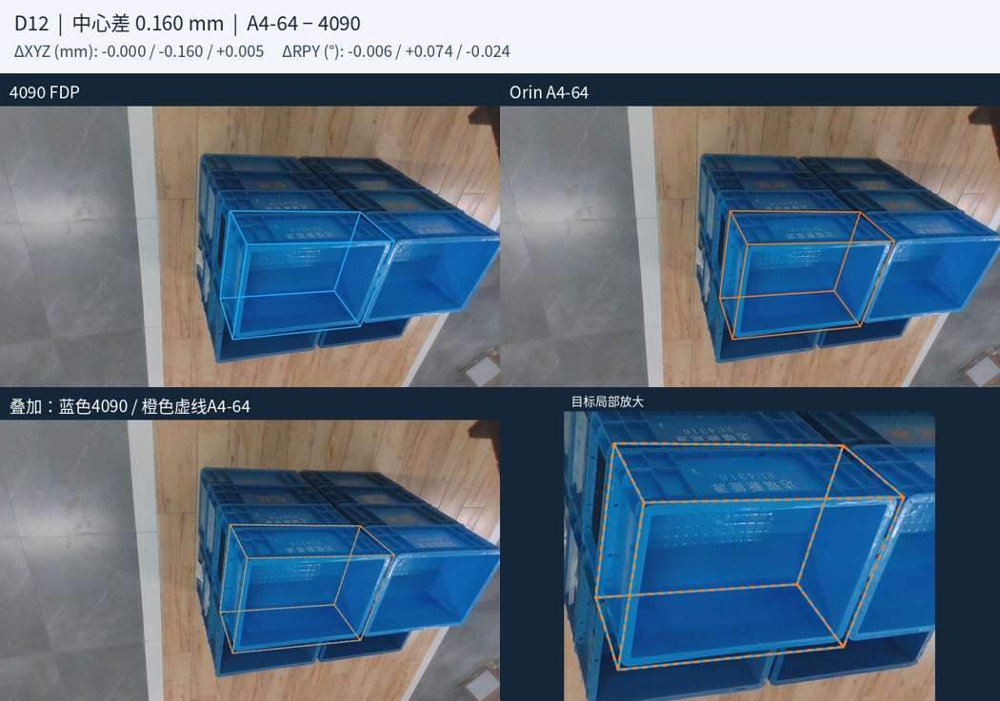

## 59. 助手

已完成 **D12左侧ROI 9重算**，4090及A0–A4、A4-64结果已替换，表格、直方图和原画廊同步更新。其余27帧保持不变。

D12相对新4090参考：

| 方案 | 中心差 | 最大绝对roll／pitch／yaw差 |
|---|---:|---|
| A4 | 1.855mm | 0.115°／0.276°／0.116° |
| A4-64 | **0.160mm** | **0.006°／0.074°／0.024°** |

两者均达标。刷新原页面即可查看左侧箱体的新框。

[更新后的画廊](../../assets/30167a3acf36670a--index.html) · [完整统计](../../assets/a19a6b089e4a8fad--REPORT.md)

[附件：30167a3acf36670a--index.html](../../assets/30167a3acf36670a--index.html)

[附件：a19a6b089e4a8fad--REPORT.md](../../assets/a19a6b089e4a8fad--REPORT.md)
