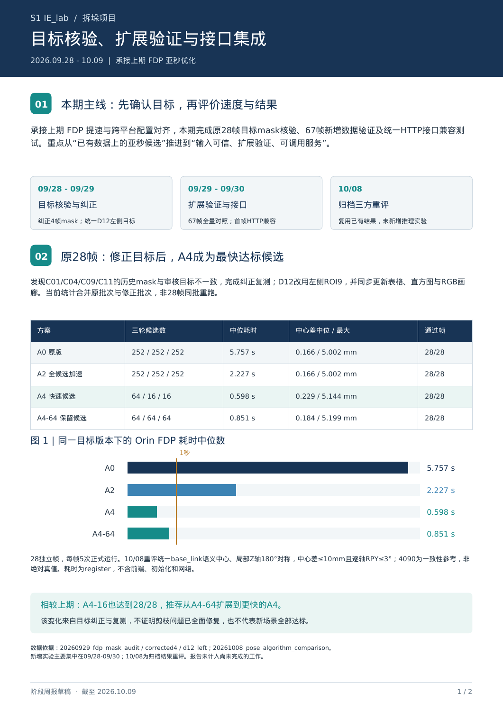
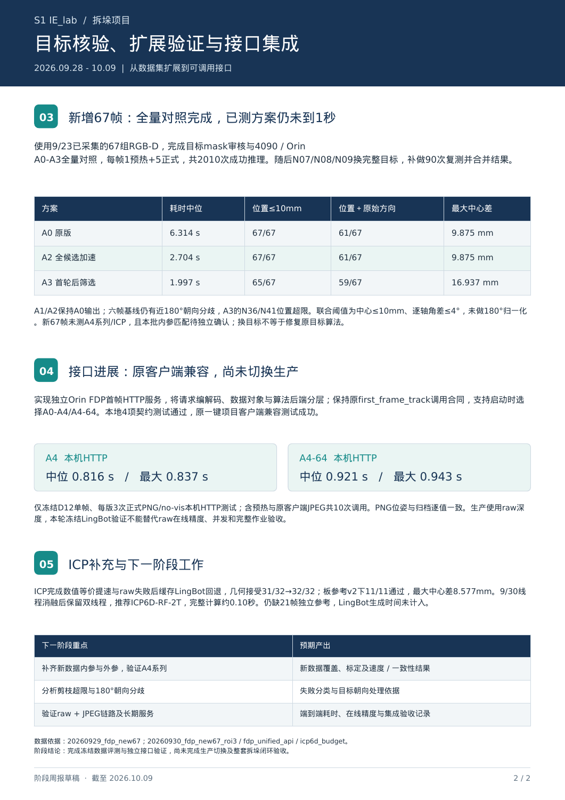
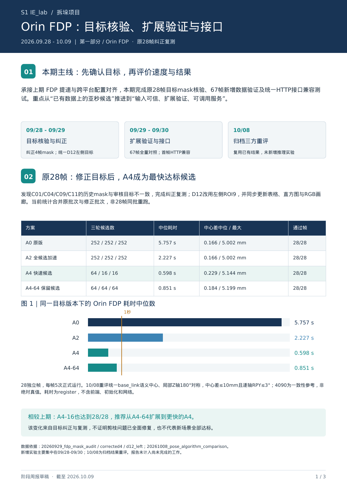
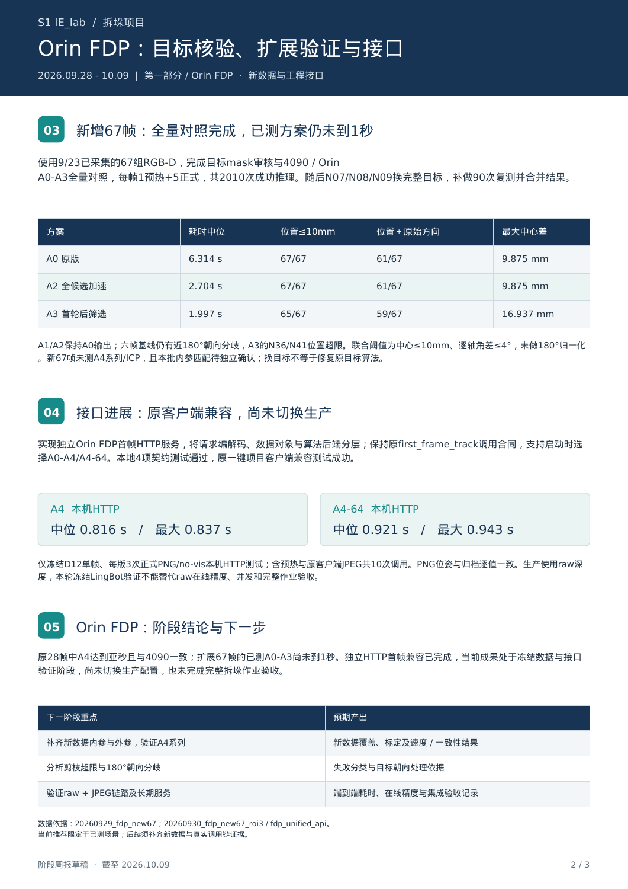
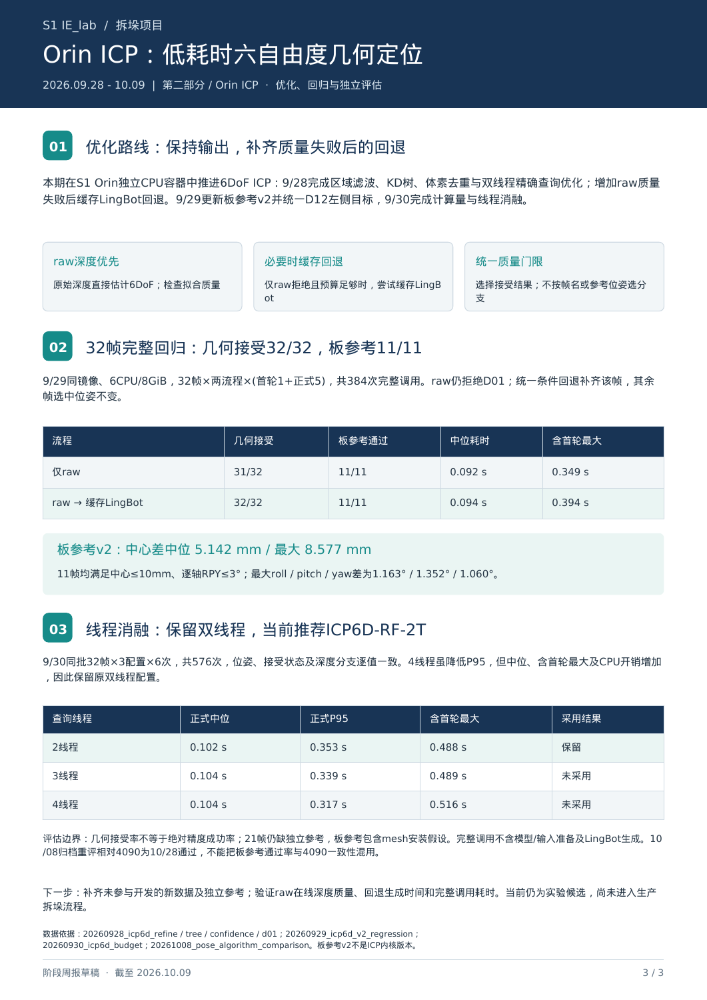
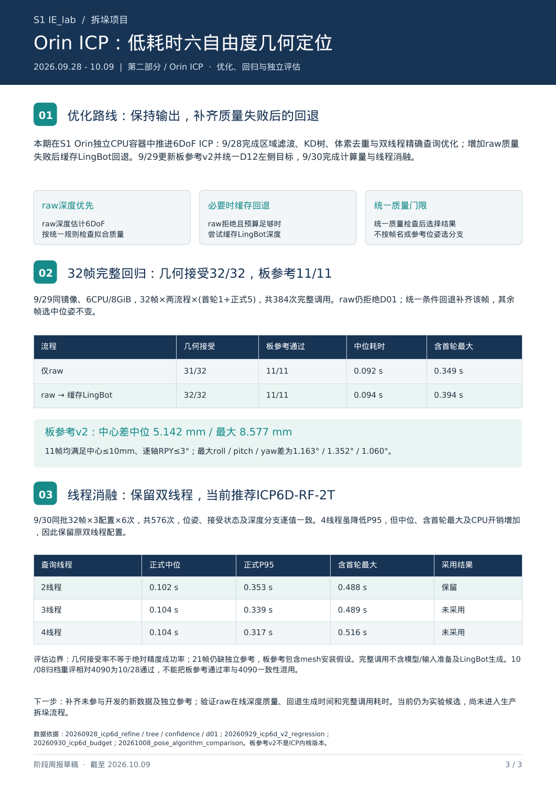

# 周报 10_12 整理 S1 项目进展周报

- 归档编号：`01a11fbe-f96b-7400-83c8-e0f7dd1e3c7b`
- 项目：S1 IE_lab 拆垛
- 创建时间：2026-10-09T16:19:31.824000+08:00
- 更新时间：2026-10-12T09:42:02.868000+08:00
- 状态：活动
- 导出范围：用户可见消息与助手可见回复；不含隐藏推理和工具原始输出

## 1. 用户

<external_codex_apps_open_page>{"page_id":null}</external_codex_apps_open_page>

## 2. 用户

给我看一下 这个项目 9_28 到 10_9 的项目进展， 我需要写周报 参考 “”周报 9_28 S1 IE_lab 周报“”

## 3. 助手（进展）

我先查看项目记录和“周报 9_28 S1 IE_lab 周报”的格式，再整理 9 月 28 日到 10 月 9 日的进展，供你写周报使用。

## 4. 助手（进展）

目前查到的进展主要有四项：ICP 延迟优化与回归、FDP 目标 mask 修正和复测、新增 67 帧验证、统一 HTTP 接口验证。10 月 8 日还做了三方算法归档重评。周报里需要区分“与 4090 输出一致”和“相对标定板参考通过”，两者支持的结论不同。

## 5. 助手（进展）

已找到你指定的旧周报：最终版是两页，聚焦 FDP，并用两张直方图展示耗时和中心偏差。

这期有一个值得重点写的变化：修正四帧 mask、统一 D12 左侧目标后，A4 保留 16 候选的方案在原 28 帧上也全部通过，中位耗时约 0.598 秒；但扩展到新 67 帧后，已测试的 A0–A3 仍未达到 1 秒。因此，正文可以围绕“目标核验 → 扩展验证 → 接口集成”来写，ICP 进展单列补充。

## 6. 助手

我看过 **“周报 9_28 S1 IE_lab 周报”**。上一版重点是 **FDP 提速、跨平台配置对齐和 A4-64 修订**，最终做成两页、两张直方图。

**9/28—10/9 这一期，建议主线写成：目标数据核验 → 新数据扩展验证 → 统一接口集成。** 截至 10/9，可核验的新增实验集中在 **9/28—9/30**；**10/8 是已有结果的三方重评，没有新增推理实验。**

下面这些内容可以直接作为周报素材。

**1. FDP：修正目标 mask，更新原 28 帧验证结论**

9/29 核查发现，C01、C04、C09、C11 四帧使用的 mask 与此前审核目标不一致。完成四帧纠正复测，并按要求将 D12 改为左侧箱体，重新计算和更新表格、直方图及 RGB 画廊。

修正后的共同 28 帧结果如下：

| 方案 | 定位耗时中位数 | 相对4090中心差中位／最大 | 一致性通过 |
|---|---:|---:|---:|
| A0 原版 | 5.757 s | 0.166／5.002 mm | 28/28 |
| A2 全候选加速 | 2.227 s | 0.166／5.002 mm | 28/28 |
| **A4：64→16→16** | **0.598 s** | **0.229／5.144 mm** | **28/28** |
| A4-64：64→64→64 | 0.851 s | 0.184／5.199 mm | 28/28 |

10/8 按中心差≤10 mm、逐轴角差≤3°并考虑箱体180°对称重新评分，上述方案均通过。

**相较上一版的关键变化：修正目标后，A4 在这批数据上也全部通过，成为最快达标候选。** 这一变化来自输入目标纠正与复测，不能解释为候选筛选算法已经全面修复。28 帧统计为不同批次合并，耗时仅为 `register`。[统一比较报告](../../assets/d620410e3b2056b7--REPORT.md)

**2. 扩展到新增 67 帧：验证了泛化限制**

完成对 **9/23 已采集的67组 RGB-D** 的素材审查、目标 mask 审核，以及4090和Orin A0–A3的全量对照：每帧1次预热、5次正式，共 **2010次成功推理**。[全量验证报告](../../assets/124ff900179e00c5--REPORT.md)

随后将 N07、N08、N09 更换为画面内更完整的目标，补做90次复测。合并后的结果为：

| 方案 | 耗时中位数 | 中心差≤10 mm | 中心＋原始方向联合通过 |
|---|---:|---:|---:|
| A0 | 6.314 s | 67/67 | 61/67 |
| A1 | 3.346 s | 67/67 | 61/67 |
| **A2** | **2.704 s** | **67/67** | **61/67** |
| A3 | 1.997 s | 65/67 | 59/67 |

这里联合通过采用中心≤10 mm、逐轴角差≤4°，保留原始朝向。A1/A2保持A0输出；剩余六帧基线角度超限主要表现为近180°朝向分歧。A3的N36、N41仍有位置超限。

**本期的重要结论：新增数据上的已测方案仍未达到1秒，旧28帧亚秒结果不能直接推广。** 新67帧尚未测试A4/A4-64，也没有逐帧外参及独立确认的本批内参；当前结论是条件下的跨平台一致性。[更新后的67帧报告](../../assets/35c7e7935e4eefb9--REPORT.md)

**3. 工程接口：完成独立 Orin FDP 首帧服务验证**

9/30 完成统一 HTTP 接口，将请求编码、数据对象和算法后端分层，支持启动时选择 A0–A4/A4-64，并保持原 `/first_frame_track` 调用合同。

原一键项目客户端兼容测试通过；A4与A4-64共完成10次冻结D12调用。单帧PNG、本机HTTP正式测试中：

- **A4：中位0.816秒，最大0.837秒。**
- **A4-64：中位0.921秒，最大0.943秒。**

这标志着工作从算法实验推进到了可调用服务验证。**尚未切换生产配置，也未完成raw深度在线精度、长期运行和完整拆垛闭环验收。**[接口验证报告](../../assets/1190de788f9c04c5--REPORT.md)

**4. ICP：本期项目进展补充**

上一版暂未写ICP，这期可单列补充：

- 完成ROI滤波、KD树、体素去重和双线程查询等优化，数值等价优化保留原位姿输出。
- 增加raw失败后回退缓存LingBot的规则，32帧几何接受由 **31/32提升至32/32**，仅D01触发回退。
- 采用更新后的板参考v2，11帧均通过中心≤10 mm、逐轴角差≤3°，最大中心差 **8.577 mm**。
- 9/30完成2／3／4查询线程对照，最终保留双线程，当前推荐方案名称为 **ICP6D-RF-2T**，完整计算约 **0.10秒**。[回归报告](../../assets/eb1292a52acb23df--REPORT.md) · [线程选型报告](../../assets/eeeff1393b889340--REPORT.md)

11帧板参考表现支持继续验证ICP，但其余21帧缺独立参考；缓存LingBot生成时间也未计入。10/8重评中，ICP相对板参考为11/11通过，相对4090则为10/28通过，说明**参考基准不同，不能把“接近4090”直接等同于“绝对定位更准”**。

**周报开头可以直接写：**

> 本期围绕S1拆垛箱体定位，完成原28帧目标mask核验与纠正复测，确认Orin FDP A4在该数据集上达到中位0.598秒并满足跨平台一致性要求；将验证范围扩展至新增67帧，识别候选剪枝和180°朝向分歧等限制；完成统一HTTP首帧接口及原客户端兼容验证，为后续端侧接入提供基础。当前成果主要处于冻结数据评测与独立服务验证阶段，尚未完成生产切换及整套拆垛闭环验收。

沿用上一版两页结构，建议**第一页讲28帧修正与67帧扩展结果，第二页讲接口验证、问题和后续计划**。下一阶段重点是补齐新数据标定信息、验证A4系列、分析剩余超限帧，并测量真实感知链路的端到端耗时。

[附件：d620410e3b2056b7--REPORT.md](../../assets/d620410e3b2056b7--REPORT.md)

[附件：124ff900179e00c5--REPORT.md](../../assets/124ff900179e00c5--REPORT.md)

[附件：35c7e7935e4eefb9--REPORT.md](../../assets/35c7e7935e4eefb9--REPORT.md)

[附件：1190de788f9c04c5--REPORT.md](../../assets/1190de788f9c04c5--REPORT.md)

[附件：eb1292a52acb23df--REPORT.md](../../assets/eb1292a52acb23df--REPORT.md)

[附件：eeeff1393b889340--REPORT.md](../../assets/eeeff1393b889340--REPORT.md)

## 7. 用户

给我生成一份周报我先看看

## 8. 助手（进展）

我按上一版的两页 PDF 格式生成一份草稿，重点写 FDP 目标修正、67 帧扩展验证和接口进展；ICP 放在简短补充里。我会使用 PDF 技能生成并检查排版。

## 9. 助手（进展）

两页草稿已生成，包含原28帧结果表、耗时对比图、67帧扩展结果和接口验证数据。现在正在逐页检查排版，并确认各项耗时和通过率的统计口径已标清。

## 10. 助手

_工具输出图片（原始工具文本未纳入归档）。_

## 11. 助手

已生成 **两页周报草稿**，包含 FDP 结果表、耗时对比图、67帧验证、接口进展及下一步计划，已逐页检查排版。

:codex-file-citation{path="/home/lsy03/文档/ChatGPT/S1/output/pdf/S1_IE_lab_周报_2026-09-28至10-09_草稿.pdf" purpose="output"}

[附件：523a0e34518cc881--S1_IE_lab_周报_2026-09-28至10-09_草稿.pdf](../../assets/523a0e34518cc881--S1_IE_lab_%E5%91%A8%E6%8A%A5_2026-09-28%E8%87%B310-09_%E8%8D%89%E7%A8%BF.pdf)

## 12. 用户

报告需要吧 Orin  FDP  和  ICP 算法分开进行展示和汇报

## 13. 助手（进展）

我会把报告改成两个独立部分：Orin FDP 展示目标修正、67帧验证和接口进展；ICP 单独展示优化路线、耗时、板参考结果及待验证问题，并分别列出下一步计划。

## 14. 助手

_工具输出图片（原始工具文本未纳入归档）。_

## 15. 助手（进展）

已改成三页：前两页独立汇报 Orin FDP，第三页独立汇报 Orin ICP。ICP 现在有自己的优化流程、32帧回归结果、线程选型表和下一步计划，正在检查新版排版。

## 16. 助手

_工具输出图片（原始工具文本未纳入归档）。_

## 17. 助手

已改为 **三页分篇报告**：

- **第1–2页：Orin FDP**，展示目标修正、扩展验证和接口进展。
- **第3页：Orin ICP**，展示优化路线、回归结果和线程选型。

两部分分别列出结论与下一步计划，已检查排版。

:codex-file-citation{path="/home/lsy03/文档/ChatGPT/S1/output/pdf/S1_IE_lab_周报_2026-09-28至10-09_FDP与ICP分篇_v2.pdf" purpose="output"}

[附件：70ef2da1246a0d94--S1_IE_lab_周报_2026-09-28至10-09_FDP与ICP分篇_v2.pdf](../../assets/70ef2da1246a0d94--S1_IE_lab_%E5%91%A8%E6%8A%A5_2026-09-28%E8%87%B310-09_FDP%E4%B8%8EICP%E5%88%86%E7%AF%87_v2.pdf)

## 18. 用户

<external_codex_apps_open_page>{"page_id":null}</external_codex_apps_open_page>

## 19. 用户

我记得有几个可视化的 HTML 对比文件可以给我找找

## 20. 助手（进展）

我先在项目里找已生成的 HTML 对比页，核对各页面展示的算法、数据范围和更新版本。

## 21. 助手

找到了，与你这期周报最相关的是下面 **4 个 HTML 对比页**：

| 页面 | 展示内容 |
|---|---|
| **[28帧：Orin FDP 与4090对比](../../assets/30167a3acf36670a--index.html)** | **Orin A4-64 vs 4090**，包含原图、单独框、叠加及放大图；已更新四帧mask和D12左侧目标。 |
| **[67帧：mask与FDP交互对比](../../assets/57d675dc89e8c864--index.html)** | 可切换 **Orin A0–A3**，与4090比较；支持图层、方向箭头和超限筛选。N07/N08/N09已换完整ROI。 |
| **[32帧：ICP、4090与板参考叠加](../../assets/0d3f45d77e458fc7--index.html)** | **绿：ICP；青：4090；黄：板参考v2**。支持逐帧切换、图层开关；11帧三方齐全。 |
| **[32帧：ICP与板参考回归图库](../../assets/c15d218a3b8e563b--index.html)** | 单独展示 **ICP、板参考和目标mask**，适合ICP部分汇报；D12为左侧目标。 |

另有 **[板参考修正前后对比](../../assets/bf4f7d74ed8b639f--index.html)**，展示旧参考与直边贴合v2的差异。

按你要求分开汇报：**FDP用前两个，ICP用第四个；第三个用于说明算法与参考之间的差异。**

[附件：30167a3acf36670a--index.html](../../assets/30167a3acf36670a--index.html)

[附件：57d675dc89e8c864--index.html](../../assets/57d675dc89e8c864--index.html)

[附件：0d3f45d77e458fc7--index.html](../../assets/0d3f45d77e458fc7--index.html)

[附件：c15d218a3b8e563b--index.html](../../assets/c15d218a3b8e563b--index.html)

[附件：bf4f7d74ed8b639f--index.html](../../assets/bf4f7d74ed8b639f--index.html)
