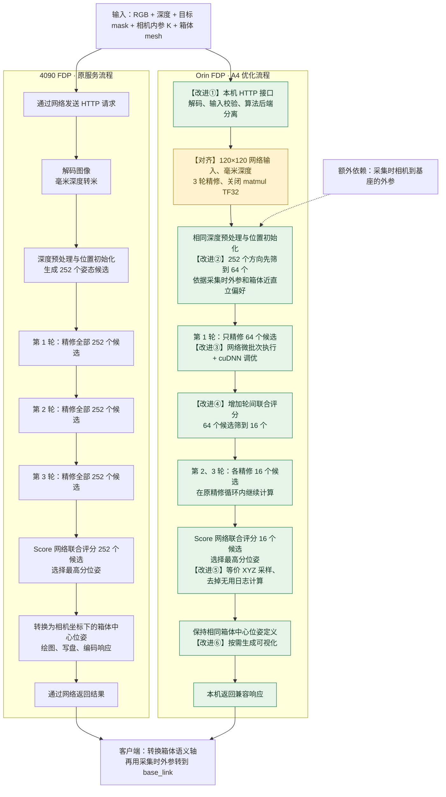

# 对比4090FDP与Orin FDP优化

- 归档编号：`01a13808-5028-7582-99b9-b1fb76d3ebf8`
- 项目：S1 IE_lab 拆垛
- 创建时间：2026-10-14T09:30:31.337000+08:00
- 更新时间：2026-10-14T09:56:43.617000+08:00
- 状态：活动
- 导出范围：用户可见消息与助手可见回复；不含隐藏推理和工具原始输出

## 1. 用户

<external_codex_apps_open_page>{"page_id":null}</external_codex_apps_open_page>

## 2. 用户

我们现在优化的4090FDP到 Orin FDP ，到底优化了啥？给我画个图对比一下

## 3. 助手（进展）

我先查项目里关于 4090 FDP 和 Orin FDP 的记录，确认优化内容，再画一张前后对比图。

## 4. 助手（进展）

记录里最关键的成果是：把同一套 FDP 的 Orin 首帧位姿计算从约 5.76 秒压到 0.60 秒，同时在已测 28 帧上保持与 4090 的结果接近。主要改动是等价计算优化、分批执行，以及减少姿态候选；没有重新训练模型。我会用 visualize 技能画出这些变化，并标明哪些结果还只经过离线验证。

## 5. 助手

**我们优化的是：让同一套 FDP 在机器人 Orin 上也能快速计算，并尽量保持与 4090 的输出一致。** 主要做了计算优化、候选筛选、跨平台数值对齐和本机接口适配，没有重新训练模型。

visualize{"path":"/home/lsy03/.codex/visualizations/2026/10/14/01a13808-5028-7582-99b9-b1fb76d3ebf8/fdp-orin-comparison.html"}

目前成果是 **Orin 首帧计算从约 5.76 秒降到 0.60 秒**；结论限于已测 28 帧，尚未切换生产，也不等于绝对定位精度提高。数据依据：[最新统一比较报告](../../assets/d620410e3b2056b7--REPORT.md)。

[附件：e3c6928b71c2fc89--fdp-orin-comparison.html](../../assets/e3c6928b71c2fc89--fdp-orin-comparison.html)

[附件：d620410e3b2056b7--REPORT.md](../../assets/d620410e3b2056b7--REPORT.md)

## 6. 用户

给我画一下4090FDP 和 OrinFDP 的实现流程图，然后给我标出来哪些是改进后的地方？

## 7. 助手（进展）

我会把两边从输入到位姿输出的实现流程并排画出来，重点标出 Orin 的数据处理、分批计算和候选筛选改动，并区分“加速优化”和“与 4090 对齐”。

## 8. 助手

下面以 **Orin A4 快速版**对比原 4090 FDP。**【改进】是优化点，【对齐】是为保持两端结果一致做的修正。** 两边使用相同网络和权重。

每一轮“精修”内部仍然是：**按候选姿态渲染模型 → 裁剪真实/渲染 RGB 与 XYZ → Refiner 网络预测位姿增量 → 更新候选姿态**。我们主要减少了进入这条计算链的候选数。

- **等价计算优化（A1/A2）**：优化 XYZ 采样、日志计算和网络执行方式，仍保留全部 252 个候选；已测输出与 Orin A0 逐值一致。
- **搜索量优化（A3/A4）**：A4 将三轮候选数从 **252→252→252** 改成 **64→16→16**，这是亚秒计算的关键，但引入了近直立先验和筛错候选的可能。
- **部署优化**：增加兼容原客户端的本机首帧接口，并允许关闭可视化。**目前完成独立验证，尚未切换生产。**

流程依据：[Orin 实现代码](/home/lsy03/文档/ChatGPT/S1/experiments/20260930_fdp_unified_api/package/fdp_api/backends/orin.py)、[接口说明](../../assets/c0d584fbf1c1cc70--README.md)、[4090 源码核查](../../assets/fdfc2b2fbf819c2b--REPORT.md)。

[附件：c0d584fbf1c1cc70--README.md](../../assets/c0d584fbf1c1cc70--README.md)

[附件：fdfc2b2fbf819c2b--REPORT.md](../../assets/fdfc2b2fbf819c2b--REPORT.md)
