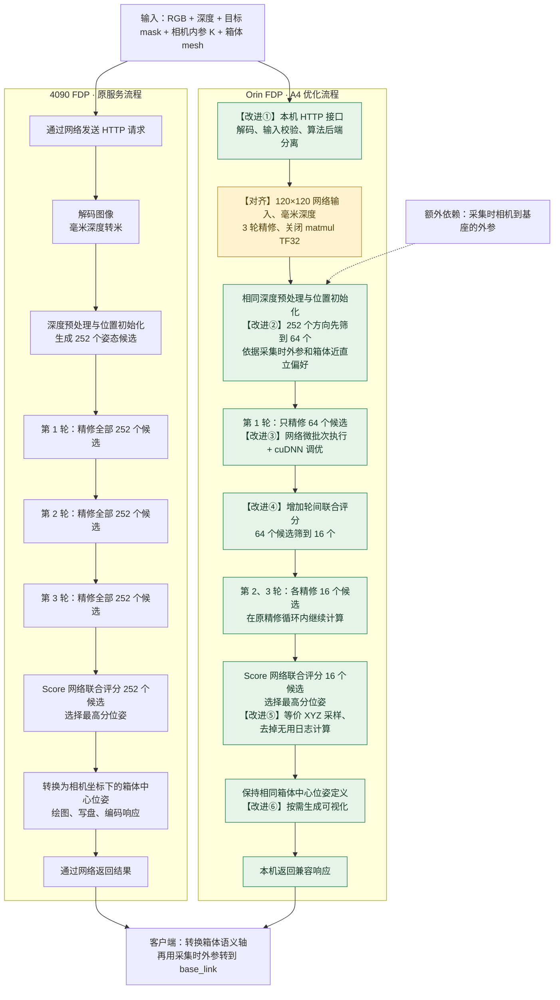
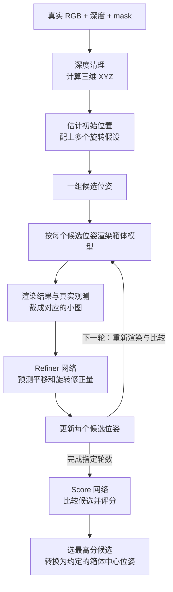
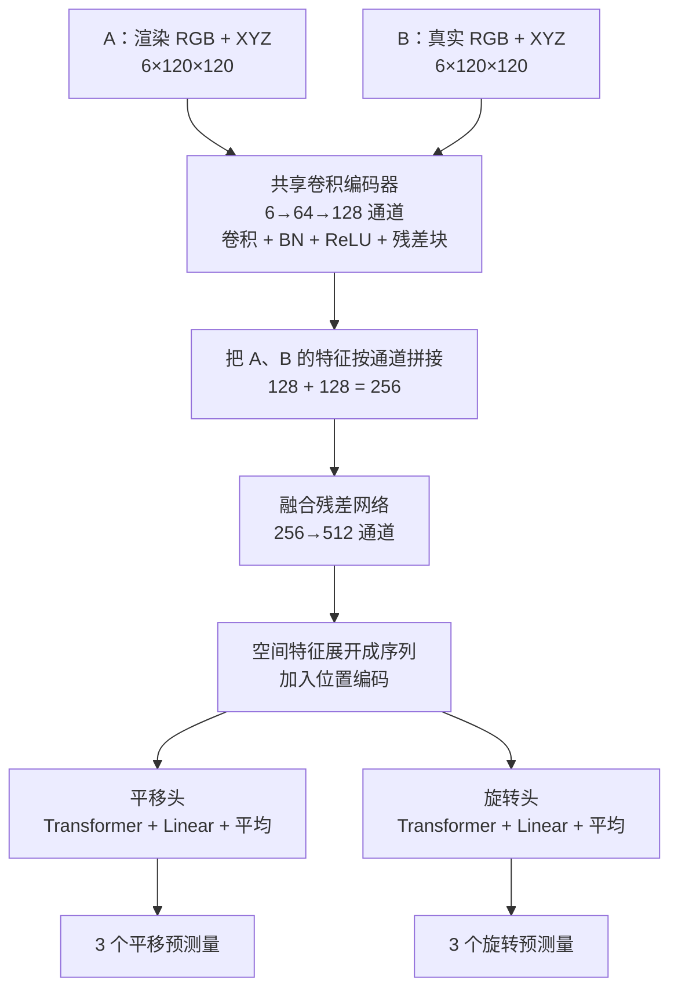
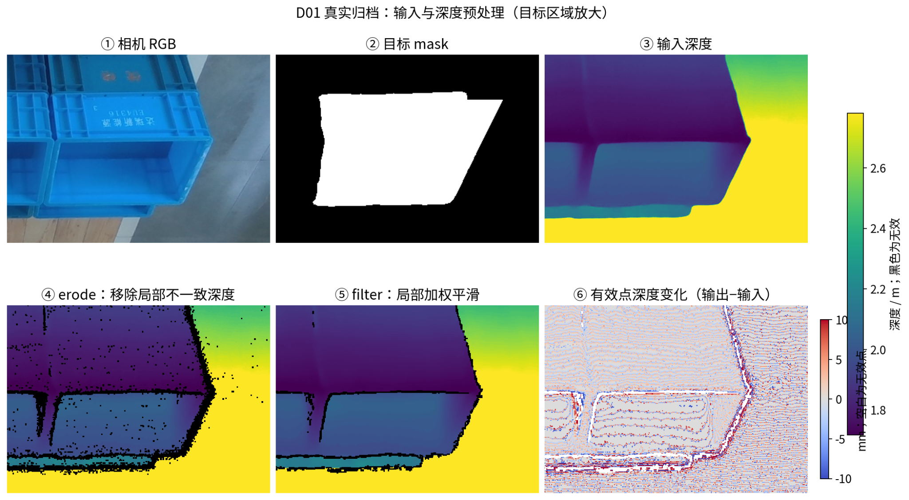
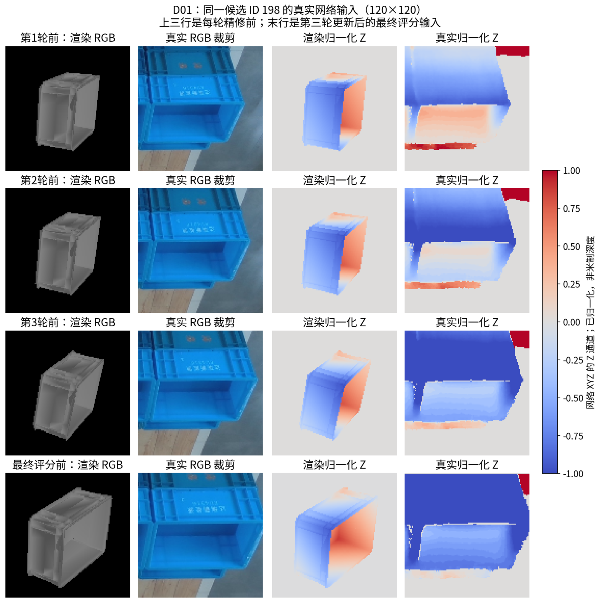
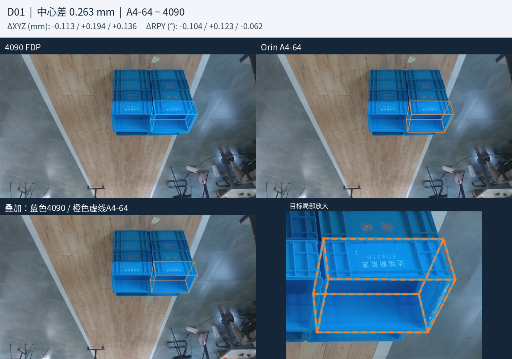
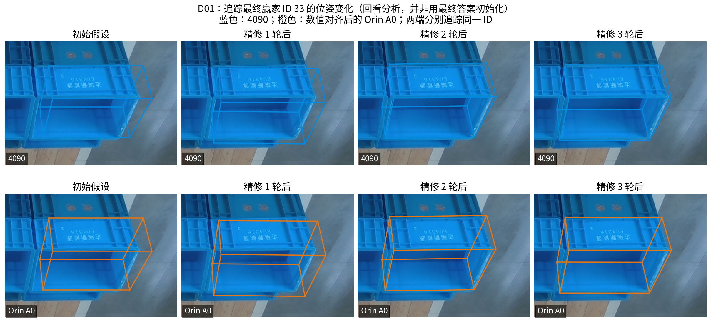
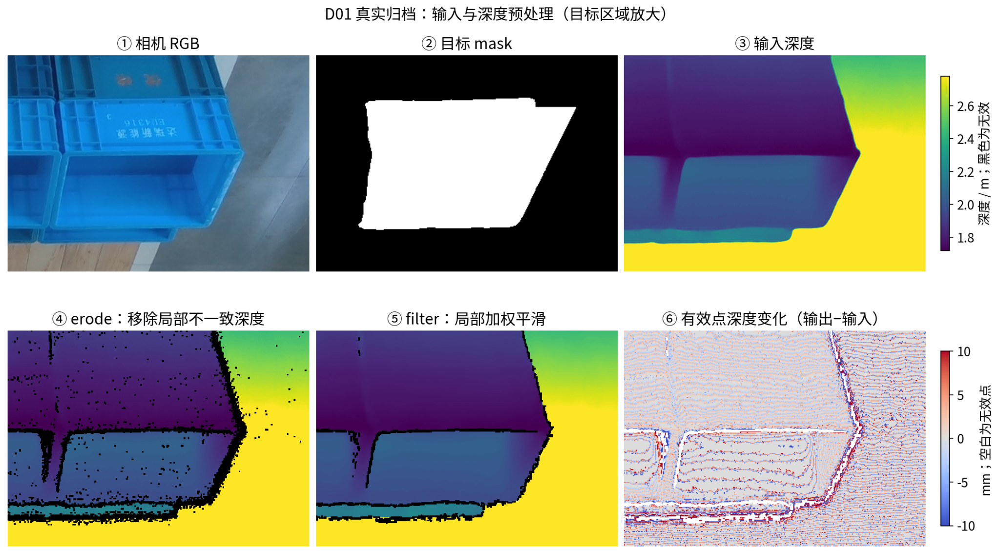
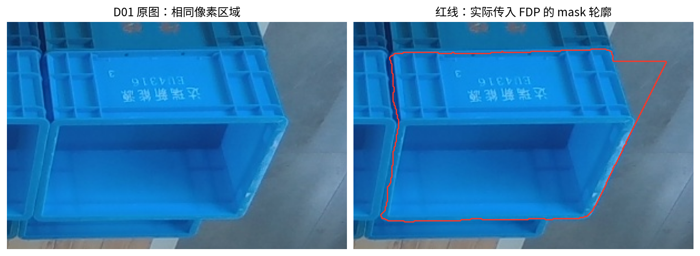

# 对比4090FDP与Orin FDP优化

- 归档编号：`01a13808-5028-7582-99b9-b1fb76d3ebf8`
- 项目：S1 IE_lab 拆垛
- 创建时间：2026-10-14T09:30:31.339000+08:00
- 更新时间：2026-10-16T09:16:29.140000+08:00
- 状态：活动
- 导出范围：用户可见消息与助手可见回复；不含隐藏推理和工具原始输出

## 1. 用户

<external_codex_apps_open_page>{"page_id":null}</external_codex_apps_open_page>

## 2. 用户

我们现在优化的4090FDP到 Orin FDP ，到底优化了啥？给我画个图对比一下

## 3. 助手（进展）

我先查项目里关于 4090 FDP 和 Orin FDP 的记录，确认优化内容，再画一张前后对比图。

## 4. 助手（进展）

记录里最关键的成果是：把同一套 FDP 的 Orin 首帧位姿计算从约 5.76 秒压到 0.60 秒，同时在已测 28 帧上保持与 4090 的结果接近。主要改动是等价计算优化、分批执行，以及减少姿态候选；没有重新训练模型。我会用 visualize 技能画出这些变化，并标明哪些结果还只经过离线验证。

## 5. 助手

**我们优化的是：让同一套 FDP 在机器人 Orin 上也能快速计算，并尽量保持与 4090 的输出一致。** 主要做了计算优化、候选筛选、跨平台数值对齐和本机接口适配，没有重新训练模型。

visualize{"path":"/home/lsy03/.codex/visualizations/2026/10/14/01a13808-5028-7582-99b9-b1fb76d3ebf8/fdp-orin-comparison.html"}

目前成果是 **Orin 首帧计算从约 5.76 秒降到 0.60 秒**；结论限于已测 28 帧，尚未切换生产，也不等于绝对定位精度提高。数据依据：[最新统一比较报告](../../assets/d620410e3b2056b7--REPORT.md)。

[附件：e3c6928b71c2fc89--fdp-orin-comparison.html](../../assets/e3c6928b71c2fc89--fdp-orin-comparison.html)

[附件：d620410e3b2056b7--REPORT.md](../../assets/d620410e3b2056b7--REPORT.md)

## 6. 用户

给我画一下4090FDP 和 OrinFDP 的实现流程图，然后给我标出来哪些是改进后的地方？

## 7. 助手（进展）

我会把两边从输入到位姿输出的实现流程并排画出来，重点标出 Orin 的数据处理、分批计算和候选筛选改动，并区分“加速优化”和“与 4090 对齐”。

## 8. 助手

下面以 **Orin A4 快速版**对比原 4090 FDP。**【改进】是优化点，【对齐】是为保持两端结果一致做的修正。** 两边使用相同网络和权重。



每一轮“精修”内部仍然是：**按候选姿态渲染模型 → 裁剪真实/渲染 RGB 与 XYZ → Refiner 网络预测位姿增量 → 更新候选姿态**。我们主要减少了进入这条计算链的候选数。

- **等价计算优化（A1/A2）**：优化 XYZ 采样、日志计算和网络执行方式，仍保留全部 252 个候选；已测输出与 Orin A0 逐值一致。
- **搜索量优化（A3/A4）**：A4 将三轮候选数从 **252→252→252** 改成 **64→16→16**，这是亚秒计算的关键，但引入了近直立先验和筛错候选的可能。
- **部署优化**：增加兼容原客户端的本机首帧接口，并允许关闭可视化。**目前完成独立验证，尚未切换生产。**

流程依据：[Orin 实现代码](/home/lsy03/文档/ChatGPT/S1/experiments/20260930_fdp_unified_api/package/fdp_api/backends/orin.py)、[接口说明](../../assets/c0d584fbf1c1cc70--README.md)、[4090 源码核查](../../assets/fdfc2b2fbf819c2b--REPORT.md)。

[附件：c0d584fbf1c1cc70--README.md](../../assets/c0d584fbf1c1cc70--README.md)

[附件：fdfc2b2fbf819c2b--REPORT.md](../../assets/fdfc2b2fbf819c2b--REPORT.md)

## 9. 用户

<external_codex_apps_open_page>{"page_id":null}</external_codex_apps_open_page>

## 10. 用户

深度预处理是如何实现的？  精修是如何进行的？ 神经网络的结构是什么样，输入和输出分别是什么？  或者你教教我如何理解这整个过程和改进点在哪？

## 11. 助手（进展）

我先核对归档源码里的深度处理、Refiner 和 Score 网络，再按“输入是什么、每一步做什么、输出是什么”串起来讲，最后把我们的改进点放回这条流程里。

## 12. 助手（进展）

源码确认了两个关键点：Refiner 比较“当前姿态渲染出的模型”和真实观测，预测一小步位姿修正；Score 则负责给候选排名。另一个容易混淆的地方是，微批次 64 只是分批提取特征，最后仍要让全部候选一起评分，这和 A4 真正删减候选是两回事。

## 13. 助手

可以把 FDP 理解为：**先提出多个“箱体可能摆在哪里、朝哪个方向”的假设，再让网络逐步修正，最后选出最符合相机观测的那个。**

整个过程里有两个主要网络：**Refiner 负责修正姿态，Score 负责比较候选。** 我们的优化主要围绕这两个网络前后的数据处理，以及需要计算多少个候选展开。

下面的深度处理、输入输出和位姿更新来自项目归档源码；网络内部结构参考 NVIDIA 官方实现，尚未逐层核验部署镜像中的网络定义。

**1．先理解算法手里有什么**

| 输入 | 提供什么信息 |
|---|---|
| RGB 图像 | 箱体的颜色、纹理、边缘 |
| 深度图 | 每个像素对应的距离 |
| 目标 mask | 这次要估计哪个箱体 |
| 相机内参 K | 如何把像素和深度转换为三维坐标 |
| 箱体 mesh | 箱体的三维形状和尺寸 |
| 相机到基座的外参 | A4 用来判断箱体是否接近直立；客户端也用它转换最终坐标 |

最终输出是一个位姿矩阵：

\[
T=\begin{bmatrix}R&t\\0&1\end{bmatrix}
\]

其中 \(t\) 是三维位置，\(R\) 是三维旋转。你看到的 XYZ 和 roll/pitch/yaw，是对这个矩阵的另一种表达。



**2．深度预处理具体做了什么**

首先统一单位。HTTP 传来的深度是 `uint16` 毫米 PNG，例如数值 `850` 表示 850 mm，解码后变成浮点数 `0.850 m`。

接着，`register()` 依次调用两个处理函数：

- **`erode_depth(radius=2)`：清掉局部不一致的深度。** 查看以当前像素为中心的 5×5 邻域。如果超过 80% 的邻居无效，或与当前深度相差超过 1 mm，就把该像素置零。它的作用类似“去掉孤立、不可信的深度点”。
- **`bilateral_filter_depth(radius=2)`：局部平滑。** 也看 5×5 邻域，先求有效深度的均值，再对接近该均值的深度加权平均。源码还设了与局部均值相差小于 10 mm 的筛选条件。

这里需要看具体实现，不能只凭“腐蚀”“双边滤波”的名字理解。4090 归档代码还有 **Warp 不可用时直接返回原深度**的回退；历史基准是否实际触发该回退，现有记录没有证明。

清理后，把深度转换成 **XYZ 图**。对像素 \((u,v)\)，深度为 \(Z\)：

\[
X=(u-c_x)Z/f_x,\qquad
Y=(v-c_y)Z/f_y
\]

于是，每个像素除了 RGB，还能对应一个三维点 \((X,Y,Z)\)。

例如 \(f_x=600\)，像素位于主点右侧 60 像素，深度为 1 m，那么：

\[
X=60\times1/600=0.1\,m
\]

这就是“这个像素对应的表面点，在相机右侧约 10 cm”。

**我们没有把这些深度清理步骤替换成新算法。** A1 的相关优化主要发生在后面的 Score 输入构造：只计算最终裁剪会用到的 XYZ，同时保留原采样取整和补零规则，减少中间数据处理。

**3．第一批位姿候选从哪里来**

位置和方向分开初始化。

位置先做一个粗猜测：取 mask 外接框的像素中心，再取 mask 内有效深度的中位数，用 K 反投影得到三维位置。它只是起点，后面还会修正。

方向则使用预先构造的旋转网格。我们这套配置实际有 **252 个旋转候选**，它们开始时共用那个粗略位置。

可以把它想成：在相机前摆出 252 个虚拟箱子，位置差不多，但朝向不同。只要其中一些接近真实情况，Refiner 就有机会进一步对齐。

**4．“精修”究竟怎么修**

拿其中一个候选来说，假设它的位置偏右，朝向也转过头了。

算法按这个候选位姿渲染 mesh，得到“如果箱体真的这样摆，相机应该看到什么”。然后，把渲染结果与真实观测裁成对应的 **120×120** 小图，交给 Refiner。

两路输入分别是：

| 输入 | 内容 | 每个候选的形状 |
|---|---|---|
| A：模型渲染 | RGB 三通道 + XYZ 三通道 |
| B：真实观测 | RGB 三通道 + XYZ 三通道 |

两路都是 **`6×120×120`**。这里的 120×120 是网络裁剪尺寸，相机原图可以更大。当前配置不额外输入法向量通道；mask 主要用于目标选择和初始化。

Refiner 输出两组三维量：

- `trans`：平移修正的预测量，经过尺度还原得到 \(\Delta t\)；
- `rot`：旋转修正的预测量，当前配置按轴角方式转换为 \(\Delta R\)，不是直接输出 roll/pitch/yaw。

然后按归档代码更新：

\[
t_{\text{新}}=t_{\text{旧}}+\Delta t,\qquad
R_{\text{新}}=\Delta R\,R_{\text{旧}}
\]

**一轮精修完成后，下一轮会用新姿态重新渲染、重新比较。** 三轮精修就是对同一张观测图反复修正三次，不是采三张图。

**5．神经网络内部是什么结构**

官方 Refiner 是 **卷积/残差特征提取 + Transformer 输出头**，可以按下面的结构理解：



卷积提取局部形状与外观，融合网络比较两路特征，两个输出头分别预测位置和方向的修正。官方两个 Transformer 输出头均采用 512 维特征、4 个注意力头。[官方 Refiner 源码](https://github.com/NVlabs/FoundationPose/blob/main/learning/models/refine_network.py)

**Score 网络也接收“渲染与真实”的成对 RGB+XYZ 输入，但输出的是每个候选的一个排序分数。** 它先提取每对图的特征，再通过注意力汇总空间信息，并让候选之间交换信息，最后给出分数；这个分数不应直接理解为定位正确的概率。[官方 Score 源码](https://github.com/NVlabs/FoundationPose/blob/main/learning/models/score_network.py)

候选间注意力带来一个重要影响：**删掉部分候选后，剩余候选的分数和排名也可能改变。** 所以“原来的赢家还留着”，并不能保证最终结果相同。

**6．把我们的改进放回流程里看**

| 版本 | 改动位置 | 如何省计算 | 结果上的含义 |
|---|---|---|---|
| A1 | 输入构造、日志 | 等价 XYZ 采样，避免无用日志求值 | 已测输出与 A0 一致 |
| A2 | 网络执行 | 微批次 64、cuDNN 算法选择 | 全部 252 个候选仍参与；已测输出与 A0 一致 |
| A3 | 第一轮之后 | 评分后只留 16 个继续精修 | 可能丢掉正确候选，也可能改变评分排名 |
| A4 | 第一轮之前 | 依据近直立偏好先选 64，再按 A3 筛到 16 | 进一步省掉首轮计算，需要匹配的外参和场景假设 |
| A4-64 | 候选保留策略 | 三轮都保留 64 个 | 比 A4 搜索更宽，计算更多 |

**“微批次 64”和“只保留 64 个候选”要分清：**

- A2 是把 252 个候选分几批处理，最后把全部特征合起来，仍然联合评分。
- A4 是实际删掉一部分旋转假设，后续不再计算它们。

用“候选数 × 精修轮数”粗看工作量：

```text
原版： 252 → 252 → 252    共 756 次候选精修
A3：   252 →  16 →  16    共 284 次候选精修
A4：    64 →  16 →  16    共  96 次候选精修
A4-64： 64 →  64 →  64    共 192 次候选精修
```

这个计数只帮助理解精修量，实际总耗时还包含渲染、裁剪和新增的中途评分，不能直接按比例换算速度。

此外，统一 **120×120、三轮精修、毫米深度和 matmul TF32 设置**，属于跨平台数值对齐。尤其关闭 matmul TF32 是为了改善与 4090 的一致性，不能算作纯加速措施。

因此，理解这次工作的关键是：**网络仍负责“怎么修、怎么选”；我们优化了数据怎么准备、网络怎么执行，以及哪些候选值得继续投入计算。** 旧 28 帧中，Orin A0 到 A4 的 register 中位时间约从 **5.76 秒降到 0.60 秒**，但候选裁剪的效果仍受场景限制。

对应本地入口：[深度处理与候选生成](/home/lsy03/文档/ChatGPT/S1/experiments/20260922_fdp_4090_service/source_audit/server4090/FoundationPose/estimater.py)、[精修输入与位姿更新](/home/lsy03/文档/ChatGPT/S1/experiments/20260922_fdp_4090_service/source_audit/server4090/FoundationPose/learning/training/predict_pose_refine.py)、[Orin 优化装配](/home/lsy03/文档/ChatGPT/S1/experiments/20260930_fdp_unified_api/package/fdp_api/backends/orin.py)。

## 14. 用户

<external_codex_apps_open_page>{"page_id":null}</external_codex_apps_open_page>

## 15. 用户

每个阶段的图片有没有？给我直观感受对比一下？

## 16. 助手（进展）

我先找已有的阶段截图和对比图，优先用同一帧把 RGB、深度、mask 和最终位姿串起来；渲染、裁剪及精修中间图也会一起检查。

## 17. 助手（进展）

找到了真实推理时保存的中间数组：同一帧的原始深度、清理后深度、三轮渲染、网络输入裁剪、每轮位姿和最终评分都有。我可以直接把它们画出来。逐阶段记录来自 4090 和 Orin A0 的对齐诊断；A4-64 则有最终结果对比图，会分别标清。

## 18. 助手

_工具输出图片（原始工具文本未纳入归档）。_








## 19. 助手

**有，而且保存了真实推理时的中间数组。** 我把同一帧 D01 整理成下面几组图，按处理顺序看。

**① 原图 → mask → 深度清理**

看下排：`erode` 先剔除局部不一致的深度点，出现黑色孔洞；后面的滤波让有效表面更平滑。右下把变化放大到毫米级，方便看出差别。


**② 网络实际看到什么**

每行从左到右是：**虚拟模型 RGB、真实 RGB、模型 Z、真实 Z**。从上往下，是三轮精修前以及最终评分前的输入。

灰色模型来自 mesh 渲染，没有真实箱子的蓝色纹理；网络结合外观与三维几何进行比较。后两列是归一化后的 Z 通道，颜色不直接表示米。

这里展示的是保存下来的**候选 198，它最终没有胜出**。可以看到它经过修正仍与真实箱体方向不同——这也说明为什么还需要 Score 从多个候选中选择。


**③ 精修到底改变了什么**

下面回看**最终胜出的候选 33**：从左到右是初始姿态、精修一轮、两轮、三轮后的三维框投影。注意箱口边缘附近的位置和方向变化。

上排是 4090，下排是数值对齐后的 **Orin A0**；两边变化很接近。这组是原版对齐诊断，尚不是 A4 的候选筛减过程。



**④ 优化后的最终结果能有多接近**

这是同一帧 **4090 与 Orin A4-64** 的最终对比：蓝色是 4090，橙色虚线是 A4-64，中心差约 **0.263 mm**，投影框基本重合。这里衡量的是两端一致性，不能据此认定绝对定位误差只有这么大。


**我们的加速主要体现在“少处理候选、少做中间计算”，所以最终图片可以几乎相同，但计算耗时明显下降。** A4 的逐轮筛选图片目前没有这套完整归档，不能把上面的 A0 中间图当成 A4 运行记录。


## 20. 用户

<external_codex_apps_open_page>{"page_id":null}</external_codex_apps_open_page>

## 21. 用户

这个mask是不是有点问题？为什么有个角突出去了？
还有这个深度图是否使用了lingbotdepth？



## 22. 助手（进展）

我会把 mask 轮廓叠到原图上，确认突角落在箱沿还是背景，同时核对这帧深度的来源记录。

## 23. 助手

_工具输出图片（原始工具文本未纳入归档）。_



## 24. 助手

**是的，这个 mask 右上角确实有局部越界；这张图使用的也是 LingBotDepth 深度。**

我把实际传入 FDP 的 mask 轮廓叠到了原图上。红线右上方包进了一块灰色背景，那个突角不是箱体的真实结构，也不是展示图片时产生的。


核对发现，这个 mask 与历史冻结输入**逐像素一致**，说明问题已经存在于原始分割结果中。为什么分割出了这个角，还需要追查当时的生成过程。它可能影响初始化位置和有效深度选择，但**尚不能确定对最终位姿造成了多大影响**；两端使用相同 mask，结果接近也不能证明 mask 正确。

深度来源则已核实到数组：

**预先生成的 LingBotDepth 深度 → 毫米量化传输 → FDP 的 erode → FDP 的滤波。**

阶段图里的输入深度，与归档 LingBot 深度按上述方式量化后的数组完全相同，最大差为 **0**。因此，后面展示的 erode/filter 是对 **LingBot 输出继续处理**；之前约 0.60 秒的 register 耗时**不包含 LingBotDepth 的生成时间**。


## 25. 助手

_历史投影中的图片引用（用于补全本地对话资源）。_

> 资源未归档：`/tmp/codex-clipboard-42b989bf-94e1-4e53-b30f-5cad6d843fad.png`（missing）
