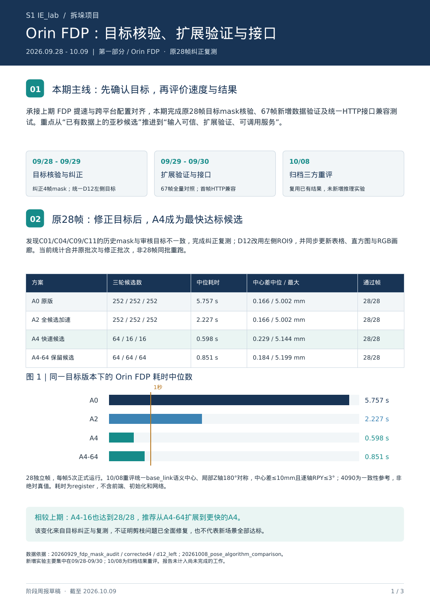
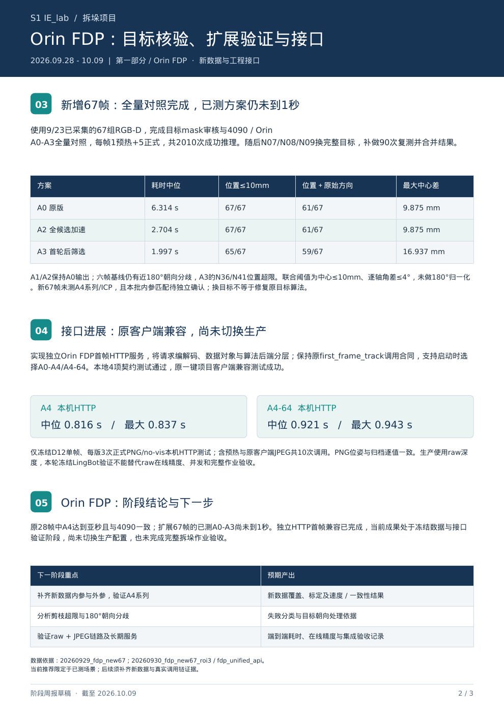
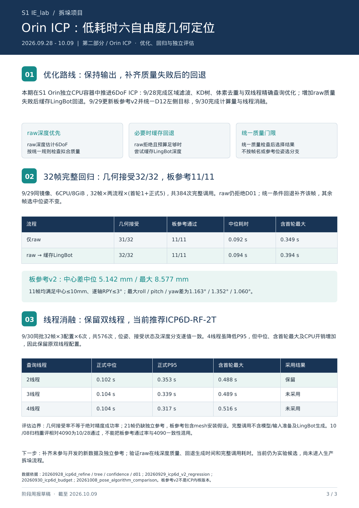
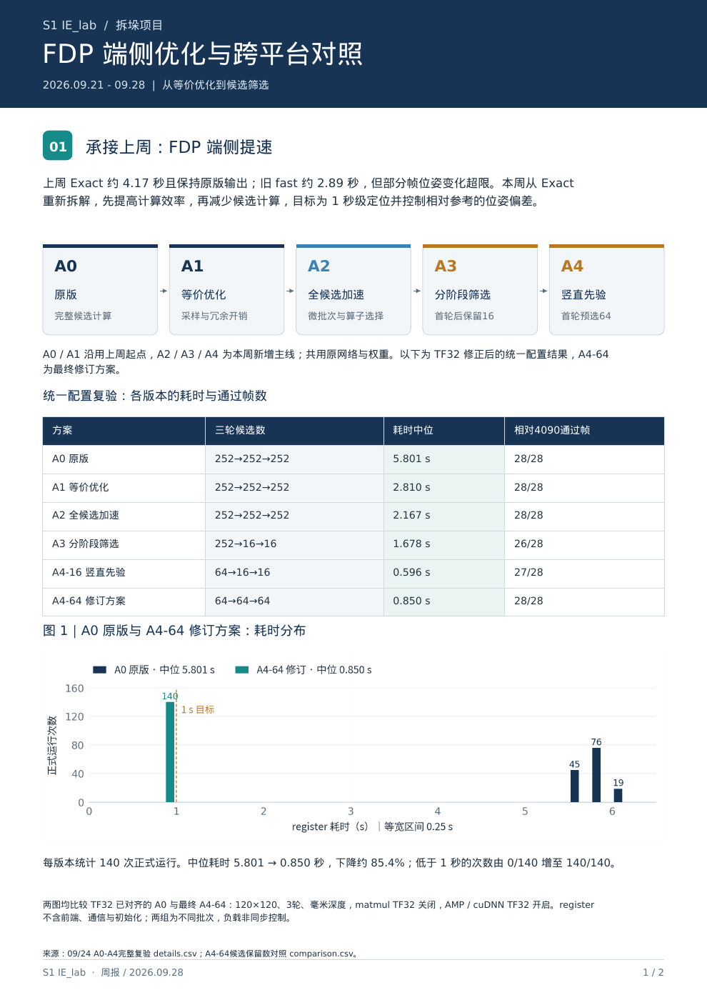
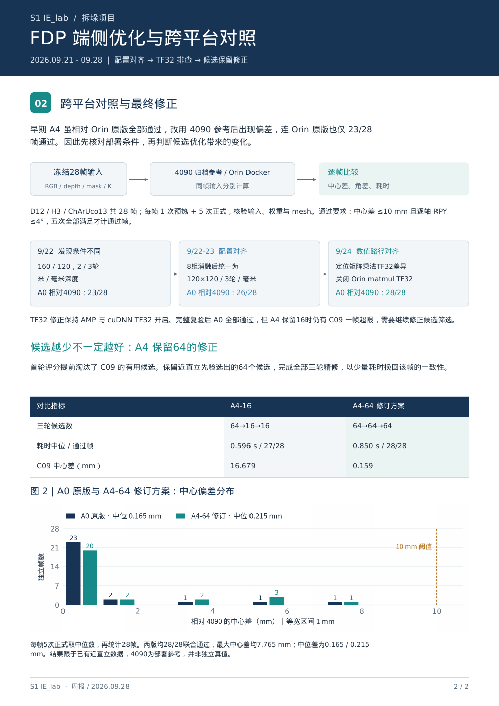
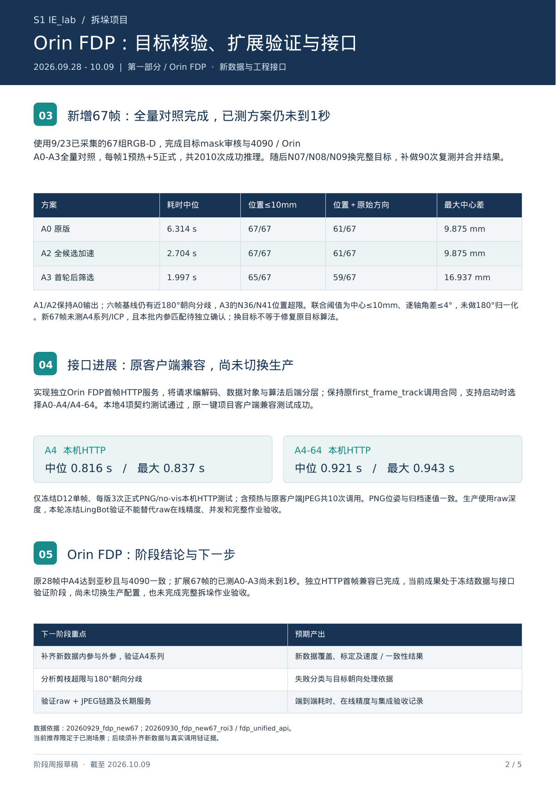
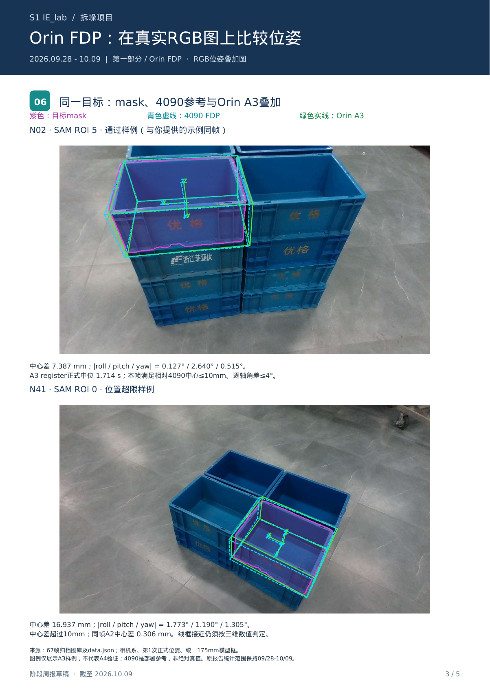
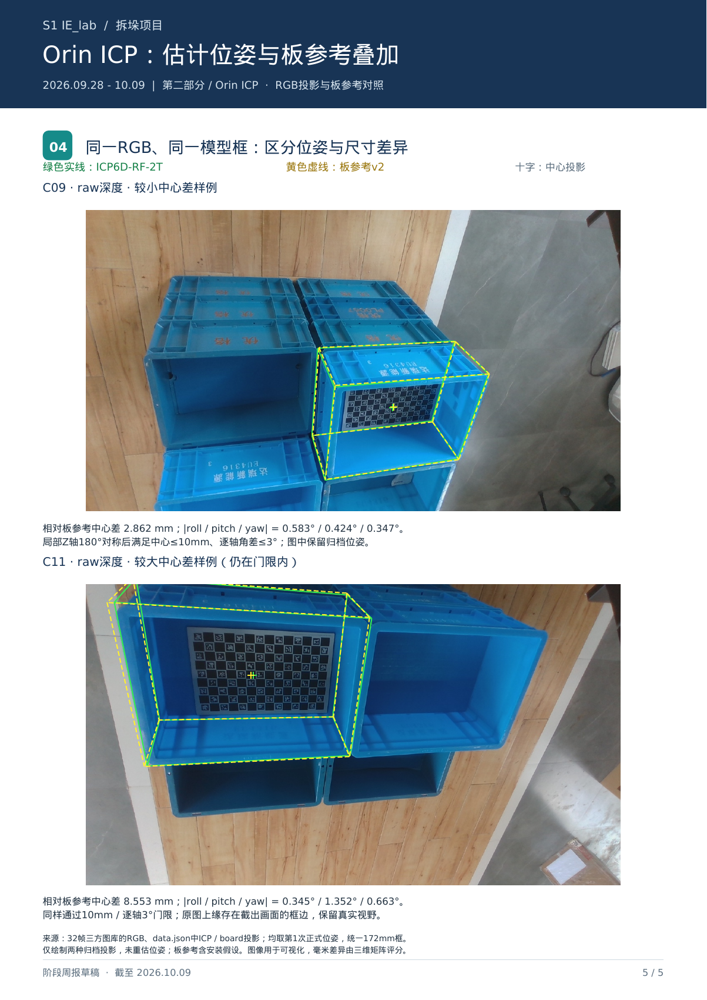

# 周报 9_19 整理 S1 项目进展周报

- 归档编号：`01a1423c-e82b-7323-89fd-fba2692f54ac`
- 项目：S1 IE_lab 拆垛
- 创建时间：2026-10-16T09:04:10.288000+08:00
- 更新时间：2026-10-16T12:22:19.903000+08:00
- 状态：活动
- 导出范围：用户可见消息与助手可见回复；不含隐藏推理和工具原始输出

## 1. 用户

<external_codex_apps_open_page>{"page_id":null}</external_codex_apps_open_page>

## 2. 用户

给我看一下 这个项目 9_28 到 10_9 的项目进展， 我需要写周报 参考 “”周报 9_28 S1 IE_lab 周报“”周报 10_12 整理 S1 项目进展周报“

## 3. 助手（进展）

我先查项目记录和你提到的两份周报，按 9 月 28 日至 10 月 9 日梳理进展，整理成可用于周报的内容。

## 4. 助手（进展）

本地已有一份覆盖 9 月 28 日至 10 月 9 日的周报，以及对应实验报告。记录中 FDP 端侧优化、ICP 优化和新增 67 帧验证是三条主要进展；我会核对最终版本，避免把早期结论或待验证项写成已完成成果。

## 5. 助手（进展）

我会用 PDF 技能核对现有周报的正文和图表，并把新整理的内容按 FDP、ICP 两部分展开，沿用之前的汇报口径。

## 6. 助手（进展）

两份指定周报都找到了。上期重点是 FDP 提速与配置对齐；这期已按你之前的要求，把 Orin FDP 和 ICP 分开汇报。

核对后的关键结果是：修正目标后，FDP A4 在原 28 帧上达到中位 0.598 秒、28/28 一致性通过；新增 67 帧已完成 A0–A3 对照，但仍未达到 1 秒。ICP 完成了 32 帧回归，10 月 9 日新增 67 帧的工作目前只有核查和执行计划。

## 7. 助手

_工具输出图片（原始工具文本未纳入归档）。_

## 8. 助手

我核对了 **“周报 9_28 S1 IE_lab 周报”** 和 **“周报 10_12 整理 S1 项目进展周报”**，以及对应实验记录。

**9/28—10/9 这期可以围绕两条主线写：Orin FDP 的目标核验、扩展验证和接口集成；ICP 的计算优化、回归和评估。** 主要新增实验集中在9/28—9/30，10/8完成归档重评，10/9完成新数据ICP测试准备。

**一、Orin FDP：从已有数据提速，推进到扩展验证和服务接口**

**1. 修正原28帧目标，更新亚秒方案结论**

发现C01、C04、C09、C11四帧历史mask与审核目标不一致，完成纠正复测；D12统一为左侧箱体，并更新结果表、图表和RGB对比页。

| 方案 | 定位耗时中位数 | 相对4090最大中心差 | 一致性通过 |
|---|---:|---:|---:|
| A0 原版 | 5.757秒 | 5.002毫米 | 28/28 |
| A2 全候选加速 | 2.227秒 | 5.002毫米 | 28/28 |
| **A4：64→16→16** | **0.598秒** | **5.144毫米** | **28/28** |
| A4-64：64→64→64 | 0.851秒 | 5.199毫米 | 28/28 |

10/8统一按中心差≤10毫米、逐轴角差≤3°，并考虑箱体180°对称重评。

**相较上期的重要变化：目标纠正后，A4也在原28帧上全部通过，成为该数据集上最快达标候选。** 这个变化来自目标纠正与复测，不能解释为候选剪枝问题已经全面解决。耗时为算法`register`，不含前端和通信。

**2. 完成新增67帧验证，明确新场景限制**

对9/23已采集的67组RGB-D完成目标审核及4090、Orin A0—A3对照，共2010次成功推理；随后更换N07—N09为更完整的目标，补做90次复测。

| 方案 | 耗时中位数 | 位置≤10毫米 | 位置＋原始方向通过 |
|---|---:|---:|---:|
| A0 | 6.314秒 | 67/67 | 61/67 |
| A2 | 2.704秒 | 67/67 | 61/67 |
| A3 | 1.997秒 | 65/67 | 59/67 |

这批联合判定采用中心≤10毫米、逐轴角差≤4°，保留原始方向。六帧基线结果存在近180°朝向分歧，A3仍有两帧位置超限。

**扩展验证的结论是：已测A0—A3仍未达到1秒；A4系列尚未测试，旧28帧结果不能直接推广。** 本批相机内参匹配和历史外参仍需补齐。

**3. 完成统一HTTP首帧接口兼容验证**

独立Orin FDP服务支持启动时选择算法，保持原客户端调用合同，本地4项契约测试及原客户端兼容测试通过。

冻结D12单帧、本机HTTP测试中，A4中位 **0.816秒**，A4-64中位 **0.921秒**。目前完成的是独立服务验证，生产切换、raw深度在线精度和完整拆垛作业验收仍待完成。

**二、ICP：完成低耗时优化和32帧回归**

- **计算优化：**完成区域滤波、KD树、体素去重和双线程精确查询优化，数值等价优化保持原位姿输出。
- **失败回退：**增加raw质量不通过时尝试缓存LingBot的规则，32帧几何接受由 **31/32提升至32/32**，仅D01触发回退。9/29回归中，该流程中位耗时 **0.094秒**、最大 **0.394秒**。
- **板参考评估：**采用板参考v2，11帧全部满足中心≤10毫米、逐轴角差≤3°；中心差中位 **5.142毫米**、最大 **8.577毫米**。
- **线程选型：**完成2／3／4线程对照，保留双线程，当前推荐方案为 **ICP6D-RF-2T**。

需要保留评估边界：其余21帧缺独立参考；缓存LingBot生成时间未计入。10/8重评时，ICP相对板参考为11/11通过，相对4090为10/28通过，两种基准支持的结论不同。

以上内容已有三页分篇报告：前两页为FDP，第三页为ICP，可直接作为周报底稿。

:codex-file-citation{path="/home/lsy03/文档/ChatGPT/S1/output/pdf/S1_IE_lab_周报_2026-09-28至10-09_FDP与ICP分篇_v2.pdf" purpose="source"}

**三、10/9新增进展及下一步**

10/9完成新67帧ICP输入核查和执行计划，确认这67帧尚未运行ICP。下一步先解决历史外参缺失或相机坐标系初始化适配，再开展全量测试；这项应写成“完成测试准备”。

:codex-file-citation{path="/home/lsy03/文档/ChatGPT/S1/experiments/20261009_icp_new67_plan/PLAN.md" purpose="source"}

周报开头可以直接写：

> 本期围绕S1拆垛箱体定位，完成Orin FDP原28帧目标核验与纠正复测，确认A4在该数据集上达到中位0.598秒并满足跨平台一致性要求；完成新增67帧扩展验证及统一HTTP首帧接口兼容测试。同时，完成ICP计算优化、条件深度回退和32帧回归，保留双线程方案，并完成新67帧ICP测试准备。下一阶段重点补齐新数据标定信息，验证算法在新增场景中的表现，并开展真实调用链的端到端评估。

[附件：70ef2da1246a0d94--S1_IE_lab_周报_2026-09-28至10-09_FDP与ICP分篇_v2.pdf](../../assets/70ef2da1246a0d94--S1_IE_lab_%E5%91%A8%E6%8A%A5_2026-09-28%E8%87%B310-09_FDP%E4%B8%8EICP%E5%88%86%E7%AF%87_v2.pdf)

[附件：d344ce51dc218d26--PLAN.md](../../assets/d344ce51dc218d26--PLAN.md)

## 9. 用户

<external_codex_apps_open_page>{"page_id":null}</external_codex_apps_open_page>

## 10. 用户

给我看下这个，我觉得好像可以用了

[附件：cd42454e79abceb6--S1_IE_lab_周报_2026-09-28至10-09_FDP与ICP分篇_位姿对比图_v3.pdf](../../assets/cd42454e79abceb6--S1_IE_lab_%E5%91%A8%E6%8A%A5_2026-09-28%E8%87%B310-09_FDP%E4%B8%8EICP%E5%88%86%E7%AF%87_%E4%BD%8D%E5%A7%BF%E5%AF%B9%E6%AF%94%E5%9B%BE_v3.pdf)

## 11. 助手（进展）

我用 PDF 技能看一下这版的排版、位姿对比图和关键数据，确认是否还有影响汇报的问题。

## 12. 助手

_工具输出图片（原始工具文本未纳入归档）。_

## 13. 助手

**可以，这版已经能用于本期周报。** 我逐页看了5页，没有发现影响汇报的排版或关键数据问题。

- **FDP和ICP分篇清楚**，各自有结果、图示和下一步。
- **新增位姿图很有用**：FDP同时展示通过与超限样例；ICP展示不同偏差大小，能把表格数字和实际效果对应起来。
- **结论范围交代到位**：旧28帧亚秒、新67帧尚未达标，以及4090参考与板参考的区别，都写清楚了。

正式提交前，只建议两处文字收尾：

1. 页脚“阶段周报草稿”改为“阶段周报”。
2. 第3页删掉“与你提供的示例同帧”，保留“通过样例”。

正文结构和图表可以保留。

:codex-file-citation{path="/home/lsy03/文档/ChatGPT/S1/output/pdf/S1_IE_lab_周报_2026-09-28至10-09_FDP与ICP分篇_位姿对比图_v3.pdf" purpose="source"}

[附件：cd42454e79abceb6--S1_IE_lab_周报_2026-09-28至10-09_FDP与ICP分篇_位姿对比图_v3.pdf](../../assets/cd42454e79abceb6--S1_IE_lab_%E5%91%A8%E6%8A%A5_2026-09-28%E8%87%B310-09_FDP%E4%B8%8EICP%E5%88%86%E7%AF%87_%E4%BD%8D%E5%A7%BF%E5%AF%B9%E6%AF%94%E5%9B%BE_v3.pdf)

## 14. 助手

_历史投影中的图片引用（用于补全本地对话资源）。_

> 资源未归档：`/tmp/s1_progress_previous-1.png`（missing）

> 资源未归档：`/tmp/s1_progress_0928_1009-1.png`（missing）

> 资源未归档：`/tmp/s1_progress_0928_1009-3.png`（missing）

> 资源未归档：`/tmp/s1_progress_0928_1009-2.png`（missing）

> 资源未归档：`/tmp/s1_progress_previous-2.png`（missing）
