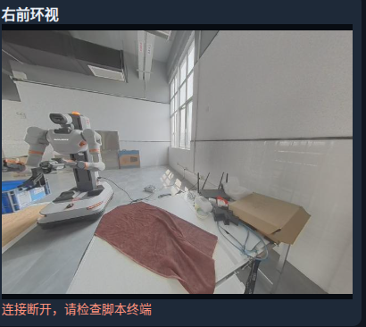

# 9_24 数据采集整理 继续制定G1传感器对齐方案

- 归档编号：`01a0d25f-d72b-7bb3-9243-aadd0c02d55a`
- 项目：VLA G1 项目
- 创建时间：2026-09-24T15:45:10.951000+08:00
- 更新时间：2026-09-29T09:18:00.068000+08:00
- 状态：活动
- 导出范围：用户可见消息与助手可见回复；不含隐藏推理和工具原始输出

## 1. 用户

我们在 “9\_23 制定G1传感器与LeRobot对齐方案 （2）” 的基础上继续

## 2. 用户

我们在 “9\_23 制定G1传感器与LeRobot对齐方案 （2）” 的基础上继续  ，下一步我们做啥？

## 3. 助手（进展）

我先查看这个任务的结论和待办，再确定下一步。

## 4. 助手（进展）

上次已完成 17 路导出，新阈值下通过率升到 92.05%；早期黑画面也定位到了 Rerun 的内存保留问题。接下来主要要解决训练样本的连续性，以及画面、状态和动作在实际运动中是否对得上。

## 5. 助手

**下一步建议先做“训练用数据视图＋动态时序验收”**，把现有这段叠毛巾数据能否用于训练判断清楚。

我核对了上次报告，目前已经做到：

- 17 路数据完整导出，共 **86.75 秒、868 行**。
- 新阈值试验通过 **799 行，92.05%**，但还没有写回正式数据集。
- 69 秒前黑画面已定位到 **Rerun 内存保留/显示问题**，原始图像正常。
- 全 17 路联合通过区间仍有 **58 段，最长仅 3.7 秒**；目前保持 `training_ready=false`。[试验报告](<../../assets/60e081b27dc504b8--%E8%AF%95%E9%AA%8C%E4%B8%8E%E9%BB%91%E7%94%BB%E9%9D%A2%E6%8E%92%E6%9F%A5.md>)

建议按下面顺序推进：

| 顺序 | 做什么 | 要得到什么 |
|---|---|---|
| **1** | 按首版策略需要，单独检查三路 RGB＋双臂关节＋双夹爪＋有效 action | 训练所需通道的通过率、连续可用时长、每个断点原因；17 路完整数据继续保留 |
| **2** | 从现有录像挑选夹爪开合、手臂启动/停止、接触毛巾等事件，对照图像、state、已接受命令和腕力曲线 | 判断是否存在可见错位，明确还需要补录哪些验证动作 |
| **3** | 明确“观测对应哪个动作时刻”，再生成训练候选版本 | 定义在线可用观测与未来动作标签；真实缺口保留标记或分段，避免删行后拼接 |
| **4** | 针对剩余问题安排短时补录或 SDK／上游状态对照 | 验证缺口来源及采集稳定性，再扩大正式采集规模 |

**现在最先做第 1 步最合适：算清楚“三视角＋16 维 state/action”在新规则下到底能留下多长的连续训练片段。** 这会直接决定后面优先修状态缺口，还是进入动作标签和训练接口验收。

[附件：60e081b27dc504b8--试验与黑画面排查.md](../../assets/60e081b27dc504b8--%E8%AF%95%E9%AA%8C%E4%B8%8E%E9%BB%91%E7%94%BB%E9%9D%A2%E6%8E%92%E6%9F%A5.md)

## 6. 用户

先这样把，
“bash teleoperation/run\_capture\_pilot.sh \\
&#x20; \--execute --seconds 600 \\
&#x20; \--speed-rad-s 1.0 \\
&#x20; \--gripper-speed-m-s 0.16 \\
&#x20; \--task "将展开的毛巾对折并叠整齐"”

在这个脚本上我们写一下记录数据的数量展示，我们先采集个五组数据，如何？

## 7. 助手（进展）

可以，先采五组。我先检查这个脚本的录制流程，加上已完成组数和当前组数据量的显示，方便你确认每组是否录成功。

## 8. 用户

时间给我放宽到 1800s

## 9. 助手（进展）

好的，会话上限改到 1800 秒。计数会显示“已完成 X/5 组”、当前组录制时长，以及落盘后的各路数据条数；取消的组单独统计。达到五组时提示你，不自动打断遥操作。

## 10. 助手（进展）

数量显示已加好，数采入口也已支持 1800 秒。完成数只在每组落盘确认后增加，取消组不计入五组目标；接下来检查参数传递和模拟采集流程，不连接机器人。

## 11. 助手

已改好：**会话上限 1800 秒（30 分钟），目标五组**。

```bash
bash teleoperation/run_capture_pilot.sh \
  --execute --seconds 1800 \
  --target-episodes 5 \
  --speed-rad-s 1.0 \
  --gripper-speed-m-s 0.16 \
  --task "将展开的毛巾对折并叠整齐"
```

终端会显示：

- 已完成 **X/5 组**、取消/失败组数。
- 当前组时长、完成组累计时长。
- 每组落盘后的 **17 路各自记录条数**。

按记录键开始，再按结束；**落盘完成才计数，取消组不计入五组**。满五组只提示，遥操继续；暂停双臂后按 `Ctrl+C` 退出。1800 秒包含组间复位时间。

18 项离线测试及命令检查通过，尚未启动真机采集。

## 12. 用户

或者除了叠毛巾，对于其他的任务，你有没有什么其他的建议？我应该从哪个任务开始比较好？

## 13. 助手（进展）

我结合你现在的双臂、夹爪和三视角采集配置，比较一下适合起步的任务，也参考公开机器人学习项目的做法。

## 14. 助手

**我建议第一个任务选“把桌上的方块或小盒子抓起，放进固定托盘”。先用一只手完成。** 对你现在的阶段，这个任务容易复位、成功标准明确，也方便排查采集、训练和部署之间的问题。

叠毛巾可以作为后续目标：毛巾会变形、遮挡，抓取点和折叠结果也有多种可能，第一次训练失败时很难判断是数据时序问题，还是任务本身太复杂。

下面是我针对当前配置建议的顺序：

| 顺序 | 任务 | 适合验证什么 | 主要难点 |
|---|---|---|---|
| **1** | **单臂抓方块，放入固定托盘** | 视觉定位、夹爪开合、完整训练部署流程 | 稳定抓取 |
| 2 | 同一物体，从多个起始位置放入托盘 | 对位置变化的适应能力 | 避免只记住固定轨迹 |
| 3 | 双臂各抓一个物体，放入各自托盘 | 双臂动作与数据链路 | 两臂节奏、遮挡 |
| 4 | 一只手拿物体，交给另一只手 | 双臂协同 | 交接位置、松爪时机 |
| 5 | 双臂叠毛巾 | 柔性物体操作、多阶段动作 | 变形、遮挡、误差累积 |

LeRobot 官方入门也推荐“从不同位置抓起物体放进容器”，并建议固定相机、保持抓取方式一致，逐步增加变化。[官方采集建议](https://huggingface.co/docs/lerobot/il_robots)

**你计划的首批五组，我建议这样采：**

- **物体**：选夹爪容易夹住的轻质、不透明、较硬方块或小盒子，颜色与桌面明显不同。
- **场景**：托盘固定，物体先放在同一个标记附近，相机和机器人起始姿态尽量一致。
- **每组动作**：接近 → 抓取 → 抬起 → 移到托盘 → 松开 → 手退出。
- **成功标准**：物体完整进入托盘，松爪后稳定留在里面。
- **录制边界**：动作开始前开启记录，手退出后结束；人工摆回物体放在两组之间。
- **长度**：以自然、连续完成为准，可以先争取每组约 **15–30 秒**，不用刻意拖长。

这五组先用于验证采集和样本质量。通过后，再扩展到例如 **5 个起始位置、每个位置 10 组，共 50 组**，作为首轮训练规模参考；不是保证训练成功的固定数量。官方也给出了这个入门采集规模。[参考说明](https://huggingface.co/docs/lerobot/il_robots)

还有一个与你当前脚本有关的细节：**单臂任务需要检查另一侧的 action 标签。** 我们此前的导出是双臂 16 维 action，未操作侧可能缺少已接受目标；采完后要明确采用单臂训练视图，或有记录依据的双臂保持目标，不能直接补零。

我的首选任务描述是：**“将桌面上的方块抓起并放入托盘中。”**

## 15. 用户

你可以看看当前试验台的样子



## 16. 助手

看到了。按这张**右前环视**画面，你现在是白色桌面，中间铺着毛巾，右后方有纸板和一些线缆。**这张画面里没有看到适合做固定放置目标的托盘。**

结合现有布置，我建议第一项任务调整为：**“把小方块从桌面 A 区抓起，放到 B 区。”** 用胶带标出两个区域就可以开始，不必先准备托盘。

具体布置可以这样做：

- **暂时收起毛巾**，露出平整桌面；把操作区域内的线缆和杂物移开。
- 在**同一只手容易到达的桌面中部**贴两个标记，先相隔约 **15–20 cm**，具体位置以现场遥操可达范围为准。
- 放一个**不易滚动、颜色明显、夹爪能稳定夹住的小盒子或方块**。
- 第一批五组统一做：**A 区抓起 → 放到 B 区 → 松爪 → 手退出**。每组结束后人工复位。
- B 区先画得宽松一些，以“物体完全落在区域内并稳定放下”为成功标准。

这样可以先验证**抓取、搬运、释放**三个动作，后续再增加起始位置变化、托盘和双臂交接。

另外，这张截图底部显示 **“连接断开，请检查脚本终端”**，所以它只能说明当时的布置。正式采集前，要确认画面持续更新，并从**头部和对应腕部相机**检查：A、B 两区及夹爪接触物体的位置都能看清。单凭这张环视图，还不能确定机械臂的可达范围和抓取视野。
