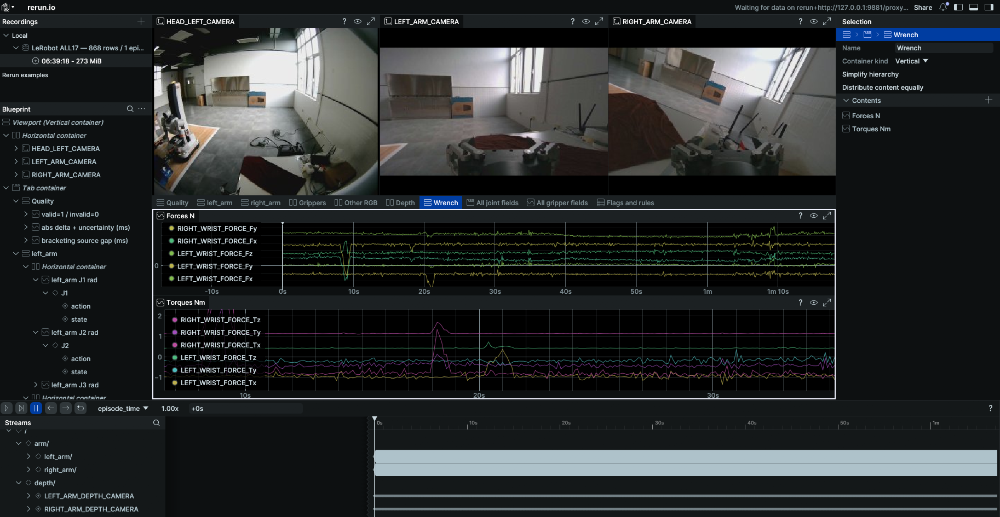
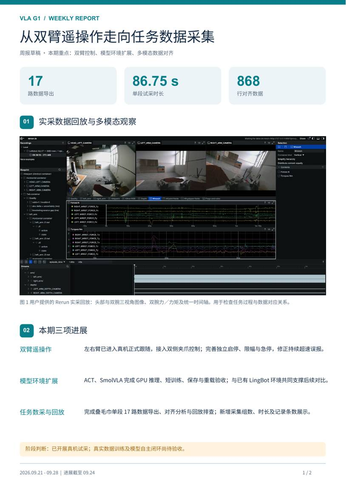
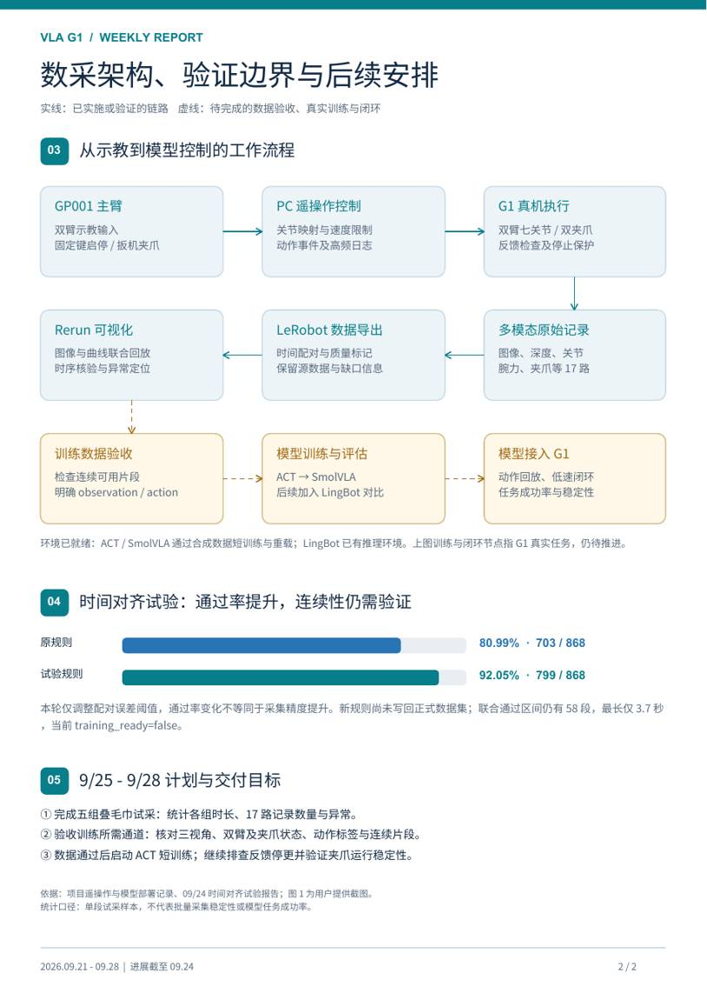
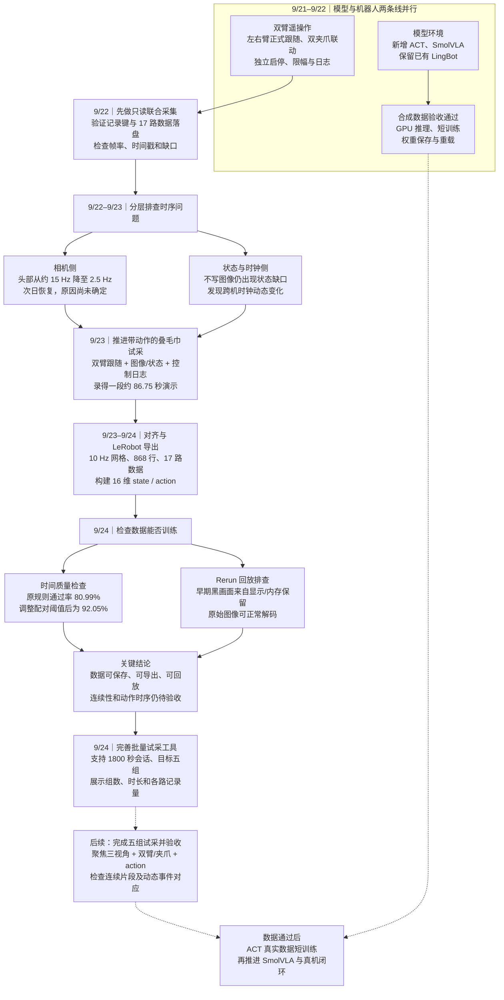
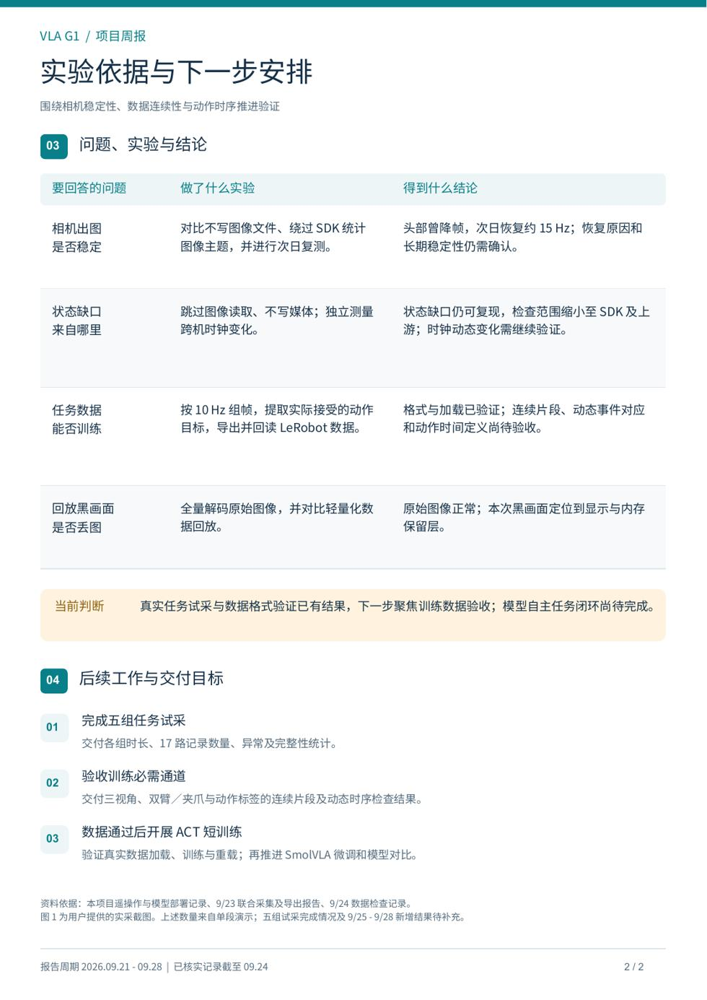
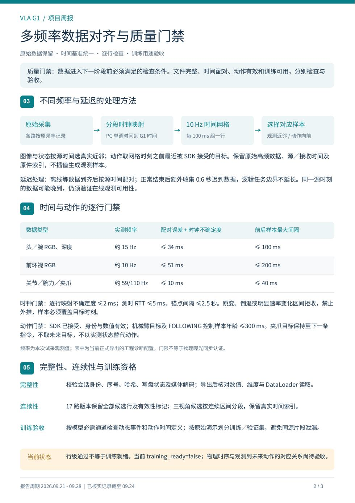
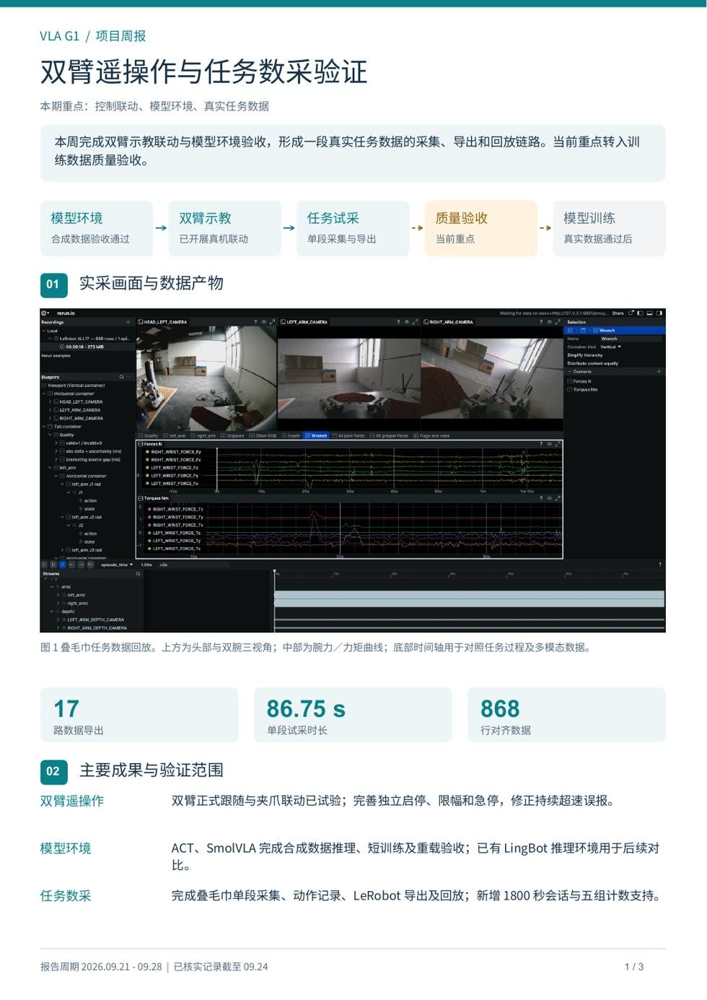
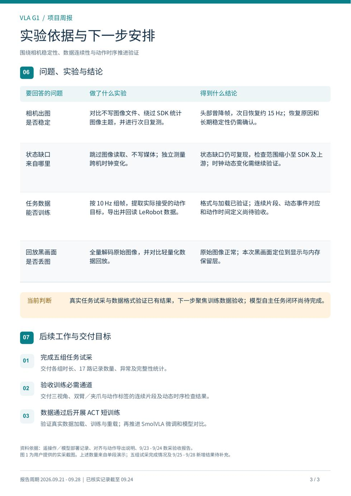

# 周报 9_28 更新VLA项目周报

- 归档编号：`01a0d284-95c7-73f0-99a6-55f4c29896d9`
- 项目：VLA G1 项目
- 创建时间：2026-09-24T16:24:59.594000+08:00
- 更新时间：2026-09-28T20:10:33.502000+08:00
- 状态：活动
- 导出范围：用户可见消息与助手可见回复；不含隐藏推理和工具原始输出

## 1. 用户

看下这个对话“整理VLA项目周报”，现在我需要更新一版 9\_21 -  9\_28 的周报，给我看看怎么写？

## 2. 助手（进展）

我先查看“整理VLA项目周报”里的内容和格式，再据此整理 9/21–9/28 这一版，缺少的进展会标出来。

## 3. 助手（进展）

上一版主要写了遥操作、LingBot 部署和多模态数采。这一版可以突出双臂控制、ACT/SmolVLA 环境，以及数据时间对齐的新进展。我正在核对各项验证到了哪一步；今天是 9 月 24 日，9/25–9/28 的内容会先列为计划。

## 4. 用户

就是 VLA G1 这个项目的

## 5. 助手

明白，**只整理“VLA G1 项目”**。我看过“整理VLA项目周报”，建议延续上一版的三个方向，突出这周新增的进展。

目前是 **9 月 24 日**，下面先作为 **9/21–9/28 周报草稿**，后半周尚未完成的工作放在计划里。

**VLA G1 项目周报（9/21–9/28）**

**1. 双臂遥操作与夹爪联动**

在前期左臂七关节联调基础上，推进双臂遥操作真机验证，已观察到左右臂同时进入正式跟随，双侧扳机夹爪控制已接入。完善左右臂独立启停、单次按键启动、关节限幅、全局急停及高频日志记录；修正持续超速判据误报，定位到反馈短时停更引起的轨迹更新超时，后续继续验证长时间运行稳定性。

**2. ACT、SmolVLA 模型环境部署**

在已有 LingBot 环境基础上，新增独立 LeRobot Docker 环境，完成 ACT、SmolVLA 的 GPU 推理、短训练／微调、权重保存及新容器重载验证，并整理统一启动脚本、版本记录和使用文档。目前已通过合成数据的软件链路验收，下一步接入 G1 真实任务数据开展训练。

**3. 多模态数采与时间对齐**

推进叠毛巾任务试采，完成一段 **86.75 秒、868 行、17 路数据**的导出与对齐质量分析，建立多模态回放及异常定位流程。完成配对阈值对比试验，联合通过率由 **80.99% 调整至 92.05%**；该结果来自阈值调整，仍需结合动态事件验证时序质量。排查并解决回放黑画面的显示问题，确认原始图像正常。同时完善采集组数、时长及各路记录数量展示，支持后续五组任务试采。

**当前问题与后续计划**

- 继续排查机器人反馈短时停更，验证双臂及夹爪连续运行稳定性。
- 完成五组叠毛巾任务试采，检查各组数据完整性和连续可用时长。
- 明确图像、状态与动作标签的对应关系，完成训练所需通道的时序验收。
- 数据验收通过后，优先开展 ACT 真实数据短训练，再推进 SmolVLA 微调及后续模型对比。

这里要保留一个关键口径：**目前已完成任务数据试采和导出，但尚未完成训练数据验收，也还没有实现模型自主控制 G1 的任务闭环。**

## 6. 用户

给我生成一份PDF报告，一页到两页就行，最好需要图片和架构流程图，最好直观一些



## 7. 助手（进展）

我会用 PDF 技能制作两页报告：第一页展示本周进展和你提供的实采画面，第二页用架构流程图说明数采、模型训练及后续闭环，并标明已完成与待验证的环节。

## 8. 助手（进展）

两页报告已生成，包含实采截图、数采到训练的流程图，以及时间对齐通过率对比。报告明确区分了已完成的环境验证和待完成的真实数据训练，我现在检查页面排版。

## 9. 助手

_工具输出图片（原始工具文本未纳入归档）。_





## 10. 助手

已生成 **两页 PDF**，包含实采截图、架构流程图、数据指标对比和后续计划，已检查排版。

:codex-file-citation{path="/home/lsy03/文档/ChatGPT/VLA G1 项目/output/pdf/VLA_G1_项目周报_20260921-20260928.pdf" purpose="output"}

- :codex-followup[压缩成一页]{prompt="把这份周报压缩成一页，保留实采图片和核心流程图。"}
- :codex-followup[制作汇报 PPT]{prompt="根据这份周报制作两页汇报PPT。"}
- :codex-followup[补齐月底进展]{prompt="结合最新项目记录，更新这份周报中9月25日至28日的实际进展。"}

## 11. 用户

我们先来回顾一下9\_21 -9\_28 我们的实验和思路流程是什么样子的？ 给我画个图展示一下。

## 12. 助手（进展）

我先核对 9/21–9/28 的项目记录，把实验顺序、遇到的问题和思路调整串起来，再画成一张流程图。

## 13. 助手（进展）

记录里的主线已经清楚了：先补齐模型环境和双臂控制，再做任务试采，随后把重点转到数据能否用于训练。我会用可视化技能把这些步骤和关键排查分支画在一起。目前找到的最新实验结论停在 9/24；五组试采已有工具支持，但还没有找到完成结果。

## 14. 助手

这一周的思路是：**先让模型环境能跑、双臂能操作，再录真实任务；通过数据检查，把重点逐步转到“这些数据能不能用于训练”。**

我核对了项目对话和报告，**目前能确认的实验记录主要到 9/24，尚未找到 9/25–9/28 的新增实验结果**。下图把已做实验和后续路径分开，虚线表示待完成或待确认。



这条流程里，有三个关键的思路变化：

- **模型环境通过后，工作重心转向真实数据。** 合成数据能训练，说明软件链路可用；还需要验证 G1 数据的字段、动作定义和质量。
- **从“时间戳能配上”进一步追问“物理事件是否对应”。** 相机采样相位差、真实状态缺口和跨机时钟变化，需要分别处理。
- **从看总体通过率，转向看连续训练片段。** 92.05% 是调整阈值后的结果；全 17 路联合通过的最长连续区间仍只有约 **3.7 秒**，因此当前仍保留 `training_ready=false`。[试验记录](<../../assets/60e081b27dc504b8--%E8%AF%95%E9%AA%8C%E4%B8%8E%E9%BB%91%E7%94%BB%E9%9D%A2%E6%8E%92%E6%9F%A5.md>)

[附件：60e081b27dc504b8--试验与黑画面排查.md](../../assets/60e081b27dc504b8--%E8%AF%95%E9%AA%8C%E4%B8%8E%E9%BB%91%E7%94%BB%E9%9D%A2%E6%8E%92%E6%9F%A5.md)

## 15. 用户

如果让你重新规划报告结构，应该如何进行？

## 16. 助手

我建议重排成 **两页：第一页讲“本周推进到了哪里”，第二页讲“实验发现了什么，以及下一步怎么推进”**。围绕一条主线展开：

**模型环境与双臂控制就绪 → 真实任务试采 → 数据导出与回放 → 训练数据质量验收。**

第一页以“进展和成果”为中心，建议这样安排：

| 位置 | 内容 | 展示方式 |
|---|---|---|
| 顶部 | 标题、周期、当前阶段 | **VLA G1 项目周报｜双臂遥操作与任务数采验证** |
| 上部 | 整体推进流程 | 横向流程图，标出已完成、当前阶段、后续工作 |
| 中部 | 三项主要成果 | 双臂遥操作；ACT/SmolVLA 环境；叠毛巾任务数采 |
| 下部 | 实验画面与关键数据 | 放大 Rerun 截图，标注三视角、腕力曲线、时间轴；配 **17 路、86.75 秒、868 行** |

三项成果每项只写“做成了什么＋验证边界”：

- **双臂遥操作：**完成双臂正式跟随及夹爪联动试验，连续运行稳定性仍需验证。
- **模型环境：**ACT、SmolVLA 完成合成数据推理、短训练与重载验收。
- **任务数采：**完成一段叠毛巾演示的采集、动作记录、LeRobot 导出与回放检查。

第二页以“实验依据和下一步决策”为中心。用下面这张表组织内容：

| 要回答的问题 | 做了什么实验 | 得到了什么结论 |
|---|---|---|
| 相机出图是否稳定？ | 对比只读、无写盘、直接主题及次日复测 | 头部曾降帧、次日恢复；原因尚未确认 |
| 状态缺口是否由采集程序造成？ | 去掉媒体写盘、跳过图像读取，独立检查时钟 | 缺口仍存在；继续排查 SDK／上游状态与时钟 |
| 导出的数据能否直接训练？ | 检查配对误差、动作标签和连续有效片段 | 格式已验证，连续性及动作时序尚待验收 |
| 回放黑画面是否代表图像丢失？ | 全量解码原图，对比轻量回放 | 本次问题定位到显示与内存保留层 |

表格下面放一个小型对比图：**原规则 80.99% → 试验规则 92.05%**，旁边直接标注：

> 通过率变化来自配对阈值调整；最长连续通过区间仍为 3.7 秒，训练数据验收尚未完成。

页尾只保留三项下一步，每项对应明确产出：

1. **完成五组试采：**交付各组时长、记录数量和完整性统计。
2. **验收训练必需通道：**交付三视角、双臂及夹爪、动作标签的连续可用片段与时序检查结果。
3. **开展 ACT 短训练：**数据验收通过后，验证真实数据加载、训练及权重重载。

这样两页就能形成 **“成果 → 实验证据 → 当前判断 → 下一步”** 的完整逻辑。周期可以写 **9/21–9/28**，同时注明“已核实实验记录截至 9/24”；9/25–9/28 的实际结果补齐后再更新完成状态。

## 17. 用户

原规则 80.99% → 试验规则 92.05%这个就不写了

## 18. 助手

好，**删掉这项通过率对比及对应图表**。数据质量部分改成：

> **多模态数据检查与问题排查：**完成 17 路数据完整性、时间戳配对及回放检查，识别状态数据间歇缺口，解决本次回放黑画面的显示问题。后续重点验证连续可用片段，以及图像、状态与动作的时序对应关系。

报告保留 **17 路数据、86.75 秒试采、868 行导出**这些直观成果，第二页重点展示“实验方法、发现的问题、后续安排”。

## 19. 用户

给我生成一版报告

## 20. 助手（进展）

我按刚才确定的结构生成两页 PDF：第一页展示主要成果和实采画面，第二页整理实验发现与后续安排，删去通过率对比。

## 21. 助手（进展）

新版会用“成果 → 实验依据 → 当前判断 → 下一步”的顺序组织内容。日期写为 9/21–9/28，并注明已核实记录截至 9/24，五组试采和真实数据训练保留为后续工作。

## 22. 助手（进展）

我会在实采图旁标出三视角、腕力曲线和时间轴的用途。第二页按“要回答的问题、做过的实验、得到的结论”整理，方便汇报时讲清每一步的依据。

## 23. 助手

_工具输出图片（原始工具文本未纳入归档）。_




## 24. 助手（进展）

新版两页报告已完成，截图和流程图显示正常，文字没有溢出。已确认删除通过率数字及对应图表，完成事项和后续计划也已分开标明。

## 25. 助手

已生成两页新版 PDF，包含实采截图、推进流程图、实验结论和后续计划，**已删除通过率对比**并完成排版检查。

:codex-file-citation{path="/home/lsy03/文档/ChatGPT/VLA G1 项目/output/pdf/VLA_G1_项目周报_20260921-20260928_修订版.pdf" purpose="output"}

- :codex-followup[制作汇报 PPT]{prompt="把这份修订版周报制作成两页汇报PPT。"}
- :codex-followup[生成汇报讲稿]{prompt="根据这份修订版周报，写一份两分钟口头汇报讲稿。"}
- :codex-followup[补齐最新进展]{prompt="检查VLA G1项目最新记录，补齐9月25日至28日的实际进展并更新报告。"}

## 26. 用户

给我讲一下，我们使用的不同频率，不同延迟的各种类型的数据，我们的对齐方法和质量保证方案是什么？质量门禁是什么？

## 27. 助手（进展）

我先核对当前对齐代码和验收报告，按“时间怎么统一、每一行怎么配数据、哪些情况会被拒收”讲清楚，也会区分已经实现的检查和仍待验证的部分。

## 28. 助手（进展）

代码确认了一个关键区别：图像和状态按源时间取最近的真实样本，动作则取该时刻之前最近被 SDK 接受的目标。另外，“这一行通过时间检查”和“整份数据可用于训练”是两层判断，不能等同。

## 29. 助手

我们当前采用的是：**保留各路原始数据，统一时间基准，在 10 Hz 时间网格上选择对应样本，再用质量规则判断这些样本能否一起使用。**

**“质量门禁”就是数据进入下一阶段前必须通过的检查条件。** 文件保存成功、时间配对通过、能够用于训练，分别有不同的验收要求。

**1. 不同频率的数据，怎么组成同一行？**

以这次叠毛巾试采为例，实际取得的频率大致如下：

| 数据类型 | 实测频率 | 当前对齐方式 |
|---|---:|---|
| 头部、腕部 RGB 与腕部深度 | 约 15 Hz | 按源时间选择距离目标时刻最近的真实帧 |
| 前环视 RGB | 约 10 Hz | 同样选择最近帧，单独设置容差 |
| 双臂关节状态 | 约 59 Hz | 选择最近的实测状态 |
| 腕力、夹爪反馈 | 约 110 Hz | 选择最近的实测数据 |
| 机械臂、夹爪动作指令 | 随控制事件产生 | 选择目标时刻之前最近被 SDK 接受的指令 |

我们在时间轴上每隔 **100 ms** 建立一个目标时刻：

```text
目标时间：  0.0 s       0.1 s       0.2 s       0.3 s
              │           │           │           │
每个时刻：  对应图像 + 关节状态 + 夹爪状态 + 动作目标
              │
           检查误差、缺口、时钟可信度和动作有效性
```

这里的 **10 Hz 是导出数据的采样网格**，原始传感器频率和机器人控制频率保持各自的设置。

当前图像和状态采用最近邻，没有插值生成中间图像或状态。高频原件完整保留；如果以后分析腕力冲击等快速变化，需要回到原始高频数据，10 Hz 表不能完整保留这些细节。

**2. 不同设备的时钟，怎么统一？**

PC 的控制日志和 G1 的传感器记录来自不同时间基准。我们先建立：

**PC 单调时间 → G1 主机时间的分段映射。**

录制过程中持续采集跨机测时点，用相邻的有效测时点进行插值，并估计映射的不确定度。因此，对齐时没有一直沿用历史测得的固定 `104 ms` 补偿。

时钟本身也有门禁：

- 测时往返时间超过 **5 ms** 的样本排除。
- 相邻有效测时点间隔超过 **2.5 秒**，对应区间拒收。
- 发现时间倒退、明显跳变或速率变化，对应区间拒收。
- 不向测时覆盖范围之外外推。
- 每行使用的时钟映射不确定度要求 **≤2 ms**。

这一步统一的是**主机时间基准**。各传感器源时间戳是否准确代表曝光或采样时刻，还需要物理事件验证。[时钟映射实现](</home/lsy03/文档/ChatGPT/VLA G1 项目/acquisition/lerobot_capture/time_map.py>)

**3. 不同延迟的数据，怎么处理？**

我们同时保留两类时间：

- **源时间戳：**数据自身携带的时间，用于离线配对。
- **接收／读取时间：**程序实际拿到数据的时间，用于检查缓存、传输和数据可用性。

举一个假设例子：

| 数据 | 源时间 | 程序拿到的时间 |
|---|---:|---:|
| 腕部图像 | 1.000 s | 1.030 s |
| 头部图像 | 1.000 s | 1.070 s |
| 环视图像 | 1.000 s | 1.140 s |

离线整理时，它们可以按源时间配到 **1.000 s 附近**。但如果机器人在 **1.050 s** 做决策，当时还拿不到后两路图像。

所以我们需要分别验证：

- **离线时间对应：**记录中的图像、状态描述的是不是接近的时刻。
- **在线可用性：**策略做决策时，这些观测是否已经到达。

当前正常结束录制后还会额外收集 **0.6 秒**的延迟到达数据，但逻辑任务边界不延长，不把下一次任务的数据混进来。这只是收尾机制，仍需验证是否覆盖实际延迟。

另外，**接收时间减源时间得到的是“表观数据年龄”**，其中包含缓存及源时钟误差，不能直接当作测准的相机物理延迟。

**4. 时间质量门禁具体检查什么？**

每路数据主要检查两件事：

> **配对误差＋时钟映射不确定度，是否在容差内？**
> **目标时刻前后的原始样本之间，是否存在过大的缺口？**

当前正式 17 路导出的规则是：

| 数据类型 | 配对误差＋时钟不确定度上限 | 目标时刻前后样本间隔上限 |
|---|---:|---:|
| 头部、腕部 RGB／深度 | 34 ms | 100 ms |
| 前环视 RGB | 51 ms | 200 ms |
| 关节、腕力、夹爪反馈 | 10 ms | 40 ms |

此外，目标时刻必须位于该路数据覆盖范围内，时钟映射也必须有效。这些是**当前项目的工程诊断规则**，不是 LeRobot 或所有 VLA 项目统一规定的标准。[当前门禁实现](</home/lsy03/文档/ChatGPT/VLA G1 项目/acquisition/lerobot_capture/export_all_streams.py>)

例如，目标时刻为 `1.000 s`：

- 选中的腕相机帧是 `1.028 s`，时钟不确定度为 `1 ms`，合计 **29 ms**，通过配对误差检查。
- 如果附近状态数据存在 **134 ms** 的缺口，即使最近的一个样本离目标时刻很近，落在缺口中的候选时刻仍可能被拒收。

**误差检查防止“配得太远”，缺口检查防止“用少量旧样本掩盖中间缺失”。**

**5. 动作标签为什么要单独检查？**

动作与观测采用不同的取值规则。当前 `action` 表示：

**目标时刻之前，最近一次被 SDK 接受的双臂轨迹端点和夹爪开度目标。**

动作门禁包括：

- 指令确实被接受，发送记录与结果的身份一致。
- 不使用目标时刻之后才发送的指令。
- 机械臂目标的年龄不超过 **300 ms**。
- 两侧最近控制样本处于 `FOLLOWING`，且足够新鲜。
- 动作维度、数值和关节顺序正确。

夹爪开度目标可以保持到下一条指令；没有新开度指令，并不代表夹爪反馈中断。

当前动作标签适合验证“当时已经下发了什么目标”。要训练“根据当前可用图像预测未来动作”的策略，还要明确观测延迟和动作预测时刻之间的关系。[动作标签定义](<../../assets/bd67eba96842c00b--ACTION_EXPORT_USAGE.md>)

**6. 质量保证还包括文件、连续片段和训练验收**

| 层次 | 检查内容 | 未通过时如何处理 |
|---|---|---|
| 文件与记录完整性 | 会话身份、序号、分片与负载哈希、写盘状态、媒体解码 | 报错或排除不完整会话 |
| 单路／单行时间质量 | 时间覆盖、配对误差、源缺口、时钟不确定度 | 保留数据并标记无效原因 |
| 动作与字段质量 | 指令有效性、16 维 state/action、单位、顺序、有限数值 | 拒绝作为有效训练样本 |
| 连续片段质量 | 合格行是否真正连续、是否跨越缺口 | 在缺口处分段，保留原时间索引 |
| 导出与读取质量 | 导出后回读、数值一致性、图像／深度类型、DataLoader 批次 | 不通过格式验收 |
| 训练可用性 | 物理事件对应、动作时间定义、任务相关字段有效性 | 保持待验收状态 |

目前有两个不同用途的导出版本：**17 路完整版本保留所有候选行及有效性标记；三视角候选版本按连续合格区间分段。** 缺口不会通过删行后压缩时间来隐藏，同一条演示的派生片段也不能分别放进训练集和验证集。

这里最容易混淆的是三个标记：

- `all_17_valid`：这一行的 17 路数据通过当前时间规则。
- `training_row_valid`：上述条件通过，并且动作标签有效。
- `training_ready`：整份数据是否已经完成训练用途验收。

**前两个为真，也不意味着第三个可以直接为真。** 我们已经实现可追溯的记录、组帧、标记和导出检查；物理时序及训练动作的因果定义仍待验收，因此当前保留 `training_ready=false`。后续应按模型真正需要的三视角、双臂／夹爪和动作通道，评估连续可用数据，而不是仅看全部通道的联合标记。

[附件：bd67eba96842c00b--ACTION_EXPORT_USAGE.md](../../assets/bd67eba96842c00b--ACTION_EXPORT_USAGE.md)

## 30. 用户

给我把这些写成一页，插入一页报告第二页，原来的实验依据和下一步安排放到后面，酌情调整到第三页

## 31. 助手（进展）

我会把对齐方法和质量门禁压缩成一页，插到报告第二页；原来的实验依据与下一步安排移到第三页，并重新检查三页排版。

## 32. 助手（进展）

第二页已加入对齐流程、各类数据的时间门限、动作检查和训练验收说明。原第二页已移到第三页；通过率对比保持删除，正在检查最终排版。

## 33. 助手

_工具输出图片（原始工具文本未纳入归档）。_







## 34. 助手

已更新为三页并检查排版：

1. 项目成果与实采画面
2. **新增：数据对齐方法与质量门禁**
3. 实验依据与下一步安排

:codex-file-citation{path="/home/lsy03/文档/ChatGPT/VLA G1 项目/output/pdf/VLA_G1_项目周报_20260921-20260928_三页版.pdf" purpose="output"}

- :codex-followup[生成逐页讲稿]{prompt="为这份三页报告生成逐页口头汇报讲稿。"}
- :codex-followup[补充对齐案例]{prompt="用一个具体时间轴案例解释报告第二页的数据对齐与质量门禁。"}
- :codex-followup[转换为 PPT]{prompt="把这份三页报告转换为对应的三页汇报PPT。"}
