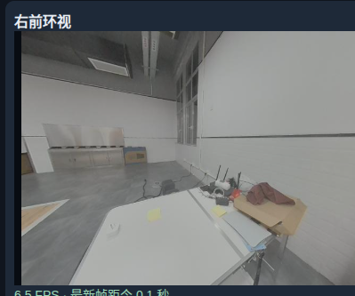

# 9_ 29 9_28 数据采集整理 继续制定G1传感器对齐方案 (2)

- 归档编号：`01a0e801-69cd-7c30-9130-9ff3b3ac2bf5`
- 项目：VLA G1 项目
- 创建时间：2026-09-29T09:08:18.307000+08:00
- 更新时间：2026-09-29T09:38:05.450000+08:00
- 状态：活动
- 导出范围：用户可见消息与助手可见回复；不含隐藏推理和工具原始输出

## 1. 用户

现在我打算把白色方块放到黄色区域，如何？ 给我重新编写脚本，我先采集数据



## 2. 助手（进展）

可以，这个任务的目标很明确：把白色方块抓起，放进黄色标记区域，松爪后保持稳定。我会给它加一个独立采集入口，沿用五组计数和 1800 秒上限，并把任务描述改好。

## 3. 助手

可以，**“白色方块放入黄色区域”很适合首批试采**。入口已写好：[采集脚本](</home/lsy03/文档/ChatGPT/VLA G1 项目/teleoperation/run_capture_white_block.sh>)。

直接在项目目录运行：

```bash
bash teleoperation/run_capture_white_block.sh --execute
```

已配置：
- **5 组、1800 秒**，保留原来的速度参数。
- 任务标签：“将桌面上的白色方块抓起并放入黄色标记区域”。
- 保留 **17 路采集、组数进度和落盘数据条数**。

每组操作：**按记录键开始 → 抓起并放入黄色区域 → 松爪、手退出 → 再按记录键结束**。失败按取消键；落盘完成后暂停操作臂，再人工复位。首批五组保持同一只手、同一起始位置。

满五组只提示，不自动停止遥操。脚本语法与离线配置检查通过，尚未启动真机。

## 4. 用户

lsy03\@lsy03-System-Product-Name:\~/文档/ChatGPT/VLA G1 项目$ bash teleoperation/run\_capture\_white\_block.sh --execute
白色方块任务：抓起白色方块，放入黄色标记区域，松爪后稳定放置，再将手退出。
每组：记录键开始；成功后再次按记录键结束；失败按取消键。等待落盘完成后再复位。
首批保持同一只手、同一起始区域和同一黄色目标区域；复位不录入演示。
17路原始数据＋控制日志；任务：将桌面上的白色方块抓起并放入黄色标记区域；关节上限1.0rad/s；夹爪速度0.16m/s
启动自动预热；先用固定键开启遥操作，再按记录键开始/结束采集。首次先录一条短动作并检查。
本次会话目标：5组；会话上限：1800秒；达到目标仅提示，遥操继续。
启动测时记录：/home/lsy03/文档/ChatGPT/VLA G1 项目/lerobot\_runs/pilot\_clock\_20260928\_203657\_727502.json
启动测时失败：启动测时偏移变化超过5ms，请先复核时钟；未启动遥操
lsy03\@lsy03-System-Product-Name:\~/文档/ChatGPT/VLA G1 项目$&#x20;
这是什么情况现在是延时问题？

## 5. 助手（进展）

这条报错指的是启动期间两台机器的时钟偏移变化超过 5 ms，不一定是网络延迟大。我先看这次保存的测时记录，区分网络往返延迟和时钟偏移变化。

## 6. 助手

**这次主要是两台机器的时钟偏移不稳定，不是网络延迟太大。** 我看了刚才保存的测时记录：

| 项目 | 本次结果 |
|---|---|
| 第一笔 SSH 请求 | 291 ms，已被程序排除 |
| 后续 11 笔请求往返时间 | **0.42–2.46 ms** |
| G1 相对 PC 的时间偏移 | 从 **49.42 ms 增长到 54.52 ms** |
| 偏移变化 | **5.10 ms**，超过启动门槛 **5 ms** |

这里的 **49–55 ms 是两台机器“钟表读数的差”，不是机器人动作延迟**。固定的时间差可以补偿；但这次约 1.5 秒内时间差持续增长，用一个固定值补偿就可能不准，因此脚本在开启遥操前退出了。

**为什么会变化，目前还不能只凭这份记录确定。** 之前检查发现过 G1 上 NTP 和 PTP 相关服务同时调节系统时间的线索，这次值得优先复查，但还不能直接认定是同一个原因。

当前**尚未进入遥操，也没开始正式录制**。下一步应先做一次持续约 30 秒的只读测时，检查两端时钟及同步服务状态，确认是暂时收敛还是持续变化，再恢复采集；不建议仅为启动成功而放宽 5 ms 门槛。

## 7. 用户

给我看下数据现在录制了几组？质量如何？

现在给我报错是啥？

[附件：a9ca462e83f8cfba--已粘贴的文本.txt](../../assets/a9ca462e83f8cfba--%E5%B7%B2%E7%B2%98%E8%B4%B4%E7%9A%84%E6%96%87%E6%9C%AC.txt)

## 8. 助手（进展）

我先看你贴的终端报错和最新会话记录，确认已落盘几组、有没有中断，以及目前能判断的数据质量。

## 9. 助手（进展）

查到今天共启动了两次白方块采集：累计两组正常结束、一组中断、一组录制故障。最新这次退出的直接原因是原始数据写入队列达到容量上限，不是之前的启动测时错误；我再核对控制日志和两组完整数据的缺口情况。

## 10. 助手

**今天累计录了 4 段，其中 2 组正常完成，另外 2 段异常结束。距离五组完整演示还差 3 组。** 终端显示的 `1/5` 只统计当前启动的会话。

| 会话 | 组号 | 时长 | 结果 |
|---|---|---:|---|
| 20:38 启动 | 第 1 组 | 29.95 秒 | 正常完成，25,513 条原始记录 |
| 20:38 启动 | 第 2 组 | 215.38 秒 | 中断：左夹爪控制更新间隔超过 300 ms |
| 20:48 启动 | 第 1 组 | 33.51 秒 | 正常完成，27,739 条原始记录 |
| 20:48 启动 | 第 2 组 | 原始采集约 26.12 秒 | 写入队列溢出，保存了部分数据 |

两组正常完成的演示合计 **63.46 秒**。

**当前报错的根因是：**
```text
queue byte limit exceeded; recording must stop
```

意思是：**传感器数据进入队列的速度，一度超过写入线程处理速度，积压接近 128 MiB 上限，触发停止。** 可能涉及磁盘写入、刷盘停顿或系统负载，现有日志还不能确定具体瓶颈。这不是之前的启动时钟报错，也不是磁盘空间不足的报错。

- 故障组已经接收的 **20,994 条记录全部写出，待写数量为 0**；但录制提前停止，不能算完整成功组。
- 后面的 `persistent cleanup failed` 是故障状态下清理退出产生的次级报错。
- 右臂的“J2 目标越界”使右臂保持 `LOCKED`，不是此次写入队列故障的原因。

**数据质量目前属于“有可保留的试采数据，尚未通过训练验收”。**

- 两组正常完成的数据都有 **17 路记录**，写入统计无错误；两次会话的 PC 日志也都没有丢弃记录。
- 仍存在约 **88–95 ms 的状态采样缺口**；第一组还有约 **133 ms 的腕部图像间隔**。不能把整段视为严格连续同步。
- 尚未取回并逐帧检查画面、文件校验及动作对齐，因此不能给出准确的训练通过率，也未确认实际放置任务是否成功。
- 这次主要操作左臂，后续需要按单臂动作语义导出，不能直接把未操作的右臂动作补零。

**建议先保留这四段，优先排查写入积压，再补剩余三组。** 当前完整数据不需要重录，但“落盘完成”还不等于“质量验收通过”。

## 11. 用户

有没有办法在rerun中查看这几组数据？ 给我脚本

## 12. 助手（进展）

我先检查现有 Rerun 查看器和这四段数据的位置，给你做一个可选择组号的启动脚本；中断段也会明确标注。

## 13. 助手（进展）

本机目前只有控制日志和清单，图像、深度等原件还在 G1 上。我会让脚本首次查看时自动取回所选组并校验，再生成轻量 Rerun 预览；两段异常数据也能查看已保存的部分，但不会标成完整成功组。

## 14. 助手

可以，已写好[查看脚本](</home/lsy03/文档/ChatGPT/VLA G1 项目/teleoperation/view_white_block_capture.sh>)。在项目目录运行：

```bash
bash teleoperation/view_white_block_capture.sh --episode 1
```

序号对应：

| 序号 | 数据 | 状态 |
|---|---|---|
| `1` | 第一场第1组，29.95秒 | 正常完成 |
| `2` | 第一场第2组，约215秒 | 中断 |
| `3` | 第二场第1组，33.51秒 | 正常完成 |
| `4` | 第二场第2组，约26秒 | 队列溢出，部分数据 |

**建议先看 `1` 和 `3`。** 首次运行需要 G1 在线：自动复制所选组原件、校验并生成轻量预览。完成后打开[本地 Rerun 页面](http://127.0.0.1:9096/?url=rerun%2Bhttp%3A%2F%2F127.0.0.1%3A9882%2Fproxy)。

可以查看相机、深度、关节、夹爪、腕力和时间缺口。切换组时先 `Ctrl+C` 关闭服务，再改 `--episode` 序号运行。

已通过离线参数、依赖和布局检查；尚未实际下载并验证这四段回放。这里展示的是**原始数据，尚无逐帧质量通过标记**。

## 15. 用户

现在的最新数据在什么地方？ G1 里面还是我本机电脑/

## 16. 助手

**目前是两边各存一部分：**

- **G1 上**：17 路完整原始传感器数据，包括图像、深度、关节、腕力和夹爪。最新会话目录：
  ```text
  /home/galbot/vla_capture/data/capture_sessions/b357cc54-1fd4-47f5-a0ee-34924c52a3e2/
  ```

- **本机电脑上**：控制日志、动作下发记录、每组清单和测时数据。最新会话目录：
  [dual_arm_capture_20260928_204855_728822](</home/lsy03/文档/ChatGPT/VLA G1 项目/lerobot_runs/dual_arm_capture_20260928_204855_728822>)

**我上次检查时，传感器原件还没有下载到本机。** 如果你之后运行了 Rerun 查看脚本并完成下载，所选组会出现在本机会话目录的 `raw/episode_******/` 下，G1 上的原件仍保留。

## 17. 用户

现在查看一下是不是有了？

## 18. 助手（进展）

我检查一下本机这两次白方块会话，确认原始数据是否已下载，以及 Rerun 预览是否已生成。

## 19. 助手

**有了，但目前只下载了第 1 组。**

| 数据 | 本机原件 | Rerun 预览 |
|---|---|---|
| 第1组：20:38 会话，29.95秒 | ✅ 约 2.03 GiB，17 个分片均存在且大小符合清单 | ✅ 约 105 MB |
| 第2组：中断段 | 尚未下载 | 未生成 |
| 第3组：20:48 会话，33.51秒 | 尚未下载 | 未生成 |
| 第4组：队列溢出段 | 尚未下载 | 未生成 |

第1组原件在本机：
[打开数据目录](</home/lsy03/文档/ChatGPT/VLA G1 项目/lerobot_runs/dual_arm_capture_20260928_203810_727975/raw/episode_000001>)

**最新的 20:48 会话原件仍未下载到本机。** 下载并查看其中正常完成的一组，运行：

```bash
bash teleoperation/view_white_block_capture.sh --episode 3
```

## 20. 用户

我想全部下载，给我脚本

## 21. 助手（进展）

我会加一个批量下载脚本，把这两次会话的四组原始数据全部取回；已有数据会先校验后跳过，下载中断可以续传，G1 上的原件会保留。

## 22. 用户

我想全部下载，并且全部在rerun中展示，给我脚本

## 23. 助手（进展）

我会增加一个“一次下载四段、在同一个 Rerun 页面切换查看”的入口，复用已下载的第1组，并保留中断和故障标记。

## 24. 助手

已写好[批量查看脚本](</home/lsy03/文档/ChatGPT/VLA G1 项目/teleoperation/view_white_block_all.sh>)。在项目目录运行：

```bash
bash teleoperation/view_white_block_all.sh
```

它会自动：

1. 下载剩余三段，复用本机已有的第1组，保留 G1 原件。
2. 校验数据并生成四段 Rerun 预览。
3. 启动同一个网页，在左侧 **Recordings** 列表切换四段。

全部处理完成后打开：[Rerun 四段数据查看](http://127.0.0.1:9097/?url=rerun%2Bhttp%3A%2F%2F127.0.0.1%3A9883%2Fproxy)。

首次运行需要 G1 在线，215 秒的中断段处理会较久。第2、4段保留异常标记，只展示已保存的数据。

脚本已通过离线检查，尚未替你执行实际下载。

## 25. 用户

现在的数据是否是 lerobot 格式？如果不是，这个与lerobot格式有啥区别？

## 26. 助手

**现在这四段白方块数据还不是 LeRobot 格式，是我们自定义的原始采集格式。** 下载脚本只是把原件复制到电脑，再生成 Rerun 预览，没有执行 LeRobot 转换。目录叫 `lerobot_runs`，不代表里面的数据已经是 LeRobot 数据集。

| 项目 | 当前原始数据 | 转换后的 LeRobot 数据 |
|---|---|---|
| 组织方式 | 17 路传感器分别按各自时间戳记录 | 按统一采样时刻组织每行训练样本 |
| 文件 | `.g1raw` 分片、JSON 清单、JSONL 控制日志 | Parquet 数据表、图像/视频及数据集元信息 |
| 频率 | 各路保留原始频率 | 按指定频率组帧，例如之前采用的 **10 Hz** |
| 状态与动作 | 传感器反馈、实际下发命令分开保存 | 明确定义 `observation.state` 和 `action` |
| 图像配对 | 各相机各自记录 | 为每个训练时刻选取对应图像 |
| 使用方式 | 用我们的解析脚本读取 | 可通过 LeRobot 数据加载器读取 |

可以理解为：

```text
G1 原始记录 + PC 控制日志
          ├─→ Rerun 预览：检查画面、曲线和缺口
          └─→ 时间对齐、动作标签定义、质量筛选
                         └─→ LeRobot 数据集
```

**原始数据更适合保留和重新处理；LeRobot 格式更方便训练。** 转换不会自动修复丢帧、时间缺口，也不会让失败演示变成成功演示。`.rrd` 则只是 Rerun 的可视化文件，同样不是 LeRobot 训练格式。

对于这批白方块数据，转换前最关键的是：

- **明确单臂动作定义**：这次主要操作左臂，需要确定左臂关节＋左夹爪的 state/action；未操作右臂不能随意补零。
- **检查时间对齐和连续片段**：保留缺口标记，不能删除坏行后直接拼成长轨迹。
- **区分完整与异常演示**：先处理两组正常完成的数据；另外两段用于排查或经检查后提取可用片段。

之前的叠毛巾数据已经做过 LeRobot 导出；**这次白方块数据目前只完成原始采集和查看脚本，还没有转换。**

## 27. 用户

我是否直接记录Lerobot数据会更加方便一些，就不需要再进行转换了

## 28. 助手

**从使用上会更方便，但时间对齐和动作整理仍然要做，只是从“采集后转换”变成“采集时实时处理”。**

LeRobot 的每一行需要明确：这个时刻用哪张图像、哪个关节状态，以及对应哪个动作。你现在有17路不同频率的数据，直接写 LeRobot 也必须处理这些问题。

| 方式 | 好处 | 对当前项目的影响 |
|---|---|---|
| 直接录 LeRobot | 录完即可加载训练，流程简单 | 实时完成配对、图像编码和写盘；规则改了以后，若没留原件就难以重做 |
| 原始采集后转换 | 保留原始频率与时间戳，可重新对齐 | 多一道处理步骤 |
| **原始采集＋自动转换** | 保留原件，操作上也无需手动转换 | 需要把现有流程串起来 |

**你当前最适合第三种：录制时保留原始数据，结束后自动生成 LeRobot。** 尤其这次出现过写入队列溢出，直接在采集过程中叠加视频编码和转换，可能增加负载；是否能改善写入效率，需要实测，不能只靠换格式判断。

可以把使用流程做成：

```text
运行采集脚本
    ↓
按键录制多组
    ↓
退出采集
    ↓
自动下载 → 完整性校验 → 时间对齐 → 导出 LeRobot
    ↓
输出数据集路径、质量报告和 Rerun 查看命令
```

这样对你来说，**不需要再手动运行转换命令**，同时还能保留全部17路原件。正常完成的组进入训练候选集，中断和故障组单独保留。

等我们把**左臂 action 定义、采样频率和缺口处理规则**固定，并解决连续采集稳定性后，再考虑直接录制 LeRobot，会更稳妥。

## 29. 用户

给我看一下是否正常？
这个数据有多大？ 为什么需要传这么久？

[附件：e309c0454365c4b4--已粘贴的文本.txt](../../assets/e309c0454365c4b4--%E5%B7%B2%E7%B2%98%E8%B4%B4%E7%9A%84%E6%96%87%E6%9C%AC.txt)

## 30. 助手（进展）

我先看你贴的传输日志，再核对本机已下载的大小，判断是在正常传输、校验还是生成预览。

## 31. 助手

**目前看是正常推进，没有新的报错。现在已经处理完前3段，正在下载第4段，比你贴的日志又往前走了。**

我刚检查到的大小如下，按十进制 GB 计算：

| 数据段 | 原始数据大小 | 当前进度 |
|---|---:|---|
| 第1段，约30秒 | **2.18 GB** | 下载、预览已完成 |
| 第2段，约215秒 | **15.41 GB** | 下载、预览已完成 |
| 第3段，约34秒 | **2.44 GB** | 下载、预览已完成 |
| 第4段，约26秒 | **约1.87 GB** | 已下载约1.81 GB，仍在临时目录 |
| **合计** | **约21.9 GB** | 下载完成后还需校验、生成第4段预览 |

耗时主要有三个原因：

1. **原始数据量确实大。** 17路全部保留，尤其两路未压缩的 `1280×720、uint16` 深度，按每路15 Hz计算，仅深度就约 **55 MB/秒**。215秒的第2段占了总量约70%。
2. **日志里的 `read chunk_...` 已经不是网络传输。** 那是在本机读取分片、解码图片、缩小预览并写入 Rerun 文件，也需要时间。
3. **当前脚本首次下载后重复做了一次完整校验。** 你看到两遍“文件完整性通过”就是这个原因；这是我脚本里可以优化的重复处理，会增加本机磁盘读取时间，但没有重复下载。

第2段的 `interrupted` 表示**录制当时中断**，不是这次传输失败。它已经通过文件完整性校验并生成预览。

**现在可以继续等，不需要重启脚本。** 第4段完成后会启动四段数据的 Rerun 页面；后续再次运行会复用本机文件，通常就不用再下载、转换了。

## 32. 用户

hite\_block\_rerun\_20260928/dual\_arm\_capture\_20260928\_203810\_727975\_episode\_000001\_w320.rrd"…
[2026-09-29T01:20:07Z INFO  re\_data\_loader::load\_file] Loading "/home/lsy03/文档/ChatGPT/VLA G1 项目/reports/white\_block\_rerun\_20260928/dual\_arm\_capture\_20260928\_203810\_727975\_episode\_000002\_w320.rrd"…
[2026-09-29T01:20:07Z INFO  re\_data\_loader::load\_file] Loading "/home/lsy03/文档/ChatGPT/VLA G1 项目/reports/white\_block\_rerun\_20260928/dual\_arm\_capture\_20260928\_204855\_728822\_episode\_000001\_w320.rrd"…
[2026-09-29T01:20:07Z INFO  re\_data\_loader::load\_file] Loading "/home/lsy03/文档/ChatGPT/VLA G1 项目/reports/white\_block\_rerun\_20260928/dual\_arm\_capture\_20260928\_204855\_728822\_episode\_000002\_w320.rrd"…
[2026-09-29T01:20:08Z INFO  re\_sdk::web\_viewer] Hosting a web-viewer at [http://127.0.0.1:9097?url=rerun%2Bhttp%3A%2F%2Flocalhost%3A9883%2Fproxy](http://127.0.0.1:9097?url=rerun%2Bhttp%3A%2F%2Flocalhost%3A9883%2Fproxy)
[2026-09-29T01:20:08Z INFO  re\_grpc\_server] Listening for gRPC connections on 127.0.0.1:9883. Connect by running \`rerun --connect rerun+[http://127.0.0.1:9883/proxy](http://127.0.0.1:9883/proxy)\`
^CTraceback (most recent call last):
&#x20; File "/home/lsy03/文档/ChatGPT/VLA G1 项目/.venv-lerobot/bin/rerun", line 9, in \<module>
&#x20;   sys.exit(main())
&#x20; File "/home/lsy03/文档/ChatGPT/VLA G1 项目/.venv-lerobot/lib/python3.10/site-packages/rerun\_sdk/rerun\_cli/\_\_main\_\_.py", line 35, in main
&#x20;   return subprocess.call([target\_path, \*sys.argv[1:]])
&#x20; File "/usr/lib/python3.10/subprocess.py", line 347, in call
&#x20;   return p.wait(timeout=timeout)
&#x20; File "/usr/lib/python3.10/subprocess.py", line 1209, in wait
&#x20;   return self.\_wait(timeout=timeout)
&#x20; File "/usr/lib/python3.10/subprocess.py", line 1959, in \_wait
&#x20;   (pid, sts) = self.\_try\_wait(0)
&#x20; File "/usr/lib/python3.10/subprocess.py", line 1917, in \_try\_wait
&#x20;   (pid, sts) = os.waitpid(self.pid, wait\_flags)
KeyboardInterrupt

lsy03\@lsy03-System-Product-Name:\~/文档/ChatGPT/VLA G1 项目$&#x20;


给我检查下什么问题，是否正常？

## 33. 助手（进展）

日志看起来是 Rerun 已启动后，你按了 `Ctrl+C`，启动器因此打印了 `KeyboardInterrupt`。我再检查四段预览文件是否完整生成，以及服务是否已退出。

## 34. 助手

**正常，这是按 `Ctrl+C` 关闭服务产生的 `KeyboardInterrupt`，不是下载或数据损坏报错。**

我刚检查确认：

- **四段原始数据都已下载到本机**，分片数量和文件大小符合清单，没有未完成分片。
- **四个 Rerun 预览均已生成**，大小分别约 105、753、118、89 MB。
- `9097`、`9883` 端口已停止监听，说明查看服务已退出。

重新查看，运行：

```bash
bash teleoperation/view_white_block_all.sh
```

然后打开 [Rerun 页面](http://127.0.0.1:9097/?url=rerun%2Bhttp%3A%2F%2F127.0.0.1%3A9883%2Fproxy)。**查看期间保持终端运行，不要按 `Ctrl+C`**；这次会复用本地文件，无需重新下载或生成预览。

第2段中断、第4段失败仍是原录制状态，与这次退出查看服务无关。

## 35. 用户

我们现在明确一下，现在的数据有多少路？

## 36. 助手

**目前采集并保存的是 17 路传感器数据，另外还有 PC 端控制与动作日志。**

| 类型 | 数量 | 内容 |
|---|---:|---|
| RGB 图像 | **6 路** | 头左、头右、左腕、右腕、左前环视、右前环视 |
| 深度图像 | **2 路** | 左腕深度、右腕深度 |
| 关节状态 | **5 路** | 底盘、头部、左臂、右臂、腿部，每路包含该组关节 |
| 六维力传感器 | **2 路** | 左腕、右腕，各包含三轴力＋三轴力矩 |
| 夹爪状态 | **2 路** | 左夹爪、右夹爪 |
| **合计** | **17 路** | |

**PC 控制日志不计入这17路**，它单独记录遥操状态、实际接受的动作目标、下发时间、录制开始/结束事件等。

这次四段白方块数据都保存了上述17路；第2、4段虽然异常结束，但已保存部分也包含全部17路。**路数齐全不代表全程无缺口或时间已对齐。**

Rerun 默认只展示三路主相机，其他数据在下方标签页中；不是只录了三路。

## 37. 用户

bash teleoperation/view\_white\_block\_all.sh
给我核实一下，我看前3s 左右都有黑屏的情况，这是什么回事，是原始数据的问题还是传输的问问题？

## 38. 助手（进展）

我会对照原始图像、预览时间轴和 Rerun 显示，确认前约 3 秒的黑屏出在哪一层，先不把它归因于采集或传输。

## 39. 助手（进展）

四段原件的前 4 秒、六路 RGB 都已逐帧解码，没有发现黑图或解码失败；对应分片哈希也一致。各路首帧最晚约在 0.14 秒出现，不能解释持续 3 秒的黑屏。我正在检查 Rerun 是否丢弃了早期显示数据。

## 40. 助手（进展）

已在网页复现：时间轴到 1.255 秒时三路主画面全黑，但文件中对应时段的图像正常。Rerun 内存面板同时显示多次 `RAM purge`（内存清理），说明四段一起加载后，查看端丢弃了部分显示数据。此前设置的服务端 4 GB 上限，并不能提高浏览器自己的内存上限。

## 41. 助手

**核实了：这次前约3秒黑屏是 Rerun 查看端的内存清理问题，不是原始图像黑屏，也没有发现对应数据传输损坏。**

证据如下：

- 检查四段数据前 **4秒、六路RGB，共1,271张图像**：原件与 Rerun 文件都能正常解码，没有近全黑图像。
- 对应 **16个原始分片的哈希与清单一致**。
- 各相机首帧最晚约 **0.14秒**出现，不存在3秒才开始出图的情况。
- 网页在 **1.255秒**复现了三路主相机全黑；内存面板显示多次 **`RAM purge`**，早期显示数据被清理。

我之前让四段同时加载的方案，对浏览器内存估计不足。**服务端设置4 GB，并不等于浏览器也能使用4 GB。** 原件和 `.rrd` 文件没有因此被删除。

现在先关闭批量页面，在终端 `Ctrl+C` 停止服务，再单独查看：

```bash
bash teleoperation/view_white_block_capture.sh --episode 1
```

打开[单组 Rerun 页面](http://127.0.0.1:9096/?url=rerun%2Bhttp%3A%2F%2F127.0.0.1%3A9882%2Fproxy)。另一组正常演示用 `--episode 3`。单组加载能明显降低内存压力；215秒的长段后续适合分段预览。

[检查结果](<../../assets/1b4517caa4aa132e--%E7%BB%93%E8%AE%BA.md>)。本次结论针对起始黑屏，不代表整段时间对齐已通过验收。

[附件：1b4517caa4aa132e--结论.md](../../assets/1b4517caa4aa132e--%E7%BB%93%E8%AE%BA.md)

## 42. 助手

_历史投影中的图片引用（用于补全本地对话资源）。_

> 资源未归档：`/tmp/codex-clipboard-da9dd83b-07aa-4a38-a4d7-f6dc2c80ebac.png`（missing）
