# 9_30 9_29 数据采集 单臂抓放白色方块 采集 继续制定G1传感器对齐方案 (2) (2)

- 归档编号：`01a0eacc-beb4-7360-9def-ed0294e12f22`
- 项目：VLA G1 项目
- 创建时间：2026-09-30T10:14:07.322000+08:00
- 更新时间：2026-09-30T14:11:31.702000+08:00
- 状态：活动
- 导出范围：用户可见消息与助手可见回复；不含隐藏推理和工具原始输出

## 1. 用户

现在我们新开一个数据采集任务脚本，只运动左臂，将“白色方块放到灰色板子上” 。
我们也可以看下哪些传感器的数据是不需要记录的

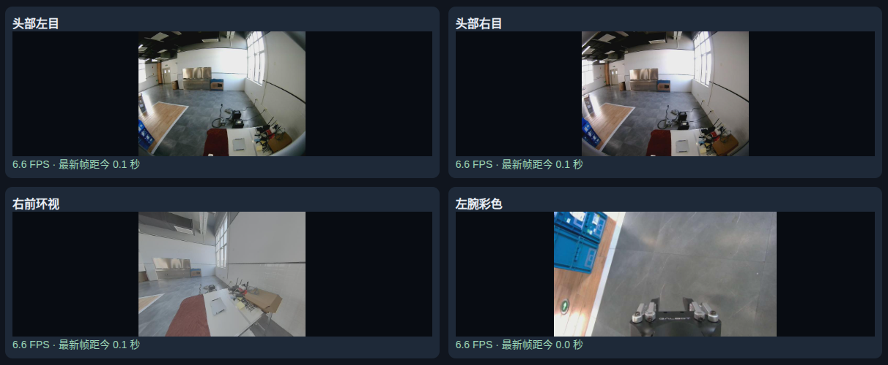

## 2. 助手（进展）

我先做一个独立的“左臂把白色方块放到灰色板上”采集入口，并检查如何在代码里锁住右臂。传感器方面，我会区分控制安全检查所需的数据和需要落盘的数据，评估能精简到哪些通道。

## 3. 助手（进展）

从截图看，右前环视能看到整个桌面；头部画面中的目标较小，左腕当前朝向地面，需要在抓取姿态下确认视野。我建议精简候选为 **6 路：头左 RGB、左腕 RGB、右前环视 RGB、左臂关节、左夹爪、左腕六维力**，两路深度是优先考虑去掉的大数据量来源。

这次先把新入口和左臂限制做好。传感器裁剪涉及 G1 上的记录器，我会写清保留建议；新入口暂时沿用17路，避免把“建议去掉”误当成已经生效。

## 4. 助手

新入口已写好，运行：

```bash
bash teleoperation/run_capture_left_gray_board.sh --execute
```

默认 **五组、1800秒**，任务为“仅用左臂将白色方块放到灰色板子上”。

- 只允许**左臂和左夹爪**遥操。
- 右侧固定键不能开启右臂跟随，右夹爪开合命令禁用。
- 两侧急停仍有效。
- 已通过24项离线测试，尚未真机验证。

**传感器建议从17路精简为以下6路：**

| 保留通道 | 用途 |
|---|---|
| 头左 RGB | 全局视角 |
| 左腕 RGB | 抓取、放置近景 |
| 右前环视 RGB | 从截图看，桌面和灰板覆盖较好 |
| 左臂关节状态 | 7个关节的实测状态 |
| 左夹爪状态 | 开度及抓取反馈 |
| 左腕六维力 | 接触过程诊断，数据量较小 |

可以考虑不记录：**头右、右腕、左前环视RGB，两路深度，右腕力，右夹爪，以及底盘、头部、右臂、腿部四组关节状态**。控制安全检查需要的反馈仍保留读取。

**注意：当前新脚本仍录17路，上面是精简建议，尚未修改G1记录器。** 两路深度是优先裁剪项；必须在采集端减少写入，才能降低之前的队列积压和下载量。

截图中左腕相机目前朝向地面，正式录制前先确认抓取与放置时能看到方块和灰板。

[新任务操作与传感器建议](<../../assets/fa27ace43ab19dde--LEFT_GRAY_BOARD_CAPTURE_USAGE.md>)

[附件：fa27ace43ab19dde--LEFT_GRAY_BOARD_CAPTURE_USAGE.md](../../assets/fa27ace43ab19dde--LEFT_GRAY_BOARD_CAPTURE_USAGE.md)

## 5. 用户

是否有左臂的深度图像？

## 6. 助手

**有，左腕相机的深度图像一直在记录。**

- 通道名：`LEFT_ARM_DEPTH_CAMERA`
- 分辨率：**1280 × 720**
- 格式：**uint16 深度值**，距离单位换算使用记录中的 `depth_scale`
- Rerun 中：切换下方 **Depth → Left depth** 查看

当前新建的左臂采集脚本仍记录全部17路，**包含左腕深度**。前面只是建议可以裁剪，并没有删除它。

如果你希望保留左腕深度用于后续空间定位，可以将建议方案从 **6路改为7路**，只去掉右腕深度。

## 7. 用户

方案从 **6路改为7路**

## 8. 用户

方案从 **6路改为7路**，只去掉右腕深度是什么意思？

## 9. 助手

我的意思是：**在建议保留的6路基础上，加回左腕深度，变成7路。**

这7路是：

1. 头左 RGB
2. 左腕 RGB
3. **左腕深度**
4. 右前环视 RGB
5. 左臂关节状态
6. 左夹爪状态
7. 左腕六维力

之前“只去掉右腕深度”的说法不够准确——它仅指**两路深度之间保留左侧、去掉右侧**，不是说17路里只删除这一项。采用上述7路方案，实际会从17路中去掉其余10路。

**目前脚本仍记录17路，7路精简方案还没有实施。**

## 10. 用户

实施7路精简方案 ，我们明确一下数据生成完是在G1里还是在我本地主机里？

## 11. 助手（进展）

我会把记录器改成实际只采集、写入这7路，并同步调整预热、完整性校验和新任务入口。原始传感器数据仍先写在 **G1**，控制与动作日志写在**本地主机**；取回后本机会保留一份原件。我会检查部署流程，并明确哪些修改已生效。

## 12. 助手（进展）

七路选择已接入 SDK 读取、预热和写盘流程，旧17路任务的离线回归已通过。接下来验证“只写七路、缺少任一路就拒收”，再把新记录器部署到 G1 的独立目录；不会覆盖旧版本，也不会启动机械臂。

## 13. 助手（进展）

新记录器已部署到 G1 的独立目录，远端配置确认是这7路；67项离线测试和七路 Rerun 布局检查通过。没有启动真机采集。

文件位置也已明确：**G1 写七路传感器原件，本机写控制日志；录制结束后执行取回命令，本机才会有传感器原件副本。** 当前没有自动下载步骤。

## 14. 助手

**7路精简方案已实施，并已部署到G1。** 运行原来的新任务入口即可：

```bash
bash teleoperation/run_capture_left_gray_board.sh --execute
```

现在实际记录：**头左RGB、左腕RGB、左腕深度、右前环视RGB、左臂关节、左夹爪、左腕六维力**。仅左臂和左夹爪允许遥操。

**数据位置明确如下：**

| 数据 | 录制时保存位置 |
|---|---|
| 七路传感器原件，包括图像和深度 | **G1**：`/home/galbot/vla_capture/data/capture_sessions/<session_id>/` |
| 控制命令、动作日志、测时和各组清单 | **本机**：项目内 `lerobot_runs/dual_arm_capture_日期_时间_PID/` |
| 下载后的传感器副本 | **本机**：上述会话目录的 `raw/` 下 |

**目前不会自动下载。** 录完后，用终端显示的实际会话目录执行：

```bash
python3 -B -m acquisition.lerobot_capture.fetch \
  lerobot_runs/dual_arm_capture_实际目录
```

下载后两边都有，G1原件保留。当前仍是原始采集格式，未自动转换为LeRobot。

67项离线测试通过，远端七路配置已确认；**尚未真机试录**，首次先短录一组检查。

## 15. 用户

给我查一下，这是什么BUG？

[附件：d6956ff8ccb0342e--已粘贴的文本.txt](../../assets/d6956ff8ccb0342e--%E5%B7%B2%E7%B2%98%E8%B4%B4%E7%9A%84%E6%96%87%E6%9C%AC.txt)

## 16. 助手（进展）

我先看报错原文和最新七路会话日志，定位是控制、采集还是退出清理环节出了问题。

## 17. 助手（进展）

这次不是七路写盘队列溢出：五段的写入队列峰值都不超过约4.3 MiB，PC日志也没有丢记录。故障前控制循环仍约每10–11 ms运行一次。

我发现一个门控问题：夹爪更新被要求与“关节反馈刚好在本轮刷新”同时满足，两个独立数据流错开时，夹爪可能一直被跳过。我会先用模拟复现，确认后修正，保留原来的300 ms超时保护。

## 18. 助手（进展）

模拟已复现同一报错：关节和夹爪都正常刷新，只要两者错开，旧代码就可能让夹爪更新超时。修正后该测试通过，真实反馈冻结、控制超时和急停测试也都通过，300 ms保护没有放宽。

这次已有3组成功落盘，共约81.5秒；另有1组按键标失败，第5组因这次异常中断。日志记录了停止命令成功、夹爪保持确认和关节静止检查通过。

## 19. 助手

**查到并修复了一个会触发这条报错的控制代码 BUG，模拟中已复现相同问题。**

旧逻辑要求“关节反馈”和“夹爪反馈”恰好在同一轮刷新，才更新夹爪。两路数据刷新时间错开时，夹爪更新会被反复跳过，最终触发：

```text
左夹爪控制更新间隔超过300ms
```

现场日志与这个机制一致：故障前控制循环仍每 **10–11 ms** 运行，夹爪有效更新却间隔约 **355 ms**。本次没有写盘队列溢出。

**修复已生效于本机代码**：夹爪独立按自己的反馈更新；300 ms超时、反馈新鲜度和急停保护均保留。40项离线测试通过，尚未真机复测。

这次数据保存情况：

- **3组正常完成**，共约 **81.5秒**。
- **1组被按键标为失败**，原始数据正常落盘。
- **第5组中断**，约6.5秒的数据保留。
- 全部都是7路，已有成功组不受这次退出影响。

下次仍用原命令，先短录一组验证：

```bash
bash teleoperation/run_capture_left_gray_board.sh --execute
```

[诊断与修复报告](<../../assets/c8971de6b6abd743--%E8%AF%8A%E6%96%AD%E4%B8%8E%E4%BF%AE%E5%A4%8D.md>)

[附件：c8971de6b6abd743--诊断与修复.md](../../assets/c8971de6b6abd743--%E8%AF%8A%E6%96%AD%E4%B8%8E%E4%BF%AE%E5%A4%8D.md)

## 20. 用户

旧逻辑要求“关节反馈”和“夹爪反馈”恰好在同一轮刷新，才更新夹爪。两路数据刷新时间错开时，夹爪更新会被反复跳过，最终触发：
```
左夹爪控制更新间隔超过300ms

是否确认新脚本已经修复这个Bug？
```

## 21. 助手（进展）

我再核对当前脚本的调用链，并重跑相位错开的复现测试，确认你下次启动用到的就是修复后的代码。

## 22. 助手

**确认：新脚本调用的代码已修复这个门控 BUG。** 我刚重新核对并测试：

- 夹爪更新已不再依赖关节反馈“同一轮刷新”。
- 原先能复现报错的相位错开测试，现在通过。
- 真实反馈冻结、超过300 ms和急停保护测试仍通过。
- Docker直接挂载本机代码，**重新运行脚本即可，无需重建镜像或重新部署G1**。

```bash
bash teleoperation/run_capture_left_gray_board.sh --execute
```

**目前确认到代码和模拟测试层面，尚未完成真机复测。** 若发生真实控制超时，同一条300 ms保护报错仍可能触发；这次修复的是异步反馈错开导致的误触发。

## 23. 用户

【数采】ARMED | 无活动episode | 记录键：ARMED开始 / RECORDING结束；取消键：录制中标失败，待命时保持连接
left\_arm 正式跟随已开启（单次确认）
左夹爪已就绪：左扳机按下闭合、松开张开。

双臂实时对比 | 左：FOLLOWING | 右：LOCKED
单位：度 | 主目标=GP映射目标；有效=限幅后目标；差值=有效目标−G1从臂
各侧固定键：全部误差<15°且READY → 按一次正式跟随 → 再按暂停
+------+----------+--------+--------+--------+--------+----------+--------+--------+--------+--------+
\| 关节 | 左主目标 | 左有效 | 左从臂 | 左差值 | 左检查 | 右主目标 | 右有效 | 右从臂 | 右差值 | 右检查 |
+------+----------+--------+--------+--------+--------+----------+--------+--------+--------+--------+
\| J1   | +61.30   | +61.30 | +61.17 | +0.13  | 通过   | -61.51   | -61.51 | -61.51 | +0.00  | 通过   |
\| J2   | -79.97   | -79.97 | -78.59 | -1.39  | 通过   | +63.42   | +63.42 | +63.42 | +0.00  | 通过   |
\| J3   | -32.90   | -32.90 | -32.71 | -0.19  | 通过   | +44.76   | +44.76 | +44.76 | +0.00  | 通过   |
\| J4   | -13.87   | -13.87 | -13.86 | -0.00  | 通过   | -3.60    | -3.60  | -3.60  | +0.00  | 通过   |
\| J5   | -3.90    | -3.90  | -4.19  | +0.29  | 通过   | -10.06   | -10.06 | -10.06 | +0.00  | 通过   |
\| J6   | -0.61    | -0.61  | -0.92  | +0.30  | 通过   | +3.08    | +3.08  | +3.08  | +0.00  | 通过   |
\| J7   | -1.31    | -1.31  | -1.05  | -0.27  | 通过   | -2.64    | -2.64  | -2.64  | +0.00  | 通过   |
+------+----------+--------+--------+--------+--------+----------+--------+--------+--------+--------+
右侧状态原因：本次仅左臂：右臂跟随禁用，显示实测姿态
左扳机=0.700，夹爪目标/实测=100.0/78.5mm，已启用 | 右扳机=0.700，夹爪目标/实测=100.0/50.0mm，未启用
【采集进度·本次会话】已完成 0/5 组 | 取消/失败 0 组 | 已发起 0 组 | 当前组 0.0s | 完成组累计 0.0s | 累计已落盘 0 条原始记录（含失败组，组结束后更新）
【数采】ARMED | 无活动episode | 记录键：ARMED开始 / RECORDING结束；取消键：录制中标失败，待命时保持连接
本轮结束：RuntimeError: left\_arm: 左夹爪保持未确认，请现场检查并使用物理急停；之前的开度目标可能继续执行
lsy03\@lsy03-System-Product-Name:\~/文档/ChatGPT/VLA G1 项目$&#x20;

看一下这又是什么bug？

## 24. 助手（进展）

这条提示表示停止时未能确认左夹爪保持住位置，可能还遮住了更早触发退出的原因。请先确认夹爪已停止；若仍在运动，使用物理急停。我会查最新会话日志，找出最先发生的异常。

## 25. 助手（进展）

这次确认运行的是上次修复后的版本，夹爪更新间隔也稳定在约52 ms。日志显示的是另一个问题：只下发过一次 **100 mm张开目标**，随后反馈开度一路升到 **118.5 mm**；退出时又报“反馈非有限或开度超出120 mm”，因此无法用该反馈发送保持命令。

此外，停止阶段的异常覆盖了最初的退出原因，日志没有保存具体越界值。我会补上这两处诊断缺失；不会把120 mm检查放宽。

## 26. 助手

**这次是“夹爪反馈异常，导致停止时无法确认保持”，不是之前的300 ms更新问题。**

日志确认：

- 本轮运行的是修复后的代码，夹爪更新间隔为 **52–59 ms**。
- 程序只发送过一次 **100 mm张开目标**，SDK返回成功。
- 随后反馈开度从50 mm持续增大，经过 **104.5、110.5、114.5、118.5 mm**。
- 停止时读取反馈，被判定为“非有限值或开度超出120 mm”，因此没有发送保持命令。

**目前不能确定是实际开度超调、反馈/标定异常，还是SDK问题。** 旧日志没有记录被拒绝的具体数值，不能直接断定机械夹爪真实超过120 mm。

另外确认了一个软件BUG：**退出清理的异常覆盖了最初的控制异常。** 我已修复错误记录，现在会同时保留原始原因、停止失败原因及非法反馈具体值；46项离线测试通过。**这只是诊断修复，夹爪反馈异常本身尚未解决。**

本次仍在 `ARMED`，**没有录制任何新组**。机械臂和底盘停止请求返回成功，但夹爪保持未确认。先不要反复重试全开动作，应先核对实际开度与反馈；若夹爪仍在运动，请使用物理急停。

## 27. 用户

我没搞懂，报错推出的原因是什么？

## 28. 助手

**直接原因是：程序读到了“不可信的左夹爪状态”，因此触发保护退出。**

过程是：

1. 程序让夹爪张开到 **100 mm**。
2. 反馈却继续增大，最后一个正常记录值已到 **118.5 mm**。
3. 随后的反馈被判定为**超过允许范围或出现非法数值**，程序停止运行。
4. 退出时，程序想让夹爪保持当前位置，但反馈仍然不可信，保持操作也失败了，所以你最终看到的是“左夹爪保持未确认”。

**不是之前的300 ms超时，也不是数据采集写盘问题。**

目前确定的是“反馈检查失败”；**到底是真实开得过大，还是反馈值错误，旧日志还不足以区分。**

## 29. 用户

夹爪的开度范围是多少？ 实际G1的范围和控制的范围？

## 30. 助手（进展）

我核对一下 SDK 标注的 G1 开度范围和当前脚本的控制范围，并区分接口规格与实机测量值。

## 31. 助手

核对后，当前是这三个范围：

| 项目 | 开度范围 | 含义 |
|---|---:|---|
| **G1 SDK标注范围** | **0–120 mm** | 接口文档给出的G1夹爪范围 |
| **当前脚本遥操目标范围** | **0–100 mm** | 扳机按到底对应0 mm，松开对应100 mm，中间连续映射 |
| **脚本允许的反馈范围** | **0–120 mm** | 超出此范围或出现非法数值，会触发保护退出 |

因此，**100 mm是当前脚本设置的最大张开目标，不是SDK标注的机械极限。**

但“你这台G1实际安装的夹爪，物理开度是否准确对应0–120 mm”，我们**尚未实测确认**，目前依据是SDK文档。

这次异常的关键是：**目标只给到100 mm，反馈却继续增加到118.5 mm，随后检查失败。** 这需要核对实际开度与反馈是否一致，不能直接通过放宽120 mm保护来解决。

## 32. 用户

给我核实一下

## 33. 助手（进展）

我先核实这台 G1 实际安装的夹爪型号、配置和 SDK 对开度的定义，再对照异常日志。先做只读检查，不发送开合命令。

## 34. 助手

**已登录G1核实：实机配置和安装的SDK都规定开度为 0–120 mm。**

| 核实项目 | 结果 |
|---|---|
| G1配置中的左右夹爪类型 | `galbot_gripper` |
| G1配置的最小/最大开度 | **0 / 120 mm** |
| G1当前安装SDK的开度范围 | **0–120 mm**，单位为米 |
| 我们脚本的遥操目标范围 | **0–100 mm** |
| 我们脚本允许的反馈范围 | **0–120 mm** |

实机配置明确写着：
```yaml
galbot_gripper:
  min_width: 0.0
  max_width: 0.12
```

所以，**120 mm保护上限有实机配置依据；100 mm目标也在允许范围内。**

但这只能确认配置与接口规格，**不能证明实际夹爪标定准确**。这次“目标100 mm，反馈继续超过100 mm”的异常仍需核对实际开度与反馈，不能据此放宽上限。此次全程只读，没有发送开合命令。

[实机核实证据](<../../assets/ef5476560a6a55cf--g1_gripper_range_evidence.txt>)

[附件：ef5476560a6a55cf--g1_gripper_range_evidence.txt](../../assets/ef5476560a6a55cf--g1_gripper_range_evidence.txt)

## 35. 用户

【采集进度·本次会话】已完成 0/5 组 | 取消/失败 0 组 | 已发起 0 组 | 当前组 0.0s | 完成组累计 0.0s | 累计已落盘 0 条原始记录（含失败组，组结束后更新）
【数采】ARMED | 无活动episode | 记录键：ARMED开始 / RECORDING结束；取消键：录制中标失败，待命时保持连接

双臂实时对比 | 左：FOLLOWING | 右：LOCKED
单位：度 | 主目标=GP映射目标；有效=限幅后目标；差值=有效目标−G1从臂
各侧固定键：全部误差<15°且READY → 按一次正式跟随 → 再按暂停
+------+----------+--------+--------+--------+--------+----------+--------+--------+--------+--------+
\| 关节 | 左主目标 | 左有效 | 左从臂 | 左差值 | 左检查 | 右主目标 | 右有效 | 右从臂 | 右差值 | 右检查 |
+------+----------+--------+--------+--------+--------+----------+--------+--------+--------+--------+
\| J1   | +67.23   | +67.23 | +67.18 | +0.05  | 通过   | -61.47   | -61.47 | -61.47 | +0.00  | 通过   |
\| J2   | -79.50   | -79.50 | -79.44 | -0.06  | 通过   | +63.38   | +63.38 | +63.38 | +0.00  | 通过   |
\| J3   | -45.91   | -45.91 | -45.92 | +0.01  | 通过   | +44.75   | +44.75 | +44.75 | +0.00  | 通过   |
\| J4   | -18.38   | -18.38 | -18.32 | -0.06  | 通过   | -3.55    | -3.55  | -3.55  | +0.00  | 通过   |
\| J5   | +10.49   | +10.49 | +10.38 | +0.11  | 通过   | -10.06   | -10.06 | -10.06 | +0.00  | 通过   |
\| J6   | -9.40    | -9.40  | -9.35  | -0.05  | 通过   | +3.10    | +3.10  | +3.10  | +0.00  | 通过   |
\| J7   | -0.14    | -0.14  | -0.08  | -0.06  | 通过   | -2.60    | -2.60  | -2.60  | +0.00  | 通过   |
+------+----------+--------+--------+--------+--------+----------+--------+--------+--------+--------+
右侧状态原因：本次仅左臂：右臂跟随禁用，显示实测姿态
左扳机=0.700，夹爪目标/实测=100.0/114.0mm，已启用 | 右扳机=0.700，夹爪目标/实测=100.0/50.0mm，未启用
【采集进度·本次会话】已完成 0/5 组 | 取消/失败 0 组 | 已发起 0 组 | 当前组 0.0s | 完成组累计 0.0s | 累计已落盘 0 条原始记录（含失败组，组结束后更新）
【数采】ARMED | 无活动episode | 记录键：ARMED开始 / RECORDING结束；取消键：录制中标失败，待命时保持连接
本轮结束：RuntimeError: 原始控制异常：ValueError: 左夹爪反馈非法：width=0.121m，velocity=-0.09502505493164062m/s，effort=100.0；要求有限值且开度在[0,0.12]m；停止/保持确认异常：left\_arm: 左夹爪保持未确认，请现场检查并使用物理急停；之前的开度目标可能继续执行
lsy03\@lsy03-System-Product-Name:\~/文档/ChatGPT/VLA G1 项目$&#x20;

给我讲一下夹爪控制的逻辑是什么？为什么老是出这个问题？

## 36. 助手（进展）

这次日志已经明确记录到反馈开度为 **121 mm**，触发了120 mm上限。我再核对最新会话的指令记录，确认程序是否重复下发或把目标改大，然后按“扳机→目标→SDK执行→反馈检查”的顺序解释。

## 37. 助手

**现在的逻辑是：扳机决定目标开度，我们把目标交给SDK执行，再检查反馈是否正常。程序并没有下发121 mm；121 mm是SDK返回的反馈值。**

控制过程分四步：

1. **开启左臂跟随后，先松开扳机使夹爪就绪。** 就绪这一步本身不发运动命令。
2. **扳机映射到0–100 mm目标。** 按到底对应闭合，松开对应100 mm，中间连续变化。
3. **最多每50 ms检查一次目标变化。** 目标有明显变化才下发，速度参数为 **0.16 m/s（160 mm/s）**；目标不变就不重复发送。SDK返回成功只代表命令被接受，**不代表已到位**。
4. **持续检查反馈。** 反馈超过0–120 mm、无效或过期，就停止遥操。退出时尝试用当前有效开度发保持命令；若反馈已非法，就不能用它发保持命令。

我核对了你这次的实际命令：先逐步闭合到0 mm，再逐步张开到100 mm。**所有目标都在0–100 mm内，最后100 mm只发送了一次。** 但反馈随后继续增大：

```text
目标：100 mm
反馈：110 → 115 → 118.5 → 121 mm
                              ↑ 超过120 mm，触发退出
```

所以反复出错的原因是：**“要求到100 mm”与“实际返回的开度”之间的异常还没解决，每次张开都可能再次撞到保护上限。** 上次修复的是夹爪更新被跳过的问题；这次的反馈越界是另一个问题。

当前脚本有一个重要特点：**它依赖SDK完成位置控制，没有在反馈越过100 mm时自行刹停，而是在反馈越过120 mm时触发范围保护。** 这不说明SDK一定有BUG，也不能仅凭日志认定机械夹爪真的张到了121 mm。

下一步需要区分：

- **实际夹爪也超过目标**：检查底层位置控制，以及当前160 mm/s速度下是否出现超调。
- **实际开度正常、反馈偏大**：检查开度标定、反馈换算或SDK数据。

目前只确认了“反馈到121 mm”，还没确认上述哪一种。**不能靠把120 mm限制调大来解决，也不应把现在的情况描述成已经修好。**

## 38. 用户

具体SDK是如何调用的？给我讲讲

## 39. 助手

当前脚本通过 **Python SDK** 调用夹爪，核心是“下发目标”和“读取反馈”两个接口。代码在 [left_trigger_gripper.py](</home/lsy03/文档/ChatGPT/VLA G1 项目/teleoperation/left_trigger_gripper.py>)。

**1. 下发夹爪目标**

实际调用是：

```python
status = robot.set_gripper_command(
    "left_gripper",  # 左夹爪
    0.10,           # 目标开度：0.10米 = 100毫米
    0.16,           # 速度参数：0.16米/秒 = 160毫米/秒
    5.0,            # SDK effort 参数
    False,          # 不等待夹爪运动到位
)
```

接口参数顺序是：

```python
set_gripper_command(
    end_effector,
    width_m,
    velocity_mps,
    effort,
    is_blocking,
)
```

其中：

- `width_m` 是**绝对目标开度**。`0.10`表示“到100 mm”，不是“再张开100 mm”。
- `velocity_mps` 是正数速度参数，张开还是闭合由目标开度决定。
- `effort=5.0` 是SDK的控制参数，不能直接理解为实测夹持力5 N。
- `False` 表示调用返回时**不等待机械运动完成**。

我们随后检查：

```python
if status != ControlStatus.SUCCESS:
    raise RuntimeError("夹爪指令失败")
```

**`SUCCESS`仅表示SDK接受了这次命令，不是已经到达100 mm的证明。**

**2. 持续读取夹爪反馈**

```python
state = robot.get_gripper_state("left_gripper")

width = state.width              # SDK反馈开度，米
velocity = state.velocity        # SDK反馈速度，米/秒
effort = state.effort            # SDK反馈effort
moving = state.is_moving         # SDK报告是否运动
timestamp = state.timestamp_ns   # 反馈时间戳
```

终端中的：

```text
夹爪目标/实测=100.0/114.0mm
```

对应：

```python
目标 = 0.10
SDK反馈state.width = 0.114
```

这里“实测”是**SDK返回的测量值**，并非另外用尺子测得。

**3. 为什么100 mm目标没有让程序立即制止114 mm反馈？**

当前调用方式是：

```text
扳机改变
  → 下发新的绝对开度目标
  → SDK及底层控制器负责执行
  → 脚本持续读反馈、做有效性与范围检查
```

目标保持100 mm时，脚本不会不断重发，也没有实现“超过100 mm立即反向纠正”的外层位置控制。

当反馈到 **121 mm**，脚本的 `0 ≤ width ≤ 0.12` 检查失败，才触发退出。停止时原本想再次调用同一个接口，将**当前有效开度**作为保持目标；但121 mm已经非法，所以没有发送该保持命令。

因此，接下来要核实的是：**SDK接受100 mm目标后，底层实际执行与反馈为什么没有停在目标附近。** SDK内部如何控制电机，不能仅从这个Python接口和`SUCCESS`返回值判断。

## 40. 用户

给我画一下，扳机发送的控制命令和实际G1夹爪的反馈状态的图

## 41. 助手（进展）

我会用刚才报错会话的实际日志，把扳机映射目标、SDK已接受的开度命令、G1反馈开度和速度画在同一时间轴上，并标出100 mm目标、120 mm保护上限及报错时刻。

## 42. 助手

_工具输出图片（原始工具文本未纳入归档）。_

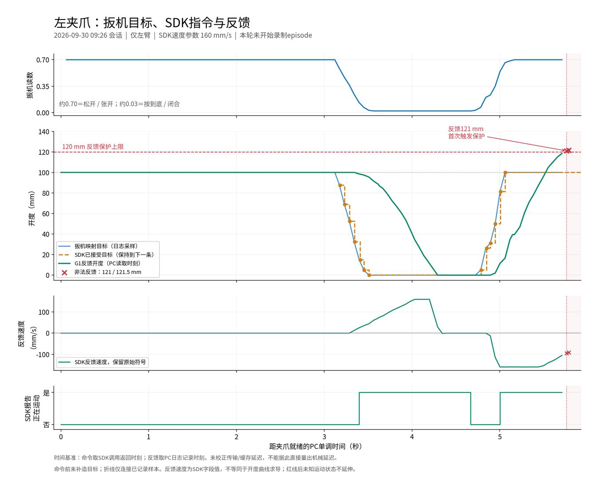

## 43. 助手

按 **09:26这次会话的实际日志**画好了：

- **蓝线**：扳机映射的目标开度。
- **橙色虚线/圆点**：SDK实际接受的控制命令。
- **绿线**：G1返回的反馈。
- **红线**：120 mm保护上限；红叉标出异常反馈。


可以看到：**最后目标保持在100 mm，反馈却继续上升到121 mm，触发退出。** 本次共接受13条开度命令，没有发送超过100 mm的目标。

横轴采用PC记录时间，未校正传输延迟；图中的反馈来自SDK，不是独立测量的物理开度。

[查看张开阶段放大图](<../../assets/5eb8ae3333c2e744--gripper_opening_zoom.png>) · [下载矢量图](<../../assets/2ef823b92b8972f9--gripper_command_feedback.svg>)


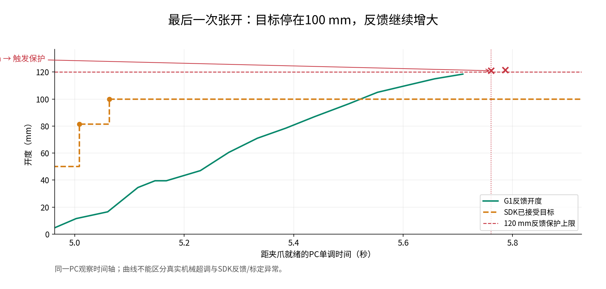

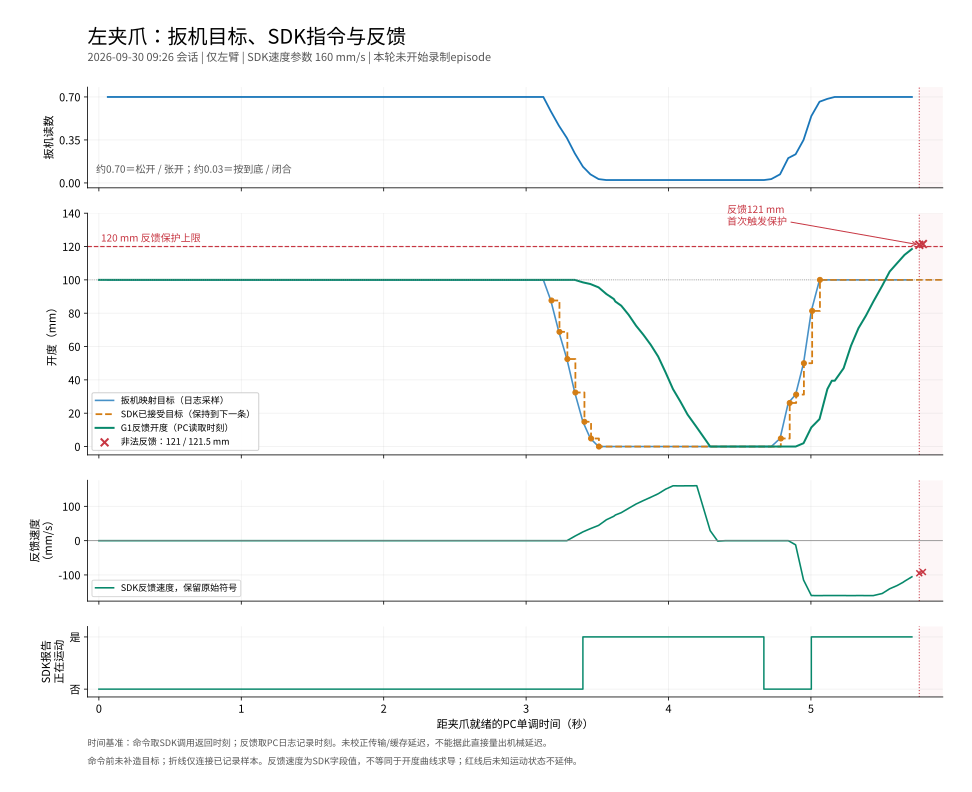

## 44. 用户

给我讲一下，我们下一步如何排查？

## 45. 助手

**下一步先区分：夹爪真的开过头了，还是SDK反馈数值不准。** 再确认是速度、连续指令还是底层控制造成的。

建议按这个顺序排查：

| 步骤 | 怎么查 | 能判断什么 |
|---|---|---|
| **1. 静止对照** | 夹爪停止后，用尺子测两指内侧间距，同时读取SDK开度 | 实际间距和反馈是否一致 |
| **2. 排除其他控制程序** | 检查是否有其他遥操、示例或服务在下发夹爪命令 | 是否存在指令互相覆盖 |
| **3. 单目标、低速测试** | 用独立脚本，只发一次小范围目标，例如当前约50 mm时到60 mm，速度先用20 mm/s | 单次位置控制是否能正确到位 |
| **4. 逐步比较速度** | 低速正常后，再比较50、100 mm/s，最后才考虑当前160 mm/s | 异常是否随速度增大而出现 |
| **5. 比较连续指令** | 单次正常后，再测试扳机式连续目标更新 | 是否与未到位时切换目标有关 |

**第3步是关键：先脱离遥操和数采，只检查夹爪本身。** 测试时记录目标、SDK返回状态、反馈开度、速度、`is_moving`和时间戳；同步拍视频或测量实际间距。先验证中间开度，暂时不重复全闭到全开的动作。

结果可以这样判断：

- **SDK显示偏大，但实际间距正确**：优先查反馈换算、零点标定、SDK版本。
- **实际和反馈都超过目标，低速正常、高速异常**：重点查速度相关超调或底层减速控制。
- **单目标正常，连续切换目标异常**：查SDK对连续命令的覆盖、排队和执行语义。
- **低速单目标也不正常**：保留这份最小复现日志，核查驱动、标定和固件，必要时交给厂家定位。

现在先保持 **120 mm保护不变**。另外，程序目前没有可靠的独立夹爪停止接口，反馈非法时保持命令也无法发送；因此运动测试需要现场操作者看护并能使用物理急停。

**我建议先做前两步，再准备“单次小范围、低速”的诊断脚本；不要直接继续批量采集。**

## 46. 用户

给我回顾上一个版本的脚本是什么？是双臂的还是什么的？  为什么就没有遇到过这种问题？

## 47. 助手（进展）

我会对照之前的双臂采集入口、现在的左臂七路入口，以及旧会话的夹爪指令和反馈，确认哪些逻辑改过、旧数据里是否出现过同类迹象。

## 48. 助手

**上一个入口支持双臂，但你9月28日采白方块时，实际上也只启用了左臂。** 我对照历史日志后确认：**旧记录中确实没有出现这次121 mm反馈越界现象。**

| 时间／版本 | 实际操作 | 左夹爪已记录反馈 | 当时的问题 |
|---|---|---|---|
| 9月23日：叠毛巾，17路 | 双臂 | 最大100 mm | 手动退出 |
| 9月28日：白方块放黄色区域，17路 | **仅左臂跟随** | 最大100 mm | 300 ms更新超时、写盘队列溢出 |
| 9月29日：白方块放灰板，7路，修复前 | 仅左臂 | 最大100 mm | 300 ms更新超时 |
| 9月30日：修复更新门控后 | 仅左臂 | **反馈到121 mm** | 开度越界，保持失败 |

旧的白方块入口是：

```bash
bash teleoperation/run_capture_white_block.sh --execute
```

当前入口是：

```bash
bash teleoperation/run_capture_left_gray_board.sh --execute
```

**有两个关键发现：**

1. **不是最近才把夹爪速度调高。** 上面这些会话的夹爪速度参数都是 **0.16 m/s**；目标上限也都是100 mm。不能简单解释为“新版速度变快了”。
2. **七路方案在修复前已经运行过，反馈仍停在100 mm。** 121 mm异常是在修改夹爪更新门控后的两次会话中出现的。这个变化时间点值得优先排查，但时间先后还不能证明因果。

因此，我需要修正前面的排查优先级：**应该先审查我上次修改前后的控制行为，不能先把原因归到SDK或硬件。** 尤其要比较目标下发时刻、目标切换顺序、暂停与保持指令，以及两天之间的运行环境变化。

还有一点：**现在直接运行旧入口，不等于恢复旧版代码。** 两个入口共用 `dual_arm_direct.py` 和 `left_trigger_gripper.py`，这些文件已经修改过。真正对比旧版，需要恢复并隔离对应版本，再做受控验证。

目前能确定的是：**旧版有过别的故障，但这次121 mm反馈越界，在已检查的旧会话里没有出现。**

## 49. 用户

bash teleoperation/run\_capture\_white\_block.sh --execute 我不是说这个，给我列出最近是个脚本

## 50. 用户

bash teleoperation/run\_capture\_white\_block.sh --execute 我不是说这个，给我列出最近十个脚本

## 51. 助手（进展）

我按最近修改时间列出遥操目录中的10个启动脚本，同时标明各自用途，方便你找到之前用的那个。

## 52. 助手

明白，你要找的是更早的遥操脚本。下面按 **Shell入口文件最近修改时间**列出10个，排除了纯Rerun查看脚本；时间不代表底层Python代码最后修改时间。

| 序号 | 脚本 | 修改日期 | 用途 |
|---|---|---|---|
| 1 | [run_dual_arm_capture.sh](</home/lsy03/文档/ChatGPT/VLA G1 项目/teleoperation/run_dual_arm_capture.sh>) | 9月29日 | 通用遥操＋分组采集底层入口 |
| 2 | [run_capture_left_gray_board.sh](</home/lsy03/文档/ChatGPT/VLA G1 项目/teleoperation/run_capture_left_gray_board.sh>) | 9月29日 | 当前：仅左臂，白方块放灰板，7路采集 |
| 3 | [run_capture_white_block.sh](</home/lsy03/文档/ChatGPT/VLA G1 项目/teleoperation/run_capture_white_block.sh>) | 9月28日 | 白方块放黄色区域，17路采集 |
| 4 | [run_capture_pilot.sh](</home/lsy03/文档/ChatGPT/VLA G1 项目/teleoperation/run_capture_pilot.sh>) | 9月23日 | 通用试采入口，自动测时，可指定任务 |
| 5 | [run_camera_timing_check.sh](</home/lsy03/文档/ChatGPT/VLA G1 项目/teleoperation/run_camera_timing_check.sh>) | 9月22日 | 仅传感器采集与时间检查，不遥操 |
| **6** | **[run_dual_arm_one_press.sh](</home/lsy03/文档/ChatGPT/VLA G1 项目/teleoperation/run_dual_arm_one_press.sh>)** | **9月22日** | **双臂＋双夹爪，各侧按一次固定键开启跟随** |
| **7** | **[run_dual_arm_direct.sh](</home/lsy03/文档/ChatGPT/VLA G1 项目/teleoperation/run_dual_arm_direct.sh>)** | **9月22日** | **双臂＋双夹爪，先慢速对齐、再确认正式跟随** |
| **8** | **[run_arm7_direct_gripper.sh](</home/lsy03/文档/ChatGPT/VLA G1 项目/teleoperation/run_arm7_direct_gripper.sh>)** | **9月18日** | **左臂7关节＋左扳机夹爪控制** |
| 9 | [run_arm7_record.sh](</home/lsy03/文档/ChatGPT/VLA G1 项目/teleoperation/run_arm7_record.sh>) | 9月18日 | 左臂遥操实验日志记录 |
| 10 | [run_arm7_direct.sh](</home/lsy03/文档/ChatGPT/VLA G1 项目/teleoperation/run_arm7_direct.sh>) | 9月17日 | 左臂7关节直接跟随入口 |

**如果你说的是“加入数采前，双臂和两个夹爪都能正常操作的脚本”，最可能是第6或第7个。**

## 53. 用户

**[run\_dual\_arm\_one\_press.sh](</home/lsy03/文档/ChatGPT/VLA G1 项目/teleoperation/run_dual_arm_one_press.sh>)****9月22日双臂＋双夹爪，各侧按一次固定键开启跟随**

我们先测试一下这个脚本

## 54. 助手（进展）

可以。我先核对这个入口和启动参数。它仍调用当前共享的控制代码，并不是冻结的9月22日版本；另外它原来写死了104 ms时钟补偿，我会先检查当前补偿值，避免测试被旧参数影响。暂不发送运动命令。

## 55. 助手

可以，先测试这个**双臂＋双夹爪遥操入口，不启动七路采集**。

我刚测得当前时钟补偿约 **93.16 ms**。考虑到夹爪越界尚未解决，先用 **20 mm/s低速、60秒**短测，在现场终端运行：

```bash
bash teleoperation/run_dual_arm_one_press.sh \
  --execute --seconds 60 \
  --speed-rad-s 1.0 \
  --gripper-speed-m-s 0.02 \
  --g1-clock-offset-ms 93.160943
```

先只按**左侧固定键**进入跟随，右侧保持锁定。观察左夹爪目标与反馈；如果反馈再次持续超过目标，停止测试，勿反复全开。

**注意：这个入口仍使用当前共享代码，所以测试的是“关闭数采后是否还异常”，不是恢复9月22日旧版。** 低速正常后，再单独比较160 mm/s，才能区分速度与采集负载的影响。

我已核对入口并完成测时，尚未启动运动。上述补偿值只代表刚才的测量。

## 56. 用户

看看这个为啥就没问题？

[附件：b0bb5169701e36b1--已粘贴的文本.txt](../../assets/b0bb5169701e36b1--%E5%B7%B2%E7%B2%98%E8%B4%B4%E7%9A%84%E6%96%87%E6%9C%AC.txt)

## 57. 助手（进展）

我先对照这次纯遥操日志和之前报错会话，重点比较夹爪速度、实际开度、指令序列，以及两次是否用了同一份控制代码。

## 58. 助手

**这次确实正常完成了。最明显的变化是：夹爪速度从160 mm/s降到了20 mm/s，慢了8倍。**

我检查了完整日志，不只是你贴的末尾：

| 对比项 | 之前报错的七路采集 | 这次纯遥操 |
|---|---:|---:|
| 夹爪速度参数 | **160 mm/s** | **20 mm/s** |
| 目标范围 | 0–100 mm | 0–100 mm |
| 控制代码 | **同一份代码，哈希一致** | **同一份代码，哈希一致** |
| 最大已记录反馈 | **121 mm，触发保护** | **100.5 mm，未越界** |
| 运行结果 | 异常退出 | **正常结束，result=0** |

这次左臂确实进入过跟随，发出了 **239条夹爪指令**，不是因为“夹爪没启用所以没报错”。你贴的末尾 `LOCKED／未启用`，是暂停后的状态。

**这让“高速下出现超调或反馈异常”成为更值得优先验证的方向。** 但还不能完全确认，因为这次同时改变了两个条件：

- 速度降为20 mm/s；
- 没有启动七路采集。

因此，也不能直接说“旧脚本没问题、新脚本有问题”——两者使用的控制代码相同。

**下一步只改变一个条件：保持20 mm/s，打开七路采集。**

```bash
bash teleoperation/run_capture_left_gray_board.sh \
  --execute --gripper-speed-m-s 0.02
```

先短测一组。如果仍正常，就更支持速度相关因素；如果再次异常，再重点查采集负载或并行SDK连接的影响。现阶段先保留20 mm/s，不急着恢复160 mm/s。

## 59. 用户

原因：七关节起步未对齐（每关节差值要求≤15°）
右侧状态原因：本次仅左臂：右臂跟随禁用，显示实测姿态
左扳机=0.700，夹爪目标/实测=100.0/100.0mm，未启用 | 右扳机=0.700，夹爪目标/实测=100.0/50.0mm，未启用
【采集进度·本次会话】已完成 0/5 组 | 取消/失败 0 组 | 已发起 0 组 | 当前组 0.0s | 完成组累计 0.0s | 累计已落盘 0 条原始记录（含失败组，组结束后更新）
【数采】ARMED | 无活动episode | 记录键：ARMED开始 / RECORDING结束；取消键：录制中标失败，待命时保持连接

双臂实时对比 | 左：LOCKED | 右：LOCKED
单位：度 | 主目标=GP映射目标；有效=限幅后目标；差值=有效目标−G1从臂
各侧固定键：全部误差<15°且READY → 按一次正式跟随 → 再按暂停
+------+----------+--------+--------+--------+--------+----------+--------+--------+--------+--------+
\| 关节 | 左主目标 | 左有效 | 左从臂 | 左差值 | 左检查 | 右主目标 | 右有效 | 右从臂 | 右差值 | 右检查 |
+------+----------+--------+--------+--------+--------+----------+--------+--------+--------+--------+
\| J1   | +62.26   | +62.26 | +78.42 | -16.16 | 差≥15° | -61.48   | -61.48 | -61.48 | +0.00  | 通过   |
\| J2   | -88.22   | -88.22 | -78.05 | -10.17 | 通过   | +63.39   | +63.39 | +63.39 | +0.00  | 通过   |
\| J3   | -39.07   | -39.07 | -24.20 | -14.88 | 通过   | +44.74   | +44.74 | +44.74 | +0.00  | 通过   |
\| J4   | +0.26    | +0.26  | -28.21 | +28.47 | 差≥15° | -3.55    | -3.55  | -3.55  | +0.00  | 通过   |
\| J5   | -33.86   | -33.86 | -3.09  | -30.78 | 差≥15° | -10.05   | -10.05 | -10.05 | +0.00  | 通过   |
\| J6   | -9.34    | -9.34  | -5.22  | -4.13  | 通过   | +3.10    | +3.10  | +3.10  | +0.00  | 通过   |
\| J7   | +3.78    | +3.78  | +1.01  | +2.77  | 通过   | -2.60    | -2.60  | -2.60  | +0.00  | 通过   |
+------+----------+--------+--------+--------+--------+----------+--------+--------+--------+--------+
左侧状态原因：七关节起步未对齐（每关节差值要求≤15°）
右侧状态原因：本次仅左臂：右臂跟随禁用，显示实测姿态
左扳机=0.700，夹爪目标/实测=100.0/100.0mm，未启用 | 右扳机=0.700，夹爪目标/实测=100.0/50.0mm，未启用
【采集进度·本次会话】已完成 0/5 组 | 取消/失败 0 组 | 已发起 0 组 | 当前组 0.0s | 完成组累计 0.0s | 累计已落盘 0 条原始记录（含失败组，组结束后更新）
【数采】ARMED | 无活动episode | 记录键：ARMED开始 / RECORDING结束；取消键：录制中标失败，待命时保持连接
^C本轮结束：KeyboardInterrupt:&#x20;
lsy03\@lsy03-System-Product-Name:\~/文档/ChatGPT/VLA G1 项目$&#x20;


现在并没有异常，要不“teleoperation/run\_capture\_left\_gray\_board.sh”给我恢复到 160 mm/s ？我们再来测试一下

## 60. 助手（进展）

我先核对脚本默认速度和这次完整日志。你贴的末尾处于 `LOCKED／ARMED`，单凭这一段还不能确认低速夹爪和采集都测试过；如果脚本默认仍是160 mm/s，就不需要改代码。

## 61. 助手

**脚本默认一直是160 mm/s，无需恢复代码。** 上次命令中的 `--gripper-speed-m-s 0.02` 只是临时覆盖为20 mm/s。

完整日志确认，这次确实启用了左夹爪：

- 下发 **158条夹爪命令**，最大反馈 **100.5 mm**，没有反馈越界。
- 但**没有按记录键开始采集**，所以验证的是七路预热待命下的低速遥操。
- 最后由你按 `Ctrl+C` 退出。

要做160 mm/s短时对照，运行：

```bash
bash teleoperation/run_capture_left_gray_board.sh \
  --execute --seconds 60 \
  --gripper-speed-m-s 0.16
```

先保持相同的待命状态和操作方式，避免同时改变多个条件。**此前160 mm/s已两次出现121 mm反馈，根因尚未解决**；若再次越界或提示保持未确认，停止测试，必要时使用物理急停。

我没有启动运动，也没有改动保护阈值。

## 62. 用户

我真的服了，我怀疑是夹爪SDK超调的问题

[附件：f8cf7b5a3349a6cc--已粘贴的文本.txt](../../assets/f8cf7b5a3349a6cc--%E5%B7%B2%E7%B2%98%E8%B4%B4%E7%9A%84%E6%96%87%E6%9C%AC.txt)

## 63. 助手（进展）

低速正常、高速反复异常，确实值得优先怀疑速度相关的超调。我先核对这次160 mm/s测试的目标和反馈，确认是否再次出现同样的过程，再区分日志能证明什么、还缺什么证据。

## 64. 助手

**你的怀疑现在有明确的日志支持：高速下的夹爪执行或反馈链路，确实存在明显异常。**

这次160 mm/s测试再次复现：

```text
SDK已接受目标：100 mm，之后没有再改大

反馈开度：95 → 103.5 → 110.5 → 114.5 → 118 → 120.5 mm
                                                    ↑ 保护退出
```

**到120.5 mm时，SDK反馈速度的绝对值仍约97 mm/s**，并不是停稳后仅多报了0.5 mm。

结合前两次低速测试：

| 条件 | 结果 |
|---|---|
| 20 mm/s，纯遥操 | 最大反馈100.5 mm，正常结束 |
| 20 mm/s，七路预热待命 | 最大反馈100.5 mm，无越界 |
| 160 mm/s，七路预热待命 | 多次反馈超过120 mm，退出 |

**这已经把排查重点收敛到“速度相关的超调或反馈异常”。** 本次仍未开始录制，所以不是之前的写盘队列溢出。

但准确归因应是 **SDK到驱动、固件和夹爪的整条控制链路**，暂时不能确定BUG就在SDK这一层，也还没有独立测量证明物理开度真的超过120 mm。

我建议现在：

- **停止反复测试160 mm/s全开动作**，先用已验证过的20 mm/s。
- 保留120 mm保护，不通过放宽范围掩盖问题。
- 整理低速正常、高速异常的命令和反馈给厂家，重点问：**100 mm目标为何在高速下反馈超过120 mm，且仍报告运动？**
- 后续只需一次有现场测量的、小范围单目标验证，区分真实超调与反馈换算问题。

**目前不应再笼统说“换回旧脚本就会好”；现有证据更支持高速执行/反馈问题。**

## 65. 用户

给我画一下这段最新测试的控制信号和夹爪状态信号图像

## 66. 助手（进展）

我会用最新这次160 mm/s测试的日志，画出扳机目标、SDK已接受命令、反馈开度、速度和运动状态，并单独放大最后一次越界过程。

## 67. 助手

_工具输出图片（原始工具文本未纳入归档）。_

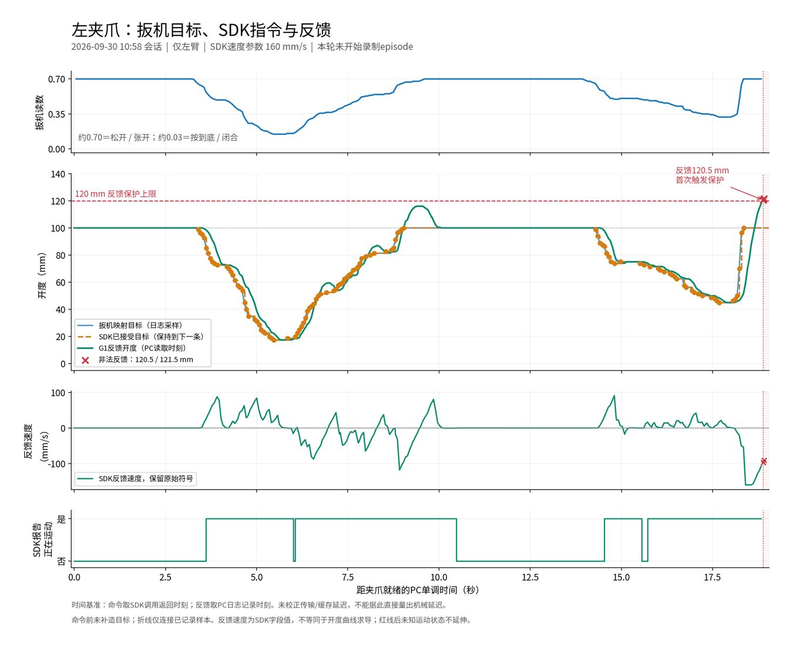

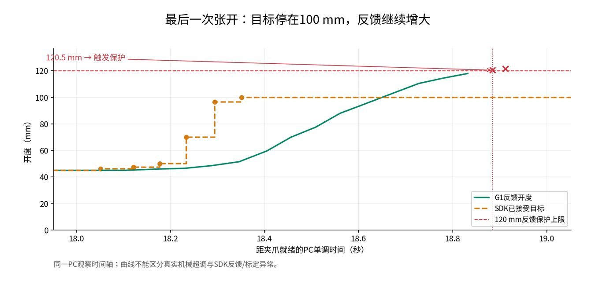

## 68. 助手

已按最新 **10:58、160 mm/s测试**的真实日志画好。

**全程信号：**蓝线是扳机映射目标，橙色虚线是SDK接受的命令，绿线是G1反馈。

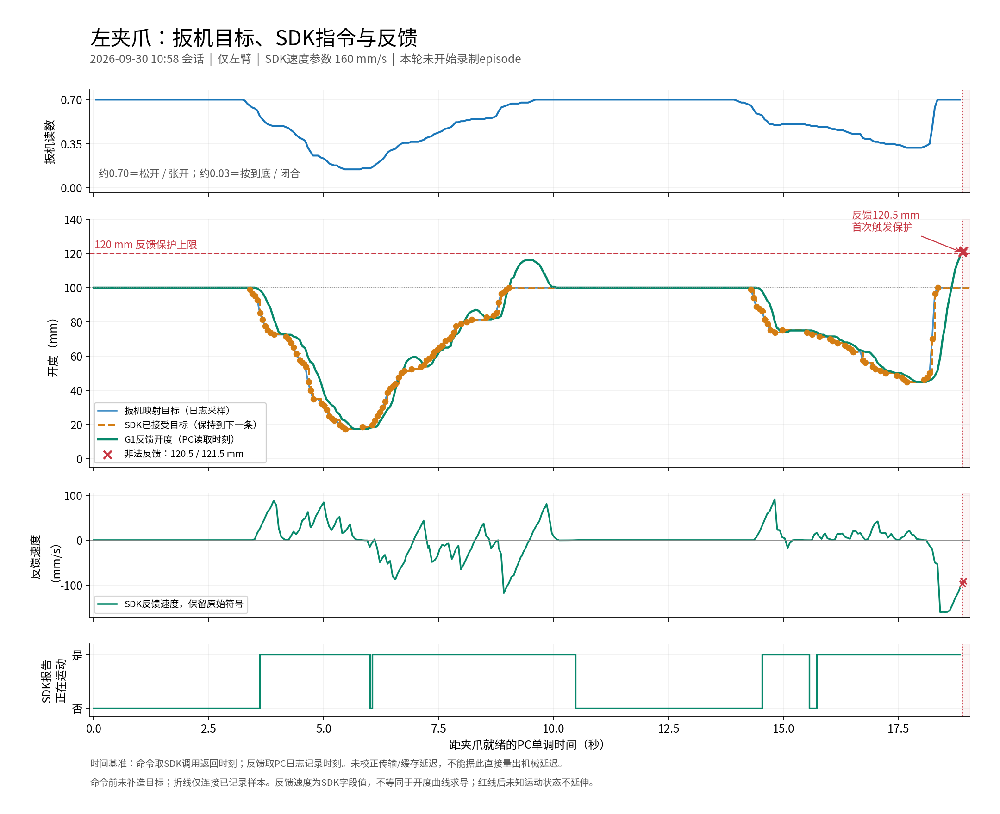

**最后一次张开放大图：**

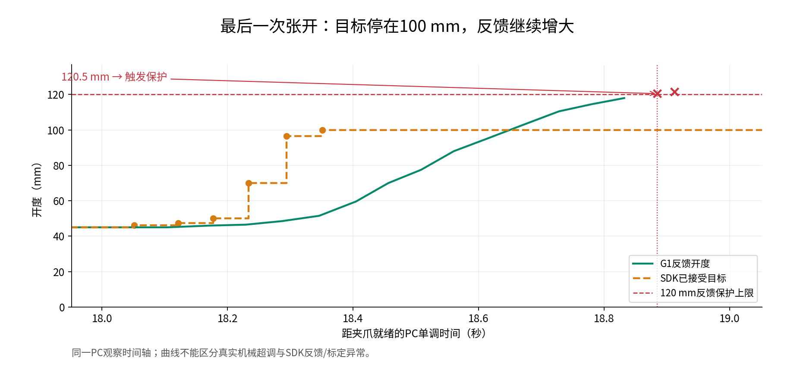

有两个明显现象：

- 约 **9–10秒**，反馈已经出现过一次超过100 mm、随后回落的过程。
- 最后目标保持 **100 mm**，反馈继续增加，在 **18.885秒达到120.5 mm**，触发保护；此时反馈速度绝对值仍约 **97 mm/s**。

横轴是PC记录时间，未校正通信延迟；反馈来自SDK，尚不能单凭曲线区分真实机械超调与反馈异常。

[下载高清总图](<../../assets/d5c11fe93b1fd359--gripper_command_feedback.png>) · [下载矢量图](<../../assets/44fd7d5cc3a0f9f4--gripper_command_feedback.svg>)


## 69. 用户

夹爪速度改到 0.06 我们再测试一下

## 70. 助手（进展）

我把灰板采集入口的夹爪速度改为 **0.06 m/s（60 mm/s）**，其余参数保持不变，并做离线配置检查；真机测试由你在现场启动。

## 71. 助手

已改为 **0.06 m/s（60 mm/s）**，离线检查通过，120 mm反馈保护保持不变。

现场短测运行：

```bash
bash teleoperation/run_capture_left_gray_board.sh \
  --execute --seconds 60
```

先不按记录键，保持与上次相同的操作方式，观察张开到100 mm后的反馈。尚未替你启动真机。

## 72. 用户

bash teleoperation/run\_capture\_left\_gray\_board.sh \\
&#x20; \--execute --seconds 600

我刚刚采集了几组，给我看看效果如何？

[附件：fb2a589ab309dd90--已粘贴的文本.txt](../../assets/fb2a589ab309dd90--%E5%B7%B2%E7%B2%98%E8%B4%B4%E7%9A%84%E6%96%87%E6%9C%AC.txt)

## 73. 助手（进展）

我先检查这次600秒会话录了几组、是否完整落盘，以及60 mm/s下夹爪有没有再越界；再看时间缺口和画面，区分采集质量与任务完成效果。

## 74. 助手（进展）

这次成功落盘了 **3组，共52.21秒**，七路都有数据；60 mm/s下记录到的夹爪最大开度为100 mm，没有再出现越界或更新超时。仍有一些采样缺口，尤其第3组的状态间隔达到约128 ms。

我接着从G1读取各组关键画面并校验原件，看看方块是否确实放到灰板上，以及相机视野是否适合后续训练。

## 75. 助手

_工具输出图片（原始工具文本未纳入归档）。_

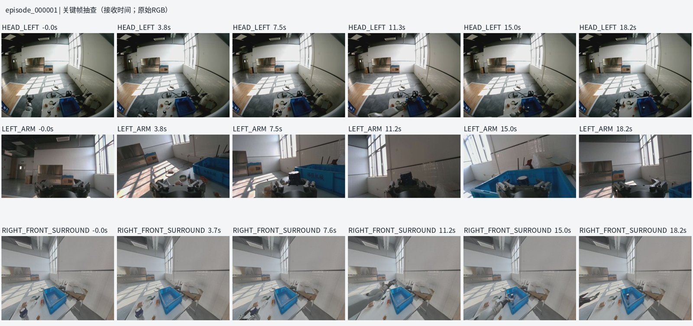

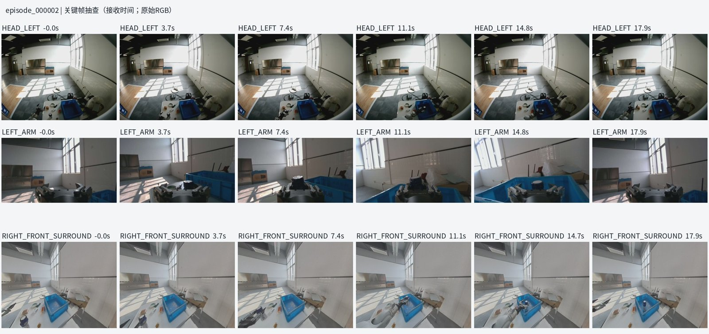

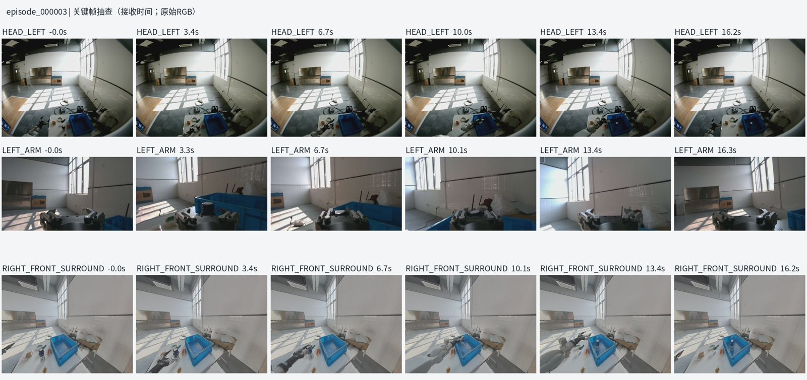

## 76. 助手（进展）

三组原件的分片哈希、记录数量和七路完整性校验都通过了，总量约 **1.89 GB**。关键帧里能看到抓取、搬运、放入蓝色箱子后撤手的过程，不过实际物体和目标区域看起来与“白方块放灰板”的标签不一致。

另外，第1、2组各有约1秒的候选时间点未通过现有时钟映射规则；第3组没有这项拒收，但有约128 ms的状态缺口。文件是完整的，训练前仍需要处理这些时序问题。

## 77. 用户

<send_user_message_question_reply>
[{"questionItemId":"[\"request_user_input_async\",\"call_gt2xCA9kMKqRyhoVcz6dQg2o\",0]","question":"抽查画面看起来是把一个罐状物从桌面放入蓝色箱子，但日志任务标签仍是“白色方块放到灰色板子上”。这三组的实际任务是否已经改了？","answer":"是，实际任务是把罐状物放入蓝色箱子"}]
</send_user_message_question_reply>

## 78. 助手（进展）

明白，这三组按“把罐状物放入蓝色箱子”评估。关键帧与这个任务一致；我会单独保存你确认的任务说明，保留原始日志，后续导出时需要使用正确标签。当前采集脚本的默认任务名称仍是旧名称。

## 79. 助手

_工具输出图片（原始工具文本未纳入归档）。_

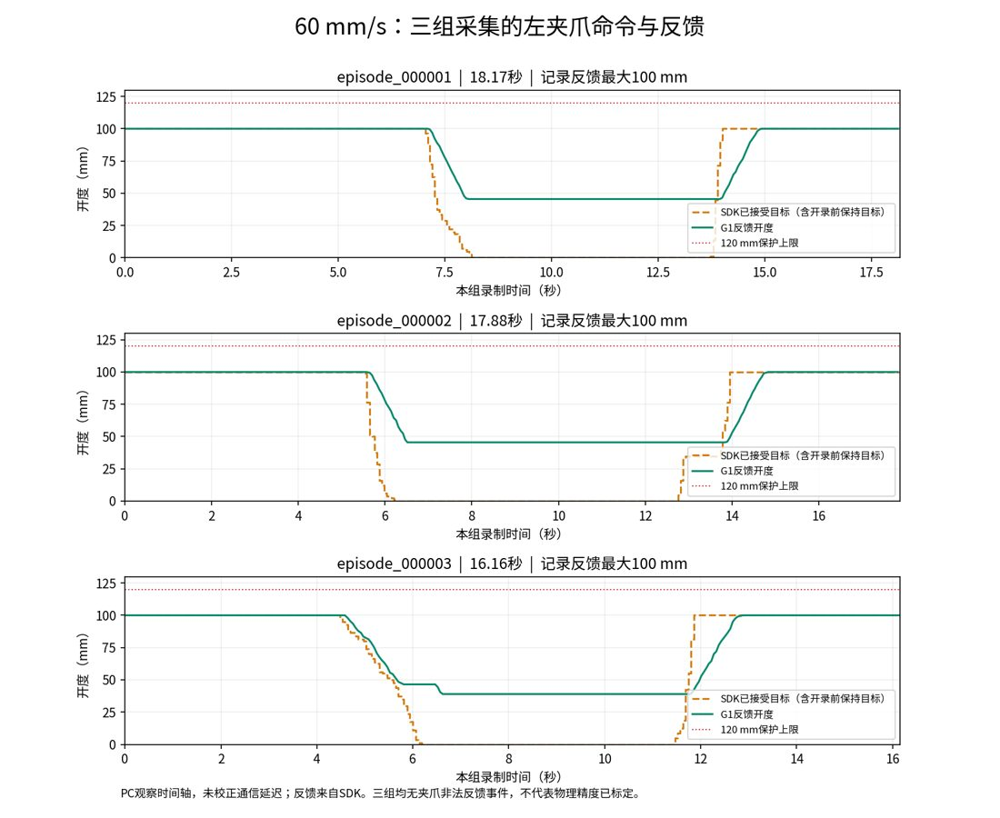

## 80. 助手

**这次采集结果不错：3组都完整保存，60 mm/s下没有再出现夹爪越界。** 按你确认的实际任务——“把罐状物放入蓝色箱子”——关键帧能看到抓取、搬运、放入箱子后撤手的过程。

| 组别 | 演示时长 | 原始记录数 | 文件校验 |
|---|---:|---:|---|
| 第1组 | 18.17秒 | 6,303条 | 通过 |
| 第2组 | 17.88秒 | 6,290条 | 通过 |
| 第3组 | 16.16秒 | 5,606条 | 通过 |
| **合计** | **52.21秒** | **18,199条** | **七路齐全，约1.89 GB** |

**夹爪表现：**整个会话最大反馈开度为100 mm，没有非法反馈或更新超时。图中抓住物体后反馈保持在约39–45.5 mm，与夹持罐状物的画面一致，不要求夹着物体时真正闭合到0 mm。

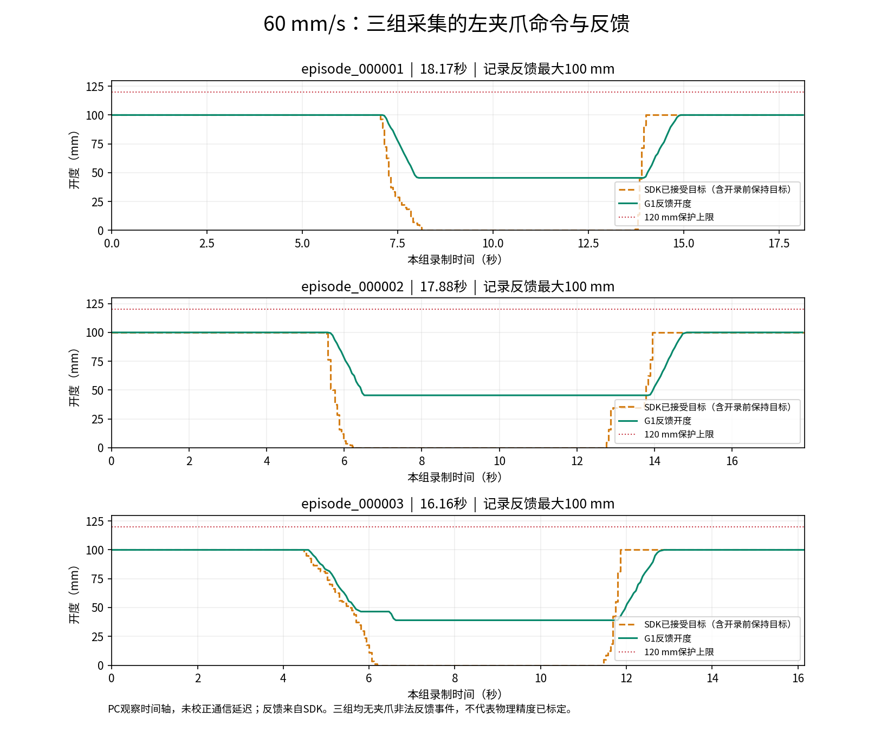

训练前还有三件事需要处理：

- **时序缺口：**第1、2组各约1秒候选时刻未通过现有时钟映射规则；第3组最大关节采样间隔约128 ms。不能直接认定整段同步合格。
- **任务标签：**原日志仍写“白方块放灰板”。已单独保存你确认的新任务说明，后续导出时需要更正标签。
- **画面验收：**已抽查54张关键帧，动作过程可辨认；尚未逐帧检查完整视频、深度质量和最终训练样本。

你贴出的末尾越界提示发生在 **LOCKED** 状态，表示当时不能重新开启跟随；随后按 `Ctrl+C` 退出，**没有破坏已保存的三组**。

建议保留这三组，继续采用60 mm/s，先完成任务标签和时间对齐处理。

[完整检查报告](<../../assets/3a7f0fb39563d532--%E6%A3%80%E6%9F%A5%E7%BB%93%E6%9E%9C.md>) · [第1组关键帧](<../../assets/1321c99cde66d8bc--episode_000001_contact.jpg>) · [第2组](<../../assets/05c2bfae9a1849fb--episode_000002_contact.jpg>) · [第3组](<../../assets/45c5aa7214b7e627--episode_000003_contact.jpg>)


[附件：3a7f0fb39563d532--检查结果.md](../../assets/3a7f0fb39563d532--%E6%A3%80%E6%9F%A5%E7%BB%93%E6%9E%9C.md)

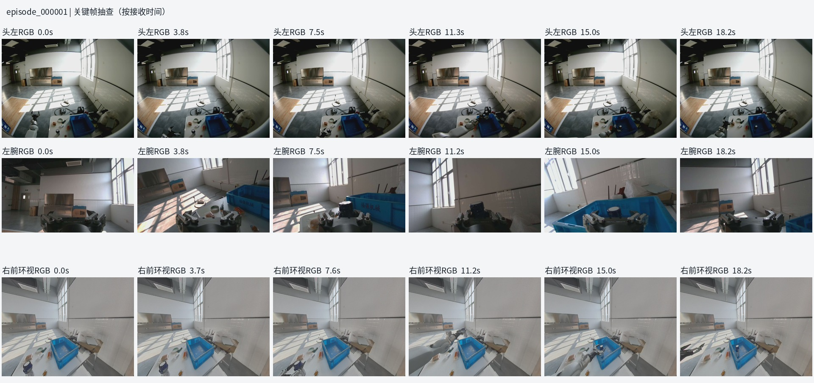


