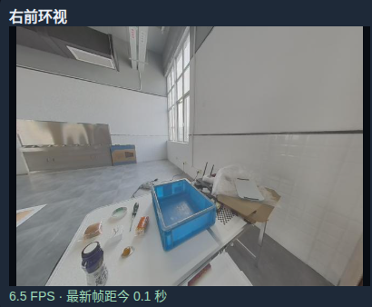
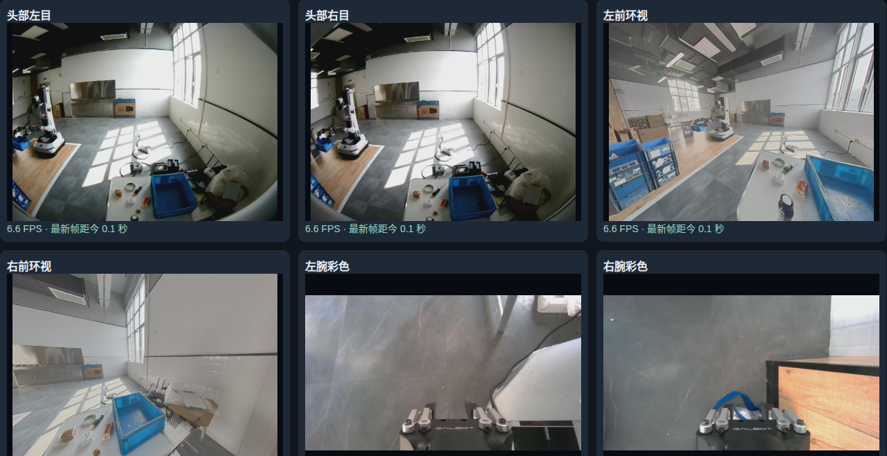

# 9_30 规范物体抓取任务提示词

- 归档编号：`01a0f012-d1e9-7b10-b99a-1a5fbe13da56`
- 项目：VLA G1 项目
- 创建时间：2026-09-30T10:09:20.361000+08:00
- 更新时间：2026-09-30T13:29:20.457000+08:00
- 状态：活动
- 导出范围：用户可见消息与助手可见回复；不含隐藏推理和工具原始输出

## 1. 用户

现在我们的任务是抓取不同的物体放到料箱之中，是否每个任务采集的过程中需要规定好提示词或者标记啥的？ 像是 ”抓取瓶子到料箱中“、“抓取螺丝刀” 这样吗？



## 2. 助手（进展）

我会结合 VLA 数据集的任务标注方式，说明你们这种“抓取不同物体放入料箱”的采集该如何记录。

## 3. 助手

**是的。如果你们希望机器人以后能根据指令，选择不同物体放入料箱，就应当给每段采集数据配上明确的任务指令。** 你说的方向是对的，但建议把“抓什么、放哪里”都写完整。

结合图里“桌面上有多种物体、旁边有蓝色料箱”的场景，我建议这样规定：

| 本次示教目标 | 对应任务指令 |
|---|---|
| 瓶子入箱 | 将桌面上的瓶子抓起，放入蓝色料箱中。 |
| 螺丝刀入箱 | 将桌面上的螺丝刀抓起，放入蓝色料箱中。 |
| 多个瓶子中选择一个 | 将桌面上的白色瓶子抓起，放入蓝色料箱中。 |

“抓取螺丝刀”只说明了抓取，没有说明放置目标。你们采集的是完整的入箱动作，最好统一使用 **“将［目标物体］放入［目标料箱］”** 这个模板。

**采集时，具体需要记录什么？**

建议初期以“一次抓取并放入料箱”为一条完整示教，也就是一个 episode。每条至少关联以下信息；这些字段名只是示例：

```json
{
  "episode_id": "000123",
  "instruction": "将桌面上的螺丝刀抓起，放入蓝色料箱中。",
  "object_category": "screwdriver",
  "object_instance_id": "screwdriver_01",
  "target_container": "blue_bin",
  "success": true
}
```

其中，`instruction` 是给模型的任务描述；物体实例编号、成功标记等主要方便管理、筛选和评估。任务记录必须能与对应的视频、机器人状态和动作数据准确关联。

短任务通常只需要**整条 episode 标注一次指令**，不必人工逐帧填写，也不用把“接近、闭合夹爪、抬起、移动、松开”逐步写出来。LeRobot 的常见数据组织方式也支持每条 episode 对应一个任务字符串。[LeRobot 官方说明](https://huggingface.co/docs/lerobot/main/language_and_recipes)

**你说的“标记”，可以分成两种：**

- **数据里的任务标签：建议有。** 采集前选好任务，保存时自动关联，最不容易错。已有数据也可以后补，但要核对指令和实际动作。
- **给图像画框、给实物贴标签：常规端到端 VLA 示教通常不要求。** 如果你们另有检测、定位或标定模块，再按那个模块的需要做。

**更关键的是，让数据体现“根据指令选择物体”。** 我建议：

- 同一场景同时摆放瓶子、螺丝刀等物体，分别采集不同目标的示教。
- 改变物体的位置和朝向，避免“瓶子总在左边、螺丝刀总在右边”。
- 有多个同类物体时，指令增加能从画面辨认的属性，例如“红柄螺丝刀”。
- 初期固定句式、统一物体名称；先保证标注正确，不必刻意为每条数据换一种说法。
- 抓错、掉落、未入箱的记录单独标记，不要混成成功示教。

最后需要确认：**训练时，任务文本确实被送进模型作为条件输入。** 只在文件夹或文件名里写“抓瓶子”，而训练代码没有读取它，模型就无法利用这条指令。

如果你们最终只是让机器人“把桌面所有物体都收进料箱”，也可以使用统一的收纳指令；但如果要实现“叫它拿瓶子就拿瓶子，叫它拿螺丝刀就拿螺丝刀”，就建议从现在开始按具体目标分别标注。

## 4. 用户

```arduino
"instruction": "将桌面上的螺丝刀抓起，放入蓝色料箱中。",

这一段是否会放入模型训练？
```

## 5. 助手

**会，前提是训练流程读取了 `instruction` 字段，并把它作为模型输入。** 仅仅在数据文件中写上这段文字，不代表它会自动参与训练。

对于按语言指令执行任务的 VLA，通常是这样：

```text
输入：
  相机图像：桌面上的物体和料箱
  任务指令：“将桌面上的螺丝刀抓起，放入蓝色料箱中。”
  机器人状态：关节位置等（取决于模型）

学习预测：
  示教中对应的机器人动作
```

**这句话的作用是告诉模型“这次要做什么”，示教动作则告诉模型“应该怎么做”。** 部署时也提供任务指令，模型结合当前画面生成动作。

另外，我上一条中的 `instruction` **只是示例字段名**。你们实际的训练代码可能读取 `task`、`prompt` 或其他字段，需要做对应映射；如果没有读取，或者使用的是不接收语言输入的策略，这段文字就不会发挥作用。

## 6. 用户

现在桌面上有交代，白色插座，螺丝刀，面包，一瓶牛奶，沙其马，我应该怎样安排数据采集比较好？我希望最终模型能够有稳定的根据命令的抓取能力，是不是可以先从 一瓶牛奶开始？先实现一个物体不同位置的抓取

## 7. 助手（进展）

可以先从牛奶在不同位置的抓取做起。我会把“先抓稳一个物体”和“在多个物体中按指令选对目标”分成两个阶段，给你一套逐步增加难度的采集安排。

## 8. 助手

**可以，建议先从“一瓶牛奶在不同位置的抓取并入箱”开始。** 这样能先验证采集、训练和真机执行是否正常，再逐步加入其他物体。

但要区分两个目标：**单物体训练验证“能不能抓稳”；多个物体同时在场、根据不同指令选择目标，才验证“有没有按命令抓”。** 只有牛奶的场景里，即使模型忽略指令，也可能完成任务。

我建议按下面的顺序安排。以下数量是**第一轮实验的采集预算，不是达到稳定成功率的保证**，后续根据失败情况补采。

| 阶段 | 桌面安排 | 采集目标 | 建议起步量 |
|---|---|---|---|
| 先检查流程 | 只有牛奶，位置变化较小 | 检查图像、动作、指令是否正确保存和对齐 | 5～10 条，回放检查 |
| 单物体抓取 | 只有牛奶，改变位置与朝向 | 不同位置都能抓起并放入料箱 | 60～100 条成功示教 |
| 两物体按指令选择 | 牛奶＋另一个容易抓的物体，同时在场 | 分别按命令抓牛奶、抓另一物体 | 每个目标先采 50～100 条 |
| 扩展到六类物体 | 从每次摆 3 个，逐步增加到全部在场 | 按指令选对目标并入箱 | 各目标保持相近数量，按失败补采 |

你说的“交代”，我先按“胶带”理解。

**第一阶段的牛奶，可以直接这样采。**

- **固定料箱位置、相机位置和机器人起始姿态。** 第一轮先把变化集中在牛奶上；如果是 G1，先固定站位、躯干姿态和所用手臂。
- 在机械臂容易够到的桌面区域，划分 **左、中、右 × 近、远，共 6 个区域**。
- 每个区域采 **10～15 条**，区域内部随机摆放，避免只重复六个固定点。
- 牛奶先保持直立，变化瓶身朝向；抓稳以后，再考虑倾斜、倒放等更难状态。
- 每条都执行完整的 **接近 → 抓起 → 搬运 → 放入料箱 → 松开并撤手**。人工重新摆放物体的过程不录入示教。
- 指令统一为：**“将桌面上的牛奶抓起，放入蓝色料箱中。”**

这时学到的能力范围，是“这瓶牛奶、这些姿态和工作区域内的抓取”。换包装、换瓶型，需要再验证。

**第二阶段，尽早加入“同样的场景，不同的命令”。**

第二个物体优先选你们遥操作时抓得最稳、外观又与牛奶明显不同的物体。例如，如果白色插座容易夹持，就用“牛奶＋白色插座”；螺丝刀比较细，可以稍后加入，实际顺序以夹爪适配情况为准。

关键的采集方式是：

| 场景 | 指令 | 示教动作 |
|---|---|---|
| 牛奶在左，插座在右 | 将牛奶放入蓝色料箱 | 抓牛奶 |
| 恢复相同布局 | 将白色插座放入蓝色料箱 | 抓插座 |
| 牛奶在右，插座在左 | 将牛奶放入蓝色料箱 | 抓牛奶 |
| 恢复相同布局 | 将白色插座放入蓝色料箱 | 抓插座 |

**两个物体都要轮流成为目标，位置也要互换。** 如果加了插座但每次仍然只抓牛奶，主要训练的是“有干扰物时抓牛奶”，还不足以验证按语言选择目标。

后面加入胶带、螺丝刀、面包和沙琪玛，也沿用这个方法：随机布局、轮换目标、统一名称。一条 episode 初期只抓一个指定物体。扩展训练时混合已有物体的数据，避免最后一个物体的数据占据绝大多数。

**每轮采完就训练、测试，再决定补什么。**

单物体阶段，可以先做 **30 次未照搬示教摆位的自主测试**，覆盖六个区域；例如把 27/30 作为内部进入下一阶段的参考线，但它还不能证明长期稳定。

多物体阶段则分别统计：

- **选对率**：是否选择了指令指定的物体。
- **完整成功率**：是否选对、抓稳，并最终放入料箱。
- **失败原因**：选错、夹空、滑落、放到箱外，或需要人工接管。

测试布局要与训练示教区分，不能把同一段视频的相邻帧拆成训练集和测试集。实际评估也应记录独立的机器人执行过程。[LeRobot 实机评估说明](https://huggingface.co/docs/lerobot/v0.5.1/il_robots)

如果失败集中在远处，就补远处示教；如果总选错物体，就补相似布局下不同指令的示教。后续也可以记录人工纠正和恢复动作，针对模型已经暴露的失败继续训练。[LeRobot 人工干预采集说明](https://huggingface.co/docs/lerobot/main/hil_data_collection)

**你们现在最值得先做的是：检查 5～10 条数据 → 采集约 60～90 条牛奶在不同位置的完整入箱示教 → 训练并测试。** 同时从第一天就保存任务指令，并确认训练代码确实把它送入支持语言条件的模型。

## 9. 用户

如果我一直保持复杂场景的桌面背景如何？ 我就是希望模型有辨别的能力，我是使用ACT还是 Smol VLA 还是Pi0.5 比较好？ 结合我现在的电脑配置



## 10. 助手（进展）

我先核对可见的电脑配置和这三个模型的官方要求，再结合你这组相机画面，判断哪条路线更适合“复杂桌面上按命令选物体”。

## 11. 助手（进展）

已查到这台电脑是 RTX 4090 24GB、i9-14900K、约 128GB 内存；项目里 ACT 和 SmolVLA 的最小训练与推理检查也都通过了。结合你要“按指令选择物体”的目标，我更倾向先用 SmolVLA。复杂桌面可以保留，但需要让同一布局对应不同目标指令，才能检验模型是否真的依据语言选物体。

## 12. 助手

**可以保留现在这种复杂桌面。结合你的目标和电脑配置，我建议以 SmolVLA 为主，ACT 用来验证抓取动作，π0.5 留作后续对比。** 不需要为了训练，先把实验室背景全部清空。

我刚实际查看了这台电脑：

| 硬件 | 当前配置 |
|---|---|
| 显卡 | **RTX 4090，24GB 显存** |
| CPU | **i9-14900K** |
| 内存 | **约 128GB** |
| 查询时的显存 | 已占用约 15.4GiB，剩余约 8.1GiB |

这套配置适合开展 SmolVLA 微调。正式训练时需要安排显存资源，不能按整张卡还有 24GB 空闲来配置。

项目里的 ACT、SmolVLA 都已通过最小训练和推理检查，但使用的是合成数据，**还不能据此判断真实抓取成功率**。[已有部署验收报告](<../../assets/afb6c614ff6bf791--%E9%83%A8%E7%BD%B2%E9%AA%8C%E6%94%B6%E6%8A%A5%E5%91%8A.md>)

**这三个模型的区别，关键在于能否直接利用你的任务指令：**

| 模型 | 对“按命令选择物体”的支持 | 在你电脑上的定位 |
|---|---|---|
| **标准 ACT** | 默认接收图像和机器人状态，**不直接使用自然语言指令** | 轻量，适合先验证“抓牛奶入箱”的动作链路 |
| **SmolVLA** | 直接接收图像、状态、语言指令 | **当前首选**，便于在 4090 上反复采集、微调、测试 |
| **π0.5** | 支持语言指令，有更广泛的预训练基础 | 值得后续比较，但训练显存和适配成本更高 |

标准 ACT 可以学习复杂背景下的抓取，但即使数据里保存了“抓牛奶”“抓插座”，也不会自动获得语言条件。若要使用 ACT 实现这个目标，需要增加任务条件，或由上层系统选择不同策略。[ACT 官方输入说明](https://huggingface.co/docs/lerobot/act)

SmolVLA 已经具备你需要的语言输入接口，并面向消费级硬件微调；仍然需要用你们机器人上的示教数据适配。[SmolVLA 官方说明](https://huggingface.co/docs/lerobot/smolvla)

π0.5 在 4090 上并非完全不能训练，但要区分训练方式：OpenPI 官方给出的参考需求是 **LoRA 微调大于 22.5GB、全量微调大于 70GB**。这些是其实现下的估计，具体还受相机数量、批量大小及训练配置影响。因此，你这张卡适合探索经过显存优化的方案，不适合直接照搬全量微调配置。[OpenPI 硬件要求](https://github.com/Physical-Intelligence/openpi#requirements)

**复杂桌面可以一直保留，但采集时必须让“指令”成为选择目标的依据。**

这里要分清三件事：

- **房间、窗户、地面等背景复杂**：可以保留，与实际部署环境一致。
- **桌上有多个候选物体**：很适合训练你要的目标选择能力。
- **物体堆叠、严重遮挡、互相压住**：会同时增加识别和抓取难度，建议后面逐步加入。

因此，我会把之前的采集建议调整成这样：

1. **六种物体都可以留在桌上，先分开放。** 留出夹爪接近空间，先固定料箱位置。
2. **先采少量牛奶入箱示教，检查流程。** 牛奶和其他物体的位置都要变化。这一步只能验证“有干扰物时抓牛奶”。
3. **第一轮正式训练就加入至少两个目标指令。** 例如牛奶、白色插座各采约 50～80 条，作为起步预算；前提是这两个物体遥操作都容易抓稳。
4. **同一布局分别采不同目标，随后交换位置。** 比如恢复同样的桌面布局，一条抓牛奶，另一条抓插座。避免模型靠“抓最左边那个”完成任务。
5. 两个目标能稳定区分后，再加入胶带、螺丝刀、面包、沙琪玛，并混合已有数据训练。

**一直摆着六种物体、每次只抓牛奶，仍然不能证明模型会根据命令选择。** 检验方法应该是：恢复相同布局，仅改变指令，看它是否改抓另一个目标；分别统计“选对物体”和“完整入箱”的成功率。

**从你这张相机截图看，画面组织也值得先优化。**

目前几个广角画面包含大量房间背景，桌面物体占比偏小；两路腕部画面在这个姿态下主要看到地面和机器人自身。我的建议是：

- 首轮模型输入先选 **一个能看清桌面、目标和料箱的全局视角，加操作手的腕部视角**；需要时再增加一个互补视角。
- 检查腕部相机在接近和夹持时，是否能看清目标及夹爪接触区域。当前这一帧不能说明它在整个动作中都无效。
- 必要时对全局画面做固定工作区裁剪，让小物体在模型输入里更清楚；保留抓取路径和料箱，训练与部署使用相同处理。
- 截图里的 **6.6 FPS 是预览显示值**，不能直接当作原始采集帧率或机器人控制频率，要以录制时间戳核对。

另一个实际选择是：SmolVLA 首轮先使用固定英文任务句，例如 `Put the milk bottle into the blue bin.`，中文界面命令映射到该句。官方模型卡标注的语言是英语；直接使用中文的效果应单独测试，不能默认与英文一致。[SmolVLA 模型卡](https://huggingface.co/lerobot/smolvla_base)

我建议你们接下来的第一轮实验定为：**保留复杂桌面、选择牛奶和白色插座两个目标、使用 SmolVLA、先接入两个有效视角，在相同布局下测试不同指令。** 这比单独把牛奶抓取练到很熟，更早检验你最关心的辨别能力。

[附件：afb6c614ff6bf791--部署验收报告.md](../../assets/afb6c614ff6bf791--%E9%83%A8%E7%BD%B2%E9%AA%8C%E6%94%B6%E6%8A%A5%E5%91%8A.md)
