# 9_30 抓牛奶数据采集开始 规范物体抓取任务提示词 (2)

- 归档编号：`01a0f0f1-0b94-7171-970c-957352129b4a`
- 项目：VLA G1 项目
- 创建时间：2026-09-30T14:12:04.119000+08:00
- 更新时间：2026-10-08T14:10:29.662000+08:00
- 状态：活动
- 导出范围：用户可见消息与助手可见回复；不含隐藏推理和工具原始输出

## 1. 用户

bash teleoperation/run\_capture\_left\_gray\_board.sh \\\
&#x20; \--execute --seconds 600

仿照这个脚本，给我重新写一个脚本，限制夹爪速度60mm/s  我们开始记录抓取牛奶的数据大概记录个三十到50条

## 2. 助手（进展）

我先检查现有灰板采集脚本、夹爪速度参数和任务保存方式，再新增牛奶采集入口，将夹爪速度设为 60 mm/s，并核对每条示教的记录方式。

## 3. 助手（进展）

现有灰板脚本已经默认使用 60 mm/s，但命令行可以覆盖这个值。新牛奶入口会固定为 60 mm/s，默认目标设为 40 条，并沿用左臂七路采集。组数仍由记录键分段计数；`--seconds 600` 表示整个会话最多 10 分钟，达到目标条数只提示，不会自动停止遥操。

## 4. 用户

`--seconds 600` 这个限制我们克取消，或者改成 3600s

## 5. 助手（进展）

我按 3600 秒处理：牛奶入口默认改为 1 小时，并检查底层时限校验是否也需要调整；目标仍为 40 条。

## 6. 助手

已改好：**默认 3600 秒（1 小时）、目标 40 条、夹爪指令速度固定 60 mm/s**，仅左臂七路采集。

启动命令：

```bash
bash "/home/lsy03/文档/ChatGPT/VLA G1 项目/teleoperation/run_capture_left_milk.sh" --execute
```

需要 50 条时，末尾加 `--target-episodes 50`。

每条仍用记录键开始/结束，失败按取消键；达到目标条数只提示，结束后暂停左臂再按 `Ctrl+C`。

底层时限已同步支持 3600 秒，dry-run 和 41 项离线测试通过。**尚未启动真机采集。**

## 7. 用户

\| J6   | -16.96   | -16.96 | -17.17 | +0.21  | 通过   | +3.10    | +3.10  | +3.10  | +0.00  | 通过   |
\| J7   | +17.58   | +17.58 | +17.62 | -0.04  | 通过   | -2.73    | -2.73  | -2.73  | +0.00  | 通过   |
+------+----------+--------+--------+--------+--------+----------+--------+--------+--------+--------+
右侧状态原因：本次仅左臂：右臂跟随禁用，显示实测姿态
左扳机=0.700，夹爪目标/实测=100.0/100.0mm，已启用 | 右扳机=0.700，夹爪目标/实测=100.0/50.0mm，未启用
【采集进度·本次会话】已完成 11/40 组 | 取消/失败 1 组 | 已发起 13 组 | 当前组 14.7s | 完成组累计 193.8s | 累计已落盘 72,812 条原始记录（含失败组，组结束后更新）
【数采】RECORDING | episode\_000013 | 记录键：ARMED开始 / RECORDING结束；取消键：录制中标失败，待命时保持连接

双臂实时对比 | 左：FOLLOWING | 右：LOCKED
单位：度 | 主目标=GP映射目标；有效=限幅后目标；差值=有效目标−G1从臂
各侧固定键：全部误差<15°且READY → 按一次正式跟随 → 再按暂停
+------+----------+--------+--------+--------+--------+----------+--------+--------+--------+--------+
\| 关节 | 左主目标 | 左有效 | 左从臂 | 左差值 | 左检查 | 右主目标 | 右有效 | 右从臂 | 右差值 | 右检查 |
+------+----------+--------+--------+--------+--------+----------+--------+--------+--------+--------+
\| J1   | +35.92   | +35.92 | +34.30 | +1.62  | 通过   | -61.10   | -61.10 | -61.10 | +0.00  | 通过   |
\| J2   | -63.37   | -63.37 | -67.58 | +4.21  | 通过   | +63.57   | +63.57 | +63.57 | +0.00  | 通过   |
\| J3   | +20.50   | +20.50 | +23.99 | -3.49  | 通过   | +44.75   | +44.75 | +44.75 | +0.00  | 通过   |
\| J4   | -81.47   | -81.47 | -78.08 | -3.40  | 通过   | -3.52    | -3.52  | -3.52  | +0.00  | 通过   |
\| J5   | -35.00   | -35.00 | -34.23 | -0.77  | 通过   | -10.05   | -10.05 | -10.05 | +0.00  | 通过   |
\| J6   | -17.18   | -17.18 | -17.13 | -0.05  | 通过   | +3.12    | +3.12  | +3.12  | +0.00  | 通过   |
\| J7   | +17.44   | +17.44 | +17.55 | -0.11  | 通过   | -2.72    | -2.72  | -2.72  | +0.00  | 通过   |
+------+----------+--------+--------+--------+--------+----------+--------+--------+--------+--------+
右侧状态原因：本次仅左臂：右臂跟随禁用，显示实测姿态
左扳机=0.700，夹爪目标/实测=100.0/100.0mm，已启用 | 右扳机=0.700，夹爪目标/实测=100.0/50.0mm，未启用
【采集进度·本次会话】已完成 11/40 组 | 取消/失败 1 组 | 已发起 13 组 | 当前组 15.2s | 完成组累计 193.8s | 累计已落盘 72,812 条原始记录（含失败组，组结束后更新）
【数采】RECORDING | episode\_000013 | 记录键：ARMED开始 / RECORDING结束；取消键：录制中标失败，待命时保持连接
本轮结束：SafetyReject: left\_arm\_joint3实测速度超限：实测=-1.210560rad/s，阈值=1.200000rad/s，轨迹速度上限=1.000000rad/s
lsy03\@lsy03-System-Product-Name:\~/文档/ChatGPT/VLA G1 项目$&#x20;


我现在采集了几组，给我检查一下数据如何？ 是否能用？ 是否有明显的抖动，如果有是否会影响训练，或者如何解决？

## 8. 助手（进展）

我先检查这次牛奶采集的会话清单、动作与关节反馈日志，确认有效条数、异常退出对最后一条的影响，以及速度超限前后的轨迹是否有明显抖动；再核对图像和时间对齐情况，判断哪些数据能用于训练。

## 9. 助手（进展）

已确认这次共发起 13 条：第 1 条取消，第 2～12 条标记成功，第 13 条因关节速度保护中断。前 11 条成功记录的写盘状态正常，没有因最后一次退出而一起损坏。接下来我会检查原始画面和逐条轨迹；单次超速不能直接判定为持续抖动。

## 10. 助手

_工具输出图片（原始工具文本未纳入归档）。_

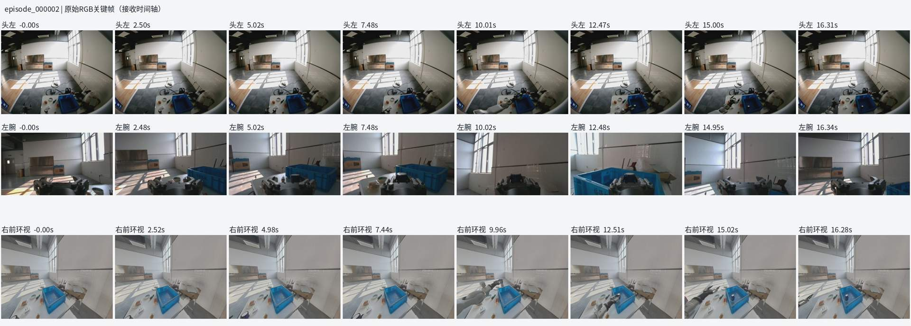

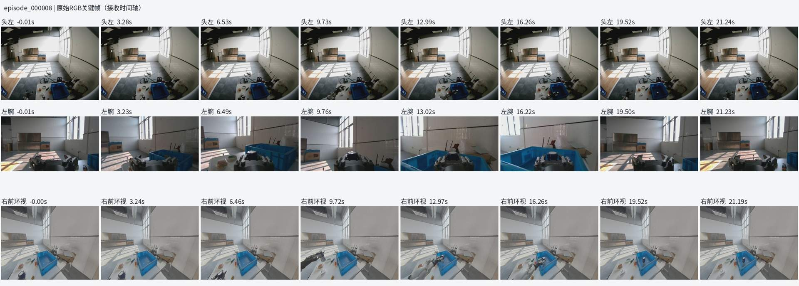

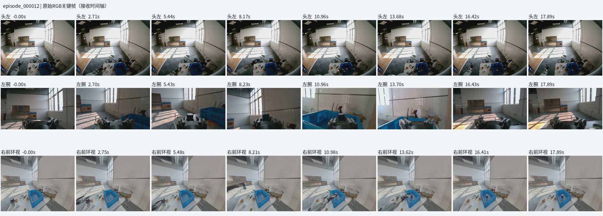

## 11. 助手（进展）

13 条原始记录的文件校验均通过，抽查画面能看到牛奶从桌面移入蓝色料箱。轨迹中暂未发现大幅持续往复抖动；不过第 2～6 条的部分时刻未通过现有跨机时钟映射检查，第 13 条也应排除出成功示教集。我正在进一步核对这些时间问题影响了多少数据。

## 12. 助手

_工具输出图片（原始工具文本未纳入归档）。_

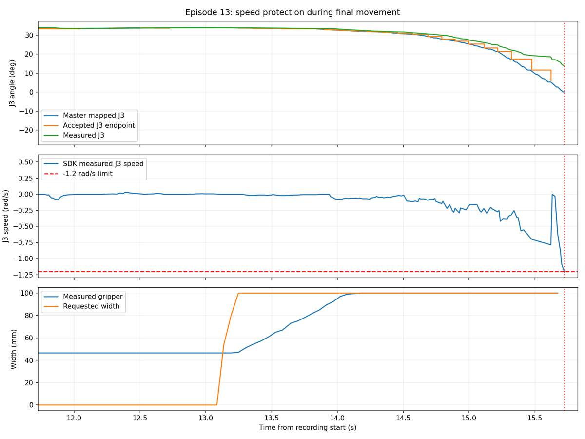

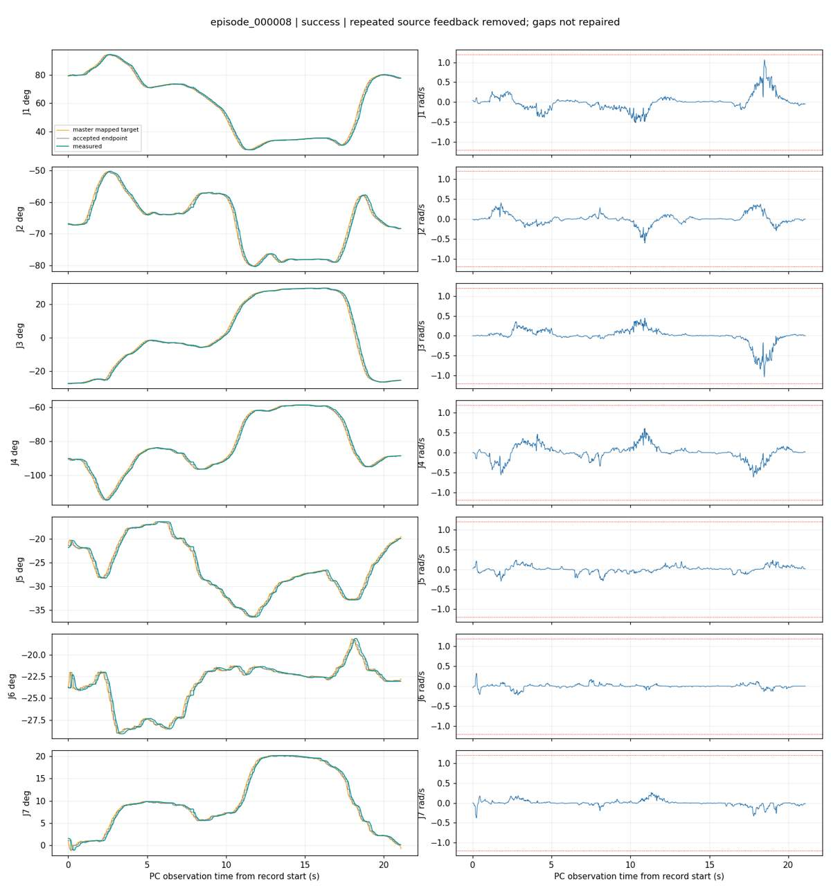

## 13. 助手

_工具输出图片（原始工具文本未纳入归档）。_

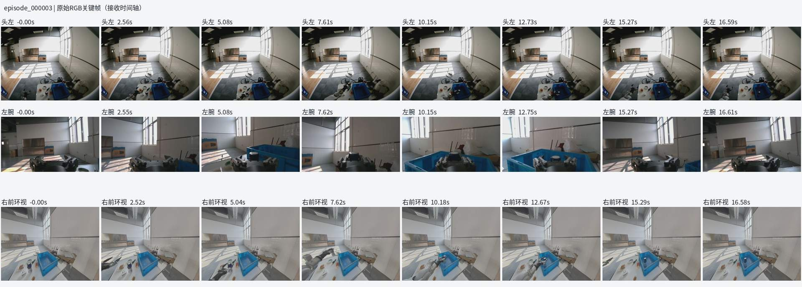

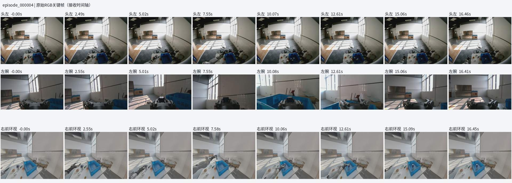

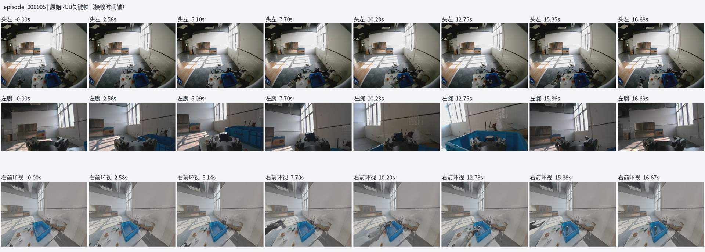

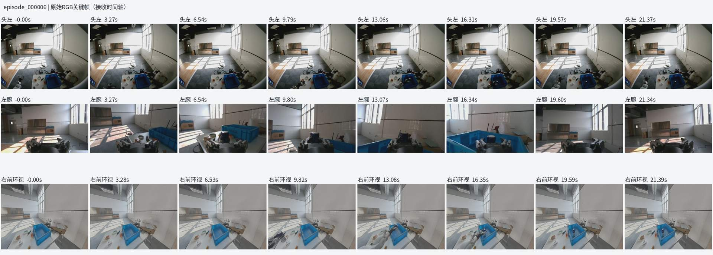

## 14. 助手

_工具输出图片（原始工具文本未纳入归档）。_

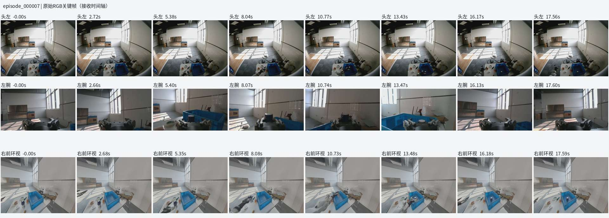

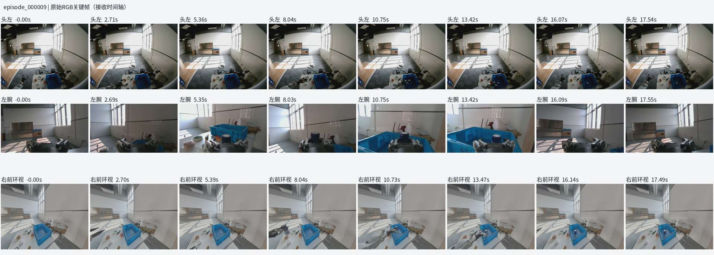

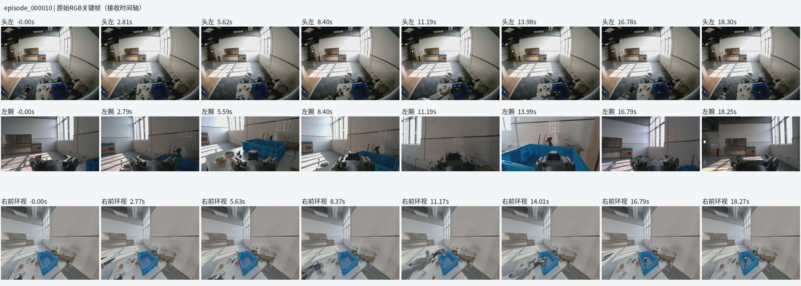

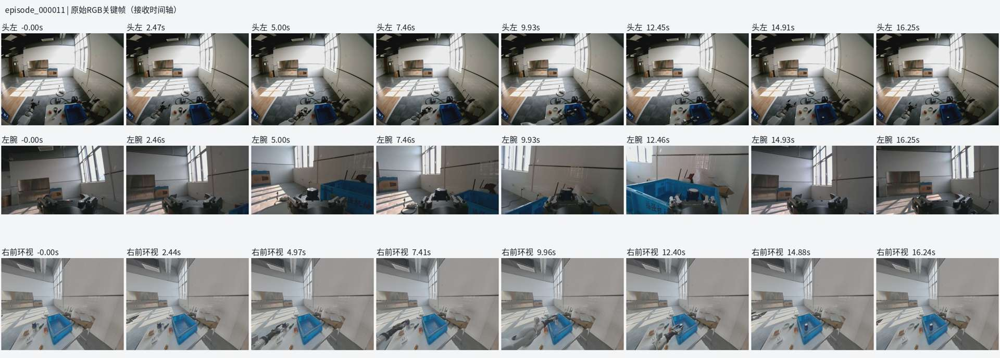

## 15. 助手（进展）

发现一个比小幅轨迹波动更需要优先处理的问题：右前环视的“源时间到接收时间”差值稳定在约 0.39 秒，明显大于头部和腕部相机。它还不能直接等同于已标定的画面延迟，但训练时不能简单按接收时间与动作拼接。第 13 条的超速则发生在放下牛奶后的撤手阶段，J3 加速到 −1.21056 rad/s 后触发保护。

## 16. 用户

第 13 条 感觉可以不用管，或者做一些数据裁切

## 17. 助手（进展）

可以，首轮先排除第 13 条，保留原件即可，不影响前面 11 条成功数据。它已经完成入箱；以后若想保留，可另存一条“放置完成、夹爪松开后结束”的裁切版本。我会先把重点放在成功组的时序问题上。

## 18. 助手

_工具输出图片（原始工具文本未纳入归档）。_


## 19. 助手

可以，**第 13 条先不纳入首轮训练，原件保留，暂不裁切。** 我已把它列入排除清单。

这批数据的结论是：**值得保留，有 11 条成功示教候选；没有发现需要整批重录的大幅持续抖动，但训练前还要处理时序和导出。**

| 数据 | 检查结果 | 建议 |
|---|---|---|
| 第 1 条 | 人工取消 | 排除成功训练集 |
| 第 2～6 条 | 成功，部分区间时钟映射未通过检查 | 保留，复核对齐 |
| 第 7～12 条 | 成功，无上述时钟映射拒收 | 优先作为导出候选 |
| 第 13 条 | 撤手时超速中断 | 暂时排除 |

11 条成功示教共 **193.8 秒**。所有原件文件校验通过，日志没有写入丢失；成功组关键帧与“牛奶入箱”任务一致。

**关于抖动：目前更像小幅调整和速度波动。**

去除重复反馈后，成功组关节位置曲线整体连贯。用于诊断的高频位置残差 RMS 约 **0.06～0.08°**，没有显示大幅持续往复震荡。这个指标不能代替末端精度测量，但不足以支持“数据因为抖动而不能用”的判断。

小幅波动不必直接删掉；如果示教反复左右修正，模型可能学到这种动作。因此下一轮重点把接近、放置和撤手做得匀速一些，**先不用给整批动作强行平滑**，以免改变抓放时刻。

**当前更值得优先解决的是时间对应关系：**

- **右前环视的源时间到接收时间相差约 0.39 秒。** 这还不等于已标定的真实画面延迟，但不能直接按接收时间与动作拼接。
- **第 2～6 条部分区间未通过现有主机时钟映射规则。** 不代表整条报废，也不代表画面实际错位了几秒，需要针对这些区间复核。
- 成功组存在最长约 **125 毫秒的关节源时间采样缺口**，导出时应保留标记或合理分段，不能删掉缺口后把时间拼起来。

我的建议是：**保留这 11 条，先完成单臂 8 维动作导出和时间对齐，再用于小规模训练验证。** 后续继续补不同位置的示教，不必因这次退出从头重采。

详细结果和逐条曲线已保存：[检查报告](<../../assets/1d0f06bd4fcc064f--%E6%A3%80%E6%9F%A5%E7%BB%93%E6%9E%9C.md>) · [汇总图](<../../assets/d057b7c67b9a8414--quality_summary.png>)。本次检查了日志、原件完整性和关键帧，未修改原数据或控制参数。

[附件：1d0f06bd4fcc064f--检查结果.md](../../assets/1d0f06bd4fcc064f--%E6%A3%80%E6%9F%A5%E7%BB%93%E6%9E%9C.md)

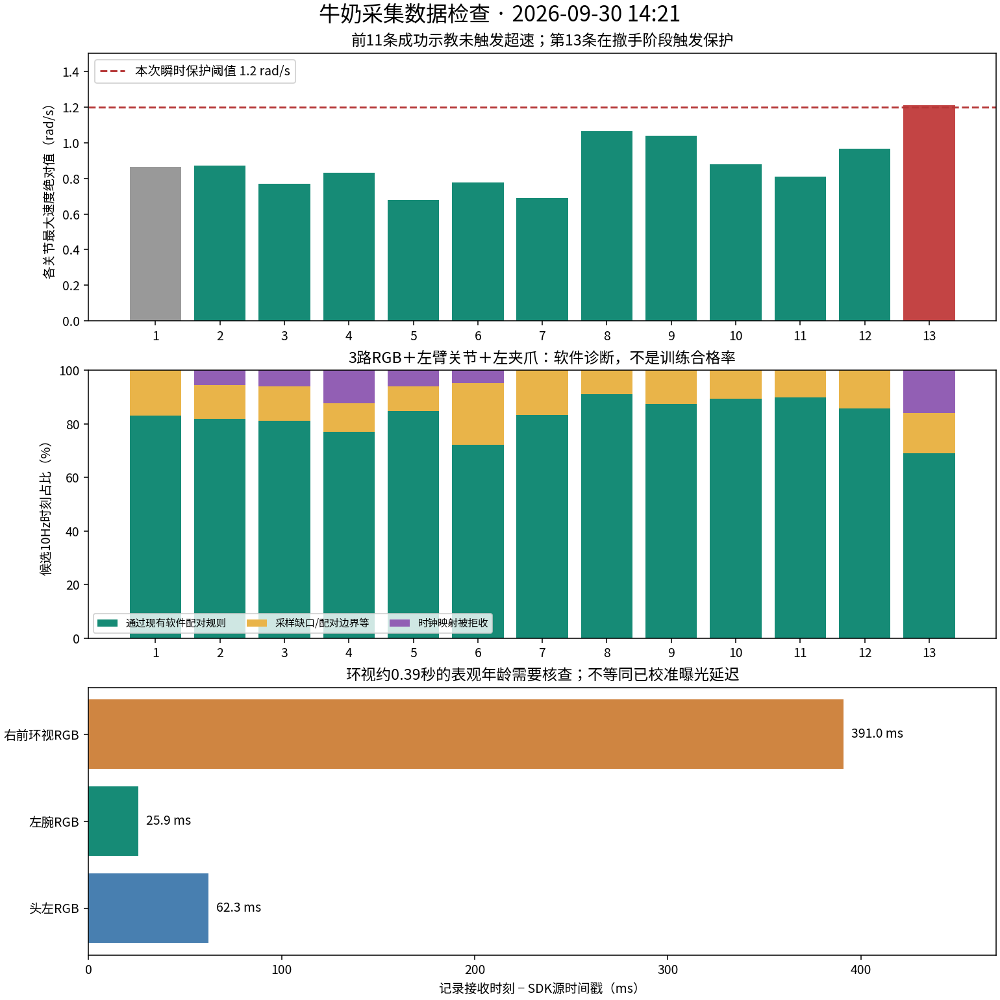

## 20. 用户

先帮我完成这几段数据的整理和lerobot格式形成如何？明确一下lerobot格式版本
数据本机放在 “lsy03\@lsy03-System-Product-Name:/mnt/data/VLA\_data$ ll
总计 8
drwxr-xr-x 2 root root 4096  9月 30 14:47 ./
drwxr-xr-x 4 root root 4096  9月 30 14:47 ../
lsy03\@lsy03-System-Product-Name:/mnt/data/VLA\_data$&#x20;
”这里如何？

## 21. 助手（进展）

我先确认当前 LeRobot 环境支持的数据格式版本，并检查 `/mnt/data/VLA_data` 的容量和写入权限。随后整理这次的 11 条成功示教，保留失败和中断记录供追溯，生成带任务指令、三路 RGB、左臂状态与动作的 LeRobot 数据集，同时保留时间质量标记。

## 22. 用户

我现在如果继续进行采集是否会影响你？

## 23. 助手（进展）

可以继续采集，**新会话不会覆盖我正在整理的这次已关闭会话**，我也不会修改正在运行的采集程序或控制参数。

本地离线整理不受影响。约 8.4GB 原件还在机器人上，为避免大批量读取与新采集争抢磁盘、网络，我先做本地整理和导出程序，整批取回安排在采集间隙。你这一轮结束时告诉我即可，先不要删除旧会话。

## 24. 用户

你的整理需要多久？要不你从机器人导出完到我本机，导出完告诉我，然后我再开始继续采集到50条数据

## 25. 助手（进展）

可以这样安排。我现在先把这次约 **8.4GB 原件取回本机并校验**，完成后马上告诉你，你就可以继续采集，不必等格式转换结束。

预估原件传输和校验约 **3～8 分钟**，完整 LeRobot 转换及重载检查再需要约 **15～30 分钟**，以实际磁盘和网络速度为准。格式已确认：**LeRobot 软件 0.4.4，数据格式 v3.0**。

## 26. 用户

或者实时给我报一下 原件传输和校验 的进度百分比，我这心里有个数

## 27. 助手（进展）

目前已完成：

- **原件传输：100%**，约 8.44GB 已到本机。
- **原件校验：100%**，13/13 条全部通过。
- **现在可以继续采集到 50 条了。** 后续格式转换只读取本机副本，不再占用机器人端传输。

数据位于 `/mnt/data/VLA_data/milk_left_20260930/source/dual_arm_capture_20260930_142120_823456/`。我继续生成和验证 LeRobot v3.0 数据集。

## 28. 助手（进展）

补充一下计数：这次保留的是 **11 条成功示教**。新会话计数会从 0 开始，再采 **39 条成功记录**就达到累计 50 条，可在启动命令后加 `--target-episodes 39`。

## 29. 助手（进展）

本机原件已经归档完成。现在正在生成单臂专用的对齐计划：保留 11 条完整示教，每条按 10Hz 整理，状态和动作各 8 维。

时间有疑问的帧会带上明确标记，不会通过删除中间帧来压缩时间线。接下来会用官方 LeRobot API 写出 v3.0，并逐帧重载核对。

## 30. 助手（进展）

LeRobot 转换目前已处理 **652/1941 帧，约 34%**。原件传输和校验仍是 100%；现在进行的是本机视频编码与数据表生成，之后还会完整重载验证。

## 31. 助手（进展）

本地导出已处理 **1249/1941 帧，约 64%**，正在编码第 7 条示教。11 条都会保持完整的时间线；第 1、13 条只保留在原件归档中，不进入这次 LeRobot 数据集。

## 32. 助手（进展）

导出已到 **1764/1941 帧，约 91%**，正在完成最后两条。随后会核对全部状态、动作、任务文本和三路视频，并在你现有的 LeRobot 训练环境中再做一次只读加载检查。

## 33. 助手（进展）

**LeRobot 文件生成已完成：11/11 条、1941/1941 帧，100%。** 现在进入完整重载校验，检查数值、任务文本、视频解码和动作块是否正确，确保数据能被现有训练环境读取。

## 34. 助手（进展）

**完整重载校验已通过，现有训练 Docker 的读取检查也通过了。** 数据集包含 11 条、1941 帧、三路 RGB，以及 8 维状态和动作。

另外抽查了 99 张编码前后的图像，未发现帧索引、颜色通道或明显亮度异常。我正在收尾交付清单和读取说明。

## 35. 助手

_工具输出图片（原始工具文本未纳入归档）。_

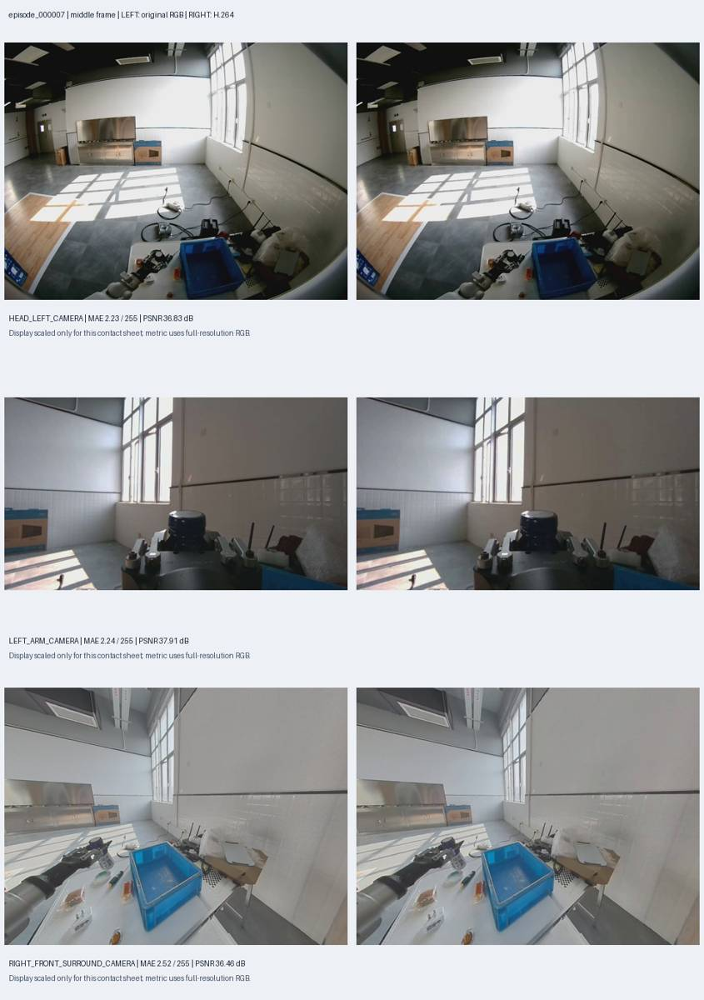

## 36. 助手

**已完成：原件传输、校验、LeRobot 转换与重载验证均为 100%。可以继续采集。**

| 项目 | 结果 |
|---|---|
| 数据格式版本 | **LeRobotDataset v3.0** |
| 生成软件版本 | **LeRobot 0.4.4** |
| 示教数量 | **11 条**，第 2～12 条 |
| 数据量 | **1941 帧，10Hz** |
| 状态与动作 | 各 **8 维**：左臂七关节＋夹爪 |
| 图像 | 头左、左腕、右前环视，三路 MP4 |
| 验证 | 全量重载通过，现有训练 Docker 读取通过 |

数据集：[milk_left_v3](/mnt/data/VLA_data/milk_left_20260930/lerobot/milk_left_v3)
说明：[README](/mnt/data/VLA_data/milk_left_20260930/README.md)

13 条原件全部保留，第 1、13 条未纳入此次数据集。

**格式已经完成，时间质量问题仍保留标记。** 其中 59 帧涉及未通过检查的时钟区间；默认训练器不会自动屏蔽这些帧，正式训练前仍需处理质量标记与时序问题。

## 37. 用户

G1上的数据是否全部导到我本机上了？我们总结一下这一整套数据处理流程是怎样的？是否写成脚本或者写成skill会更加方便执行？

## 38. 助手（进展）

我先核对取回清单，明确“这次会话全部取回”和“G1 上所有历史数据取回”的范围，再梳理采集、归档、检查、转换和验证这条流程。关于脚本与 skill 的分工，我也会结合现有实现给出建议。

## 39. 助手（进展）

核对结果是：**14:21 这次牛奶会话的全部 13 条原件都已取回，约 8.44GB，13/13 校验通过，G1 上的原件也保留着。** 你之后新采集的会话尚未包含在这次归档里。

我会参考 Skill Creator 和 OpenAI Docs 的规范梳理封装方式：脚本负责可重复的数据处理，skill 负责选择会话、调用脚本和解释结果。

## 40. 助手

**这次 14:21 牛奶采集会话的数据，已经全部导到本机。** 我刚重新核对了清单：

- **13 条原始记录、68 个分片，约 8.44GB，全部校验通过。**
- 七路传感器原件、PC 控制日志、任务描述和时间信息都已归档。
- G1 上的原件仍然保留。
- **你之后新采集的会话尚未包含在这次归档里；这次没有搬运 G1 上所有历史数据。**

本机位置：[原始会话](/mnt/data/VLA_data/milk_left_20260930/source/dual_arm_capture_20260930_142120_823456) · [LeRobot 数据集](/mnt/data/VLA_data/milk_left_20260930/lerobot/milk_left_v3)

整套流程可以固定成下面这样：

| 步骤 | 做什么 | 得到什么 |
|---|---|---|
| ① 采集 | G1 保存传感器，PC 保存实际控制命令，记录任务及成功/失败结果 | 同一个会话 ID 下的两部分原件 |
| ② 归档 | 会话结束后，把两部分数据汇集到本机数据盘 | 完整、可追溯的源会话 |
| ③ 完整性校验 | 检查哈希、记录数量、序号、文件是否完整 | 确认数据没有传坏、漏传 |
| ④ 筛选与审计 | 区分成功、失败、中断；检查画面、轨迹、采样缺口和时钟 | 纳入清单与质量报告 |
| ⑤ 时间整理 | 按 10Hz 建立时间线，匹配图像、真实状态和已接受动作 | 带质量标记的对齐数据 |
| ⑥ 格式转换 | 写入三路 RGB、8 维状态/动作、任务文本和来源信息 | **LeRobotDataset v3.0** |
| ⑦ 重载验证 | 重新读取全部数据，再用现有训练 Docker 检查 | 确认格式和读取兼容性 |
| ⑧ 训练准备 | 处理质量标记、确定动作时间约定、划分训练与验证集 | 正式用于训练的数据版本 |

其中第 ⑥ 步使用的是 **LeRobot 软件 0.4.4**；生成的**数据格式版本是 v3.0**。两个版本号要分别记录。

**我建议采用“统一脚本＋skill”的组合。**

| 部分 | 负责的事情 |
|---|---|
| **处理脚本** | 下载、校验、对齐、导出、验证；提供百分比、失败恢复和重复运行检查 |
| **skill** | 根据你的话选择会话与任务，调用脚本，检查结果，解释异常和输出位置 |

Skill 可以包含流程说明，并引用负责确定性计算和文件处理的脚本，这正适合这套工作。[官方说明](https://developers.openai.com/plugins/build/skills)

目前关键步骤已经有脚本：

- [fetch.py](</home/lsy03/文档/ChatGPT/VLA G1 项目/acquisition/lerobot_capture/fetch.py>)：取回并校验原件。
- [align_left7.py](</home/lsy03/文档/ChatGPT/VLA G1 项目/acquisition/lerobot_capture/align_left7.py>)：左臂七路数据对齐。
- [export_left7.py](</home/lsy03/文档/ChatGPT/VLA G1 项目/acquisition/lerobot_capture/export_left7.py>)：生成官方 v3.0 数据集。
- [validate_left7_docker.sh](</home/lsy03/文档/ChatGPT/VLA G1 项目/acquisition/lerobot_capture/validate_left7_docker.sh>)：训练环境读取验证。

**下一步最有价值的是把这些脚本接成一个参数化入口，再包装成 `g1-data-pipeline` skill。** 同时把目前绑定本次会话的审计、报告脚本通用化。封装后，你只需说：

> “整理刚结束的牛奶采集，保存到 VLA_data，导出 LeRobot v3.0，保留原件并报告进度。”

当前已有各步骤脚本，统一入口和这个 skill 尚未创建。封装时还应保留一个关键区别：**“格式验证通过”和“时间质量已满足训练要求”分别报告**，不能自动把现有时序问题标成已解决。

## 41. 用户

好的，给我整理成 “统一脚本＋skill”的组合

## 42. 助手（进展）

我会把现有流程封装成统一入口，支持选择已结束会话、归档校验、对齐、导出、验证和进度查询，再用 Skill Creator 创建调用它的 skill。原始数据会保留，默认不启动训练。

## 43. 助手（进展）

我会把入口分成“会话列表、执行处理、查看进度、接管已有归档”四个命令。处理到原件归档完成时就能停下，后续离线转换可再续跑；中断产生的派生文件会保留并另开重试目录。当前只支持已验证的 `left7` 配置，其他配置会明确提示，不会套用错误的数据维度。

## 44. 助手（进展）

归档和审计模块已经完成。新入口会从会话清单读取任务、条数和路径，报告不再写死“牛奶、13 条、1941 帧”。我正在验证续跑行为，重点检查会话未结束、源文件变化和输出目录冲突时能否正确停止。

## 45. 助手（进展）

临时合成数据已完整跑通：先归档、暂停、续跑到 LeRobot v3.0，再用现有 Docker 读取验证；重复执行也没有重新生成数据集。接下来我会安装 skill，并用已完成的牛奶归档验证“接管已有结果”的路径，全程只读本机数据。

## 46. 助手

已完成“**统一脚本＋skill**”组合。

- [统一脚本](</home/lsy03/文档/ChatGPT/VLA G1 项目/acquisition/lerobot_capture/run_data_pipeline.sh>)：支持会话列表、归档校验、审计、对齐、导出、进度查询和中断续跑。
- [g1-data-pipeline skill](/home/lsy03/.codex/skills/g1-data-pipeline/SKILL.md)：已安装到个人 skills。
- [使用说明](<../../assets/315790049edd5bc4--PIPELINE_USAGE.md>)。

以后可以直接说：

> 使用 $g1-data-pipeline，把刚结束的牛奶会话先取回并校验，完成后告诉我。

然后说：

> 使用 $g1-data-pipeline，继续完成这批数据的离线整理和 LeRobot 导出。

当前支持 **left7**，使用 **LeRobot 软件 0.4.4、数据格式 v3.0**。原件保留，失败和中断记录单独处理，不自动启动训练。

**验证结果：14 项测试通过，包含完整离线转换、中断恢复和重复执行检查。** 已有牛奶归档也已接管；原来的 11 条、1941 帧数据集保持不变。

[附件：315790049edd5bc4--PIPELINE_USAGE.md](../../assets/315790049edd5bc4--PIPELINE_USAGE.md)
