# VLA 数据整理

- 归档编号：`01a0f123-ee3f-7da3-8232-cff7bba23cd2`
- 项目：VLA G1 项目
- 创建时间：2026-09-30T15:07:38.947000+08:00
- 更新时间：2026-10-09T13:37:23.488000+08:00
- 状态：活动
- 导出范围：用户可见消息与助手可见回复；不含隐藏推理和工具原始输出

## 1. 用户

\| J6   | -10.71   | -10.71 | -5.04  | -5.67  | 通过     | +3.10    | +3.10  | +3.10  | +0.00  | 通过   |
\| J7   | +4.25    | +4.25  | +7.39  | -3.14  | 通过     | -2.73    | -2.73  | -2.73  | +0.00  | 通过   |
+------+----------+--------+--------+--------+----------+----------+--------+--------+--------+--------+
左J2保守限位[-89.14, +89.14]°
左侧状态原因：left\_arm\_joint2起点/GP目标不在保守限位内
右侧状态原因：本次仅左臂：右臂跟随禁用，显示实测姿态
左扳机=0.700，夹爪目标/实测=100.0/100.0mm，未启用 | 右扳机=0.700，夹爪目标/实测=100.0/50.0mm，未启用
【采集进度·本次会话】已完成 11/40 组 | 取消/失败 0 组 | 已发起 11 组 | 当前组 0.0s | 完成组累计 225.7s | 累计已落盘 78,612 条原始记录（含失败组，组结束后更新）
【数采】ARMED | 无活动episode | 记录键：ARMED开始 / RECORDING结束；取消键：录制中标失败，待命时保持连接

双臂实时对比 | 左：LOCKED | 右：LOCKED
单位：度 | 主目标=GP映射目标；有效=限幅后目标；差值=有效目标−G1从臂
各侧固定键：全部误差<15°且READY → 按一次正式跟随 → 再按暂停
+------+----------+--------+--------+--------+----------+----------+--------+--------+--------+--------+
\| 关节 | 左主目标 | 左有效 | 左从臂 | 左差值 | 左检查   | 右主目标 | 右有效 | 右从臂 | 右差值 | 右检查 |
+------+----------+--------+--------+--------+----------+----------+--------+--------+--------+--------+
\| J1   | +59.00   | +59.00 | +67.43 | -8.42  | 通过     | -61.12   | -61.12 | -61.12 | +0.00  | 通过   |
\| J2   | -92.08   | -92.08 | -77.48 | -14.60 | 目标越界 | +63.57   | +63.57 | +63.57 | +0.00  | 通过   |
\| J3   | -28.57   | -28.57 | -20.37 | -8.21  | 通过     | +44.75   | +44.75 | +44.75 | +0.00  | 通过   |
\| J4   | +5.92    | +5.92  | -12.46 | +18.38 | 差≥15°   | -3.55    | -3.55  | -3.55  | +0.00  | 通过   |
\| J5   | +5.12    | +5.12  | -7.86  | +12.98 | 通过     | -10.05   | -10.05 | -10.05 | +0.00  | 通过   |
\| J6   | -10.71   | -10.71 | -5.04  | -5.67  | 通过     | +3.10    | +3.10  | +3.10  | +0.00  | 通过   |
\| J7   | +4.25    | +4.25  | +7.39  | -3.15  | 通过     | -2.73    | -2.73  | -2.73  | +0.00  | 通过   |
+------+----------+--------+--------+--------+----------+----------+--------+--------+--------+--------+
左J2保守限位[-89.14, +89.14]°
左侧状态原因：left\_arm\_joint2起点/GP目标不在保守限位内
右侧状态原因：本次仅左臂：右臂跟随禁用，显示实测姿态
左扳机=0.700，夹爪目标/实测=100.0/100.0mm，未启用 | 右扳机=0.700，夹爪目标/实测=100.0/50.0mm，未启用
【采集进度·本次会话】已完成 11/40 组 | 取消/失败 0 组 | 已发起 11 组 | 当前组 0.0s | 完成组累计 225.7s | 累计已落盘 78,612 条原始记录（含失败组，组结束后更新）
【数采】ARMED | 无活动episode | 记录键：ARMED开始 / RECORDING结束；取消键：录制中标失败，待命时保持连接

双臂实时对比 | 左：LOCKED | 右：LOCKED
单位：度 | 主目标=GP映射目标；有效=限幅后目标；差值=有效目标−G1从臂
各侧固定键：全部误差<15°且READY → 按一次正式跟随 → 再按暂停
+------+----------+--------+--------+--------+----------+----------+--------+--------+--------+--------+
\| 关节 | 左主目标 | 左有效 | 左从臂 | 左差值 | 左检查   | 右主目标 | 右有效 | 右从臂 | 右差值 | 右检查 |
+------+----------+--------+--------+--------+----------+----------+--------+--------+--------+--------+
\| J1   | +59.00   | +59.00 | +67.43 | -8.43  | 通过     | -61.12   | -61.12 | -61.12 | +0.00  | 通过   |
\| J2   | -92.06   | -92.06 | -77.48 | -14.58 | 目标越界 | +63.57   | +63.57 | +63.57 | +0.00  | 通过   |
\| J3   | -28.57   | -28.57 | -20.36 | -8.21  | 通过     | +44.75   | +44.75 | +44.75 | +0.00  | 通过   |
\| J4   | +5.93    | +5.93  | -12.46 | +18.39 | 差≥15°   | -3.56    | -3.56  | -3.56  | +0.00  | 通过   |
\| J5   | +5.12    | +5.12  | -7.86  | +12.98 | 通过     | -10.05   | -10.05 | -10.05 | +0.00  | 通过   |
\| J6   | -10.71   | -10.71 | -5.04  | -5.68  | 通过     | +3.10    | +3.10  | +3.10  | +0.00  | 通过   |
\| J7   | +4.25    | +4.25  | +7.40  | -3.15  | 通过     | -2.73    | -2.73  | -2.73  | +0.00  | 通过   |
+------+----------+--------+--------+--------+----------+----------+--------+--------+--------+--------+
左J2保守限位[-89.14, +89.14]°
左侧状态原因：left\_arm\_joint2起点/GP目标不在保守限位内
右侧状态原因：本次仅左臂：右臂跟随禁用，显示实测姿态
左扳机=0.700，夹爪目标/实测=100.0/100.0mm，未启用 | 右扳机=0.700，夹爪目标/实测=100.0/50.0mm，未启用
【采集进度·本次会话】已完成 11/40 组 | 取消/失败 0 组 | 已发起 11 组 | 当前组 0.0s | 完成组累计 225.7s | 累计已落盘 78,612 条原始记录（含失败组，组结束后更新）
【数采】ARMED | 无活动episode | 记录键：ARMED开始 / RECORDING结束；取消键：录制中标失败，待命时保持连接
^C本轮结束：KeyboardInterrupt:&#x20;
lsy03\@lsy03-System-Product-Name:\~/文档/ChatGPT/VLA G1 项目$&#x20;

给我检查一下，我新采集的数据，为什么我记得我采集了不止11次，给我看看

## 2. 助手（进展）

我先检查采集目录、会话日志和落盘记录，核对“本次会话 11 组”与实际已保存的数据组数。

## 3. 助手（进展）

已核对到：最新这一轮确实保存了 11 组，225.7 秒和 78,612 条记录都与你贴的终端一致；前一轮牛奶任务还有 11 组成功记录，两轮合计 22 组。我再检查最新一轮的录制事件，确认有没有按键被忽略或未结束的录制。

## 4. 助手

你记得没错，**牛奶任务累计采集了 24 组，其中 22 组标记成功。界面的 11/40 只统计最新一次启动的会话。**

我核对了今天的会话清单和录制日志：

| 会话开始时间 | 采集组数 | 成功 | 取消／中断 |
|---|---:|---:|---:|
| 14:21 牛奶任务 | 13 | 11 | 1 组取消、1 组中断 |
| 14:58 牛奶任务（刚结束） | 11 | 11 | 0 |
| **牛奶任务合计** | **24** | **22** | **2** |

另外，14:00 还有 **3 组成功记录**，但任务标签是“白色方块放到灰色板子”，没有计入牛奶任务。

最新这轮检查结果：

- **11 次开始、11 次结束、11 次落盘完成**，没有记录到被忽略的录制事件。
- 合计 **225.7 秒、78,612 条原始记录**，与你贴出的数字完全一致。
- 11 组清单均显示接收数＝写入数、待写入为 0、无写入错误，均有 7 路传感器记录。
- 按 `Ctrl+C` 时已是待命状态，没有正在录制的组，**这次退出没有截断最后一组**。

原因在[计数代码](</home/lsy03/文档/ChatGPT/VLA G1 项目/acquisition/lerobot_capture/progress.py:5>)：每次重新启动，完成数都会从 0 开始，不读取历史会话累计数量。

所以，**如果你的目标是累计 40 组牛奶成功示教，目前是 22/40，还差 18 组**。这里的“成功”指操作者标成功且落盘完成；最新这批尚未做画面和时序质量验收。

## 5. 用户

给我仿照这个流程把新的数据也处理一下

[附件：31791d41d5c193dd--已粘贴的文本.txt](../../assets/31791d41d5c193dd--%E5%B7%B2%E7%B2%98%E8%B4%B4%E7%9A%84%E6%96%87%E6%9C%AC.txt)

## 6. 助手（进展）

我先读你贴的流程，确认这次新数据对应的会话，再按同样步骤处理和检查。

## 7. 助手（进展）

这次按你贴的完整流程处理 **14:58 会话的 11 组新数据**：归档到 `/mnt/data/VLA_data`、校验原件、检查画面与轨迹、10Hz 对齐、生成 LeRobot v3.0，并验证训练 Docker 能读取。

我会使用 `galbot-136-ssh` 技能中的凭据规范，通过项目现用的有线地址读取 G1 原件；新批次单独保存，便于与上一批追溯。

## 8. 助手（进展）

G1 上这批原件共 **11 组、67 个分片，约 8.12 GB**，正在传到本机；当前约 **21%**。PC 控制日志等 28 个文件已复制并通过哈希核对。随后会继续核对每个原始记录的哈希、数量和时间顺序。

## 9. 助手（进展）

原件传输已到 **100%**，正在做本机完整性校验。轨迹诊断已完成：这轮也有部分时钟映射未通过检查的区间，我会沿用上一批的质量标记规则保留这些信息，导出时不会把它们当作已通过同步检查的数据。

## 10. 助手（进展）

**传输和完整性校验均已完成：11/11 组通过，78,612 条原始记录数量一致。** G1 上的原件保留，后续步骤都在本机执行，可以继续采集。

现在开始提取关键帧、检查时序并生成 10Hz 对齐数据，之后转换为与上一批一致的 LeRobotDataset v3.0。

## 11. 助手（进展）

11 组的原件索引、264 张关键帧和对齐计划都已生成。关节诊断中，各组最大速度为 **0.528～0.955 rad/s**，高频位置残差 RMS 为 **0.053～0.097°**；这些指标没有显示明显的大幅抖动。

接下来生成三路视频和 8 维状态／动作数据，并逐帧重载验证。

## 12. 助手

_工具输出图片（原始工具文本未纳入归档）。_

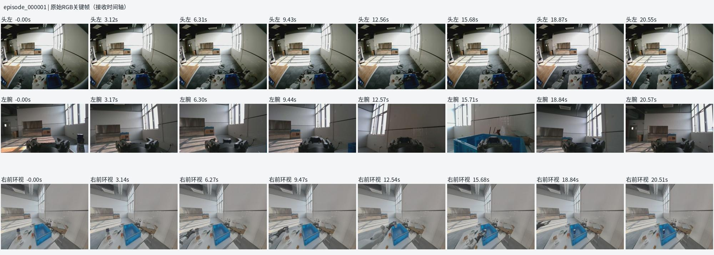

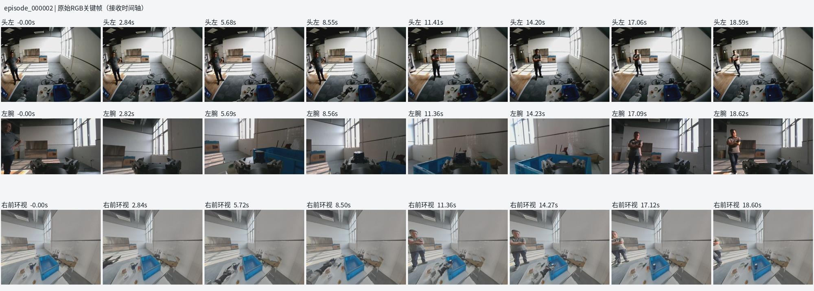

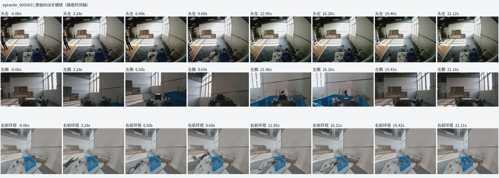

## 13. 助手

_工具输出图片（原始工具文本未纳入归档）。_

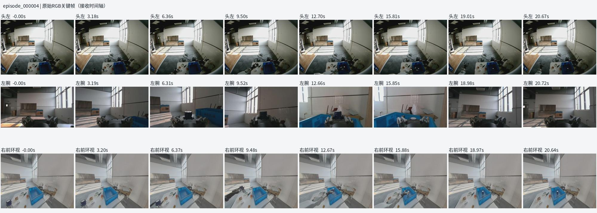

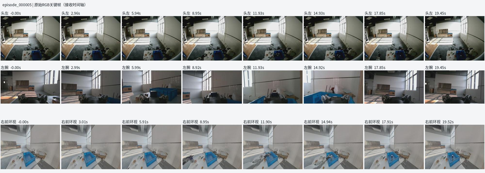

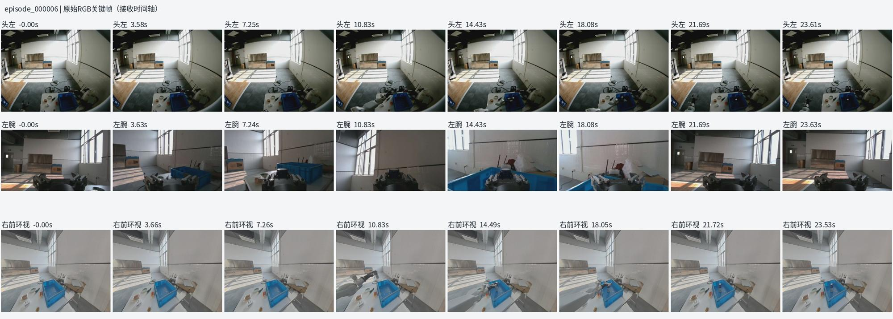

## 14. 助手

_工具输出图片（原始工具文本未纳入归档）。_

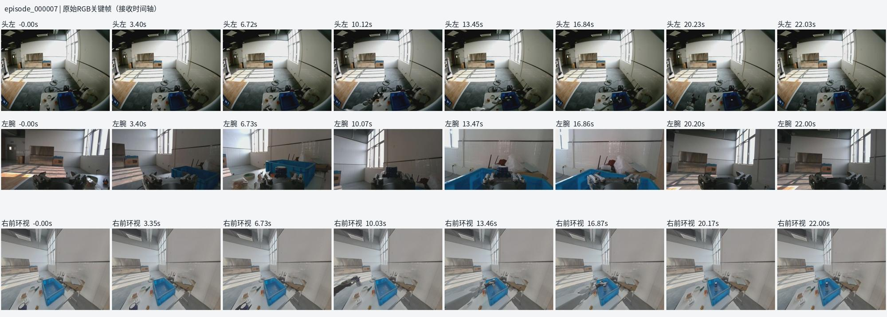

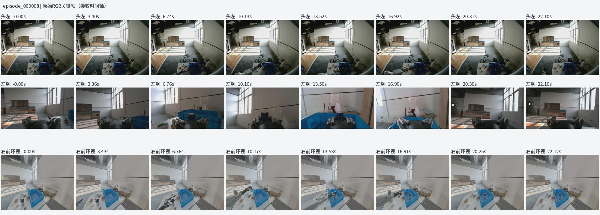

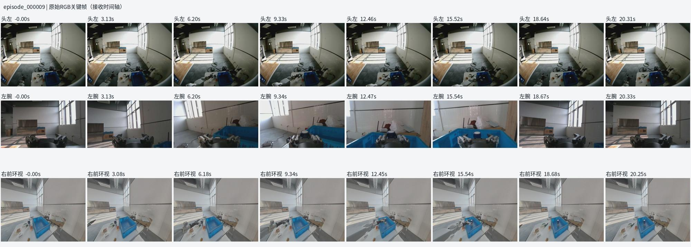

## 15. 助手

_工具输出图片（原始工具文本未纳入归档）。_

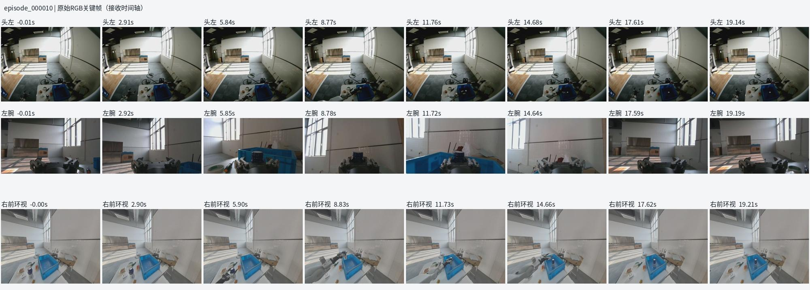

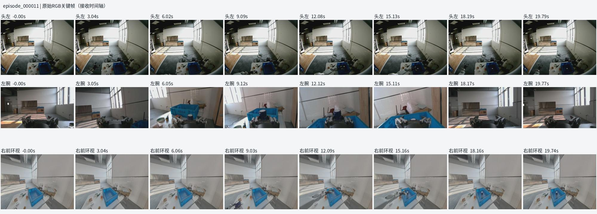

## 16. 助手（进展）

已逐组看过关键帧，11 组都与抓取牛奶并放入蓝箱的任务一致，抽样画面中没有整帧黑屏。这批将导出 **2,262 帧、10Hz**；视频正在逐组编码，之后还要完成全量重载和训练 Docker 读取检查。

## 17. 助手（进展）

当前已保存 **5/11 组**，约 **55% 的帧已写入编码流程**。时序统计已明确：2,262 帧中，**140 帧带时钟映射标记，1,857 帧通过现有核心时序匹配规则**。这些标记会随数据集保留，正式训练时需要显式处理。

## 18. 助手（进展）

视频转换已保存 **8/11 组**，帧写入约 **83%**。11 组都保留了完整时间线，没有裁去头尾或内部帧；剩余三组编码完成后，就进入全量重载验证。

## 19. 助手（进展）

**2,262 帧已全部写入**，最后一组视频正在编码收尾。接下来会逐帧核对状态、动作、质量标记和三路图像，再检查训练环境中的动作块是否正确停在每组边界。

## 20. 助手（进展）

11 组视频均已完成编码，全量重载验证已到 **71%**，目前没有发现数值、任务文本或图像读取错误。验证完成后还剩 Docker 兼容性检查和原件／MP4 抽样对照。

## 21. 助手（进展）

**全量重载和训练 Docker 检查均已通过**：2,262 个数值帧、6,786 个 RGB 帧可正常读取，16 步动作块没有跨组串接。原件与 MP4 的 99 个抽样对照也已完成，现在整理最终报告、版本信息和文件清单。

## 22. 助手

已按上一批流程全部处理完成，**新数据已归档、校验、转换并通过读取验证**。

| 项目 | 本批结果 |
|---|---|
| 数据格式 | **LeRobotDataset v3.0** |
| 生成软件 | LeRobot **0.4.4** |
| 数据量 | **11 条、2,262 帧、10Hz** |
| 状态／动作 | 各 8 维：左臂七关节＋夹爪 |
| 图像 | 头左、左腕、右前环视三路 MP4 |
| 原件 | 约 **8.12 GB**，全部校验通过，G1 原件保留 |
| 验证 | 全量重载、训练 Docker 读取、视频抽样对照均通过 |

已保存到：[新数据集](/mnt/data/VLA_data/milk_left_20260930_145800/lerobot/milk_left_v3) · [使用说明](/mnt/data/VLA_data/milk_left_20260930_145800/README.md) · [检查报告](/mnt/data/VLA_data/milk_left_20260930_145800/audit/检查结果.md)。

本批 **140 帧带时钟映射标记**，已保留质量字段；默认训练器不会自动屏蔽，正式训练前仍需处理。

两批目前合计 **22 条成功示教、4,203 帧**，分别保存。

## 23. 用户

给我继续处理一下新的数据

## 24. 助手（进展）

我先找出上次之后新增、已结束的采集会话，再沿用同样的归档、校验、LeRobot v3.0 转换和读取验证流程处理。

## 25. 助手（进展）

找到 **15:44 开始的新会话，共 20 组：19 组标成功、1 组标失败**，退出时没有活动录制，PC 日志也没有丢写。

其中第 1 组只有 **1.5 秒**、第 17 组只有 **3.6 秒**，我会重点检查是否是误触或不完整动作；先把全部原件归档保留。

## 26. 用户

<send_user_message_question_reply>
[{"questionItemId":"[\"request_user_input_async\",\"call_Wo25Qw6ijsXUDBD0fuvpHyf6\",0]","question":"新会话第 1 组约 1.5 秒、第 17 组约 3.6 秒，但都标记为成功。这两组是否是误触录制或未完成的动作？我会先检查画面并保留原件。","answer":"是，排除这两组的训练导出"}]
</send_user_message_question_reply>

## 27. 助手（进展）

收到，第 **1、17 组保留原件但排除导出**；第 2 组已标失败，也按之前的规则排除。本批将处理其余 **17 组成功示教**，全部 20 组原件约 **11.64 GB** 都会归档。

## 28. 助手（进展）

原件传输约 **69%**。已把第 1、17 组的排除要求写进独立清单，并给对齐流程补上显式排除参数；原始标签和文件保持不变。相关检查已通过，后续也可以直接按组号排除误触录制。

## 29. 助手（进展）

原件已传到本机 **100%**，正在逐组校验。选中的 17 组共 **297.4 秒**，最大关节速度约 **0.919 rad/s**，高频位置残差 RMS 约 **0.050～0.079°**；目前的运动统计没有显示明显的大幅抖动。

## 30. 助手（进展）

**20/20 组原件已全部通过完整性校验，共 108,829 条原始记录、98 个分片。** 现在都在本机数据盘上，后续处理只读取本机，可以继续采集。

正在生成关键帧和 17 组的对齐数据；第 1、2、17 组会在报告和导出来源清单中明确列为排除项。

## 31. 助手（进展）

对齐已完成：本批将生成 **17 条、2,981 帧、10Hz**，没有裁去选中组的头尾或内部帧。排除清单已核对为第 **1、2、17 组**。

其中 **216 帧带时钟映射标记，2,316 帧通过现有核心时序匹配规则**；这些质量信息会随数据集保留。现在开始编码视频，同时逐组检查关键帧。

## 32. 助手

_工具输出图片（原始工具文本未纳入归档）。_

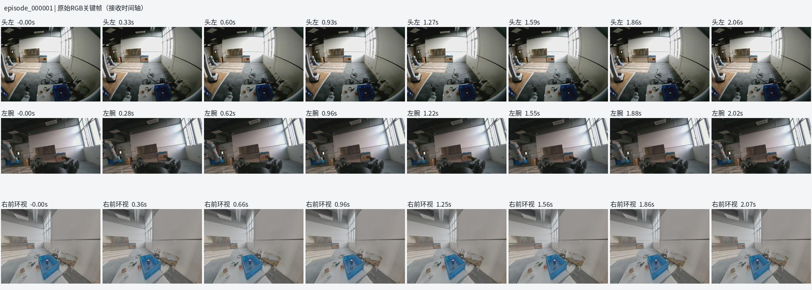

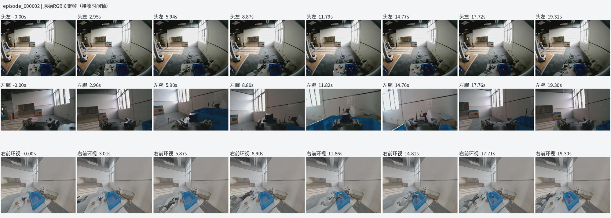

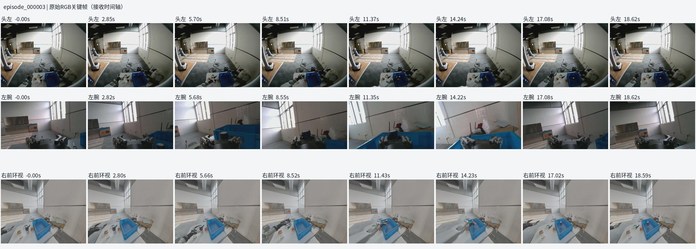

## 33. 助手

_工具输出图片（原始工具文本未纳入归档）。_

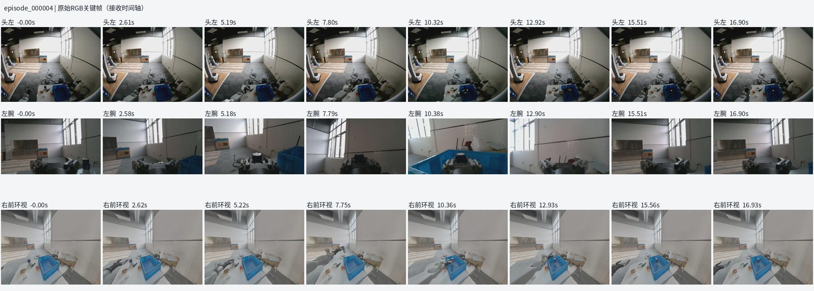

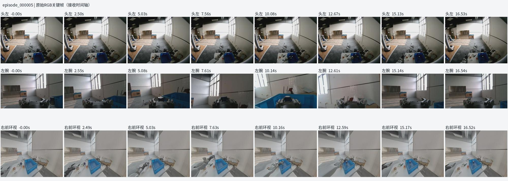

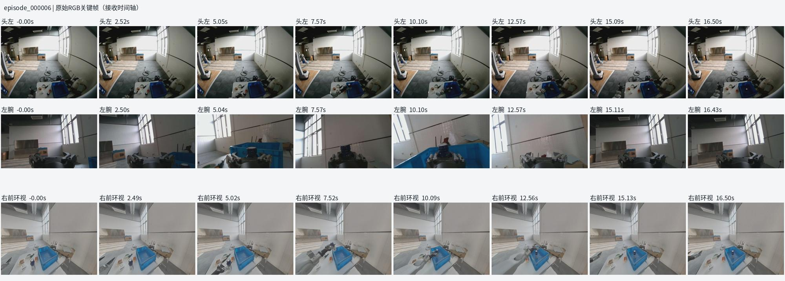

## 34. 助手

_工具输出图片（原始工具文本未纳入归档）。_

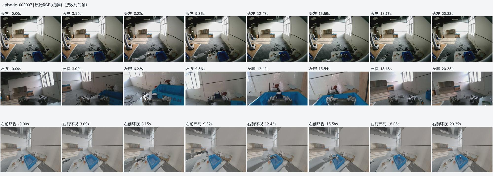

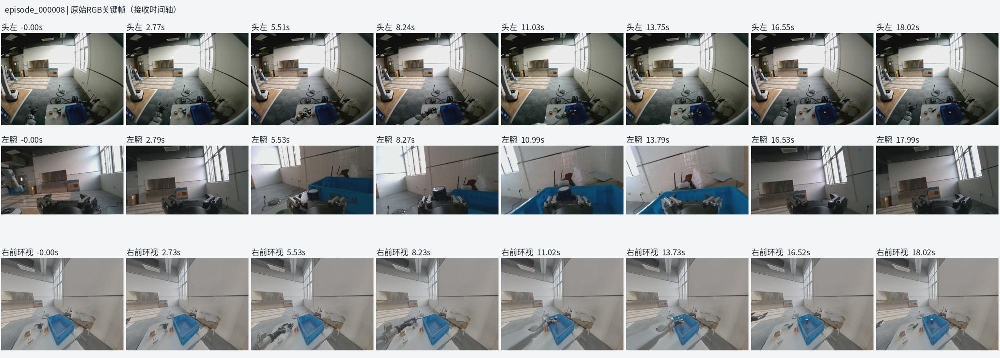

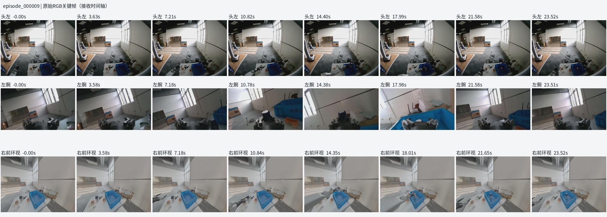

## 35. 助手

_工具输出图片（原始工具文本未纳入归档）。_

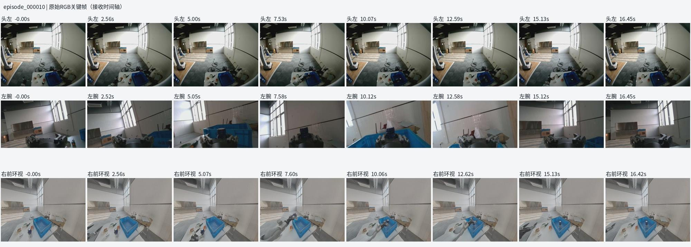

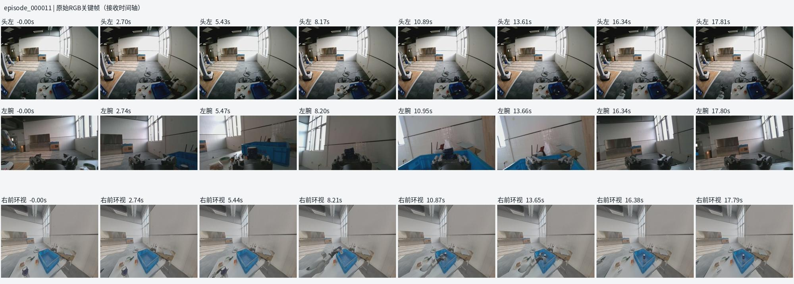

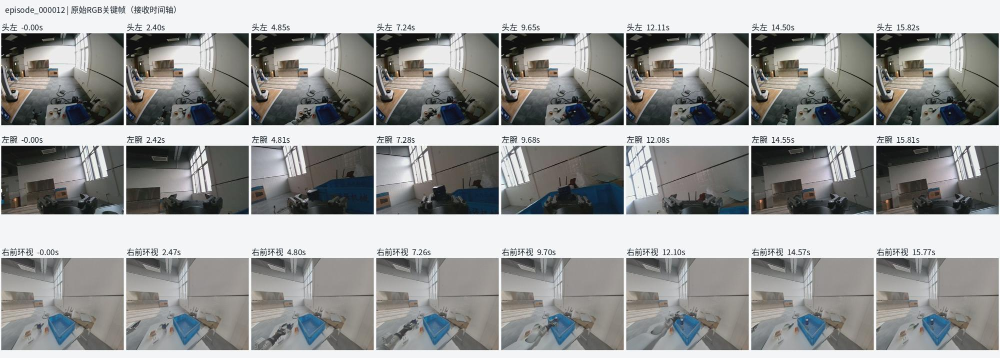

## 36. 助手（进展）

已检查前 12 组关键帧，纳入组的画面与牛奶入箱任务一致，暂未见整帧黑屏。第 1 组基本是短暂待机画面，符合你确认的误触情况。视频正逐组编码，当前约 **17% 的帧已写入**。

## 37. 助手

_工具输出图片（原始工具文本未纳入归档）。_

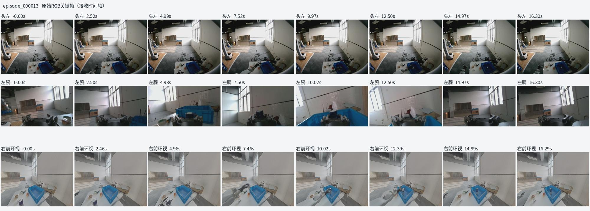

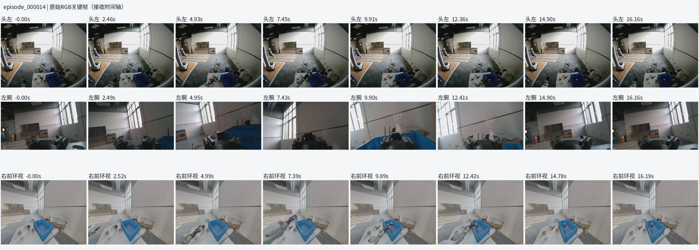

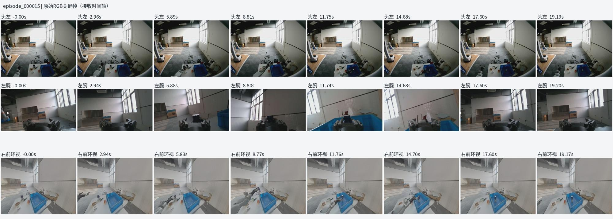

## 38. 助手

_工具输出图片（原始工具文本未纳入归档）。_

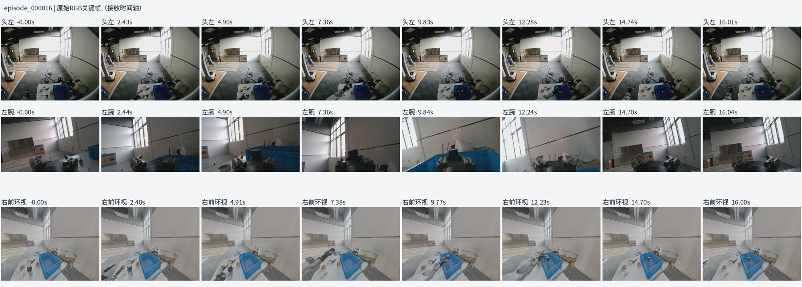

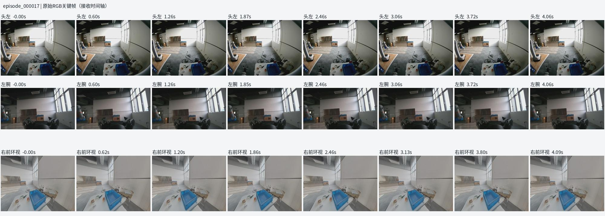

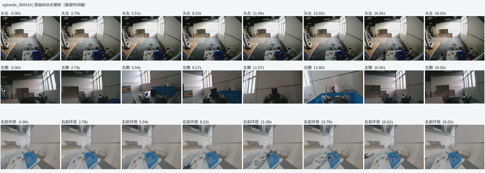

## 39. 助手

_工具输出图片（原始工具文本未纳入归档）。_

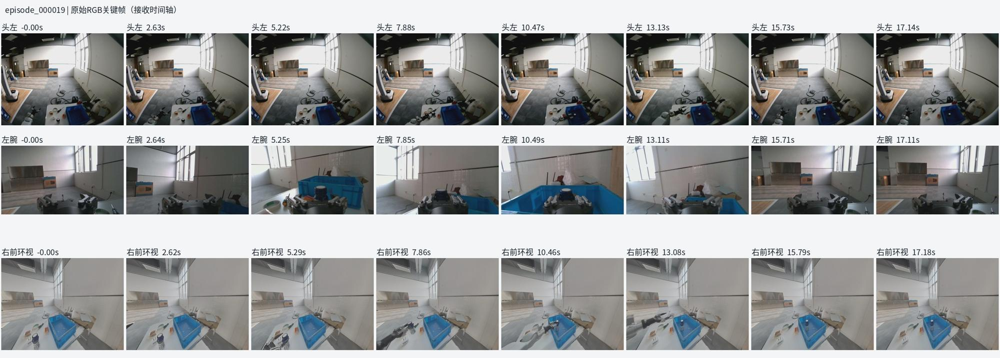

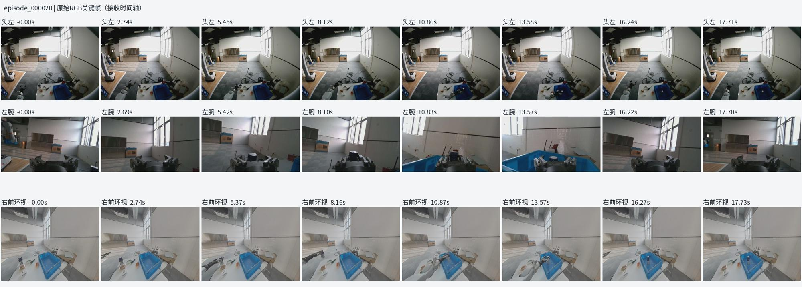

## 40. 助手（进展）

全部 **480 张关键帧已抽样审阅**，17 组纳入数据都能看到与任务一致的抓取、入箱和撤手过程；第 17 组也是短暂静止画面，已按你的要求排除。

视频转换已保存 **6/17 组**，约 **43% 的帧已写入**。本批仍有约 0.39 秒的环视表观时间差，已记录到时序报告，未直接平移时间戳。

## 41. 助手（进展）

转换进度约 **55%**，已保存 **8/17 组**。另外已复核：全部 46 个 PC 原件文件哈希未变，第 1、17 组的原始成功标签仍保留，只在派生数据的选择清单中排除。

## 42. 助手（进展）

已保存 **11/17 组**，帧写入约 **71%**。目前转换没有报错；完成编码后会继续全量重载，再检查训练 Docker 的读取和动作块边界。

## 43. 助手（进展）

已保存 **14/17 组**，帧写入约 **88%**，剩余最后三组。本批完成后，三批已整理的数据将合计 **39 条、7,184 帧**，各批来源仍可独立追溯。

## 44. 助手（进展）

**17 组视频已全部生成。** 正在全量重载 2,981 个数值帧和 8,943 个 RGB 帧，目前完成约 **13%**，尚未发现读取或数值核对错误。

## 45. 助手（进展）

全量重载验证已到 **67%**，数值、任务文本、质量字段和三路图像读取均未报错。完成后再做一次现有训练 Docker 的兼容性检查，并输出最终报告。

## 46. 助手（进展）

**全量重载已 100% 通过：2,981 个数值帧、8,943 个 RGB 帧。** 现在进行最后的 Docker 读取检查，以及每组首、中、末画面的原件／MP4 对照，确认格式兼容和图像来源对应关系。

## 47. 助手

已处理完成，**本批新增 17 条、2,981 帧，10Hz**。

- 格式：**LeRobotDataset v3.0**，生成软件 **LeRobot 0.4.4**。
- 第 **1、17 组**按你的要求排除，第 **2 组**因失败排除。
- 全部 **20 组原件、约 11.64 GB** 已归档并校验，G1 原件保留。
- 全量重载、训练 Docker 读取和视频抽样对照均通过。

[新数据集](/mnt/data/VLA_data/milk_left_20260930_154454/lerobot/milk_left_v3) · [使用说明](/mnt/data/VLA_data/milk_left_20260930_154454/README.md) · [检查报告](/mnt/data/VLA_data/milk_left_20260930_154454/audit/检查结果.md)

本批 **216 帧带时钟映射标记**，正式训练前仍需处理；默认训练器不会自动屏蔽。

三批累计已整理 **39 条、7,184 帧**。如果目标是 50 条，还差 **11 条**。

## 48. 用户

<external_codex_apps_open_page>{"page_id":null}</external_codex_apps_open_page>

## 49. 用户

我想查看其中的一些数据集，使用rerun ，是否能够查看lerobot格式的数据？

## 50. 助手（进展）

我先检查项目里现有的 Rerun 查看脚本和 LeRobot 数据集读取方式，确认能直接展示哪些内容，并给你可运行的查看命令。

## 51. 助手（进展）

可以，Rerun 能展示 LeRobot 数据集里的多路图像、关节／夹爪状态和动作曲线。项目已有查看脚本，但它写死了旧的双臂 16 维格式；你现在的牛奶数据是单臂 8 维，需要适配。

我先把它改成可按批次、按 episode 选择的查看工具，并生成最近一批首条示教的预览。

## 52. 助手（进展）

查看工具已适配：三路视频、8 维状态／动作会按名称显示，还能查看时钟和配对质量标记。预览中会同时标明“数据集 episode 编号”和“原始录制编号”，避免选错组。

正在生成最近一批的 episode 0，它对应原始第 3 组。

## 53. 助手（进展）

预览已生成并通过 Rerun 文件校验：包含最近一批首条示教的 **184 帧、三路图像、8 维状态／动作和质量标记**。我现在打开这个示例，同时把切换数据集和 episode 的命令写进使用说明。

## 54. 助手

**可以，LeRobot 格式的数据能用 Rerun 查看。** [官方说明](https://rerun.io/docs/howto/logging-and-ingestion/lerobot)

我已适配你的单臂 8 维数据，并启动 Rerun 打开示例：**15:44 批次的 episode 0，对应原始第 3 组，共 184 帧**。

窗口中可以查看：

- 头左、左腕、右前环视三路视频。
- 七关节＋夹爪的实测状态与动作目标曲线。
- 时钟和配对质量标记、任务文本。

底部选择 `dataset_index`，点击播放或拖动游标即可。

切换其他批次、选择其他 episode 的命令已写入[使用说明](<../../assets/144bda9e05e693e7--RERUN_USAGE.md>)。

[附件：144bda9e05e693e7--RERUN_USAGE.md](../../assets/144bda9e05e693e7--RERUN_USAGE.md)

## 55. 用户

展示的数据中是否有六维力传感器的数据？ 如果没有，就给我加上

## 56. 助手（进展）

当前预览只展示了 LeRobot 导出的图像、状态、动作和质量标记，还没有六维力。我会从对应的左腕原始记录中加入三轴力和三轴力矩，并与这条示教的时间线对应起来。

## 57. 助手（进展）

原件中确实有 `LEFT_WRIST_FORCE`，包含 **Fx、Fy、Fz、Tx、Ty、Tz**。我会加两种视图：与视频帧对应的 10Hz 六维力，以及保留原始采样频率的六维力曲线。这样既能看抓放过程，也能看接触瞬间的变化。

## 58. 助手

之前没有展示，**现在已加入左腕六维力，并打开新版预览**：

- **Fx、Fy、Fz**：三轴力，单位 N。
- **Tx、Ty、Tz**：三轴力矩，单位 N·m。
- 原始曲线共 **2,044 个样本，约 108Hz**；另有与视频帧配对的 10Hz 视图。

在下方切换两个 `Left wrist 6-axis` 标签页查看，底部时间线选择 `g1_recorder_time`。

[新版预览](</home/lsy03/文档/ChatGPT/VLA G1 项目/reports/lerobot_rerun_20261008/milk_154454_ep0_wrench.rrd>)。原 LeRobot 数据集保持不变。

## 59. 用户

我时说rerun 中是否有展示？

## 60. 助手

你说的是 **Rerun 界面里是否显示六维力曲线**。新版预览中有，位置在下方标签页：

- **Left wrist 6-axis | raw samples**：原始 Fx、Fy、Fz、Tx、Ty、Tz 曲线。
- **Left wrist 6-axis | 10 Hz matched**：与视频帧配对的曲线。

如果当前窗口没有这两个标签页，打开的是旧预览，需要切换到 **`milk_154454_ep0_wrench.rrd`**。

## 61. 用户

如何打开rerun 查看？

## 62. 助手

在终端复制执行：

```bash
"/home/lsy03/文档/ChatGPT/VLA G1 项目/.venv-lerobot/bin/rerun" \
"/home/lsy03/文档/ChatGPT/VLA G1 项目/reports/lerobot_rerun_20261008/milk_154454_ep0_wrench.rrd"
```

打开后：

1. 下方选择 **Left wrist 6-axis | raw samples**，查看六维力曲线。
2. 底部时间线选择 **g1_recorder_time**。
3. 点击 **▶ 播放**，或拖动时间游标，同时查看三路视频和力曲线。

切换到 **State and accepted action** 可看关节与夹爪曲线。

## 63. 用户

我并没有看到六维力传感器的数据

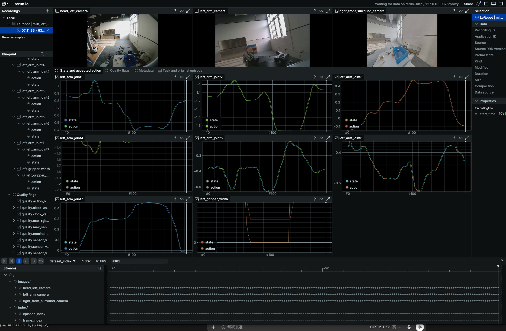

## 64. 助手（进展）

你这张截图里确实没有六维力标签页，底部也还是旧的 `dataset_index` 时间线。我之前只确认了新文件已生成，没确认它是否在当前窗口显示。我现在检查加载情况，并打开一个默认直接显示六维力的新窗口。

## 65. 助手（进展）

已核对，新文件里有完整的六通道数据；问题出在当前显示的布局。我把新版改成了**六条力／力矩曲线直接固定在视频下方**，不再藏在标签页里，并使用独立的窗口配置。正在实际渲染截图核对。

## 66. 助手

_工具输出图片（原始工具文本未纳入归档）。_

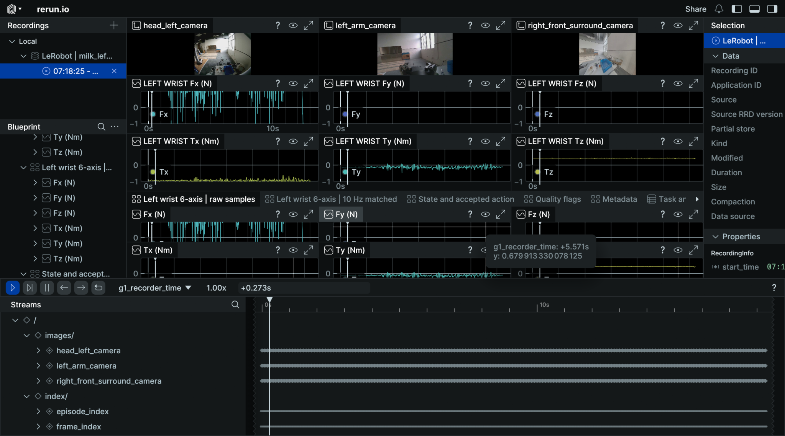

## 67. 助手（进展）

实际截图已经能看到六维力面板了。我还发现默认纵轴范围会把部分力曲线裁到图外，已改成按真实数据范围显示，确保 **Fx、Fy、Fz、Tx、Ty、Tz 六条都能看见**。

## 68. 助手

_工具输出图片（原始工具文本未纳入归档）。_


## 69. 助手

你截图中的界面确实没有六维力。**已修正并另开新版窗口**，六条曲线现在固定显示在视频下方：

**Fx、Fy、Fz（N）／Tx、Ty、Tz（N·m）**。

我已用实际渲染截图确认六条都可见：[查看核对截图](<../../assets/b96bab0aeadd9114--six_axes_verified.png>)。

需要重新打开时执行：

```bash
cd "/home/lsy03/文档/ChatGPT/VLA G1 项目"
.venv-lerobot/bin/rerun --port 9890 reports/lerobot_rerun_20261008/milk_154454_ep0_six_axes.rrd
```


## 70. 用户

lsy03@lsy03-System-Product-Name:~$ cd "/home/lsy03/文档/ChatGPT/VLA G1 项目"
.venv-lerobot/bin/rerun --port 9890 reports/lerobot_rerun_20261008/milk_154454_ep0_six_axes.rrd
[2026-10-08T07:21:20Z INFO  rerun::commands::entrypoint] A process is already listening at this address. Assuming it's a Rerun Viewer. server_addr=0.0.0.0:9890
[2026-10-08T07:21:20Z INFO  rerun::commands::entrypoint] Another viewer is already running, streaming data to it. uri=rerun+http://127.0.0.1:9890/proxy
[2026-10-08T07:21:20Z INFO  re_data_loader::load_file] Loading "reports/lerobot_rerun_20261008/milk_154454_ep0_six_axes.rrd"…
lsy03@lsy03-System-Product-Name:~/文档/ChatGPT/VLA G1 项目$
检查一下，这个是否打开？

## 71. 助手（进展）

这段日志表示文件已发送给监听 9890 端口的现有 Rerun 窗口，没有新开窗口。我再检查进程、端口和加载状态，确认是否正常。

## 72. 助手

**已打开，检查正常：**9890 端口正在监听，桌面上也存在独立的 **Rerun Viewer** 窗口。

你这次命令把文件再次发送到了已有窗口，所以终端立即返回是正常的。

按 **Alt+Tab** 切到独立的 **Rerun Viewer** 窗口；桌面上还有一个 Chrome 中的 Rerun 页面，注意区分。新版窗口的视频下方应直接显示 **Fx、Fy、Fz、Tx、Ty、Tz** 六条曲线。

## 73. 助手

_历史投影中的图片引用（用于补全本地对话资源）。_

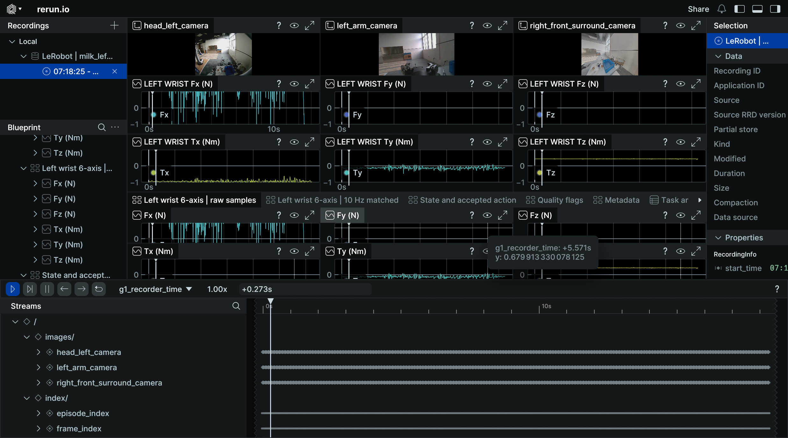
