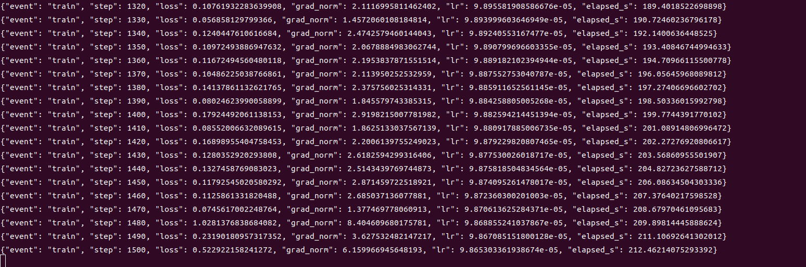
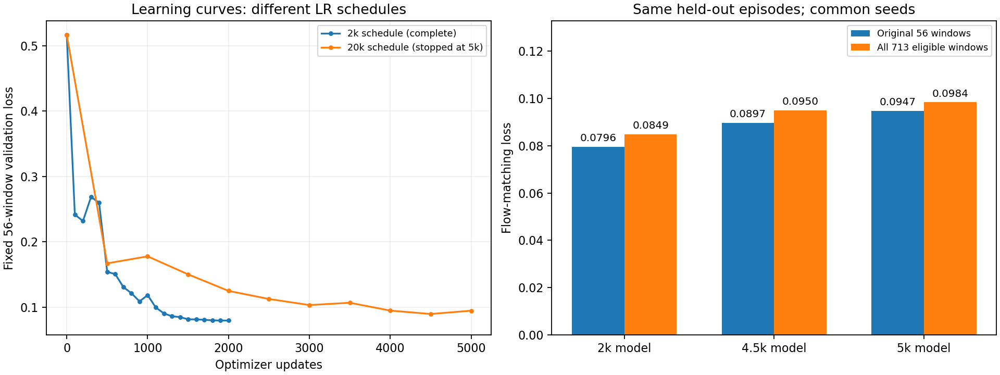
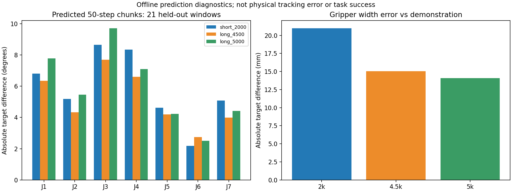
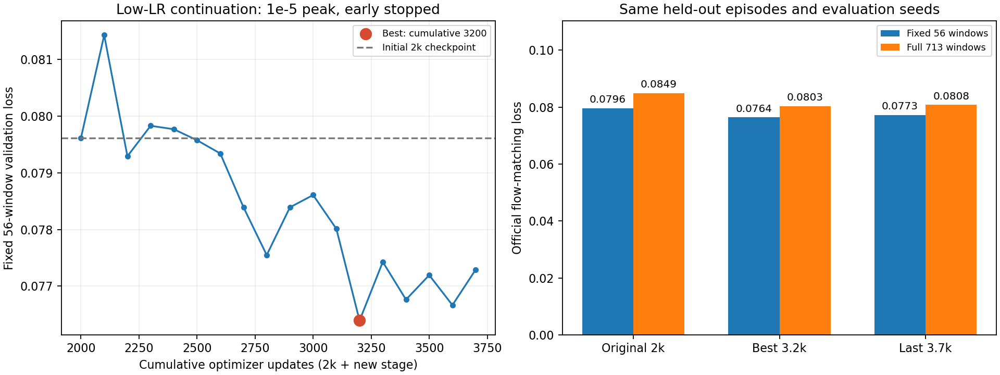
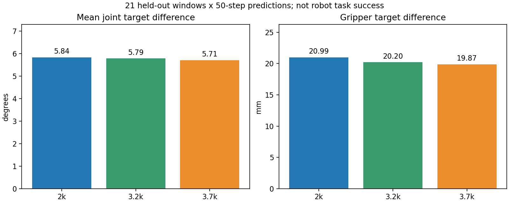

# 10_8 9_30 SmolVla 2k 继续训练 模型训练

- 归档编号：`01a0f168-756e-7703-af28-e1ee1ee9a728`
- 项目：VLA G1 项目
- 创建时间：2026-09-30T16:22:30.002000+08:00
- 更新时间：2026-10-08T12:07:13.443000+08:00
- 状态：活动
- 导出范围：用户可见消息与助手可见回复；不含隐藏推理和工具原始输出

## 1. 用户

我们看看现在的数据是否能够进行 SmolVla的初步训练？

## 2. 助手（进展）

我会用 `g1-data-pipeline` 技能核对现有数据的质量标记，再检查本机 SmolVLA 训练环境和数据配置，判断能否开始初步训练、还需要哪些处理。

## 3. 助手（进展）

目前判断：**数据量和格式足以做第一轮小规模微调试验，但还不能直接按默认配置把全部帧喂进去。** 三批共有 39 条示教，主要待处理的是质量标记的采样方式，以及图像和动作的时间对应关系。

现有 SmolVLA 训练自测用的是合成 6 维数据。我会再核对真实 8 维数据的模型输入，并统计可用于第一轮实验的样本。

## 4. 助手（进展）

样本统计已经明确：**5,800/7,184 帧通过现有核心时序规则**。如果保留原始时间线，只选择质量通过的观测作为训练起点，并确保后续 50 步动作不跨组，可得到 **4,296 个候选训练起点**。

因此不用先删帧再拼接轨迹；更合适的是在采样器中筛选训练起点。真实数据的模型前向检查也在进行中。

## 5. 助手（进展）

真实数据前向检查已通过：三批各取一个样本，SmolVLA 都能接收 **8 维状态和三路图像**，计算出有限损失，并输出 **50×8 的动作块**。这次只做了前向检查，没有更新模型权重。

还确认了默认模型不会处理自定义质量字段。第一轮建议用质量筛选的完整动作窗口，并按整条示教划分训练、验证集，再做小规模微调。

## 6. 助手

**可以开始 SmolVLA 的初步微调实验。** 现有数据量和格式已经足够验证“模型能否学到牛奶入箱动作”，但启动前需要配置质量筛选和训练／验证划分。

我刚做了真实数据检查：

| 检查项 | 结果 |
|---|---|
| 数据规模 | **39 条、7,184 帧，约 12 分钟** |
| 格式 | LeRobot v3.0，状态／动作各 8 维 |
| 模型兼容性 | 三批真实样本均前向通过，损失有限，输出 **50×8** 动作块 |
| 时序质量 | **5,800 帧**通过现有核心规则；**415 帧**带时钟映射标记 |
| 初步可采样量 | **4,296 个起点**满足当前观测质量检查，且后续 50 步动作完整、不跨组 |

这些训练起点相互重叠，不能看作 4,296 条独立示教。

建议这样开始：

1. **先用 3～5 条时钟检查通过的示教做小规模拟合测试**，检查损失和预测动作是否合理。
2. 再按完整 episode 划分，例如 **32 条训练、7 条验证**，避免随机拆帧造成数据泄漏。
3. 配置三批联合读取、8 维输入输出，以及仅用训练集计算的归一化统计。
4. **通过采样器筛选质量合格的起点，保留原时间线**。默认训练器不会自动应用 `quality.*`，不能直接删坏帧再拼轨迹。

官方建议约 **50 条示教**作为起点；39 条可以先做探索实验，同时继续补不同初始位置的数据，不能据此保证成功率。[官方 SmolVLA 指南](https://huggingface.co/docs/lerobot/main/smolvla)

目前最需要关注的是环视约 **0.39 秒的表观时间差及在线观测对应关系**。离线损失下降之后，仍需验证这一点，才能判断实机效果。

本次**没有启动训练或更新权重**。检查证据已保存到[评估结果](<../../assets/20e70a15a8a48207--readiness_summary.json>)。

[附件：20e70a15a8a48207--readiness_summary.json](../../assets/20e70a15a8a48207--readiness_summary.json)

## 7. 用户

给我个脚本，我们开始初步训练

## 8. 助手（进展）

我会把质量筛选、按整条示教划分训练／验证集、8 维输入配置和训练日志整合成可重复运行的脚本，先跑一轮短训练验证，再启动初步微调。

## 9. 助手（进展）

训练主体已经写好：默认 **32 条训练、7 条验证**，只采样质量通过且后续 50 步动作完整的起点，原始数据保持只读。每轮会保存固定验证集损失、显存峰值和模型检查点。

我正在检查脚本并准备 20 步短训练；确认反向传播、保存和重载都正常后，再启动 2,000 步的初步实验。

## 10. 助手（进展）

**20 步短训练和新容器中的检查点重载都已通过**，实际训练显存峰值约 **2.1 GB**。数据划分后有 **3,583 个训练起点、713 个验证起点**。

现在启动 2,000 步初步微调，保持 batch size 1，每 100 步检查固定验证样本的损失，并保存改进后的权重。

## 11. 助手（进展）

训练已到约 **290/2,000 步**。固定验证样本的损失从 **0.516 降到 0.232**，已保存第 200 步的改进权重，显存峰值仍约 **2.1 GB**。

这说明当前配置已开始拟合任务数据；我会继续跑完这一轮，并检查最终保存的模型能否独立重载。

## 12. 助手（进展）

已到约 **590/2,000 步**，最佳固定验证损失进一步降到 **0.154**，对应第 500 步。训练和梯度均未出现非有限值，检查点正常保存。

## 13. 助手（进展）

训练已接近一半，约 **990/2,000 步**。最佳固定验证损失为 **0.109**，仍在下降；当前没有看到验证损失持续恶化的迹象。这只是离线拟合结果，还不能换算成抓取成功率。

## 14. 助手（进展）

已到约 **1,360/2,000 步**，最佳固定验证损失降到 **0.086**。脚本已保存每次验证改进的权重，最终可以使用验证集表现最好的检查点。

## 15. 用户

你的rank是多少？是否只在动作专家下进行lora

## 16. 助手（进展）

这一轮**没有启用 LoRA，所以没有 rank 参数**。当前是基础权重默认的微调方式：`train_expert_only=true`、`train_state_proj=true`，直接更新动作专家及相关投影层的参数。

我再核对实际可训练参数范围，给你确认哪些层在更新；当前训练继续运行。

## 17. 助手（进展）

已核对当前检查点：`use_peft=false`，确实没有 LoRA。

实际范围是：

- **冻结**整个视觉语言模型（VLM）。
- **训练**动作专家、状态投影层、动作输入／输出投影层和时间 MLP。
- 这些层直接更新原参数，**不是只训练低秩适配器**。

本轮保持这个基线配置；如果之后做 LoRA 对照实验，再单独设定 rank 和目标层。

## 18. 助手（进展）

这一轮 **2,000 步已完成**，用时约 **8 分钟**。固定验证损失从 **0.516 降到 0.0796**，最佳检查点是第 2,000 步。

我正在做最后一次独立重载检查。训练方法仍是刚才确认的**动作专家及投影层直接微调，没有 LoRA，也没有 rank**。

## 19. 助手

**这一轮没有使用 LoRA，rank 不适用。**

实际配置是：

| 部分 | 训练方式 |
|---|---|
| 视觉语言模型 VLM | 冻结 |
| 动作专家 | 直接更新原参数 |
| 状态、动作投影层及时间 MLP | 直接更新原参数 |
| LoRA／PEFT | 未启用，`use_peft=false` |

另外，刚才的 **2,000 步初步训练已完成**，独立重载通过。56 个固定验证样本的损失从 **0.516 → 0.0796**，这不代表实机抓取成功率。

[训练脚本](</home/lsy03/文档/ChatGPT/VLA G1 项目/lerobot_deploy/scripts/train_milk_smolvla.sh>) · [最佳权重](/mnt/data/VLA_data/smolvla_runs/smolvla-milk-start-20260930_163516-1183772/checkpoints/step_002000/pretrained_model) · [损失曲线](/mnt/data/VLA_data/smolvla_runs/smolvla-milk-start-20260930_163516-1183772/loss_curve.png)

## 20. 用户

继续给我生成训练脚本，下次的步数是20k吗

## 21. 助手（进展）

下一轮可以先设为 **20,000 步上限**，但是否用最后一步的模型要看验证结果。我先把现有脚本补成明确的 20k 入口，并核对它是从基础权重重新训练，还是接着这次 2k 检查点训练，避免混淆步数。

## 22. 用户

给我脚本，我来执行

## 23. 助手（进展）

好，这次只生成脚本，由你执行。20k 入口会从基础预训练权重重新开一轮独立实验，沿用当前的数据筛选、32/7 划分和动作专家直接微调方式；不会覆盖已有的 2k 结果。

## 24. 助手

脚本已生成，**没有启动训练**。你直接执行：

```bash
bash "/home/lsy03/文档/ChatGPT/VLA G1 项目/lerobot_deploy/scripts/train_milk_smolvla_20k.sh"
```

默认配置：

- **20,000 步**，从基础预训练权重重新开始，保留已有 2k 结果。
- Batch size 1，学习率 `1e-4`，warmup 1,000 步。
- 每 500 步验证，每 1,000 步及验证改善时保存。
- 冻结 VLM，直接微调动作专家和投影层，**不使用 LoRA**。
- 最终选 `best_checkpoint.json`，不默认选择最后一步。

[脚本](</home/lsy03/文档/ChatGPT/VLA G1 项目/lerobot_deploy/scripts/train_milk_smolvla_20k.sh>) · [使用说明](<../../assets/a0b72978d3b347c8--README.md>)

[附件：a0b72978d3b347c8--README.md](../../assets/a0b72978d3b347c8--README.md)

## 25. 用户

lsy03\@lsy03-System-Product-Name:\~$ bash "/home/lsy03/文档/ChatGPT/VLA G1 项目/lerobot\_deploy/scripts/train\_milk\_smolvla\_20k.sh"
Starting a NEW base-model experiment. Existing 2k weights/results remain intact.
Run directory: /mnt/data/VLA\_data/smolvla\_runs/smolvla-milk-start-20260930\_164811-1186441
Container: smolvla-milk-start-20260930\_164811-1186441
lsy03\@lsy03-System-Product-Name:\~$ ^C
lsy03\@lsy03-System-Product-Name:\~$&#x20;

## 26. 助手（进展）

这个脚本会在后台容器中训练，打印运行目录后返回终端是正常的。我检查一下这次容器的实际状态，确认刚才的 `Ctrl+C` 是否影响了训练。

## 27. 助手

**训练正在正常运行**，刚检查到 **20/20,000 步**，没有报错。

脚本采用后台运行；你是在终端已经返回后按的 `Ctrl+C`，**没有停止训练**。

实时看日志：

```bash
docker logs --tail 30 -f smolvla-milk-start-20260930_164811-1186441
```

看日志时按 `Ctrl+C` 也只会退出日志查看，训练会继续。**不用重复启动脚本。**

## 28. 用户

估算一下，完成需要多长时间？

## 29. 助手（进展）

我看一下当前步数和最近的实际训练速度，再估算剩余时间。

## 30. 助手

按当前实测速度，**预计还需 45～55 分钟，约今天 17:35～17:45 完成**。

- 当前：**810 / 20,000 步**
- 最近速度：约 **0.145 秒／步**，包含期间的验证和保存开销
- 全程预计：约 **50 分钟**

这是根据当前 GPU 负载估算的；若其他任务增加占用，完成时间会延后。

## 31. 用户

给我解释一下这几个参数，如何判断训练结果的好坏？



## 32. 助手（进展）

我会结合截图和这次脚本的实际计算方式解释这些参数，再看一下最新验证日志，判断这些波动是否正常。

## 33. 助手

**目前这些日志看起来正常，不能因为某一步 loss 突然变大就判断训练失败。判断效果时，应优先看固定验证集的趋势。**

你截图中的参数含义如下：

| 参数 | 含义 | 应该怎么看 |
|---|---|---|
| `event: "train"` | 这是一条训练记录 | `validation` 才是验证记录 |
| `step` | 已完成的模型参数更新次数 | `1500` 表示更新了 1,500 次；不是 1,500 条示教，也不是 1,500 轮 |
| `loss` | 当前这一批样本的训练损失 | 长期下降通常是好现象，单步波动很常见 |
| `grad_norm` | 所有参与更新参数的梯度总范数，记录的是**裁剪前**的值 | 用来观察更新是否稳定，不是越小越好 |
| `lr` | 学习率，控制每次参数更新的幅度 | `9.86e-05` 就是约 `0.0000986` |
| `elapsed_s` | 训练循环计时开始后的秒数，包含期间验证和保存 | `212.46` 约为 3 分 32 秒，不含此前模型加载 |

当前脚本每 **10 步打印一次训练记录**，每 **500 步打印一次验证记录**。

**`loss` 到底是什么？**

SmolVLA 这里使用的是 *flow matching* 损失：训练时对动作加入随机噪声，让模型学习如何恢复动作，损失衡量这个预测过程的误差。

因此：

- `loss=0.1` **不代表关节误差 0.1°**。
- 也不代表错误率 10% 或成功率 90%。
- 没有一个通用的“低于 0.1 就训练合格”的标准。
- 只能在数据、归一化、模型和评估方式一致时比较。

**你截图中第 1480 步的突增是否异常？**

这一段：

```text
step=1480  loss≈1.028  grad_norm≈8.40
step=1490  loss≈0.232  grad_norm≈3.63
step=1500  loss≈0.522  grad_norm≈6.15
```

单凭这些数值，**不能判断发散**。当前 batch size 是 1，不同动作阶段的难度不同，训练噪声也随机，所以每一步的 loss 会跳动。第 1480 步之后又回落，也没有出现 `NaN`、`Inf`。

脚本的梯度裁剪阈值是 **10**：超过时会缩放梯度，再执行更新。截图中的 `8.40` 尚未触发裁剪；偶尔超过 10 也不等于训练失败。[PyTorch 梯度裁剪说明](https://docs.pytorch.org/docs/main/generated/torch.nn.utils.clip_grad_norm_.html)

**更值得看的是验证结果。** 我刚核对到这轮的记录：

| 步数 | 固定验证损失 |
|---:|---:|
| 0，训练前 | 0.5160 |
| 500 | 0.1670 |
| 1,000 | 0.1778 |
| 1,500 | **0.1503** |

验证使用留出的 **7 条示教中的 56 个固定起点**，并固定随机噪声，比较起来更可靠。第 1,000 步略有回升，第 1,500 步又改善，**目前没有持续恶化的迹象**。

判断训练好坏，可以按这三个层次：

1. **训练是否稳定**：损失和梯度保持有限，没有持续暴涨或报错。
2. **是否学到了可泛化的规律**：训练损失下降，验证损失也改善。如果训练损失一直下降、验证损失连续多次上升，通常提示过拟合。优先保留 `best_checkpoint.json` 对应的权重。
3. **机器人是否真的完成任务**：检查预测轨迹、抓放时机，再通过独立的闭环测试统计成功率、掉落和多余修正。**离线 loss 低，仍不能代替这一步。**

这轮当前可以继续观察，无需因为截图中某一个 loss 尖峰就调整参数或停止训练。

## 34. 用户

我们现在训练的数据集和验证集是怎么选择的？

## 35. 助手（进展）

我查看这次 20k 实验保存的实际划分清单，把训练和验证分别用了哪些组、如何筛选帧说明白。

## 36. 助手

当前是**按完整示教划分：32 条训练、7 条验证**。同一条 episode 的所有帧都归属于同一边，避免相邻画面同时进入训练和验证。

我核对了这次 20k 实验保存的实际清单，使用的是以下三批数据。表中数字都是**原始 episode 编号**：

| 采集批次 | 训练组 | 验证组 |
|---|---|---|
| 14:21，11 条 | 2–4、6–8、10–12，共 **9 条** | **5、9** |
| 14:58，11 条 | 1、3–9、11，共 **9 条** | **2、10** |
| 15:44，17 条 | 3–7、9–11、13–16、18–19，共 **14 条** | **8、12、20** |
| 合计 | **32 条** | **7 条** |

选择过程是：

1. **先排除不采用的整组数据**：失败、中断，以及你确认的误触录制，已经在导出阶段排除。
2. **在每批内随机留出约 18% 的完整示教**作为验证集。三批分别使用固定随机种子 `42、43、44`，因此可以复现。没有根据 loss 好坏挑验证组。
3. **划分完成后，再筛选各组内的训练起点**：当前观测须通过时序质量检查，动作有效，且从该时刻开始的 50 步动作完整、有效、不跨 episode。原始时间轴保留。

筛选后的数量是：

| 类型 | 可用动作窗口起点 |
|---|---:|
| 训练集 | **3,583 个** |
| 验证集 | **713 个** |

每个窗口输入当前三路图像、8 维状态和任务文本，预测 **50×8 的动作块**。相邻窗口可能重叠，所以这些数量不等于独立示教条数。

**日志里的验证 loss，目前只用其中 56 个固定窗口计算。** 从每条验证示教的可用起点中均匀选出 8 个，共 `7×8=56`；每 500 步重复评估这些窗口，并固定噪声种子，方便比较模型是否改善。其余验证窗口没有参与训练，也暂未纳入周期性验证计算。

归一化的均值、标准差也**只由训练集计算**，验证数据不参与参数更新或归一化统计。

这套划分适合看模型能否处理**同一采集环境下未用于训练的示教**。由于三批来自相近场景，而且验证集用于选择最佳检查点，它还不能代替独立测试集或新场景实机测试。

实际记录：[划分与采样清单](/mnt/data/VLA_data/smolvla_runs/smolvla-milk-start-20260930_164811-1186441/split_and_sampling.json) · [56 个固定验证窗口](/mnt/data/VLA_data/smolvla_runs/smolvla-milk-start-20260930_164811-1186441/validation_anchors.json)。

## 37. 用户

train", "step": 4040, "loss": 0.07285169512033463, "grad\_norm": 1.4013330936431885, "lr": 9.05087594284172e-05, "elapsed\_s": 564.8773924319539}
{"event": "train", "step": 4050, "loss": 0.10755182057619095, "grad\_norm": 2.03635573387146, "lr": 9.046331221941661e-05, "elapsed\_s": 566.0974044748582}
{"event": "train", "step": 4060, "loss": 0.07859589904546738, "grad\_norm": 1.5714365243911743, "lr": 9.041776825546623e-05, "elapsed\_s": 567.3287639699411}
{"event": "train", "step": 4070, "loss": 0.2329113781452179, "grad\_norm": 3.2003490924835205, "lr": 9.03721276489412e-05, "elapsed\_s": 568.5370710699353}
{"event": "train", "step": 4080, "loss": 0.07561029493808746, "grad\_norm": 1.5784796476364136, "lr": 9.032639051245523e-05, "elapsed\_s": 569.7235691710375}
{"event": "train", "step": 4090, "loss": 0.08604679256677628, "grad\_norm": 2.0748908519744873, "lr": 9.028055695886016e-05, "elapsed\_s": 570.9231684769038}
{"event": "train", "step": 4100, "loss": 0.12372352182865143, "grad\_norm": 2.449218511581421, "lr": 9.023462710124568e-05, "elapsed\_s": 572.2149451950099}
{"event": "train", "step": 4110, "loss": 0.052303727716207504, "grad\_norm": 1.2835726737976074, "lr": 9.018860105293917e-05, "elapsed\_s": 573.4026538720354}
{"event": "train", "step": 4120, "loss": 0.036457858979701996, "grad\_norm": 1.193869709968567, "lr": 9.014247892750534e-05, "elapsed\_s": 574.5849102430511}
{"event": "train", "step": 4130, "loss": 0.05950011685490608, "grad\_norm": 1.0348325967788696, "lr": 9.009626083874595e-05, "elapsed\_s": 575.7530114620458}
{"event": "train", "step": 4140, "loss": 0.3467903733253479, "grad\_norm": 4.110128402709961, "lr": 9.004994690069952e-05, "elapsed\_s": 576.9117964019533}
{"event": "train", "step": 4150, "loss": 0.10629770159721375, "grad\_norm": 2.1257057189941406, "lr": 9.000353722764112e-05, "elapsed\_s": 578.1518626019824}
{"event": "train", "step": 4160, "loss": 0.04274475947022438, "grad\_norm": 1.4194352626800537, "lr": 8.995703193408199e-05, "elapsed\_s": 579.3305555540137}
{"event": "train", "step": 4170, "loss": 0.09759795665740967, "grad\_norm": 2.2356204986572266, "lr": 8.99104311347693e-05, "elapsed\_s": 580.4718512059189}
{"event": "train", "step": 4180, "loss": 0.06299804896116257, "grad\_norm": 1.9044930934906006, "lr": 8.986373494468591e-05, "elapsed\_s": 581.6298273459543}
{"event": "train", "step": 4190, "loss": 0.05338446423411369, "grad\_norm": 1.341036081314087, "lr": 8.981694347905001e-05, "elapsed\_s": 582.8076954910066}
{"event": "train", "step": 4200, "loss": 0.059371333569288254, "grad\_norm": 1.1525282859802246, "lr": 8.97700568533149e-05, "elapsed\_s": 583.9819538518786}
{"event": "train", "step": 4210, "loss": 0.03893932327628136, "grad\_norm": 1.245064377784729, "lr": 8.972307518316869e-05, "elapsed\_s": 585.242351511959}
{"event": "train", "step": 4220, "loss": 0.0847194567322731, "grad\_norm": 1.8239593505859375, "lr": 8.967599858453396e-05, "elapsed\_s": 586.4325274799485}
{"event": "train", "step": 4230, "loss": 0.1444469839334488, "grad\_norm": 2.1900434494018555, "lr": 8.962882717356753e-05, "elapsed\_s": 587.6706668238621}
{"event": "train", "step": 4240, "loss": 0.12986043095588684, "grad\_norm": 1.970929503440857, "lr": 8.958156106666017e-05, "elapsed\_s": 588.8708304038737}
{"event": "train", "step": 4250, "loss": 0.3419021964073181, "grad\_norm": 3.567725658416748, "lr": 8.953420038043631e-05, "elapsed\_s": 590.1078137699515}


现在我们的训练是否可以随时暂停？然后之后我们接下来等我回来再进行训练

## 38. 助手（进展）

可以。我先确认训练状态，然后暂停这次训练容器，等你回来再继续。这样会保留当前模型、优化器和训练进度，但仍占用内存和显存；暂停期间电脑需要保持开机，不能重启或删除容器。

## 39. 助手

**已暂停训练**，容器状态已确认是 `paused`。

- 暂停前最后记录：**4,820 / 20,000 步**
- 最近落盘检查点：**第 4,500 步**
- 当前运行状态保留，恢复后会接着暂停位置继续。

你回来后告诉我“继续训练”，或执行：

```bash
docker unpause smolvla-milk-start-20260930_164811-1186441
```

**期间保持电脑开机，不要重启 Docker 或删除容器。** 这种暂停仍占用内存和显存；若需要关机，需要另外安排从检查点恢复。

## 40. 用户

我会关机的

## 41. 助手（进展）

那需要先把暂停改成可关机恢复的方式。当前内存中的约 4,820 步会在关机后消失；已落盘的是第 4,500 步。我先检查该检查点是否完整，并补上恢复训练脚本，再停止这次容器，保留已保存的训练成果。

## 42. 用户

要不我们继续训练到下一个保存点然后再结束？

## 43. 助手（进展）

可以。我们继续到 **5,000 步**，等该步的模型、优化器和学习率调度状态全部保存后再停止。我先设置到点停止，避免保存完成后又多跑一段。

## 44. 用户

给我分析一下当前的训练效果

## 45. 用户

给我分析一下当前的训练效果

## 46. 助手（进展）

我先确认训练是否已按要求在 5,000 步保存后停止，再分析训练和验证损失趋势，区分已经看到的改善与还不能判断的实机效果。

## 47. 用户

给我看下当前训练进度是什么

## 48. 助手（进展）

我检查一下最新训练记录和容器状态，确认目前是仍停在 5,000 步，还是已经有新的训练进度。

## 49. 助手

当前训练**已停止，尚未恢复**，停在 **5,000 / 20,000 步（25%）**。

- 最后日志确认：第 **5,000 步检查点已保存**。
- 第 5,000 步验证 loss：**0.0947**。
- 此轮此前最佳：第 **4,500 步，0.0897**。
- 剩余：**15,000 步**。

另外，重启后 **16.4TB 数据盘 `/dev/sda1` 尚未挂载**，所以目前看不到 `/mnt/data/VLA_data`。这不代表数据丢失，但需要先挂载数据盘、核对检查点，再恢复训练。

## 50. 用户

是否每次重启都需要重新挂载 `/dev/sda1` ？ 给我命令我来挂载

## 51. 助手（进展）

我先只读检查这块盘的 UUID 和自动挂载配置，再给你临时挂载及开机自动挂载的命令；不会替你执行挂载。

## 52. 助手

**目前没有配置开机自动挂载，所以重启后需要手动挂载。** 配好自动挂载后就不用每次操作了。

现在先执行：

```bash
sudo mount /dev/sda1 /mnt/data

# 确认挂载及数据目录
df -h /mnt/data
ls /mnt/data/VLA_data
```

如果希望以后开机自动挂载，先备份配置：

```bash
sudo cp -a /etc/fstab "/etc/fstab.bak.$(date +%Y%m%d_%H%M%S)"
sudo nano /etc/fstab
```

在文件末尾添加下面这一行，**只添加一次**：

```text
UUID=892fce27-cf7c-48b9-9dc5-7e69f9d1d78a /mnt/data ext4 defaults,nofail 0 2
```

保存退出后执行：

```bash
sudo systemctl daemon-reload
sudo findmnt --verify --verbose
sudo mount -a
findmnt /mnt/data
```

使用 UUID 可以避免重启后磁盘设备名变化；`nofail` 表示数据盘不可用时仍允许系统正常启动。

## 53. 用户

lsy03\@lsy03-System-Product-Name:\~$ sudo mount /dev/sda1 /mnt/data

# 确认挂载及数据目录

df -h /mnt/data
ls /mnt/data/VLA\_data
[sudo] lsy03 的密码：
[REDACTED]        大小  已用  可用 已用% 挂载点
/dev/sda1        17T   78G   16T    1% /mnt/data
milk\_left\_20260930         milk\_left\_20260930\_154454
milk\_left\_20260930\_145800  smolvla\_runs
lsy03\@lsy03-System-Product-Name:\~$ sudo cp -a /etc/fstab "/etc/fstab.bak.$(date +%Y%m%d\_%H%M%S)"
sudo nano /etc/fstab
lsy03\@lsy03-System-Product-Name:\~$ sudo systemctl daemon-reload
sudo findmnt --verify --verbose
sudo mount -a
findmnt /mnt/data
/
[ ] 目标存在
[ ] FS 选项︰ errors=remount-ro
[ ] UUID=798672fe-c87b-4b4f-a1fe-a845227a8c86 转换为 /dev/nvme0n1p2
[ ] 源 /dev/nvme0n1p2 已存在
[ ] 文件系统类型是 ext4
/boot/efi
[ ] 目标存在
[ ] FS 选项︰ umask=0077
[ ] UUID=91C2-DF1E 转换为 /dev/nvme0n1p1
[ ] 源 /dev/nvme0n1p1 已存在
[ ] 文件系统类型是 vfat
none
[W] 非绑定挂载源 /swapfile 是一个目录或常规文件
[ ] 文件系统类型是 swap
/mnt/data
[ ] 目标存在
[ ] 用户空间选项︰ nofail
[ ] UUID=892fce27-cf7c-48b9-9dc5-7e69f9d1d78a 转换为 /dev/sda1
[ ] 源 /dev/sda1 已存在
[ ] 文件系统类型是 ext4

0 个解析错误，0 个错误，1 个警告
TARGET    SOURCE    FSTYPE OPTIONS
/mnt/data /dev/sda1 ext4   rw,relatime
lsy03\@lsy03-System-Product-Name:\~$


给我检查一下

## 54. 助手（进展）

我检查一下自动挂载配置、当前挂载状态和训练检查点，确认数据盘恢复正常，并核对那个 swap 警告。

## 55. 助手

检查通过，配置正常：

- **自动挂载已配置正确**：UUID 匹配，仅添加了一次，systemd 已加载对应挂载配置。
- **数据盘当前正常读写挂载**到 `/mnt/data`，三批数据及训练目录都可见。
- **第 5,000 步检查点文件仍在**，包括模型权重、优化器状态和预处理配置；此次确认了文件存在，未重新完整加载验证。
- `/swapfile` 的警告无需处理：它本来就是交换文件，目前 **2GB swap 已正常启用**。

以后正常重启应自动挂载，不必每次手动操作。训练仍处于停止状态，本次没有启动训练。

## 56. 用户

继续检查训练结果

## 57. 助手（进展）

我会继续检查已保存的训练结果：比较两轮实验的验证趋势，核对 4,500／5,000 步检查点，并检查保存的模型能否重载。此次只做离线检查，不恢复训练。

## 58. 助手（进展）

发现一个值得核对的点：目前记录的最好结果仍是上一轮 **2k 模型（0.0796）**，本轮 4,500 步为 **0.0897**，5,000 步为 **0.0947**。

我会先确认两轮划分和归一化完全一致，再把这三个模型放到**全部 713 个合格验证窗口**上比较，避免只凭原来的 56 个抽样窗口下结论。

## 59. 助手（进展）

已确认两轮使用了**完全相同的训练／验证划分、归一化统计和固定验证样本**，可以直接比较。第 5,000 步的优化器与学习率调度状态也已成功读取，确实保存到了第 5,000 步。

现在正在做全量验证，并额外比较预测动作与示教动作的偏差；这比只看训练 loss 更能说明模型学到了什么。

## 60. 助手（进展）

2k 模型的全量验证已完成，loss 为 **0.0849**，与原来 56 个窗口上的 **0.0796** 接近。当前正在检查 4,500 步模型。

动作预测检查也显示，低 loss 并不意味着动作已经足够准确：我会分别列出关节角度和夹爪开度的预测偏差，并注明它们是离线对照误差，不是实机跟踪误差。

## 61. 用户

先暂停，我先重启一下软件

## 62. 助手

好的，先暂停处理。训练本身仍停在 **5,000 步**，此次没有恢复训练。你重启软件后说“继续检查”，我再接着处理。

## 63. 用户

<external_codex_apps_open_page>{"page_id":null}</external_codex_apps_open_page>

## 64. 用户

继续

## 65. 助手（进展）

我继续完成上次的离线评估，先检查已有结果，再汇总三个检查点的验证损失和动作预测偏差。训练仍保持停止。

## 66. 助手（进展）

三个模型的全量验证已完成。**2k 模型的验证 loss 最低，但 4,500／5,000 步模型在部分动作误差指标上更好**，因此不能只凭 loss 选模型。

另外有两个实际问题需要关注：首步关节预测仍有约 **3°** 的平均偏差，夹爪原始预测也会超出 0～100mm 范围。这些是下一步比盲目增加训练步数更值得检查的地方。

## 67. 助手

_工具输出图片（原始工具文本未纳入归档）。_



## 68. 助手

检查完成。**模型已经学到部分示教规律，但三个检查点各有优势，目前还不能确定哪个实机效果最好。** 训练仍停在 5,000 步，本次没有更新权重。

两轮的数据划分和归一化完全一致。用全部 **713 个合格验证窗口**重新比较后：

| 模型 | 验证 loss ↓ | 关节动作块平均偏差 ↓ | 夹爪开度平均偏差 ↓ |
|---|---:|---:|---:|
| 2,000 步 | **0.0849** | 5.84° | 20.99mm |
| 4,500 步 | 0.0950 | **5.13°** | 15.05mm |
| 5,000 步 | 0.0984 | 5.89° | **14.10mm** |

动作偏差来自 **21 个验证窗口，每个预测 50 步**，对照的是示教目标。这些数值不是实机跟踪误差，也不是任务成功率。

目前最值得关注的是：

- **loss 与动作准确性排名并不一致。** 2k 的 loss 最低，4.5k 的完整关节轨迹偏差更小，5k 的夹爪预测更接近示教，不能只凭 loss 选最终模型。
- **首步动作连续性仍需检查。** 三个模型首步关节平均偏差约 **2.9～3.6°**；同批样本中，“保持当前姿态”的首步参考偏差只有 **0.23°**。这个基线用于检查起步连续性，后续仍需动作才能完成任务。
- **夹爪原始输出存在越界。** 5k 模型抽样预测范围约 **−7.9～117.4mm**，约 21% 超出目标范围 0～100mm。需要检查输出限幅及抓放时机；限幅本身不能解决时机错误。

两个训练计划的学习率也不同：2k 实验已完成衰减；20k 计划在第 5k 步仍使用较大学习率。因此，**现在不能把差异简单归因于“训练越久越差”**，单次验证回升也不足以认定过拟合。

我的建议是：**保留三个模型，先检查首步动作、夹爪切换和逐段轨迹，再决定是否继续训练到 20k。** 模型及 5k 优化器状态都已成功读取，当前检查点可以保留用于后续恢复。

[验证对比图](<../../assets/99ebd73a880bb35e--image-99ebd73a880b.png>) · [动作误差图](<../../assets/a1ba5cf04e8fe7f1--action_error_comparison.png>) · [完整检查结果](<../../assets/a5643a99f5b871b1--analysis_summary.json>)




[附件：a5643a99f5b871b1--analysis_summary.json](../../assets/a5643a99f5b871b1--analysis_summary.json)

## 69. 用户

现在是否是有两条训练的流程轨迹，分别名字是啥？

## 70. 助手

是，当前有 **两轮正式训练实验**：

| 实验名称 | 训练计划 | 当前状态 |
|---|---|---|
| `smolvla-milk-start-20260930_163516-1183772` | 2,000 步初步训练 | **已完成 2,000 步** |
| `smolvla-milk-start-20260930_164811-1186441` | 20,000 步训练 | **已保存并停止在 5,000 步** |

两轮都从同一个 `smolvla_base` 基础权重**独立开始**，使用相同的训练／验证划分。第二轮中的 **4,500、5,000 步**是两个检查点，属于同一条训练轨迹。

另外还有一个 **20 步 smoke 测试**，用于检查训练和保存功能，不计入这两轮正式实验。

## 71. 用户

`smolvla-milk-start-20260930_163516-1183772`2,000 步初步训练**已完成 2,000 步  这个效果感觉是不是会更好，应该在这个基础上进行备份和继续训练？**

## 72. 助手（进展）

2k 模型的全量验证 loss 确实最低，值得作为候选保留；但 4.5k／5k 在部分动作指标上更好。我会先为 2k 检查点做一份带哈希校验的独立备份，并检查从它继续训练的恢复条件，给你一个可执行的续训方案。

## 73. 助手（进展）

建议是：**备份 2k 模型，另开一个低学习率的续训分支**，继续与原 2k、4.5k、5k 模型对照。2k 的验证 loss 更好，但它的夹爪预测误差也更大，还不能认定整体效果最好。

我会保留原 2k 权重，续训入口默认额外训练最多 2,000 步，并根据验证结果决定是否保留新模型。

## 74. 用户

所有训练命令需要我来执行

## 75. 助手（进展）

明白。之后所有训练启动、续训和短训练命令都由你执行。我只完成备份、脚本编写和静态检查；这次尚未启动任何新训练。

## 76. 助手

明白，**所有训练命令都由你执行，我不会自行启动。**

已完成：

- [2k 检查点备份](/mnt/data/VLA_data/smolvla_runs/backups/milk_2k_20261008)，约 **1.61GB**，逐文件哈希校验通过。
- [低学习率续训脚本](</home/lsy03/文档/ChatGPT/VLA G1 项目/lerobot_deploy/scripts/continue_milk_smolvla_2k.sh>)：从 2k 权重开始，学习率 `1e-5`，额外最多 2,000 步；连续 5 次验证未改善则停止。
- 语法、dry-run 和数据隔离测试通过，**尚未启动新训练**。

你准备好后执行：

```bash
bash "/home/lsy03/文档/ChatGPT/VLA G1 项目/lerobot_deploy/scripts/continue_milk_smolvla_2k.sh"
```

这个分支加载 **2k 模型权重**，重新建立优化器和学习率计划；原 2k 结果保留。2k 值得作为续训候选，但其夹爪误差仍较大，后续需要同时比较验证 loss 和动作指标。

## 77. 用户

bash "/home/lsy03/文档/ChatGPT/VLA G1 项目/lerobot_deploy/scripts/continue_milk_smolvla_2k.sh"

这是什么命令？

## 78. 助手

这是**从已备份的 2k 模型权重开始，新开一轮低学习率训练**的命令。

- `bash`：运行后面的脚本文件。
- 引号：保证含空格的完整路径被正确识别。
- 脚本会在后台启动训练，打印新的结果目录后返回终端。

这轮默认：

| 项目 | 设置 |
|---|---|
| 初始权重 | 已完成的 2,000 步模型 |
| 新增训练 | 最多 2,000 步，累计最多 4,000 步 |
| 学习率 | `1e-5` |
| 提前停止 | 连续 5 次验证未改善 |
| 优化器 | 重新创建，属于新的训练分支 |

原来的 2k、4.5k、5k 结果都会保留。

**如果你只想查看命令、不启动训练，使用：**

```bash
bash "/home/lsy03/文档/ChatGPT/VLA G1 项目/lerobot_deploy/scripts/continue_milk_smolvla_2k.sh" --dry-run
```

## 79. 用户

lsy03@lsy03-System-Product-Name:~/下载$ bash "/home/lsy03/文档/ChatGPT/VLA G1 项目/lerobot_deploy/scripts/continue_milk_smolvla_2k.sh" --dry-run
Command only; NO training started:
bash /home/lsy03/文档/ChatGPT/VLA\ G1\ 项目/lerobot_deploy/scripts/train_milk_smolvla.sh start --init-checkpoint /datasets/smolvla_runs/backups/milk_2k_20261008/checkpoints/step_002000 --steps 2000 --batch-size 1 --lr 0.00001 --warmup-steps 100 --eval-every 100 --save-every 250 --eval-samples 56 --seed 42 --early-stop-patience 5
lsy03@lsy03-System-Product-Name:~/下载$

是否能给我实时print 出 训练的进度和loss 和 val loss

## 80. 助手（进展）

可以。我会给脚本增加前台实时输出模式，启动后直接显示训练进度、训练 loss 和验证 loss。你仍然负责执行训练命令；我只修改脚本并做静态检查。

## 81. 用户

lsy03@lsy03-System-Product-Name:~/下载$ bash "/home/lsy03/文档/ChatGPT/VLA G1 项目/lerobot_deploy/scripts/continue_milk_smolvla_2k.sh" --dry-run
Command only; NO training started:
bash /home/lsy03/文档/ChatGPT/VLA\ G1\ 项目/lerobot_deploy/scripts/train_milk_smolvla.sh start --init-checkpoint /datasets/smolvla_runs/backups/milk_2k_20261008/checkpoints/step_002000 --steps 2000 --batch-size 1 --lr 0.00001 --warmup-steps 100 --eval-every 100 --save-every 250 --eval-samples 56 --seed 42 --early-stop-patience 5
lsy03@lsy03-System-Product-Name:~/下载$

之前的这个命令我是否应该暂停？ 如何暂停？ 如何重启？重启后是否会恢复训练？

## 82. 助手（进展）

你贴的这条带 `--dry-run`，**只打印命令，没有启动训练，所以不用暂停**。如果之后正式启动，`Ctrl+C` 只会退出实时日志查看；训练暂停和电脑重启后的恢复是两种不同操作，我会分别说明。

## 83. 助手

**你贴的命令带 `--dry-run`，没有启动训练，所以现在不需要暂停。**

正式启动后，几种操作的区别是：

| 操作 | 对训练的影响 |
|---|---|
| 日志界面按 `Ctrl+C` | 退出日志查看，后台训练继续 |
| 重启 Codex／关闭终端 | 后台容器中的训练继续 |
| `docker pause 容器名` | 临时冻结训练，仍占用内存和显存 |
| `docker unpause 容器名` | 从内存暂停的位置继续 |
| **电脑关机／重启** | 训练进程结束，**不会自动恢复** |

临时暂停和继续时，把“容器名”替换为启动后打印的名称：

```bash
docker pause 容器名
docker unpause 容器名
```

**关机后不要把重新运行当前脚本当成恢复训练。** 当前脚本每次都从固定的 **2k 备份**开启新分支；它不会自动找到上次最新检查点。关机前应确认检查点保存完成，回来后再明确加载该检查点续训。精确恢复优化器、调度器和采样位置的功能目前尚未实现。

实时输出已经加好：每 **10 步显示 train loss 和进度**，每 **100 步更新 val loss**。你准备开始时，去掉 `--dry-run`：

```bash
bash "/home/lsy03/文档/ChatGPT/VLA G1 项目/lerobot_deploy/scripts/continue_milk_smolvla_2k.sh"
```

本次我没有启动训练。

## 84. 用户

5 elapsed=00:04:08 eta=00:00:57
[TRAIN] step=1630/2000 (81.5%) cumulative=3630 train_loss=0.106145 val_loss=0.076664 (val@1600) lr=3.116e-06 grad_norm=1.766 elapsed=00:04:09 eta=00:00:55
[TRAIN] step=1640/2000 (82.0%) cumulative=3640 train_loss=0.087476 val_loss=0.076664 (val@1600) lr=3.084e-06 grad_norm=2.520 elapsed=00:04:10 eta=00:00:54
[TRAIN] step=1650/2000 (82.5%) cumulative=3650 train_loss=0.050514 val_loss=0.076664 (val@1600) lr=3.053e-06 grad_norm=0.959 elapsed=00:04:11 eta=00:00:52
[TRAIN] step=1660/2000 (83.0%) cumulative=3660 train_loss=0.052390 val_loss=0.076664 (val@1600) lr=3.022e-06 grad_norm=0.913 elapsed=00:04:12 eta=00:00:50
[TRAIN] step=1670/2000 (83.5%) cumulative=3670 train_loss=0.040258 val_loss=0.076664 (val@1600) lr=2.993e-06 grad_norm=1.414 elapsed=00:04:13 eta=00:00:49
[TRAIN] step=1680/2000 (84.0%) cumulative=3680 train_loss=0.042359 val_loss=0.076664 (val@1600) lr=2.964e-06 grad_norm=1.483 elapsed=00:04:14 eta=00:00:47
[TRAIN] step=1690/2000 (84.5%) cumulative=3690 train_loss=0.088431 val_loss=0.076664 (val@1600) lr=2.936e-06 grad_norm=1.858 elapsed=00:04:16 eta=00:00:46
[TRAIN] step=1700/2000 (85.0%) cumulative=3700 train_loss=0.041103 val_loss=0.076664 (val@1600) lr=2.909e-06 grad_norm=1.088 elapsed=00:04:17 eta=00:00:44
[VAL]   step=1700/2000 (85.0%) cumulative=3700 val_loss=0.077289 samples=56 elapsed=00:04:21
[SAVE]  step=1700/2000 (85.0%) cumulative=3700 path=/output/checkpoints/step_001700
[END]   step=1700/2000 (85.0%) cumulative=3700 status=early_stopped val_loss=0.077289 (val@1700) best_val_loss=0.076391 best_stage_step=1200 elapsed=00:04:22
lsy03@lsy03-System-Product-Name:~/下载$

先给我看下效果

## 85. 助手（进展）

这轮因连续验证未改善，在新增第 1,700 步提前停止；日志显示最佳点是新增第 1,200 步，也就是累计 3,200 步。我先核对本轮保存目录和完整验证曲线，再比较它与原 2k 模型的改善幅度。

## 86. 助手（进展）

从日志看，低学习率续训带来了**小幅改善**：固定验证 loss 从 **0.07962 降到 0.07639，约降低 4.1%**。最佳权重是本阶段第 **1,200 步（累计 3,200 步）**，最后的 1,700 步略差，因此提前停止是正常的。

我再对最佳点和最后一点做全量离线验证，看看这点改善是否也体现在动作预测上。

## 87. 助手（进展）

最佳的累计 **3,200 步模型**已完成全量验证：713 个窗口的 loss 从原 2k 的 **0.08487 降到 0.08034，约改善 5.3%**。所以这次改善不只出现在原来的 56 个抽样窗口中。

正在完成最后的累计 3,700 步模型检查，随后会给你明确的保留建议。

## 88. 助手

_工具输出图片（原始工具文本未纳入归档）。_



## 89. 助手

**这轮续训有小幅改善，已经接近当前设置下的平台期。** 提前停止正常触发，没有训练报错。

我用相同的全部 **713 个验证窗口**比较了三个模型：

| 模型 | 验证 loss ↓ | 关节动作块平均偏差 ↓ | 夹爪开度平均偏差 ↓ |
|---|---:|---:|---:|
| 原始 2k | 0.08487 | 5.84° | 20.99mm |
| 累计 **3,200 步** | **0.08034** | 5.79° | 20.20mm |
| 累计 3,700 步 | 0.08082 | **5.71°** | **19.87mm** |

动作偏差来自 21 个留出窗口的预测对照，是相对示教目标的误差，不能换算成实机成功率。

可以这样判断：

- **续训确实有效**：累计 3,200 步的全量验证 loss 比原 2k 降低约 **5.3%**。
- **收益有限**：关节和夹爪动作偏差只略有改善。3,700 步部分动作指标稍好，但验证 loss 略差，没有一个模型全面领先。
- **早停合理**：新增第 1,200 步取得最低验证 loss，随后连续 5 次验证未刷新最佳值，所以在新增 1,700 步停止。
- **仍需检查动作质量**：首步关节偏差仍约 3°，夹爪原始预测越界问题也没有明显改善，继续堆训练步数未必能解决。

建议先把**累计 3,200 步模型作为主要候选**，保留 3,700 步做对照，下一步重点检查抓放时机和预测轨迹。

[3,200 步候选权重](/mnt/data/VLA_data/smolvla_runs/smolvla-milk-follow-20261008_111934-46832/checkpoints/step_001200/pretrained_model) · [验证曲线](<../../assets/7ef64c2fb7c901a6--image-7ef64c2fb7c9.png>) · [动作误差对比](<../../assets/328e5767598efe33--action_error_comparison.png>)




## 90. 助手

_历史投影中的图片引用（用于补全本地对话资源）。_

> 资源未归档：`/tmp/codex-clipboard-2cb40828-9e0a-435e-9762-76ccee2e68a4.png`（missing）
