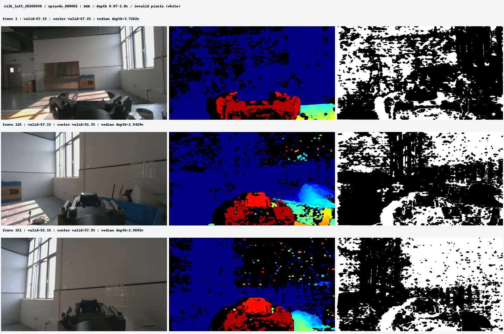
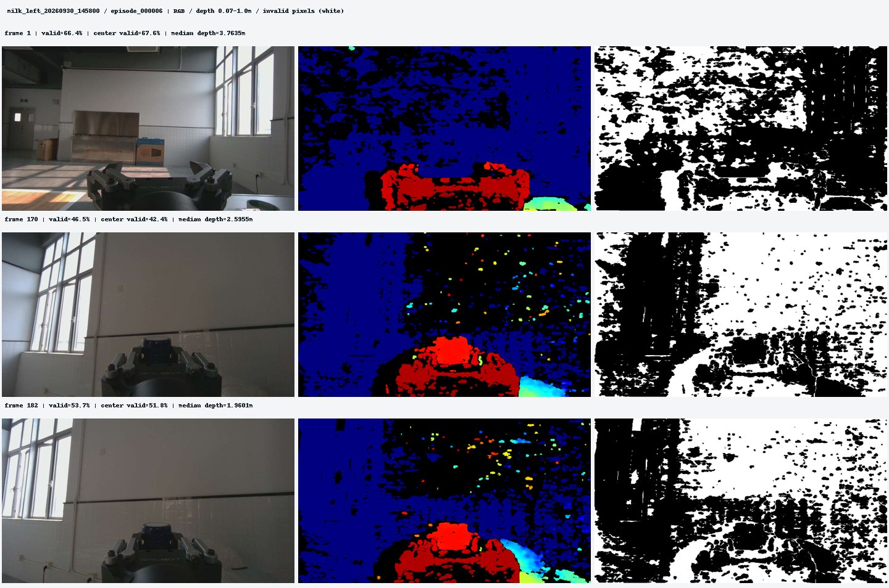
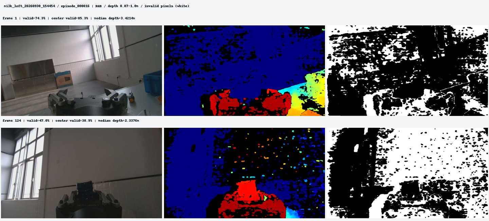
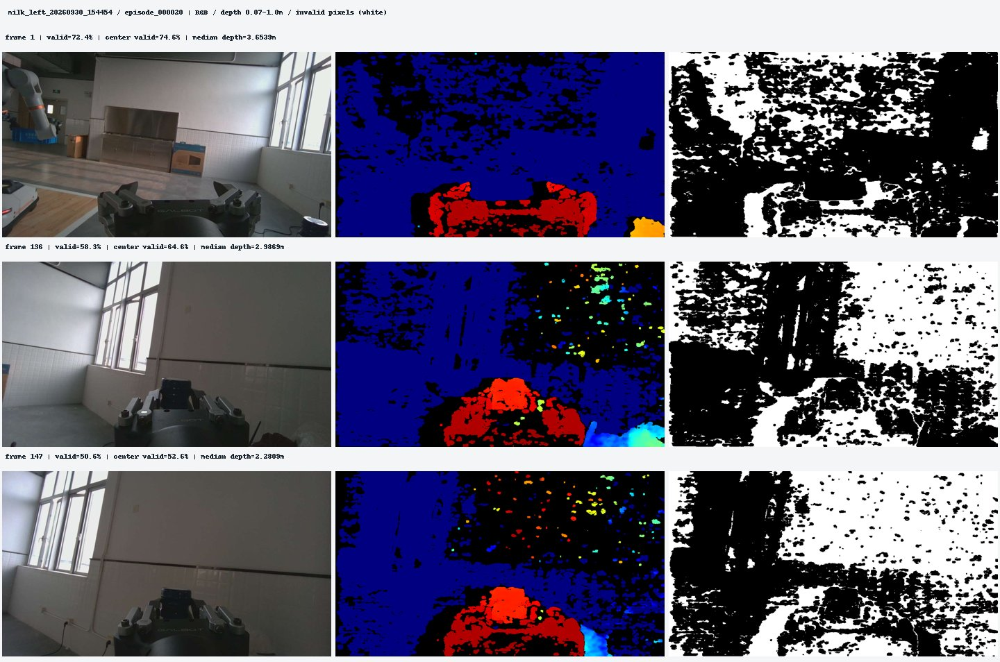
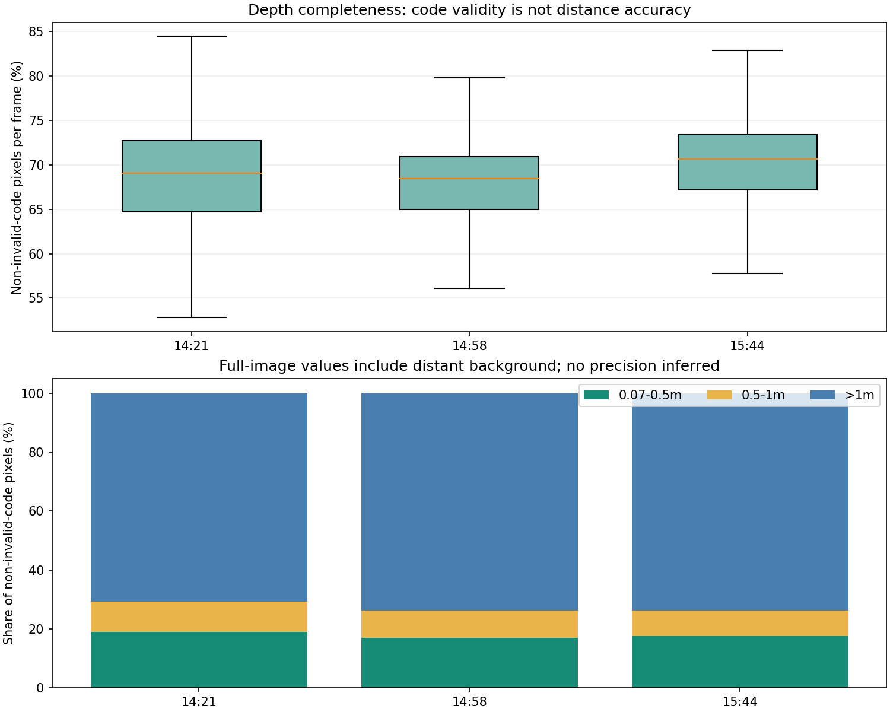
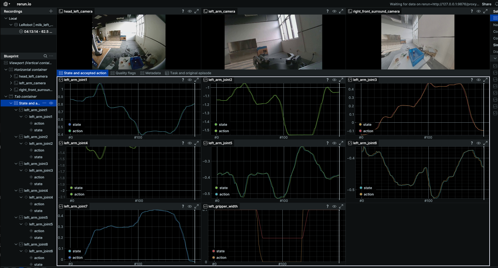

# 10_8 9_30 SmolVla 模型训练 (2)

- 归档编号：`01a11941-f7ab-75f2-b3de-43d29ee29060`
- 项目：VLA G1 项目
- 创建时间：2026-10-08T10:05:16.078000+08:00
- 更新时间：2026-10-08T12:18:27.503000+08:00
- 状态：活动
- 导出范围：用户可见消息与助手可见回复；不含隐藏推理和工具原始输出

## 1. 用户

给我检查一下训练数据是否有问题？尤其是其中的深度图像

## 2. 助手（进展）

我会用 `g1-data-pipeline` 技能检查这三批训练数据，重点核对深度原件的完整性、编码和数值范围、无效像素、时间戳及与 RGB 的对应关系，同时确认深度是否实际进入了当前 SmolVLA 训练。

## 3. 助手（进展）

先确认了一个关键点：**当前 SmolVLA 训练只使用三路 RGB，深度图没有作为模型输入**。深度原件仍保存在七路原始数据中，数据集里的 `quality.sensor_valid_LEFT_ARM_DEPTH_CAMERA` 只是质量标记。

深度记录的格式是 **1280×720、16 位无符号整数，米数＝原始值÷10000**。接下来我会逐帧检查，尤其区分无效深度、显示色阶问题和实际数据损坏。

## 4. 用户

先暂停，我先重启一下软件

## 5. 助手

好的，先暂停检查，等你重启软件后再继续。

目前只做了读取和核对，未修改数据，也没有启动训练或后台深度扫描。

## 6. 用户

<external_codex_apps_open_page>{"page_id":null}</external_codex_apps_open_page>

## 7. 用户

继续

## 8. 助手（进展）

继续检查三批数据的深度原件。我会逐帧核对完整性、无效像素、数值范围和 RGB 时间对应，并生成原始深度与彩色预览的对照图。

## 9. 助手

_工具输出图片（原始工具文本未纳入归档）。_




## 10. 助手（进展）

目前已检查 **19/44 组原件**，还没有发现整帧无效、连续重复深度帧或校验损坏。已检查帧的非零深度像素占比大约在 **46%～75%**，说明确实存在较多深度空洞。

对照图中，空洞主要出现在远处背景、亮窗及部分近距离物体边缘；目前只凭画面还不能确定成因。我会继续统计抓取过程中的情况，并核对 RGB／深度配对。

## 11. 助手

_工具输出图片（原始工具文本未纳入归档）。_




## 12. 助手（进展）

三批 LeRobot 导出数据已全部核对通过：文件哈希、7,184 帧的状态／动作、帧索引和质量标记都与来源一致。

深度检查已到 **41/44 组**。目前发现两帧深度没有同时间戳的腕部 RGB；其余已检查帧均可精确按记录时间戳配对。另外，深度图中不少远处背景虽然有非零数值，也不能据此认为测距可靠：D405 官方给出的理想工作距离是 **7～50 cm**，更适合近距离操作。[官方规格](https://www.realsenseai.com/products/stereo-depth-camera-d405/)

## 13. 助手

_工具输出图片（原始工具文本未纳入归档）。_





## 14. 助手（进展）

全量检查完成：**44 组、12,108 帧深度**均可正确解析，233 个原始分片和三批训练导出文件的校验都通过。

确认需要关注的是深度质量：全图平均约 **31.1% 像素为无效零值**，单帧非无效码像素占比最低 **46.5%**，并有较多远距离背景数值。它们不影响当前只用 RGB 的 SmolVLA 输入；如果以后加入深度，需要保留无效像素掩码，并先核对目标区域的测距质量。

## 15. 助手

_工具输出图片（原始工具文本未纳入归档）。_



## 16. 助手

查完了：**原件和训练导出数据完整；深度图确实有较多空洞和远景噪点。目前深度没有输入 SmolVLA，因此不会直接影响这轮 RGB 训练。**

| 检查项 | 结果 |
|---|---|
| 原件完整性 | 44 组、233 个分片全部校验通过 |
| 深度检查 | 全量检查 **12,108 帧**，没有整帧全无效 |
| 深度编码 | 1280×720、uint16；**米数＝原始值÷10000**，各组一致 |
| 空洞比例 | 全图累计约 **31.1% 像素为无效零值**；最差单帧仅 46.5% 像素有非无效码 |
| RGB 对应 | **12,106/12,108 帧**有同时间戳腕部 RGB；另外两帧最近相差不超过 66.7ms |
| 训练导出 | 39 条、7,184 帧的数值、索引、质量标记和文件哈希全部通过 |

深度最需要注意的是：

- **非零不等于测距准确。** 全图非无效码像素中约 73% 的数值超过 1 米，包含大量背景。D405 官方理想工作距离为 **7～50cm**，远景数值不能直接当作精确测距。[官方规格](https://www.realsenseai.com/products/stereo-depth-camera-d405/)
- 抽样对照中，近处夹爪和瓶子轮廓可见，但背景、窗口及物体边缘有空洞和散点。成因尚不能唯一确定。
- `quality.sensor_valid_LEFT_ARM_DEPTH_CAMERA` **只表示时序匹配通过**，不表示深度像素完整或距离准确。

**目前没有因深度问题而废弃整批 RGB 数据的依据。** 如果以后加入深度输入，需要保留无效像素掩码，重点检查夹爪／目标区域，并用已知距离标尺验证尺度和 RGB 配准；此前的时序问题仍需继续保留质量筛选。

[完整检查报告](<../../assets/ebd73e2855583c9a--%E6%A3%80%E6%9F%A5%E6%8A%A5%E5%91%8A.html>) · [空洞最多示例：RGB／深度／无效像素对照](<../../assets/c40df1ef14bcd893--image-c40df1ef14bc.jpg>)

[附件：ebd73e2855583c9a--检查报告.html](../../assets/ebd73e2855583c9a--%E6%A3%80%E6%9F%A5%E6%8A%A5%E5%91%8A.html)


## 17. 用户

SmolVLA 目前的输入和输出分别是什么

## 18. 助手

目前这套 **G1 左臂牛奶任务 SmolVLA**，输入是“三路 RGB＋当前状态＋任务指令”，输出是“50 步的左臂动作序列”。

| 输入 | 具体内容 |
|---|---|
| 三路 RGB | 头左相机、左腕相机、右前环视相机的当前画面 |
| 8 维状态 | 左臂 J1～J7 的**实测关节角度**，单位 rad；夹爪**实测开度**，单位 m |
| 语言指令 | `Pick up the milk bottle from the table and place it into the blue bin.` |

每次使用 **1 个时刻的观测**，图像在模型内部缩放、填充至 512×512。**深度图和腕力目前没有进入模型。**

输出的每一步也是 **8 维**：

```text
[J1目标角度, J2目标角度, …, J7目标角度, 夹爪目标开度]
```

关节角度单位为 **rad**，夹爪开度单位为 **m**；这些是绝对位置目标，训练标签来自 SDK 已接受的控制目标。

当前 batch size 为 1，因此一次预测的输出形状是：

```text
[1, 50, 8]
 ↑   ↑   ↑
批次 步数 动作维度
```

按训练数据 **10Hz** 的时间线，这 50 步对应从当前时刻开始、约 **5 秒**的动作范围。实际部署时执行多少步再重新观察，需要另行设置。

## 19. 用户

是否需要加入深度相机的数据进行训练？

## 20. 助手（进展）

我结合这批深度检查结果和 SmolVLA 的输入方式判断一下，重点看加入深度能解决什么，以及需要付出的数据和模型改动。

## 21. 助手

**目前不必加入深度。建议先把现有 RGB 模型作为基线，验证实际抓取表现，再决定是否做 RGB＋深度的对照实验。**

SmolVLA 当前使用多视图图像、机器人状态和语言指令生成动作；深度不是启动微调的必要条件。[官方说明](https://huggingface.co/docs/lerobot/smolvla)

对你的任务，深度可能帮助判断**瓶子距离、接近高度、夹爪与箱沿的位置关系**。但加入它并不保证效果提高：

- 当前深度全图约 **31.1% 是无效零值**，目标区域还需要单独检查。
- 当前模型没有专门的深度输入通路，需要处理尺度、无效像素和特征融合。
- RGB、深度和动作的时间对应必须可靠，否则会增加错误信息。

建议按这个顺序推进：

1. **先评估 RGB 模型**：记录抓取成功率、抓空、放置误差，以及失败发生在哪个阶段。
2. 如果失败反复集中在距离／高度判断，并排除了时序和控制问题，再加入深度。
3. 使用相同训练／验证划分和训练预算，对比 **RGB** 与 **RGB＋深度**，以实际任务表现判断收益。

深度原件继续保留。后续接入时，应使用**真实深度值＋无效像素掩码**；彩色深度预览图主要用于查看，不能直接等同于可靠的距离输入。

## 22. 用户

我们先确认一下当前数据集有哪些，现在使用的是哪个数据集？名字是什么

## 23. 助手（进展）

我核对一下本机数据集目录和最近训练保存的配置，确认现在有哪些数据集、训练实际读取的是哪几批，以及各自的名字。

## 24. 助手

我核对了最新的 **10 月 8 日训练配置**：现在使用的是下面 **三批“左臂抓牛奶放入蓝箱”数据，共同参与训练**。

| 批次 | 数据集名称／ID | 示教数 | 帧数 |
|---|---|---:|---:|
| 9 月 30 日 14:21 | `local/g1_left_milk` | 11 | 1,941 |
| 9 月 30 日 14:58 | `local/g1_left_milk_20260930_145800` | 11 | 2,262 |
| 9 月 30 日 15:44 | `local/g1_left_milk_20260930_154454` | 17 | 2,981 |
| **合计** | | **39** | **7,184** |

本机位置分别是：

- [第一批 milk_left_20260930](/mnt/data/VLA_data/milk_left_20260930/lerobot/milk_left_v3)
- [第二批 milk_left_20260930_145800](/mnt/data/VLA_data/milk_left_20260930_145800/lerobot/milk_left_v3)
- [第三批 milk_left_20260930_154454](/mnt/data/VLA_data/milk_left_20260930_154454/lerobot/milk_left_v3)

**三个目录的末级文件夹都叫 `milk_left_v3`，需要通过上一级批次名或数据集 ID 区分。** 当前脚本联合读取这三个独立数据集，没有合并生成一个新的数据集名称。

它们都是 **LeRobotDataset v3.0、10Hz**，当前使用：

- 三路 RGB：头左、左腕、右前环视。
- 8 维状态／动作：左臂七关节＋夹爪。
- **32 条用于训练、7 条用于验证**。
- 深度保存在原件中，目前不作为模型输入。

## 25. 用户

给我检查数据的质量，如果我们需要给深度数据进行linbotdepth 处理对照，是否需要重新建立数据集？

## 26. 助手（进展）

我会核对这三批数据现有的质量结论，以及 LingBot-Depth 的输入输出要求，再判断对照实验需要新增哪些派生数据、是否需要重新导出训练集。我按你说的 “linbotdepth” 指项目里的 **LingBot-Depth** 来检查。

## 27. 助手（进展）

发现一个对接时必须处理的细节：**G1 深度原值要除以 10000 转成米，而本机 LingBot-Depth 示例默认除以 1000**。直接把原始 PNG 放进示例会产生 **10 倍尺度错误**，因此需要专门的数据适配。

现有数据足够开展对照，不需要重新采集。只看深度补全效果时，新增配对的派生深度文件即可；要比较 SmolVLA 的训练效果，则需要新增 RGB-D 数据版本并适配模型输入。

## 28. 助手

**不需要重新采集，也不必重建现有三个 RGB 数据集。建议新增一份可追溯的深度派生版本，用来做原始深度与 LingBot-Depth 的对照。**

我复核了质量结果，并检查了当前训练样本的深度配对：

| 项目 | 结果与影响 |
|---|---|
| 原件与导出完整性 | 44 组原件校验通过，39 条训练候选的数值及来源一致 |
| 深度完整性 | 没有整帧全无效；全图约 **31.1% 像素为无效零值** |
| 当前样本配对 | **3,583 个训练起点、713 个验证起点**，都能取得同源时间戳的腕部 RGB／深度，并通过当前深度时序检查 |
| 精度与同步限制 | 相同时间戳不代表几何标定和测距精度已验证；原有时钟及环视时间问题仍存在 |

因此，**已有数据足够开展对照实验**，但“补全后像素更多”不能直接说明距离更准确。

是否需要新数据集，取决于对照目标：

| 对照目标 | 需要做什么 |
|---|---|
| 只比较深度图补全效果 | 保存配对 RGB、原始深度、补全深度、掩码和内参即可，**无需重新导出 LeRobot 数据集** |
| 比较深度对 SmolVLA 的作用 | 新增 RGB-D 数据版本或读取适配器，同时改模型输入 |
| 判断 LingBot-Depth 是否比原始深度更好 | 原始深度版与补全深度版使用相同模型结构、样本、划分和训练预算 |

建议保留三个实验条件：

- **A：RGB 基线**——当前输入方式。
- **B：RGB＋原始深度**。
- **C：RGB＋LingBot-Depth 补全深度**。

其中 **B 与 C 的比较**，才能更直接地判断补全算法的收益。三组沿用现有 **32 条训练／7 条验证**划分，动作标签和时间线保持一致。

对接时有一个必须处理的问题：**G1 原始深度除以 10000 才是米，本机 LingBot-Depth 示例默认除以 1000。直接套示例会产生 10 倍尺度错误。** 应先转换成米，再将对应的腕部 RGB、深度和内参送入模型；其官方接口输出补全深度及点云。[官方接口说明](https://github.com/Robbyant/lingbot-depth)

派生数据还应保留：

- 原始有效掩码、输出有效掩码，以及哪些像素由模型补全。
- 原始帧 ID／时间戳、内参、模型版本和处理参数。
- 以米为单位的数值深度；彩色图只用于查看。

**下一步建议先做少量完整轨迹的离线对照**，检查瓶子／夹爪区域、原有效区域的数值变化及相邻帧稳定性。确认有效后，再批量生成 RGB-D 版本。当前 SmolVLA 尚未接入深度，单独处理深度文件不会改变它的训练结果。

## 29. 用户

这里面是否包含腕部的六维力数据？



## 30. 助手（进展）

我核对一下这个 LeRobot 展示对应的字段，以及原始数据里的腕力记录，确认六维力是否有保存、是否包含在当前训练输入中。

## 31. 助手

**原始采集数据里有左腕六维力／力矩，但截图这个 LeRobot 展示和当前 SmolVLA 训练没有使用它。**

| 位置 | 六维力数据 |
|---|---|
| 七路原件中的 `LEFT_WRIST_FORCE` | **已保存** |
| 截图中的状态／动作曲线 | 只显示七个关节＋夹爪 |
| 当前 SmolVLA 输入 | **未包含腕力** |

保存的六个量是：

```text
Fx、Fy、Fz：力，单位 N
Tx、Ty、Tz：力矩，单位 N·m
```

数据集里的 `quality.sensor_valid_LEFT_WRIST_FORCE` **只是时序质量标记，不是六维力数值**。

另外，记录中腕力的**坐标系、清零及重力补偿状态尚未确认**。所以不能直接把其中的力值理解成夹持力或纯接触力；如果后续加入训练，需要先确认这些语义并完成时序对齐。

## 32. 助手

_历史投影中的图片引用（用于补全本地对话资源）。_

> 资源未归档：`/tmp/codex-clipboard-cbdcf442-44e1-4cd9-9cde-7c720c6a3eb1.png`（missing）
