# 10_8 9_30 SmolVla 模型训练 (2) (2)

- 归档编号：`01a119bc-6791-7603-9b66-d8fecaa5bde1`
- 项目：VLA G1 项目
- 创建时间：2026-10-08T12:19:00.116000+08:00
- 更新时间：2026-10-09T20:56:02.107000+08:00
- 状态：活动
- 导出范围：用户可见消息与助手可见回复；不含隐藏推理和工具原始输出

## 1. 用户

<external_codex_apps_open_page>{"page_id":null}</external_codex_apps_open_page>

## 2. 用户

我们要不加上六维力和深度图，重新对SmolVLA进行训练，如何？

## 3. 用户

我们要不加上六维力和深度图，重新对SmolVLA进行训练，如何？ 给我代码，我来执行

## 4. 助手（进展）

可以做一轮加入六维腕力和深度的对照实验。我会给你可执行的代码：输入增加六维腕力，深度保留真实数值和无效像素掩码，动作输出仍为 8 维；沿用同一训练／验证划分。代码准备好后由你启动，我先核对数据对齐和模型接入方式。

## 5. 助手（进展）

已确认原件里有可用的六维腕力，加入时序检查后，现有样本预计只需剔除 2 个训练起点，验证集划分可以保持。

这版会先使用原始深度，增加“深度＋无效掩码”的轻量编码器；腕力作为原始传感器观测参与训练。它的坐标系、清零和重力补偿仍未确认，因此代码会记录这些限制，不能把腕力解释成纯接触力。我也会提供 RGB、仅加力、仅加深度和两者都加的开关，方便对照。

## 6. 用户

训练是否使用gpu进行？

## 7. 助手（进展）

是的，这版训练使用 **RTX 4090 GPU**：SmolVLA 动作专家、状态投影和新增深度编码器都在 CUDA 上运行；数据读取、对齐和缓存准备主要由 CPU 完成。

仍按你的要求只准备代码供你执行，目前没有启动正式训练。我继续完成脚本和验证。

## 8. 助手（进展）

核心接入已完成：状态输入变为 **14 维（原 8 维＋六维腕力）**，深度和掩码由新增 CNN 编码后送入状态投影，输出仍是 **50×8 的动作块**。

这是一版实验性扩展，需要用随代码提供的加载器读取模型。接下来我会检查单位转换、掩码处理、梯度能否传到新分支，以及模型保存后能否正确重载；这些检查不执行优化器更新。

## 9. 用户

如果训练脚本代码完成了，可以直接开始训练

## 10. 助手（进展）

收到。代码验证通过后，我会直接启动 **2,000 步的小规模 RGB＋六维力＋原始深度训练**，保留早停和最佳检查点。当前正在做真实数据的 CUDA 前后向与重载检查，通过后再开始更新权重。

## 11. 用户

给我代码，我来训练，需要显示训练的模型loss 和 验证loss 给我命令我来执行

## 12. 助手（进展）

我会把代码整理成一套能直接执行的版本，并让控制台同时显示训练 loss、固定验证 loss、最佳验证 loss 和进度。按你最新要求，正式训练由你启动；我先检查入口、数据缓存和模型加载是否一致。

## 13. 助手（进展）

控制台显示已补好：每 10 步显示平均训练 loss、最近一次验证 loss 及其步数、最佳验证 loss、梯度和学习率；每 100 步重新计算固定验证集 loss。

单位、掩码和模态开关的检查已通过。现在做最后一次 GPU 前后向及保存重载检查，通过后给你一组可以直接复制执行的命令。

## 14. 助手（进展）

GPU 检查通过了：六维力投影和深度编码器都能收到有效梯度，输出形状为 **[1, 50, 8]**；保存后用专用加载器重载，预测结果完全一致。本次优化器更新次数为 **0**。

下面的 `train` 命令会启动训练并直接显示 loss 日志，训练数据准备和正式训练由你执行。

## 15. 助手

代码已完成，**GPU 前后向和模型重载检查通过，尚未启动正式训练**。这版使用三路 RGB＋六维腕力＋原始深度，输出仍是 8 维动作。

依次执行：

```bash
cd "/home/lsy03/文档/ChatGPT/VLA G1 项目"

# 1. 首次准备深度与腕力缓存
bash lerobot_deploy/scripts/train_milk_depth_force.sh prepare

# 2. 检查完整数据加载及GPU计算，不更新权重
bash lerobot_deploy/scripts/train_milk_depth_force.sh check

# 3. 启动2000步初步训练，并直接显示loss
bash lerobot_deploy/scripts/train_milk_depth_force.sh train \
  --steps 2000 \
  --batch-size 1 \
  --eval-every 100 \
  --log-every 10
```

控制台会显示：

```text
Step 100/2000 | train_loss=... | val_loss=... (step 100) | best_val=... | grad=... | lr=...
```

- `train_loss`：最近一小段训练的平均 loss。
- `val_loss`：固定验证样本的 loss，每 100 步更新。
- `best_val`：目前最低的验证 loss。

**查看日志时按 Ctrl+C，训练仍在后台继续；不要重复启动来查看进度。** 程序会打印本轮保存目录。

[启动脚本](</home/lsy03/文档/ChatGPT/VLA G1 项目/lerobot_deploy/scripts/train_milk_depth_force.sh>) · [使用说明](<../../assets/fd1519a5e097bc72--README.md>)

这版深度使用原始值和掩码，尚未加入 LingBot-Depth 补全；腕力采用原始传感器观测。

[附件：fd1519a5e097bc72--README.md](../../assets/fd1519a5e097bc72--README.md)

## 16. 用户

Step   1880/2000 ( 94.0%) | train_loss=0.128443 | val_loss=0.084583 (step 1800) | best_val=0.084583 | grad=2.129 | lr=3.363e-06 | elapsed=5.5m
Step   1890/2000 ( 94.5%) | train_loss=0.082623 | val_loss=0.084583 (step 1800) | best_val=0.084583 | grad=1.482 | lr=3.226e-06 | elapsed=5.5m
VALIDATE step=1900/2000 | val_loss=0.083531 | samples=56
SAVED step=1900 | /output/checkpoints/step_001900/model_bundle
Step   1900/2000 ( 95.0%) | train_loss=0.117648 | val_loss=0.083531 (step 1900) | best_val=0.083531 | grad=1.907 | lr=3.100e-06 | elapsed=5.6m
Step   1910/2000 ( 95.5%) | train_loss=0.079450 | val_loss=0.083531 (step 1900) | best_val=0.083531 | grad=2.979 | lr=2.986e-06 | elapsed=5.6m
Step   1920/2000 ( 96.0%) | train_loss=0.090271 | val_loss=0.083531 (step 1900) | best_val=0.083531 | grad=0.991 | lr=2.884e-06 | elapsed=5.6m
Step   1930/2000 ( 96.5%) | train_loss=0.070062 | val_loss=0.083531 (step 1900) | best_val=0.083531 | grad=1.085 | lr=2.794e-06 | elapsed=5.7m
Step   1940/2000 ( 97.0%) | train_loss=0.069301 | val_loss=0.083531 (step 1900) | best_val=0.083531 | grad=1.465 | lr=2.716e-06 | elapsed=5.7m
Step   1950/2000 ( 97.5%) | train_loss=0.082356 | val_loss=0.083531 (step 1900) | best_val=0.083531 | grad=1.756 | lr=2.650e-06 | elapsed=5.7m
Step   1960/2000 ( 98.0%) | train_loss=0.077184 | val_loss=0.083531 (step 1900) | best_val=0.083531 | grad=2.242 | lr=2.596e-06 | elapsed=5.7m
Step   1970/2000 ( 98.5%) | train_loss=0.056907 | val_loss=0.083531 (step 1900) | best_val=0.083531 | grad=1.697 | lr=2.554e-06 | elapsed=5.7m
Step   1980/2000 ( 99.0%) | train_loss=0.084029 | val_loss=0.083531 (step 1900) | best_val=0.083531 | grad=1.555 | lr=2.524e-06 | elapsed=5.8m
Step   1990/2000 ( 99.5%) | train_loss=0.054695 | val_loss=0.083531 (step 1900) | best_val=0.083531 | grad=1.581 | lr=2.506e-06 | elapsed=5.8m
VALIDATE step=2000/2000 | val_loss=0.083650 | samples=56
SAVED step=2000 | /output/checkpoints/step_002000/model_bundle
Step   2000/2000 (100.0%) | train_loss=0.072968 | val_loss=0.083650 (step 2000) | best_val=0.083531 | grad=1.346 | lr=2.500e-06 | elapsed=5.9m
{"status": "completed", "step": 2000, "steps": 2000, "mode": "force-depth", "baseline_validation_loss": 0.5293322651247893, "final_validation_loss": 0.08364995146569397, "best_validation_loss": 0.0835305827204138, "best_step": 1900, "elapsed_s": 354.000799286001, "peak_reserved_mib": 2102.0, "training_ready_for_robot_deployment": false}
lsy03@lsy03-System-Product-Name:~/文档/ChatGPT/VLA G1 项目$
给我看下训练结果如何，是否过拟合？我想继续进行更多步骤的训练

## 17. 助手（进展）

这轮训练正常完成，最佳验证 loss 出现在第 1,900 步。我会核对完整训练曲线和数据划分，判断是否有持续过拟合迹象，并准备从最佳权重继续训练的入口，避免重新从基础模型开始。

## 18. 助手（进展）

完整曲线显示，**目前没有明显的持续过拟合迹象**：验证 loss 从 0.5293 降到 0.08353，最后一步仅回升约 0.14%，单次小幅回升不足以判定过拟合。最近 500 步的平均训练 loss 约 0.087，也没有出现训练 loss 降低、验证 loss 持续升高的趋势。

我会把后续训练设为从第 1,900 步最佳模型开启一个低学习率阶段：额外最多 5,000 步、学习率 `1e-5`，每 100 步验证，连续 5 次无改善则早停。数据划分、归一化和验证样本保持一致。

## 19. 助手（进展）

最佳检查点的重载验证已通过：新入口读回了完整的 SmolVLA、深度编码器和归一化状态，在同一固定验证集上复现 **0.08353058**，与第 1,900 步记录完全一致。验证过程没有更新权重。

续训脚本已就绪。它会创建独立的新阶段，使用较小学习率，并同时显示训练、验证和最佳验证 loss；下面给你启动命令。

## 20. 助手

**这轮训练正常，没有明显的持续过拟合迹象，但改善速度已放缓。**

| 步数 | 验证 loss |
|---:|---:|
| 训练前 | 0.52933 |
| 500 | 0.16136 |
| 1,000 | 0.11420 |
| 1,500 | 0.08745 |
| **1,900** | **0.08353，最佳** |
| 2,000 | 0.08365 |

最后仅回升约 **0.14%**，单次波动不足以判定过拟合。这里评估的是 7 条留出示教中的 **56 个固定窗口**，还不能代表实机成功率。

我已补好续训脚本，并验证加载第 1,900 步后能准确复现 **0.08353058**。你执行：

```bash
bash "/home/lsy03/文档/ChatGPT/VLA G1 项目/lerobot_deploy/scripts/continue_milk_depth_force.sh"
```

默认会：

- 从 **第 1,900 步最佳多模态权重**开始，额外最多训练 **5,000 步**。
- 学习率降至 **1e-5**，每 100 步验证。
- 连续 5 次验证无改善则早停，保留最佳模型。
- 显示训练 loss、验证 loss、最佳 loss 和累计步数。

这是**加载权重后开启新的低学习率阶段**，优化器和调度器重新初始化。后续训练尚未启动。

[续训脚本](</home/lsy03/文档/ChatGPT/VLA G1 项目/lerobot_deploy/scripts/continue_milk_depth_force.sh>) · [本轮损失曲线](<../../assets/d278b4d97b2cd1d7--loss_curve.png>)

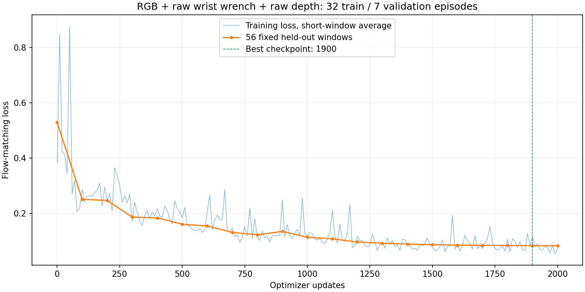

## 21. 用户

VALIDATE step=1700/5000 | val_loss=0.080367 | samples=56
Step   1700/5000 ( 34.0%) [cumulative 3600] | train_loss=0.065908 | val_loss=0.080367 (step 1700) | best_val=0.079538 | grad=1.237 | lr=8.057e-06 | elapsed=4.6m
Step   1710/5000 ( 34.2%) [cumulative 3610] | train_loss=0.082562 | val_loss=0.080367 (step 1700) | best_val=0.079538 | grad=1.611 | lr=8.036e-06 | elapsed=4.6m
Step   1720/5000 ( 34.4%) [cumulative 3620] | train_loss=0.102924 | val_loss=0.080367 (step 1700) | best_val=0.079538 | grad=1.486 | lr=8.015e-06 | elapsed=4.6m
Step   1730/5000 ( 34.6%) [cumulative 3630] | train_loss=0.131678 | val_loss=0.080367 (step 1700) | best_val=0.079538 | grad=1.528 | lr=7.994e-06 | elapsed=4.7m
Step   1740/5000 ( 34.8%) [cumulative 3640] | train_loss=0.088103 | val_loss=0.080367 (step 1700) | best_val=0.079538 | grad=1.749 | lr=7.973e-06 | elapsed=4.7m
Step   1750/5000 ( 35.0%) [cumulative 3650] | train_loss=0.068914 | val_loss=0.080367 (step 1700) | best_val=0.079538 | grad=1.712 | lr=7.952e-06 | elapsed=4.7m
Step   1760/5000 ( 35.2%) [cumulative 3660] | train_loss=0.060397 | val_loss=0.080367 (step 1700) | best_val=0.079538 | grad=1.414 | lr=7.931e-06 | elapsed=4.7m
Step   1770/5000 ( 35.4%) [cumulative 3670] | train_loss=0.068644 | val_loss=0.080367 (step 1700) | best_val=0.079538 | grad=1.135 | lr=7.910e-06 | elapsed=4.7m
Step   1780/5000 ( 35.6%) [cumulative 3680] | train_loss=0.076860 | val_loss=0.080367 (step 1700) | best_val=0.079538 | grad=1.620 | lr=7.889e-06 | elapsed=4.8m
Step   1790/5000 ( 35.8%) [cumulative 3690] | train_loss=0.060232 | val_loss=0.080367 (step 1700) | best_val=0.079538 | grad=2.049 | lr=7.868e-06 | elapsed=4.8m
VALIDATE step=1800/5000 | val_loss=0.081021 | samples=56
SAVED step=1800 | /output/checkpoints/step_001800/model_bundle
Step   1800/5000 ( 36.0%) [cumulative 3700] | train_loss=0.098502 | val_loss=0.081021 (step 1800) | best_val=0.079538 | grad=1.381 | lr=7.847e-06 | elapsed=4.9m
{"status": "early_stopped", "step": 1800, "steps": 5000, "mode": "force-depth", "baseline_validation_loss": 0.0835305827204138, "initial_checkpoint_step": 1900, "cumulative_step": 3700, "best_cumulative_step": 3200, "final_validation_loss": 0.08102123855080988, "best_validation_loss": 0.07953820969643337, "best_step": 1300, "elapsed_s": 292.95755950999956, "peak_reserved_mib": 2108.0, "training_ready_for_robot_deployment": false}
lsy03@lsy03-System-Product-Name:~/文档/ChatGPT/VLA G1 项目$
现在这是怎么回事，给我看看

## 22. 助手（进展）

这是脚本按早停规则正常结束，日志里没有报错。我会核对最近几次验证记录和最佳检查点，确认为什么在这一步停下，以及该保留哪个模型。

## 23. 助手

**这是正常触发早停，训练没有报错。** 脚本设置为：每 100 步验证一次，连续 **5 次未刷新最佳验证 loss** 就结束。

实际记录如下：

| 本阶段步数 | 验证 loss | 是否刷新最佳 |
|---:|---:|---|
| **1,300** | **0.079538** | **最佳** |
| 1,400 | 0.080659 | 否，第 1 次 |
| 1,500 | 0.081224 | 否，第 2 次 |
| 1,600 | 0.080716 | 否，第 3 次 |
| 1,700 | 0.080367 | 否，第 4 次 |
| 1,800 | 0.081021 | 否，第 5 次，触发早停 |

规则看的是**是否优于历史最佳值**。即使第 1,700 步比第 1,600 步有所下降，只要仍高于 `0.079538`，计数就不会重置。

这轮结果是：

- 从上一轮第 **1,900 步**权重开始，新增训练 **1,800 步**，累计到 **3,700 步**。
- 最佳模型在本阶段 **1,300 步，即累计 3,200 步**。
- 最佳验证 loss 从续训起点的 **0.083531 降到 0.079538**，改善约 **4.8%**。
- 最后保存的第 1,800 步模型，验证表现略逊于最佳模型。

目前更像是**进入平台期，并出现小幅验证退化**；仅凭 56 个固定窗口，还不足以明确判定过拟合。

建议先保留早停，使用[累计 3,200 步的最佳模型](/mnt/data/VLA_data/smolvla_runs/smolvla-multimodal-train-20261008_134056-77817/checkpoints/step_001300/model_bundle)，下一步对全部 **713 个验证窗口**做一次完整评估，再决定是否继续增加训练步数。

## 24. 用户

5 次未刷新最佳验证 loss 是否太严苛了？ 是否可以放宽要求？

## 25. 助手（进展）

可以放宽。现在每 100 步验证一次，耐心值 5 相当于连续 500 步没有刷新最佳值就停止；对只有 56 个固定验证窗口的小数据实验，放宽到 15 次是合理的探索设置。

我会把续训脚本默认值改为 15，并确认它从当前累计 3,200 步的最佳模型继续。训练仍由你启动。

## 26. 助手

**可以放宽。5 次不算错误，但对于当前较小的验证集，可以给模型更多时间跨过平台期。**

每 100 步验证一次时：

| 耐心值 | 连续未刷新最佳值的训练步数 |
|---:|---:|
| 5 | 500 步 |
| 10 | 1,000 步 |
| **15，建议先试** | **1,500 步** |

我已把默认值改为 **15**，并将续训来源更新为**当前累计 3,200 步的最佳模型**，避免重新从上一轮的 1,900 步开始。

执行：

```bash
bash "/home/lsy03/文档/ChatGPT/VLA G1 项目/lerobot_deploy/scripts/continue_milk_depth_force.sh" \
  --early-stop-patience 15
```

仍使用学习率 **1e-5**，额外最多训练 **5,000 步**，持续保存最佳验证模型。放宽早停能容忍更长的平台期，但不能保证结果会更好。

脚本已检查，**本次没有启动训练**。

## 27. 用户

这个新脚本是在哪个基础上继续的？

## 28. 助手

新脚本从**当前验证表现最好的多模态模型——累计第 3,200 步**继续：

- 第一轮最佳：第 **1,900 步**
- 第二阶段最佳：新增 **1,300 步**
- 累计：**3,200 步**
- 对应验证 loss：**0.079538**

具体加载的是[这个检查点](/mnt/data/VLA_data/smolvla_runs/smolvla-multimodal-train-20261008_134056-77817/checkpoints/step_001300/model_bundle)。

它包含训练后的 **SmolVLA 权重、深度编码器、腕力相关投影及归一化配置**。继续时保留这些权重，重新初始化优化器和学习率调度器，开启学习率 `1e-5` 的新阶段。

默认额外最多训练 **5,000 步**，因此累计上限是 **8,200 步**，也可能因 15 次验证无改善而提前结束。

## 29. 用户

5 次未刷新最佳验证 loss 或者15次未刷新是否需要降低学习率然后再进行训练，或者是模型陷入了局部最优解？

## 30. 助手（进展）

我先看一下当前实验的学习率和验证趋势。连续几次没有刷新最佳值，只能说明这段时间验证指标没有改善；需要结合训练 loss，才能判断更像平台期还是过拟合，也不能仅凭这个判定陷入局部最优。

## 31. 助手

**可以采用“先降低学习率，再考虑早停”的策略，但 5 次或 15 次没刷新验证 loss，不能说明模型陷入了局部最优。**

我刚查看了正在运行的新一轮：

- 续训起点验证 loss：**0.079538**
- 本阶段第 **1,300 步、累计 4,500 步**：**0.077841**
- 学习率已按余弦调度降至约 **8.8e-6**

**它仍在改善，所以目前建议让这轮继续，不急着再次手动降学习率。** 这也说明上次触发早停，并不代表模型已经无法继续学习。

可以这样区分：

| 观察到的趋势 | 更可能的情况 | 处理方向 |
|---|---|---|
| 训练和验证 loss 都基本不变 | 优化平台期，或数据／模型能力限制 | 尝试降低学习率 |
| 训练 loss 下降，验证 loss 持续升高 | 过拟合迹象 | 保留最佳模型，检查数据与泛化 |
| 验证 loss 小幅来回波动 | 验证样本有限，或训练尚不稳定 | 增加耐心值，扩大验证范围 |

降低学习率能让参数更新更细，可能帮助模型在当前区域继续改善；**它通常不是“跳出局部最优”的手段**。是否存在局部最优，无法仅凭这些日志确认。

如果这一轮后续进入平台期，下一版可以采用：

- 验证指标一段时间无改善，学习率**减半**。
- 给降低后的学习率留出继续训练的时间。
- 多次降学习率后仍无改善，再早停。
- 设置最低学习率，例如 `1e-6`。

PyTorch 的 `ReduceLROnPlateau` 就是按验证指标执行这种调整的调度器。[官方说明](https://docs.pytorch.org/docs/stable/generated/torch.optim.lr_scheduler.ReduceLROnPlateau.html)

**当前代码使用的是余弦衰减，已经在自动降低学习率。** 如果改成验证驱动降学习率，应明确替换或协调调度方式，避免两个调度器互相覆盖。另一个值得优先做的检查，是对全部 **713 个验证窗口**评估一次，确认改善不只出现在目前固定的 56 个窗口上。

## 32. 用户

elapsed=12.9m
VALIDATE step=4600/5000 | val_loss=0.076955 | samples=56
Step   4600/5000 ( 92.0%) [cumulative 7800] | train_loss=0.053122 | val_loss=0.076955 (step 4600) | best_val=0.076003 | grad=0.873 | lr=2.618e-06 | elapsed=13.0m
Step   4610/5000 ( 92.2%) [cumulative 7810] | train_loss=0.100748 | val_loss=0.076955 (step 4600) | best_val=0.076003 | grad=1.156 | lr=2.612e-06 | elapsed=13.0m
Step   4620/5000 ( 92.4%) [cumulative 7820] | train_loss=0.069917 | val_loss=0.076955 (step 4600) | best_val=0.076003 | grad=2.088 | lr=2.606e-06 | elapsed=13.1m
Step   4630/5000 ( 92.6%) [cumulative 7830] | train_loss=0.054843 | val_loss=0.076955 (step 4600) | best_val=0.076003 | grad=1.344 | lr=2.601e-06 | elapsed=13.1m
Step   4640/5000 ( 92.8%) [cumulative 7840] | train_loss=0.097657 | val_loss=0.076955 (step 4600) | best_val=0.076003 | grad=1.452 | lr=2.596e-06 | elapsed=13.1m
Step   4650/5000 ( 93.0%) [cumulative 7850] | train_loss=0.065689 | val_loss=0.076955 (step 4600) | best_val=0.076003 | grad=0.782 | lr=2.590e-06 | elapsed=13.1m
Step   4660/5000 ( 93.2%) [cumulative 7860] | train_loss=0.076718 | val_loss=0.076955 (step 4600) | best_val=0.076003 | grad=1.591 | lr=2.585e-06 | elapsed=13.1m
Step   4670/5000 ( 93.4%) [cumulative 7870] | train_loss=0.071683 | val_loss=0.076955 (step 4600) | best_val=0.076003 | grad=1.443 | lr=2.580e-06 | elapsed=13.2m
Step   4680/5000 ( 93.6%) [cumulative 7880] | train_loss=0.079106 | val_loss=0.076955 (step 4600) | best_val=0.076003 | grad=1.659 | lr=2.576e-06 | elapsed=13.2m
Step   4690/5000 ( 93.8%) [cumulative 7890] | train_loss=0.079217 | val_loss=0.076955 (step 4600) | best_val=0.076003 | grad=1.381 | lr=2.571e-06 | elapsed=13.2m
VALIDATE step=4700/5000 | val_loss=0.076360 | samples=56
SAVED step=4700 | /output/checkpoints/step_004700/model_bundle
Step   4700/5000 ( 94.0%) [cumulative 7900] | train_loss=0.071968 | val_loss=0.076360 (step 4700) | best_val=0.076003 | grad=2.121 | lr=2.566e-06 | elapsed=13.3m
{"status": "early_stopped", "step": 4700, "steps": 5000, "mode": "force-depth", "baseline_validation_loss": 0.07953820969643337, "initial_checkpoint_step": 3200, "cumulative_step": 7900, "best_cumulative_step": 6400, "final_validation_loss": 0.07635959600364524, "best_validation_loss": 0.07600284683784204, "best_step": 3200, "elapsed_s": 798.5960840449989, "peak_reserved_mib": 2108.0, "training_ready_for_robot_deployment": false}
lsy03@lsy03-System-Product-Name:~/文档/ChatGPT/VLA G1 项目$

给我看下训练结果如何？

## 33. 助手（进展）

我核对一下这轮完整验证曲线和最佳检查点，看看后半程的改善幅度，以及触发早停前是否只是围绕平台波动。

## 34. 助手

**这轮有进一步改善，随后进入平台期，早停正常生效。当前应保留累计第 6,400 步的最佳模型。**

| 指标 | 结果 |
|---|---:|
| 本轮起点验证 loss | 0.079538 |
| **最佳验证 loss** | **0.076003** |
| 最佳位置 | 本阶段 3,200 步，累计 **6,400 步** |
| 最后验证 loss | 0.076360 |
| 停止位置 | 本阶段 4,700 步，累计 7,900 步 |

最佳验证 loss 比本轮起点改善约 **4.44%**。最后结果仅比最佳值高 **0.47%**，后半程主要围绕 `0.076～0.077` 波动，**没有明显持续恶化的趋势，更像平台期；现有证据不足以确认过拟合。**

放宽耐心值在这条训练轨迹上起到了作用：按同一份验证记录回放，耐心值 **5 会在本阶段第 1,000 步停止**；耐心值 15 允许模型继续，并在第 3,200 步取得更低的验证 loss。之后连续 15 次未刷新最佳值，才在第 4,700 步结束。

建议接下来先用[累计 6,400 步的最佳模型](/mnt/data/VLA_data/smolvla_runs/smolvla-multimodal-train-20261008_141016-80070/checkpoints/step_003200/model_bundle)，对全部 **713 个验证窗口**做完整评估，并检查预测动作。当前结果仍来自 **56 个固定窗口**，不能换算成实机成功率，也还不能证明加入腕力、深度优于 RGB 基线。

[本轮损失曲线](<../../assets/10f3dd6e468a7aea--stage3_loss_curve.png>)

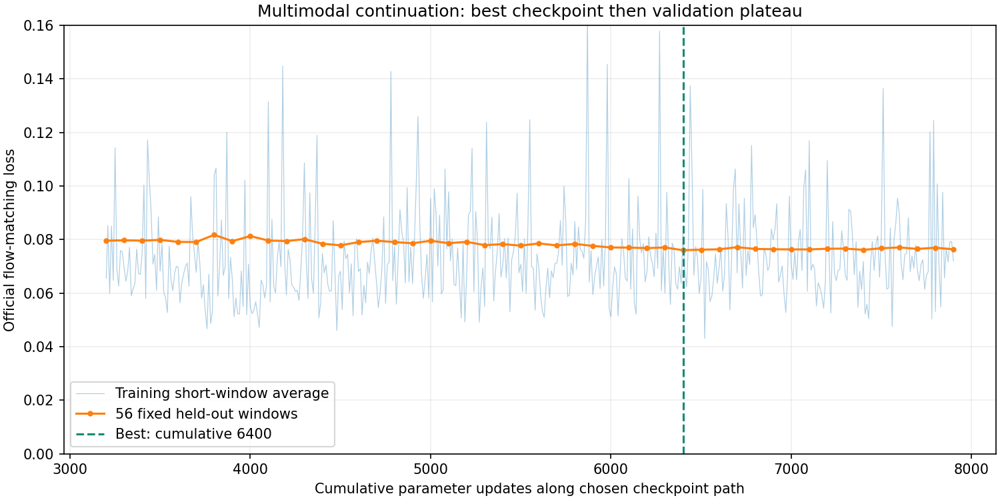

## 35. 用户

开始 “”用[累计 6,400 步的最佳模型](/mnt/data/VLA_data/smolvla_runs/smolvla-multimodal-train-20261008_141016-80070/checkpoints/step_003200/model_bundle)，对全部 **713 个验证窗口**做完整评估，并检查预测动作“”

## 36. 助手（进展）

我开始用累计 6,400 步的最佳模型评估全部 713 个验证窗口。会逐条核对验证损失、预测动作的有限值与范围、关节／夹爪误差和时间变化，并保留按示教分组的结果。整个过程只做离线推理。

## 37. 助手（进展）

评估范围已确认：**7 条验证示教、713 个完整动作窗口**，使用训练时保存的同一归一化配置。

除了复核原来的 56 窗口 loss，我会输出全部窗口的关节角度误差、夹爪开度误差，以及预测目标是否超出当前限位。也会用两组固定采样噪声检查预测的随机波动。误差按角度和毫米报告；这些仍是离线示教匹配指标。

## 38. 助手（进展）

最佳权重已准确复现原来的 **56 窗口验证 loss＝0.076003**，确认模型和预处理加载一致。全量评估正在运行，每个窗口都会生成两次可复现的动作预测。

我还加入了“未来始终保持当前已接受目标”的简单基线，用来判断模型是否比保持不动更接近示教动作，尤其关注夹爪开合和较远时间步。

## 39. 助手（进展）

已完成约 **42%（300/713 窗口）**。目前前向损失和两组动作预测均未出现非有限值。

评估会保留每个时间步的原始预测，因此可以同时看“第一步是否准确”和“约 5 秒动作范围内误差怎样变化”，也能定位具体示教的薄弱环节。

## 40. 助手（进展）

全量评估已到 **77%（550/713 窗口）**，数值检查仍正常。完成后会给出各关节和夹爪的误差、七条示教的分别表现，以及误差最大的预测曲线，避免只看平均 loss 掩盖问题。

## 41. 助手（进展）

713 个窗口已全部评估完成。全量 loss 为 **0.08058**，但动作检查暴露出需要重视的问题：

- 第一动作步的平均关节误差约 **3.59°**，夹爪开度误差约 **16.82 mm**。
- 原始预测夹爪范围出现 **−32.59～146.77 mm**，超出了当前 0～100 mm 范围。
- 部分 J2 预测超出保守限位。

所以低 loss 不能直接代表动作可用。我正在核对最大误差曲线和分示教结果，判断主要问题集中在哪些动作与时间段。

## 42. 助手

_工具输出图片（原始工具文本未纳入归档）。_

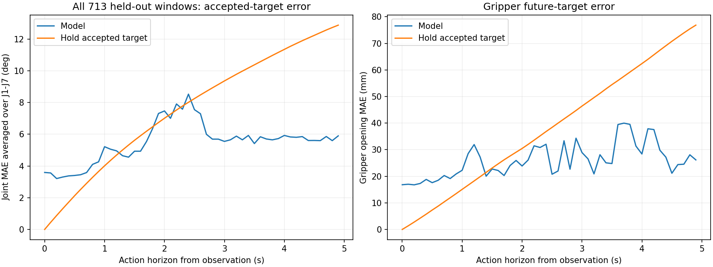

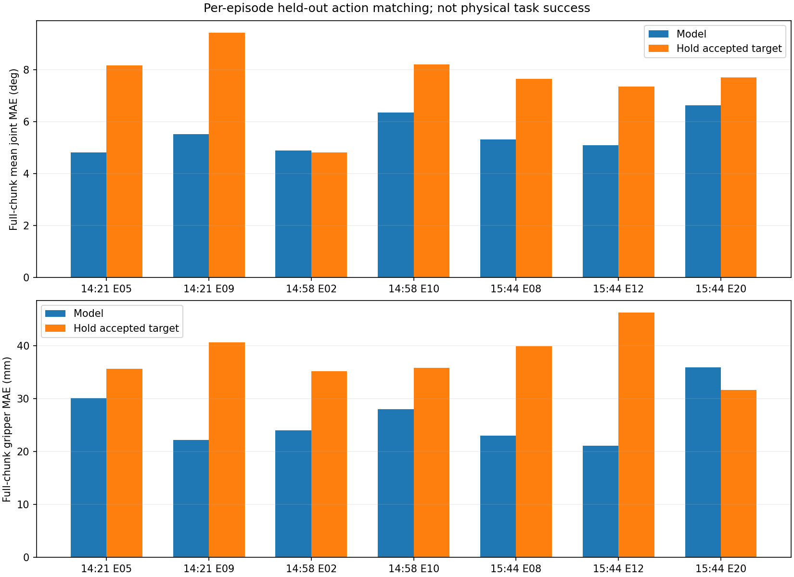

## 43. 助手

_工具输出图片（原始工具文本未纳入归档）。_

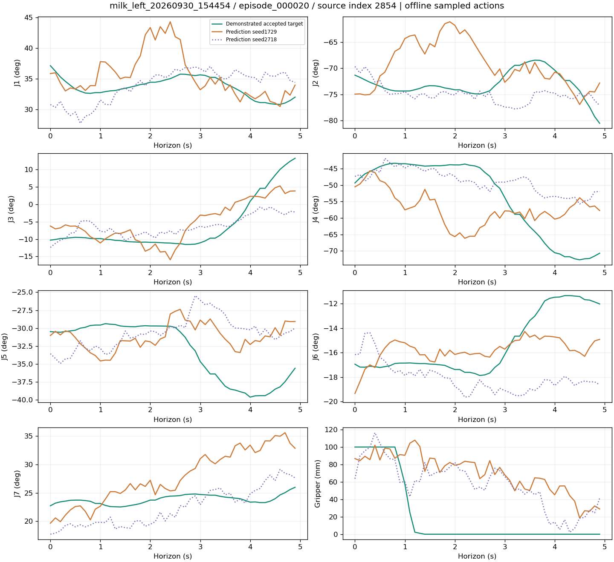

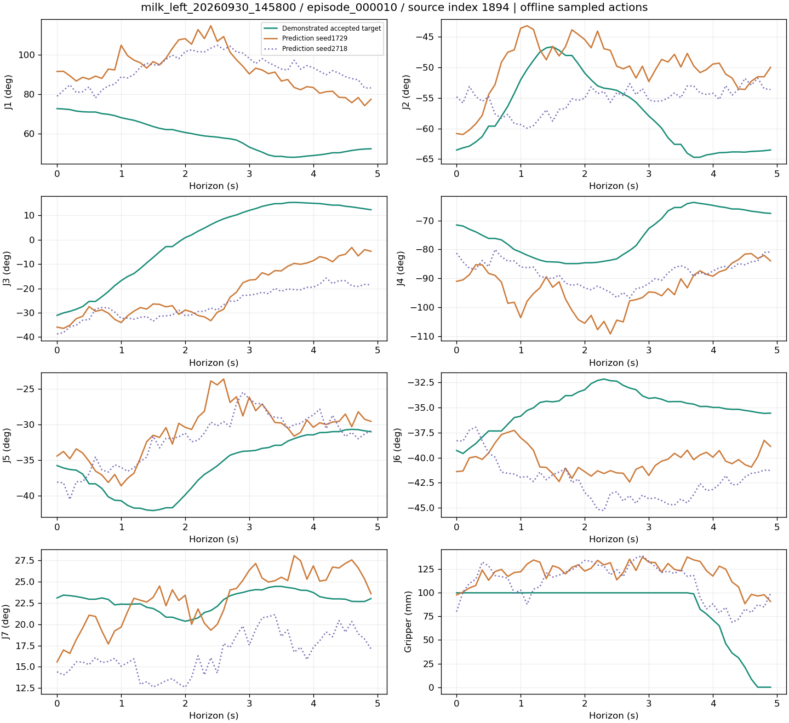

## 44. 助手

**713 个验证窗口已全部评估完成。模型学到了一些动作趋势，但预测精度、输出范围和随机稳定性仍有明显问题，目前不适合直接上机执行。**

原来的 56 窗口 loss 准确复现为 **0.076003**；全部 713 窗口的 loss 为 **0.080576**。两者样本及噪声集合不同，不能仅凭差值判断过拟合。

预测动作与示教中“已接受控制目标”的误差为：

| 指标 | 第一动作步 | 全部 50 步平均 |
|---|---:|---:|
| 七关节平均绝对误差 | **3.59°** | **5.49°** |
| 夹爪开度平均绝对误差 | **16.82 mm** | **25.91 mm** |

全动作平均表现优于“保持当前目标”的简单基线——基线误差为 **7.57°、37.96 mm**，但仍有三个突出问题：

- **夹爪输出越界**：原始预测范围为 **−32.59～146.77 mm**，超出 0～100 mm。即使离线假设限幅，夹爪平均误差仍约 **20.58 mm**。
- **部分 J2 预测超出保守限位**：最大超出约 **3.78°**。
- **采样稳定性不足**：同一输入换一组采样噪声，两次动作序列平均相差约 **4.14°、15.60 mm**。

较薄弱的是 **15:44 批次第 20 组**，其全动作平均夹爪误差约 **35.93 mm**；示例中能看到闭合时刻与示教不一致。

下一步建议优先检查**夹爪开合时序、短期动作误差和输出约束**，并把真实 8 维动作误差纳入模型选择。当前官方 loss 还包含内部 padding 维度的平均，低 loss 无法替代这些检查。

[完整评估报告](<../../assets/154737e4296f0d3e--%E8%AF%84%E4%BC%B0%E6%8A%A5%E5%91%8A.html>) · [预测误差随时间变化](<../../assets/19ac3077fab818d3--image-19ac3077fab8.png>) · [夹爪问题示例](<../../assets/c80df5ce243bc2fa--image-c80df5ce243b.png>)

本次未更新权重、未发送机器人指令；这些结果是离线示教匹配评估，还不能给出实机成功率。

[附件：154737e4296f0d3e--评估报告.html](../../assets/154737e4296f0d3e--%E8%AF%84%E4%BC%B0%E6%8A%A5%E5%91%8A.html)


## 45. 用户

其中的红线、蓝线、虚线分别代表什么？

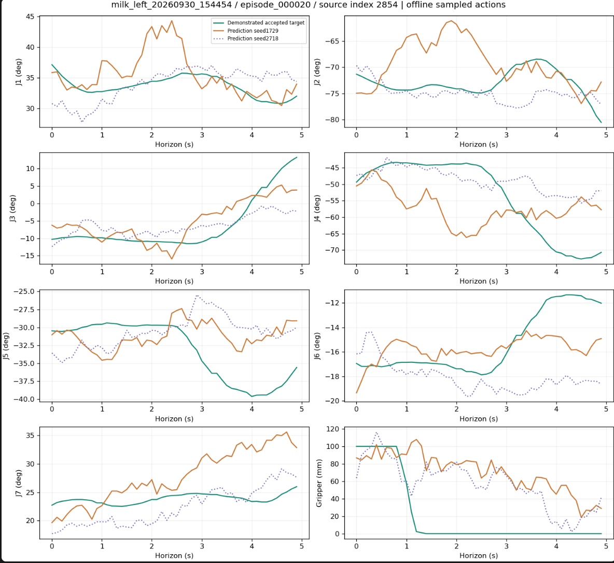

## 46. 助手

这张图的三条线分别是：

| 线条 | 含义 |
|---|---|
| **蓝绿色实线** | 示教记录中 **SDK 已接受的控制目标**，作为预测的对照 |
| **橙红色实线** | 模型第一次预测，随机种子 `1729` |
| **紫蓝色虚线** | 同一模型、同一输入的第二次预测，随机种子 `2718` |

两条预测线的区别只有**采样噪声不同**，用于检查预测稳定性，并不是两个不同的模型。预测线越贴近蓝绿色示教线，表示越接近这条示教；两条预测线差距越大，说明随机采样对结果的影响越明显。

横轴是从当前观测开始、约 **5 秒的动作预测范围**；J1～J7 的纵轴单位是度，夹爪单位是毫米。蓝绿色线是**目标指令**，不是机械臂的实测反馈。

例如右下角夹爪图：示教在约 **0.6～1 秒**快速闭合，而两条预测没有准确跟上这个闭合时刻，体现了抓放时序偏差。

## 47. 用户

| 指标         | 第一动作步        | 全部 50 步平均        |                                                                |
| ---------- | ------------ | ---------------- | -------------------------------------------------------------- |
| 七关节平均绝对误差  | **3.59°**    | **5.49°**        |                                                                |
| 夹爪开度平均绝对误差 | **16.82 mm** | **25.91 mm**<br> | 这个数据是否正常？ 我怎么感觉所有关节的预测差距都还是很大？而且为什么各个关节的起点是不同的？夹爪这部分效果很差是什么原因？ |

## 48. 助手（进展）

这些误差对精细抓取来说确实偏大，尤其是夹爪；平均值也会掩盖某些窗口里十几度甚至更大的偏差。

我会再核对“预测起点与当前实测状态／目标的差异”，以及 loss 是否被内部填充维度稀释，区分已确认的原因和还需要实验验证的原因。

## 49. 助手（进展）

核对后有两个明确发现：

- 当前实测关节角度与示教目标平均只差约 **0.42°**，远小于模型首步的 **3.59°** 误差。因此起点差距主要是预测误差，不能都归因于机械臂跟随滞后。
- 夹爪抓住瓶子时，**闭合目标可以是 0 mm，实测开度却停在瓶径附近**。模型要学习的是目标指令。当前预测既有开合时刻偏差，也有越界，单纯限幅后首步误差仍约 **16.10 mm**。

## 50. 助手（进展）

loss 分项也核对出来了：日志中的 **0.0760** 是 32 个内部维度的平均；只看真实 8 维动作，其流匹配 loss 约为 **0.2904**，其中夹爪这一维约为 **0.4545**，高于各个关节维度。

这说明不能把日志里较小的数值理解成动作已很精确。我再做一个小规模推理对照，检查把采样步数从当前 10 步增加后，动作误差是否明显下降。

## 51. 助手

**这些误差对精细抓取确实偏大，你从曲线看到的差距是真实存在的。当前只能说训练数值稳定、模型学到部分趋势，不能说动作精度已经合格。**

而且平均值会掩盖较差情况：首步 J3 平均误差 **5.85°**，其绝对误差 P95 为 **13.29°**；713 个窗口中，有 **57 个窗口**的首步至少一个关节误差超过 15°。

**为什么起点不同？**

需要区分两种情况：

- **不同关节之间**：J1、J2 等本来就在不同角度，起点数值不同是正常的。
- **同一关节的三条曲线之间**：蓝绿色是示教中已接受的目标；两条预测是同一输入、不同采样噪声生成的绝对动作序列。当前模型没有把第一步硬性锚定到实测姿态或目标上，因此起点可能不同。**差得很大仍然是预测误差，不能因此视为合理。**

我核对了输入：实测关节角度与当前示教目标平均仅差约 **0.42°**。因此模型首步的 3.59° 误差，大部分无法用跟随滞后来解释。

**为什么 loss 看起来低，动作却不准？**

此前脚本沿用了官方的内部 **32 维平均 loss**，其中只有 8 维是真实动作。我刚拆分复核了同一批固定验证样本：

| 损失范围 | 数值 |
|---|---:|
| 日志中的 32 维平均 | **0.0760** |
| 真实 8 维动作平均 | **0.2904** |
| 24 维 padding 平均 | **0.00455** |

这使日志数值显得较小。它们仍是归一化的流匹配损失，并非角度或毫米误差；**单纯删除 padding 或把 loss 乘四，也不会自动修复策略。** 但当前选模指标确实需要增加真实 8 维及夹爪的单独评估。

**夹爪为什么差？**

已经确认的问题有：

- **输出没有范围约束**，因此会生成负开度或超过 100mm 的值。不过限幅后首步误差仍有 **16.10mm**，说明问题不只是越界。
- **抓放时序没有学准**：示教已经闭合时，模型仍可能输出较大的开度。
- **采样随机性较明显**：同一输入换噪声，夹爪目标也会变化。

还需要注意：抓住瓶子时，目标可以是 **0mm**，实际开度却停在瓶径附近。这是正常的指令／反馈差异。所以 16mm 的目标误差不直接等于“少夹了 16mm”，但结合曲线中的闭合延迟，当前夹爪控制确实不够可靠。

可能的影响因素还包括：单时刻观测、约 5 秒的预测跨度、示教间抓放阶段差异，以及数据量有限。现有证据不能把问题唯一归因于某一项。我也比较了 **10、20、50 步推理采样**，误差没有明显改善，因此增加推理步数目前帮不上忙。

下一步应优先：

1. 增加**真实 8 维损失、首步／短期物理误差、夹爪单独指标**。
2. 测试夹爪的**有界输出和独立监督**，保留中间开度标签。
3. 做短期动作预测、观测历史及 RGB／力／深度消融对照。

[诊断记录](<../../assets/07fb02e90e7c9ed7--prediction_diagnosis.json>)。本次检查没有修改权重或数据。

[附件：07fb02e90e7c9ed7--prediction_diagnosis.json](../../assets/07fb02e90e7c9ed7--prediction_diagnosis.json)

## 52. 用户

我感觉现在是不是得重新训练了？ 给我方案计划，明确目标 ，给我重新写个训练脚本，我来执行

## 53. 助手（进展）

我会先检查当前模型和训练代码，再制定重训计划并实现新脚本。重点是修正真实 8 维动作的监督、夹爪输出范围和近期开合时序，同时保留现有模型作为对照。代码和检查通过后，由你启动正式训练。

## 54. 助手（进展）

建议做一轮新的重训实验，先检验三个改动是否有效：

- 将预测范围从约 5 秒缩短到 **1 秒（10 步）**，关节改学相对当前实测姿态的增量。
- 关节 loss 只计算真实 7 维；夹爪增加独立的 **0～100 mm 有界输出**和单独监督，保留中间开度标签。
- 验证时同时看角度／毫米误差，用物理误差选模，并加入平台期降学习率。

先把首步关节 MAE ≤2°、夹爪 MAE ≤5 mm 设为实验目标。这是待验证的目标，不是效果承诺；数据仍沿用当前 32/7 划分。

## 55. 助手（进展）

新代码的核心已经写好：关节预测从当前实测姿态计算增量，夹爪使用独立有界输出；原始动作标签保持其物理含义，训练时再转换表示。深度和腕力仍保留为输入。

验证会同时记录原始预测误差、限幅后误差和“保持当前姿态”的基线，避免靠限幅或不运动掩盖问题。接下来做单位、loss 范围、梯度、标签泄漏和模型重载检查。

## 56. 助手（进展）

GPU 检查已通过：新关节目标和夹爪分支均能正常反向传播，输出形状是 **[2, 10, 8]**；重复输入的预测一致，修改未来标签不会影响推理结果，保存后重载也得到相同预测。

这些检查确认了代码接入正常，尚不能证明训练效果会改善。本次没有执行优化器更新，正式重训仍由你启动。

## 57. 助手

**建议开一轮新的重训实验。** 这次修改训练目标和夹爪输出方式，现有累计 6,400 步模型保留作对照。代码已写好，并通过 GPU 前后向、标签泄漏检查和模型重载测试；**正式训练尚未启动**。

主要改动：

- **5 秒预测缩短为 1 秒、10 步**，先提高近期动作精度。
- 关节学习相对当前实测姿态的增量，loss 只计算真实 **7 个关节**。
- 夹爪使用独立的 **0～100 mm 有界输出**和单独监督，保留中间开度标签。
- 继续使用 RGB、六维腕力和原始深度，复用原有 **32 条训练／7 条验证**划分。
- 用角度、毫米误差选最佳模型；平台期先降学习率，再早停。

实验目标如下，**需要训练后验证，不能保证达到**：

| 指标 | 旧模型 | 新实验目标 |
|---|---:|---:|
| 首步关节 MAE | 3.59° | ≤2° |
| 首步夹爪 MAE | 16.82 mm | ≤5 mm |
| 1 秒范围关节 MAE | 按旧预测前 10 步对照 | ≤3° |
| 1 秒范围夹爪 MAE | 按旧预测前 10 步对照 | ≤10 mm |

还要求短期预测优于“保持当前实测状态”基线，并单独统计**限幅前**误差，避免靠限幅掩盖问题。

先执行检查，再跑 **2,000 步试训**：

```bash
cd "/home/lsy03/文档/ChatGPT/VLA G1 项目"

bash lerobot_deploy/scripts/train_milk_retrain_v2.sh check

bash lerobot_deploy/scripts/train_milk_retrain_v2.sh train \
  --steps 2000
```

控制台会显示训练 loss、关节／夹爪分项 loss，以及：

```text
val_first_joint=...deg | val_first_grip=...mm | best_score=...
```

结束后，对新模型评估全部 713 个验证窗口：

```bash
bash lerobot_deploy/scripts/train_milk_retrain_v2.sh eval "替换为启动时打印的完整RUN_DIR"
```

**先看这轮物理误差是否改善，再决定延长训练预算。** 新 loss 定义不同，不能直接和旧的 `0.076` 比较。

[启动脚本](</home/lsy03/文档/ChatGPT/VLA G1 项目/lerobot_deploy/scripts/train_milk_retrain_v2.sh>) · [详细计划与说明](<../../assets/1d46e1e8ddcceaaa--README.md>)

[附件：1d46e1e8ddcceaaa--README.md](../../assets/1d46e1e8ddcceaaa--README.md)

## 58. 用户

六维力传感器和深度图是否已经放入训练？

## 59. 助手（进展）

我核对一下最新训练记录和 v2 默认配置，确认哪些模态已实际参与训练，哪些还只是写进了待执行脚本。

## 60. 助手

**已经加入了。** 之前累计 6,400 步的多模态模型已使用六维腕力和深度；你最新启动的 **v2 重训配置也是 `force-depth`**。

具体接入方式：

| 数据 | 模型中的使用方式 |
|---|---|
| 六维腕力 `Fx、Fy、Fz、Tx、Ty、Tz` | 与原来的七关节＋夹爪实测状态拼成 **14 维观测**，使用训练集统计归一化 |
| 腕部深度 | 原始值 **÷10000 转成米**，缩至 128×224，与无效像素掩码一起进入深度 CNN |
| 三路 RGB | 继续使用头左、左腕、右前环视 |

因此，它们已作为**实际模型输入**接入，不只是存在原件或质量标记里。GPU 检查也确认深度分支和腕力相关投影能收到梯度。

目前使用的是**原始深度，尚未做 LingBot-Depth 补全**；腕力使用原始 SDK 观测，尚未确认清零和重力补偿。最新 v2 运行刚读取时处于初始化阶段，尚未记录训练更新步数。

## 61. 用户

-05 | elapsed=10.0m
Step 1960/2000 (98.0%) | train_loss=0.58408 | joint7_loss=0.50906 | grip_loss=0.03292 | val_loss=0.76118 | val_first_joint=0.599deg | val_first_grip=6.06mm | best_score=2.96011 | lr=5.000e-05 | elapsed=10.0m
Step 1970/2000 (98.5%) | train_loss=0.58454 | joint7_loss=0.41131 | grip_loss=0.07371 | val_loss=0.76118 | val_first_joint=0.599deg | val_first_grip=6.06mm | best_score=2.96011 | lr=5.000e-05 | elapsed=10.0m
Step 1980/2000 (99.0%) | train_loss=0.86096 | joint7_loss=0.60975 | grip_loss=0.09751 | val_loss=0.76118 | val_first_joint=0.599deg | val_first_grip=6.06mm | best_score=2.96011 | lr=5.000e-05 | elapsed=10.0m
Step 1990/2000 (99.5%) | train_loss=0.78573 | joint7_loss=0.57669 | grip_loss=0.08654 | val_loss=0.76118 | val_first_joint=0.599deg | val_first_grip=6.06mm | best_score=2.96011 | lr=5.000e-05 | elapsed=10.1m
VALIDATE 2000/2000 | joint7_loss=0.58980 | grip_reg=0.08404 | first_joint=0.462deg | first_grip=6.80mm | short_joint=1.718deg | short_grip=10.10mm | score=3.17383 | stale=2 | lr=5.000e-05
SAVED 2000
Step 2000/2000 (100.0%) | train_loss=0.68411 | joint7_loss=0.41639 | grip_loss=0.11369 | val_loss=0.80046 | val_first_joint=0.462deg | val_first_grip=6.80mm | best_score=2.96011 | lr=5.000e-05 | elapsed=10.3m
{"status": "completed", "step": 2000, "steps": 2000, "best_step": 1800, "best_selection_score": 2.9601067168824384, "final_validation": {"first_joint_mae_deg": 0.4524786553661539, "first_gripper_mae_mm": 6.801992277490042, "short_joint_mae_deg": 1.7101784004090579, "short_gripper_mae_mm": 10.099477555195335, "raw_first_joint_mae_deg": 0.46169266767626094, "raw_short_joint_mae_deg": 1.7178979952070892, "raw_joint_excess_max_deg": 4.201304761347322, "raw_first_joint_violating_windows": 7, "gripper_prediction_range_mm": [0.5737937688827515, 99.84272003173828], "first_joint_abs_error_p95_deg_by_dim": [1.33781719989935, 1.568581971197401, 1.2994763598803065, 1.9001278912462822, 0.8459456091325246, 0.8062534588748764, 0.8068608121024786], "first_gripper_abs_error_p95_mm": 42.09610540419817, "hold_measured_state_short_joint_mae_deg": 2.073168748286717, "hold_measured_state_short_gripper_mae_mm": 26.71592429147235, "joint_mae_deg_by_horizon": [0.4524786553661539, 0.6776682624297434, 0.9886569460278848, 1.3261052729561855, 1.7382174558436823, 1.8557075635669473, 2.12907308454956, 2.3159487271552, 2.640903987075529, 2.977024049119693], "gripper_mae_mm_by_horizon": [6.801992277490042, 6.642442863916846, 8.414289684359185, 9.350922771513329, 10.626220590243715, 10.560413531493396, 11.533167056248724, 12.04202144539782, 12.606526730191295, 12.416778601099006], "selection_score": 3.173825209924702, "experimental_goals_met": false, "validation_loss": 0.800457124199186, "loss_components": {"joint_flow7": 0.5897996478847095, "gripper_regression": 0.08403572552154921, "gripper_extreme_bce": 0.21293009220140188}}, "elapsed_s": 619.022621594002, "peak_reserved_mib": 2316.0, "training_ready_for_robot_deployment": false}
lsy03@lsy03-System-Product-Name:~/文档/ChatGPT/VLA G1 项目$

给我看下训练效果，要不我们继续训练？

## 62. 助手（进展）

这轮固定验证结果中，首步关节误差明显缩小，夹爪也有改善，但仍有少数大误差和原始关节预测越界。我先核对第 1,800 步最佳模型的完整指标，再与保持当前姿态的基线比较，判断继续训练的价值。

## 63. 助手（进展）

最佳模型是第 **1,800 步**：首步关节误差约 **0.61°**，夹爪 **5.44 mm**。第 2,000 步关节更准，但夹爪退步，所以综合评分没有刷新最佳。

目前只有两次验证未改善，还不足以判断过拟合。我会补做全部 713 个验证窗口的评估，并准备从第 1,800 步降低学习率继续训练的入口。

## 64. 助手（进展）

这轮还在进步：学习率在第 1,600 步减半后，第 1,800 步又刷新了最佳评分。继续训练有价值，但夹爪仍有少数大误差，不能只看平均值。

续训入口已写好：保留最佳模型的完整权重、深度与六维力输入，再以 **2×10⁻⁵** 的学习率追加最多 **3,000 步**。我正在核验载入后能否复现原来的验证结果。

## 65. 助手（进展）

全部 **713 个窗口**评估完成：首步关节误差 **0.62°**、夹爪 **4.35 mm**；未来约 1 秒平均误差为 **1.80° / 6.42 mm**，比旧模型明显改善，也优于“保持当前实测姿态”的短期预测基线。

但仍有 **18 个窗口**的首步夹爪误差超过 50 mm，**74 个窗口**的原始首步 J2 预测越过保守限位。续训加载检查已通过，建议继续做低学习率实验，再复查这些大误差。

## 66. 助手

**可以继续训练，建议从第 1,800 步最佳模型开始，降低学习率。** 我已补做全部 **713 个验证窗口**的评估，结果比训练日志中的 56 个抽样窗口更完整：

| 指标 | 旧模型，同一批窗口、前10步 | 新模型最佳1800步 |
|---|---:|---:|
| 首步关节平均误差 | 3.59° | **0.62°** |
| 首步夹爪平均误差 | 16.10 mm | **4.35 mm** |
| 约1秒关节平均误差 | 3.58° | **1.80°** |
| 约1秒夹爪平均误差 | 15.33 mm | **6.42 mm** |

旧模型夹爪也限制到 0～100 mm 后比较。新模型的短期关节误差优于“保持当前实测姿态”基线的 **2.25°**，说明有实际改善；不能只凭很小的首步误差判断效果。

**目前没有充分证据判断明显过拟合。** 学习率减半后，第1800步仍刷新了最佳评分；后面仅两次验证退步。第2000步关节更准，但夹爪更差，所以保留1800步作为续训起点。

仍需解决两点：

- **18/713 个窗口**首步夹爪误差超过50 mm，平均值掩盖了少数严重错误。
- **74/713 个窗口**原始首步J2预测越过保守限位，最大约1.90°；输出有限幅保护，但模型尚不适合直接实机部署。

续训脚本已完成，并通过**零训练更新的加载检查**，复现了原最佳模型指标。执行：

```bash
bash "/home/lsy03/文档/ChatGPT/VLA G1 项目/lerobot_deploy/scripts/train_milk_retrain_v2.sh" \
  continue "/mnt/data/VLA_data/smolvla_runs/smolvla-retrain-v2-train-20261008_155613-141874" \
  --steps 3000 --lr 2e-5
```

这会保留完整模型、深度和六维力输入，重新初始化优化器，追加最多3000步，累计到 **4800步**。每100步显示验证loss和物理误差，连续5次未改善降学习率，15次早停。预计约 **15～18分钟**，原结果保留。

[完整评估结果](<../../assets/ffa4c5a1c29c8176--evaluation.json>)。正式续训尚未启动。

[附件：ffa4c5a1c29c8176--evaluation.json](../../assets/ffa4c5a1c29c8176--evaluation.json)

## 67. 用户

VALIDATE 1800/3000 | joint7_loss=0.52226 | grip_reg=0.07690 | first_joint=0.479deg | first_grip=6.05mm | short_joint=1.694deg | short_grip=9.09mm | score=2.92254 | stale=14 | lr=5.000e-06
Step 1800/3000 (60.0%) [cumulative 3600] | train_loss=0.41906 | joint7_loss=0.28304 | grip_loss=0.05938 | val_loss=0.72124 | val_first_joint=0.479deg | val_first_grip=6.05mm | best_score=2.90365 | lr=5.000e-06 | elapsed=9.3m
Step 1810/3000 (60.3%) [cumulative 3610] | train_loss=0.33514 | joint7_loss=0.25233 | grip_loss=0.03612 | val_loss=0.72124 | val_first_joint=0.479deg | val_first_grip=6.05mm | best_score=2.90365 | lr=5.000e-06 | elapsed=9.3m
Step 1820/3000 (60.7%) [cumulative 3620] | train_loss=0.36546 | joint7_loss=0.27381 | grip_loss=0.04250 | val_loss=0.72124 | val_first_joint=0.479deg | val_first_grip=6.05mm | best_score=2.90365 | lr=5.000e-06 | elapsed=9.4m
Step 1830/3000 (61.0%) [cumulative 3630] | train_loss=0.75955 | joint7_loss=0.59866 | grip_loss=0.07148 | val_loss=0.72124 | val_first_joint=0.479deg | val_first_grip=6.05mm | best_score=2.90365 | lr=5.000e-06 | elapsed=9.4m
Step 1840/3000 (61.3%) [cumulative 3640] | train_loss=0.57895 | joint7_loss=0.47982 | grip_loss=0.04412 | val_loss=0.72124 | val_first_joint=0.479deg | val_first_grip=6.05mm | best_score=2.90365 | lr=5.000e-06 | elapsed=9.4m
Step 1850/3000 (61.7%) [cumulative 3650] | train_loss=0.73536 | joint7_loss=0.58872 | grip_loss=0.05774 | val_loss=0.72124 | val_first_joint=0.479deg | val_first_grip=6.05mm | best_score=2.90365 | lr=5.000e-06 | elapsed=9.5m
Step 1860/3000 (62.0%) [cumulative 3660] | train_loss=0.43049 | joint7_loss=0.36792 | grip_loss=0.02938 | val_loss=0.72124 | val_first_joint=0.479deg | val_first_grip=6.05mm | best_score=2.90365 | lr=5.000e-06 | elapsed=9.5m
Step 1870/3000 (62.3%) [cumulative 3670] | train_loss=0.65334 | joint7_loss=0.49620 | grip_loss=0.07033 | val_loss=0.72124 | val_first_joint=0.479deg | val_first_grip=6.05mm | best_score=2.90365 | lr=5.000e-06 | elapsed=9.5m
Step 1880/3000 (62.7%) [cumulative 3680] | train_loss=0.42312 | joint7_loss=0.35601 | grip_loss=0.03113 | val_loss=0.72124 | val_first_joint=0.479deg | val_first_grip=6.05mm | best_score=2.90365 | lr=5.000e-06 | elapsed=9.6m
Step 1890/3000 (63.0%) [cumulative 3690] | train_loss=0.51948 | joint7_loss=0.39010 | grip_loss=0.05739 | val_loss=0.72124 | val_first_joint=0.479deg | val_first_grip=6.05mm | best_score=2.90365 | lr=5.000e-06 | elapsed=9.6m
VALIDATE 1900/3000 | joint7_loss=0.52360 | grip_reg=0.07882 | first_joint=0.485deg | first_grip=5.97mm | short_joint=1.693deg | short_grip=9.33mm | score=2.93355 | stale=15 | lr=5.000e-06
SAVED 1900
Step 1900/3000 (63.3%) [cumulative 3700] | train_loss=0.55092 | joint7_loss=0.31707 | grip_loss=0.10053 | val_loss=0.72636 | val_first_joint=0.485deg | val_first_grip=5.97mm | best_score=2.90365 | lr=5.000e-06 | elapsed=9.8m
{"status": "early_stopped", "step": 1900, "cumulative_step": 3700, "steps": 3000, "best_step": 400, "best_cumulative_step": 2200, "best_selection_score": 2.9036523119563906, "final_validation": {"first_joint_mae_deg": 0.48142869748046635, "first_gripper_mae_mm": 5.965909527731128, "short_joint_mae_deg": 1.6913232770571118, "short_gripper_mae_mm": 9.334240315885316, "raw_first_joint_mae_deg": 0.48503841760891414, "raw_short_joint_mae_deg": 1.6932673632095063, "raw_joint_excess_max_deg": 1.5735534027249962, "raw_first_joint_violating_windows": 3, "gripper_prediction_range_mm": [0.32237836718559265, 99.87410736083984], "first_joint_abs_error_p95_deg_by_dim": [1.6027875585608247, 1.19719897281442, 1.2297776944949115, 1.7933208081002079, 0.9357239634606993, 0.9655902462670495, 0.8065069229261073], "first_gripper_abs_error_p95_mm": 29.581433162093163, "hold_measured_state_short_joint_mae_deg": 2.073168748286717, "hold_measured_state_short_gripper_mae_mm": 26.71592429147235, "joint_mae_deg_by_horizon": [0.48142869748046657, 0.7036954338795487, 1.0519342485956833, 1.4183899987958524, 1.8051339556808206, 1.9256076078426032, 2.0598459020478446, 2.3074802766292972, 2.489600682756161, 2.670115966862837], "gripper_mae_mm_by_horizon": [5.965909527731128, 6.477473693978807, 8.112004602610666, 8.396286421754796, 9.016758872998512, 8.966546535832874, 10.594495580984844, 11.449752977828862, 12.177622550682697, 12.185552394449976], "selection_score": 2.933547600342383, "experimental_goals_met": false, "validation_loss": 0.7263644541214619, "loss_components": {"joint_flow7": 0.5236010149653468, "gripper_regression": 0.07881677411319288, "gripper_extreme_bce": 0.22564948332936702}}, "elapsed_s": 589.7044128380003, "peak_reserved_mib": 2326.0, "training_ready_for_robot_deployment": false}
lsy03@lsy03-System-Product-Name:~/文档/ChatGPT/VLA G1 项目$

给我看下进度如何？

## 68. 助手（进展）

这轮已触发早停：本阶段完成 1,900 步，权重路径累计 3,700 步；最佳评分出现在累计 2,200 步。我先核对最佳检查点和验证走势，看看这次续训带来了多少改善。

## 69. 助手

**这轮训练已经结束，正常触发了早停，不是卡在63.3%。** 我已核对实际保存的检查点。

- 本阶段完成 **1,900 / 3,000 步**，耗时 **9.8分钟**。
- 最后模型累计 **3,700步**。
- **最佳模型在本阶段第400步，累计2,200步**，已单独保存。

以下均为同一组 **56个固定验证窗口**，关节使用限幅前误差：

| 指标 | 续训前：累计1800步 | 最佳：累计2200步 | 最后：累计3700步 |
|---|---:|---:|---:|
| 首步关节误差 | 0.607° | **0.540°** | 0.485° |
| 首步夹爪误差 | **5.44 mm** | 5.65 mm | 5.97 mm |
| 约1秒关节误差 | 1.834° | **1.714°** | 1.693° |
| 约1秒夹爪误差 | 9.57 mm | **9.33 mm** | 9.33 mm |
| 综合评分，越低越好 | 2.9601 | **2.9037** | 2.9335 |

**续训有改善，但幅度已经较小。** 最佳综合评分改善约 **1.9%**；关节更准，首步夹爪反而略有退步。

早停判断依据是**综合物理误差评分**。累计2200步之后，连续15次验证没有显著刷新最佳；期间学习率已从 `2e-5 → 1e-5 → 5e-6`。因此，这是经过两次降学习率后仍进入平台期，并非单纯因为验证loss不下降。

目前也不能仅据此认定明显过拟合：验证loss仍从 **0.7885降到0.7264**，但它的下降没有持续转化成更好的动作预测。

建议先停止追加步数，对[累计2200步最佳模型](/mnt/data/VLA_data/smolvla_runs/smolvla-retrain-v2-continue-20261008_161604-149225/checkpoints/step_000400/model_bundle)做全部 **713个窗口**评估，再决定下一轮。最后3700步模型也值得保留作比较：它的原始首步越界窗口从7个降到3个，但夹爪更差。**目前仍未满足全部实验目标，不宜直接部署实机。**

## 70. 用户

给我评估脚本，我来执行

## 71. 助手（进展）

我会把评估入口整理成可直接执行的命令，确认它读取累计2,200步的最佳模型，并评估全部713个验证窗口。

## 72. 助手

评估脚本已就绪，直接执行：

```bash
bash "/home/lsy03/文档/ChatGPT/VLA G1 项目/lerobot_deploy/scripts/train_milk_retrain_v2.sh" \
  eval "/mnt/data/VLA_data/smolvla_runs/smolvla-retrain-v2-continue-20261008_161604-149225"
```

它会自动读取**累计2,200步的最佳模型**，使用GPU评估全部 **713个验证窗口**，不更新权重。预计约 **3～5分钟**，显示 `Evaluated …/713` 进度。

结果保存到启动时打印的 `Run directory`，包含：

- `evaluation.json`：验证loss、首步/1秒动作误差、P95误差、关节越界和逐episode指标。
- `predictions.npz`：预测动作、示教目标及实测状态。
- 与旧版累计6,400步模型的同窗口、同预测时长对比。

结束时应出现 `"status": "evaluation_completed"`。

## 73. 用户

好像评估完了，你看下日志

## 74. 助手（进展）

我先查看最新评估日志和结果文件，确认是否完整跑完713个窗口，再对比续训前后的效果。

## 75. 助手

**评估已正常完成：713/713 个窗口全部跑完，容器退出码为0。** 确认使用的是**累计2,200步最佳模型**。

与累计1,800步模型比较，以下均为同一批713个窗口，关节误差采用限幅前预测：

| 指标 | 1800步 | 2200步 | 改善 |
|---|---:|---:|---:|
| 验证loss | 0.7028 | **0.6616** | 5.8% |
| 首步关节误差 | 0.618° | **0.547°** | 11.6% |
| 首步夹爪误差 | 4.35 mm | **4.28 mm** | 1.7% |
| 约1秒关节误差 | 1.80° | **1.70°** | 5.7% |
| 约1秒夹爪误差 | 6.42 mm | **6.03 mm** | 6.1% |
| 综合评分，越低越好 | 2.4214 | **2.2977** | 5.1% |

**这次续训有效，2200步模型整体更好，但困难样本仍未解决：**

- 首步夹爪误差超过50 mm的窗口从 **18个降到16个**，最大仍约 **89.9 mm**。
- 夹爪首步误差P95从 **26.90升到29.33 mm**，说明平均改善并没有覆盖所有大误差样本。
- 原始首步J2越界仍有 **74/713个窗口**，最大超出保守限位约 **1.90°**；整个1秒预测内最大超出约 **5.99°**。

平均误差已达到之前设定的探索目标，但越界和少数夹爪错误仍使 `experimental_goals_met=false`。这些是已有7条验证示教上的离线结果，尚不能代表实机成功率。

**建议保留2200步作为当前最佳模型，先检查夹爪大误差窗口和J2边界样本，暂不原样追加训练步数。**

[完整评估结果](/mnt/data/VLA_data/smolvla_runs/smolvla-retrain-v2-eval-20261008_165714-158856/evaluation.json)

## 76. 用户

给我检查一下原始数据的夹爪变化范围是多少？ 主臂和从臂的都检查一下，看下问题是不是在这里

## 77. 助手（进展）

我会分别检查主臂夹爪指令、发给从臂的目标开度和从臂实测开度，核对它们的范围、单位和开闭变化，再看训练标签是否有异常。

## 78. 助手（进展）

这次我会按 `g1-data-pipeline` 技能中的数据语义核查：区分实测反馈和SDK接受的目标，保留原件不变。先追溯训练标签对应的原始字段，避免把主臂输入、从臂目标和实测开度混在一起。

## 79. 助手（进展）

已发现一个关键差异：三批训练数据中，主臂映射目标和从臂接受的指令都是 **0～100 mm**，但从臂实测开度只到 **约38～100 mm**。右侧未参与跟随，日志里的实测开度一直是 **50 mm**。

这还不能直接认定为错误：夹住物体时，闭合目标可以是0 mm，实际开度会停在物体宽度附近。我会继续核对原始反馈、开闭时序和导出标签，区分正常接触与映射或数据处理问题。

## 80. 助手

_工具输出图片（原始工具文本未纳入归档）。_

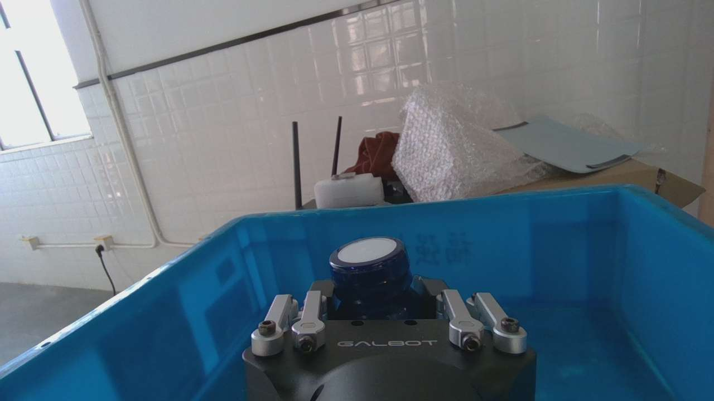

## 81. 助手（进展）

已抽查到原图证据：一帧里夹爪正夹着牛奶瓶，目标是 **0 mm**，实测是 **45.5 mm**，这支持“受物体阻挡”的解释。

模型的大误差也主要集中在开闭过渡：713个验证窗口中，全闭目标平均误差约 **1.82 mm**，全开约 **1.10 mm**，中间开度却约 **28.47 mm**。我会把这部分与原始指令逐条核对，确认是否存在标签错配。

## 82. 助手

_工具输出图片（原始工具文本未纳入归档）。_

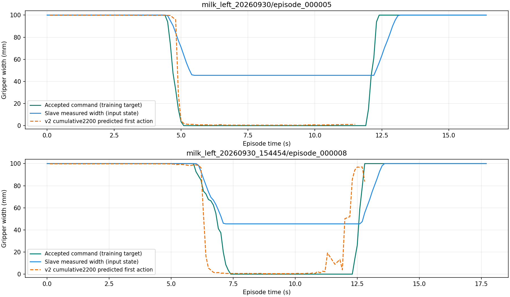

## 83. 助手

查完了：**主臂目标与从臂实测的范围确实不同，但没有发现单位换算、字段互换或标签导出错误。当前模型的问题更集中在夹爪开闭过渡阶段。**

本次检查了三批数据的 **44次原始录制、87,744条夹爪反馈**，并逐条核对训练导出的 **39组、7,184帧**。

**左侧夹爪范围如下，开度单位均为mm：**

| 数据批次 | 主臂扳机原值 | 主臂映射目标 | 从臂接受目标 | 从臂实测开度 |
|---|---:|---:|---:|---:|
| 第一批，11组 | 0～0.700 | 0～100 | 0～100 | **38.5～100** |
| 第二批，11组 | 0～0.700 | 0～100 | 0～100 | **38.5～100** |
| 第三批，17组 | 0～0.700 | 0～100 | 0～100 | **38.0～100** |

主臂记录的是**扳机值及其映射开度**，没有主臂机械夹爪的实测宽度。映射为：扳机≤0.04对应闭合0mm，≥0.66对应张开100mm，中间线性变化。

右侧未参与跟随：控制日志中扳机恒为 **0.700**、实测开度恒为 **50mm**，没有接受右夹爪指令，也未进入当前左臂训练。原始采集未包含右夹爪高频数据流。

**为什么指令能到0mm，实际只到38～46mm？**

我抽查了原始画面：第三批第8组的12秒处，目标为 **0mm**、实测为 **45.5mm**，画面中夹爪正夹着牛奶瓶。这支持“被物体阻挡，无法继续闭合”的解释，不能把38mm认作空载机械最小开度。

训练里的 `action` 是接受的指令，`state` 是实测反馈。全部7,184帧都能追溯到对应原始反馈和接受指令，实际Parquet仅有浮点舍入差异。

**更明显的问题在过渡段：**

| 713个验证窗口的首步目标 | 窗口数 | 模型夹爪平均误差 |
|---|---:|---:|
| 接近全闭，≤1mm | 335 | **1.82mm** |
| 接近全开，≥99mm | 304 | **1.10mm** |
| 中间开度，1～99mm | 74 | **28.47mm** |

16个误差超过50mm的窗口中，**13个属于中间开度**。训练起点中，中间开度也只占约 **11.9%**。这些证据更指向：模型学会了保持开/关两端，但对抓放切换时机和连续过渡学习不足。

建议保留指令与反馈各自的语义，优先检查过渡段并调整采样或补充示教；目前没有依据把闭合指令从0mm直接改成38mm。

[查看对比曲线](<../../assets/4c080cb091b802fd--image-4c080cb091b8.png>) · [完整审计结果](<../../assets/4a592889c15382b2--audit.json>)


[附件：4a592889c15382b2--audit.json](../../assets/4a592889c15382b2--audit.json)

## 84. 用户

主臂数据是否进入训练？
力传感器的数据是否可以给我对比展示一下
黄线是如何得到的？ 是否随着机械臂的运动，摄像头的变化，黄线也会变化？黄线的预测时间是多少步多长时间？

## 85. 助手（进展）

我会核对训练实际读取的字段，解释黄线的生成方式和时间范围，再把原始六维力与夹爪开闭、机械臂运动放在同一时间线上展示。

## 86. 助手（进展）

核对后，主臂关节值和扳机值没有作为模型的直接输入；它们经过遥操映射、限幅和SDK接受后，间接形成训练目标。模型直接读取从臂实测状态、相机、深度、左腕六维力和任务文本。

刚才图里的黄橙色虚线，是每个记录时刻重新预测的“第1步夹爪指令”连成的曲线。每次模型实际输出10步，间隔0.1秒，覆盖当前时刻至约0.9秒后；这条线并不是一次预测出的整段轨迹。

## 87. 助手

_工具输出图片（原始工具文本未纳入归档）。_

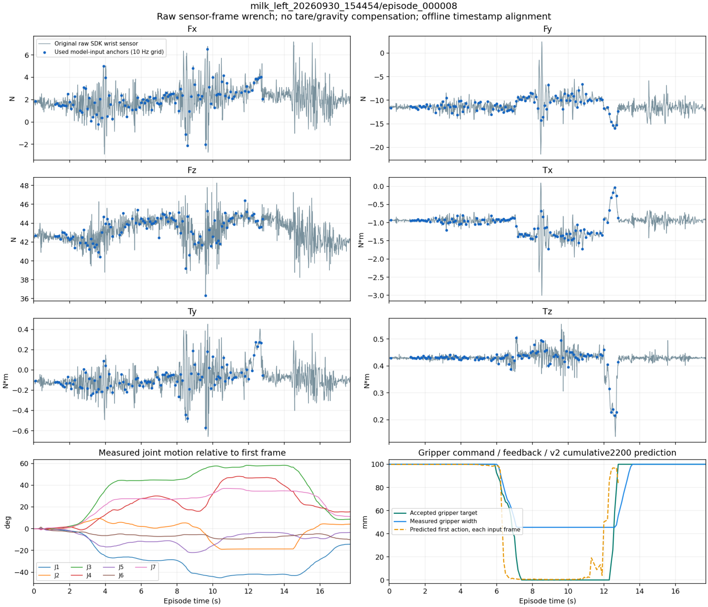

## 88. 助手

_工具输出图片（原始工具文本未纳入归档）。_

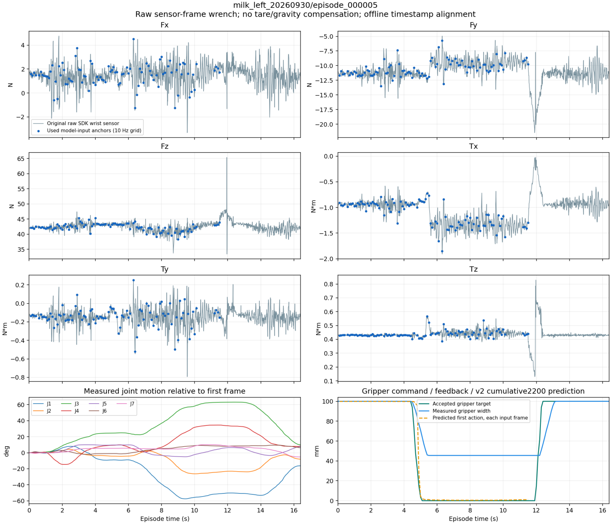

## 89. 助手（进展）

力传感器对比图已生成：灰线是原始左腕力/力矩，蓝点是实际模型输入起点使用的读数，下方对照关节运动、夹爪指令、反馈和黄线预测。

还发现一个采样限制：当前模型虽只预测10步，输入起点仍沿用旧版“需要完整50步标签”的缓存，因此每组最后约4.9秒没有预测起点。39次开爪过程中，有12次发生在最后可用起点之后；这会减少模型在开爪时刻看到的直接观测，值得作为下一步训练改进。

## 90. 助手

**主臂数据间接参与了训练，但没有作为模型的直接输入。**

当前数据链路是：

`主臂关节/扳机 → 遥操映射与限幅 → SDK接受的从臂指令 → 训练目标 action`

模型直接输入的是：**从臂7个实测关节角、实测夹爪开度、左腕六维力、三路RGB、腕部深度和任务文本**。主臂关节角、扳机值没有直接送进网络。

**六维力对比图已经做好：**

- [第一批第5组：预测较好的例子](<../../assets/b65e0f0f8ea3e423--milk_left_20260930_episode_000005_wrench_motion.png>)
- [第三批第8组：夹爪过渡误差较大的例子](<../../assets/6e672c59a9dd62ac--milk_left_20260930_154454_episode_000008_wrench_.png>)

图中前六个面板分别是 `Fx/Fy/Fz`，单位 **N**，和 `Tx/Ty/Tz`，单位 **N·m**：

- **灰线**：原始左腕传感器读数。
- **蓝点**：实际模型输入起点使用的读数，已与原件核对一致。
- **左下**：从臂七关节相对起始姿态的变化。
- **右下**：夹爪接受目标、实测开度和模型预测。

目前只记录了**从臂左腕六维力**，模型也不输出力预测。零点、坐标变换及重力补偿尚未确认，因此这些读数不能直接当作纯接触力。

**黄线是怎样得到的？**

你刚才图里的黄橙色虚线，是在每个记录时刻：

`当前相机/深度/从臂状态/六维力 → 模型预测 → 取第1步夹爪开度 → 连成曲线`

它没有使用未来真实动作生成预测。

随着机械臂运动、摄像头画面、深度或力读数变化，**重新推理得到的黄线可能变化**；模型权重在评估时保持不变。一次已经生成的预测块，只有收到新观测并重新计算，才会得到更新。

**每次预测10个动作步，间隔0.1秒，覆盖约1秒。** 标签时间点是：

```text
t、t+0.1、t+0.2、……、t+0.9秒
```

每一步包含7个关节目标和1个夹爪目标。**当前黄线只画每次预测的第1步**，不是把一次预测的全部10步连接起来。

另外，检查发现：当前10步模型仍沿用旧版需要50步完整标签的输入起点，因此每组最后约4.9秒没有预测起点。图中后段缺少蓝点或黄线，并不代表传感器没有采集。下一轮应按10步重新生成起点，让模型看到更多开爪阶段的直接观测。

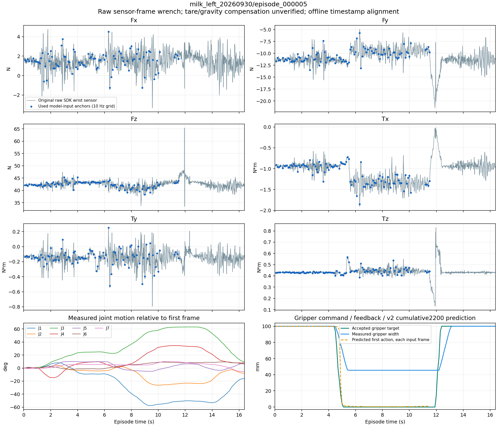

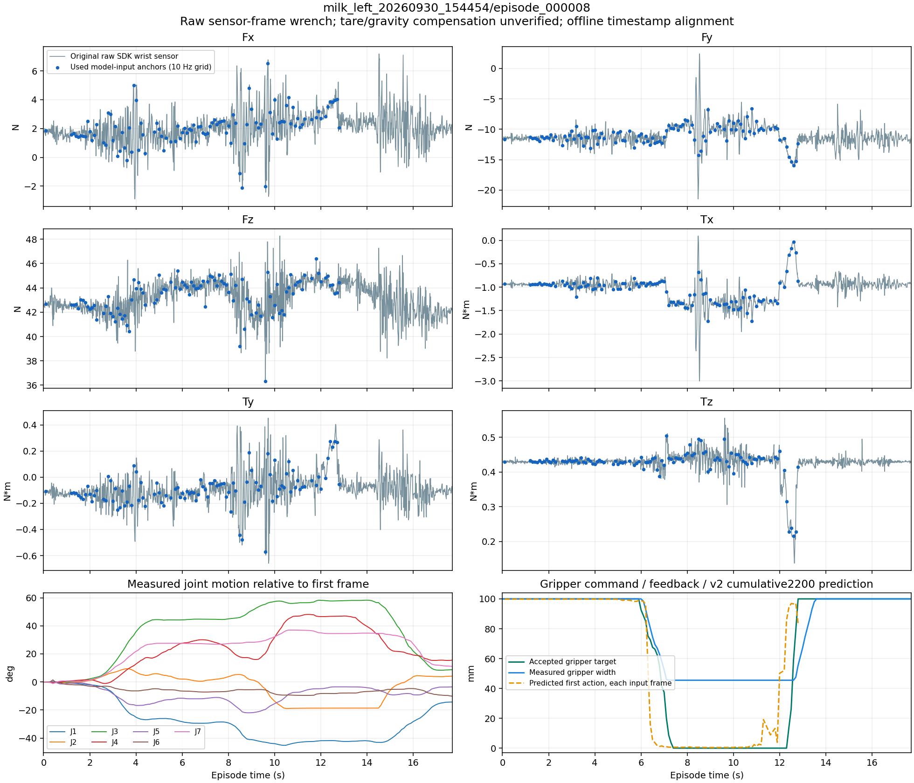

## 91. 用户

那这个黄线是如何画出来的？

## 92. 助手

黄线是把**模型在每个时刻预测的“第一步夹爪指令”连起来**画出的。

具体过程是：

1. 读取某个时刻的真实记录：相机图像、深度、从臂姿态、夹爪反馈和六维力。
2. 模型根据这些观测，一次预测10步动作。
3. **只取第1步的夹爪开度**，转换成mm，画在这个时刻。
4. 对下一个记录时刻重复上述过程，最后连接这些点。

例如：

```text
6.0秒的观测 → 预测10步 → 取第一步：95mm → 画点(6.0, 95)
6.1秒的观测 → 重新预测 → 取第一步：80mm → 画点(6.1, 80)
6.2秒的观测 → 重新预测 → 取第一步：20mm → 画点(6.2, 20)
```

实际绘图取的是：

```python
yellow_mm = predictions["predicted_action"][:, 0, 7] * 1000
# 所有样本、第1个动作步、第8个动作维度（夹爪）
plt.plot(observation_times, yellow_mm, "--")
```

**关键区别：下一时刻仍使用数据集里真实记录的观测，没有让机器人执行上一次预测。** 因此，黄线展示的是离线逐时刻预测效果，并不是机器人实际执行后的轨迹，也不是一次预测出的完整10步曲线。

## 93. 用户

如果是这样的话，这个图说实话也分析不出啥东西吧，还得上真机来进行验证吧

## 94. 助手

**是，最终必须通过真机闭环验证。当前黄线不能证明机器人能完成任务。** 我之前对离线误差改善的评价，应限定在“拟合示教指令更好”，不能直接推导为抓取成功率提高。

这张图仍能筛查问题：例如第8组出现了**提前开爪**，以及开闭过渡预测不准。但它无法验证：

- 预测动作执行后，机器人和物体实际会怎样变化。
- 新姿态下的相机画面是否导致后续预测偏离。
- 误差是否不断累积，最终发生抓空、滑落或放置失败。

真正的闭环应该是：

**当前真实观测 → 预测 → 执行第1步 → 获取执行后的新观测 → 再预测。**

下一步应转向真机验证准备：先用真机实时数据做推理预览，确认输入与训练一致；再进行低速、短时、有人监护的闭环测试。最终记录**抓取成功率、放置成功率、提前松爪/滑落次数、人工接管次数**。

当前已有J2原始预测越界和提前开爪的证据，因此模型还需要受控测试。**现在继续单纯追加训练步数，价值已经小于检查真实闭环行为。**

## 95. 用户

<external_codex_apps_open_page>{"page_id":null}</external_codex_apps_open_page>

## 96. 用户

现在我们这个模型是哪个版本？ 名字是啥？

## 97. 助手（进展）

我核对一下当前选用的检查点和配置，确认模型名称、版本及累计训练步数。

## 98. 助手

当前选用的是 **SmolVLA 牛奶任务重训 v2，累计2,200步最佳模型**。

- **项目版本**：`g1_smolvla_short_retrain/2`，这里的v2是我们项目的版本编号。
- **训练模式**：`force-depth`，输入包含RGB、深度、六维力和从臂实测状态。
- **输出**：10步动作，约1秒；每步为7个关节目标＋夹爪开度。
- **训练方式**：动作专家及自定义模块训练，未使用LoRA。
- **软件版本**：LeRobot `0.4.4`。

[当前最佳模型目录](/mnt/data/VLA_data/smolvla_runs/smolvla-retrain-v2-continue-20261008_161604-149225/checkpoints/step_000400/model_bundle)

目录中的 `step_000400` 是**续训阶段第400步**，加上来源模型的1,800步，累计为 **2,200步**。
