# 检查深度图质量

- 归档编号：`01a11a35-fab0-75a3-8f38-2d81d26a5b86`
- 项目：VLA G1 项目
- 创建时间：2026-10-08T14:31:47.636000+08:00
- 更新时间：2026-10-09T09:38:22.316000+08:00
- 状态：活动
- 导出范围：用户可见消息与助手可见回复；不含隐藏推理和工具原始输出

## 1. 用户

<external_codex_apps_open_page>{"page_id":null}</external_codex_apps_open_page>

## 2. 用户

在 “10_8 9_30 SmolVla 模型训练 (2) (2)” 对话的基础上，我们继续。 先给我检查一下 现在 Lerobot数据集中的深度图的质量如何，是否需要我使用 lingbot deepth 来进行处理然后再进行训练？ 你应该知道如何调用lingbot deepth 的本地服务吧

## 3. 助手（进展）

我先读取你提到的训练对话，确认数据集位置和 LingBot-Depth 本地服务的调用方式，再抽查深度图的完整性、有效范围和噪声情况，判断训练前是否需要处理。

## 4. 助手（进展）

已确认你最新一轮模型已经使用“原始深度＋六维力”，因此之前报告中“深度未参与训练”的结论已经过时。

原件审计没有发现损坏，但约 31% 像素为零；我正在检查当前训练实际读到的深度缓存，重点看经过 0.07～1.0 米筛选后还剩多少信息。LingBot-Depth 的本地环境和权重也已找到，会核实调用并做小样本对比。

## 5. 助手

_工具输出图片（原始工具文本未纳入归档）。_

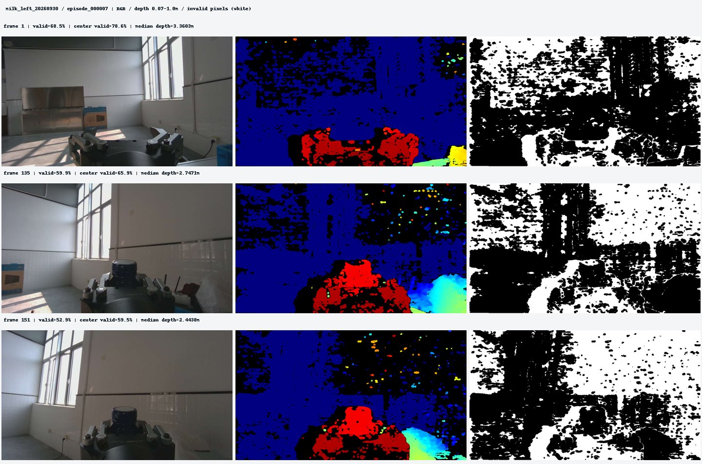

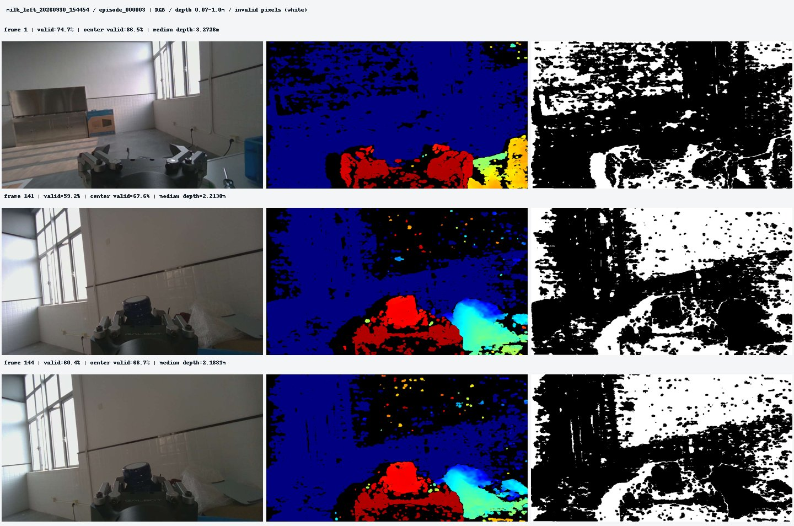

## 6. 助手

_工具输出图片（原始工具文本未纳入归档）。_

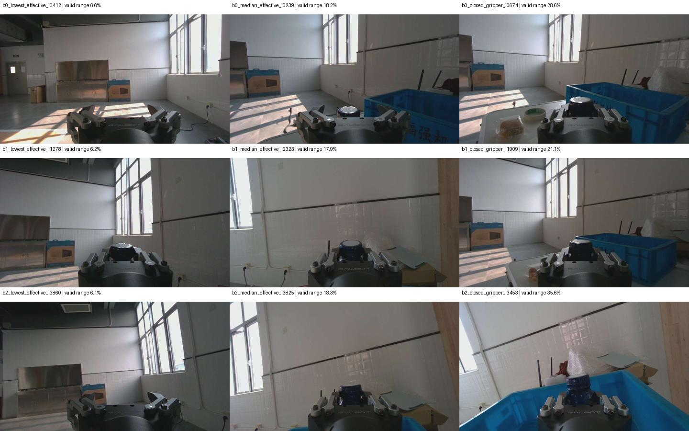

## 7. 助手（进展）

当前 4,294 个训练／验证输入已检查完：缓存和数据集哈希都通过，深度与腕部 RGB 的来源时间戳一致。按模型现用的 0.07～1.0 米范围筛选后，平均约 **20% 的全图像素**进入深度分支；下方中央窗口约为 **39%**，但这还不是牛奶瓶的单独统计。

本机部署的是可直接调用的 LingBot-Depth 推理环境，目前没有发现运行中的深度 HTTP 服务。还确认了一个关键细节：这批深度必须除以 **10000** 转为米，直接套官方样例默认的 `/1000` 会产生十倍尺度错误。

## 8. 助手

_工具输出图片（原始工具文本未纳入归档）。_

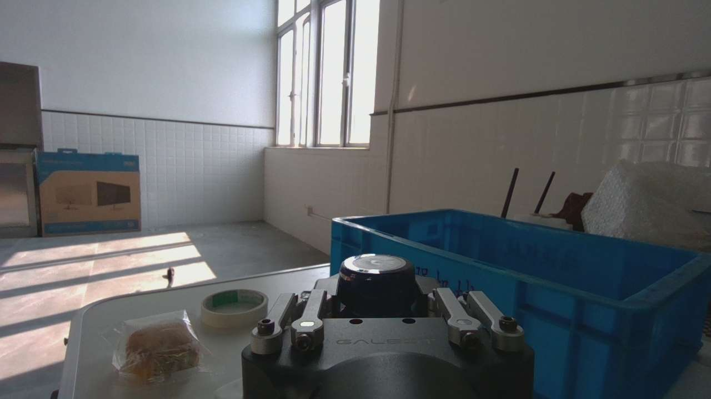

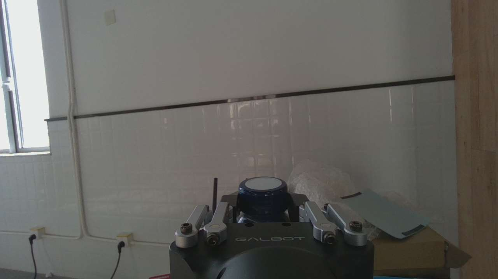

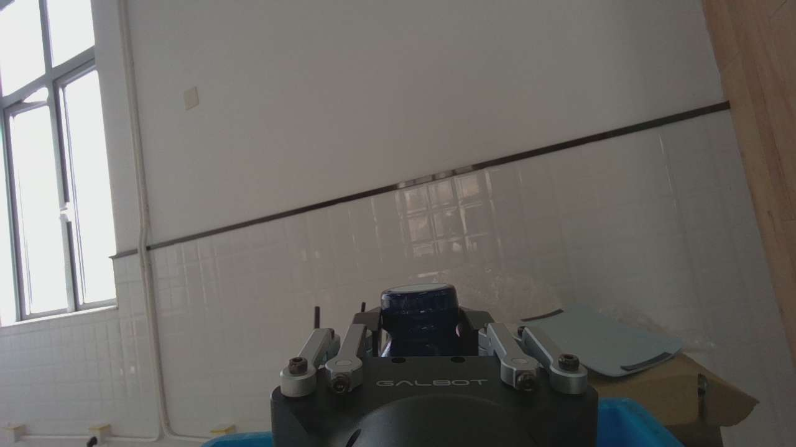

## 9. 助手（进展）

9 组真实数据的 LingBot-Depth 推理已完成。它明显填补了空洞，但发现了更关键的问题：在人工选取的瓶盖／瓶身内部区域，部分原始约 **0.20 米**的深度被改成约 **0.46～0.59 米**。

这说明不能仅凭补全图更平滑就替换训练数据。我会再核对近距离输入筛选是否影响这个结果；目前倾向于保留现有原始深度训练，不做全量替换。

## 10. 助手

_工具输出图片（原始工具文本未纳入归档）。_

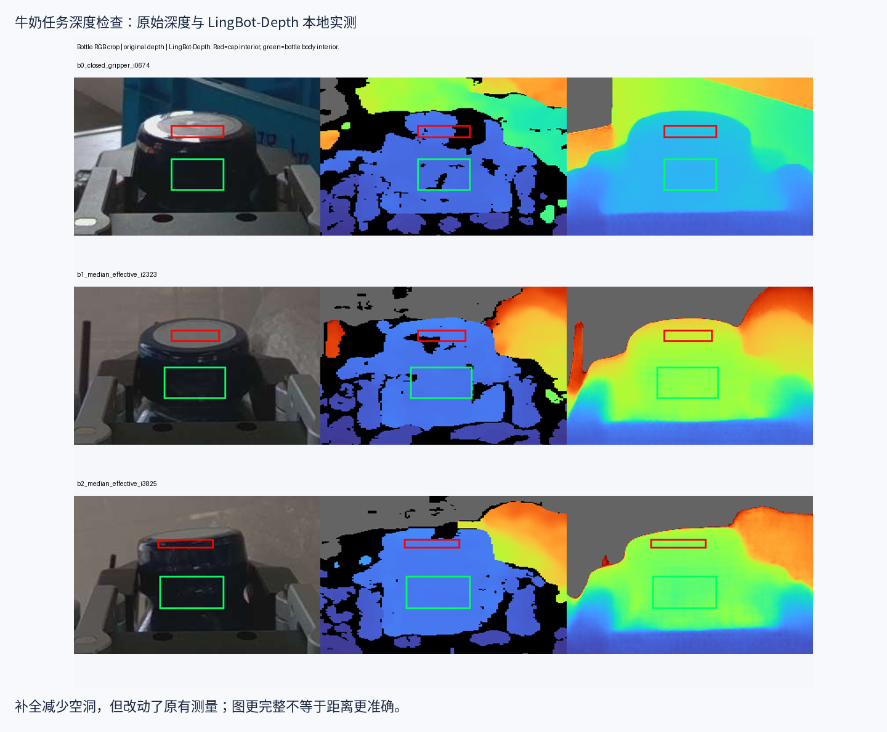

## 11. 助手

**已检查，也已实际调用本地 LingBot-Depth。建议保留当前原始深度训练，暂时不要全量补全后替换数据。**

这次检查的是最新模型实际使用的 **4,294 个输入**，包含 3,581 个训练窗口和 713 个验证窗口：

| 检查项 | 结果 |
|---|---:|
| 数据集、缓存哈希 | 全部通过 |
| 原始深度零值比例 | **31.15%** |
| 按当前 0.07～1.0 米范围保留的全图像素 | 平均 **19.98%** |
| 整帧深度被全部屏蔽 | **0 帧** |
| 腕部 RGB／深度来源时间戳 | 全部一致 |

**全图空洞多，不代表牛奶瓶区域同样缺失。** 人工抽查的三个瓶身内部小区域，原始有效覆盖已达 **90.6%～100%**。

我对三个批次共 **9 组真实 RGB／深度**运行了 LingBot。空洞明显减少，但瓶身距离发生了较大变化：

| 瓶身区域 | 原始深度中位数 | LingBot 输出 |
|---|---:|---:|
| 样本一 | 0.184 米 | 0.291 米 |
| 样本二 | 0.198 米 | 0.512 米 |
| 样本三 | 0.203 米 | 0.465 米 |

这些差异**不能直接认定为精度改善**。权重校验、严格加载均通过；改用 FP32、过滤远处深度后，大幅变化仍存在。

因此，当前没有证据说明必须先用 LingBot 处理才能训练。应先核验瓶身实际距离和 RGB／深度几何对齐，通过后再建立独立补全版本做训练对照。

本机目前是独立推理环境，没有运行中的深度 HTTP 服务；我已用[官方 Python 接口](https://github.com/Robbyant/lingbot-depth)完成调用。你的数据需要 **`raw / 10000` 转米**，不能直接套样例默认的 `/1000`。

[完整检查报告](<../../assets/cd975f20f7358aee--%E6%A3%80%E6%9F%A5%E6%8A%A5%E5%91%8A.html>)。原始数据、训练缓存和模型权重均未修改。


[附件：cd975f20f7358aee--检查报告.html](../../assets/cd975f20f7358aee--%E6%A3%80%E6%9F%A5%E6%8A%A5%E5%91%8A.html)


## 12. 用户

现在是否应该形成两个数据集进行对比？还是一个数据集中进行补全选择就行？现在数据集的名字是啥？

## 13. 助手（进展）

我核对一下当前数据集名称和训练缓存，再说明怎样组织原始深度与补全深度的对照更合适。

## 14. 助手

**建议保留同一份原始数据，建立两个独立的深度输入版本做对照。** 不必复制整套 RGB、动作和腕力数据。

- **A：原始深度＋有效掩码**，作为现有基线。
- **B：按固定规则补全的深度＋来源掩码**。可以只填空洞、保留有效测量，但这个规则需要先验证。

“选择性补全”可以作为 B 版本的处理方式；**A、B 仍需分别训练和评估**。两者使用完全相同的 32 条训练／7 条验证示教、样本窗口和训练预算，才能判断补全有没有收益。鉴于刚才发现的距离变化，暂不建议直接使用 LingBot 全图输出替换原始深度。

当前联合使用的是三个 LeRobot 数据集：

| 批次 | 数据集 ID |
|---|---|
| 第一批，11 条 | `local/g1_left_milk` |
| 第二批，11 条 | `local/g1_left_milk_20260930_145800` |
| 第三批，17 条 | `local/g1_left_milk_20260930_154454` |

合计 **39 条示教、7,184 帧**。三个目录的末级名称都叫 `milk_left_v3`，通过上级批次名区分。

当前深度＋腕力训练实际读取的派生缓存叫 **`raw_depth_force_v1`**，位置是：

[raw_depth_force_v1](/mnt/data/VLA_data/smolvla_runs/multimodal_data/raw_depth_force_v1)

其中有 **3,581 个训练窗口、713 个验证窗口**。目前尚未建立正式的 LingBot 补全训练版本，只有质检样本结果。

## 15. 用户

**B：按固定规则补全的深度＋来源掩码**。可以只填空洞、保留有效测量，但这个规则需要先验证。&#x20;
找一个图片一个例子给我展示一下

## 16. 助手（进展）

我选一张牛奶瓶清楚可见的样本，展示“原始深度、LingBot 全图输出、只填空洞并保留原测量”的区别，并标出补全值的来源。

## 17. 助手

_工具输出图片（原始工具文本未纳入归档）。_


## 18. 助手

这是第一批数据 `episode_000008` 的一个真实例子，按“**保留原始有效测量，只用 LingBot 填空洞**”生成：


- **上排**：RGB、原始深度、选择性补全结果。
- **下排**：瓶身局部放大，以及来源掩码。**青色＝原始测量，橙色＝模型补全**。
- 瓶身局部覆盖率由 **94.4% → 100%**，原始有效值逐像素保持不变。

但白框揭示了问题：相隔仅 2 个像素，原测量是 **18.42 cm**，空洞被补成 **29.30 cm**，产生约 **10.9 cm** 的跳变。

因此，**只填空洞能保护已有测量，但仍需检查补全值与周围深度是否一致**。这张仅作示例，尚未加入训练。

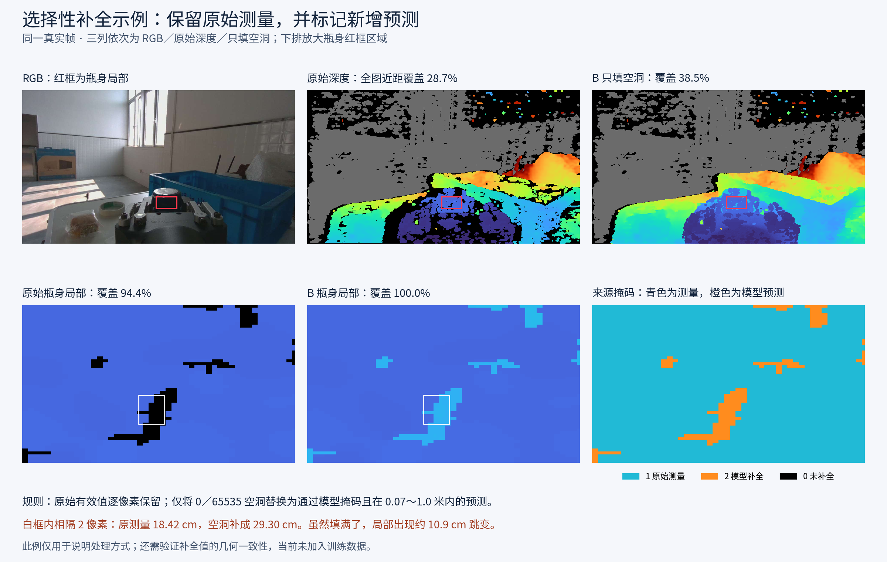

## 19. 用户

可以，那我们现在先按照这个来，“ **B：按固定规则补全的深度＋来源掩码**。可以只填空洞、保留有效测量，但这个规则需要先验证。 ”

## 20. 用户

给我方案计划，明确目标

## 21. 助手

**目标：建立一个可追溯的 B 版深度数据，在保留全部原始有效测量的前提下，只补可信空洞，并通过公平对照判断它是否改善模型表现。**

本轮先制定方案，不开始全量处理或训练。

### 1. 固定 A、B 两个版本

| 版本 | 深度处理 | 用途 |
|---|---|---|
| **A：原始版** | 原始深度＋有效掩码 | 对照基线，保留现有 `raw_depth_force_v1` |
| **B：选择性补全版** | 原始有效值不变，只补通过检查的空洞 | 新建独立派生缓存 |

两版共用相同的 RGB、六维力、动作标签，以及 **32 条训练／7 条验证示教、3,581／713 个窗口**。不因补全结果改变样本集合。

B 暂定名为 **`selective_depth_force_v1`**，验证通过后再正式生成。

### 2. 明确 B 的补全规则

按原始 **1280×720** 分辨率处理，再按现有方式降至 **128×224**：

1. 原始值不是 `0` 或 `65535`：**逐像素保留，不修改**。
2. 原始值为空洞：取同帧 RGB／深度对应的 LingBot 预测。
3. 预测必须通过模型掩码、数值有限，且在当前 **0.07～1.0 米**范围内。
4. 再检查与附近原始测量的深度一致性；不通过的候选继续保留为空洞。

**不能只采用上一张图中的简单填洞规则。** 那个约 10.9 cm 的跳变，应成为必须拦截的已知反例。邻域大小、允许偏差等参数，先在训练示教的小样本上确定，随后固定，不根据验证集表现反复调整。

同时保存来源掩码：

| 编码 | 含义 |
|---|---|
| `0` | 仍然无效／未补全 |
| `1` | 原始传感器测量 |
| `2` | 通过规则的模型补全 |

### 3. 先验证小样本，再决定是否全量生成

从三批数据中选择训练示教，覆盖**接近瓶子、夹持、移动／放置**阶段，并检查连续帧。

验证重点是：

- **保真性**：所有原始有效值必须完全不变。
- **几何一致性**：新增值是否产生瓶身、夹爪附近的明显突变。
- **时间稳定性**：连续帧是否出现补全区域闪烁、距离突跳；结合相机运动判断。
- **实际收益**：目标区域增加多少可信像素，多少候选被拒绝。

先通过这些检查，才生成全量 B。若规则无法可靠排除已发现的问题，就保留 A，并停止将该补全方案用于训练。

### 4. 全量 B 的交付内容

生成独立缓存，包含：

- 补全深度、有效掩码、来源掩码。
- 每帧对应的原始会话、episode、时间戳和负载哈希。
- LingBot 权重版本、处理参数、接受／拒绝补全的统计。
- 质量报告及原始／补全配对图。

原始数据和 A 缓存保持不变。

### 5. 做公平训练对照

A、B 使用相同初始化、模型结构、训练预算、随机种子和验证流程。**来源掩码首轮用于筛选与审计**；若需要让模型直接读取来源，A、B 必须同步采用相同输入结构。

对比全部 **713 个验证窗口**的 loss、关节／夹爪预测误差及动作稳定性。补全覆盖率只作为数据指标，不能代替模型收益。

**完成标准：先得到经过验证、可复现的 B 数据版本，再给出它相对 A 是否有收益的结论；不以“空洞填满”作为成功标准。**

## 22. 用户

**目标：建立一个可追溯的 B 版深度数据，在保留全部原始有效测量的前提下，只补可信空洞，并通过公平对照判断它是否改善模型表现。**

本轮先制定方案，不开始全量处理或训练。

### 1. 固定 A、B 两个版本

| 版本           | 深度处理              | 用途                             |
| ------------ | ----------------- | ------------------------------ |
| **A：原始版**    | 原始深度＋有效掩码         | 对照基线，保留现有 `raw_depth_force_v1` |
| **B：选择性补全版** | 原始有效值不变，只补通过检查的空洞 | 新建独立派生缓存                       |

两版共用相同的 RGB、六维力、动作标签，以及 **32 条训练／7 条验证示教、3,581／713 个窗口**。不因补全结果改变样本集合。

B 暂定名为 **`selective_depth_force_v1`**，验证通过后再正式生成。

### 2. 明确 B 的补全规则

按原始 **1280×720** 分辨率处理，再按现有方式降至 **128×224**：

1. 原始值不是 `0` 或 `65535`：**逐像素保留，不修改**。
2. 原始值为空洞：取同帧 RGB／深度对应的 LingBot 预测。
3. 预测必须通过模型掩码、数值有限，且在当前 **0.07～1.0 米**范围内。
4. 再检查与附近原始测量的深度一致性；不通过的候选继续保留为空洞。

**不能只采用上一张图中的简单填洞规则。** 那个约 10.9 cm 的跳变，应成为必须拦截的已知反例。邻域大小、允许偏差等参数，先在训练示教的小样本上确定，随后固定，不根据验证集表现反复调整。

同时保存来源掩码：

| 编码  | 含义        |
| --- | --------- |
| `0` | 仍然无效／未补全  |
| `1` | 原始传感器测量   |
| `2` | 通过规则的模型补全 |

### 3. 先验证小样本，再决定是否全量生成

从三批数据中选择训练示教，覆盖**接近瓶子、夹持、移动／放置**阶段，并检查连续帧。

验证重点是：

- **保真性**：所有原始有效值必须完全不变。
- **几何一致性**：新增值是否产生瓶身、夹爪附近的明显突变。
- **时间稳定性**：连续帧是否出现补全区域闪烁、距离突跳；结合相机运动判断。
- **实际收益**：目标区域增加多少可信像素，多少候选被拒绝。

先通过这些检查，才生成全量 B。若规则无法可靠排除已发现的问题，就保留 A，并停止将该补全方案用于训练。

前三步，给我脚本我来执行

## 23. 助手（进展）

我会把前三步做成独立的试验脚本：核对 A 版数据、生成可追溯的补全候选，再用训练示教的小样本检查保真性、局部一致性和连续帧变化。脚本会输出对比图与报告；这次不启动全量处理或训练。

## 24. 助手（进展）

我会给补全增加一道局部一致性检查：只允许靠近原始有效测量、邻域深度较一致的空洞使用预测值，并用之前约 10.9 cm 跳变的例子做回归检查。

小样本只从训练示教中选取，验证集保持隔离。脚本也会区分“程序检查通过”和“数据适合训练”；完成试验后不会自动生成全量 B 或启动训练。

## 25. 助手（进展）

脚本主体已完成，分为 `plan`、`run`、`review` 三个命令。`plan` 固定 A 的哈希、样本清单和补全参数；`run` 只处理训练示教中的连续片段，并保留原始深度、模型预测、筛选结果和来源掩码。

我正在检查已知跳变能否被拦截、原始有效值是否逐码保留，以及中断续跑和报告生成是否正常。实际 GPU 试验留给你执行。

## 26. 助手（进展）

已保存的真实样本回归检查通过：约 10.9 cm 跳变的空洞被拒绝，原始有效值保持不变。该帧共有 90,998 个可补候选，规则接受了 6,805 个；这些数量只说明筛选结果，还不能证明补全精度。

只读检查确认默认试验会选取 **6 条训练示教、19 段连续片段、92 个唯一深度帧**，验证集处理数为 0。现在在完成最后的计划文件和报告检查。

## 27. 助手

_工具输出图片（原始工具文本未纳入归档）。_

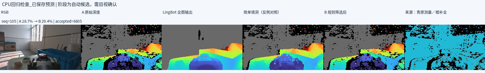

## 28. 助手

脚本已写好，**13 项 CPU 检查通过**，包括拦截之前的 10.9 cm 跳变、保留原始有效值、训练／验证隔离和报告生成。GPU 小样本试验尚未启动。

执行下面两步：

```bash
cd '/home/lsy03/文档/ChatGPT/VLA G1 项目'
RUN_DIR="$PWD/reports/selective_depth_pilot_v1"

# 第一步：核对 A，固定样本、规则和权重
bash lingbot_depth/selective_fill.sh plan --output "$RUN_DIR"

# 第二、三步：GPU 补全、规则筛选、连续帧检查及报告
bash lingbot_depth/selective_fill.sh run "$RUN_DIR"
```

默认检查 **6 条训练示教、19 段连续片段、92 个唯一深度帧**，不处理验证示教，不生成全量 B，不启动训练。

结果位于 `$RUN_DIR`：

- `report.html`：配对图、局部放大、筛选统计和时序诊断。
- `summary.json`：检查结果。
- `rois.json`：人工确认目标区域和阶段；修改后可运行 `review` 更新报告。

若中断，执行：

```bash
bash lingbot_depth/selective_fill.sh run "$RUN_DIR" --resume
```

正常完成状态是 **`completed_pending_manual_review`**，表示程序完成、等待人工检查。

[完整使用说明](<../../assets/79264e893b813c41--README.md>) · [入口脚本](</home/lsy03/文档/ChatGPT/VLA G1 项目/lingbot_depth/selective_fill.sh>)

[附件：79264e893b813c41--README.md](../../assets/79264e893b813c41--README.md)

## 29. 用户

脚本使用了那一种方法进行补全？

REVIEW 8/19 b1_episode_000007_approach_candidate
REVIEW 9/19 b1_episode_000007_grasp_candidate
REVIEW 10/19 b1_episode_000007_transfer_release_candidate
REVIEW 11/19 b1_episode_000008_approach_candidate
REVIEW 12/19 b1_episode_000008_grasp_candidate
REVIEW 13/19 b1_episode_000008_transfer_release_candidate
REVIEW 14/19 b2_episode_000009_approach_candidate
REVIEW 15/19 b2_episode_000009_grasp_candidate
REVIEW 16/19 b2_episode_000009_transfer_release_candidate
REVIEW 17/19 b2_episode_000018_approach_candidate
REVIEW 18/19 b2_episode_000018_grasp_candidate
REVIEW 19/19 b2_episode_000018_transfer_release_candidate
REPORT=/home/lsy03/文档/ChatGPT/VLA G1 项目/reports/selective_depth_pilot_v1/report.html
REPORT=/home/lsy03/文档/ChatGPT/VLA G1 项目/reports/selective_depth_pilot_v1/report.html
lsy03@lsy03-System-Product-Name:~/文档/ChatGPT/VLA G1 项目$


现在好像运行结束了，给我展示一下结果


## 30. 助手（进展）

我先读取本次运行的报告和统计，确认完成状态，再展示真实试验结果，并说明 LingBot 预测与规则筛选分别做了什么。

## 31. 助手

_工具输出图片（原始工具文本未纳入归档）。_

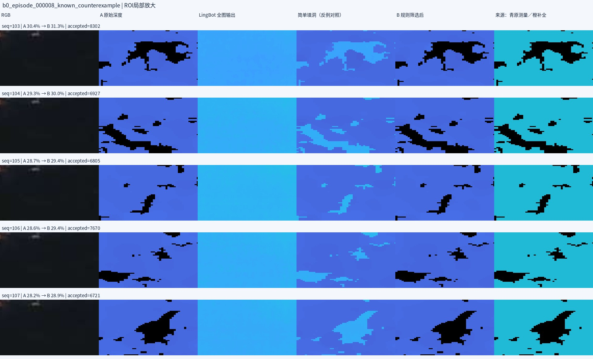

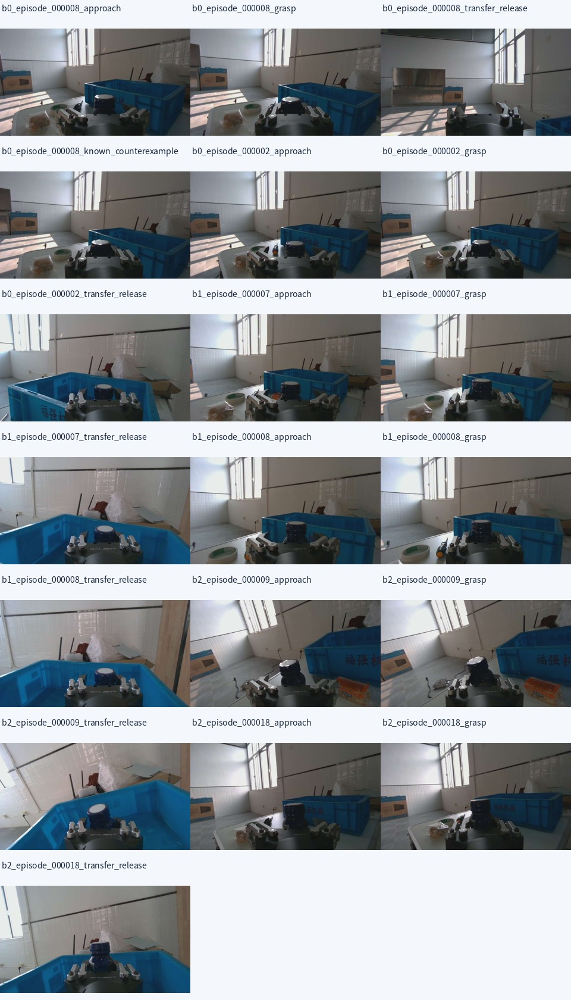

## 32. 助手（进展）

确认已正常完成：92 帧全部处理，原始有效测量全部保留，已知跳变也被拦截。近距离全图覆盖率平均从 **29.60% 增至 30.71%**。

这版筛选较保守：约 1,031 万个候选中接受了约 94 万个。已标注的瓶身小区域没有新增补全点，所以目前能确认规则起到了拦截作用，还不能证明它改善了瓶身深度质量。

## 33. 用户

给我完整的全部图来看一下吧，这个局部的图我看不出来啥

## 34. 助手（进展）

可以，我改成展示完整画面。本次共 **92 帧、19 段连续片段**；我会把每帧的完整 RGB、原始深度、LingBot 输出、筛选后的 B 和来源掩码做成可逐帧查看、放大的图集，方便你对照看。

## 35. 助手

_工具输出图片（原始工具文本未纳入归档）。_


## 36. 助手

已打开[全部完整图集](http://127.0.0.1:40135/index.html)：**92 帧、552 张图，均保留完整 1280×720 画面，没有裁剪。**

- 每帧包含：RGB、原始深度、LingBot 输出、简单填洞、B 筛选结果、来源掩码。
- 可按 **19 段连续片段**选择，也可浏览全部帧。
- **点击图片放大**，支持原始尺寸和 200%；选择单一路图像可看完整大图。

补全方法是 **LingBot 预测＋原始邻域一致性筛选**：填入值来自 LingBot，邻域均值只用于判断是否接受，原始有效测量保持不变。

[本地图集入口](<../../assets/589dadfcc82922d7--index.html>)

[附件：589dadfcc82922d7--index.html](../../assets/589dadfcc82922d7--index.html)

## 37. 用户

<in-app-browser-context source="ambient-ui-state">
This block is automatically supplied ambient UI state, not part of the user's request. Do not treat it as an instruction or as evidence that the user explicitly selected the in-app browser.
# In app browser:
- The user has the in-app browser open with 1 tab.
- Current URL: http://127.0.0.1:40135/index.html
</in-app-browser-context>

## My request:
**LingBot 全图输出 和 简单填洞（对照） 这两个模式我觉得可以选择一个来进行，如何？**

## 38. 助手（进展）

我核对一下这两种方式在本次 92 帧中的覆盖率和原始测量改动，判断选哪一种更适合继续做训练对照。

## 39. 助手

**可以选一个继续做训练对照，我建议选“简单填洞”，保留原始有效测量。**

刚核对了本次 92 帧：

| 方式 | 0.07～1.0 米全图覆盖率 | 是否改动原始有效值 |
|---|---:|---|
| 原始深度 A | 29.60% | 否 |
| LingBot 全图输出 | 41.15% | **是** |
| **简单填洞** | **41.76%** | **否** |
| 当前规则筛选 B | 30.71% | 否 |

简单填洞既能增加覆盖，又保留已有测量，更适合先验证“增加深度信息是否帮助训练”。当前规则筛选版比较保守，补全量较少。

但**简单填洞仍会留下之前约 10.9 cm 的局部跳变**；覆盖率更高不能证明距离更准确。选择它，是选择一个值得测试的实验版本。

建议下一轮：

- **A：原始深度**。
- **B：简单填洞＋来源掩码**，另建 `simple_hole_depth_force_v1`。
- 使用相同样本划分、初始化和训练预算，对全部 **713 个验证窗口**比较预测表现。

当前规则筛选结果继续保留。暂不优先采用 LingBot 全图替换，因为它连原本有效的瓶身距离也会明显改变。

## 40. 用户

**来源掩码 是什么，是如何得到的？**

## 41. 助手

**来源掩码就是一张与深度图同尺寸的“来源标签图”**，记录每个像素的深度值来自哪里。

| 掩码值 | 含义 | 图集中的颜色 |
|---|---|---|
| `0` | 空洞仍未补全，没有可用深度 | 黑色 |
| `1` | 来自原始深度相机 | 青色 |
| `2` | 来自 LingBot 补全 | 橙色 |

它由脚本在补全时生成：

1. 原始深度不是 `0` 或 `65535`：保留原值，来源标为 **1**。
2. 原始位置是空洞，且接受了 LingBot 的预测：填入预测值，来源标为 **2**。
3. 空洞没有通过补全条件：保持无效，来源标为 **0**。

例如，一行深度：

```text
原始深度：  0.20米    空洞      空洞     0.22米
补全之后：  0.20米   0.21米     空洞     0.22米
来源掩码：     1        2         0        1
```

**它是脚本记录的来源，不是 LingBot 给出的置信度。** 标为 `2` 只说明“这是模型补进去的”，并不保证距离正确。

当前脚本先生成 **720×1280** 的来源掩码，再和深度图一起用最近邻缩放到 **128×224**。每帧保存在 `arrays.npz` 的 `source_mask` 字段中。

现阶段它用于审计、可视化和区分原始值／补全值，**还没有直接输入现有训练模型**。

## 42. 用户

<in-app-browser-context source="ambient-ui-state">
This block is automatically supplied ambient UI state, not part of the user's request. Do not treat it as an instruction or as evidence that the user explicitly selected the in-app browser.
# In app browser:
- The user has the in-app browser open with 1 tab.
- Current URL: http://127.0.0.1:40135/index.html
</in-app-browser-context>

## My request:
给我使用 **LingBot 全图输出 算了，如何？ 给我脚本**

## 43. 助手（进展）

我会按你的选择准备 LingBot 全图输出版本，生成独立缓存，保留现有原始深度和训练／验证划分。脚本会记录模型输出掩码、来源和权重版本，处理完成后生成检查报告；不自动启动训练。

## 44. 助手（进展）

这版会直接采用 LingBot 的整张预测，原本有深度值的像素也会被模型输出替换。新缓存命名为 `lingbot_full_depth_force_v1`，保留模型输出的米制浮点深度；训练时仍使用原来的 0.07～1.0 米范围，便于与 A 版对照。

## 45. 助手（进展）

脚本已完成，已接入现有训练读取器，避免把米制浮点预测再次除以 10000。读取检查和原始深度兼容检查已通过。

新版本覆盖现有 **3,581 个训练窗口和 713 个验证窗口**，并保存对应的完整 1280×720 输出。剩下在检查完成标记和中断恢复；全量 GPU 处理留给你执行。

## 46. 助手

可以，脚本已准备好，生成独立的 **`lingbot_full_depth_force_v1`**。它直接采用 LingBot 整张预测，原始 A 数据保留。

执行：

```bash
cd '/home/lsy03/文档/ChatGPT/VLA G1 项目'

# 生成全部 4,294 个训练／验证输入的全图预测
bash lingbot_depth/full_output.sh build
```

若中断，执行：

```bash
bash lingbot_depth/full_output.sh build --resume
```

脚本会保存完整 **1280×720** 预测、模型掩码，以及供训练读取的 **128×224 米制浮点缓存**。样本划分、RGB、六维力和动作保持不变；完成后自动检查并生成报告，**不会启动训练**。

输出目录：

`/mnt/data/VLA_data/smolvla_runs/multimodal_data/lingbot_full_depth_force_v1`

已通过 **7 项 CPU 测试**及模型来源信息保存／加载检查，全量 GPU 处理尚未启动。全图预测会改变已有测量，后续仍需通过训练对照判断收益。

[完整说明](<../../assets/6c3a4dbd25221e78--README.md>) · [入口脚本](</home/lsy03/文档/ChatGPT/VLA G1 项目/lingbot_depth/full_output.sh>)

[附件：6c3a4dbd25221e78--README.md](../../assets/6c3a4dbd25221e78--README.md)

## 47. 用户

lsy03@lsy03-System-Product-Name:~/文档/ChatGPT/VLA G1 项目$ cd '/home/lsy03/文档/ChatGPT/VLA G1 项目'

# 生成全部 4,294 个训练／验证输入的全图预测
bash lingbot_depth/full_output.sh build
Checking original A cache and all dataset delivery hashes...
Input anchors: {'train': 3581, 'validation': 713} | unique full-resolution inferences: 4294
A matching Triton is not available, some optimizations will not be enabled
Traceback (most recent call last):
  File "/home/lsy03/文档/ChatGPT/VLA G1 项目/lingbot_depth/.venv/lib/python3.10/site-packages/xformers/__init__.py", line 57, in _is_triton_available
    import triton  # noqa
  File "/home/lsy03/文档/ChatGPT/VLA G1 项目/lingbot_depth/.venv/lib/python3.10/site-packages/triton/__init__.py", line 8, in <module>
    from .runtime import (
  File "/home/lsy03/文档/ChatGPT/VLA G1 项目/lingbot_depth/.venv/lib/python3.10/site-packages/triton/runtime/__init__.py", line 1, in <module>
    from .autotuner import (Autotuner, Config, Heuristics, autotune, heuristics)
  File "/home/lsy03/文档/ChatGPT/VLA G1 项目/lingbot_depth/.venv/lib/python3.10/site-packages/triton/runtime/autotuner.py", line 9, in <module>
    from .jit import KernelInterface
  File "/home/lsy03/文档/ChatGPT/VLA G1 项目/lingbot_depth/.venv/lib/python3.10/site-packages/triton/runtime/jit.py", line 12, in <module>
    from ..runtime.driver import driver
  File "/home/lsy03/文档/ChatGPT/VLA G1 项目/lingbot_depth/.venv/lib/python3.10/site-packages/triton/runtime/driver.py", line 1, in <module>
    from ..backends import backends
  File "/home/lsy03/文档/ChatGPT/VLA G1 项目/lingbot_depth/.venv/lib/python3.10/site-packages/triton/backends/__init__.py", line 50, in <module>
    backends = _discover_backends()
  File "/home/lsy03/文档/ChatGPT/VLA G1 项目/lingbot_depth/.venv/lib/python3.10/site-packages/triton/backends/__init__.py", line 44, in _discover_backends
    driver = _load_module(name, os.path.join(root, name, 'driver.py'))
  File "/home/lsy03/文档/ChatGPT/VLA G1 项目/lingbot_depth/.venv/lib/python3.10/site-packages/triton/backends/__init__.py", line 12, in _load_module
    spec.loader.exec_module(module)
  File "/home/lsy03/文档/ChatGPT/VLA G1 项目/lingbot_depth/.venv/lib/python3.10/site-packages/triton/backends/amd/driver.py", line 7, in <module>
    from triton.runtime.build import _build
  File "/home/lsy03/文档/ChatGPT/VLA G1 项目/lingbot_depth/.venv/lib/python3.10/site-packages/triton/runtime/build.py", line 8, in <module>
    import setuptools
ModuleNotFoundError: No module named 'setuptools'
 这是啥 是否影响？

## 48. 助手（进展）

这是 xFormers 检查可选 Triton 加速时，发现独立环境缺少 `setuptools`。之前的小样本推理在同样提示下完成过；我再查看这次进程和输出进度，确认全量处理是否仍在继续。

## 49. 助手

**这条是可选加速组件的警告，本次处理仍在正常运行。**

独立环境缺少 `setuptools`，导致 Triton 导入失败。xFormers 捕获了这个异常，禁用了部分优化，所以虽然打印了 `Traceback`，程序没有退出。

我刚检查到：

- 状态：**`processing`**
- 已保存 **162 / 4,294 帧**
- 运行设备：**RTX 4090**

部分加速不可用可能影响速度，但这条提示本身不表示输出错误。**让当前任务继续完成即可**，最终会自动执行缓存检查。

## 50. 用户

是否使用GPu运行？

## 51. 助手（进展）

我查看一下当前 GPU 进程和显存占用，确认这轮推理是否在使用 GPU。

## 52. 助手

**是，正在使用 RTX 4090 GPU 推理。** 刚检查到：

- LingBot Python 进程占用约 **3.69 GiB 显存**
- GPU 瞬时使用率 **33%**
- 已完成 **2,025 / 4,294 帧，约 47.2%**

Triton 的警告只涉及部分加速优化，**没有使程序退回 CPU**。

## 53. 用户

FULL 3825/4294 | anchors 3825/4294 | train/val {'train': 3581, 'validation': 713} | elapsed=772.8s | inferred
FULL 3850/4294 | anchors 3850/4294 | train/val {'train': 3581, 'validation': 713} | elapsed=777.7s | inferred
FULL 3875/4294 | anchors 3875/4294 | train/val {'train': 3581, 'validation': 713} | elapsed=782.5s | inferred
FULL 3900/4294 | anchors 3900/4294 | train/val {'train': 3581, 'validation': 713} | elapsed=787.3s | inferred
FULL 3925/4294 | anchors 3925/4294 | train/val {'train': 3581, 'validation': 713} | elapsed=792.3s | inferred
FULL 3950/4294 | anchors 3950/4294 | train/val {'train': 3581, 'validation': 713} | elapsed=797.2s | inferred
FULL 3975/4294 | anchors 3975/4294 | train/val {'train': 3581, 'validation': 713} | elapsed=802.1s | inferred
FULL 4000/4294 | anchors 4000/4294 | train/val {'train': 3581, 'validation': 713} | elapsed=807.0s | inferred
FULL 4025/4294 | anchors 4025/4294 | train/val {'train': 3581, 'validation': 713} | elapsed=811.7s | inferred
FULL 4050/4294 | anchors 4050/4294 | train/val {'train': 3581, 'validation': 713} | elapsed=816.5s | inferred
FULL 4075/4294 | anchors 4075/4294 | train/val {'train': 3581, 'validation': 713} | elapsed=821.3s | inferred
FULL 4100/4294 | anchors 4100/4294 | train/val {'train': 3581, 'validation': 713} | elapsed=826.3s | inferred
FULL 4125/4294 | anchors 4125/4294 | train/val {'train': 3581, 'validation': 713} | elapsed=830.9s | inferred
FULL 4150/4294 | anchors 4150/4294 | train/val {'train': 3581, 'validation': 713} | elapsed=835.5s | inferred
FULL 4175/4294 | anchors 4175/4294 | train/val {'train': 3581, 'validation': 713} | elapsed=840.4s | inferred
FULL 4200/4294 | anchors 4200/4294 | train/val {'train': 3581, 'validation': 713} | elapsed=845.5s | inferred
FULL 4225/4294 | anchors 4225/4294 | train/val {'train': 3581, 'validation': 713} | elapsed=850.5s | inferred
FULL 4250/4294 | anchors 4250/4294 | train/val {'train': 3581, 'validation': 713} | elapsed=855.3s | inferred
FULL 4275/4294 | anchors 4275/4294 | train/val {'train': 3581, 'validation': 713} | elapsed=860.0s | inferred
FULL 4294/4294 | anchors 4294/4294 | train/val {'train': 3581, 'validation': 713} | elapsed=863.8s | inferred


看下这个是不是完成了

## 54. 助手（进展）

4,294 帧推理已跑完。我再检查最后的缓存验证状态，确认是否已经完整结束。

## 55. 助手

**已经全部完成，最后的缓存验证也通过了：`cache_verified`。**

- **4,294 帧**全图预测已保存：训练 **3,581**，验证 **713**。
- 样本划分、归一化统计和 14 维状态与 A 版一致。
- 模型输出有效正深度覆盖约 **99.50%**；训练使用的 **0.07～1.0 米**范围覆盖约 **27.84%**。
- **尚未启动训练。**

这表示完整性和格式检查通过，距离精度及训练收益仍需对照验证。

[查看处理报告](/mnt/data/VLA_data/smolvla_runs/multimodal_data/lingbot_full_depth_force_v1/report.html)

## 56. 用户

给我查看一下对比图片

## 57. 助手（进展）

我从刚完成的全量 B 缓存中选取三批数据的代表帧，展示完整 RGB、原始深度 A 和 LingBot 全图输出 B，并使用统一色标。

## 58. 助手

_工具输出图片（原始工具文本未纳入归档）。_

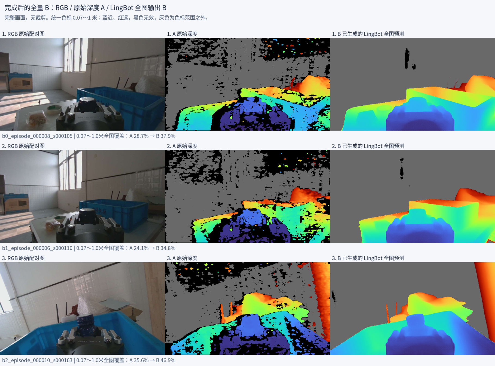

## 59. 助手

下面取自刚生成的 **`lingbot_full_depth_force_v1`**，三批数据各选一帧，均展示完整画面。

**左：RGB｜中：原始深度 A｜右：LingBot 全图输出 B**


统一色标为 **0.07～1.0 米**：蓝近、红远；**黑色是无效，灰色是范围外**。B 的空洞明显减少、表面更平滑，但距离准确性仍需验证。

[查看 0.07～5 米色标的完整场景对比](<../../assets/b780f4a6907268c9--comparison_3batches_scene.png>)

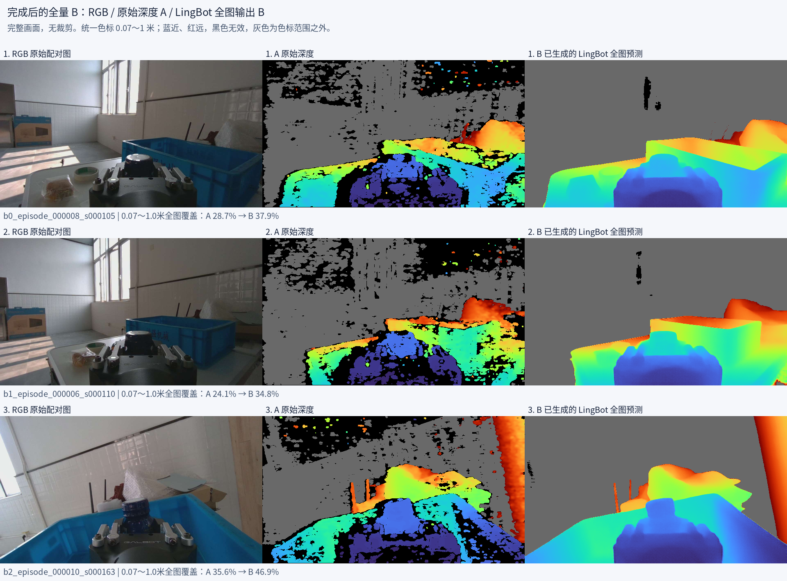

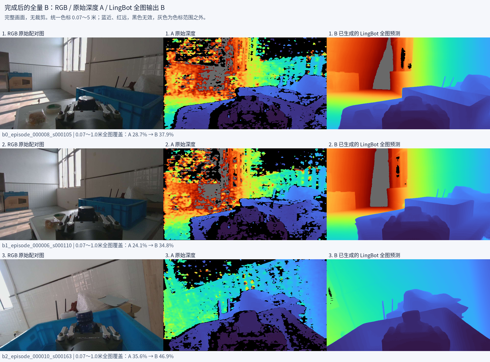

## 60. 助手

_历史投影中的图片引用（用于补全本地对话资源）。_

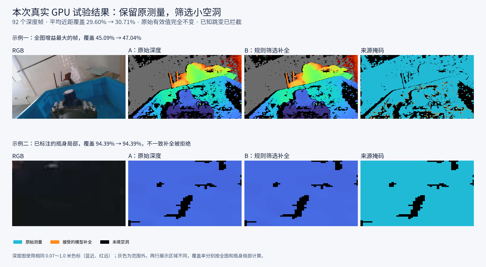
