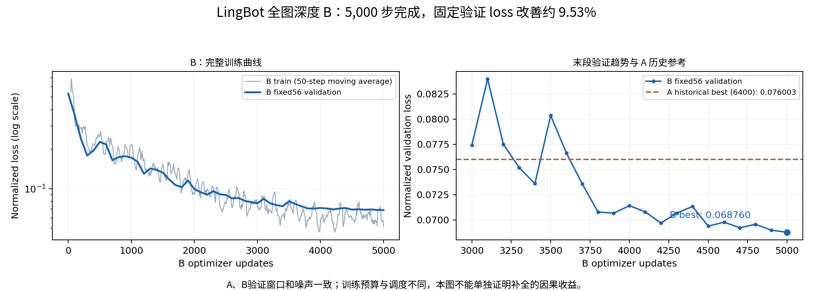
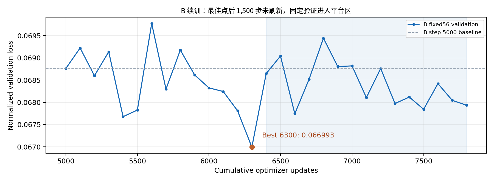

# 10_8 深度图lingbotdepth 补全重新训练 检查深度图质量 (2)

- 归档编号：`01a11b10-27e0-7af1-83f2-eec3699bec90`
- 项目：VLA G1 项目
- 创建时间：2026-10-08T18:30:06.051000+08:00
- 更新时间：2026-10-09T13:34:17.696000+08:00
- 状态：活动
- 导出范围：用户可见消息与助手可见回复；不含隐藏推理和工具原始输出

## 1. 用户

<external_codex_apps_open_page>{"page_id":null}</external_codex_apps_open_page>

## 2. 用户

现在深度图补全数据已经完整，下面我们是不是可以开始进行补全深度图的对照训练了？ 给我方案计划，明确目标

## 3. 助手（进展）

我先确认补全缓存与原始 A 版的窗口、划分和统计一致，再制定只改变深度输入的对照训练计划，明确训练预算、评估指标和判定标准。这一步不启动训练。

## 4. 助手

**可以开始对照训练。** 我刚核对了 B 的完成标记和哈希，确认 A、B 的窗口、训练／验证划分及归一化统计一致。

**明确目标：判断将原始深度替换为 LingBot 全图预测，是否改善 SmolVLA 的动作预测表现。** 深度图覆盖率提高只作为数据变化记录，最终依据是模型评估结果。本轮先制定计划，不启动训练。

### 1. 固定实验组，只改变深度输入

| 实验 | 深度缓存 | 其他输入 |
|---|---|---|
| **A：原始深度** | `raw_depth_force_v1` | 三路 RGB＋关节／夹爪状态＋六维力 |
| **B：LingBot 全图深度** | `lingbot_full_depth_force_v1` | 与 A 完全相同 |

两组保持：

- **32 条训练示教、7 条验证示教**。
- **3,581 个训练窗口、713 个验证窗口**。
- 相同动作标签、归一化、采样顺序和深度编码器结构。
- 深度输入均使用 **128×224、0.07～1.0 米**及有效掩码。
- 来源掩码用于追溯，首轮不增加新的模型输入通道。

### 2. 从相同起点重新训练

两组都从同一份 **SmolVLA 基础权重**开始，深度编码器使用相同初始化，优化器和调度器重新初始化。

已有累计 6,400 步的原始深度模型保留作历史参考。它经历了多阶段续训，不能直接与一轮新训练的 B 作为公平主对照。

首轮建议固定以下设置：

| 参数 | A、B 共用设置 |
|---|---|
| 训练模式 | `force-depth` |
| 更新步数 | **各 5,000 步** |
| Batch size | 1 |
| 学习率 | `1e-4` |
| Warmup | 500 步 |
| 学习率调度 | 相同余弦衰减 |
| 随机种子 | 42 |
| 验证频率 | 每 100 步 |
| 常规保存频率 | 每 500 步，同时保存最佳模型 |
| 早停 | **首轮关闭**，保证相同更新预算 |

两轮依次执行。训练中不分别调整学习率、范围或阈值，避免引入其他差异。

### 3. 训练前完成两组检查

分别执行真实数据前向、反向及模型保存／重载检查，不更新权重。确认：

- A 正确按 `/10000` 转米，B 直接读取米制浮点数。
- 深度分支和腕力相关参数能收到梯度。
- 初始化权重、验证窗口和配置一致。
- 损失、梯度及预测动作均为有限值。

通过后才启动两轮正式训练。

### 4. 使用统一评估判断收益

训练期间使用相同 **56 个固定验证窗口**选择最佳检查点；训练完成后，对两组的**最佳模型和第 5,000 步模型**评估全部 **713 个验证窗口**。

主要指标：

- **主指标**：预测动作的标准化 MAE，使用共同训练集的动作标准差归一化，先按示教统计，再对 7 条示教平均。
- **物理单位误差**：七关节误差以度报告，夹爪误差以毫米报告。
- **动作质量**：第一步与整个 50 步预测范围的误差、动作突变、超限及非有限值。
- **辅助指标**：验证 loss、各条示教表现及最差案例。

动作预测使用相同的固定噪声种子。重叠窗口不视为独立示教；这 713 个窗口仍属于验证集，不能当作独立测试集或实机成功率。

### 5. 预先明确判定标准

建议将以下条件作为**首轮探索门槛**，不是通用精度标准：

- B 的主指标比 A **改善至少 5%**。
- 夹爪 MAE 不恶化超过 **5%**。
- 没有新增非有限值，超限和动作突变指标没有退化。

达到门槛后，再用种子 **43、44**各重复一组 A／B，确认改善是否稳定。未达到时，结论是“当前实验未显示足够收益”，不根据结果临时放宽标准。

最终交付包括两组配置与检查点、训练／验证曲线、全量验证对照表、按示教分组的结果，以及最差预测案例。**完成标准是得出有证据支持的 A／B 结论，而不是必须让 B 胜出。**

## 5. 用户

给我脚本

## 6. 助手（进展）

我会把这份计划做成成对训练脚本：固定相同初始化、样本顺序和训练预算，依次训练 A、B，再用相同噪声评估各自的最佳模型和第 5,000 步模型。脚本会保存对照报告；这次不启动训练。

## 7. 用户

| 实验                            | 深度缓存 | 其他输入 |
| ----------------------------- | ---- | ---- |
| **A 现在是不是已经有训练结果了？只需要训练b就行了** |      |      |

## 8. 助手（进展）

对，A 已有原始深度＋六维力的训练结果，当前可以先只训练 B，保留 A 的最佳模型作比较。我会把脚本改为只运行 B；由于 A 经历过多阶段续训，这一轮比较先作为初步结果，不视为相同训练预算下的严格对照。

## 9. 助手

**对，A 已有训练结果，可以先只训练 B，无需重复训练 A。**

A 保留累计 **6,400 步**的最佳模型，固定 56 窗口验证 loss 为 **0.076003**。B 使用已准备好的脚本，从 SmolVLA 基础权重开始，保存独立结果。

执行：

```bash
cd '/home/lsy03/文档/ChatGPT/VLA G1 项目'

# 检查 B 数据、前后向和保存重载，不更新权重
bash lerobot_deploy/scripts/train_milk_lingbot_full.sh check

# 仅训练 B，固定 5,000 步
bash lerobot_deploy/scripts/train_milk_lingbot_full.sh train \
  --steps 5000 \
  --lr 1e-4 \
  --warmup-steps 500 \
  --eval-every 100 \
  --save-every 500 \
  --early-stop-patience 0 \
  --seed 42
```

训练完成后，用相同 **713 个验证窗口**比较 A、B。由于 A 经历过多阶段续训，这次先判断 B 是否有改善迹象，不能把差异全部归因于深度补全。

## 10. 用户

之前A训练的权重放在什么地方叫什么？现在B的权重训练又放在哪里是否会覆盖已有的模型权重？

## 11. 助手（进展）

我核对一下 A 的最佳检查点路径，以及 B 脚本创建输出目录的方式，确认名称和覆盖行为。

## 12. 助手

**不会覆盖 A 或已有模型。B 每次启动都会创建新的训练目录。**

A 当前最佳模型是 **累计第 6,400 步**，保存在：

[A 最佳模型 model_bundle](/mnt/data/VLA_data/smolvla_runs/smolvla-multimodal-train-20261008_141016-80070/checkpoints/step_003200/model_bundle)

其中：

- `policy/model.safetensors`：SmolVLA 主模型权重。
- `depth_encoder.safetensors`：深度编码器权重。
- `multimodal_config.json`：多模态输入配置。

目录叫 `step_003200`，因为它是第三阶段新增的第 3,200 步，**累计为 6,400 步**。

B 启动后的目录格式是：

```text
/mnt/data/VLA_data/smolvla_runs/smolvla-multimodal-train-日期_时间-进程号/
```

终端会打印准确的 `Run directory`。该目录内：

- `best_checkpoint.json`：标记验证表现最好的检查点。
- `checkpoints/step_005000/model_bundle/`：计划第 5,000 步保存的最终模型。
- 权重文件名称与 A 相同，但所在训练目录不同。

我刚检查，**目前尚未发现 B 的训练输出目录**。脚本创建目录时拒绝覆盖已有目录；B 默认从 SmolVLA 基础权重开始，A 的最佳模型继续保留。

## 13. 用户

现在是不是训练完了，看下结果如何

## 14. 助手（进展）

我先查看 B 的训练状态、最佳检查点和验证曲线，确认是否结束，再比较它与 A 已有结果的表现。

## 15. 助手（进展）

B 已正常完成 5,000 步，最佳模型也在第 5,000 步。固定验证 loss 为 **0.068760**，比 A 的历史最佳 **0.076003** 低约 **9.53%**；两者使用的是同一组 56 个验证窗口和相同噪声种子。

训练末段仍在小幅改善。我会把完整曲线整理出来；目前这只是固定窗口上的积极结果，尚不能确认全部 713 个窗口的动作误差也改善了。

## 16. 助手

_工具输出图片（原始工具文本未纳入归档）。_


## 17. 助手

**B 已正常训练完成，结果有改善迹象。最佳模型就是最后的第 5,000 步模型。**

| 指标 | A：原始深度历史最佳 | B：LingBot 全图深度 |
|---|---:|---:|
| 最佳位置 | 累计 6,400 步 | **5,000 步** |
| 固定验证 loss | 0.076003 | **0.068760** |

B 的验证 loss 比 A 低约 **9.53%**。已确认两者使用**相同的 56 个验证窗口和噪声种子**。B 训练耗时约 **14 分 15 秒**，末段验证 loss 仍在缓慢下降，没有持续恶化的趋势。


[B 最佳模型权重](/mnt/data/VLA_data/smolvla_runs/smolvla-multimodal-train-20261008_183825-176799/checkpoints/step_005000/model_bundle)

**目前能确认固定窗口 loss 更低，尚不能确认动作预测或抓取表现更好。** A、B 的训练预算和调度不同，也不能把改善全部归因于深度补全。下一步应对全部 **713 个验证窗口**评估两者最佳模型，比较关节、夹爪误差及动作稳定性。



## 18. 用户

如果没啥问题是不是继续进行更多step训练？

## 19. 助手（进展）

我先核对 B 的末段验证趋势和续训脚本是否支持这份新缓存，再判断是否值得继续，以及合适的新增步数和学习率。

## 20. 助手（进展）

可以再做一轮小学习率续训：B 从第 4,000 步的 `0.071404` 降到第 5,000 步的 `0.068760`，末段仍有改善。建议从当前最佳权重新增最多 3,000 步，学习率设为 `5e-6`，每 100 步验证，连续 15 次不刷新最佳值时停止。

旧续训脚本默认加载的是 A。我会加一个明确指向 B 权重和补全缓存的入口，避免用错数据；不会在这里启动训练。

## 21. 助手

**可以再续训一小轮。** 第 4,000～5,000 步的验证 loss 从 `0.071404` 降到 `0.068760`，仍有改善空间，但收益不能保证。

已准备好 B 专用续训脚本：

- 从 **B 第 5,000 步最佳权重**继续。
- 新增最多 **3,000 步**，累计上限 **8,000 步**。
- 学习率 **`5e-6`**，每 100 步验证，连续 15 次未刷新最佳值时停止。
- 保留现有模型，新阶段写入独立目录。
- 重新初始化优化器和调度器，属于新续训阶段。

执行：

```bash
cd '/home/lsy03/文档/ChatGPT/VLA G1 项目'

# 先复核加载后的 loss，应接近 0.068760；不更新权重
bash lerobot_deploy/scripts/continue_milk_lingbot_full.sh verify

# verify 通过后开始续训
bash lerobot_deploy/scripts/continue_milk_lingbot_full.sh
```

脚本已通过语法和参数检查，**尚未启动续训**。续训结果仍需结合全部 713 个验证窗口的动作误差判断。

## 22. 用户

<external_codex_apps_open_page>{"page_id":null}</external_codex_apps_open_page>

## 23. 用户

Step   2550/3000 ( 85.0%) [cumulative 7550] | train_loss=0.053725 | val_loss=0.067845 (step 2500) | best_val=0.066993 | grad=1.000 | lr=2.636e-06 | elapsed=7.3m
Step   2560/3000 ( 85.3%) [cumulative 7560] | train_loss=0.038175 | val_loss=0.067845 (step 2500) | best_val=0.066993 | grad=2.145 | lr=2.630e-06 | elapsed=7.3m
Step   2570/3000 ( 85.7%) [cumulative 7570] | train_loss=0.035724 | val_loss=0.067845 (step 2500) | best_val=0.066993 | grad=0.855 | lr=2.625e-06 | elapsed=7.3m
Step   2580/3000 ( 86.0%) [cumulative 7580] | train_loss=0.044937 | val_loss=0.067845 (step 2500) | best_val=0.066993 | grad=1.165 | lr=2.619e-06 | elapsed=7.3m
Step   2590/3000 ( 86.3%) [cumulative 7590] | train_loss=0.046334 | val_loss=0.067845 (step 2500) | best_val=0.066993 | grad=1.017 | lr=2.613e-06 | elapsed=7.3m
VALIDATE step=2600/3000 | val_loss=0.068421 | samples=56
Step   2600/3000 ( 86.7%) [cumulative 7600] | train_loss=0.050741 | val_loss=0.068421 (step 2600) | best_val=0.066993 | grad=0.663 | lr=2.608e-06 | elapsed=7.4m
Step   2610/3000 ( 87.0%) [cumulative 7610] | train_loss=0.045666 | val_loss=0.068421 (step 2600) | best_val=0.066993 | grad=1.473 | lr=2.603e-06 | elapsed=7.5m
Step   2620/3000 ( 87.3%) [cumulative 7620] | train_loss=0.057476 | val_loss=0.068421 (step 2600) | best_val=0.066993 | grad=1.592 | lr=2.598e-06 | elapsed=7.5m
Step   2630/3000 ( 87.7%) [cumulative 7630] | train_loss=0.050964 | val_loss=0.068421 (step 2600) | best_val=0.066993 | grad=1.481 | lr=2.593e-06 | elapsed=7.5m
Step   2640/3000 ( 88.0%) [cumulative 7640] | train_loss=0.048451 | val_loss=0.068421 (step 2600) | best_val=0.066993 | grad=0.899 | lr=2.588e-06 | elapsed=7.5m
Step   2650/3000 ( 88.3%) [cumulative 7650] | train_loss=0.048999 | val_loss=0.068421 (step 2600) | best_val=0.066993 | grad=0.580 | lr=2.583e-06 | elapsed=7.5m
Step   2660/3000 ( 88.7%) [cumulative 7660] | train_loss=0.059198 | val_loss=0.068421 (step 2600) | best_val=0.066993 | grad=1.749 | lr=2.578e-06 | elapsed=7.6m
Step   2670/3000 ( 89.0%) [cumulative 7670] | train_loss=0.137590 | val_loss=0.068421 (step 2600) | best_val=0.066993 | grad=1.215 | lr=2.574e-06 | elapsed=7.6m
Step   2680/3000 ( 89.3%) [cumulative 7680] | train_loss=0.042831 | val_loss=0.068421 (step 2600) | best_val=0.066993 | grad=1.443 | lr=2.570e-06 | elapsed=7.6m
Step   2690/3000 ( 89.7%) [cumulative 7690] | train_loss=0.052874 | val_loss=0.068421 (step 2600) | best_val=0.066993 | grad=0.998 | lr=2.565e-06 | elapsed=7.6m
VALIDATE step=2700/3000 | val_loss=0.068046 | samples=56
Step   2700/3000 ( 90.0%) [cumulative 7700] | train_loss=0.039720 | val_loss=0.068046 (step 2700) | best_val=0.066993 | grad=1.045 | lr=2.561e-06 | elapsed=7.7m
Step   2710/3000 ( 90.3%) [cumulative 7710] | train_loss=0.046787 | val_loss=0.068046 (step 2700) | best_val=0.066993 | grad=1.278 | lr=2.557e-06 | elapsed=7.7m
Step   2720/3000 ( 90.7%) [cumulative 7720] | train_loss=0.045142 | val_loss=0.068046 (step 2700) | best_val=0.066993 | grad=0.781 | lr=2.553e-06 | elapsed=7.7m
Step   2730/3000 ( 91.0%) [cumulative 7730] | train_loss=0.047061 | val_loss=0.068046 (step 2700) | best_val=0.066993 | grad=0.716 | lr=2.550e-06 | elapsed=7.8m
Step   2740/3000 ( 91.3%) [cumulative 7740] | train_loss=0.041355 | val_loss=0.068046 (step 2700) | best_val=0.066993 | grad=1.308 | lr=2.546e-06 | elapsed=7.8m
Step   2750/3000 ( 91.7%) [cumulative 7750] | train_loss=0.055777 | val_loss=0.068046 (step 2700) | best_val=0.066993 | grad=0.836 | lr=2.543e-06 | elapsed=7.8m
Step   2760/3000 ( 92.0%) [cumulative 7760] | train_loss=0.040218 | val_loss=0.068046 (step 2700) | best_val=0.066993 | grad=0.849 | lr=2.539e-06 | elapsed=7.8m
Step   2770/3000 ( 92.3%) [cumulative 7770] | train_loss=0.057577 | val_loss=0.068046 (step 2700) | best_val=0.066993 | grad=1.187 | lr=2.536e-06 | elapsed=7.8m
Step   2780/3000 ( 92.7%) [cumulative 7780] | train_loss=0.123697 | val_loss=0.068046 (step 2700) | best_val=0.066993 | grad=1.160 | lr=2.533e-06 | elapsed=7.9m
Step   2790/3000 ( 93.0%) [cumulative 7790] | train_loss=0.037391 | val_loss=0.068046 (step 2700) | best_val=0.066993 | grad=1.140 | lr=2.530e-06 | elapsed=7.9m
VALIDATE step=2800/3000 | val_loss=0.067935 | samples=56
SAVED step=2800 | /output/checkpoints/step_002800/model_bundle
Step   2800/3000 ( 93.3%) [cumulative 7800] | train_loss=0.031911 | val_loss=0.067935 (step 2800) | best_val=0.066993 | grad=1.416 | lr=2.527e-06 | elapsed=8.0m
{"status": "early_stopped", "step": 2800, "steps": 3000, "mode": "force-depth", "baseline_validation_loss": 0.06876013570997332, "initial_checkpoint_step": 5000, "cumulative_step": 7800, "best_cumulative_step": 6300, "final_validation_loss": 0.06793501796866101, "best_validation_loss": 0.06699343947028476, "best_step": 1300, "elapsed_s": 479.7369242170025, "peak_reserved_mib": 2108.0, "training_ready_for_robot_deployment": false}
lsy03@lsy03-System-Product-Name:~/文档/ChatGPT/VLA G1 项目$


给我看下是否到达平台期？

## 24. 助手（进展）

我核对这轮完整验证曲线，重点看最佳点之后的趋势，以及末段是否还有持续改善。

## 25. 助手

_工具输出图片（原始工具文本未纳入归档）。_



## 26. 助手

**从当前固定 56 个验证窗口看，已经进入平台区，早停是合理的。**

| 位置 | 验证 loss |
|---|---:|
| 续训起点：累计 5,000 步 | 0.068760 |
| **最佳：累计 6,300 步** | **0.066993** |
| 结束：累计 7,800 步 | 0.067935 |

这轮最佳值较起点改善 **2.57%**。但最佳点之后连续 **1,500 步、15 次验证**未刷新，主要在 `0.0677～0.0694` 之间波动。末段虽有小幅回落，尚未突破最佳值；没有持续恶化到足以明确判断过拟合的趋势。


建议先保留[累计 6,300 步的最佳模型](/mnt/data/VLA_data/smolvla_runs/smolvla-multimodal-train-20261008_205126-212674/checkpoints/step_001300/model_bundle)，**暂不继续堆步数**，先对全部 **713 个验证窗口**检查动作误差和稳定性。

当前只能判断这组固定验证指标出现平台，不能据此确认模型已达到最优。


