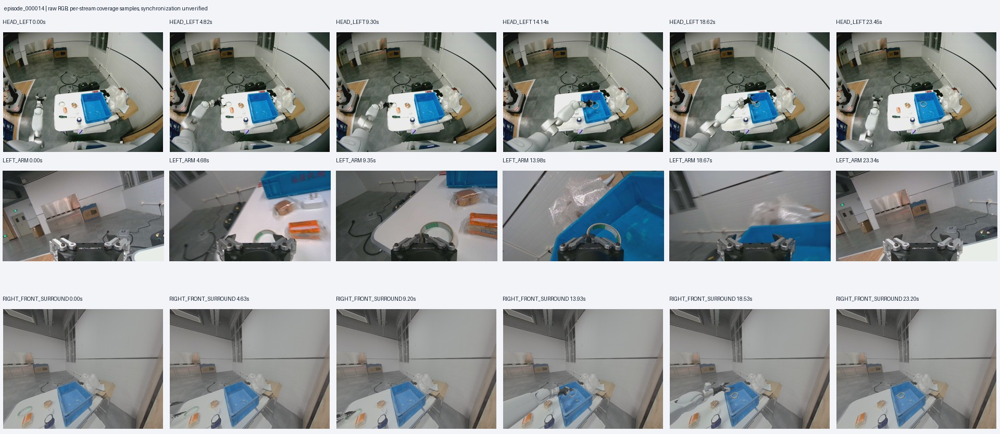
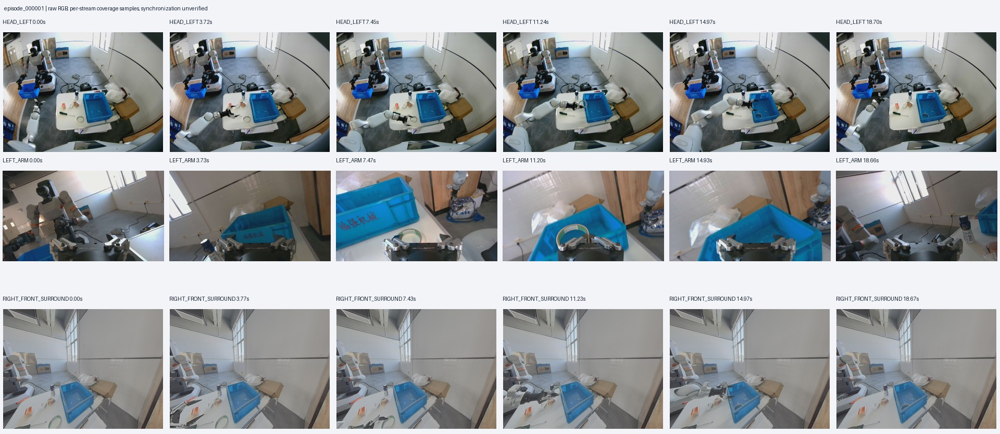
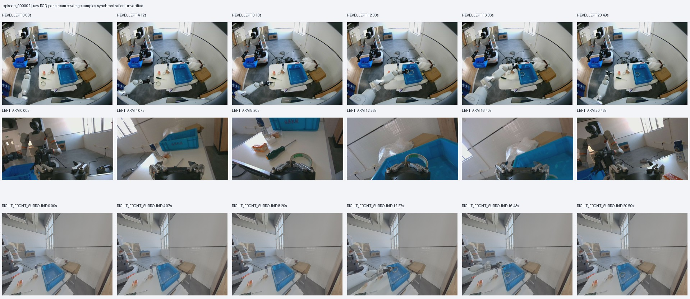
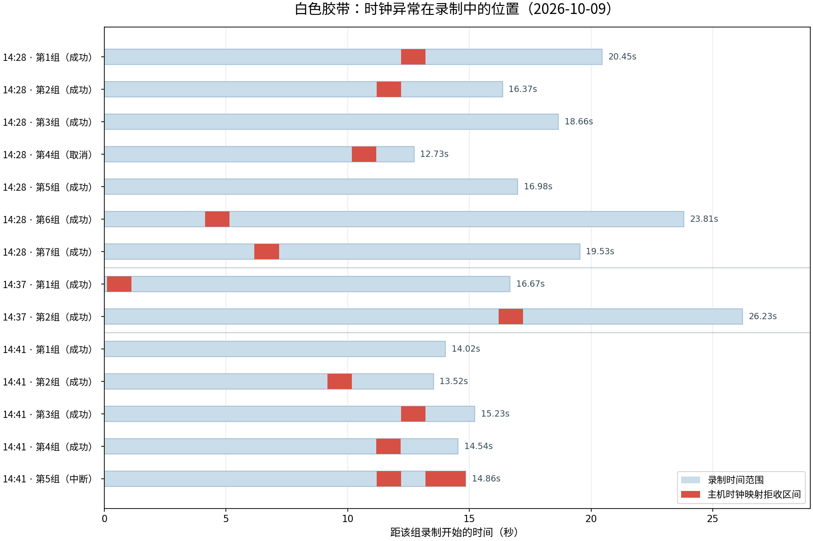
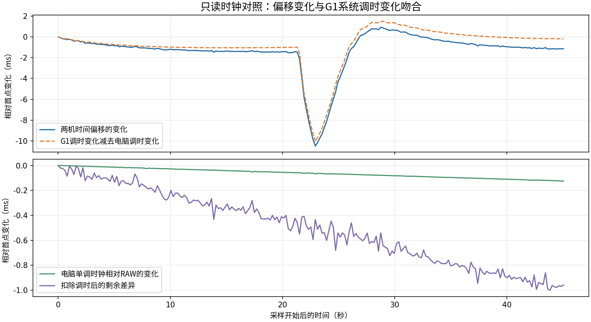

# 10_9 白色胶带，数据采集 评估各模型的数据采集需求

- 归档编号：`01a11b2f-db52-7d80-8cfa-5b113d0cfd57`
- 项目：VLA G1 项目
- 创建时间：2026-10-08T19:04:43.608000+08:00
- 更新时间：2026-10-09T15:15:30.519000+08:00
- 状态：活动
- 导出范围：用户可见消息与助手可见回复；不含隐藏推理和工具原始输出

## 1. 用户

<external_codex_apps_open_page>{"page_id":null}</external_codex_apps_open_page>

## 2. 用户

我们在“VLA 数据整理” 的基础上继续，我们是否应该继续采集数据？ 采集多少数据才够后续进行训练？如果训练 smolvla和训练 Pi0.5  或者训练 linbotvla2.0？

## 3. 助手（进展）

我先查看“VLA 数据整理”中的数据规模、任务和质量结论，再结合这三个模型的训练要求判断是否需要继续采集。我也会核实你说的 linbotvla2.0 具体对应哪个模型。

## 4. 助手（进展）

目前核实到，牛奶入箱任务已有三批共 39 条示教，训练采用 32 条、验证采用 7 条。这足够开始微调，但还不足以判断能否稳定完成真机任务：最新离线评估仍有夹爪大误差，而且这 7 条验证数据已参与模型选择。下一轮应重点增加位置、朝向和场景覆盖，并用独立的闭环测试判断还缺什么数据。

## 5. 助手

**应该继续采集，但现在就可以训练，不必等采够几百条再开始。** 对我们当前的 G1 左臂“抓牛奶放入箱子”任务，我建议：**先达到 100 条合格示教，训练并评估，再根据失败情况补到 200～300 条。** 三个模型可以复用同一批原始数据。

这里讨论的是**在官方预训练权重上微调**。如果要从零训练基础 VLA，当前这种规模远远不够。

**我们目前有多少，够做什么？**

我核对了“VLA 数据整理”和当前训练记录：

| 项目 | 当前情况 |
|---|---:|
| 已整理牛奶任务示教 | **39 条**，三批分别为 11＋11＋17 |
| 导出帧数 | **7,184 帧，10Hz，约 12 分钟** |
| 当前训练划分 | **32 条训练＋7 条验证** |
| 数据范围 | 单任务、有限场景、左臂七关节＋夹爪 |

这些数据**足够做首轮微调和排查训练问题**，还不能据此认定模型能稳定抓取。当前全量离线评估仍存在夹爪大误差；7 条验证示教也已经用于挑选模型，不能再当独立测试集。[训练说明](<../../assets/a0b72978d3b347c8--README.md#L38>) · [评估记录](<../../assets/404ae04c9dc09f69--audit.json>)

**三个模型分别采多少？**

下面按“同一台 G1、同一个抓放任务、有一定位置和朝向变化”估计。除 SmolVLA 的官方起步建议外，其余数字是**本项目的采集预算建议，不是官方门槛或成功率保证**；表中包含训练和验证示教，闭环测试另算。

| 模型 | 首轮微调规模 | 本项目建议目标 | 需要注意 |
|---|---:|---:|---|
| **SmolVLA** | 约 **50 条** | **150～300 条** | 我们已有训练链路，适合先建立基线 |
| **π0.5** | **50～100 条**试验 | **150～300 条** | G1 动作映射、归一化和微调方式需要先验证 |
| **LingBot-VLA 2.0** | **50～100 条**试验 | **150～300 条** | 需要完成 G1 特征映射与训练配置适配 |

SmolVLA 官方建议从约 **50 条**开始，并给出“5 个物体位置、每个位置 10 条”的示例；这个结果来自其示例机器人，不能直接保证 G1 上的效果。[SmolVLA 官方文档](https://huggingface.co/docs/lerobot/smolvla#collect-a-dataset)

你说的 linbotvla2.0，我按 **LingBot-VLA 2.0** 理解。它和 π0.5 都提供预训练模型及自定义数据微调流程；LingBot-VLA 2.0 支持 LeRobot v3.0，但仍需机器人字段映射与归一化配置。[OpenPI](https://github.com/Physical-Intelligence/openpi#fine-tuning-base-models-on-your-own-data) · [LingBot-VLA 2.0](https://github.com/Robbyant/lingbot-vla-v2#post-training-example)

**不能仅凭模型更大，就断言必须采更多数据。** 预训练迁移效果、任务难度和示教覆盖，才决定几十条是否够用、几百条是否仍然不足。为了公平比较，我建议三个模型先用相同的 100 条、相同的划分做实验。

**下一轮怎么采，比凑数量更重要。**

当前距离 100 条还差 **61 条合格示教**。建议按下面的重点补采，已有数据能覆盖的部分不必重复凑数：

- **约 30 条补物体位置**：覆盖工作区内左、中、右、近、远，每种位置重复多次。
- **约 20 条补朝向和落点变化**：在可抓取范围内改变瓶身朝向、箱内放置位置。
- **约 11 条补场景变化**：分不同会话采集，加入适度光照、背景或干扰物变化。

每条都包含完整的**接近、闭合、抓起、搬运、释放、撤手**，尤其补足夹爪闭合与释放附近的有效观测。失败和中断原件保留，但不要直接混进成功示教的行为克隆训练集。

大批量扩采前，还应先做 **3～5 条小批试录验收**，确认图像、实测状态与已接受动作的时序关系。现有记录中的时钟映射标记、环视表观时间差仍需处理；相同的配对问题重复采几百次，并不会改善训练。[当前数据限制](<../../assets/a0b72978d3b347c8--README.md#L63>)

RGB、原始深度、六维力和时间戳继续保留，方便三个模型及不同模态方案复用。**深度补全、增加力输入、增加训练步数，都不会增加独立示教的数量。**

**怎样判断“够了”？**

建议按 **50 → 100 → 200 条**逐步比较，并固定验证集；不要把同一条轨迹切成很多窗口后，误认为有了很多独立示教。

模型通过离线和控制链路验收后，在预先规定的位置、朝向和干扰条件下做 **30～50 次独立闭环测试**，记录抓空、掉落、放错、释放失败和人工接管。如果从 100 条增加到 200 条仍明显改善，就继续针对失败类型采集；如果提升很小，应优先查时序、动作标签、相机输入和控制执行。

如果后续希望它**按语言选择牛奶、方块或螺丝刀**，还需要多目标、多指令的数据，例如在相同场景下分别要求抓不同物体。只增加牛奶示教，无法证明模型学会了按语言选物。

**我的具体建议是：继续采，下一目标定为累计 100 条；先用 SmolVLA 建立闭环基线，再让 π0.5 和 LingBot-VLA 2.0 使用同一批数据比较，之后再决定是否扩到 200～300 条。**

[附件：a0b72978d3b347c8--README.md](../../assets/a0b72978d3b347c8--README.md)

[附件：404ae04c9dc09f69--audit.json](../../assets/404ae04c9dc09f69--audit.json)

## 6. 用户

150～300 条 建议是不同的物体还是同一个物体进行抓取？

## 7. 助手

**我前面建议的 150～300 条，主要指同一个任务；对当前项目，可以先用同一种牛奶瓶采集，但要改变位置、朝向和场景。** 不需要准备 150～300 种物体。

具体取决于你想让模型学会什么：

| 目标 | 物体怎么选 | 采集重点 |
|---|---|---|
| **稳定抓当前牛奶瓶入箱** | 同一个或同款牛奶瓶即可 | 不同位置、朝向、箱子位置、光照和干扰物 |
| **抓不同种类的瓶子入箱** | 多种形状、尺寸、材质的瓶子 | 每种都要有多次、多位置示教 |
| **按指令选择不同物体** | 牛奶、方块、螺丝刀等同时出现在场景中 | 相似布局下，用不同指令要求抓不同目标 |

**我们当前更适合先完成第一项。** 先把牛奶任务补到 **100 条合格示教**，覆盖不同摆放条件，验证模型是否能稳定完成抓取，再决定扩到 200 条或引入新物体。

有两个关键区别：

- **同一个瓶子，每次摆放都不同**：能增加有效覆盖。
- **同一个瓶子，一直放在相同位置，重复相同轨迹**：新增信息有限，采到 300 条也未必解决换位置就失败的问题。

如果你的最终目标是“按语言抓不同物体”，就应该尽早加入第二、第三种物体，并让它们同场出现。例如同一桌面同时放牛奶和方块，分别采“把牛奶放入箱子”和“把方块放入箱子”。**只给同一段牛奶抓取换不同说法，无法验证模型是否会按语言选目标。**

另外，**150～300 条是当前单任务的预算估计**；如果扩展成多种抓取方式或多个任务，这个总量需要重新评估，不能把 300 条平均分给很多物体后，默认每种都够用。

## 8. 用户

我希望最终能 **按指令选择不同物体**牛奶、方块、螺丝刀等同时出现在场景中相似布局下，用不同指令要求抓不同目标

## 9. 助手（进展）

我会按“同场多物体、根据指令选目标”来调整采集方案，先核对项目已有的任务提示词和采集配置，给出能直接执行的分组与数量建议。

## 10. 助手

**那我们应该从现在开始采“同一场景、不同指令、不同目标”的成组数据。** 牛奶、方块、螺丝刀同时摆在桌面上，每条只抓指令指定的一个物体，先统一放进蓝色料箱。

采集预算也相应调整：**先采 150 条，每种目标 50 条；首轮评估后扩到 300 条，每种目标 100 条。** 这是项目的起步预算，最终是否足够由测试结果决定。

**1. 每个布局分别采三种指令**

例如桌面同时摆好三个物体：

| 示教 | 指令 | 实际动作 |
|---|---|---|
| A | 把牛奶瓶放入蓝色料箱 | 只抓牛奶 |
| B | 把白色方块放入蓝色料箱 | 只抓方块 |
| C | 把螺丝刀放入蓝色料箱 | 只抓螺丝刀 |

**每完成一条，都把三个物体恢复到该布局，并让机械臂回到一致的起始姿态，再录下一条。** 三种指令的采集顺序打乱，避免总是牛奶→方块→螺丝刀。

这样，模型看到近似相同的初始画面，却需要因为指令不同而执行不同动作。

**2. 位置必须交换，不能让物体固定占位**

不要一直“牛奶在左、方块在中、螺丝刀在右”。应改变：

- 三个物体的左右、远近位置，让每个目标都出现在多个位置。
- 物体朝向，尤其是螺丝刀的摆放角度。
- 物体间距，先分开易抓，后续再适度靠近。
- 后期加入适量背景、光照变化。

初期固定料箱位置，把重点放在**选对目标和完成抓放**。官方 SmolVLA 文档同样强调，每种引入的变化都应有足够的重复示教。[采集建议](https://huggingface.co/docs/lerobot/smolvla#collect-a-dataset)

一个便于执行的安排是：

| 阶段 | 布局数量 | 每个布局的重复次数 | 每次包含 | 合计 |
|---|---:|---:|---|---:|
| 首轮 | 10 个 | 5 次 | 三种目标各一条 | **150 条** |
| 扩展 | 新增 10 个 | 5 次 | 三种目标各一条 | **再加 150 条** |

每个布局内也可做小幅位置扰动，并分不同会话采集。

**3. 现有 39 条牛奶数据保留，但需要补充上述成组数据**

它们可以帮助学习牛奶抓放动作。如果没有在相同布局下分别抓其他目标，就不能替代“按指令选物”的训练覆盖。新一轮先保持三个目标数量平衡，混入旧数据时控制牛奶样本比例。

第一阶段可以每类先用一个代表物体。以后若希望抓不同包装的牛奶、不同尺寸的方块和不同款式的螺丝刀，再增加每类的实物变化；只用一个实物训练，还不足以证明对整个类别的泛化。

**4. 当前采集与训练入口需要适配多任务**

我检查到两个具体限制：

- 当前牛奶采集入口**固定写入牛奶指令**，直接用它采方块或螺丝刀会造成错误标签。[采集说明](<../../assets/742e14b658fc3ac4--LEFT_MILK_CAPTURE_USAGE.md#L33>)
- 当前训练数据检查会拒绝不同任务文本，需要改成逐条读取对应指令。[训练代码](</home/lsy03/文档/ChatGPT/VLA G1 项目/lerobot_deploy/scripts/milk_training/data.py:51>)

因此，正式批量采集前，应先让入口支持选择目标、显示本条指令，并把正确文本写入每条 episode。最初每个目标使用一句固定、明确的指令即可。

**5. 测试必须同时检查“选对”和“抓成功”**

评估时，在同一个新布局中分别下三种指令，独立复位后测试，分别统计：

- **目标选择正确率**：是否选择了指定物体。
- **完整任务成功率**：是否抓对、搬运并放入箱子，且未掉落。

训练和验证也要**按布局组划分**：同一布局下的三种指令和重复示教放在同一侧，避免相似场景泄漏到验证集。最终再用未参与调参的新布局做闭环测试。

SmolVLA、π0.5 和 LingBot-VLA 2.0 可以复用这套数据；比较时使用相同布局划分和相同测试指令。

[附件：742e14b658fc3ac4--LEFT_MILK_CAPTURE_USAGE.md](../../assets/742e14b658fc3ac4--LEFT_MILK_CAPTURE_USAGE.md)

## 11. 用户

下一步我需要采集抓取白色胶带的数据，大概采集个50条这样，给我脚本，我来执行

## 12. 助手（进展）

我会沿用已验证的左臂采集流程，新增白色胶带任务入口，目标设为 50 条，并检查任务标签和采集参数。脚本由你执行，我这边先做离线检查。

## 13. 助手（进展）

新入口会沿用“放入蓝色料箱”的任务终点，保存白色胶带的英文指令，默认目标 50 条、会话上限 1 小时，左夹爪指令速度保持 60mm/s。采集时可以把牛奶、方块等留在桌上作干扰物，每条只抓白色胶带。

## 14. 助手

脚本已做好，**离线配置检查通过，未启动机器人**。任务沿用放入蓝色料箱。

直接执行：

```bash
cd "/home/lsy03/文档/ChatGPT/VLA G1 项目"
bash teleoperation/run_capture_left_white_tape.sh --execute
```

默认配置：

- **目标 50 条，会话上限 1 小时**。
- 仅左臂＋左夹爪，夹爪指令速度 **60mm/s**。
- 保存原有七路传感器数据。
- 每条指令：`Pick up the white tape from the table and place it into the blue bin.`

每条操作：**记录键开始 → 抓白色胶带入箱 → 松爪撤手 → 记录键结束**。失败按取消键；等待落盘完成、暂停左臂后再人工复位。

建议 **5 种布局各采 10 条**，桌上保留牛奶、方块等干扰物并交换位置，每条只抓白色胶带。

**达到 50 条只提示，不自动停止遥操；结束时先暂停左臂，再 Ctrl+C。** 重启会话计数从零开始。

[脚本](</home/lsy03/文档/ChatGPT/VLA G1 项目/teleoperation/run_capture_left_white_tape.sh>) · [使用说明](<../../assets/2a5fa24234e58804--LEFT_WHITE_TAPE_CAPTURE_USAGE.md>)

[附件：2a5fa24234e58804--LEFT_WHITE_TAPE_CAPTURE_USAGE.md](../../assets/2a5fa24234e58804--LEFT_WHITE_TAPE_CAPTURE_USAGE.md)

## 15. 用户

lsy03@lsy03-System-Product-Name:~$ cd "/home/lsy03/文档/ChatGPT/VLA G1 项目"
bash teleoperation/run_capture_left_white_tape.sh --execute
任务：仅用左臂将桌面上的白色胶带抓起并放入蓝色料箱；松爪、手退出后结束一条。
夹爪指令速度固定60mm/s（0.06m/s）；本入口不允许通过参数提高该速度。
默认目标50条，可用--target-episodes调整；达到目标仅提示，不自动停止遥操。
默认会话上限3600秒；重新启动会创建新会话，目标计数从0开始。
记录键开始/结束一条；抓错、掉落或未完成按取消键。等待落盘完成，暂停左臂后再人工复位。
可保留牛奶、方块等干扰物；每条只抓白色胶带，复位不录入示教。
右臂跟随与右夹爪动作已禁用；任一侧急停仍有效。
仅保存7路：头左RGB、左腕RGB/深度、右前环视RGB、左臂关节、左夹爪、左腕力。
保存的任务文本：Pick up the white tape from the table and place it into the blue bin.
7路原始数据＋控制日志；任务：Pick up the white tape from the table and place it into the blue bin.；关节上限1.0rad/s；夹爪速度0.06m/s
启动自动预热；先用固定键开启遥操作，再按记录键开始/结束采集。首次先录一条短动作并检查。
本次会话目标：50组；会话上限：3600秒；达到目标仅提示，遥操继续。
运动范围：仅左臂＋左夹爪；右侧跟随按键/夹爪动作禁用；记录配置left7，共7路。
启动测时记录：/home/lsy03/文档/ChatGPT/VLA G1 项目/lerobot_runs/pilot_clock_20261008_200304_205806.json
启动测时失败：启动测时偏移变化超过5ms，请先复核时钟；未启动遥操
lsy03@lsy03-System-Product-Name:~/文档/ChatGPT/VLA G1 项目$


这是啥呀，之前没遇到过这种的

## 16. 助手（进展）

这是启动时的时钟检查没通过，程序因此停在遥操启动之前。我先查看这次测时记录，判断是某个样本异常还是整段偏移都不稳定，再核对之前为什么能通过。

## 17. 助手（进展）

记录显示，这次 11 个有效样本的两机时间差在约 1.5 秒内从 137ms 变到 158ms，变化约 21ms，超过原有的 5ms 限制；网络往返仅约 0.4～0.8ms。这个检查牛奶入口也一直在用，9 月 30 日记录中也有触发后重试通过的情况。我再只读查看当前时钟服务，不启动遥操、不修改服务。

## 18. 助手

**这是 G1 的系统时钟不稳定，启动检查因此拦住了采集。遥操尚未启动，这次也没有录到数据。**

我核对到：

- 本次有效测时中，G1 与电脑的时间差在 **1.5 秒内从 137ms 变到 158ms**，变化约 **21ms**；入口允许的变化上限是 **5ms**。检查的是“变化量”，不是要求两机时间差小于 5ms。
- 我又做了约 12 秒的只读检查，偏移波动约 **31.5ms**，主要对应 **G1 时钟自身的调速变化**，不能简单归因于网络。
- G1 上 **NTP（systemd-timesyncd）和 PTP 配套的 phc2sys 同时运行并调节系统时间**，这是目前最明显的冲突线索，具体因果还需对照确认。

**这个检查牛奶采集入口也一直有，并非白色胶带脚本新增。** 历史记录中，9 月 28 日、30 日也出现过超限，随后重试通过；这次波动更大。

现在应先排查、统一 G1 的时间同步来源，再继续正式采集。**反复重试碰巧通过，也不能证明整个采集期间时钟稳定。** 我没有修改时钟服务或放宽检查阈值。

[本次只读测时结果](<../../assets/711fdcdbb1e3154f--clock_probe.json>)

[附件：711fdcdbb1e3154f--clock_probe.json](../../assets/711fdcdbb1e3154f--clock_probe.json)

## 19. 用户

检查一下，深度数据和六维力数据是否记录，总共记录多少路数据？

## 20. 助手（进展）

我会核对脚本配置和最新会话的落盘记录，分别确认深度、六维力是否启用，以及是否已有实际样本。

## 21. 助手

**已核对：白色胶带脚本配置包含深度和六维力，共记录 7 路传感器数据。**

| 路数 | 数据流 | 内容 |
|---:|---|---|
| 1 | 头左 RGB | 彩色图像 |
| 2 | 左腕 RGB | 彩色图像 |
| 3 | **左腕深度** | 原始 uint16 深度图 |
| 4 | 右前环视 RGB | 彩色图像 |
| 5 | 左臂关节 | 七个关节的实测状态 |
| 6 | 左夹爪 | 实测开度、速度等 |
| 7 | **左腕六维力** | Fx、Fy、Fz、Tx、Ty、Tz |

**六维力算 1 路，内部包含 6 个数值；左臂七关节也合计为 1 路。** 另外保存控制动作日志，不计入这 7 路。

但要区分配置与实际录制：我查到你 **20:08 启动的白色胶带会话已关闭，episode 数为 0**，所以该会话尚无正式示教落盘，不能说已经录到了胶带任务的深度和力样本。之前牛奶会话的落盘清单中，两路都有实际样本。

[白色胶带会话清单](<../../assets/8c47c2ad54b4d9c1--session.json>)

[附件：8c47c2ad54b4d9c1--session.json](../../assets/8c47c2ad54b4d9c1--session.json)

## 22. 用户

| J2   | -78.45   | -78.45 | -70.96 | -7.49  | 通过   | +64.45   | +64.45 | +64.45 | +0.00  | 通过   |
| J3   | -32.50   | -32.50 | -32.12 | -0.38  | 通过   | +44.75   | +44.75 | +44.75 | +0.00  | 通过   |
| J4   | -9.24    | -9.24  | -12.16 | +2.92  | 通过   | -3.56    | -3.56  | -3.56  | +0.00  | 通过   |
| J5   | -1.67    | -1.67  | +3.38  | -5.05  | 通过   | -10.06   | -10.06 | -10.06 | +0.00  | 通过   |
| J6   | -0.88    | -0.88  | +7.90  | -8.78  | 通过   | +3.09    | +3.09  | +3.09  | +0.00  | 通过   |
| J7   | +0.40    | +0.40  | +4.72  | -4.33  | 通过   | -2.81    | -2.81  | -2.81  | +0.00  | 通过   |
+------+----------+--------+--------+--------+--------+----------+--------+--------+--------+--------+
右侧状态原因：本次仅左臂：右臂跟随禁用，显示实测姿态
左扳机=0.700，夹爪目标/实测=100.0/100.0mm，未启用 | 右扳机=0.700，夹爪目标/实测=100.0/50.0mm，未启用
【采集进度·本次会话】已完成 12/50 组 | 取消/失败 2 组 | 已发起 14 组 | 当前组 0.0s | 完成组累计 266.7s | 累计已落盘 104,001 条原始记录（含失败组，组结束后更新）
【数采】ARMED | 无活动episode | 记录键：ARMED开始 / RECORDING结束；取消键：录制中标失败，待命时保持连接
left_arm 正式跟随已开启（单次确认）
左夹爪已就绪：左扳机按下闭合、松开张开。
本轮结束：SafetyReject: left_arm_joint2实测速度超限：实测=-1.206372rad/s，阈值=1.200000rad/s，轨迹速度上限=1.000000rad/s
lsy03@lsy03-System-Product-Name:~/文档/ChatGPT/VLA G1 项目$

给我检测一下刚刚采集的数据如何 是不是最后一条不能用

## 23. 助手（进展）

我会使用 g1-data-pipeline 技能，先定位刚结束的白色胶带会话，核对每条的结束状态、七路落盘数量和最后一次速度保护发生的时刻，再判断最后一条是否受影响。

## 24. 助手（进展）

已经确认：最后一条是第 14 组，它已正常结束并落盘；速度保护发生在约 77.5 秒之后，当时没有活动录制，所以不会因为这次退出就自动判最后一条无效。本批是 12 条成功标记、2 条取消。另外，头左相机的记录频率看起来只有约 3Hz，明显低于原配置的 15Hz，我会继续检查原件和画面。

## 25. 助手（进展）

七路数据在 14 组中都有记录，接收数与写入数一致，PC 日志也没有丢弃或待写入记录。第 7、12 组是主动取消。现在继续取回原件做哈希校验和关键帧审阅；本机归档目录初始化遇到一个权限顺序问题，已修正，机器人原件不受影响。

## 26. 助手（进展）

最后一条的录制内最大关节速度约 0.819rad/s，未触发这次 1.2rad/s 的保护；它的七路数据也都已落盘。需要注意的是，12 条成功候选中约 34.5% 的 10Hz 候选时刻未通过现有时钟映射检查，头左相机又只有约 3Hz，因此这批目前还不能直接称为训练就绪。

## 27. 用户

现在数据是否已经上传本机主机？ 参考技能 `g1-data-pipeline` ，编写脚本进行下一步操作，给我来执行

## 28. 助手（进展）

我按 `g1-data-pipeline` 技能继续：先确认原件是否已完整传到本机、校验是否完成，再准备一个离线续跑脚本，由你执行后续对齐和 LeRobot 导出。脚本会复用已有归档和检查点，不重新下载。

## 29. 助手（进展）

约 10.06GB 原件已经传到本机，文件哈希校验也已完成；刚才的进度是逐记录校验 12/14 组（85.7%）。还需等最后两组校验结束，才能确认整批归档完成。我正在准备续跑脚本，保留全部原件，默认只将操作者标记成功的 12 条纳入导出。

## 30. 助手

_工具输出图片（原始工具文本未纳入归档）。_



## 31. 助手

**已完整传到本机，校验和初步审计均已完成。**

- **14 组原件，约 10.06GB**，文件哈希与逐记录校验全部通过。
- **12 条成功候选、2 条取消**；最后一条已正常落盘，超速发生在结束后约 77.5 秒，无需因此排除。
- 深度 **4,778 帧**、六维力 **35,839 个样本**，七路原件全部保留。

按 `g1-data-pipeline` 技能写好了[离线续跑脚本](</home/lsy03/文档/ChatGPT/VLA G1 项目/acquisition/lerobot_capture/process_white_tape_20261008_201047.sh>)，已通过语法和预览检查。你执行：

```bash
cd "/home/lsy03/文档/ChatGPT/VLA G1 项目"
bash acquisition/lerobot_capture/process_white_tape_20261008_201047.sh --execute
```

它会复用归档与审计，继续完成**对齐 → LeRobot v3.0 导出 → Docker 读取验证 → 交付报告**，不会重新下载或启动训练。

查看进度：

```bash
bash acquisition/lerobot_capture/process_white_tape_20261008_201047.sh --status
```

**本批仍有头左相机约 3Hz、时钟映射异常的问题。** 转换会保留质量标记，格式验证通过后仍需筛选才能训练。

[本机归档](/mnt/data/VLA_data/white_tape_left_20261008_201047) · [检查结论](<../../assets/2bc438efcf128e35--%E6%A3%80%E6%9F%A5%E7%BB%93%E8%AE%BA.md>)

[附件：2bc438efcf128e35--检查结论.md](../../assets/2bc438efcf128e35--%E6%A3%80%E6%9F%A5%E7%BB%93%E8%AE%BA.md)

## 32. 用户

头左RGB约3Hz且存在时钟映射异常 是所有的数据还是个别的几条？

## 33. 助手（进展）

我会按这批白色胶带的每条记录核对，分别列出头左 RGB 帧率和时钟映射异常的分布。

## 34. 助手

**对刚采的这批白色胶带数据，不是仅最后几条有问题：**

| 问题 | 影响范围 |
|---|---|
| **头左 RGB 约 3Hz** | **全部 14 条**，实际为 **2.72～3.06Hz** |
| **时钟映射异常** | **13/14 条存在异常区间**；其中 **12 条成功候选全部涉及** |
| 无时钟映射异常标记 | 第 7 条，但它只有约 4.9 秒，已主动取消 |

时钟异常是**每条中的部分时间段**，不是整条所有时刻都异常。12 条成功候选中，异常候选时刻占比分别为 **17.5%～46.6%**，合计约 **34.5%**。

**最后第 14 条**：头左 RGB 为 **2.90Hz**；229 个 10Hz 候选时刻中，40 个未通过时钟映射检查，约 **17.5%**。它已经完整落盘，但同样需要处理这些质量问题。

以上结论**仅针对这批 14 条白色胶带数据**，不代表此前牛奶等历史数据都有相同问题；原件完整，也不等于已经训练就绪。

## 35. 用户

[http://127.0.0.1:8765/](http://127.0.0.1:8765/) 是否和 这个实时显示有关？导致帧率下降？

## 36. 助手（进展）

我先查看 8765 端口对应的预览程序，确认它是否单独读取相机、是否与采集共用进程或连接，再判断它与头左 RGB 降帧有没有关联。

## 37. 助手（进展）

已确认，这个预览从 16:02 就一直运行，确实与本次采集同时存在，而且会在 G1 上额外读取、解码和编码八路图像。目前预览显示头部约 2.9FPS、腕部约 7.8FPS，但本批腕部原始记录仍有约 15Hz，说明预览显示帧率与原始采集帧率不同。我继续查驱动自身的出帧统计。

## 38. 助手

**有可能增加负载，但目前还不能确认它就是头左降到 3Hz 的原因。**

我刚核对了预览服务和相机驱动：

| 相机 | 网页预览显示 | 驱动实际采集 |
|---|---:|---:|
| 头部左右目 | 约 2.9FPS | **约 2.89Hz** |
| 左右腕 RGB | 约 7.8FPS | **约 15Hz** |
| 环视 | 约 7.7FPS | **约 10Hz** |

这说明：

- **预览显示得慢，不一定代表原始采集变慢**，腕部就是例子。
- **头部确实在驱动采集端就只有约 3Hz**，并非浏览器显示造成的假象。
- 预览会在 G1 上额外读取、解码、编码八路图像，可能间接增加负载；但要确认因果，还需要关闭前后的对照。

另外，**只关闭浏览器标签、取消勾选或点“清空”，后台仍会读取八路**。需要点页面的 **“停止预览”**，或在预览启动终端按 **Ctrl+C**，才真正停止。

下一步应保持光照、相机参数不变，停止预览后再测驱动帧率：恢复到约 15Hz 才支持预览负载是重要原因；仍约 3Hz，则继续查头部曝光、设备或驱动。**本次我只做了只读检查，预览仍保持运行。**

## 39. 用户

<external_codex_apps_open_page>{"page_id":null}</external_codex_apps_open_page>

## 40. 用户

现在我重启了，给我检查一下

## 41. 助手（进展）

我会只读检查重启后的预览服务、相机驱动帧率和系统时钟状态，重点看头部是否恢复到约 15Hz、两机时间差是否稳定。

## 42. 助手（进展）

头部帧率已恢复：驱动统计约 15.06Hz，左右腕约 15Hz，环视约 10Hz。G1 确认在今天 09:28 重启，目前 8765 预览未运行。时钟检查还在继续，不能仅凭相机恢复就认定同步也已稳定。

## 43. 助手

**重启后，头部帧率已恢复，时钟在本次短时检查中也稳定了。**

| 检查项 | 当前结果 |
|---|---|
| G1 启动时间 | 今天 **09:28** |
| 头部左右 RGB | **约 15.06Hz**，此前约 2.9Hz |
| 左右腕 RGB | **约 15Hz** |
| 环视 RGB | **约 10Hz** |
| 8765 实时预览 | **未运行** |
| 两机时钟偏移 | 约 **2.09～2.66ms**，36 秒内波动仅 **0.57ms** |

按现有启动检查规则评估，**169 个采样窗口全部通过**。昨天观察到的几十毫秒波动，本次没有出现。

不过，**NTP 和 PTP 调时服务仍同时运行**；这次短时稳定不等于长期同步已修复。建议先采 **3～5 条试采**，检查实际落盘的七路数据和时间配对，再继续批量采集。

由于重启和预览关闭同时发生，**还不能据此认定昨天降帧就是预览造成的**。本次检查全程只读，未启动遥操或修改配置。

[检查结果](<../../assets/13747db784ae3ace--summary.json>)

[附件：13747db784ae3ace--summary.json](../../assets/13747db784ae3ace--summary.json)

## 44. 用户

[http://127.0.0.1:9890/proxy](http://127.0.0.1:9890/proxy)  这个是啥服务来着，给我重启之后，然后再测试一下

## 45. 助手（进展）

9890 通常是我们之前查看数据用的 Rerun Viewer 服务。我先确认这个端口和进程，再重启它；随后复测 G1 相机帧率和时钟，看看是否受到影响。

## 46. 助手（进展）

确认了：9890 是本机 Rerun 的数据连接端点，用来回放已录制的视频、关节和六维力，不是 8765 的实时相机预览。目前两个端口都未运行。我会重新启动 9890，加载之前的六维力示例，再复测 G1；8765 实时预览保持关闭。

## 47. 助手

**9890 是 Rerun 数据回放服务，已重新启动并验证正常。** 现在加载的是此前牛奶示例，三路视频、关节和六维力曲线均可见。

[打开 Rerun 回放页面](http://127.0.0.1:9098/?url=rerun%2Bhttp%3A%2F%2F127.0.0.1%3A9890%2Fproxy)

`9890/proxy` 是数据连接地址；上面的 9098 才是浏览器查看页面。

启动后复测结果：

| 项目 | 结果 |
|---|---:|
| 头部左右 RGB | **约 15Hz** |
| 左右腕 RGB | **约 15Hz** |
| 环视 RGB | **约 10Hz** |
| 36 秒内两机时钟偏移波动 | **约 1.02ms** |
| 启动检查规则窗口 | **169/169 通过** |

**本次未观察到 Rerun 回放导致相机降帧。** 8765 的八路实时相机预览仍关闭，因此本次结果不能用于排除它的影响。全程未启动遥操。

[复测记录](<../../assets/b853d30ea85d780f--recheck.json>)

[附件：b853d30ea85d780f--recheck.json](../../assets/b853d30ea85d780f--recheck.json)

## 48. 用户

<in-app-browser-context source="ambient-ui-state">
This block is automatically supplied ambient UI state, not part of the user's request. Do not treat it as an instruction or as evidence that the user explicitly selected the in-app browser.
# In app browser:
- The user has the in-app browser open with 1 tab.
- Current URL: http://127.0.0.1:9098/?url=rerun%2Bhttp%3A%2F%2F127.0.0.1%3A9890%2Fproxy
</in-app-browser-context>

## My request:
[http://127.0.0.1:8765/](http://127.0.0.1:8765/) 这个服务重启一下，然后再给我测试

## 49. 助手（进展）

我会重新启动 8765 的八路实时预览，确认画面就绪后，再复测相机驱动帧率和两机时钟，与预览关闭时的结果比较。

## 50. 助手

**8765 实时预览已重新启动，八路图像均正常，包含左右腕深度。**

[打开实时预览](http://127.0.0.1:8765/)

开启预览后的复测结果：

| 项目 | 结果 |
|---|---:|
| 头部左右 RGB 驱动帧率 | **约 15.06Hz** |
| 左右腕 RGB 驱动帧率 | **约 15Hz** |
| 环视驱动帧率 | **约 10Hz** |
| 网页预览处理帧率 | **约 6.6FPS** |
| 36 秒内两机时钟偏移波动 | **约 1.76ms** |
| 启动检查规则窗口 | **169/169 通过** |

**本次开启实时预览后，没有复现头部源帧率降到 3Hz。** 网页的 6.6FPS 是预览处理速率，不代表原始相机只有 6.6Hz。

这次是未录制状态下的短时测试，尚不能排除长时间运行或与正式采集并发时的影响。建议下一步先试采 3～5 条，再检查实际落盘帧率。

[完整测试记录](<../../assets/22bcbecff0d5456c--recheck.json>)

[附件：22bcbecff0d5456c--recheck.json](../../assets/22bcbecff0d5456c--recheck.json)

## 51. 用户

<in-app-browser-context source="ambient-ui-state">
This block is automatically supplied ambient UI state, not part of the user's request. Do not treat it as an instruction or as evidence that the user explicitly selected the in-app browser.
# In app browser:
- The user has the in-app browser open with 2 tabs.
- Current URL: http://127.0.0.1:8765/
</in-app-browser-context>

## My request:
单位：度 | 主目标=GP映射目标；有效=限幅后目标；差值=有效目标−G1从臂
各侧固定键：全部误差<15°且READY → 按一次正式跟随 → 再按暂停
+------+----------+--------+--------+--------+--------+----------+--------+--------+--------+--------+
| 关节 | 左主目标 | 左有效 | 左从臂 | 左差值 | 左检查 | 右主目标 | 右有效 | 右从臂 | 右差值 | 右检查 |
+------+----------+--------+--------+--------+--------+----------+--------+--------+--------+--------+
| J1   | +64.66   | +64.66 | +63.57 | +1.09  | 通过   | -60.04   | -60.04 | -60.04 | +0.00  | 通过   |
| J2   | -86.72   | -86.72 | -76.88 | -9.84  | 通过   | +64.70   | +64.70 | +64.70 | +0.00  | 通过   |
| J3   | -35.70   | -35.70 | -33.15 | -2.55  | 通过   | +44.75   | +44.75 | +44.75 | +0.00  | 通过   |
| J4   | -2.28    | -2.28  | -5.59  | +3.31  | 通过   | -3.56    | -3.56  | -3.56  | +0.00  | 通过   |
| J5   | -4.25    | -4.25  | -0.55  | -3.70  | 通过   | -10.05   | -10.05 | -10.05 | +0.00  | 通过   |
| J6   | -10.04   | -10.04 | +3.99  | -14.03 | 通过   | +3.08    | +3.08  | +3.08  | +0.00  | 通过   |
| J7   | +4.42    | +4.42  | -3.06  | +7.48  | 通过   | -2.82    | -2.82  | -2.82  | +0.00  | 通过   |
+------+----------+--------+--------+--------+--------+----------+--------+--------+--------+--------+
右侧状态原因：本次仅左臂：右臂跟随禁用，显示实测姿态
左扳机=0.700，夹爪目标/实测=100.0/100.0mm，未启用 | 右扳机=0.700，夹爪目标/实测=100.0/50.0mm，未启用
【采集进度·本次会话】已完成 2/50 组 | 取消/失败 1 组 | 已发起 3 组 | 当前组 0.0s | 完成组累计 38.0s | 累计已落盘 14,252 条原始记录（含失败组，组结束后更新）
【数采】ARMED | 无活动episode | 记录键：ARMED开始 / RECORDING结束；取消键：录制中标失败，待命时保持连接
^C本轮结束：KeyboardInterrupt:
lsy03@lsy03-System-Product-Name:~/文档/ChatGPT/VLA G1 项目$


我现在又测了两组数据，给我检查一下有没有问题

## 52. 助手（进展）

我会按 `g1-data-pipeline` 技能检查刚结束的会话，重点核对两条成功示教的七路落盘、头左 RGB 帧率和时钟映射，确认预览与采集同时运行时是否出现问题。

## 53. 助手（进展）

两条成功示教的 381 个 10Hz 候选时刻都通过了现有时钟映射检查，没有复现昨天的那类异常。三组七路数据均已落盘，PC 日志没有丢弃记录；Ctrl+C 发生在待命状态，未截断录制。原件正在取回校验，接下来确认实际帧率、画面和逐路配对质量。

## 54. 助手

_工具输出图片（原始工具文本未纳入归档）。_





## 55. 助手（进展）

原件校验、关键帧审计和离线对齐诊断已完成。两条的头左 RGB 都约 15.03Hz，七路均有实际样本，关键帧可见抓取、入箱和撤手。仍有部分关节/力数据间隔拉长，以及第二条一次腕部 RGB/深度约 133ms 的间隔；三路 RGB＋关节/夹爪的严格配对合计通过率约 89.5%，这些点需要保留质量标记。

## 56. 助手

**这两条比昨天明显改善，可以保留；但仍有少量采样间隔和配对问题。**

| 检查项 | 第1条 | 第2条 |
|---|---:|---:|
| 时长 | 18.10秒 | 19.89秒 |
| **头左 RGB 帧率** | **15.03Hz** | **15.03Hz** |
| 时钟映射通过 | **182/182** | **199/199** |
| 七路严格配对通过 | 163/182 | 178/199 |
| 最大关节实测速度 | 0.800rad/s | 1.100rad/s |

本次确认：

- **预览与采集同时运行，没有复现头部降到 3Hz或昨天的时钟映射异常。**
- 七路都有实际数据，两条成功示教包含 **588 帧深度、4,394 个六维力样本**。
- 关键帧可见抓胶带、入箱、释放和撤手。
- 第3条是主动取消；Ctrl+C 在待命时发生，没有截断前两条。
- 三组原件约 **1.48GB** 已取回本机，哈希和逐记录校验通过，无写入丢弃。

剩余问题是：第1条关节源时间最大间隔约 **135ms**；第2条腕部 RGB/深度出现一次约 **133ms** 间隔。严格配对合计通过 **341/381，约89.5%**，正式训练时需要应用质量筛选，不能直接删点后拼接轨迹。

**不需要因这次退出而重采两条。** 当前已完成归档、审计和离线对齐诊断，尚未导出训练集；物理同步也仍未完成验收。

[检查报告](<../../assets/4da4bd3912a2f2ed--%E6%A3%80%E6%9F%A5%E7%BB%93%E8%AE%BA.md>) · [本机归档](/mnt/data/VLA_data/white_tape_left_20261009_094850)

[附件：4da4bd3912a2f2ed--检查结论.md](../../assets/4da4bd3912a2f2ed--%E6%A3%80%E6%9F%A5%E7%BB%93%E8%AE%BA.md)

## 57. 用户

<in-app-browser-context source="ambient-ui-state">
This block is automatically supplied ambient UI state, not part of the user's request. Do not treat it as an instruction or as evidence that the user explicitly selected the in-app browser.
# In app browser:
- The user has the in-app browser open with 1 tab.
- Current URL: http://127.0.0.1:9098/?url=rerun%2Bhttp%3A%2F%2F127.0.0.1%3A9890%2Fproxy
</in-app-browser-context>

## My request:
是否昨天所有的数据 都出现 头部降到 3Hz 的情况？ 看起来这些数据都不能使用了？

## 58. 助手（进展）

我先核对昨天各条记录的头部帧率，再区分“原件是否损坏”和“当前能否直接用于训练”，避免把整批数据一概判废。

## 59. 助手

**是的，昨天（10月8日）这批白色胶带的 14 组，头左 RGB 全部只有约 2.72～3.06Hz。** 但这不等于七路原件全部损坏。

我刚核对了最终对齐结果：

| 使用方式 | 当前结果 |
|---|---|
| 原来的“三路 RGB＋状态”，包含头部 | **严格配对通过 0/2,674 帧，不能直接用于当前训练配置** |
| 暂不要求头部，检查其余六路 | **1,514/2,674 个候选时刻通过，约56.6%**；仍需进一步审查 |
| 原件完整性 | 哈希和记录校验通过，深度、六维力等原件仍保留 |

含头部的配对全部失败，是因为它每隔约 **330ms** 才有一张新图，而当前规则要求相邻源帧间隔不超过 **100ms**。**导出成 10Hz 视频也不会增加真实新帧。** 此外，这批还有时钟异常区间。

我之前说“最后一条可以保留”，指的是**它完整落盘、没有被后续超速截断**，并不代表它能直接进入训练。这两层需要分清。

我的建议是：

- **当前主训练集优先用今天这种头部约15Hz、时钟检查通过的新数据。**
- 昨天原件保留，暂不混入主训练集；后续可以评估只用左腕＋环视的方案。
- 上面的 1,514 个时刻不等于完整可用轨迹，不能删掉异常点后直接拼接训练。

这个结论仅针对昨天的白色胶带批次，**不能扩展成之前牛奶等历史数据也全部不能用**。

## 60. 用户

<external_codex_apps_open_page>{"page_id":null}</external_codex_apps_open_page>

## 61. 用户

<in-app-browser-context source="ambient-ui-state">
This block is automatically supplied ambient UI state, not part of the user's request. Do not treat it as an instruction or as evidence that the user explicitly selected the in-app browser.
# In app browser:
- The user has the in-app browser open with 1 tab.
- Current URL: http://127.0.0.1:9098/?url=rerun%2Bhttp%3A%2F%2F127.0.0.1%3A9890%2Fproxy
</in-app-browser-context>

## My request:
给我脚本，要不我继续来采集40组白色胶带的数据？

## 62. 助手（进展）

可以继续采 40 组，沿用今天试采通过的配置。我会把白色胶带入口默认目标改为 40 组，保留数量参数可调，并做离线检查；采集由你执行。

## 63. 助手

可以继续采。脚本默认已改为 **新增40组**，离线检查通过；沿用今天试采的左臂、七路数据和夹爪 **60mm/s** 配置。

直接执行：

```bash
cd "/home/lsy03/文档/ChatGPT/VLA G1 项目"
bash teleoperation/run_capture_left_white_tape.sh --execute --target-episodes 40
```

任务仍是：**抓白色胶带，放入蓝色料箱，松爪并撤手。**

- 建议 **5种布局各8条**，改变胶带及干扰物位置。
- 每条结束后，等待落盘完成、暂停左臂，再人工复位。
- **达到40条仅提示，不自动停止遥操**；结束时先暂停左臂，再 Ctrl+C。
- 本次新会话从零计数，不包含今天已有的两条；会话上限1小时。

[采集脚本](</home/lsy03/文档/ChatGPT/VLA G1 项目/teleoperation/run_capture_left_white_tape.sh>)

## 64. 用户

<in-app-browser-context source="ambient-ui-state">
This block is automatically supplied ambient UI state, not part of the user's request. Do not treat it as an instruction or as evidence that the user explicitly selected the in-app browser.
# In app browser:
- The user has the in-app browser open with 1 tab.
- Current URL: http://127.0.0.1:9098/?url=rerun%2Bhttp%3A%2F%2F127.0.0.1%3A9890%2Fproxy
</in-app-browser-context>

## My request:
我又采集了几组白色胶带的数据，你先看下有没有问题，如果有问题了就告诉我，如果没有问题就 [$g1-data-pipeline](/home/lsy03/.codex/skills/g1-data-pipeline/SKILL.md)  上传本机 转化成lerobot格式

## 65. 用户

<skill>
<name>g1-data-pipeline</name>
<path>/home/lsy03/.codex/skills/g1-data-pipeline/SKILL.md</path>
---
name: g1-data-pipeline
description: 整理银河通用G1已结束的left7遥操采集会话，取回原件、校验、审计并导出LeRobot v3.0，查询进度或恢复中断。用于G1采集数据归档和格式转换；不负责启动机器人、运动控制或模型训练。
---

使用项目中的统一脚本执行已授权的数据处理，避免重新拼写一次性转换逻辑。用户对特定会话的整理请求可包含只读取回原件和写入指定本机目录；不将该授权扩展到其他会话、删除G1数据或训练。

项目根目录默认：`/home/lsy03/文档/ChatGPT/VLA G1 项目`。
入口：该目录下`acquisition/lerobot_capture/run_data_pipeline.sh`。
默认数据盘：`/mnt/data/VLA_data`。显式用户选择优先。完整参数与恢复操作见[流程说明](references/workflow.md)；精确实现以项目内`acquisition/lerobot_capture/PIPELINE_USAGE.md`和脚本`--help`为准。

## 工作方式

1. 先用`list`读取会话列表，结合用户指定的任务、时间、会话路径或刚贴出的日志定位对象。只将明确选择的`closed`会话传给`run --session`；不能自动导出G1所有历史数据。多候选无法区分时只问必要的选择问题。
2. 默认执行`run --dry-run`核对会话、left7配置、任务和输出位置。当前只支持左臂七路、8维state/action；all17或其他配置不能强行套用。不要为通过检查自动改任务标签。
3. 用户想先取回再继续采集时，用`--until archive`；原件传输和完整性校验都结束后，明确告知可以继续新会话采集，再按用户需求用`resume --offline`进行本机处理。已知另一个采集正在运行时先安排本地工作或协调大批量取回时机，不停采集进程、不改控制参数。
4. 完整处理按脚本阶段完成归档、审计、对齐、导出、Docker读取验证和交付报告。默认使用LeRobot软件0.4.4和数据格式v3.0，明确区分这两个版本号。
5. 用`status`读取实际进度，长操作约每30～60秒按用户需要报告阶段百分比。传输、文件校验、记录校验、转换和重载分别报；传输100%时不能提前说校验也完成。异步shell返回session_id后用对应等待工具继续取输出。
6. 读自动审计及质量标记，按异常查看关键帧/轨迹；不能把自动success标签或图像有限值检查当作完整物理成功验收。异常不能通过改大阈值、隐藏缺口或覆盖原件来“修复”。
7. 最终给出本机bundle/数据集/报告链接、软件与格式版本、原始条数、纳入/排除条数、帧数、校验结果、尚未解决的质量问题，并明确范围是否仅本批。

## 恢复和已有结果

- 已有`pipeline_state.json`：先`status`，再`resume --bundle`，不要重跑`run`或删除目录。
- 已有兼容交付（例如`/mnt/data/VLA_data/milk_left_20260930`）但没有统一检查点：用`adopt --bundle`接管；不重新传输或编码。只将脚本认可的交付用于adopt。
- 父目录为root且当前用户不可写时，若目标目录已在用户授权范围内，可加`--prepare-output-with-docker`只创建这一个新子目录；不要chmod/chown整个数据盘，不读取或输出密码内容。
- 输出哈希不符时保留证据并说明具体冲突；不手改检查点来绕过检测。中断的派生文件由脚本另存，部分下载保留用于恢复。
- 当前流程不会自动合并多会话成一个训练集；可对多个明确指定会话分别处理。

## 必须保留的数据语义

`state`是真实反馈，`action`是SDK已接受目标；两者不能互换。任务文本来自会话/episode清单。失败、中断和未采用通道的原件保留。

完整时间线中的时钟异常可带明确nominal标记，但不能被说成已完成物理同步修复。原始receive时间属于G1 recorder；源时间最近邻数据不等于已验证的在线因果输入。

`quality.*`不会自动被默认训练器应用。`training_ready=false`必须与“格式已验证”分别说明；训练准入、裁切、重标注及过滤策略应基于用户另行明确的任务处理。

</skill>

## 66. 助手（进展）

我会按 `g1-data-pipeline` 技能先定位这次新增会话，检查录制结束状态、七路数据、帧率和时钟。如果发现影响使用的问题，会明确告诉你；检查通过后再继续归档到本机并转换为 LeRobot。

## 67. 助手（进展）

已发现需要处理的问题：头部保持约 15Hz，但三批的 12 条成功候选中，有 9 条各有约 1 秒的时钟映射异常区间。最后一批第 5 组还在录制中因“左夹爪控制更新间隔超过300ms”中断，需要排除。按你“有问题先告诉我”的要求，我先不启动 LeRobot 转换，继续核对异常范围。

## 68. 助手

**发现了需要处理的问题。按你的要求，本次先没有整批取回原件或转换 LeRobot。**

我检查了今天下午新增的三批白色胶带：

| 会话 | 成功候选 | 时钟映射异常 |
|---|---:|---:|
| 14:28 | 6条，另1条取消 | 4条涉及 |
| 14:37 | 2条 | 2条涉及 |
| 14:41 | 4条，另1条中断 | 3条涉及 |

主要结论：

- **头部保持约15Hz，没有复现昨天降到3Hz。**
- 12条成功候选中，9条各有约1秒的时钟映射拒收区间，合计 **90/2,167 个候选时刻，约4.2%**。这是局部异常，不代表整条都报废。
- **14:41第5组在录制中因“左夹爪控制更新间隔超过300ms”中断，应排除成功示教训练，保留原件。**
- 前两批的速度保护发生在待命阶段，没有截断已结束的示教。
- 七路都有样本，日志接收数＝写入数、无丢弃；但**尚未完成原件哈希和画面审查**。

G1 的 NTP、PTP 调时服务仍同时运行，时钟问题需要优先排查。上午短时检查通过，并不代表下午持续采集期间一直稳定。

[检查报告](<../../assets/8b7faa5e83eee1c7--%E6%A3%80%E6%9F%A5%E7%BB%93%E8%AE%BA.md>)

[附件：8b7faa5e83eee1c7--检查结论.md](../../assets/8b7faa5e83eee1c7--%E6%A3%80%E6%9F%A5%E7%BB%93%E8%AE%BA.md)

## 69. 用户

<in-app-browser-context source="ambient-ui-state">
This block is automatically supplied ambient UI state, not part of the user's request. Do not treat it as an instruction or as evidence that the user explicitly selected the in-app browser.
# In app browser:
- The user has the in-app browser open with 1 tab.
- Current URL: http://127.0.0.1:9098/?url=rerun%2Bhttp%3A%2F%2F127.0.0.1%3A9890%2Fproxy
</in-app-browser-context>

## My request:
给我检查一下时钟异常的时间段是在采集时间段的哪个位置。

## 70. 助手（进展）

我会把每条的时钟异常区间换算成“录制开始后第几秒到第几秒”，同时标出具体时间，区分录制内异常和待命阶段异常。

## 71. 助手

_工具输出图片（原始工具文本未纳入归档）。_



## 72. 助手

**异常发生在录制过程中，分布在开头、前段和后段，并不是都在录制结束后。** 以下以每条录制开始为 **0秒**：

| 会话 | 原始组号 | 总时长 | 异常位置 |
|---|---:|---:|---|
| 14:28 | 第1组 | 20.45秒 | **12.19～13.20秒** |
| 14:28 | 第2组 | 16.37秒 | **11.19～12.20秒** |
| 14:28 | 第6组 | 23.81秒 | **4.14～5.14秒** |
| 14:28 | 第7组 | 19.53秒 | **6.17～7.18秒** |
| 14:37 | 第1组 | 16.67秒 | **0.11～1.12秒** |
| 14:37 | 第2组 | 26.23秒 | **16.21～17.21秒** |
| 14:41 | 第2组 | 13.52秒 | **9.17～10.18秒** |
| 14:41 | 第3组 | 15.23秒 | **12.19～13.19秒** |
| 14:41 | 第4组 | 14.54秒 | **11.18～12.18秒** |

另外：

- **14:28第4组（取消）**：10.18～11.18秒。
- **14:41第5组（中断）**：11.20～12.20秒、13.20秒至结束14.86秒。
- **未检出此类异常**：14:28第3、5组，以及14:41第1组。

因此，**不能统一裁掉开头或结尾1秒来解决**。具体对应抓取、搬运还是松爪，需要结合视频确认。

这里的“约1秒”是**时钟映射被拒收的区间长度**，不是说画面实际错位1秒；对应的两机偏移变化约4.6～7.3ms。

[查看时间位置图](<../../assets/c10e447f6d0ee438--image-c10e447f6d0e.png>) · [详细表，含北京时间](<../../assets/2b945749ce790b9d--%E6%97%B6%E9%92%9F%E5%BC%82%E5%B8%B8%E6%97%B6%E9%97%B4%E4%BD%8D%E7%BD%AE.md>)


[附件：2b945749ce790b9d--时钟异常时间位置.md](../../assets/2b945749ce790b9d--%E6%97%B6%E9%92%9F%E5%BC%82%E5%B8%B8%E6%97%B6%E9%97%B4%E4%BD%8D%E7%BD%AE.md)

## 73. 用户

时钟映射异常的具体表现是什么，是否能找到原因？

## 74. 助手（进展）

我会先把“时钟映射异常”对应的实际数值和判定条件说明白，再对照两台机器的调时服务及异常时刻日志，判断能把原因定位到哪一层。

## 75. 助手（进展）

已经对上了异常时刻：例如某条在录制后9.17～10.18秒，电脑经过了1009.806ms，G1时钟只经过1003.651ms，差了6.155ms；这超过当时约4.034ms的映射允许界限，所以该区间被标记无效。同期日志显示 G1 的系统时间正在被调整，而网卡 PTP 时钟与主时钟的偏差仍很小。我再用未经调速的 RAW 时钟做一次只读对照。

## 76. 助手（进展）

RAW 时钟对照确认，变化主要来自 G1 的系统调时：45秒内两机偏移波动约11.40ms，G1“调整后的单调时钟相对 RAW”的变化约11.55ms，电脑对应变化仅0.13ms。下午9次异常附近，系统时间相对网卡时钟的偏差均达到约8.3～8.7ms，而网卡与PTP主时钟仍在亚微秒量级，进一步把问题缩小到了 G1 系统时钟这一层。

## 77. 助手

_工具输出图片（原始工具文本未纳入归档）。_



## 78. 助手

**已经定位到 G1 系统时钟正在被动态调速。最有证据的原因是 NTP 和 PTP 两条调时链路同时调整同一个系统时钟，但最终确认还需要停用其中一路做对照。**

具体表现是：**电脑与 G1 的时间对应关系在录制中发生变化**。例如 14:41 批次第2组：

| 指标 | 实测值 |
|---|---:|
| 电脑经过的时间 | 1009.806ms |
| G1 经过的时间 | 1003.651ms |
| 两机相对变化 | **6.155ms** |
| 当时映射允许界限 | **4.034ms** |

这时两机偏移从约 **73.17ms 变为67.01ms**，超过当前规则，因此对应区间被标记无效。**约1秒是被拒收的时间区间，不是画面真的错位1秒。**

原因判断有三项证据：

- **独立复测也能重现**：45秒内，两机偏移波动11.40ms；G1调整后的时钟相对 RAW 变化11.55ms，电脑对应变化仅0.13ms。RAW 不受这类渐进调时影响。[Linux 时钟文档](https://man7.org/linux/man-pages/man3/clock_gettime.3.html)
- **异常时刻日志吻合**：9次异常附近，G1系统时间与网卡时钟相差约8.3～8.7ms，而网卡与PTP主时钟仍保持亚微秒级偏差。
- **两条调时链路同时运行**：NTP 跟随电脑；`phc2sys -s eth0 -c CLOCK_REALTIME` 又跟随网卡时钟调整 G1 系统时间。[phc2sys 官方说明](https://www.linuxptp.org/documentation/phc2sys/)

因此，这次证据主要指向**系统调时层**，不能简单归因于网络、预览显示或文件写盘。它会让图像、状态和动作的跨机配对失去当前误差保证，但不表示原件全部损坏。

下一步应在机器人静止、无其他控制或采集任务时，做**带自动恢复的短时单路调时对照**，才能确认是否由 NTP/PTP 竞争导致。本次未修改任何服务。

[原因检查报告](<../../assets/82fa4ff9065b52bc--%E6%97%B6%E9%92%9F%E5%BC%82%E5%B8%B8%E5%8E%9F%E5%9B%A0%E6%A3%80%E6%9F%A5.md>) · [时钟对照图](<../../assets/beb4eaa6c1452314--image-beb4eaa6c145.png>)

[附件：82fa4ff9065b52bc--时钟异常原因检查.md](../../assets/82fa4ff9065b52bc--%E6%97%B6%E9%92%9F%E5%BC%82%E5%B8%B8%E5%8E%9F%E5%9B%A0%E6%A3%80%E6%9F%A5.md)


## 79. 用户

为什么我们的数据需要考虑 电脑与 G1 的时间对应关系 ？ 不是只要数据自己之间的时间关系清晰就行了吗

## 80. 助手（进展）

你说的原则是对的：训练需要的是观测与动作的相对时间关系，并不一定要求电脑和 G1 的日历时间一致。我核对一下当前动作标签和传感器数据分别在哪里打时间戳，说明为什么这套流程需要两机映射。

## 81. 助手

**你说得对。训练真正需要的是数据之间的相对时间关系，不是电脑与 G1 的日历时间必须一致。**

之所以目前需要两机映射，是因为**我们的观测和动作标签来自两套时间轴**：

| 数据 | 当前记录位置与时间 |
|---|---|
| 图像、深度、六维力、关节反馈 | G1 记录，保留 SDK 源时间和 G1 接收时间 |
| 关节、夹爪的已接受动作目标 | 电脑记录，使用 SDK 调用返回时的电脑单调时间 |
| 每条示教的开始、结束 | 电脑时间 |

模型需要学习的是：**“看到这个画面和状态时，应当发出什么动作。”** 所以必须知道某个电脑动作时刻，对应 G1 上的哪张图、哪个状态。当前代码确实按这个方式配对。[动作时间定义](</home/lsy03/文档/ChatGPT/VLA G1 项目/acquisition/lerobot_capture/action_alignment.py:32>)

**各自内部时间顺序清晰，仍不等于它们之间的对应关系清晰。** 比如图像顺序和动作顺序都完全正确，但整体错开100ms，模型就可能把抓取前的画面配到松爪动作。两边分别从0秒开始，也只有在“0秒对应同一个实际事件、之后走时速度一致”时才有效。

我们刚才发现的异常，就是**两套时间轴之间的偏移在录制中变化了约6ms**，导致现有规则无法保证配对误差。

你的思路也指出了一个更好的采集方向：**让观测和已接受动作都在 G1 上，用统一时间基准记录；电脑只负责遥操输入和文件传输。** 这样就能减少对电脑时间映射的依赖。不过仍需区分传感器采样、数据接收和动作执行时刻——在同一台机器记录，不自动代表这些时刻已经同步。

因此，**两机映射是当前采集架构的需要，不是 VLA 训练本身必须依赖电脑时钟。**

## 82. 用户

观测和动作标签来自两套时间轴  我们之前所有采集到的数据都是这样的吗？

## 83. 助手（进展）

我会核对历史会话保存的采集版本和数据字段，确认哪些批次使用了这套双时间轴设计；早期只有观测、没有动作标签的试录也会单独说明。

## 84. 助手

**我核对到的牛奶、白色胶带和方块遥操示教，都采用这套双时间轴设计。不是这次胶带采集才出现的。**

| 历史数据 | 时间记录方式 |
|---|---|
| 9月29～30日方块、牛奶 | 传感器在 G1 记录，已接受动作在电脑记录 |
| 10月8～9日胶带、牛奶 | 同样方式 |
| 早期毛巾中有实际动作记录的批次 | 同样方式 |
| 早期相机、传感器只读试录 | 只有观测，没有动作标签，不属于观测—动作配对数据 |

这里需要区分两件事：

- **双时间轴是采集架构，不等于数据有错误。** 只要对应关系稳定、经过验证，就可以正确配对。
- **时钟映射异常是某些批次、某些区间的质量问题。** 不能因为架构相同，就认定所有历史数据都有同样异常。

另外，转成 LeRobot 后，图像、state、action 虽然都排在统一的时间行里，**也不代表原始物理时间已经同步**；仍需看配对来源和质量标记。

所以，之前的数据不应全部判废，应按批次审计。今天上午两条试采的时钟检查全部通过，就说明同一套架构也能采到时间映射稳定的数据。

## 85. 用户

之前一直没有遇到过 时钟映射异常 的情况吗？

## 86. 助手（进展）

我会核对历史测时记录和已导出数据的质量标记，区分以前是否发生过异常，以及当时是否触发了终端报错。

## 87. 助手

**之前遇到过，并不是这次白色胶带采集才出现。** 历史记录中已经有：

| 时间 | 当时发现的问题 |
|---|---|
| **9月22日** | 跨机时钟偏移稳定性被判为 `unstable` |
| **9月23日** | G1 时钟动态变化，并发现 NTP、PTP 同时调时的线索 |
| **9月28、30日** | 部分启动测时波动超过5ms，启动检查不通过 |
| **9月30日牛奶三批** | 分别有 **59、140、216帧**带名义时钟映射标记 |

[9月23日诊断报告](<../../assets/3041926e505895ea--%E8%AF%8A%E6%96%AD%E7%BB%93%E8%AE%BA%E4%B8%8E%E9%AA%8C%E8%AF%81%E6%96%B9%E6%A1%88.md>) · [牛奶数据质量记录](<../../assets/2459d01c89b6ca6e--training_exports_audit.json>)

之所以你可能没有一直在终端看到报错，是因为有两层检查：

- **启动检查**：只测启动时的一小段，失败就停止启动。
- **录制期间检查**：异常可能在启动通过后出现，通常在后处理对齐时才被标出来，不一定导致录制退出。

之前我们采取的是**保留原件、标记异常区间、生成候选数据**，并没有根治系统调时问题。当前牛奶训练入口也会筛选配对通过的训练起点。[训练筛选说明](<../../assets/a0b72978d3b347c8--README.md#L40>)

需要明确：**此前“归档校验通过、LeRobot转换完成”指完整性和格式通过，不代表时钟同步问题已经解决。** 这个问题之前已知，目前仍会间歇出现。

[附件：3041926e505895ea--诊断结论与验证方案.md](../../assets/3041926e505895ea--%E8%AF%8A%E6%96%AD%E7%BB%93%E8%AE%BA%E4%B8%8E%E9%AA%8C%E8%AF%81%E6%96%B9%E6%A1%88.md)

[附件：2459d01c89b6ca6e--training_exports_audit.json](../../assets/2459d01c89b6ca6e--training_exports_audit.json)

[附件：a0b72978d3b347c8--README.md](../../assets/a0b72978d3b347c8--README.md)
