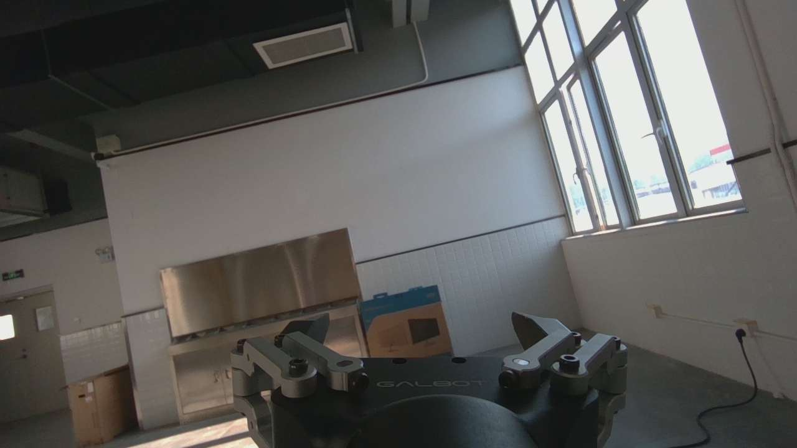
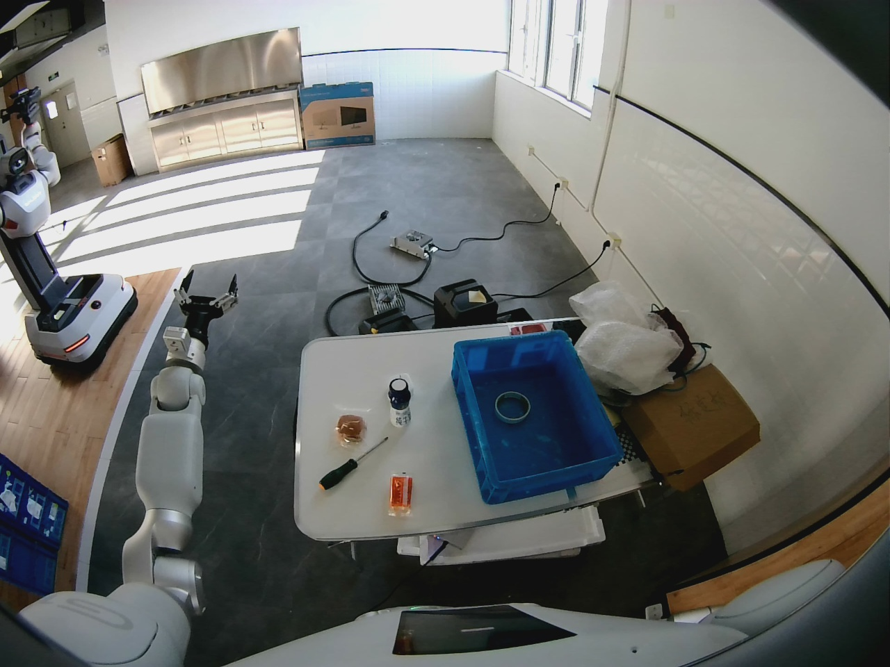

# 10_9 模型真机验证框架（1）

- 归档编号：`01a11e50-be6f-7061-afe3-8c8c7fdf77e5`
- 项目：VLA G1 项目
- 创建时间：2026-10-09T09:39:30.548000+08:00
- 更新时间：2026-10-10T13:42:35.603000+08:00
- 状态：活动
- 导出范围：用户可见消息与助手可见回复；不含隐藏推理和工具原始输出

## 1. 用户

<external_codex_apps_open_page>{"page_id":null}</external_codex_apps_open_page>

## 2. 用户

我们计划开始模型的实机控制，现在可用的模型有哪些？

## 3. 助手（进展）

我先核对本机现有权重、各版本评估结果和推理接口，区分哪些可以作为实机控制候选、哪些还需要补评估。

## 4. 助手

**目前已有 4 类用 G1 牛奶任务数据训练过的 SmolVLA 模型。建议先用 v2 累计 2,200 步最佳权重接入真机实时推理，再做短程闭环。** 我已确认下面这些权重文件存在；目前都尚未完成 G1 自主任务闭环验收。

| 模型版本 | 输入与输出 | 当前证据 | 实机优先级 |
|---|---|---|---|
| **SmolVLA v2，累计 2,200 步** | 三路 RGB、关节/夹爪状态、原始深度、六维力；预测 **10 步，约 1 秒** | 已评估全部 713 个验证窗口，动作误差目前最有依据 | **第一候选** |
| **SmolVLA + LingBot 补全深度，累计 6,300 步** | 三路 RGB、状态、补全深度、六维力；预测 50 步 | 固定 56 窗口 loss 为 **0.066993**；完整动作评估尚缺 | 第二候选，先补评估和在线深度处理 |
| **SmolVLA 原始深度/力 v1，累计 6,400 步** | 三路 RGB、状态、原始深度、六维力；预测 50 步 | 已评估 713 个窗口，关节和夹爪误差明显大于 v2 | 保留作对照 |
| **SmolVLA RGB 基线，累计 3,200 步** | 三路 RGB、关节/夹爪状态；预测 50 步 | 已做离线评估，夹爪范围和时机仍有问题 | 对照候选，输入接入较简单 |

对应最佳权重：

- [v2：累计 2,200 步](</mnt/data/VLA_data/smolvla_runs/smolvla-retrain-v2-continue-20261008_161604-149225/checkpoints/step_000400/model_bundle>)——目录里的 `400` 是续训阶段步数。
- [补全深度版：累计 6,300 步](</mnt/data/VLA_data/smolvla_runs/smolvla-multimodal-train-20261008_205126-212674/checkpoints/step_001300/model_bundle>)
- [原始深度/力 v1：累计 6,400 步](</mnt/data/VLA_data/smolvla_runs/smolvla-multimodal-train-20261008_141016-80070/checkpoints/step_003200/model_bundle>)
- [RGB 基线：累计 3,200 步](</mnt/data/VLA_data/smolvla_runs/smolvla-milk-follow-20261008_111934-46832/checkpoints/step_001200/pretrained_model>)

**为什么优先 v2？** 最新完整评估中，首步原始关节平均误差约 **0.55°**、夹爪约 **4.28 mm**；整个 1 秒预测范围平均误差约 **1.70° / 6.03 mm**。不过仍有 **74/713 个窗口首步原始关节预测越界**，夹爪误差 P95 约 **29.3 mm**，需要检查这些异常在实时控制中的表现。[评估结果](</mnt/data/VLA_data/smolvla_runs/smolvla-retrain-v2-eval-20261008_165714-158856/evaluation.json>)

另外还有已部署的 **π0.5 基础模型、ACT 合成数据冒烟模型，以及 LingBot-VLA 的历史推理部署记录**，但没有查到它们已完成 G1 牛奶任务训练的权重，暂不作为本次首轮控制候选。这里的“LingBot 补全深度版”控制模型仍然是 **SmolVLA**，LingBot-Depth 负责处理深度图。

接入 v2 时必须使用它的专用 `RetrainPolicy.load_bundle()`，保留检查点里的预处理。它最终输出的是 **7 个关节绝对角度（rad）＋夹爪开度（m）**，不能把内部训练用的关节增量直接发送给机器人。下一步就围绕这一个版本打通实时输入和控制接口。

## 5. 用户

我们现在是不是可以先写一个解耦的可插拔的模型控制软件，不论是什么种类的模型以及同一个模型的不同版本都可以轻松切换，适用与 ACT、SmoloVLA、lingbotVLA、Pi0.5 模型来控制G1 这种脚本是不是Lerobot就有类似的可以用？给我现在写一个

## 6. 助手（进展）

我会先检查现有 G1 控制接口和 LeRobot 的推理入口，再实现一套可切换模型与权重版本的控制程序，把模型加载、观测处理和机器人执行分开。

## 7. 助手（进展）

LeRobot 已有 `PolicyServer / RobotClient` 和统一策略加载接口，可以复用。项目里的 SmolVLA v2、多模态扩展和 LingBot-VLA 还需要各自的适配器。我会采用“GPU 模型服务＋G1 控制客户端”的结构，用配置切换模型和权重，统一处理动作单位、限位、超时与停止。

## 8. 用户

G1的控制方式可以参考遥操作脚本

## 9. 助手（进展）

会的。我会沿用遥操作脚本里的 `publish_target` 轨迹构造、全身反馈检查、部署 URDF 限位和同一个进程锁，让模型只负责提供目标。切换模型时先停止当前控制会话，再加载新配置。

## 10. 助手（进展）

核心结构已写好：模型服务不依赖机器人 SDK，G1 客户端也不依赖 PyTorch。现在正在接入各类模型加载器，并按遥操作脚本核对深度缩放、六维力字段和腕部图像配对，避免切换模型时改变输入或动作含义。

## 11. 助手（进展）

已通过首轮 19 项测试，包括模型会话校验、过期预测拒收，以及推理阻塞时的看门狗停止。接下来用现有牛奶数据和真实 v2 权重验证 GPU 推理链路，并补测机器人侧的预览与停止行为；这些检查不会向 G1 发送动作。

## 12. 助手（进展）

真实 v2 和 RGB 基线权重都已通过新适配器的 GPU 离线推理，分别输出 `[10,8]` 和 `[50,8]`；完整测试现为 25 项通过。ACT、π0.5 和 LingBot 的加载入口也已写好，但还没有匹配 G1 任务的权重可做验证，配置中已明确标出这一限制。

## 13. 助手（进展）

已完成 27 项测试，以及 v2、RGB 基线、原始深度/力 v1 三套真实权重的离线推理。v2 通过本机 HTTP 的预热后往返耗时约 127–136 ms，所以当前同步版本不能保证 10Hz。我已在文档中注明实际频率取决于采集、网络和推理耗时；默认运行仍是预览模式。

## 14. 助手

**已写好第一版可插拔控制软件**，并沿用遥操作脚本的轨迹发布、反馈检查、URDF 限位和进程锁。

LeRobot 已有类似的 [PolicyServer / RobotClient](https://huggingface.co/docs/lerobot/v0.4.4/async)。这次在其策略加载接口之外，补上了项目自定义模型与 Galbot G1 的适配。

实现分为三层：

- **模型服务**：运行在 GPU 电脑，加载模型和对应的预处理、归一化。
- **统一动作接口**：输出七关节绝对角度 rad＋夹爪开度 m。
- **G1 客户端**：读取实时观测，检查预测、执行第一个动作，再获取新观测重算。

支持情况：

| 模型 | 当前状态 |
|---|---|
| SmolVLA RGB、原始深度/力 v1、v2 | 已通过真实权重的 GPU 离线推理 |
| ACT、π0.5 | 加载入口已实现，待匹配 G1 任务权重验证 |
| LingBot-VLA | 适配入口已实现，需 G1 权重和明确的状态、动作映射 |

模型和版本通过[配置注册表](<../../assets/6b0de2df1d1b634e--models.json>)切换。例如启动当前最佳 v2：

```bash
cd '/home/lsy03/文档/ChatGPT/VLA G1 项目'
export G1_POLICY_TOKEN='替换为本次使用的访问令牌'
bash g1_policy_control/serve.sh --model milk-v2-best
```

停止旧会话后，把模型名换成 `milk-v2-1800` 或 `milk-rgb-best` 即可。也支持 `--checkpoint` 指定同类模型的新权重。

**已通过 27 项测试；尚未发送真机动作。** 默认客户端只预览，执行需显式加 `--execute`，完成预检后现场输入 `ARM`。当前版本沿用直接遥操的无碰撞检查路径。

完整的两端启动、网络连接、停止和扩展说明已放在[使用文档](<../../assets/613efb365313e824--README.md>)；验证结果见[验收记录](<../../assets/29227c23d5a90dbc--acceptance.json>)。下一步可以部署到 G1，先跑实时预览。

[附件：6b0de2df1d1b634e--models.json](../../assets/6b0de2df1d1b634e--models.json)

[附件：613efb365313e824--README.md](../../assets/613efb365313e824--README.md)

[附件：29227c23d5a90dbc--acceptance.json](../../assets/29227c23d5a90dbc--acceptance.json)

## 15. 用户

为什么还需要 部署到 G1 ？

## 16. 助手

**模型不需要部署到 G1，仍然在你的 GPU 电脑上运行。** 我前面“部署到 G1”的说法不够准确，指的是轻量控制客户端。

当前这版选择了：

```text
GPU 电脑：模型推理
    ↓ 预测动作
G1 本机：读取传感器、调用 SDK、执行与停止
```

这是我选择的程序运行方式，**不是 VLA 控制必须这样部署**。如果现有遥操作脚本已经能从电脑调用 G1 SDK，模型控制也可以运行在相同环境里，无须新增机器人端程序。

对你现有工程，更合适的是：**保持遥操作原来的连接和运行位置，把“主臂提供目标”换成“模型提供目标”**，复用原来的执行与停止链路。我这版复用了遥操的控制函数，但没有完全沿用其部署方式，这一点需要调整。

## 17. 用户

是否现在的控制逻辑能够复用 遥操作脚本 中的主要结构？

## 18. 助手（进展）

我对照一下新控制客户端和遥操作主循环，确认已经复用了哪些部分，以及哪些主要结构可以继续沿用。

## 19. 助手

**可以，而且应该优先复用遥操作的主要结构。当前版本已经复用了底层函数，但还没有复用完整的控制主循环。**

我刚对照了[遥操作脚本](</home/lsy03/文档/ChatGPT/VLA G1 项目/teleoperation/arm7_direct.py>)和新客户端：

| 部分 | 当前情况 |
|---|---|
| SDK 轨迹构造、`publish_target` 发布方式 | 已复用 |
| 全身反馈读取、时间戳检查 | 已复用 |
| URDF 限位读取、机器人进程锁 | 已复用 |
| 就绪、慢速对齐、二次确认、正式跟随状态机 | 新版尚未复用 |
| 固定键暂停、GP001 软件急停、采集记录结构 | 新版尚未接入 |
| 速度保护、停止清理 | 新版另写了一套，存在重复 |

更合适的结构是：

```text
目标来源：GP001 主臂 / 模型预测
                 ↓
统一目标接口：七关节角度＋夹爪开度＋有效时间
                 ↓
共享控制核心：就绪、确认、反馈检查、轨迹限制、发布、停止
                 ↓
              G1 SDK
```

**模型推理应在独立线程或进程运行，控制循环只读取最新有效目标。** 这样推理变慢时，反馈检查、暂停和急停仍然持续运行。

但不能直接把主臂数据替换成模型输出：遥操的对齐目标来自主臂，模型目标会随观测变化，需要重新定义启动对齐；夹爪也要把“扳机映射”改成“模型开度目标”，保留反馈与停止保护。

所以，当前这版适配器和模型服务可以保留，**机器人控制层应进一步抽取遥操的共享核心**。这会比维护两套独立控制逻辑更适合接下来的真机验证。

## 20. 用户

结论：**控制程序的离线框架已经完成，可以进入下一步真机验证；但还没有完成“真机运动控制验收”，所以第一步只能做实时预览，暂时不要直接启动自主执行。**

目前已完成：

- 27 项单元、HTTP、模拟 SDK、超时和停止路径测试全部通过。
- `milk-v2-best`、RGB 基线、原始深度/力模型都已完成 GPU 离线推理。
- G1 端控制路径已复用遥操作脚本的：
  - `publish_target`
  - `read_full`
  - URDF 限位
  - G1 进程锁
  - 左夹爪 `set_gripper_command`
- 默认模式不会发送任何运动命令。

尚未完成：

- G1 上的实时相机、深度、六维力和关节反馈验证。
- 真机端到端时延和实际重规划频率测量。
- 实际停止、夹爪保持和异常断链行为验证。
- 当前路径没有碰撞检查。
- `milk-v2-best` 仍有离线预测越界样本，越界会被程序拒绝，不会自动裁剪执行。

验收记录也明确标记：
```yaml
physical_robot_tested: false
robot_commands_sent: false
```

因此下一步可以这样进行：

1. 在 GPU 主机启动 `milk-v2-best` 模型服务。
2. 在 G1 上运行默认预览模式：
```arduino
python3 -m g1_policy_control run \
  --server http://模型服务器地址:8091 \
  --seconds 30
```

3. 检查实时预览是否稳定：
   - 三路 RGB 是否正常；
   - 左腕 RGB 和深度时间戳是否匹配；
   - 六维力格式是否正确；
   - 反馈年龄是否小于限制；
   - 模型输出是否经常被限位或时效检查拒绝；
   - 推理和往返延迟是否可接受。
4. 预览通过后，再进行非常短的低速执行：
```arduino
python3 -m g1_policy_control run \
  --server http://模型服务器地址:8091 \
  --seconds 5 \
  --execute
```

程序会先完成预检，显示 `READY`，必须现场输入 `ARM` 才会开始发命令。第一次建议只验证接近动作和夹爪开合，不直接跑完整抓取放置任务。

所以准确地说：**现在可以继续真机验证，但当前阶段是“真机实时预览 → 低速单步运动 → 短程闭环”，还不是直接进行完整自主任务。** મુખ્ય候选继续使用 `milk-v2-best`；LingBot-Depth 版本的在线深度处理还没有完成，暂时不要切换过去。


下一步我们真机验证应该怎么做？

## 21. 助手（进展）

我先核对现有启动入口和执行行为，把第一轮真机预览的步骤写具体，同时确认“5 秒执行”和真正单步测试有什么区别。

## 22. 助手

**下一步先完成一次 30 秒实时预览，确认真实输入和模型输出能接通。首次运动应单独测试手臂和夹爪。**

我刚核对启动脚本，发现需要先修正两点：

- 现有遥操实际运行在 **PC 的 SDK 容器**里，通过 SDK 连接 G1。新客户端目前按 G1 本机环境写的，URDF 路径和时钟处理需要适配到这个 PC 容器，才能沿用你的现有运行方式。
- **`--seconds 5 --execute` 是连续闭环，会同时控制手臂和夹爪，并不是单步测试。** 首次运动前应增加“只控制手臂／只控制夹爪”和“只发送一次目标”的选项；这些选项目前还没实现。

我前面给出的直接执行建议需要相应修正。

按下面的顺序推进：

| 阶段 | 具体操作 | 通过条件 |
|---|---|---|
| **1. 启动环境适配** | 使用遥操同一个 PC SDK 容器、限位文件和互斥锁；重新检查 PC/G1 时钟偏移 | 能读取真实反馈，限位和时间戳检查正常 |
| **2. 静止预览** | 摆到牛奶示教的起始姿态，退出遥操；运行 `milk-v2-best` 预览 30 秒 | 输入完整、预测有限、无运动指令、无持续超时或越界 |
| **3. 多姿态预览** | 停预览→遥操摆位→退出遥操→重新预览，分别检查接近、抓取前、抬起和放置附近姿态 | 找出哪些阶段容易越界、提前开爪或输入失效 |
| **4. 单次运动验收** | 手臂与夹爪分别测试，每次只发一个受限目标，执行后检查停止和实际变化 | 指令方向、单位、位移及停止行为符合预期 |
| **5. 短程闭环** | 先做接近动作，再做抓取、抬起；逐段扩展 | 能持续使用执行后的新观测，异常时停止 |
| **6. 完整任务** | 冻结权重，先做 10 次抓取放置尝试 | 记录成功、滑落、提前释放和接管次数 |

模型服务现在可以先在 GPU 电脑启动：

```bash
cd '/home/lsy03/文档/ChatGPT/VLA G1 项目'
export G1_POLICY_TOKEN='替换为本次使用的访问令牌'
bash g1_policy_control/serve.sh --model milk-v2-best
```

**预览重点看这几项：**

- 三路图像身份、分辨率是否与训练一致；腕部 RGB 和深度能否配对。
- 深度是否按 `/10000` 转成米，六维力顺序是否为 `Fx,Fy,Fz,Tx,Ty,Tz`。
- 关节、夹爪、深度和力是否满足当前时效限制。
- 原始预测与实测姿态的差值，特别是 J2 和夹爪开闭时机。
- 实际循环间隔、往返时延及拒收原因。离线约 130 ms 的往返耗时不能证明真机达到 10Hz。

今天的时钟记录已经出现过约 **2.5–8 ms** 的偏移，不能直接沿用旧遥操入口里的 **104 ms**。[当天检查记录](<../../assets/13747db784ae3ace--summary.json>)

**第一轮的交付应是一份真实预览日志：输入是否可靠、哪些预测被拒绝、实际延迟是多少。拿到这份证据后，再决定首次单次运动的范围。**

[附件：13747db784ae3ace--summary.json](../../assets/13747db784ae3ace--summary.json)

## 23. 用户

我不明白，为什么遥操需要加到我们模型控制G1 的验证当中？

## 24. 助手

**遥操不需要加入模型控制的验证流程，也不需要连接 GP001。** 我之前把“复用遥操里的控制代码”和“使用遥操操作机器人”混在一起了，造成了误解。

我们要复用的是已验证过的代码：SDK 初始化、关节指令发布、反馈读取、限位检查和停止处理。这些功能与目标来自主臂还是模型无关。

模型验证应独立运行：

```text
G1 实时观测 → 模型预测 → 检查动作 → SDK 执行 → 获取新观测
```

遥操最多是摆放初始姿态的一种可选工具，也可以用已有姿态控制程序完成，不是每轮验证的必要步骤。

**下一步直接验证模型链路：实时预览 → 单次受限动作 → 短程闭环。** 需要准备的是模型输入与 G1 SDK 执行环境，无须把遥操系统接进来。

## 25. 用户

实时预览 → 单次受限动作 → 短程闭环 检查一下现在的代码逻辑是否满足要求？ 我们验证需要使用哪一个模型？

## 26. 助手（进展）

我会按这三个阶段检查当前代码，重点确认预览是否完全只读、是否支持真正的单次受限动作，以及闭环中的时效和停止保护，再确定验证模型。

## 27. 助手（进展）

27 项离线测试仍全部通过，但代码还不能完整支持这三步：没有真正的单次动作模式，执行时会同时发手臂和夹爪命令，PC 容器入口也尚未适配。另一个需要修正的问题是，看门狗与传感器读取共用锁，SDK 读取阻塞时可能延迟停止。模型方面，今天新增了 π0.5 牛奶权重，我正在核对它的评估结果是否足以替代 v2。

## 28. 助手

**检查结论：当前代码尚未完整满足这三个阶段。验证主模型继续使用 `milk-v2-best`，累计 2,200 步的最佳权重。**

| 阶段 | 当前代码情况 | 判断 |
|---|---|---|
| 实时预览 | 默认不调用运动接口，能够采集、推理和检查预测；但 PC SDK 容器的路径、时钟配置尚未适配 | **只读逻辑满足，启动环境需补齐** |
| 单次受限动作 | 有每周期位移限制，但没有“只发送一次”模式，也没有手臂/夹爪单独启用选项 | **不满足** |
| 短程闭环 | 已有“新观测→预测→执行首步→再观测”的循环 | **框架满足，停止和互斥仍需修正** |

本次重新运行，**27 项离线测试全部通过**，但检查发现以下缺口，运动前需要处理：

1. **没有真正的单次动作模式。**
   `--seconds 5 --execute` 会持续循环，并同时发送手臂与夹爪命令。每步受限也不能限制整段累计位移。[执行逻辑](</home/lsy03/文档/ChatGPT/VLA G1 项目/g1_policy_control/robot.py:168>)

2. **看门狗会被传感器读取阻塞。**
   观测采集和看门狗共用 `read_lock`。我用模拟测试复现了：读取锁被占用时，超时停止直到锁释放才触发。现有测试只覆盖了网络推理阻塞，没有覆盖这种情况。[看门狗逻辑](</home/lsy03/文档/ChatGPT/VLA G1 项目/g1_policy_control/robot.py:192>)

3. **键盘 STOP 在推理期间不能及时处理。**
   当前只在循环开始检查输入；若推理过程中输入 STOP，返回后仍可能再执行一次动作，下一轮才处理停止。Ctrl+C 走的是另一条信号处理路径。[主循环](</home/lsy03/文档/ChatGPT/VLA G1 项目/g1_policy_control/client.py:75>)

4. **PC 容器运行与跨容器互斥未完成。**
   当前使用机器人本机 URDF 路径和零时钟偏移；另外，容器里的 `/tmp` 锁不能保证与另一个容器互斥，需要沿用共享目录或宿主机锁。[初始化逻辑](</home/lsy03/文档/ChatGPT/VLA G1 项目/g1_policy_control/robot.py:39>)

**选 `milk-v2-best` 的依据：**

- 已完成全部 713 个验证窗口评估，并通过新控制框架的真实 GPU 推理。
- 首步原始关节平均误差约 **0.55°**，夹爪约 **4.28 mm**。
- 使用原始深度，不需要额外接入在线深度补全。
- 仍有 **74 个窗口首步关节预测越界**，因此它是验证候选，尚未证明闭环可靠。[评估结果](</mnt/data/VLA_data/smolvla_runs/smolvla-retrain-v2-eval-20261008_165714-158856/evaluation.json>)

今天新增的 **π0.5 牛奶权重**也检查了：开闭转折窗口夹爪平均误差约 **32.2 mm**，且尚未接入当前注册表，不作为首轮主模型。[π0.5 评估](<../../assets/501c5cd5e1652077--%E8%AE%AD%E7%BB%83%E6%95%88%E6%9E%9C%E8%AF%84%E4%BC%B0.md>)

下一步应先补齐上述代码缺口，再用同一份 `milk-v2-best` 权重依次完成预览、单次动作和短程闭环，避免同时更换软件和模型。

[附件：501c5cd5e1652077--训练效果评估.md](../../assets/501c5cd5e1652077--%E8%AE%AD%E7%BB%83%E6%95%88%E6%9E%9C%E8%AF%84%E4%BC%B0.md)

## 29. 用户

我们继续进行模型控制真机的软件，给我方案计划，明确目标

## 30. 助手（进展）

我会把目标收敛为可验证的软件交付：独立于遥操输入，支持实时预览、单次受限动作和短程闭环。先核对 PC SDK 的启动方式，再给出实现顺序和每一步的验收条件。

## 31. 助手

**这轮明确目标：把现有离线框架补成能独立控制 G1 的软件，支持“实时预览、单次受限动作、短程闭环”三个明确模式，并完成对应验收。**

首轮固定使用 **`milk-v2-best`，累计 2,200 步最佳权重**。软件验证期间保持权重、输入处理和场景一致。

运行结构确定为：

```text
PC GPU 模型服务
        ↕ 观测／预测
PC SDK 控制程序
        ↕
       G1
```

复用已有 SDK 环境和控制函数，**不依赖 GP001、主臂数据或遥操启动程序**。

计划分五步：

| 步骤 | 实现内容 | 验收条件 |
|---|---|---|
| **1. 补齐 PC 启动入口** | 独立 SDK 容器入口；去掉串口必需条件；配置限位文件、时钟偏移和共享控制锁 | 未连接 GP001 也能启动；限位可追溯；另一个控制进程运行时拒绝启动 |
| **2. 完善实时预览** | 持续显示实测状态、原始预测、受限目标、观测年龄和延迟；记录拒收原因 | 30 秒真实观测与推理稳定运行；手臂和夹爪运动接口调用数均为零 |
| **3. 增加单次动作模式** | 单独选择手臂或夹爪；只执行一次受限目标；观察反馈后停止并结束 | 不会进入连续循环；未启用通道没有动作命令；日志能够核对发送次数和实际变化 |
| **4. 修正停止与超时** | 监督循环不等待采集锁；操作员停止独立处理；执行前再次检查停止状态；丢弃迟到预测 | 模拟网络、采集阻塞或停止事件后，禁止追加正常动作；实际停止结果单独记录 |
| **5. 增加短程闭环模式** | 每次用新观测重算；限制时间、动作次数及相对起点累计位移 | 任一预算达到即停止；异常锁存；切换模型后必须重新建立会话和确认 |

**三个模式的行为必须明确区分：**

- **`preview`**：采集、推理、显示和记录，不发送运动指令。预测越界可以记录后继续观察；反馈失效等输入问题需要中止。
- **`step`**：预检和现场确认后，只执行一个动作段；停止检查结束后退出，不自动执行下一步。
- **`closed-loop`**：预检和现场确认后，连续执行首步预测；受到时间、次数和累计位移的共同限制。

第一次运动可从下面的项目参数开始，再根据现场反馈调整：

| 模式 | 初始约束 |
|---|---|
| 手臂单次动作 | 仅左臂，速度上限 **0.05 rad/s**，每关节目标变化不超过 **0.5°**，夹爪不发指令 |
| 夹爪单次动作 | 手臂不发指令，开度变化不超过 **2 mm**，保持原低速参数 |
| 首次短程闭环 | 仅左臂，最多 **2 秒／10 次动作**，每关节相对起点累计位移不超过 **2°** |

这些是初次软件验证参数；是否适合当前姿态，还要现场检查。软件停止请求被接受与机器人已经停稳必须分别记录。

**交付物应包括：**

- 一个独立 PC 启动脚本及三种运行模式。
- 模型、通道、动作预算和运行环境配置。
- 覆盖采集锁阻塞、推理期间 STOP、迟到结果、单次发送和跨容器互斥的新增测试。
- 每轮验证报告：模型版本、发送次数、实际位移、延迟、拒收原因和停止结果。
- 更新后的使用文档，清楚区分离线通过和真机通过。

按每天 6–8 小时，争取**第一天完成代码修正、离线测试和真实预览；第二天完成单次动作与短程闭环验证**。现场失败则先修正对应环节，时间表不替代验收条件。

这轮软件的完成标准是：**三种模式行为明确、动作预算可核对、停止与异常路径有证据，且至少完成受控短程真机闭环。** 完整牛奶抓放成功率随后单独验证。

## 32. 用户

今天直接给我完成 全部任务，开始执行，执行过程中告诉我详细进度，我需要实时监督

## 33. 助手（进展）

我开始执行。先完成三种模式、PC 启动入口和停止保护，再运行离线测试，然后进入真机预览、单次动作和短程闭环。我会逐阶段报告代码变化、测试结果和真机日志；模型保持为 `milk-v2-best`。

## 34. 助手（进展）

第一阶段先处理运行环境：模型控制会使用 PC 上已有的 Galbot SDK 容器，不要求连接 GP001。远端只读检查会沿用已保存的 SSH 凭据和主机密钥校验；当前目标地址取自遥操入口，为 `192.168.1.88`。

## 35. 用户

<send_user_message_question_reply>
[{"questionItemId":"[\"request_user_input_async\",\"call_1540b2331bd4474e9bc4c67f7bc8901f\",0]","question":"进入真实运动前，需要确认现场条件：现在是否有人在 G1 旁可立即操作物理急停，且左臂空载、附近运动区域已清空？我先完成代码和只读检查，收到明确回答后才进行运动测试。","answer":"已就位，左臂空载且区域清空"}]
</send_user_message_question_reply>

## 36. 用户

<external_codex_apps_open_page>{"page_id":null}</external_codex_apps_open_page>

## 37. 用户

执行真机操作的命令交给我，其他的你来执行

## 38. 助手（进展）

收到。真机预览和运动命令都交给你运行；我负责代码、离线测试、模型服务和日志分析。我不会代你启动 G1 控制程序或输入 `ARM`。现场条件已经记下，后续会给你分阶段的准确命令。

## 39. 助手（进展）

PC 运行方式和三种模式正在落地：`preview` 持续记录预测及拒收原因，`step` 只执行一个动作段，`closed-loop` 限制时间、次数和累计位移。停止通道改为独立 SDK 进程，避免等待传感器读取锁。接下来先做模拟阻塞、单次发送和通道隔离测试，再整理给你运行的命令。

## 40. 助手（进展）

43 项离线测试已通过。新增测试覆盖了：只发送一次、手臂/夹爪隔离、累计位移和次数限制、推理期间 STOP、采集阻塞时的独立停止，以及 SDK 超时后拒绝迟到响应。PC 入口也已通过语法和 dry-run 检查。现在开始启动并预热本机 `milk-v2-best` 服务，随后给你第一条预览命令。

## 41. 助手（进展）

模型服务已启动并预热，输出为 `[10,8]`，本机预热后往返约 144–149 ms。43 项测试也已在实际 PC SDK 镜像中通过。

你现在可以在 PC 终端运行第一阶段预览：
```bash
cd '/home/lsy03/文档/ChatGPT/VLA G1 项目'
export G1_POLICY_TOKEN_FILE=/tmp/g1_policy_control_20261009.token
bash g1_policy_control/run_pc.sh --mode preview --channels arm --seconds 30
```
这条命令不会发送运动指令，结束时会打印报告路径。运行结束后告诉我“预览结束”，我直接读取新日志。运动命令等这份报告检查通过后再给你。

## 42. 用户

cd '/home/lsy03/文档/ChatGPT/VLA G1 项目'
export G1_POLICY_TOKEN_FILE=/tmp/g1_policy_control_20261009.token
bash g1_policy_control/run_pc.sh --mode preview --channels arm --seconds 30
这个要不换成10s 的测试，我怕出意外

## 43. 助手（进展）

可以，先改成 **10 秒只读预览**：

```bash
cd '/home/lsy03/文档/ChatGPT/VLA G1 项目'
export G1_POLICY_TOKEN_FILE=/tmp/g1_policy_control_20261009.token
bash g1_policy_control/run_pc.sh --mode preview --channels arm --seconds 10
```

`preview` 不发送手臂或夹爪运动命令。10 秒是预览循环的时长，启动检查另计；可随时按 `Ctrl+C` 退出。我继续完成离线检查，不替你运行真机命令。

## 44. 助手

可以，先运行 **10 秒只读预览**：

```bash
cd '/home/lsy03/文档/ChatGPT/VLA G1 项目'
export G1_POLICY_TOKEN_FILE=/tmp/g1_policy_control_20261009.token
bash g1_policy_control/run_pc.sh --mode preview --channels arm --seconds 10
```

这条命令不发送手臂或夹爪运动指令。启动检查另计时间，可按 `Ctrl+C` 退出。

模型服务已准备好，最新 **44 项离线测试全部通过**。运行结束后告诉我，我读取报告检查结果，再进入下一阶段。

## 45. 用户

lsy03@lsy03-System-Product-Name:~$ cd '/home/lsy03/文档/ChatGPT/VLA G1 项目'
export G1_POLICY_TOKEN_FILE=/tmp/g1_policy_control_20261009.token
bash g1_policy_control/run_pc.sh --mode preview --channels arm --seconds 10
{"urdf_verified": true, "g1_minus_pc_ms": 86.985663, "runtime": "lerobot_runs/model_20261009_153117_617647/runtime.json"}
STOPPED: SDK worker response timed out; late responses disabled
{
  "log": "/home/lsy03/文档/ChatGPT/VLA G1 项目/lerobot_runs/model_20261009_153117_617647/events.jsonl",
  "mode": "preview",
  "channels": "arm",
  "model": "milk-v2-best",
  "execute_requested": false,
  "sdk_attempts": 0,
  "arm_command_attempts": 0,
  "gripper_command_attempts": 0,
  "acknowledged_commands": 0,
  "prediction_rejections": 0,
  "abort_count": 1,
  "session_completed": false,
  "stationary_verified": false,
  "stop_acknowledged": false,
  "roundtrip_ms_median": null,
  "roundtrip_ms_max": null,
  "event_counts": {
    "start": 1,
    "supervisor_stop": 1,
    "session_summary": 1,
    "abort": 1
  },
  "preview_motion_api_calls_zero": true,
  "input_and_prediction_accepted": false,
  "scope": "Evidence from this run only; SDK acknowledgement does not establish task success"
}
Run report: /home/lsy03/文档/ChatGPT/VLA G1 项目/lerobot_runs/model_20261009_153117_617647/report.json
lsy03@lsy03-System-Product-Name:~/文档/ChatGPT/VLA G1 项目$


给我看下是否有问题？

## 46. 助手（进展）

有问题：这次预览没有完成，日志显示还未进入模型推理；同时四类运动请求计数都为零。我会检查超时发生在子进程启动、SDK 初始化还是首次反馈读取，定位后再给你重试命令。

## 47. 助手（进展）

已定位到“工作进程启动”阶段：从启动到退出约 15.08 秒，触发的是启动超时，不是 1 秒的运行期 RPC 超时，也与 `--seconds 10` 无关。URDF 校验通过，约 87 ms 的时钟偏移采样也较稳定。当前日志不足以指出哪一个 SDK 调用卡住，我会补上启动阶段日志，不放宽运动保护。

## 48. 助手

**有问题：这次预览没有启动成功，但日志确认没有发送运动命令。**

- URDF 校验通过，约 **87 ms** 的时钟偏移采样稳定。
- SDK 工作进程启动约 **15.08 秒**后超时，尚未进入模型推理。
- `stop_acknowledged: false`、`stationary_verified: false` 表示未进行这些验收，不能据此判断停止失败。

确切卡点还无法从旧日志判断。我已增加 SDK 导入、对象创建、初始化和反馈读取的阶段日志，相关 **17 项离线测试通过**。

请重新运行同一条 **10 秒只读预览**：

```bash
bash g1_policy_control/run_pc.sh --mode preview --channels arm --seconds 10
```

这次会显示 `SDK observe: ...` 的启动进度；若仍超时，会指出最后卡住的阶段。10 秒仍是采样时长，初始化另计。预览通过前先不要进入运动测试。

## 49. 用户

lsy03@lsy03-System-Product-Name:~/文档/ChatGPT/VLA G1 项目$ bash g1_policy_control/run_pc.sh --mode preview --channels arm --seconds 10
{"urdf_verified": true, "g1_minus_pc_ms": 90.810513, "runtime": "lerobot_runs/model_20261009_153759_618662/runtime.json"}
SDK observe: worker_entered (0.00s)
SDK observe: backend_constructing (0.00s)
SDK observe: sdk_import_begin (0.02s)
SDK observe: sdk_import_complete (0.04s)
SDK observe: robot_construct_begin (0.04s)
SDK observe: robot_construct_complete (0.04s)
SDK observe: sdk_init_begin (0.04s)
SDK observe: sdk_init_complete (2.02s)
SDK observe: feedback_wait_begin (2.02s)
SDK observe: backend_ready (2.02s)
SDK observe: metadata_feedback_read (2.02s)
preview elapsed=0.2s accepted=1 rejected=0 commands=0 latency=172.3ms target=[0.6561409831047058, -1.162570574760437, -0.6105215759277344, -1.1361466856002809, -0.15576735746860504, -0.2606611936092377, 0.1735116778612137, 0.1]
Current thread 0x00007f0f25909480 (most recent call first):
  File "/workspace/g1_arm_smoke_test/g1_arm_smoke_test.py", line 625 in cleanup_robot
  File "/workspace/g1_policy_control/robot.py", line 280 in close
  File "/workspace/g1_policy_control/process_robot.py", line 44 in sdk_worker
  File "/opt/conda/lib/python3.11/multiprocessing/process.py", line 108 in run
  File "/opt/conda/lib/python3.11/multiprocessing/process.py", line 314 in _bootstrap
  File "/opt/conda/lib/python3.11/multiprocessing/spawn.py", line 135 in _main
  File "/opt/conda/lib/python3.11/multiprocessing/spawn.py", line 122 in spawn_main
  File "<string>", line 1 in <module>
STOPPED: ValueError: No exact current wrist RGB/depth pair
{
  "log": "/home/lsy03/文档/ChatGPT/VLA G1 项目/lerobot_runs/model_20261009_153759_618662/events.jsonl",
  "mode": "preview",
  "channels": "arm",
  "model": "milk-v2-best",
  "execute_requested": false,
  "sdk_attempts": 0,
  "arm_command_attempts": 0,
  "gripper_command_attempts": 0,
  "acknowledged_commands": 0,
  "prediction_rejections": 1,
  "abort_count": 1,
  "session_completed": false,
  "stationary_verified": false,
  "stop_acknowledged": false,
  "roundtrip_ms_median": 148.05142799741589,
  "roundtrip_ms_max": 172.25347099883948,
  "event_counts": {
    "start": 1,
    "sdk_startup_stage": 14,
    "startup_wait": 63,
    "observation": 3,
    "preview": 2,
    "inference": 3,
    "prediction_rejected": 1,
    "supervisor_stop": 1,
    "session_summary": 1,
    "abort": 1
  },
  "preview_motion_api_calls_zero": true,
  "input_and_prediction_accepted": true,
  "scope": "Evidence from this run only; SDK acknowledgement does not establish task success"
}
Run report: /home/lsy03/文档/ChatGPT/VLA G1 项目/lerobot_runs/model_20261009_153759_618662/report.json
lsy03@lsy03-System-Product-Name:~/文档/ChatGPT/VLA G1 项目$

看下有什么问题？

## 50. 助手（进展）

这次 SDK 已在约 2 秒内启动，模型也完成了实时推理；退出原因变成了腕部 RGB 与深度未配对。我会检查配对读取是否漏掉了已有的同帧数据，并确认退出时的清理超时。运动请求计数仍全部为零。

## 51. 助手（进展）

确认了三个问题：
1. 腕部 RGB 和深度分别读取“最新帧”，原代码只重试约 25 ms，可能错过本来同时间戳的一对；这不能证明相机本身不同步。
2. 右前环视有一帧在推理后超过 600 ms 时效限制，程序因此正确拒收。
3. 屏幕上的线程堆栈是清理超时时主动打印的诊断，卡点在 `wait_for_shutdown()`，不是崩溃。

我会保留完全相同时间戳的配对要求，改用短缓存找帧，并修正退出诊断。

## 52. 助手

_工具输出图片（原始工具文本未纳入归档）。_





## 53. 助手

**这次已经接通真实输入和模型推理，但预览仍未完整通过。** 日志有 3 次推理、2 次接受，运动命令全部为零；打印的 `target` 只是拟执行目标。

主要问题：

- **腕部配对读取不稳**：分别读取最新 RGB 和深度，可能错过已有的同时间戳帧，不能据此认定相机不同步。
- **右前环视时效不足**：一帧原本已延迟约 486 ms，再经过推理后超过 600 ms 限制，被正确拒收。
- **退出清理超时**：线程堆栈是主动诊断输出，卡在 `wait_for_shutdown()`，不是崩溃。

我已修改帧缓存与配对逻辑、修正时效计算，并让只读预览跳过短暂缺帧。**完全相同时间戳和时效限制仍保留；52 项离线测试通过，真机效果待复测。**

请再运行同一条：

```bash
bash g1_policy_control/run_pc.sh --mode preview --channels arm --seconds 10
```

这次重点看能否完成 10 秒，以及输入、预测拒收数量。暂时保持预览阶段。

## 54. 用户

lsy03@lsy03-System-Product-Name:~/文档/ChatGPT/VLA G1 项目$ bash g1_policy_control/run_pc.sh --mode preview --channels arm --seconds 10
{"urdf_verified": true, "g1_minus_pc_ms": 93.904469, "runtime": "lerobot_runs/model_20261009_154632_619297/runtime.json"}
SDK observe: worker_entered (0.00s)
SDK observe: backend_constructing (0.00s)
SDK observe: sdk_import_begin (0.02s)
SDK observe: sdk_import_complete (0.03s)
SDK observe: robot_construct_begin (0.03s)
SDK observe: robot_construct_complete (0.03s)
SDK observe: sdk_init_begin (0.03s)
SDK observe: sdk_init_complete (3.14s)
SDK observe: feedback_wait_begin (3.14s)
SDK observe: backend_ready (3.14s)
SDK observe: metadata_feedback_read (3.14s)
preview elapsed=0.2s accepted=0 rejected=1 commands=0 latency=161.4ms target=None
preview elapsed=0.7s accepted=2 rejected=3 commands=0 latency=152.8ms target=None
preview input rejected: ValueError: Stale/future depth: 0.572s
preview input rejected: ValueError: Stale/future left_arm_camera: 1.075s
preview input rejected: ValueError: Stale/future left_arm_camera: 1.578s
preview input rejected: ValueError: Stale/future left_arm_camera: 2.081s
preview input rejected: ValueError: Stale/future left_arm_camera: 2.584s
preview input rejected: ValueError: Stale/future left_arm_camera: 3.087s
preview input rejected: ValueError: Stale/future left_arm_camera: 3.590s
preview input rejected: ValueError: Stale/future left_arm_camera: 4.093s
preview input rejected: ValueError: Stale/future left_arm_camera: 4.596s
preview input rejected: ValueError: Stale/future left_arm_camera: 5.099s
preview input rejected: ValueError: Stale/future left_arm_camera: 5.601s
preview input rejected: ValueError: Stale/future left_arm_camera: 6.104s
preview input rejected: ValueError: Stale/future left_arm_camera: 6.606s
preview input rejected: ValueError: Stale/future left_arm_camera: 7.109s
preview input rejected: ValueError: Stale/future left_arm_camera: 7.612s
preview input rejected: ValueError: Stale/future left_arm_camera: 8.114s
preview input rejected: ValueError: Stale/future left_arm_camera: 8.616s
preview input rejected: ValueError: Stale/future left_arm_camera: 9.119s
日志：/workspace/lerobot_runs/model_20261009_154632_619297/events.jsonl
{
  "log": "/home/lsy03/文档/ChatGPT/VLA G1 项目/lerobot_runs/model_20261009_154632_619297/events.jsonl",
  "mode": "preview",
  "channels": "arm",
  "model": "milk-v2-best",
  "execute_requested": false,
  "sdk_attempts": 0,
  "arm_command_attempts": 0,
  "gripper_command_attempts": 0,
  "acknowledged_commands": 0,
  "prediction_rejections": 5,
  "abort_count": 0,
  "input_rejections": 90,
  "cleanup_unconfirmed": 1,
  "session_completed": true,
  "stationary_verified": false,
  "stop_acknowledged": false,
  "roundtrip_ms_median": 147.25716700195335,
  "roundtrip_ms_max": 161.3944860000629,
  "event_counts": {
    "start": 1,
    "sdk_startup_stage": 14,
    "observation": 7,
    "prediction_rejected": 5,
    "inference": 7,
    "preview": 2,
    "observation_rejected": 90,
    "supervisor_stop": 1,
    "sdk_cleanup_unconfirmed": 1,
    "session_summary": 1,
    "completed": 1
  },
  "preview_motion_api_calls_zero": true,
  "input_and_prediction_accepted": true,
  "scope": "Evidence from this run only; SDK acknowledgement does not establish task success"
}
Run report: /home/lsy03/文档/ChatGPT/VLA G1 项目/lerobot_runs/model_20261009_154632_619297/report.json
lsy03@lsy03-System-Product-Name:~/文档/ChatGPT/VLA G1 项目$

继续看下什么问题

## 55. 助手（进展）

这次程序跑满了 10 秒，但预览仍不合格：只有 2 次预测被接受，之后左腕输入的年龄持续增长，像是在反复使用同一对旧帧。我会对比缓存选中的时间戳和 SDK 新返回的帧，区分是缓存逻辑卡住，还是相机流停止更新。

## 56. 用户

给我看一下，现在是什么问题？

## 57. 助手（进展）

现在最明确的问题是**输入帧的新鲜度**：7 次推理只有 2 次通过，另有 90 次输入拒收。缓存仍允许返回上一对历史匹配帧，没有要求时间戳继续推进；这是上一轮修正遗漏的地方。SDK 新帧是否也停止更新，还需要补充原始时间戳日志确认。我继续修这个缓存缺陷，不放宽时效限制。

## 58. 助手

**现在卡在传感器输入的新鲜度，预览还没通过。**

- SDK 能正常启动，模型能推理，延迟约 **147 ms**。
- **7 次推理仅 2 次通过，另有 90 次输入拒收。**
- 已确认缓存逻辑有遗漏：允许重复返回历史匹配帧，没有要求时间戳推进。**SDK 源流是否也冻结，目前还不能确定。**
- 右前环视仍有超时效问题，SDK 退出清理也未确认完成。

`session_completed: true` 只表示跑满了 10 秒，不表示数据合格。**全部运动命令计数仍为零。**

我已修正缓存：只返回更新且未过期的配对，并补充 SDK 原始时间戳诊断。**55 项离线测试通过**，需要真机复测确认效果：

```bash
bash g1_policy_control/run_pc.sh --mode preview --channels arm --seconds 10
```

继续保持只读预览；下一份日志可以区分缓存滞留和 SDK 源流冻结。

## 59. 用户

看下现在还有问题没？

[附件：f56884439a2bb207--已粘贴的文本.txt](../../assets/f56884439a2bb207--%E5%B7%B2%E7%B2%98%E8%B4%B4%E7%9A%84%E6%96%87%E6%9C%AC.txt)

## 60. 助手（进展）

我先读你贴的输出和对应运行日志，重点检查腕部帧是否持续更新、预测接受率、时效拒收和退出清理，再判断这次预览是否通过。

## 61. 助手（进展）

还有问题，这次更早：SDK 初始化完成后，全身关节反馈的年龄从约 **2.16 秒增长到 16.79 秒**，说明返回的时间戳一直未更新，模型因此完全没运行。约 104 ms 的时钟偏移已补偿，解释不了这种增长。下一步应先做不经过模型、不经过多进程控制框架的只读 SDK 对照检查；我准备诊断入口，由你运行。

## 62. 助手

**还有问题，这次卡在关节反馈接收，模型尚未运行。**

日志显示：

- SDK 初始化成功，约 **4.1 秒**。
- 返回了 21 个关节，但反馈年龄从 **2.16 秒增长到 16.79 秒**，时间戳基本没有更新。
- 时钟偏移约 **104 ms**，已经补偿，无法解释这种持续增长。
- 所有运动请求计数仍为 **0**。SDK 升级提示只是通知，不是本次错误证据。

因此这次预览未通过，不能进入运动阶段。现在需要区分：**PC SDK 本身接收不到新反馈，还是多进程运行方式影响了接收。**

我已准备一个不经过模型和多进程控制框架的只读对照入口，请运行：

```bash
bash g1_policy_control/run_pc.sh --diagnose-sdk --seconds 10
```

它只读取关节反馈，不发送运动、停止或控制器修改命令。重点看 `timestamp_advanced` 是否持续为 `true`，以及 `unique_joint_timestamps` 是否增长。采样 10 秒，初始化和清理另计。

## 63. 用户

"left_arm_pvt_ctrl"}
{"elapsed_s": 4.405773339996813, "joint_count": 21, "age_ms": 19.843595, "timestamp_advanced": true, "controller": "left_arm_pvt_ctrl"}
{"elapsed_s": 4.606049080990488, "joint_count": 21, "age_ms": 9.555879, "timestamp_advanced": true, "controller": "left_arm_pvt_ctrl"}
{"elapsed_s": 4.806356655986747, "joint_count": 21, "age_ms": 26.796655, "timestamp_advanced": true, "controller": "left_arm_pvt_ctrl"}
{"elapsed_s": 5.006578259999515, "joint_count": 21, "age_ms": 19.65638, "timestamp_advanced": true, "controller": "left_arm_pvt_ctrl"}
{"elapsed_s": 5.206906022998737, "joint_count": 21, "age_ms": 10.047445, "timestamp_advanced": true, "controller": "left_arm_pvt_ctrl"}
{"elapsed_s": 5.407222898997134, "joint_count": 21, "age_ms": 20.193715, "timestamp_advanced": true, "controller": "left_arm_pvt_ctrl"}
{"elapsed_s": 5.607541101999232, "joint_count": 21, "age_ms": 20.510512, "timestamp_advanced": true, "controller": "left_arm_pvt_ctrl"}
{"elapsed_s": 5.807874413992977, "joint_count": 21, "age_ms": 8.140987, "timestamp_advanced": true, "controller": "left_arm_pvt_ctrl"}
{"elapsed_s": 6.008077933991444, "joint_count": 21, "age_ms": 36.815095, "timestamp_advanced": true, "controller": "left_arm_pvt_ctrl"}
{"elapsed_s": 6.208295860997168, "joint_count": 21, "age_ms": 8.881934, "timestamp_advanced": true, "controller": "left_arm_pvt_ctrl"}
{"elapsed_s": 6.408615651991568, "joint_count": 21, "age_ms": 17.223909, "timestamp_advanced": true, "controller": "left_arm_pvt_ctrl"}
{"elapsed_s": 6.608834146987647, "joint_count": 21, "age_ms": 26.809812, "timestamp_advanced": true, "controller": "left_arm_pvt_ctrl"}
{"elapsed_s": 6.809073179989355, "joint_count": 21, "age_ms": 20.401637, "timestamp_advanced": true, "controller": "left_arm_pvt_ctrl"}
{"elapsed_s": 7.0093402349884855, "joint_count": 21, "age_ms": 16.577204, "timestamp_advanced": true, "controller": "left_arm_pvt_ctrl"}
{"elapsed_s": 7.209537488000933, "joint_count": 21, "age_ms": 8.615921, "timestamp_advanced": true, "controller": "left_arm_pvt_ctrl"}
{"elapsed_s": 7.409763850999298, "joint_count": 21, "age_ms": 17.625682, "timestamp_advanced": true, "controller": "left_arm_pvt_ctrl"}
{"elapsed_s": 7.609992390993284, "joint_count": 21, "age_ms": 10.377135, "timestamp_advanced": true, "controller": "left_arm_pvt_ctrl"}
{"elapsed_s": 7.810297695992631, "joint_count": 21, "age_ms": 20.461781, "timestamp_advanced": true, "controller": "left_arm_pvt_ctrl"}
{"elapsed_s": 8.010588341989205, "joint_count": 21, "age_ms": 14.597935, "timestamp_advanced": true, "controller": "left_arm_pvt_ctrl"}
{"elapsed_s": 8.210780958994292, "joint_count": 21, "age_ms": 6.454076, "timestamp_advanced": true, "controller": "left_arm_pvt_ctrl"}
{"elapsed_s": 8.411031591997016, "joint_count": 21, "age_ms": 14.326728, "timestamp_advanced": true, "controller": "left_arm_pvt_ctrl"}
{"elapsed_s": 8.61140689199965, "joint_count": 21, "age_ms": 24.823881, "timestamp_advanced": true, "controller": "left_arm_pvt_ctrl"}
{"elapsed_s": 8.811709114001133, "joint_count": 21, "age_ms": 8.349446, "timestamp_advanced": true, "controller": "left_arm_pvt_ctrl"}
{"elapsed_s": 9.012015930988127, "joint_count": 21, "age_ms": 18.624963, "timestamp_advanced": true, "controller": "left_arm_pvt_ctrl"}
{"elapsed_s": 9.212237196989008, "joint_count": 21, "age_ms": 21.839281, "timestamp_advanced": true, "controller": "left_arm_pvt_ctrl"}
{"elapsed_s": 9.412480926999706, "joint_count": 21, "age_ms": 16.147524, "timestamp_advanced": true, "controller": "left_arm_pvt_ctrl"}
{"elapsed_s": 9.612735845992574, "joint_count": 21, "age_ms": 13.098852, "timestamp_advanced": true, "controller": "left_arm_pvt_ctrl"}
{"elapsed_s": 9.813023454000358, "joint_count": 21, "age_ms": 22.649905, "timestamp_advanced": true, "controller": "left_arm_pvt_ctrl"}
{
  "mode": "read_only_direct_sdk",
  "sdk_version": "1.9.1",
  "samples": 50,
  "unique_joint_timestamps": 50,
  "timestamp_advances": 49,
  "first_age_ms": 17.957601,
  "last_age_ms": 22.649905,
  "error": null,
  "motion_commands_sent": 0,
  "scope": "Main-process get_joint_states() comparison; no model, no motion, no service changes"
}
SDK diagnosis: /home/lsy03/文档/ChatGPT/VLA G1 项目/lerobot_runs/model_20261009_164749_652769/sdk_diagnosis.json
lsy03@lsy03-System-Product-Name:~/文档/ChatGPT/VLA G1 项目$


运行完了，给我评估一下

## 64. 助手（进展）

这份结果很好：50 次采样得到 50 个不同时间戳，关节反馈持续更新，控制器名称也正确。我会读取完整日志核对年龄范围，并比较这次对照与模型预览的初始化参数，判断能排除哪些原因。

## 65. 助手

**这次只读关节反馈对照通过了。** 完整日志结果：

| 指标 | 结果 |
|---|---:|
| 采样数／不同时间戳数 | **50／50** |
| 相邻采样时间戳推进 | **49／49** |
| 反馈年龄最小／中位／最大 | **5.44／18.56／73.06 ms** |
| 超过 300 ms 的次数 | **0** |
| 控制器 | `left_arm_pvt_ctrl` |
| 运动命令 | **0** |

说明 **PC 主进程通过 SDK 能持续收到新关节反馈**，机器人反馈链路并非一直冻结。

但还不能直接认定是多进程导致：这次同时改变了**运行方式**和**SDK 初始化传感器集合**。相机、深度及完整模型控制链路仍未通过验收。

我已准备下一项单变量对照：保持主进程读取，只改为模型预览使用的相机集合。请运行：

```bash
bash g1_policy_control/run_pc.sh --diagnose-sdk --seconds 10 --sensor-mode model
```

仍然只读，不发送运动命令。如果这项也稳定，再检查子进程运行方式；如果冻结，就重点排查显式传感器初始化路径。

## 66. 用户

": "left_arm_pvt_ctrl"}
{"elapsed_s": 9.212480329995742, "joint_count": 21, "age_ms": 5411.995117, "timestamp_advanced": false, "controller": "left_arm_pvt_ctrl"}
{"elapsed_s": 9.412707979994593, "joint_count": 21, "age_ms": 5612.223964, "timestamp_advanced": false, "controller": "left_arm_pvt_ctrl"}
{"elapsed_s": 9.612937090001651, "joint_count": 21, "age_ms": 5812.45197, "timestamp_advanced": false, "controller": "left_arm_pvt_ctrl"}
{"elapsed_s": 9.813131503004115, "joint_count": 21, "age_ms": 6012.647278, "timestamp_advanced": false, "controller": "left_arm_pvt_ctrl"}
{
  "mode": "read_only_direct_sdk",
  "sdk_version": "1.9.1",
  "sensor_mode": "model",
  "cleanup_confirmed": false,
  "samples": 50,
  "unique_joint_timestamps": 21,
  "timestamp_advances": 20,
  "first_age_ms": 51.008559,
  "last_age_ms": 6012.647278,
  "error": null,
  "motion_commands_sent": 0,
  "scope": "Main-process get_joint_states() comparison; no model, no motion, no service changes"
}
SDK diagnosis: /home/lsy03/文档/ChatGPT/VLA G1 项目/lerobot_runs/model_20261009_171304_669146/sdk_diagnosis.json
lsy03@lsy03-System-Product-Name:~/文档/ChatGPT/VLA G1 项目$


看看如何

## 67. 助手（进展）

这个对照很关键：仍在主进程读取，仅换成模型的传感器集合后，关节反馈也停止更新了。因此多进程不是触发冻结的必要条件。我会核对冻结开始的时间和清理结果，再判断下一项该怎样缩小范围。

## 68. 助手

**这项对照未通过，但排查范围明显缩小了。**

| 对照 | 结果 |
|---|---|
| 主进程＋默认 `init()` | 50/50 个不同时间戳，反馈持续更新 |
| 主进程＋模型的四传感器集合 | 21/50 个不同时间戳，约 **4 秒后冻结**，最终反馈年龄约 **6 秒** |

因此，**冻结不需要模型推理或多进程也能复现**。目前应重点排查显式传感器初始化及接收路径，尚不能断定具体是哪路相机或 SDK 内部机制。

另外，完整记录的退出码是 **137**，清理未完成，最后被诊断超时保护强制结束。所有运动命令仍为零。

下一项只改变一个因素：保持四传感器初始化，同时持续读取图像，检查是否影响关节接收。我已准备好只读入口：

```bash
bash g1_policy_control/run_pc.sh --diagnose-sdk --seconds 10 --sensor-mode model --read-images
```

重点看关节时间戳是否继续推进，以及四路图像的 `unique_image_timestamps`。目前仍不能进入运动测试。

## 69. 用户

应该是执行完了，你看看

[附件：b9d72d4902a5c679--已粘贴的文本.txt](../../assets/b9d72d4902a5c679--%E5%B7%B2%E7%B2%98%E8%B4%B4%E7%9A%84%E6%96%87%E6%9C%AC.txt)

## 70. 助手（进展）

我先核对这次图像轮询对照的完整结果，检查关节和四路图像时间戳是否持续推进，以及程序是否完成清理退出。

## 71. 助手（进展）

采集部分通过了：关节 50 次采样全部更新，年龄约 6–53 ms；头左、左腕、深度各有 151 个不同时间戳，右前环视有 100 个。

这说明在本轮配置下，持续取图避免了之前的反馈冻结，内部机制还不能据此确定。退出仍有问题：记录中的 `cleanup_confirmed=false`，退出码是 137。

我会把同样的持续取图方式接入模型预览工作进程，让它在模型推理和等待请求期间也继续读取四路图像。

## 72. 助手

**10 秒采样已完成，关节和图像接收通过了；退出清理仍未通过。**

- 关节：50 个不同时间戳，49 次相邻比较全部推进；反馈年龄约 **6–53 ms**。
- 图像：头左、左腕、深度各收到 **151 个不同时间戳**，右前环视 **100 个**。
- 全程运动命令为 **0**。

这轮说明：**持续读取图像时，之前的关节冻结没有复现。** 我已把持续取图接入模型预览工作进程，并通过 **60 项离线测试**。

仍有两个限制：SDK 清理未完成，退出码 **137** 表示最终被超时保护强制结束；右前环视仍有约 **400–483 ms** 延迟，进入模型推理后可能超时效。

现在请回到完整模型的 **10 秒只读预览**：

```bash
bash g1_policy_control/run_pc.sh --mode preview --channels arm --seconds 10
```

这次重点检查能否持续推理、腕部帧是否推进，以及时效拒收数量。尚未进入运动验收。

## 73. 用户

"stop_acknowledged": false,
  "roundtrip_ms_median": null,
  "roundtrip_ms_max": null,
  "event_counts": {
    "start": 1,
    "sdk_startup_stage": 14,
    "wrist_pair_unavailable": 88,
    "startup_wait": 88,
    "supervisor_stop": 1,
    "sdk_cleanup_unconfirmed": 1,
    "session_summary": 1,
    "abort": 1
  },
  "preview_motion_api_calls_zero": true,
  "input_and_prediction_accepted": false,
  "preview_data_quality_passed": false,
  "preview_gate": "At least 10 accepted observations, full duration, zero input/prediction rejections; not motion certification",
  "scope": "Evidence from this run only; SDK acknowledgement does not establish task success"
}
Run report: /home/lsy03/文档/ChatGPT/VLA G1 项目/lerobot_runs/model_20261009_195847_726393/report.json
lsy03@lsy03-System-Product-Name:~/文档/ChatGPT/VLA G1 项目$

验证得如何了？

## 74. 助手（进展）

这次仍未通过：日志摘要显示有 88 次腕部配对失败，尚未进入模型推理。我会读取这轮原始 RGB/深度时间戳，确认是源帧停滞，还是两路持续更新但无法组成同帧。

## 75. 助手（进展）

这轮 SDK 初始化和首次反馈读取成功了，但腕部 RGB、深度各只收到一个时间戳，随后约 15 秒没有推进；两帧还相差约 66.9 ms。因此不是模型误差，也不能靠放宽配对限制解决。

此前独立主进程持续取图能稳定更新，当前 SDK 子进程路径还没有达到同样效果。我会保留隔离和超时保护，改用独立 Python 程序启动 SDK，避开 `multiprocessing.spawn` 的运行上下文，再由你复测。

## 76. 助手

**这次预览未通过，也还没进入模型推理。**

原始日志确认：

- SDK 初始化和首次关节反馈读取成功。
- 腕部 RGB、深度各只有 **1 个时间戳**，随后约 15 秒没有更新。
- 两帧相差 **66.9 ms**，无法配成同帧。
- 所有运动请求仍为 **0**；退出清理也未确认完成。

问题仍在 **SDK 数据接收路径**。此前独立主进程持续取图能正常更新，当前工作进程未达到同样效果；底层原因尚未确定。

我已改用独立 Python 程序启动 SDK，保留进程隔离、持续取图和超时保护。**61 项离线测试通过，真机效果待复测。**

请再运行同一条只读预览：

```bash
bash g1_policy_control/run_pc.sh --mode preview --channels arm --seconds 10
```

目前尚不能进入单次运动或短程闭环。
