# 检查 PI0.5 部署与微调支持 (2)

- 归档编号：`01a11e56-c76f-7870-aa4f-be1617e32350`
- 项目：VLA G1 项目
- 创建时间：2026-10-09T09:46:06.066000+08:00
- 更新时间：2026-10-10T18:39:58.454000+08:00
- 状态：活动
- 导出范围：用户可见消息与助手可见回复；不含隐藏推理和工具原始输出

## 1. 用户

<external_codex_apps_open_page>{"page_id":null}</external_codex_apps_open_page>

## 2. 用户

给我展示一下当前可用的数据集有哪些？

## 3. 助手（进展）

我先盘点当前项目和数据盘里的数据集，核对格式、规模及已有训练记录，再区分哪些可以用于训练、哪些仍需处理。

## 4. 助手（进展）

我会用 `g1-data-pipeline` 技能的交付清单核对结果。目前找到三批牛奶任务数据和一批新采集的白色胶带任务数据，另外还有深度、腕力派生缓存及诊断数据；我继续核对条数和各自的可用范围。

## 5. 助手（进展）

已核对出四批标准数据集，共51条示教、9,858帧。其中39条牛奶示教已有经过质量筛选的训练入口；白色胶带数据虽已完成格式导出，但交付报告中的时序有效帧数为0，目前还不能直接纳入同一训练流程。

## 6. 助手

当前本地主要有 **3批牛奶任务数据、1批白色胶带任务数据，以及叠毛巾历史数据**。其中牛奶数据已有质量筛选后的离线训练记录。

| 数据集 | 示教数 | 帧数 | 当前可用范围 |
|---|---:|---:|---|
| [牛奶①：09-30 14:21](/mnt/data/VLA_data/milk_left_20260930/lerobot/milk_left_v3) | 11 | 1,941 | 已用于筛选后的离线训练 |
| [牛奶②：09-30 14:58](/mnt/data/VLA_data/milk_left_20260930_145800/lerobot/milk_left_v3) | 11 | 2,262 | 已用于筛选后的离线训练 |
| [牛奶③：09-30 15:44](/mnt/data/VLA_data/milk_left_20260930_154454/lerobot/milk_left_v3) | 17 | 2,981 | 已用于筛选后的离线训练 |
| [白色胶带：10-08 20:10](/mnt/data/VLA_data/white_tape_left_20261008_201047/lerobot/dataset_v3) | 12 | 2,674 | 格式读取通过；时序有效帧为 **0**，需先排查 |
| [叠毛巾：完整17路](</home/lsy03/文档/ChatGPT/VLA G1 项目/lerobot_runs/lerobot_towel_all17_20260923_145410>) | 1 | 868 | 保留质量标记，主要用于审计和适配 |
| [叠毛巾：候选片段](</home/lsy03/文档/ChatGPT/VLA G1 项目/lerobot_runs/lerobot_towel_candidate_20260923_145410>) | 61个短片段 | 638 | 来自同一条示教，不能算作61条独立示教 |

前四批合计 **51条、9,858帧**，均为 LeRobot v3.0、10Hz，包含三路 RGB、左臂7关节＋夹爪的 **8维状态和8维动作**。牛奶三批合计 **39条、7,184帧**，现有划分为 **32条训练／7条验证**。

此外，牛奶数据还有两套多模态派生缓存：

| 缓存 | 内容 | 筛选后样本 |
|---|---|---:|
| [原始深度＋腕力](/mnt/data/VLA_data/smolvla_runs/multimodal_data/raw_depth_force_v1) | RGB＋8维状态＋6维腕力＋原始深度 | 3,581训练／713验证窗口 |
| [LingBot处理深度＋腕力](/mnt/data/VLA_data/smolvla_runs/multimodal_data/lingbot_full_depth_force_v1) | 同一批样本，深度替换为模型预测 | 同上 |

这两套缓存来自上述39条牛奶示教，**不是新增示教**；LingBot预测深度的距离精度尚未验收。

还有合成测试数据、GP001预览和传感器诊断数据，主要用于接口检查。

**针对 π0.5，目前最接近现有输入接口的是牛奶三批的 RGB＋8维数据。** 四批数据的交付报告仍保留 `training_ready=false`；牛奶实验通过专用脚本应用质量筛选，默认训练器不会自动处理 `quality.*` 标记，π0.5训练链路尚未验收。

## 7. 用户

[牛奶①：09-30 14:21](/mnt/data/VLA_data/milk_left_20260930/lerobot/milk_left_v3)111,941已用于筛选后的离线训练[牛奶②：09-30 14:58](/mnt/data/VLA_data/milk_left_20260930_145800/lerobot/milk_left_v3)112,262已用于筛选后的离线训练[牛奶③：09-30 15:44](/mnt/data/VLA_data/milk_left_20260930_154454/lerobot/milk_left_v3)172,981已用于筛选后的离线训练

牛奶数据现在是否足够？是否需要我多采集几条？

## 8. 助手（进展）

我先结合现有训练和验证结果判断：这39条足够做初步微调实验，但要判断是否还需要补采，关键是模型在哪些场景失效，以及现有数据是否覆盖了这些变化。

## 9. 助手

**39条足够开始 π0.5 的首轮微调，但还不能证明能稳定完成任务。建议你再补采20条成功示教，并额外留5～10条新示教作为独立测试。** 这是下一轮实验的建议数量，不是 π0.5 的硬性门槛。

目前实际是 **32条训练＋7条验证**。这7条验证数据已经反复用于选模型，缺少独立测试集；切出的几千个重叠窗口也不等于几千条独立示教。

补采可以这样安排，重点扩大牛奶起始位置的覆盖：

| 牛奶起始位置 | 新增示教 |
|---|---:|
| 中间 | 4条 |
| 偏左 | 4条 |
| 偏右 | 4条 |
| 偏近 | 4条 |
| 偏远 | 4条 |
| **合计** | **20条** |

相机、蓝筐位置和抓取方式先保持一致，每条完整记录“接近→抓紧→提起→移动→放下→松爪→撤离”。独立测试示教单独标记，之后不参与训练和选模型。

作为量级参考，LeRobot 官方抓取放筐教程建议从至少50条、多个物体位置的演示起步；这不保证 G1 或 π0.5 的成功率。[官方采集建议](https://huggingface.co/docs/lerobot/v0.4.4/il_robots#tips-for-gathering-data)

**先采2条检查时间对齐和动作记录，通过后再完成剩余采集。** 近期白色胶带批次出现过时序有效帧为0的情况，先检查能避免新增数据遇到同类问题。

## 10. 用户

给我脚本，我来继续补采40条算了

## 11. 助手（进展）

我会基于现有牛奶任务采集入口，准备一个补采40条的新会话脚本，保留原有数据。先核对启动方式、记录键和停止流程，再给你可直接运行的命令；采集由你手动启动。

## 12. 助手（进展）

现有牛奶采集脚本已经支持40条，并且每次启动都会创建新会话，可以直接复用。它固定采集左臂、左夹爪和7路传感器；达到40条只提示，不会自动停止遥操。我正在做不连接设备的配置检查。

## 13. 助手

直接用现有的[牛奶采集脚本](</home/lsy03/文档/ChatGPT/VLA G1 项目/teleoperation/run_capture_left_milk.sh>)，已通过配置检查。你在终端运行：

```bash
bash "/home/lsy03/文档/ChatGPT/VLA G1 项目/teleoperation/run_capture_left_milk.sh" \
  --execute --target-episodes 40 --seconds 3600
```

每次创建新会话，不覆盖原数据；采集左臂、左夹爪和7路传感器，会话上限1小时。

1. 等待预热完成，对齐主从臂，按左固定键开启跟随。
2. 按记录键开始；完成放入蓝筐、松爪和撤手后，再按记录键结束。失败按取消键。
3. 等待落盘完成，暂停左臂后人工复位。
4. **达到40条只提示，不会自动停止。** 完成后暂停左臂，再按 `Ctrl+C` 退出。

建议按**中间、偏左、偏右、偏近、偏远，各8条**采集。相机和蓝筐保持固定；保存终端打印的会话目录，后续用于归档。

## 14. 用户

| J2   | -79.65   | -79.65 | -72.23 | -7.42  | 通过   | +64.70   | +64.70 | +64.70 | +0.00  | 通过   |
| J3   | -37.83   | -37.83 | -30.72 | -7.11  | 通过   | +44.75   | +44.75 | +44.75 | +0.00  | 通过   |
| J4   | -8.49    | -8.49  | -12.55 | +4.07  | 通过   | -3.56    | -3.56  | -3.56  | +0.00  | 通过   |
| J5   | +6.16    | +6.16  | +8.98  | -2.83  | 通过   | -10.06   | -10.06 | -10.06 | +0.00  | 通过   |
| J6   | -9.88    | -9.88  | +11.14 | -21.02 | 差≥15° | +3.09    | +3.09  | +3.09  | +0.00  | 通过   |
| J7   | +5.02    | +5.02  | -1.94  | +6.96  | 通过   | -2.82    | -2.82  | -2.82  | +0.00  | 通过   |
+------+----------+--------+--------+--------+--------+----------+--------+--------+--------+--------+
左侧状态原因：七关节起步未对齐（每关节差值要求≤15°）
右侧状态原因：本次仅左臂：右臂跟随禁用，显示实测姿态
左扳机=0.700，夹爪目标/实测=100.0/100.0mm，未启用 | 右扳机=0.700，夹爪目标/实测=100.0/50.0mm，未启用
【采集进度·本次会话】已完成 10/40 组 | 取消/失败 1 组 | 已发起 11 组 | 当前组 0.0s | 完成组累计 171.5s | 累计已落盘 64,557 条原始记录（含失败组，组结束后更新）
【数采】ARMED | 无活动episode | 记录键：ARMED开始 / RECORDING结束；取消键：录制中标失败，待命时保持连接
^C本轮结束：KeyboardInterrupt:
lsy03@lsy03-System-Product-Name:~/文档/ChatGPT/VLA G1 项目$
现在我已经采集了10组，给我检查一下有没有问题

## 15. 助手（进展）

我会按 `g1-data-pipeline` 技能核对刚结束的牛奶会话：检查10组完成记录、1组失败记录、原始数据落盘情况和时间对齐质量。你贴出的 J6 起步未对齐提示也会结合采集期间的日志判断；检查不会启动机器人运动或训练。

## 16. 助手（进展）

已确认这批是10组正常结束、1组取消，完成组累计171.5秒；PC日志没有丢写，11组清单都显示原始记录已落盘。`Ctrl+C` 发生在无活动录制的 ARMED 状态，10组已完成记录没有被中断。另发现部分示教触发过关节目标限位，原件取回后我会连同时序质量一起核查。

## 17. 助手（进展）

6.70GB原件已全部取回，文件哈希和64,557条原始记录校验通过；接下来只在PC上做离线检查。日志显示10组成功示教采集期间左臂均处于 FOLLOWING。你贴出的 J6 未对齐提示出现在最后暂停之后，不代表那10组录制失败。

## 18. 用户

[$g1-data-pipeline](/home/lsy03/.codex/skills/g1-data-pipeline/SKILL.md)  如果没有问题就给我上传到本地，并进行处理成可以训练的lerobot格式，我继续采集数据，应该不会影响你继续处理吧

## 19. 助手（进展）

可以继续开新会话采集：这批原件已经完整归档到本机，后续转换和验证都离线进行，不会占用机器人的采集连接。

目前发现的主要注意点是8组示教触发过 J2 目标限位裁剪。日志保存的是实际接受的目标；我会保留原件和质量标记，完成 LeRobot 导出与读取验证，再明确哪些部分需要训练筛选。新会话计数会从0开始，补到总共40组还需再完成30组。

## 20. 助手

_工具输出图片（原始工具文本未纳入归档）。_

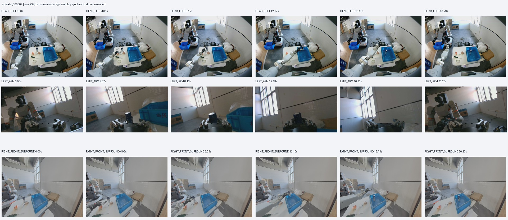

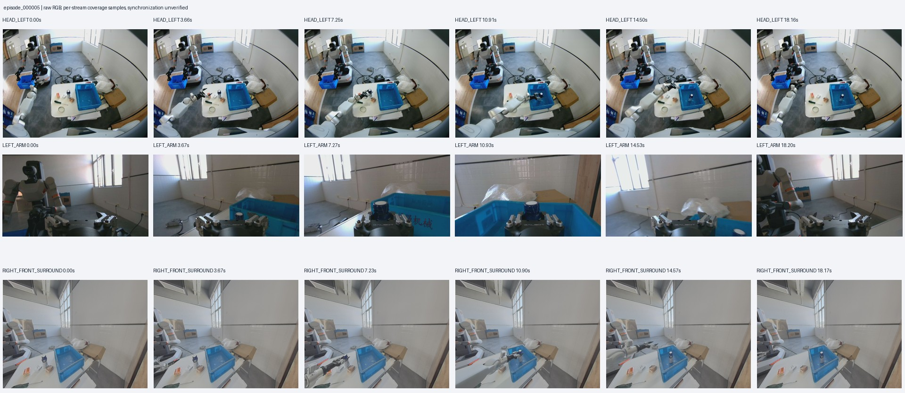

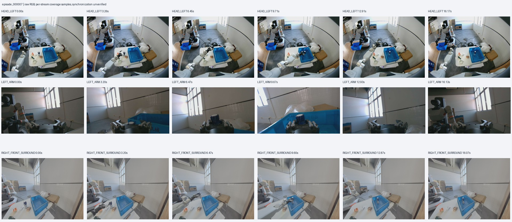

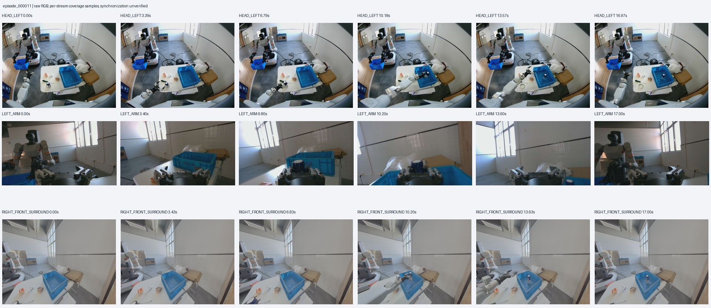

## 21. 助手

_工具输出图片（原始工具文本未纳入归档）。_

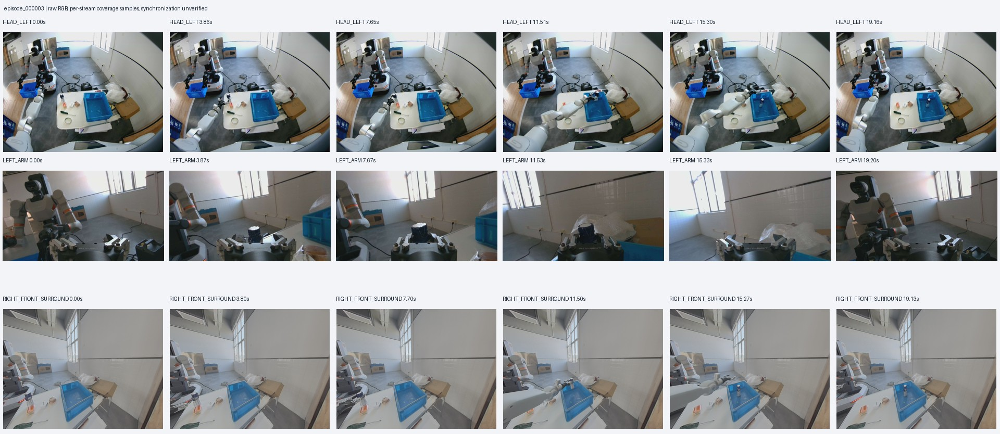

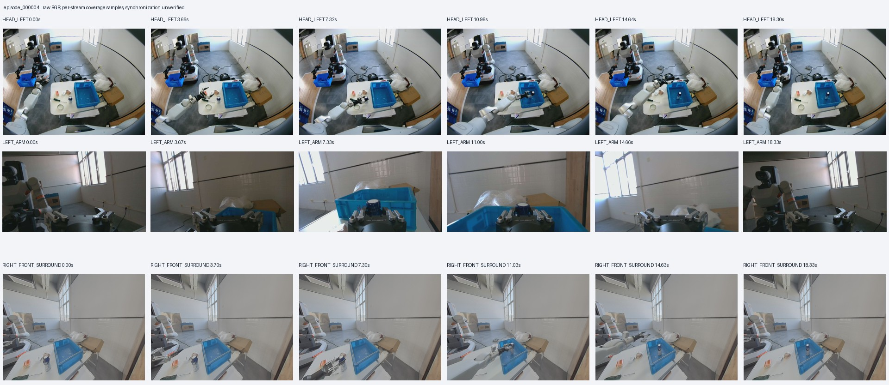

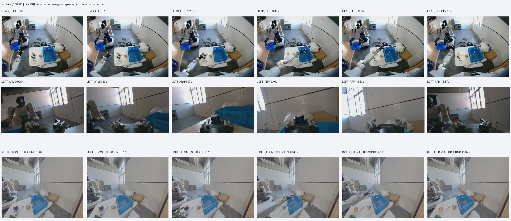

## 22. 助手（进展）

离线对齐检查已完成：这10组可导出1,721帧，动作标签全部有效；其中1,512帧（87.9%）通过当前时序规则，10帧带时钟质量标记。转换正在进行。我会另外保存符合现有采样规则的训练窗口索引，保留完整时间线，方便后续训练时应用质量筛选。

## 23. 助手

_工具输出图片（原始工具文本未纳入归档）。_

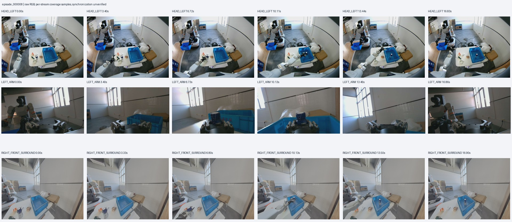

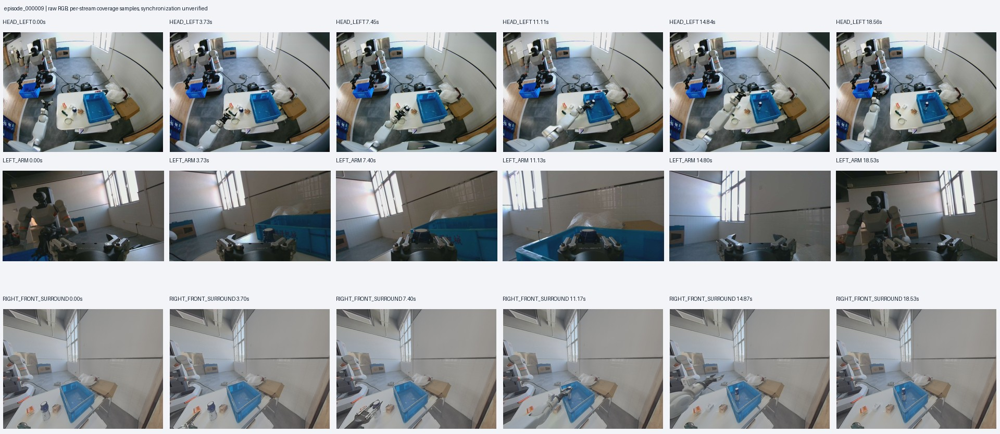

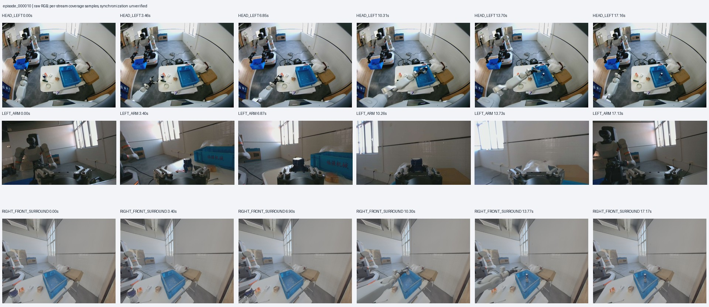

## 24. 助手（进展）

转换已到约80%。处理脚本已限制计算和编码线程，我也降低了本次离线处理的调度优先级，以减少与采集程序争用PC资源。

继续采集时，留意 J2 是否长时间贴住限位：这批8组出现过裁剪，主臂请求与限位后目标的最大差值约10.2°。可以调整物体摆位来减少这种情况，现有限位参数保持不变。

## 25. 助手（进展）

导出在最后一组视频编码时意外中断，原件、审计和对齐结果都完整保留。我会按现有流程恢复，未完成的导出另存保留。你的新会话采集可以继续，恢复过程不访问机器人。

## 26. 助手（进展）

恢复后的导出正在推进。10组成功示教的三视角关键帧都已查看，能看到牛奶拿起、放入蓝筐和撤手的过程，抽查画面没有明显黑屏或损坏。按现有牛奶训练规则，这批有1,083个合格的50步动作窗口起点；导出完成后会验证这些窗口能否被训练环境正确读取。

## 27. 助手（进展）

恢复后的导出已到约87%。接下来还会做全量重载、训练环境读取和视频对照检查，全部通过后再给你最终路径与报告。这批失败组和原始传感器数据都会保留。

## 28. 助手（进展）

10组、1,721帧已经编码完成，正在用官方 LeRobot API 全量重新读取，目前约46%。这一阶段会核对数值、动作和三路图像；之后再交叉验证训练 Docker 的读取结果。

## 29. 助手（进展）

标准 LeRobot 导出、1,721帧全量重载、训练 Docker 读取和90次视频对照都已通过，对照复核标记为0。现在最后验证筛选索引在 π0.5 隔离环境中的读取，确认50步动作窗口不跨示教边界。

## 30. 助手

**已完成本地归档和 LeRobot 格式处理，可以继续采集。** 后续离线处理不占用机器人的采集连接。

- 原始11组：纳入10组正常结束示教，1组取消记录保留原件。
- 导出 **1,721帧、10Hz、三路RGB、8维状态/动作**；LeRobot软件0.4.4、数据格式v3.0。
- 全量重载、Docker读取和视频对照通过；另准备了 **1,083个质量筛选后的50步训练窗口起点**，π0.5环境读取验证通过。

你截图中的 **J6未对齐发生在暂停后的待命阶段**，没有破坏已完成记录。另有8组触发J2限位裁剪，已按实际SDK接受目标保存并记录在报告中。训练需应用筛选索引，仍保留 `training_ready=false`，物理同步尚未认证。

[原件归档](/mnt/data/VLA_data/milk_left_20261009_100031) · [LeRobot数据集](/mnt/data/VLA_data/milk_left_20261009_100031/lerobot/dataset_v3) · [筛选索引](<../../assets/3c77c131df5def4e--training_candidates.json>) · [检查报告](<../../assets/ed49fc3e5608852f--%E6%A3%80%E6%9F%A5%E4%B8%8E%E4%BA%A4%E4%BB%98%E6%8A%A5%E5%91%8A.md>)

本轮补采还剩 **30组**；新会话计数从0开始。

[附件：3c77c131df5def4e--training_candidates.json](../../assets/3c77c131df5def4e--training_candidates.json)

[附件：ed49fc3e5608852f--检查与交付报告.md](../../assets/ed49fc3e5608852f--%E6%A3%80%E6%9F%A5%E4%B8%8E%E4%BA%A4%E4%BB%98%E6%8A%A5%E5%91%8A.md)

## 31. 用户

我又采集了一些数据
双臂实时对比 | 左：READY | 右：LOCKED
单位：度 | 主目标=GP映射目标；有效=限幅后目标；差值=有效目标−G1从臂
各侧固定键：全部误差<15°且READY → 按一次正式跟随 → 再按暂停
+------+----------+--------+--------+--------+--------+----------+--------+--------+--------+--------+
| 关节 | 左主目标 | 左有效 | 左从臂 | 左差值 | 左检查 | 右主目标 | 右有效 | 右从臂 | 右差值 | 右检查 |
+------+----------+--------+--------+--------+--------+----------+--------+--------+--------+--------+
| J1   | +59.16   | +59.16 | +60.09 | -0.93  | 通过   | -60.04   | -60.04 | -60.04 | +0.00  | 通过   |
| J2   | -75.07   | -75.07 | -67.66 | -7.41  | 通过   | +64.69   | +64.69 | +64.69 | +0.00  | 通过   |
| J3   | -41.84   | -41.84 | -44.63 | +2.79  | 通过   | +44.74   | +44.74 | +44.74 | +0.00  | 通过   |
| J4   | +6.85    | +6.85  | -1.92  | +8.78  | 通过   | -3.56    | -3.56  | -3.56  | +0.00  | 通过   |
| J5   | -6.75    | -6.75  | +6.88  | -13.62 | 通过   | -10.05   | -10.05 | -10.05 | +0.00  | 通过   |
| J6   | -10.94   | -10.94 | -4.43  | -6.51  | 通过   | +3.09    | +3.09  | +3.09  | +0.00  | 通过   |
| J7   | +4.31    | +4.31  | +3.33  | +0.99  | 通过   | -2.81    | -2.81  | -2.81  | +0.00  | 通过   |
+------+----------+--------+--------+--------+--------+----------+--------+--------+--------+--------+
右侧状态原因：本次仅左臂：右臂跟随禁用，显示实测姿态
左扳机=0.700，夹爪目标/实测=100.0/100.0mm，未启用 | 右扳机=0.700，夹爪目标/实测=100.0/50.0mm，未启用
【采集进度·本次会话】已完成 10/40 组 | 取消/失败 1 组 | 已发起 11 组 | 当前组 0.0s | 完成组累计 171.1s | 累计已落盘 61,501 条原始记录（含失败组，组结束后更新）
【数采】ARMED | 无活动episode | 记录键：ARMED开始 / RECORDING结束；取消键：录制中标失败，待命时保持连接

双臂实时对比 | 左：READY | 右：LOCKED
单位：度 | 主目标=GP映射目标；有效=限幅后目标；差值=有效目标−G1从臂
各侧固定键：全部误差<15°且READY → 按一次正式跟随 → 再按暂停
+------+----------+--------+--------+--------+--------+----------+--------+--------+--------+--------+
| 关节 | 左主目标 | 左有效 | 左从臂 | 左差值 | 左检查 | 右主目标 | 右有效 | 右从臂 | 右差值 | 右检查 |
+------+----------+--------+--------+--------+--------+----------+--------+--------+--------+--------+
| J1   | +59.15   | +59.15 | +60.09 | -0.94  | 通过   | -60.04   | -60.04 | -60.04 | +0.00  | 通过   |
| J2   | -75.08   | -75.08 | -67.66 | -7.42  | 通过   | +64.69   | +64.69 | +64.69 | +0.00  | 通过   |
| J3   | -41.84   | -41.84 | -44.63 | +2.79  | 通过   | +44.74   | +44.74 | +44.74 | +0.00  | 通过   |
| J4   | +6.86    | +6.86  | -1.92  | +8.78  | 通过   | -3.56    | -3.56  | -3.56  | +0.00  | 通过   |
| J5   | -6.74    | -6.74  | +6.88  | -13.62 | 通过   | -10.05   | -10.05 | -10.05 | +0.00  | 通过   |
| J6   | -10.94   | -10.94 | -4.43  | -6.52  | 通过   | +3.09    | +3.09  | +3.09  | +0.00  | 通过   |
| J7   | +4.31    | +4.31  | +3.33  | +0.99  | 通过   | -2.82    | -2.82  | -2.82  | +0.00  | 通过   |
+------+----------+--------+--------+--------+--------+----------+--------+--------+--------+--------+
右侧状态原因：本次仅左臂：右臂跟随禁用，显示实测姿态

给我看下数据有没有问题

## 32. 助手（进展）

我会沿用 `g1-data-pipeline` 的检查流程，先定位这批对应的会话，再核对落盘、控制异常和时序质量。你贴出的画面是待命状态，各关节通过的是重新启用跟随前的对齐检查；录制期间的数据质量还需要查日志和原件。

## 33. 用户

如果没有问题，给我编写脚本 [$g1-data-pipeline](/home/lsy03/.codex/skills/g1-data-pipeline/SKILL.md)  进行数据上传和lerobot处理，我来执行

## 34. 助手（进展）

明白，改为由你手动执行。我会停止刚发起的本次归档任务，保留已下载内容，并编写支持断点续跑的专用脚本。当前日志层面已确认10组正常结束、1组取消、无丢写；原件完整性和时序检查会由脚本继续完成，因此暂时还不能认定整批数据没有问题。

## 35. 助手（进展）

专用脚本已写好，默认只预览，只有你加 `--execute` 才会续传和处理。预检查发现：10组成功示教均处于 FOLLOWING，关节指令拒绝0条；不过这次10组都触发过 J2 限位裁剪，最大差约10.46°。脚本会保留实际接受目标和质量标记，完成后给出审计报告，不会把这些记录直接判成无问题。

## 36. 助手

脚本已写好并通过语法、预览检查，**由你手动执行**：

```bash
bash "/home/lsy03/文档/ChatGPT/VLA G1 项目/acquisition/lerobot_capture/process_milk_20261009_103445.sh" --execute
```

它会续传这批原件，完成完整性校验，再自动离线审计、导出 **LeRobot v3.0** 并验证读取结果。已下载约81%的内容保留，尚未完成完整校验。

看到“**原件已完整归档并校验，可继续新会话采集**”后，就可以继续采集。中断后重跑同一命令即可续跑；加 `--status` 可查看进度。

目前日志无丢写、无关节指令拒绝，但**10组都出现过J2限位裁剪，最大差约10.46°**；脚本会保留实际接受目标和质量标记，最终质量以审计报告为准。

[脚本](</home/lsy03/文档/ChatGPT/VLA G1 项目/acquisition/lerobot_capture/process_milk_20261009_103445.sh>) · [使用说明](<../../assets/55f7d17a969e63a2--MILK_20261009_103445_USAGE.md>)

[附件：55f7d17a969e63a2--MILK_20261009_103445_USAGE.md](../../assets/55f7d17a969e63a2--MILK_20261009_103445_USAGE.md)

## 37. 用户

运用当前的牛奶数据，写一个 Pi0.5 动作专家微调的脚本，先讲讲你的损失函数应该如何设计？

## 38. 助手（进展）

我先核对 π0.5 动作专家的训练实现，以及当前牛奶数据的处理状态，再说明损失函数和监督目标该怎么设。脚本会复用独立 Docker 环境和现有质量筛选规则，由你手动启动训练。

## 39. 用户

[validate.video] 1/10 (10.0%) Video round-trip audit: 1/10 episodes; 9 RGB comparisons
[validate.video] 2/10 (20.0%) Video round-trip audit: 2/10 episodes; 18 RGB comparisons
[validate.video] 3/10 (30.0%) Video round-trip audit: 3/10 episodes; 27 RGB comparisons
[validate.video] 4/10 (40.0%) Video round-trip audit: 4/10 episodes; 36 RGB comparisons
[validate.video] 5/10 (50.0%) Video round-trip audit: 5/10 episodes; 45 RGB comparisons
[validate.video] 6/10 (60.0%) Video round-trip audit: 6/10 episodes; 54 RGB comparisons
[validate.video] 7/10 (70.0%) Video round-trip audit: 7/10 episodes; 63 RGB comparisons
[validate.video] 8/10 (80.0%) Video round-trip audit: 8/10 episodes; 72 RGB comparisons
[validate.video] 9/10 (90.0%) Video round-trip audit: 9/10 episodes; 81 RGB comparisons
[validate.video] 10/10 (100.0%) Video round-trip audit: 10/10 episodes; 90 RGB comparisons
[validate] 1/1 (100.0%) complete
[report] 0/1 (0.0%) starting
[report] 1/1 (100.0%) complete
{"status": "complete", "bundle": "/mnt/data/VLA_data/milk_left_20261009_103445", "next": "none", "training_ready": false}
lsy03@lsy03-System-Product-Name:~/文档/ChatGPT/VLA G1 项目$
现在补采的数据应该好了，给我看看能不能用来 Pi 0.5 的动作专家微调

## 40. 助手（进展）

这批日志显示归档、导出和验证流程已经完成，`training_ready=false` 仍是保留的质量状态，不能单凭它判断数据不可用。我会检查补采数据的具体质量比例，并在 π0.5 环境里核对真实动作窗口。

损失设计先定一个基线：沿用官方 flow matching，监督7个关节和1个连续夹爪目标；冻结视觉语言骨干，只更新动作专家及相关投影层。32维内部表示中的24个填充维度不计入损失。夹爪加权作为可配置实验项，与等权基线使用相同数据划分比较。

## 41. 助手（进展）

真实数据核对后，可以用于离线动作专家微调，不过有一处需要说明：最新批次首组前5.2秒缺少已接受的夹爪目标，流程裁去了52帧，没有用实测状态补造动作。导出后实际为1,664帧，其中1,481帧通过时序规则；交付报告中的部分计数使用了裁切前口径。

当前5批共有59条候选示教。我会让脚本默认排除这条被裁切的示教，并将最新批次其余9条作为独立测试集；训练和验证只使用之前的数据，归一化也只从训练组计算。原始数据保持不变。

## 42. 用户

如果没啥问题，给我写个脚本我来运行

## 43. 助手（进展）

我会写成默认仅预览、由你手动执行的脚本。第一轮默认采用等权的8维 flow-matching 损失，提供夹爪权重参数作对照；动作窗口先设为10步，对应当前10Hz数据约1秒。脚本会包含真实数据准备、零优化器更新的检查模式、训练入口和专家权重加载器；我不会启动训练。

## 44. 用户

你现在在干啥，训练脚本写好了没

## 45. 助手（进展）

写好了。刚才在做收尾检查：损失数学测试和58条真实示教的CPU读取检查都已通过，没有启动训练。脚本已包含数据划分、零更新GPU检查和动作专家微调入口；GPU反向传播及显存是否够用，还需要你先运行 `check` 确认。

## 46. 助手

**写好了，尚未启动训练。** 刚才完成了损失测试和58条真实示教的CPU读取检查。

- 冻结视觉语言骨干，微调动作专家及投影层。
- 损失采用8维等权 flow matching，填充维度不计入；夹爪权重可调。
- 数据划分：40条训练、9条验证、9条测试；排除1条前缀被裁切的示教。

**先运行GPU检查，确认反向传播和显存通过：**

```bash
bash "/home/lsy03/文档/ChatGPT/VLA G1 项目/pi05_deploy/scripts/train_milk_expert.sh" check
```

检查通过后启动训练：

```bash
bash "/home/lsy03/文档/ChatGPT/VLA G1 项目/pi05_deploy/scripts/train_milk_expert.sh" train
```

`check` 执行0次优化器更新。GPU训练显存目前尚未实测。

[训练脚本](</home/lsy03/文档/ChatGPT/VLA G1 项目/pi05_deploy/scripts/train_milk_expert.sh>) · [损失设计与使用说明](<../../assets/75f0da6e2ceee6bd--README.md>)

[附件：75f0da6e2ceee6bd--README.md](../../assets/75f0da6e2ceee6bd--README.md)

## 47. 用户

": "train", "step": 1930, "steps": 2000, "loss": 0.0237511444138363, "gradient_norm": 0.5732489824295044, "lr": 2.5752707535215714e-06, "joint_flow_mse": 0.024058342445641756, "gripper_flow_mse": 0.021600775377009995, "elapsed_s": 1889.7105704179994}
{"event": "train", "step": 1940, "steps": 2000, "loss": 0.07753713650163263, "gradient_norm": 1.1677742004394531, "lr": 2.555317346368622e-06, "joint_flow_mse": 0.0742548267589882, "gripper_flow_mse": 0.10051332435978111, "elapsed_s": 1898.8175278100098}
{"event": "train", "step": 1950, "steps": 2000, "loss": 0.010497589479200542, "gradient_norm": 0.2622649669647217, "lr": 2.5384244536749648e-06, "joint_flow_mse": 0.009923794190399349, "gripper_flow_mse": 0.014514162496197969, "elapsed_s": 1907.8496271620097}
{"event": "train", "step": 1960, "steps": 2000, "loss": 0.03268951294012368, "gradient_norm": 0.7371241450309753, "lr": 2.524596693788787e-06, "joint_flow_mse": 0.03516937140375376, "gripper_flow_mse": 0.015330491049098782, "elapsed_s": 1916.9637367500109}
{"event": "train", "step": 1970, "steps": 2000, "loss": 0.010463280428666621, "gradient_norm": 0.343477725982666, "lr": 2.513837847081572e-06, "joint_flow_mse": 0.010331064113415778, "gripper_flow_mse": 0.01138880261714803, "elapsed_s": 1926.056139998007}
{"event": "train", "step": 1980, "steps": 2000, "loss": 0.02152313687838614, "gradient_norm": 0.5755554437637329, "lr": 2.506150854914582e-06, "joint_flow_mse": 0.02438447973690927, "gripper_flow_mse": 0.001493743562605232, "elapsed_s": 1935.1645216210018}
{"event": "train", "step": 1990, "steps": 2000, "loss": 0.04748119553551078, "gradient_norm": 0.7382999658584595, "lr": 2.501537818834724e-06, "joint_flow_mse": 0.03244243864901364, "gripper_flow_mse": 0.15275253797881305, "elapsed_s": 1944.2703937390033}
{"event": "train", "step": 2000, "steps": 2000, "loss": 0.0319022610783577, "gradient_norm": 2.074455499649048, "lr": 2.5e-06, "joint_flow_mse": 0.00928397139068693, "gripper_flow_mse": 0.19023030491371173, "elapsed_s": 1953.3493192690075}
{"event": "evaluation", "step": 2000, "fm_loss": 0.05993191163159079, "joint_mae_deg": 2.618674342279081, "gripper_mae_mm": 0.8120750531002328, "first_joint_mae_deg": 1.380056619644165, "first_gripper_mae_mm": 0.7907918875140173, "hold_state_joint_mae_deg": 1.8948642920564722, "hold_state_gripper_mae_mm": 14.944444444444445, "gripper_out_of_range_fraction": 0.4407407387539192, "windows": 27, "selection_score": 1.471752181759587, "elapsed_s": 1958.5832080580003}
RUN_DIR=/home/lsy03/文档/ChatGPT/VLA G1 项目/pi05_deploy/runtime/outputs/milk_runs/pi05-milk-train-20261009_114715-576014
结束状态见status.json；退出码=0
lsy03@lsy03-System-Product-Name:~/文档/ChatGPT/VLA G1 项目$

给我查一下，效果如何？训练 loss 和验证loss 到多少了？ 是否应该增加训练步数？

## 48. 助手（进展）

我会读取这轮完整日志、最佳检查点和验证曲线，核对最终与最佳表现，再判断是否值得加步数。你贴出的结果里，夹爪误差较小，但关节误差还没有优于“保持当前实测姿态”基线；增加步数是否有用，要看后半程的验证趋势。

## 49. 助手（进展）

日志确认：最佳检查点是1900步，最终2000步略有回退。最终训练 loss 为0.03190，最近10个记录点平均0.03646；验证 flow loss 为0.05993，1900步为0.05938。

我会再对1900步模型做离线验证集复核，重点看关节运动误差和夹爪越界幅度。夹爪平均误差虽小，约40%的输出仍超出0～100mm；需要区分边界附近的小幅偏差和较大的越界。复核不更新权重，也不使用独立测试集。

## 50. 助手

_工具输出图片（原始工具文本未纳入归档）。_

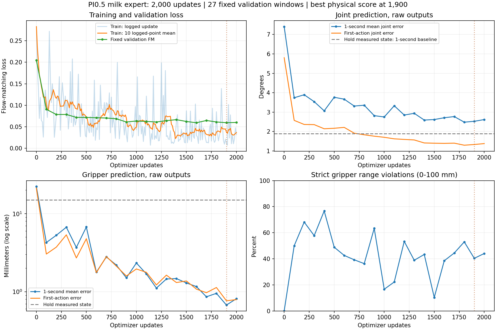

## 51. 助手（进展）

复核发现一个需要纠正的地方：我之前每条验证示教只取首、中、尾3个起点，实际27个窗口都没有覆盖夹爪开闭转折，导致夹爪指标偏乐观。这是验证采样设计的遗漏。

1900步模型在144个均匀验证窗口上的夹爪平均误差为6.17mm；在全部192个开闭转折窗口上为32.21mm。关节运动段有一定改善，但低运动量窗口不如保持当前姿态。建议先修正验证覆盖，再考虑小规模续训，而不是直接大幅增加步数。

## 52. 助手

**训练有明显改善，但暂不建议直接大幅增加步数。** 后半程验证 loss 已接近平台，而且发现原验证采样漏掉了关键的夹爪开闭阶段。

| 指标 | 数值 |
|---|---:|
| 最后一次训练 loss | **0.03190** |
| 最近10个训练记录点平均 | **0.03646** |
| 最终验证 flow loss | **0.05993** |
| 最低验证 flow loss | **0.05926，1600步** |
| 原验证选中的最佳模型 | **1900步**，验证 loss **0.05938** |

约900步以后，验证 loss 主要在 **0.059～0.066** 波动。2000步的物理误差比1900步略差，当前应保留1900步检查点。

**更重要的是：我原先设置的27个验证窗口，全都没有覆盖夹爪开闭转折。这是验证采样设计的遗漏，导致夹爪效果评估偏乐观。** 我已修正下一轮默认验证覆盖，并单列转折误差。

对1900步模型额外复核后：

- **144个均匀窗口**：关节误差 **2.39°**，与保持当前姿态基线 **2.38°** 基本持平；夹爪误差 **6.17mm**。
- **192个开闭转折窗口**：夹爪误差 **32.21mm**，开闭时机仍是明显短板。
- 本次观察到夹爪输出范围 **−6.28～109.57mm**，越界并非全部只是数值舍入。

我的建议是：**先完善转折验证与训练采样覆盖，再从1900步追加1000～2000步低学习率实验**，例如 `5e-6`，每100步验证、连续5次不改善就停止。目前没有充分依据直接扩到一两万步。

本次只做了离线复核，没有启动续训。
[训练曲线](<../../assets/a8c69a65f0d43aa3--image-a8c69a65f0d4.png>) · [完整评估报告](<../../assets/501c5cd5e1652077--%E8%AE%AD%E7%BB%83%E6%95%88%E6%9E%9C%E8%AF%84%E4%BC%B0.md>)


[附件：501c5cd5e1652077--训练效果评估.md](../../assets/501c5cd5e1652077--%E8%AE%AD%E7%BB%83%E6%95%88%E6%9E%9C%E8%AF%84%E4%BC%B0.md)

## 53. 用户

给我写下续训的脚本

## 54. 助手（进展）

我会以1900步检查点为起点，写一个由你手动运行的续训入口，默认追加1000步、学习率5e-6。验证沿用修正后的采样方式，同时保留原训练的数据划分和归一化；这一阶段会新建优化器，不是恢复旧运行的完整状态。

## 55. 用户

现在执行到哪里了？

## 56. 助手（进展）

目前只完成了1900步检查点、数据划分和续训参数的核对，**没有启动续训，脚本还未完成验收**。接下来我会写入低学习率续训入口和改进后的转折采样、验证配置，再做语法及预览检查；训练仍由你手动启动。

## 57. 助手（进展）

续训入口已写好：默认只预览，显式加 `--execute` 才会训练。它从1900步权重加载，默认追加1000步；开闭转折窗口的采样权重设为2，验证使用144个均匀窗口和全部192个转折窗口。数据标签、划分、归一化和损失结构保持原样。接下来只做CPU兼容性检查，不启动GPU训练。

## 58. 助手

**续训脚本已写好，检查通过，尚未启动训练。**

先验证1900步权重的加载和新验证指标，执行0次优化器更新：

```bash
bash "/home/lsy03/文档/ChatGPT/VLA G1 项目/pi05_deploy/scripts/continue_milk_expert.sh" --verify-init-only
```

验证完成后启动续训：

```bash
bash "/home/lsy03/文档/ChatGPT/VLA G1 项目/pi05_deploy/scripts/continue_milk_expert.sh" --execute
```

默认设置：

- 从1900步权重追加最多 **1000步**，累计最多2900步。
- 学习率 **5e-6**，连续5次验证不改善则早停。
- 开闭转折采样权重2；分别验证144个均匀窗口和192个转折窗口。
- 新建优化器和实验目录，原数据划分、归一化及原实验保留；**不是完整状态恢复**。

[脚本](</home/lsy03/文档/ChatGPT/VLA G1 项目/pi05_deploy/scripts/continue_milk_expert.sh>) · [使用说明](<../../assets/6027cbf2755d7a70--CONTINUATION.md>)

[附件：6027cbf2755d7a70--CONTINUATION.md](../../assets/6027cbf2755d7a70--CONTINUATION.md)

## 59. 用户

训练过程中是否展示 train loss 和 val loss？ ？

## 60. 助手

**会显示，目前采用 JSON 日志：**

- **Train loss**：第1步及每10步显示，`event="train"` 中的 `loss`。
- **Val loss**：每100步验证后显示，`event="evaluation"` 中的 `fm_loss`。
- 验证分两组：144个均匀窗口和192个开闭转折窗口，分别输出结果。
- 同时显示关节误差、夹爪误差、学习率和累计步数。

续训开始前会先显示初始化验证结果。完整日志保存在新 `RUN_DIR` 的 `console.log` 和 `metrics.jsonl`。

## 61. 用户

lsy03@lsy03-System-Product-Name:~/文档/ChatGPT/VLA G1 项目$ bash "/home/lsy03/文档/ChatGPT/VLA G1 项目/pi05_deploy/scripts/continue_milk_expert.sh" --verify-init-only
检查点哈希通过；起始累计步数： 1900
仅重载和初始化验证；优化器更新次数为0。
RUN_DIR=/home/lsy03/文档/ChatGPT/VLA G1 项目/pi05_deploy/runtime/outputs/milk_runs/pi05-milk-train-20261009_141643-593053
模式=train；网络关闭；原数据和基础权重只读。
DATA {'train': 40, 'validation': 9, 'test': 9, 'excluded': 1} {'train': 5726, 'validation': 1255, 'test': 1321}
WARNING:lerobot.configs.policies:Device 'mps' is not available. Switching to 'cuda'.
WARNING:lerobot.configs.policies:Device 'mps' is not available. Switching to 'cuda'.
WARNING:root:Vision embedding key might need handling: paligemma_with_expert.paligemma.model.vision_tower.vision_model.embeddings.patch_embedding.bias
WARNING:root:Vision embedding key might need handling: paligemma_with_expert.paligemma.model.vision_tower.vision_model.embeddings.patch_embedding.weight
MODEL trainable_parameters= 430098464
{"event": "evaluation", "step": 0, "cumulative_step": 1900, "metric_scope": "validation_uniform", "fm_loss": 0.049415081922133036, "joint_mae_deg": 2.3857398252520294, "gripper_mae_mm": 6.174962117854092, "first_joint_mae_deg": 1.1615661444763343, "first_gripper_mae_mm": 4.5275473524298935, "hold_state_joint_mae_deg": 2.3775375260868006, "hold_state_gripper_mae_mm": 21.09389175971349, "gripper_out_of_range_fraction": 0.3548611116906007, "windows": 144, "gripper_transition_windows": 24, "transition_joint_mae_deg": 1.4178992037971814, "transition_gripper_mae_mm": 25.787738184134167, "gripper_prediction_min_mm": -6.283122539520264, "gripper_prediction_max_mm": 103.51361846923828, "gripper_excess_max_mm": 6.283122539520264, "selection_score": 2.4278623361968332, "elapsed_s": 30.44733960799931}
{"event": "evaluation", "step": 0, "cumulative_step": 1900, "metric_scope": "validation_all_transitions", "fm_loss": 0.08968709803836343, "joint_mae_deg": 1.6762221848281722, "gripper_mae_mm": 32.208858565737806, "first_joint_mae_deg": 1.0170662684831768, "first_gripper_mae_mm": 17.105868075974286, "hold_state_joint_mae_deg": 0.7284320465599498, "hold_state_gripper_mae_mm": 39.78938005616268, "gripper_out_of_range_fraction": 0.1734375002561137, "windows": 192, "gripper_transition_windows": 192, "transition_joint_mae_deg": 1.6762221848281722, "transition_gripper_mae_mm": 32.208858565737806, "gripper_prediction_min_mm": -6.283122539520264, "gripper_prediction_max_mm": 109.57491302490234, "gripper_excess_max_mm": 9.574913024902344, "selection_score": 7.279882805561647, "elapsed_s": 70.49100719799753}
RUN_DIR=/home/lsy03/文档/ChatGPT/VLA G1 项目/pi05_deploy/runtime/outputs/milk_runs/pi05-milk-train-20261009_141643-593053
结束状态见status.json；退出码=0
lsy03@lsy03-System-Product-Name:~/文档/ChatGPT/VLA G1 项目$

是否正常？ 简单恢复

## 62. 助手

正常，退出码为0，验证结果与之前复核一致；1900步权重加载正确，**没有执行训练更新**。这些 WARNING 不影响本次验证。

可以开始续训：

```bash
bash "/home/lsy03/文档/ChatGPT/VLA G1 项目/pi05_deploy/scripts/continue_milk_expert.sh" --execute
```

## 63. 用户

gripper_flow_mse": 0.003681907750433311, "cumulative_step": 2380, "elapsed_s": 881.7467060310009}
{"event": "train", "step": 490, "steps": 1000, "loss": 0.0811451023328118, "gradient_norm": 2.18276309967041, "lr": 3.2178013043399588e-06, "joint_flow_mse": 0.013425780227407813, "gripper_flow_mse": 0.5551804198767059, "cumulative_step": 2390, "elapsed_s": 892.3903280590021}
{"event": "train", "step": 500, "steps": 1000, "loss": 0.029702987638302147, "gradient_norm": 0.5936018228530884, "lr": 3.140708399750594e-06, "joint_flow_mse": 0.010426253706100397, "gripper_flow_mse": 0.16464014444500208, "cumulative_step": 2400, "elapsed_s": 902.9162472970056}
{"event": "evaluation", "step": 500, "cumulative_step": 2400, "metric_scope": "validation_uniform", "fm_loss": 0.052003262554838635, "joint_mae_deg": 2.3744284845888615, "gripper_mae_mm": 7.189142751610941, "first_joint_mae_deg": 1.1835437988241513, "first_gripper_mae_mm": 4.959000893790896, "hold_state_joint_mae_deg": 2.3775375260868006, "hold_state_gripper_mae_mm": 21.09389175971349, "gripper_out_of_range_fraction": 0.26666666717372006, "windows": 144, "gripper_transition_windows": 24, "transition_joint_mae_deg": 1.3513046850760777, "transition_gripper_mae_mm": 25.628581364949543, "gripper_prediction_min_mm": -5.658423900604248, "gripper_prediction_max_mm": 103.53193664550781, "gripper_excess_max_mm": 5.658423900604248, "selection_score": 2.625042792616619, "elapsed_s": 934.760431941002}
{"event": "evaluation", "step": 500, "cumulative_step": 2400, "metric_scope": "validation_all_transitions", "fm_loss": 0.07996948161356461, "joint_mae_deg": 1.4926284290850163, "gripper_mae_mm": 28.75721601645152, "first_joint_mae_deg": 1.0229892736921709, "first_gripper_mae_mm": 18.417378284968436, "hold_state_joint_mae_deg": 0.7284320465599498, "hold_state_gripper_mae_mm": 39.78938005616268, "gripper_out_of_range_fraction": 0.13958333483121046, "windows": 192, "gripper_transition_windows": 192, "transition_joint_mae_deg": 1.4926284290850163, "transition_gripper_mae_mm": 28.75721601645152, "gripper_prediction_min_mm": -5.658423900604248, "gripper_prediction_max_mm": 107.62178802490234, "gripper_excess_max_mm": 7.621788024902344, "selection_score": 6.497757417832812, "elapsed_s": 976.4100424310018}
RUN_DIR=/home/lsy03/文档/ChatGPT/VLA G1 项目/pi05_deploy/runtime/outputs/milk_runs/pi05-milk-train-20261009_142054-594221
结束状态见status.json；退出码=0
lsy03@lsy03-System-Product-Name:~/文档/ChatGPT/VLA G1 项目$


寻俩结果如何？

## 64. 助手（进展）

我会核对这轮续训的状态和各次验证结果，确认为什么在500步结束，并与1900步的初始化基线比较。

## 65. 助手

**续训有局部改善，但整体没有超过原1900步模型。** 在新增500步、累计2400步时触发了正常早停，不是报错。

| 指标 | 续训前 | 续训后 | 变化 |
|---|---:|---:|---|
| 均匀验证 loss | 0.04942 | 0.05200 | 略变差 |
| 均匀窗口关节误差 | 2.386° | 2.374° | 基本持平 |
| 均匀窗口夹爪误差 | 6.175mm | 7.189mm | 变差 |
| 开闭转折夹爪误差 | 32.209mm | 28.757mm | 改善约10.7% |
| 开闭转折关节误差 | 1.676° | 1.493° | 改善约10.9% |

最后训练 loss 为 **0.02970**，最近10个记录点平均 **0.04451**。训练 loss 较低，但不能替代动作误差判断。

因为连续5次均匀验证综合分数都没有超过初始化基线，所以 `best_step=0`，表示**目前仍保留原1900步权重作为整体最佳**。2400步模型可以保留作转折改善的对照。

**不建议直接延长当前配置。** 下一轮更适合尝试将转折采样权重从2降到约1.5，观察能否保留转折收益、同时减少普通窗口的退步。当前仍是离线验证结果，尚不能判定实机抓放成功率。

## 66. 用户

<external_codex_apps_open_page>{"page_id":null}</external_codex_apps_open_page>

## 67. 用户

先给我评估一下训练的耗时是多长

## 68. 助手（进展）

我会核对两轮训练日志，区分日志记录的训练与验证耗时，以及包含模型加载、检查点保存的总运行时间，再估算下一轮的耗时。

## 69. 助手

按当前 **RTX 4090、batch=1、梯度累积4** 的设置，耗时如下：

| 训练阶段 | 步数 | 总耗时 |
|---|---:|---:|
| 首轮训练，27个验证窗口 | 2000步 | **约33分20秒，实测** |
| 最近续训，144＋192个验证窗口 | 500步后早停 | **约17分04秒，实测** |
| 下一轮，同当前验证配置 | 新增1000步 | **预计30～35分钟** |
| 下一轮，同当前验证配置 | 新增2000步 | **预计60～70分钟** |

目前纯训练约 **1.06秒/次优化器更新**；每100步的两组验证合计约 **74秒**，因此验证占用了较多时间。

如果下一轮再次在500步触发早停，耗时也会接近 **17分钟**。以上没有启动新训练。

## 70. 用户

优先夹爪审计，我先暂缓其他 GPU 测试

**排查完成：夹爪标签、单位、归一化和动作解码一致。主要异常是续训后，夹爪生成对初始噪声过于敏感。**

同一组 70 个验证窗口，首步夹爪误差如下：

| 采样条件         | 第12步    | 第5012步     |
| ------------ | ------- | ---------- |
| 原种子 20261009 | 8.88mm  | 38.26mm    |
| 种子 42        | 9.49mm  | **6.55mm** |
| 种子 1729      | 10.38mm | **8.50mm** |
| 负噪声种子 9      | 10.42mm | **6.91mm** |
| FP32积分、50步   | 9.79mm  | 49.12mm    |

因此，之前“续训整体变差”的判断需要收窄：**部分种子下确实改善了，但稳定性明显下降。不能挑一个好种子当作修复。**

受控测试中，只翻转夹爪噪声、保持观察和其他噪声不变，第5012步对“应张开”样本的平均预测从 **105.6mm 变成22.7mm**；第12步同样测试仅变化约8.9mm。

已排除的直接错误：

- 原始索引 `7` → 模型槽位 `28` 正确，目标是米制绝对命令。
- 重算训练集均值、标准差，误差均为 **0**。
- BF16编码解码误差最多 **0.185mm**，无法解释几十毫米的退化。
- 缓存前向、未使用维度约束和增加积分步数都没有解决问题。

另发现：现有 loss 只验证 `t=0.5`，源码的 `sample_beta` 也不是标准 Beta 采样。这些是需要对照验证的改进项，尚不能认定为唯一原因。

**建议下一轮从第12步、rank=8开始做500步小对照，增强夹爪独立监督，并用多个预先固定的种子评估平均与最差误差。**

[完整审计记录](<../../assets/a421d146c605b3a5--audit_summary.json>) · [对照图](<../../assets/91dc439ab38eb157--gripper_audit.png>)

审计已结束，显存已释放，可以恢复其他 GPU 测试。

&#x20; 已编辑 3 个文件+104-2查看变更

撤销查看变更

lingbot_finetune/audit_sampler.pylingbot_finetune/audit_sampler.py+26-2

lingbot_finetune/audit_noise_sign.pylingbot_finetune/audit_noise_sign.py+47-0

lingbot_finetune/plot_gripper_audit.pylingbot_finetune/plot_gripper_audit.py+31-0

从聊天中继续

给我看一下现在linbotVLA2.0训练的夹爪loss是什么设定？我看我看之前smolVLA 也出过类似的问题，但是后边修改损失函数后就好了，看下是不是类似的问题？

8:41

用时 39秒

结论：**是同一类问题，但更准确地说，是“夹爪被当作普通动作维度做 flow-matching”，导致训练 loss 下降，却没有保证夹爪自由采样稳定。**

当前 LingBot-VLA 2.0 的夹爪 loss 设定是：

1. 夹爪原始目标是第 8 维，映射到统一动作槽位 28，单位是米，范围 0–0.1m。
2. 训练时只保留 8 个有效动作维度：7 个关节＋1 个夹爪，mask 校验在 [acceptance_core.py:53]\(/home/lsy03/文档/ChatGPT/VLA G1 项目/lingbot_finetune/acceptance_core.py:53)。
3. 夹爪没有独立 head，也没有独立 loss。模型统一计算 flow-matching MSE：

   [modeling_lingbot_vla_v2.py (line 908)](/home/lsy03/Lsy03_document/VLA_G1/lingbot_deploy/lingbot-vla-v2/lingbotvla/models/vla/lingbot_vla/modeling_lingbot_vla_v2.py:908)
4. 最后把所有有效维度直接求平均：

   [modeling_lingbot_vla_v2.py (line 1290)](/home/lsy03/Lsy03_document/VLA_G1/lingbot_deploy/lingbot-vla-v2/lingbotvla/models/vla/lingbot_vla/modeling_lingbot_vla_v2.py:1290)

因此，夹爪只占 8 个有效动作维度中的 1 个，约 12.5%；没有首步加权、闭合／张开边界 BCE、SmoothL1，也没有 sigmoid 限制输出到 0–100mm。

归一化和解码本身没有发现错误。夹爪 mean/std 是训练集计算出的约 49mm/48mm，重新计算误差为 0；编码到模型槽位再解码的误差只有约 0.000003mm。[审计记录](<\</home/lsy03/文档/ChatGPT/VLA G1 项目/reports/lingbot_gripper_audit_20261009/audit_summary.json\>>)

这和之前 SmolVLA 的问题很像。SmolVLA 后来把夹爪单独处理：

- 关节单独使用 flow loss；
- 夹爪使用 sigmoid 输出；
- 夹爪使用 SmoothL1 回归；
- 对极端闭合／张开状态增加 BCE；
- 总损失为 `joint_loss + 2 × gripper_regression + 0.2 × extreme_BCE`。

代码在 [model.py:14](<\</home/lsy03/文档/ChatGPT/VLA G1 项目/lerobot_deploy/scripts/milk_retrain_v2/model.py\>>) 和 [model.py:19](<\</home/lsy03/文档/ChatGPT/VLA G1 项目/lerobot_deploy/scripts/milk_retrain_v2/model.py\>>)。

现有证据说明问题主要在目标函数和采样鲁棒性：

- 第 5012 步的 `t=0.5` 夹爪 flow MSE 从第 12 步的约 1.019 降到约 0.112；
- 但固定种子自由采样的首步夹爪 MAE 从 8.88mm 变成 38.26mm；
- 换种子后又能得到 6.55mm、8.50mm，说明模型对初始噪声非常敏感；
- 只翻转夹爪噪声、保持观测和其他噪声不变时，第 5012 步的张开动作会变化约 83mm。[采样对照汇总](<\</home/lsy03/文档/ChatGPT/VLA G1 项目/reports/lingbot_gripper_audit_20261009/sampler_comparison_summary.json\>>)

所以判断是：

**标签、单位、归一化和动作解码没有明显 bug；当前 LingBot 的夹爪 loss 设计确实缺少 SmolVLA 后来增加的“独立夹爪监督和有界输出”，这很可能就是类似退化的根因。**

下一轮应从第 12 步开始做一个约 500 步的受控实验：保留关节 flow loss，新增独立夹爪 sigmoid/SmoothL1＋极端状态 BCE，并用多个预先固定的噪声种子报告平均误差和最差误差。

给我看下是否需要重新训练？

收起

9:08

用时 43秒

**需要重新做一轮“改方案后的微调”，但不需要从零训练，也不建议沿用原 loss 再跑 5000 步。**

| 部分          | 建议                                   |
| ----------- | ------------------------------------ |
| 基础模型、数据和归一化 | 继续复用                                 |
| 初始化检查点      | 先从第 **12 步**开始，保持 rank=8             |
| 关节预测        | 保留 flow-matching                     |
| 夹爪预测        | 新增独立、无噪声的 sigmoid head，输出限制在 0–100mm |
| 夹爪监督        | 参考 SmolVLA 的 SmoothL1＋极端状态 BCE，前几步加权 |
| 首轮规模        | **500 步小实验**，有效再延长                   |

新增的夹爪 head 没有训练过，所以必须学习新权重；仅修改推理代码、裁剪输出或换随机种子，无法解决目前的稳定性问题。

同时，你贴出的“同一类问题、很可能就是根因”应视为**待验证假设**。SmolVLA 当时同时改了 head、损失和预测方式，不能证明单独改 loss 就能修好 LingBot。

这次验收应看：**多个预先固定种子下的平均／最差夹爪误差、闭合目标被预测成张开的比例，以及关节指标是否退化**。独立夹爪 head 的预测应不再随动作采样噪声变化。

9:09

可以，给我脚本，我来执行

9:15

已处理 8分钟 20秒

我会把这轮 500 步小实验做成独立脚本：从第 12 步检查点加载，新增无噪声的有界夹爪 head，保留关节 flow loss，并带训练、验证、保存和重新加载入口。我会先完成短程检查，再给你执行命令。

给我看下是不是夹爪loss pi0.5 有同样的问题/

[附件：a421d146c605b3a5--audit_summary.json](../../assets/a421d146c605b3a5--audit_summary.json)


## 71. 助手（进展）

我会对照当前 π0.5 的夹爪损失、采样方式和已有验证结果判断。先区分“设计上类似”与“已经证实对噪声敏感”，避免把 LingBot 的审计结论直接套过来；本次先只读检查代码和日志。

## 72. 助手

**π0.5有同类的夹爪设计风险，但还没有证实它出现了 LingBot 那种“对初始噪声过度敏感”的问题。**

当前 π0.5 的设定是：

| 项目 | 当前实现 |
|---|---|
| 夹爪坐标 | 原始第8维，模型槽位 **7**；不是LingBot的28 |
| 监督方式 | 与7个关节一起做 flow-matching MSE |
| 独立夹爪 head | 没有 |
| 独立回归／边界损失 | 没有；`gripper_flow_mse`只是日志统计 |
| 有界输出 | 没有 sigmoid 保证0～100mm |
| 夹爪权重 | 两轮都为1，即8个真实维度等权 |

代码见 [loss.py](</home/lsy03/文档/ChatGPT/VLA G1 项目/pi05_deploy/scripts/milk_expert/loss.py:14>)。

这里需要纠正一个理解：**权重系数为1/8，不代表夹爪始终只贡献12.5%的总loss。** 例如续训第490步，夹爪实际贡献约 **85.5%**。所以问题不能简单归因于“夹爪权重太小”。

π0.5与这次 LingBot 审计还有两个明确区别：

- 实际使用的是标准 `torch.distributions.Beta(1.5, 1)`，我已在镜像CPU上核对。
- 训练和验证都会采样不同的时间 \(t\)，**不是只在 `t=0.5` 计算loss**。[LeRobot原实现](https://github.com/huggingface/lerobot/blob/v0.4.4/src/lerobot/policies/pi05/modeling_pi05.py#L84)

已有 π0.5 结果确实显示短板：开闭转折误差仍有 **28.76mm**，1900步模型曾输出 **−6.28～109.57mm**。但这些只能证明转折预测和输出边界存在问题，不能证明根因与 LingBot 相同；标准 flow matching 本身也不是错误。

**下一步应先对1900步和2400步做同窗口、多固定种子及“仅翻转夹爪噪声”的对照。** 若确认同样敏感，再做500步小实验：保留7关节flow损失，新增无噪声的 sigmoid 夹爪 head＋SmoothL1／极端状态BCE。

本次没有运行GPU测试，也没有改训练方案。

## 73. 用户

<external_codex_apps_open_page>{"page_id":null}</external_codex_apps_open_page>

## 74. 用户

给我脚本我来运行

## 75. 助手（进展）

我会把刚才建议的夹爪噪声审计做成独立脚本，由你运行：对1900步和2400步权重使用同一批验证窗口、多个预设种子，并做“只翻转夹爪初始噪声”的受控对照。脚本只做离线推理，不更新权重；我先完成语法和CPU检查。

## 76. 助手（进展）

脚本已写好，默认比较1900步和累计2400步，完整报告4个预设种子的平均、最差误差和配对噪声翻转结果。正在验证CPU准备流程和统计逻辑；GPU审计尚未运行，交给你启动。

## 77. 助手

**夹爪噪声审计脚本已写好，CPU检查通过，尚未运行GPU审计。**

你执行：

```bash
bash "/home/lsy03/文档/ChatGPT/VLA G1 项目/pi05_deploy/scripts/audit_milk_gripper_noise.sh" --execute
```

默认会：

- 对比 **1900步、累计2400步**权重。
- 使用同一批72个验证窗口、4个固定种子。
- 做“只翻转夹爪初始噪声”的配对测试。
- 报告平均／最差误差、开闭混淆率、越界幅度及不同时间点的flow误差。

**不训练、不更新权重、不控制机器人。** 结果保存到终端打印的 `AUDIT_DIR`，完成后查看 `summary.json` 和 `REPORT.md`。

[脚本](</home/lsy03/文档/ChatGPT/VLA G1 项目/pi05_deploy/scripts/audit_milk_gripper_noise.sh>) · [使用说明](<../../assets/80177bea287588b7--README.md>)

[附件：80177bea287588b7--README.md](../../assets/80177bea287588b7--README.md)

## 78. 用户

lsy03@lsy03-System-Product-Name:~/文档/ChatGPT/VLA G1 项目$ bash "/home/lsy03/文档/ChatGPT/VLA G1 项目/pi05_deploy/scripts/audit_milk_gripper_noise.sh" --execute
检查点哈希通过，累计步数： 1900
检查点哈希通过，累计步数： 2400
AUDIT_DIR=/home/lsy03/文档/ChatGPT/VLA G1 项目/pi05_deploy/runtime/outputs/gripper_audits/pi05-gripper-noise-20261010_183446-1245294
模式=execute；优化器更新次数0，原件及权重只读。
PROBES 72 unique; 36 uniform; 36 transition
LOAD step_1900
WARNING:lerobot.configs.policies:Device 'mps' is not available. Switching to 'cuda'.
WARNING:lerobot.configs.policies:Device 'mps' is not available. Switching to 'cuda'.
WARNING:root:Vision embedding key might need handling: paligemma_with_expert.paligemma.model.vision_tower.vision_model.embeddings.patch_embedding.bias
WARNING:root:Vision embedding key might need handling: paligemma_with_expert.paligemma.model.vision_tower.vision_model.embeddings.patch_embedding.weight
Traceback (most recent call last):
  File "/code/audit.py", line 177, in <module>
    try:main()
        ^^^^^^
  File "/code/audit.py", line 95, in main
    policy,_,_=load_policy(manifest,checkpoint);policy.eval()
               ^^^^^^^^^^^^^^^^^^^^^^^^^^^^^^^^
  File "/code/expert/model.py", line 43, in load_policy
    policy.to('cuda')
  File "/opt/conda/lib/python3.11/site-packages/torch/nn/modules/module.py", line 1369, in to
    return self._apply(convert)
           ^^^^^^^^^^^^^^^^^^^^
  File "/opt/conda/lib/python3.11/site-packages/torch/nn/modules/module.py", line 928, in _apply
    module._apply(fn)
  File "/opt/conda/lib/python3.11/site-packages/torch/nn/modules/module.py", line 928, in _apply
    module._apply(fn)
  File "/opt/conda/lib/python3.11/site-packages/torch/nn/modules/module.py", line 928, in _apply
    module._apply(fn)
  [Previous line repeated 1 more time]
  File "/opt/conda/lib/python3.11/site-packages/torch/nn/modules/module.py", line 955, in _apply
    param_applied = fn(param)
                    ^^^^^^^^^
  File "/opt/conda/lib/python3.11/site-packages/torch/nn/modules/module.py", line 1355, in convert
    return t.to(
           ^^^^^
torch.OutOfMemoryError: CUDA out of memory. Tried to allocate 504.00 MiB. GPU 0 has a total capacity of 23.51 GiB of which 406.81 MiB is free. Process 802185 has 1.75 GiB memory in use. Process 1232067 has 12.77 GiB memory in use. Process 1245414 has 7.59 GiB memory in use. Of the allocated memory 7.05 GiB is allocated by PyTorch, and 162.25 MiB is reserved by PyTorch but unallocated. If reserved but unallocated memory is large try setting PYTORCH_CUDA_ALLOC_CONF=expandable_segments:True to avoid fragmentation.  See documentation for Memory Management  (https://pytorch.org/docs/stable/notes/cuda.html#environment-variables)
AUDIT_DIR=/home/lsy03/文档/ChatGPT/VLA G1 项目/pi05_deploy/runtime/outputs/gripper_audits/pi05-gripper-noise-20261010_183446-1245294
退出码=1；审计完成后结果见summary.json和REPORT.md。
lsy03@lsy03-System-Product-Name:~/文档/ChatGPT/VLA G1 项目$


给我看下什么问题？

## 79. 助手（进展）

报错发生在模型搬到GPU时，还没有开始审计推理。当时另一个进程占了约12.77GiB显存，这次审计进程也已占用约7.59GiB，剩余显存不足。我会先只读核对占用进程，不停止其他任务，再给审计脚本补上显存预检查。

## 80. 助手（进展）

现在占用约 12.77 GiB 的进程已经退出，GPU 当前空闲约 20.7 GiB。这次是并发任务导致显存不足；审计尚未开始推理，不能据此判断夹爪 loss 或模型效果。

脚本原先缺少显存预检查，我会补上启动前和模型加载前的检查，显存不足时直接提示退出。

## 81. 助手

这是 **GPU 显存不足**，报错发生在模型加载阶段，审计还没开始推理。

- 当时只剩 **407 MiB**，模型还要申请 **504 MiB**；另一个进程占用了 **12.77 GiB**。
- 最新检查又有进程 `1246509` 占用约 **12.76 GiB**，当前空闲约 **7.9 GiB**，仍不适合重跑。
- 权重没有被修改；这次失败不能说明夹爪 loss 或模型效果有问题。Docker 隔离也不会增加可用显存。

已给脚本补上显存检查：默认要求至少 **14 GiB 空闲**，不足就退出。语法、CPU检查和预览已通过，没有启动 GPU 审计或停止其他任务。

等其他 GPU 任务结束后，执行原命令即可：

```bash
bash "/home/lsy03/文档/ChatGPT/VLA G1 项目/pi05_deploy/scripts/audit_milk_gripper_noise.sh" --execute
```
