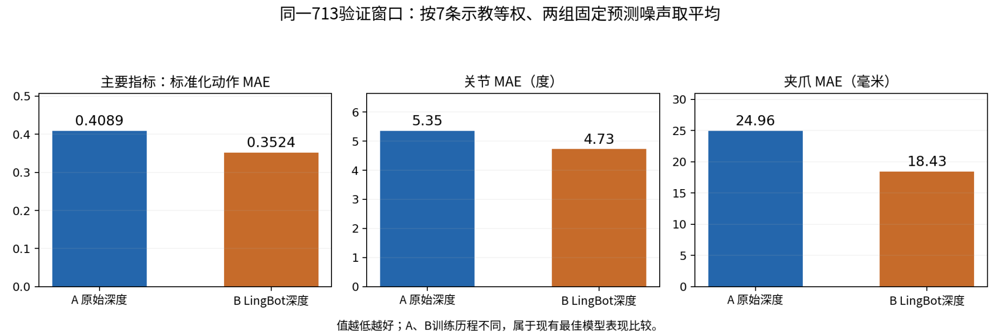
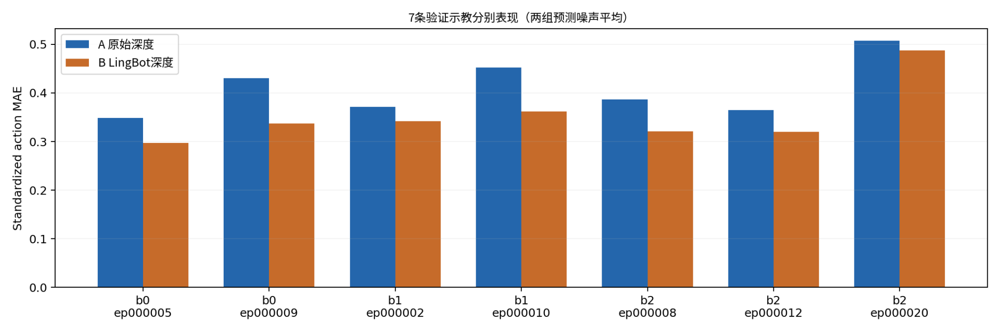

# 10_8 无lingbot 与 lingbotdepth 训练结果 对比

- 归档编号：`01a11e73-d012-7641-928d-54f146674005`
- 项目：VLA G1 项目
- 创建时间：2026-10-09T10:17:48.818000+08:00
- 更新时间：2026-10-09T10:32:11.002000+08:00
- 状态：活动
- 导出范围：用户可见消息与助手可见回复；不含隐藏推理和工具原始输出

## 1. 用户

<external_codex_apps_open_page>{"page_id":null}</external_codex_apps_open_page>

## 2. 用户

给我对比一下lingbot depth 和 没有 lingbot depth 的模型 差距如何/

## 3. 助手（进展）

我会把原始深度 A 和 LingBot 深度 B 的最佳模型放到相同的 713 个验证窗口上比较，重点看关节、夹爪预测误差和动作稳定性。先核对已有评估结果，缺少的部分再补齐；全程只做离线推理。

## 4. 助手（进展）

比较对象已确认：A 是原始深度最佳模型，累计 **6,400 步**；B 是 LingBot 全图深度最佳模型，累计 **6,300 步**。两者都预测 50 步动作，推理采样步数也一致。

为了避免旧评估环境带来差异，我会用同一份读取和评估代码重新跑 A、B。两者训练历程不同，因此结果能比较现有模型的表现，但不能单独证明差异完全来自深度补全。

## 5. 助手（进展）

A 的固定 56 窗口 loss 已准确复现为 **0.076003**，确认加载和预处理一致；全量评估目前完成 **200/713 窗口**，预测未出现非有限值。

本次会同时报告标准化动作误差、关节角度误差、夹爪毫米误差，以及预测目标的超限情况，不只比较 loss。

## 6. 助手（进展）

A 已完成 **550/713 窗口，约 77%**。目前数值检查正常；A 完成后会接着评估 B，并按 7 条示教分别比较，避免只看总体平均值。

## 7. 助手（进展）

A 已完成，重新评估的 loss、关节误差和夹爪误差都复现了之前的结果，说明评估协议一致。B 正在加载最佳权重，接下来会运行同样的 713 个窗口。

## 8. 助手（进展）

B 的固定验证 loss 也已准确复现为 **0.066993**，全量评估已完成 **200/713 窗口**。接下来重点看这个较低的 loss 是否对应更小的关节和夹爪动作误差；这两者不一定同步改善。

## 9. 助手（进展）

B 已完成 **400/713 窗口，超过一半**，目前没有出现非有限预测。完成后会给出总体差距和每条示教的结果，并单列第一步动作误差，便于看清实际执行起点的表现。

## 10. 助手（进展）

B 已完成 **600/713 窗口，约 84%**。最后一段结束后就能直接计算 A、B 在同一批动作标签上的误差差距，随后生成对比图和报告。

## 11. 助手（进展）

全量比较已完成。B 的标准化动作误差平均降低约 **13.8%**，关节误差降低约 **11.7%**，夹爪误差降低约 **26.2%**；7 条验证示教的标准化动作指标都有改善。

但 B 出现超限预测的窗口更多，因此它并非所有指标都更好。我会在最终结果中同时列出精度收益和范围检查的退化。

## 12. 助手

_工具输出图片（原始工具文本未纳入归档）。_

## 13. 助手

**在这批验证数据上，LingBot 深度模型 B 的动作预测更准确，夹爪改善尤其明显；但超限预测增多，并非所有指标都更好。**

比较的是最佳模型：**A 原始深度，累计 6,400 步；B LingBot 全图深度，累计 6,300 步**。两者都有 RGB 和六维力输入。

已重新评估相同的 **713 个窗口、7 条示教**，使用两组相同预测噪声。动作误差按示教等权平均：

| 指标，越低越好 | A 原始深度 | B LingBot | B 改善 |
|---|---:|---:|---:|
| 标准化动作 MAE | 0.4089 | **0.3524** | **13.8%** |
| 50 步关节 MAE | 5.35° | **4.73°** | **11.7%** |
| 50 步夹爪 MAE | 24.96 mm | **18.43 mm** | **26.2%** |
| 第一步关节 MAE | 3.43° | **3.00°** | **12.6%** |
| 第一步夹爪 MAE | 20.92 mm | **16.95 mm** | **19.0%** |

**7 条示教的标准化动作指标全部改善。**

不过，以一组固定预测噪声为例，在 50 步预测中出现超限的窗口：

- 保守关节限位：A **60** → B **104**。
- 夹爪超出 0～100 mm：A **559** → B **599**。

另一组噪声下也有类似增加。因此，**B 在平均精度上更有优势，但没有通过我们预设的“超限窗口不增加”条件**，还不能据此判断实机抓取表现更好。

两者训练历程不同，且这些示教参与过检查点选择，不能把全部改善归因于 LingBot，也不能换算成成功率。

[完整对比报告](<../../assets/eb09768c7f097b64--%E5%AF%B9%E6%AF%94%E6%8A%A5%E5%91%8A.html>)

[附件：eb09768c7f097b64--对比报告.html](../../assets/eb09768c7f097b64--%E5%AF%B9%E6%AF%94%E6%8A%A5%E5%91%8A.html)

## 14. 助手

_历史投影中的图片引用（用于补全本地对话资源）。_

