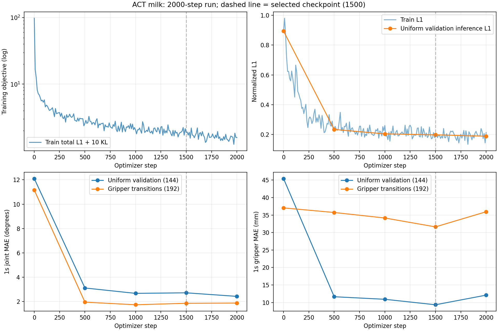
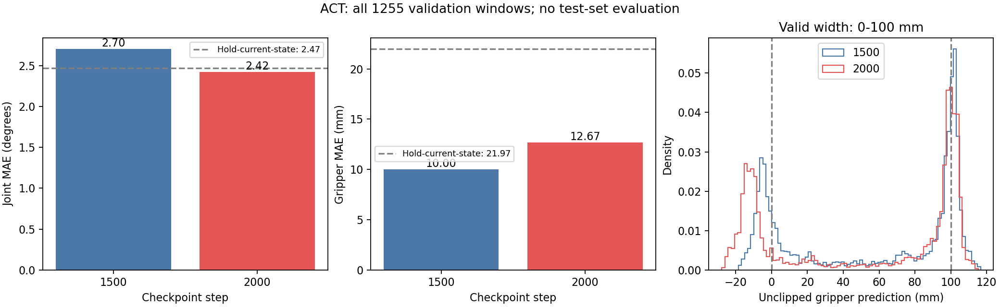

# 确认G1牛奶数据ACT测试环境

- 归档编号：`01a11ea9-1a88-7a41-b177-45fad5a84852`
- 项目：VLA G1 项目
- 创建时间：2026-10-09T11:16:01.289000+08:00
- 更新时间：2026-10-09T15:36:34.806000+08:00
- 状态：活动
- 导出范围：用户可见消息与助手可见回复；不含隐藏推理和工具原始输出

## 1. 用户

<external_codex_apps_open_page>{"page_id":null}</external_codex_apps_open_page>

## 2. 用户

G1 牛奶数据能否使用ACT来进行测试？ACT的训练环境是不是已经下有了？

## 3. 助手（进展）

我先检查项目里的牛奶数据说明和 ACT 相关环境记录，确认能否直接测试，以及训练环境是否已经准备好。

## 4. 助手（进展）

已有记录显示 ACT 环境已部署，并在 9 月 21 日通过训练、保存和重新加载测试。牛奶数据的三路 RGB、8 维状态和动作也能用于 ACT；还需要适配质量筛选和数据划分。我再核对当前镜像和 GPU 是否可用。

## 5. 助手

**可以用 ACT 测试 G1 牛奶任务，训练环境也已经部署好了。**

- **数据适配可行**：现有牛奶数据为 LeRobot v3.0，包含三路 RGB、8 维状态和动作（左臂 J1～J7＋夹爪），可以用于 ACT 训练。[ACT 官方说明](https://huggingface.co/docs/lerobot/act)支持多视角图像和关节状态输入、预测未来动作序列。
- **环境已准备**：刚确认本机 Docker 镜像 `lerobot-act-smolvla:0.4.4-cu128` 仍在，ResNet18 权重已缓存，RTX 4090 正常可用，当前约占用 1.2GB／24GB 显存。
- **已有验证**：9 月 21 日完成过 ACT 的 5 步合成数据训练、模型保存、新容器重载和推理，均通过。见[部署验收报告](/home/lsy03/文档/ChatGPT/VLA%20G1%20项目/lerobot_deploy/reports/部署验收报告.md)。
- **牛奶任务还需正式训练**：目前查到的 ACT 验证使用合成数据，还没有查到牛奶任务的 ACT 模型。现有牛奶专用训练脚本主要针对 SmolVLA。

建议先做 **RGB＋8 维状态的 ACT 基线**，沿用牛奶数据的质量筛选、按完整 episode 划分训练与验证，再比较关节角度和夹爪误差。默认训练器不会自动应用 `quality.*` 标记，因此还需补上牛奶任务专用采样与评估入口；无需重新安装整套环境。

[附件：afb6c614ff6bf791--部署验收报告.md](../../assets/afb6c614ff6bf791--%E9%83%A8%E7%BD%B2%E9%AA%8C%E6%94%B6%E6%8A%A5%E5%91%8A.md)

## 6. 用户

给我看下现在能够使用的牛奶数据是哪些？

## 7. 助手（进展）

我会核对本机各批牛奶数据的交付状态、示教数量和质量筛选结果，列出当前可用于离线训练的数据。这里使用 g1-data-pipeline 技能检查已有交付。

## 8. 助手（进展）

已确认有 5 批完成格式验证的牛奶数据，共 59 条示教、10,569 帧。今天 10:34 的第二批也已完成交付；现有 π0.5 实验将这批 10 条留作独立测试集，我会在清单中注明。

## 9. 助手

**目前有 5 批牛奶数据，已完成 LeRobot 格式和 Docker 读取验证，共 59 条示教、10,569 帧。按当前实验准入规则，排除 1 条不完整示教后，可使用 58 条。**

任务均为：**左臂拿起桌面牛奶瓶，放入蓝筐**。

| 采集时间 | 原始条数 | 已导出示教 | 导出帧数 | 数据集 |
|---|---:|---:|---:|---|
| 9 月 30 日 14:21 | 13 | 11 | 1,941 | [第一批](/mnt/data/VLA_data/milk_left_20260930/lerobot/milk_left_v3) |
| 9 月 30 日 14:58 | 11 | 11 | 2,262 | [第二批](/mnt/data/VLA_data/milk_left_20260930_145800/lerobot/milk_left_v3) |
| 9 月 30 日 15:44 | 20 | 17 | 2,981 | [第三批](/mnt/data/VLA_data/milk_left_20260930_154454/lerobot/milk_left_v3) |
| 10 月 9 日 10:00 | 11 | 10 | 1,721 | [补采第一批](/mnt/data/VLA_data/milk_left_20261009_100031/lerobot/dataset_v3) |
| 10 月 9 日 10:34 | 11 | 10 | 1,664 | [补采第二批](/mnt/data/VLA_data/milk_left_20261009_103445/lerobot/dataset_v3) |
| **合计** | **66** | **59** | **10,569** | |

五批统一为 **v3.0、10Hz、三路 RGB、8 维 state/action**，分别对应左臂七关节和夹爪。深度、腕力原件也已保留。

有两点影响实际使用：

- **最新批次的 `episode_000001` 不完整**：开头 52 帧缺少有效夹爪目标，导出时裁去了 5.2 秒。当前实验将其排除，因此最新批次实际采用 **9 条**。
- **需要应用质量筛选**：各批仍标记 `training_ready=false`，默认训练器不会自动过滤 `quality.*`；这些数据支持按现有规则开展离线实验，尚未完成物理同步或实机部署验收。

现有 π0.5 实验已采用 **40 条训练＋9 条验证＋9 条独立测试**的划分，最新批次的 9 条完整示教留作测试。ACT 做对照时可以沿用这套划分。原来的 SmolVLA 实验使用的是前三批 **39 条，按 32／7 划分**。具体见[当前数据准入说明](<../../assets/75f0da6e2ceee6bd--README.md>)。

[附件：75f0da6e2ceee6bd--README.md](../../assets/75f0da6e2ceee6bd--README.md)

## 10. 用户

如果确认训练数据没有问题，给我ACT的训练脚本

## 11. 助手（进展）

我会先复核这 5 批数据的哈希、质量筛选和训练划分，再补齐 ACT 的训练、验证及保存脚本。脚本会沿用 40／9／9 的划分，由你手动启动训练。

## 12. 助手（进展）

脚本已按 40 条训练、9 条验证、9 条测试实现，裁切示教会自动排除。原始三路图像尺寸不同，ACT 输入会统一做等比例缩放和补边；质量无效的起点会被过滤，归一化统计只使用训练组。接下来核对导出标签与源记录，并做 GPU 前后向和保存重载检查。

## 13. 助手（进展）

五批数据的哈希、全量数值标签和质量标记已核对通过，划分及归一化统计与现有 π0.5 实验一致。ACT 已通过真实数据前后向、保存重载和未来标签泄漏检查，执行了 0 次优化器更新；我正在补验验证指标和全量评估入口。正式训练尚未启动。

## 14. 助手（进展）

GPU 检查已通过，输出形状为 `[4,10,8]`，覆盖了 49 条训练与验证示教的抽样读取。脚本会显示训练 loss、关节及夹爪误差，并保存最佳验证模型；全量 1,255 个验证窗口的独立评估仍在运行。

## 15. 助手

**已确认数据通过当前离线训练准入检查，ACT 脚本已准备好。**

- 使用 **40 条训练／9 条验证／9 条独立测试**，自动排除不完整示教并应用质量筛选。
- 已通过数据哈希、标签一致性、GPU 前后向、保存重载和全量验证评估；**未启动正式训练**。
- 物理同步仍未认证，当前用于离线实验。

[训练脚本](</home/lsy03/文档/ChatGPT/VLA G1 项目/lerobot_deploy/scripts/train_milk_act.sh>) · [使用说明](<../../assets/33eeb3fcc0fcb1da--README.md>)

先跑一轮 **2,000 步**：

```bash
cd '/home/lsy03/文档/ChatGPT/VLA G1 项目'
bash lerobot_deploy/scripts/train_milk_act.sh train --steps 2000
```

默认 batch=4、学习率=1e-5，三路 RGB＋8 维状态，预测 10 步动作。终端会显示训练指标并保存最佳模型；启动时打印结果目录 `RUN_DIR`。

[附件：33eeb3fcc0fcb1da--README.md](../../assets/33eeb3fcc0fcb1da--README.md)

## 16. 用户

<external_codex_apps_open_page>{"page_id":null}</external_codex_apps_open_page>

## 17. 用户

是否加入了深度图和六维力传感器的数据进入训练？

## 18. 助手

**没有。这次 ACT 训练脚本只使用：**

- 三路 RGB：头左、左腕、右前环视。
- 8 维实测状态：左臂 7 个关节＋夹爪开度。
- 8 维动作标签：SDK 已接受的关节及夹爪目标。

**深度图和六维腕力（Fx、Fy、Fz、Tx、Ty、Tz）原件已保留，但没有送入本次 ACT 模型。** 当前是 RGB 基线；加入它们需要补充输入编码、归一化和有效性筛选，不能只改启动参数。

## 19. 用户

1e-05, "eta_s": 9.808871133040936, "elapsed_s": 480.6346873050061}
{"event": "train", "step": 1970, "steps": 2000, "train_loss": 1.2456984519958496, "l1_loss": 0.17346547544002533, "kld_loss": 0.10722330212593079, "grad_norm": 62.76933670043945, "lr": 1e-05, "eta_s": 7.350433374974619, "elapsed_s": 482.6784596149955}
{"event": "train", "step": 1980, "steps": 2000, "train_loss": 1.834599256515503, "l1_loss": 0.20748810470104218, "kld_loss": 0.16271111369132996, "grad_norm": 83.13321685791016, "lr": 1e-05, "eta_s": 4.896613839919228, "elapsed_s": 484.7647715280036}
{"event": "train", "step": 1990, "steps": 2000, "train_loss": 1.5878713130950928, "l1_loss": 0.1442367285490036, "kld_loss": 0.14436346292495728, "grad_norm": 70.9133071899414, "lr": 1e-05, "eta_s": 2.4462563339648615, "elapsed_s": 486.8050118100073}
{"event": "train", "step": 2000, "steps": 2000, "train_loss": 1.5722514390945435, "l1_loss": 0.21406190097332, "kld_loss": 0.1358189582824707, "grad_norm": 76.85567474365234, "lr": 1e-05, "eta_s": 0.0, "elapsed_s": 488.88436851400184}
{"event": "validation", "joint_mae_deg": 2.4239690361969988, "gripper_mae_mm": 12.102478183805943, "first_joint_mae_deg": 2.0361534564446133, "first_gripper_mae_mm": 12.08733394742012, "hold_state_joint_mae_deg": 2.377539331209956, "hold_state_gripper_mae_mm": 21.093890070915222, "gripper_out_of_range_fraction": 0.6034722328186035, "gripper_min_mm": -27.834974229335785, "gripper_max_mm": 113.7707307934761, "val_l1_normalized": 0.18901820480823517, "score": 3.632480154859688, "samples": 144, "scope": "uniform", "step": 2000, "elapsed_s": 495.84423779499775}
{"event": "validation", "joint_mae_deg": 1.8750728363799714, "gripper_mae_mm": 35.9468050301075, "first_joint_mae_deg": 1.950156038708864, "first_gripper_mae_mm": 25.76301433146, "hold_state_joint_mae_deg": 0.7284328981535427, "hold_state_gripper_mae_mm": 39.78938236832619, "gripper_out_of_range_fraction": 0.24583333730697632, "gripper_min_mm": -23.848846554756165, "gripper_max_mm": 102.75616496801376, "val_l1_normalized": 0.21633794903755188, "score": 8.126897424211485, "samples": 192, "scope": "transitions", "step": 2000, "elapsed_s": 504.50424068600114}
{"event": "save", "step": 2000, "path": "/output/checkpoints/step_002000/pretrained_model", "elapsed_s": 504.972349099}
{"event": "finished", "step": 2000, "best_step": 1500, "best_score": 3.228123844268118, "elapsed_s": 504.972709684007}
RUN_DIR=/home/lsy03/文档/ChatGPT/VLA G1 项目/lerobot_deploy/runtime/outputs/milk_act_runs/act-milk-train-20261009_151826-eSjUq6
退出码=0
lsy03@lsy03-System-Product-Name:~/文档/ChatGPT/VLA G1 项目$


这个训练好像结束了，给我检查一下是否需要调整或者增加训练步数？

## 20. 助手（进展）

这轮已正常结束，日志显示最佳模型在 1,500 步。我会检查完整训练曲线，并对最佳模型评估全部验证窗口，重点看夹爪开闭转折、输出越界，以及关节预测是否优于保持当前状态的基线，再判断是否值得增加步数。

## 21. 助手（进展）

训练过程没有出现 NaN/Inf，loss 持续下降，但 2,000 步的验证综合分数比 1,500 步差了约 12.5%。夹爪在转折窗口上的误差仍较大，且出现超出 0～100mm 的输出。我正在对两份权重做全量对比，确认这是否只是固定验证抽样造成的波动。

## 22. 助手（进展）

全量评估确认：2,000 步的关节误差有所改善，但夹爪误差和越界情况比 1,500 步更差。1,500 步模型在全部验证窗口上的夹爪误差约 10mm，开闭转折时约 31.6mm；约 20.3% 的夹爪预测越界超过 5mm，并非仅是边界上的微小误差。建议优先调整夹爪监督和转折采样，再做短续训试验。

## 23. 助手

_工具输出图片（原始工具文本未纳入归档）。_


## 24. 助手

**这轮训练正常结束。建议先调整夹爪训练，再做短续训；暂不按原配置直接增加大量步数。保留 1,500 步模型作为基线。**

我重新比较了两份权重的**全部 1,255 个验证窗口**：

| 指标，越低越好 | 1,500 步 | 2,000 步 |
|---|---:|---:|
| 1秒关节平均误差 | 2.70° | **2.42°** |
| 1秒夹爪平均误差 | **10.00mm** | 12.67mm |
| 开闭转折时夹爪误差 | **31.63mm** | 35.95mm |
| 夹爪越界超过5mm的比例 | **20.3%** | 36.0% |
| 夹爪预测范围，合法范围0～100mm | −18.43～116.61mm | −27.83～115.27mm |

**继续训练改善了关节预测，但夹爪明显退步。** 1,500 步模型的夹爪转折误差仍较大；低运动窗口的关节误差为 2.08°，保持当前实测状态的基线仅为 0.78°，说明静止稳定性也需要改善。

下一轮建议：

1. **优先处理夹爪越界**：比较有界输出或越界惩罚方案，评估仍保留未经裁剪的结果。
2. **加强抓放转折覆盖**：先尝试转折窗口 2 倍采样，并核对这些窗口的图像与动作时序。
3. **再做小规模续训对照**：从 1,500 步权重追加最多 1,000～2,000 步，学习率试用 `5e-6`，每 100～250 步验证，连续 5 次未改善停止。这是待验证的实验方案。

目前只有四次训练后验证，**还不足以认定严重过拟合**。训练 loss 下降不能单独决定增加步数。

**现有脚本暂不支持续训**；再次运行 `train --steps 4000` 会重新初始化。本次未启动训练，也未使用独立测试集。

[详细检查结果](<../../assets/0ff087029019a23d--review_summary.json>) · [训练曲线](<../../assets/3f15b8a8fd67dda6--training_curves.png>)

[附件：0ff087029019a23d--review_summary.json](../../assets/0ff087029019a23d--review_summary.json)



## 25. 助手

_历史投影中的图片引用（用于补全本地对话资源）。_


