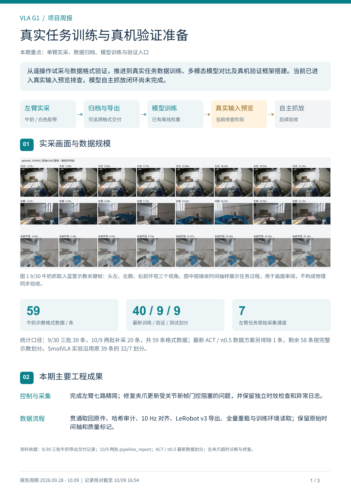
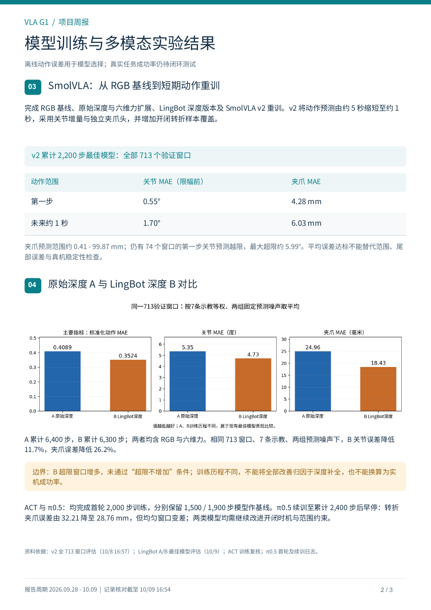
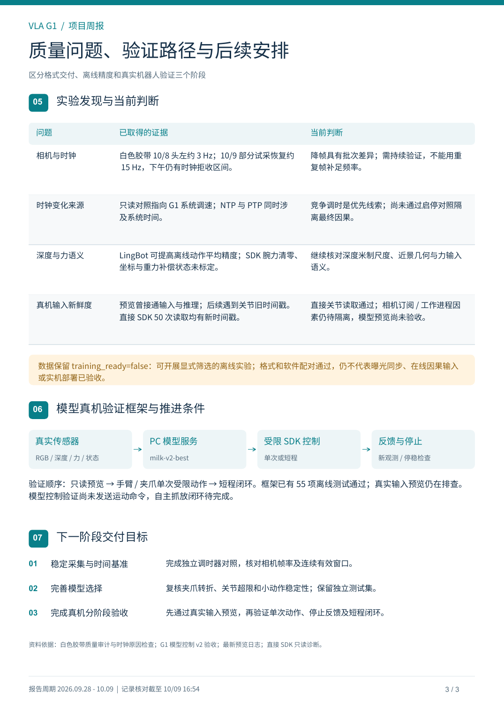
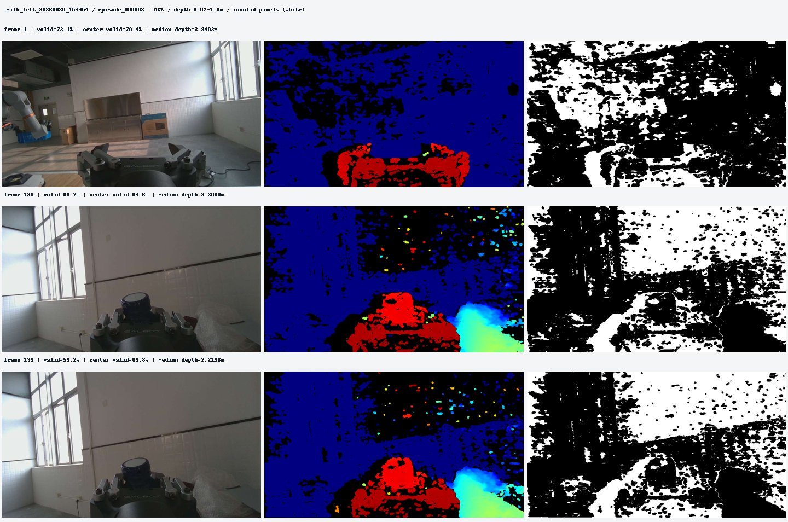
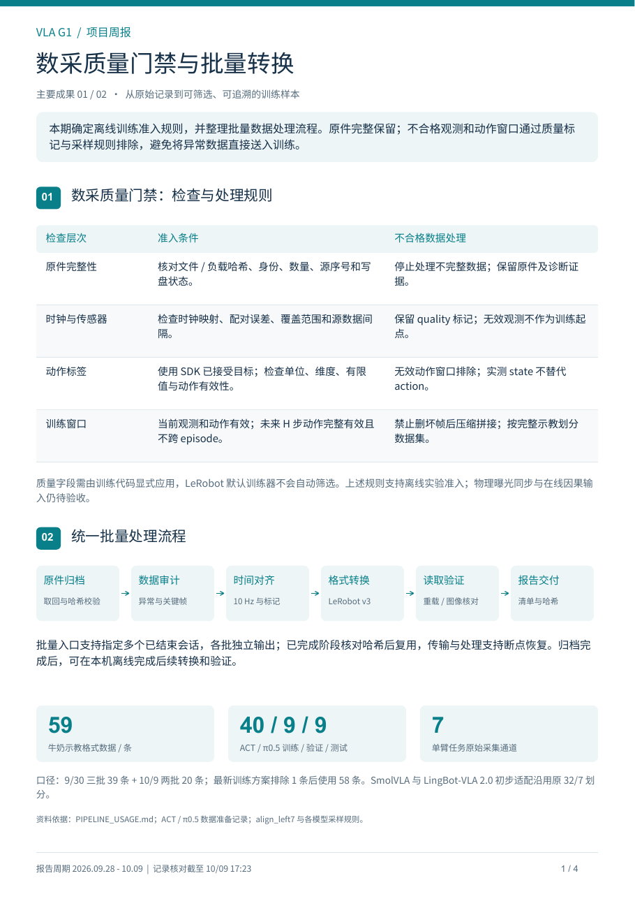
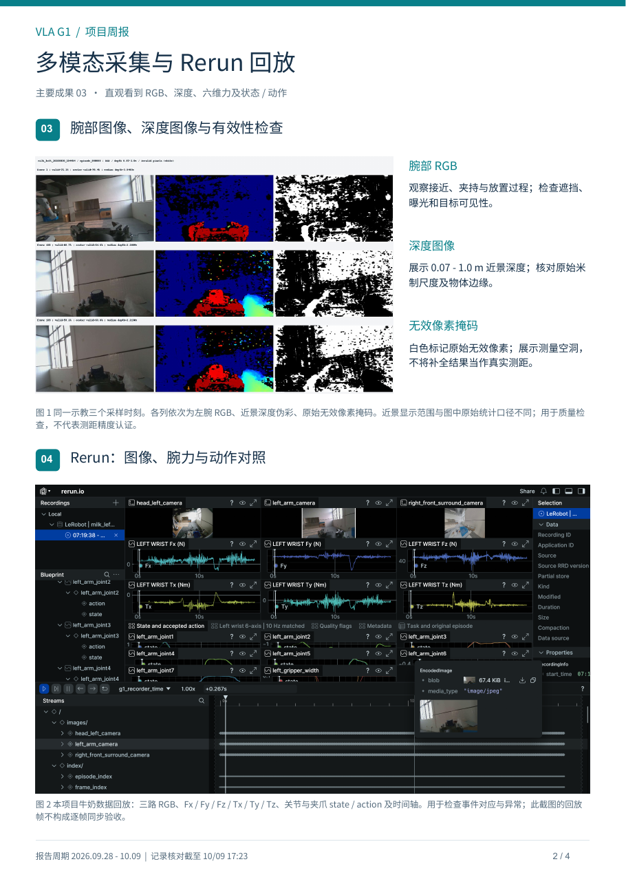
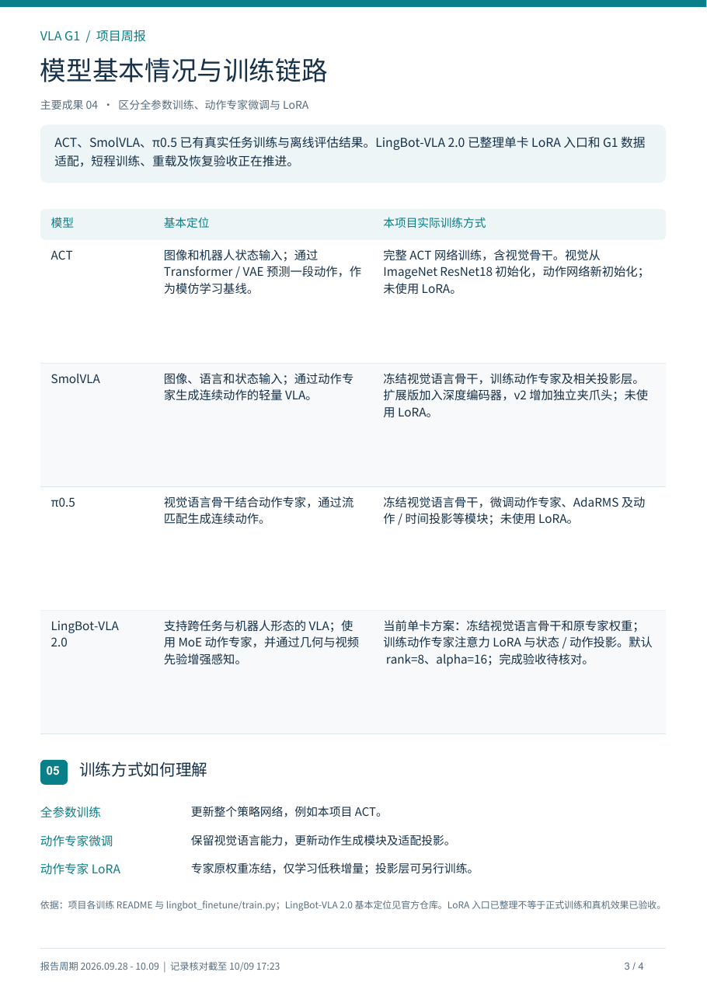
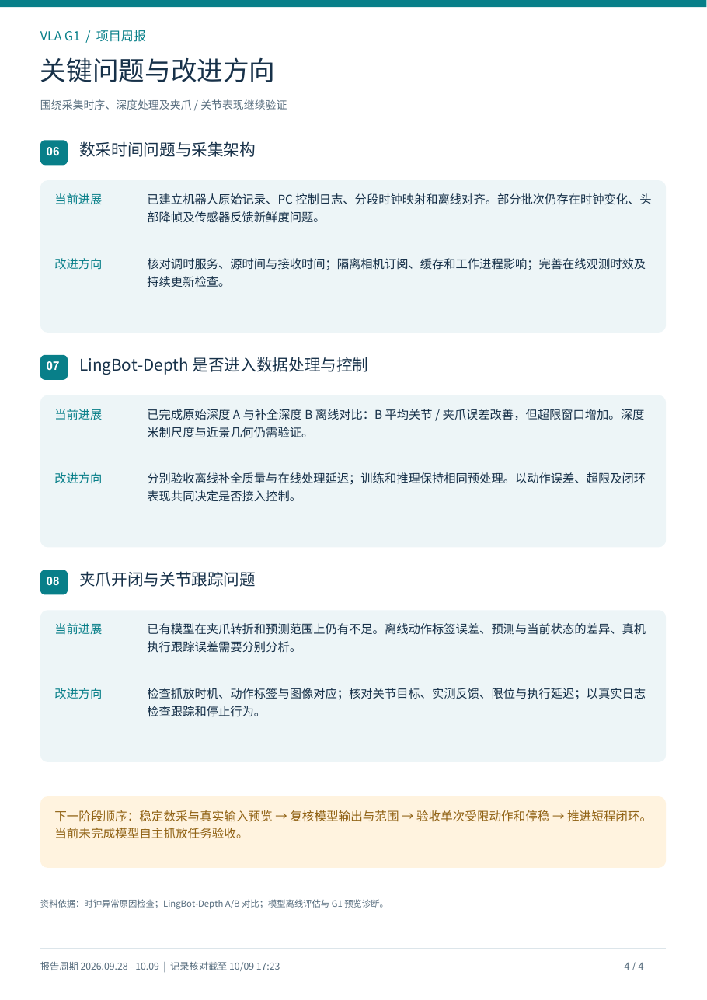
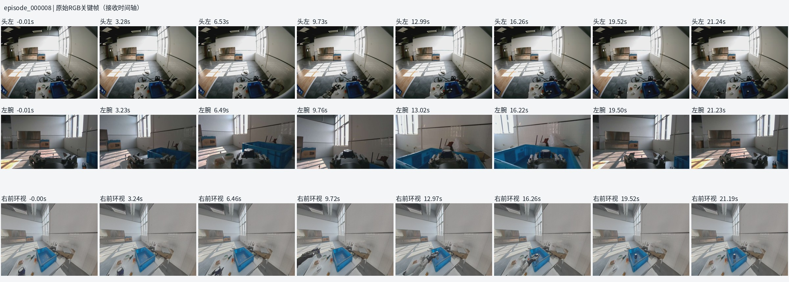
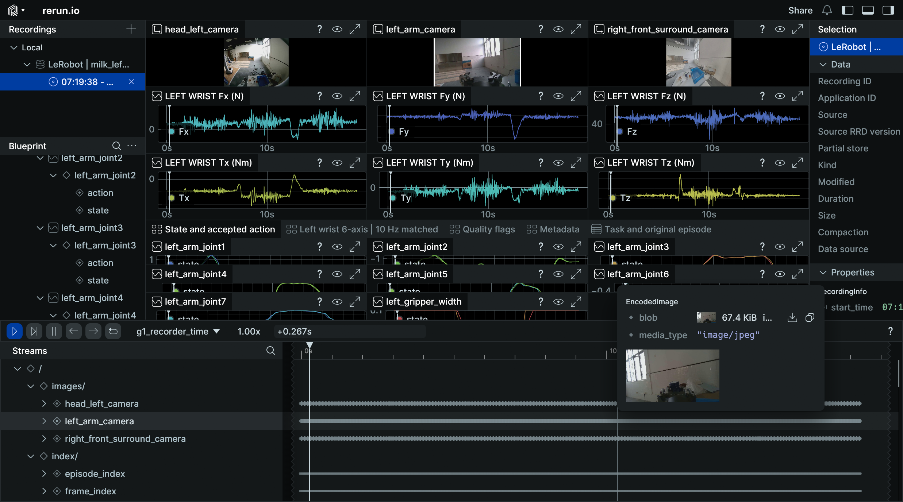

# 周报 10_12

- 归档编号：`01a11fd1-8292-75e0-8706-b3a598275e6f`
- 项目：VLA G1 项目
- 创建时间：2026-10-09T16:39:46.582000+08:00
- 更新时间：2026-10-16T09:06:18.286000+08:00
- 状态：活动
- 导出范围：用户可见消息与助手可见回复；不含隐藏推理和工具原始输出

## 1. 用户

<external_codex_apps_open_page>{"page_id":null}</external_codex_apps_open_page>

## 2. 用户

给我看一下 这个项目 9_28 到 10_9 的项目进展， 我需要写周报 参考 “周报 9_28 更新VLA项目周报”

## 3. 助手（进展）

我先查一下项目里的进展记录和“周报 9_28 更新VLA项目周报”，再按原来的格式整理 9 月 28 日到 10 月 9 日的进展。

## 4. 助手（进展）

本地已经有这段时间的数据采集、质量审计和模型训练记录。我正在核对具体结果，尤其是数据是否可用于训练、模型评估到哪一步，以及真机验证是否已经完成。

## 5. 助手（进展）

已找到参考聊天“周报 9_28 更新VLA项目周报”。上一版主要写到任务试采和训练前质量验收；本期已经推进到真实数据训练、深度与力输入实验，以及真机验证框架搭建。

目前有两个需要保留在周报里的结论：模型已有离线训练结果，但夹爪开闭时机仍有明显误差；白色胶带数据新增了成功示教候选，但部分批次仍受相机降帧和时钟映射异常影响。

## 6. 助手

参考“周报 9_28 更新VLA项目周报”，这期最值得突出的变化是：**项目从遥操作试采、数据格式验证，推进到了真实任务数据训练、多模态模型对比和真机验证框架搭建。当前尚未完成模型自主抓放闭环。**

下面这版可以直接作为 **9/28—10/9 周报初稿**。

**本期主要进展**

| 方向 | 本期完成内容 | 当前结果 |
|---|---|---|
| 遥操作与采集 | 将左臂任务采集精简为七路，覆盖三路 RGB、腕部深度、关节、夹爪和六维力；修复夹爪更新被关节新帧门控阻塞的问题 | 已用于牛奶、白色胶带抓放采集；后续仍出现反馈间隔与超时问题，需要继续排查 |
| 数据归档与导出 | 完善原件取回、哈希校验、时间对齐、LeRobot v3 导出、重载及训练环境读取流程 | 牛奶任务五批共 **59 条示教格式数据**；最新训练方案排除一条后，按 **40 条训练、9 条验证、9 条独立测试**划分 |
| 真实数据训练 | 完成 SmolVLA RGB 基线、深度与力扩展、短期动作重训，以及 ACT、π0.5 首轮训练 | 已有可重载权重及离线动作误差评估，模型选择开始同时考虑关节、夹爪和开闭转折表现 |
| 深度补全实验 | 完成原始深度 A 与 LingBot 补全深度 B 的训练及统一验证 | B 平均动作误差更低，但超限预测增多，尚不能判断真机效果更好 |
| 真机验证 | 搭建实时预览、单次受限动作、短程闭环三个验证阶段，完成 55 项离线测试 | 已接通真实输入与模型推理；预览仍有输入新鲜度问题，运动验收尚未完成 |

数据划分依据为最新[训练数据准备记录](<../../assets/56a9ed5b19ee9262--status.json>)；夹爪门控问题及修复见[诊断记录](<../../assets/c8971de6b6abd743--%E8%AF%8A%E6%96%AD%E4%B8%8E%E4%BF%AE%E5%A4%8D.md>)。

**模型实验可以重点写两项成果**

第一，针对旧模型夹爪输出越界和抓放时机误差，完成 SmolVLA v2 重训：将预测范围从约 5 秒缩短到约 1 秒，采用关节增量预测和独立夹爪预测头，并增加开闭转折样本覆盖。累计 2,200 步模型在全部 **713 个验证窗口**上的结果为：

| 指标 | 离线结果 |
|---|---:|
| 第一步关节 MAE，限幅前 | **0.55°** |
| 第一步夹爪 MAE | **4.28 mm** |
| 1 秒关节 MAE，限幅前 | **1.70°** |
| 1 秒夹爪 MAE | **6.03 mm** |

这些平均误差已有改善，但仍存在关节超限预测和夹爪较大尾部误差，尚未达到完整部署验收条件。[评估记录](</mnt/data/VLA_data/smolvla_runs/smolvla-retrain-v2-eval-20261008_165714-158856/evaluation.json>)

第二，在相同的 713 个验证窗口上，LingBot 深度模型相对原始深度模型，关节动作误差降低约 **11.7%**，夹爪动作误差降低约 **26.2%**。但两者训练历程不同，且补全版本超限窗口增多，因此目前结论应写为“现有模型离线平均精度改善”，不能直接归因于深度补全或换算为抓取成功率。[对比记录](<../../assets/db1937d567480a0f--summary.json>)

ACT 与 π0.5 均完成 2,000 步首轮训练；π0.5 又进行了低学习率续训。评估发现两类模型仍有明显的夹爪开闭转折误差，继续增加步数的收益有限，后续重点转向采样、时序和输出约束。[ACT 评估](<../../assets/0ff087029019a23d--review_summary.json>)、[π0.5 评估](<../../assets/501c5cd5e1652077--%E8%AE%AD%E7%BB%83%E6%95%88%E6%9E%9C%E8%AF%84%E4%BC%B0.md>)

**当前问题与下一步**

- **采集质量：**白色胶带 10/8 批次头部相机降至约 3 Hz，次日部分试采恢复约 15 Hz；下午新增批次仍出现时钟映射异常。只读诊断已将主要变化定位到 G1 系统调速，NTP/PTP 共同调时是优先排查线索，最终因果仍需受控对照。[时钟诊断](<../../assets/82fa4ff9065b52bc--%E6%97%B6%E9%92%9F%E5%BC%82%E5%B8%B8%E5%8E%9F%E5%9B%A0%E6%A3%80%E6%9F%A5.md>)
- **模型效果：**继续检查夹爪开闭时机、关节超限和小动作稳定性，保持独立测试集用于最终评估。
- **真机验证：**先解决 SDK 反馈时间戳及图像配对的新鲜度问题，通过只读预览后，再推进单次动作和短程闭环。最新预览尚未通过，运动命令计数为零。[最新预览记录](<../../assets/98847125f1c2fa01--report.json>)

延续上一版三页结构时，建议安排为：**第一页“实采数据与阶段成果”，第二页“模型训练与对比结果”，第三页“质量问题、真机验证和下一步”**。标题可用：**《VLA G1 项目周报｜真实任务训练与真机验证准备》**。

[附件：56a9ed5b19ee9262--status.json](../../assets/56a9ed5b19ee9262--status.json)

[附件：c8971de6b6abd743--诊断与修复.md](../../assets/c8971de6b6abd743--%E8%AF%8A%E6%96%AD%E4%B8%8E%E4%BF%AE%E5%A4%8D.md)

[附件：db1937d567480a0f--summary.json](../../assets/db1937d567480a0f--summary.json)

[附件：0ff087029019a23d--review_summary.json](../../assets/0ff087029019a23d--review_summary.json)

[附件：501c5cd5e1652077--训练效果评估.md](../../assets/501c5cd5e1652077--%E8%AE%AD%E7%BB%83%E6%95%88%E6%9E%9C%E8%AF%84%E4%BC%B0.md)

[附件：82fa4ff9065b52bc--时钟异常原因检查.md](../../assets/82fa4ff9065b52bc--%E6%97%B6%E9%92%9F%E5%BC%82%E5%B8%B8%E5%8E%9F%E5%9B%A0%E6%A3%80%E6%9F%A5.md)

[附件：98847125f1c2fa01--report.json](../../assets/98847125f1c2fa01--report.json)

## 7. 用户

给我生成报告PDF

## 8. 助手（进展）

我会沿用上一版三页报告的样式，生成 9/28—10/9 的 PDF，加入实采画面和模型对比图。我会使用 PDF 技能，并核对最新结果、检查最终排版。

## 9. 助手

_工具输出图片（原始工具文本未纳入归档）。_

## 10. 助手（进展）

三页初稿已生成，包含实采画面、模型误差对比和真机验证流程。最新只读诊断显示，直接 SDK 关节读取已有持续更新；模型预览仍未通过，我已把这一区别补进报告。现在检查排版。

## 11. 助手

_工具输出图片（原始工具文本未纳入归档）。_

## 12. 助手

已生成三页 PDF，包含实采画面、模型对比图、验证流程和后续计划，已检查全部页面排版。

:codex-file-citation{path="/home/lsy03/文档/ChatGPT/VLA G1 项目/output/pdf/VLA_G1_项目周报_20260928-20261009.pdf" purpose="output"}

## 13. 用户

主要成果  1.数采门禁确定，过滤不合格数据 &#x20;

2. &#x20;数据批量转换流程整理
3. 各种数据采集展示 腕部图像 深度图像  rerun 图像
4. 各个模型的训练链路打通  顺便介绍一下各个模型的基本情况 和 全量还是动作专家或者动作专家lora微调

改进的方向

1.数采时间问题与数采架构搭建

2.是否应该使用lingbot depth 进行处理数据并且参与推理控制？

3.模型输出的夹爪开闭和关节跟踪的问题需要排查

你先看看这个，如何？

## 14. 助手（进展）

这个结构适合重排周报，重点会更集中：先讲采集与数据处理的成果，再讲模型训练链路，最后讲待改进的问题。我先核对各模型实际训练了哪些参数，避免把全量微调、动作专家微调和 LoRA 写混。

## 15. 助手

**这个结构合适，能更清楚地突出本期交付。** 报告主线可以改为：**数采质量规则 → 批量数据处理 → 多模态展示 → 模型训练链路**，模型误差数字作为实验依据。

你列的成果建议这样表述：

1. **确定数采质量门禁，并用于训练样本筛选。**
   检查文件完整性、时钟映射、传感器配对和动作标签；不合格样本排除出训练采样，原件与异常标记保留。这里写“离线训练准入规则已落实”更准确，物理同步仍待验证。

2. **整理并打通批量数据转换流程。**
   用流程图展示：原件取回 → 完整性校验 → 时间对齐 → LeRobot 转换 → 重载与训练读取验证。突出批次处理、断点恢复和来源追溯。

3. **展示多模态采集与回放。**
   放头部与腕部 RGB、腕部深度、Rerun 三类画面；Rerun 同时展示关节、夹爪和六维力曲线，让读者直观看到采了什么、如何检查。

4. **打通各模型的真实数据训练链路。**
   基本情况与本项目训练方式可以用一张表说明：

| 模型 | 基本定位 | 本项目实际训练方式 |
|---|---|---|
| ACT | 根据图像和机器人状态预测一段动作的模仿学习模型 | **完整 ACT 网络训练，含视觉骨干**；视觉从 ImageNet 权重初始化，动作网络新初始化；未使用 LoRA |
| SmolVLA | 融合图像、语言和状态，生成动作的轻量 VLA | **冻结视觉语言骨干，训练动作专家及相关投影层**；扩展版还训练深度编码器，v2 增加夹爪头；未使用 LoRA |
| π0.5 | 通过视觉语言骨干与动作专家生成连续动作的 VLA | **冻结视觉语言骨干，微调动作专家及动作／时间投影等模块**；未使用 LoRA |
| LingBot-Depth | 深度补全与优化模型 | 本期使用已有权重处理深度，未进行模型微调；作为策略输入处理模块介绍 |

ACT、π0.5 的训练范围已核对项目[ACT 说明](<../../assets/33eeb3fcc0fcb1da--README.md>)和[π0.5 说明](<../../assets/75f0da6e2ceee6bd--README.md>)。

**改进方向也合理，建议每项写成“问题＋下一步验证”：**

- **数采时间与架构：**继续定位调时、缓存和反馈新鲜度问题，完善源时间、接收时间及在线输入检查。
- **LingBot-Depth 是否进入控制：**分别评估离线数据处理收益，以及在线推理的几何一致性、处理延迟和训练／推理预处理一致性。现有平均误差改善支持继续实验，但还不足以决定接入控制。
- **夹爪与关节问题：**夹爪重点查开闭时机、幅度和图像动作对应；关节分别查模型预测误差与实际执行跟踪误差，后者需要真机反馈验证。

排版上建议改为 **四页**：①质量门禁与转换流程；②多模态采集展示；③模型介绍与训练方式；④问题及改进计划。这样图片和模型说明都有足够空间。

[附件：33eeb3fcc0fcb1da--README.md](../../assets/33eeb3fcc0fcb1da--README.md)

[附件：75f0da6e2ceee6bd--README.md](../../assets/75f0da6e2ceee6bd--README.md)

## 16. 用户

| 模型            | 基本定位                     | 本项目实际训练方式                                                  |
| ------------- | ------------------------ | ---------------------------------------------------------- |
| ACT           | 根据图像和机器人状态预测一段动作的模仿学习模型  | **完整 ACT 网络训练，含视觉骨干**；视觉从 ImageNet 权重初始化，动作网络新初始化；未使用 LoRA |
| SmolVLA       | 融合图像、语言和状态，生成动作的轻量 VLA   | **冻结视觉语言骨干，训练动作专家及相关投影层**；扩展版还训练深度编码器，v2 增加夹爪头；未使用 LoRA    |
| π0.5          | 通过视觉语言骨干与动作专家生成连续动作的 VLA | **冻结视觉语言骨干，微调动作专家及动作／时间投影等模块**；未使用 LoRA                    |
| LingBot-Depth | 深度补全与优化模型                | 本期使用已有权重处理深度，未进行模型微调；作为策略输入处理模块介绍                    |

这个给我吧lingbot dept换成lingbotvla 2.0

## 17. 助手（进展）

我会把这一行换成 LingBot-VLA 2.0，核对它的基本定位和项目内的训练记录。

## 18. 用户

先生成一版PDF我看一下

## 19. 助手（进展）

我会按刚才的四页结构生成一版：质量门禁与转换流程、多模态展示、模型介绍与训练方式、问题及改进计划。模型表会换成 LingBot-VLA 2.0；它在本项目中尚未核实的训练状态会明确标注。

## 20. 助手

_工具输出图片（原始工具文本未纳入归档）。_

## 21. 助手（进展）

项目里已新增 LingBot-VLA 2.0 的单卡训练入口：冻结视觉语言骨干，在动作专家上使用 LoRA，并训练状态和动作投影层。我会把这个实际配置写进模型表，并核对训练日志来确认完成状态。

## 22. 助手（进展）

四页初稿已生成，主要成果和改进方向已按你的提纲重排。多模态展示页加入了腕部 RGB、深度与无效像素对照，以及 Rerun 回放截图；正在检查文字和图片的排版。

## 23. 助手

_工具输出图片（原始工具文本未纳入归档）。_

## 24. 助手

已按你的提纲生成四页初稿，并检查排版：质量门禁与转换流程、多模态展示、模型与训练方式、改进方向。模型表已换成 LingBot-VLA 2.0，注明动作专家 LoRA 验收正在推进。

:codex-file-citation{path="/home/lsy03/文档/ChatGPT/VLA G1 项目/output/pdf/VLA_G1_项目周报_20260928-20261009_成果与改进版.pdf" purpose="output"}

## 25. 助手

_历史投影中的图片引用（用于补全本地对话资源）。_

