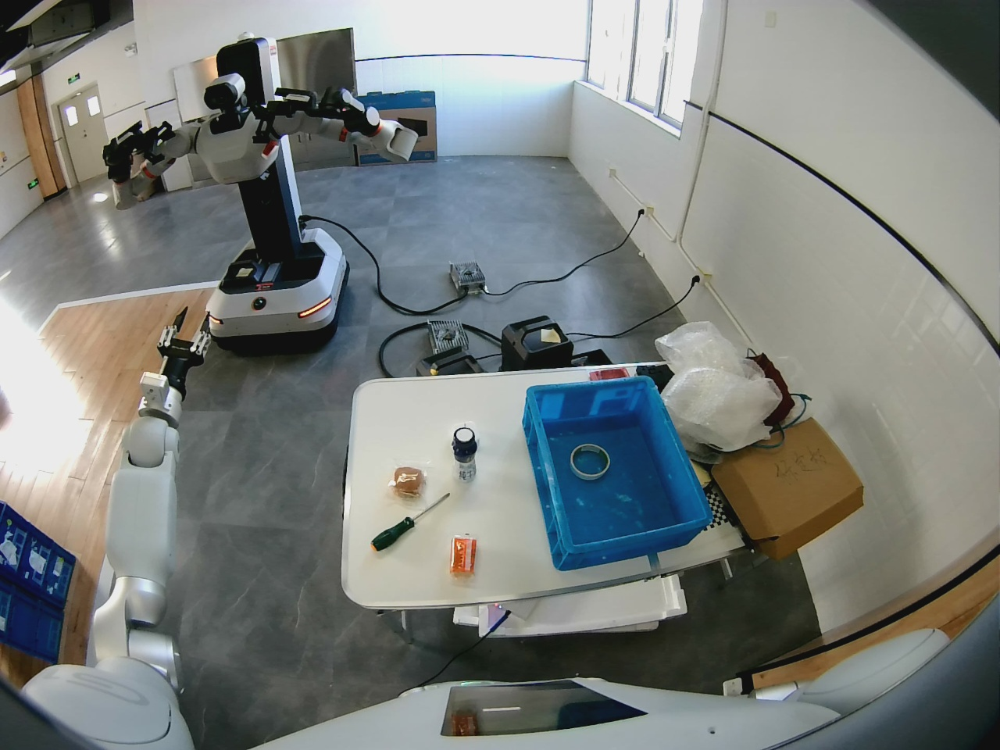
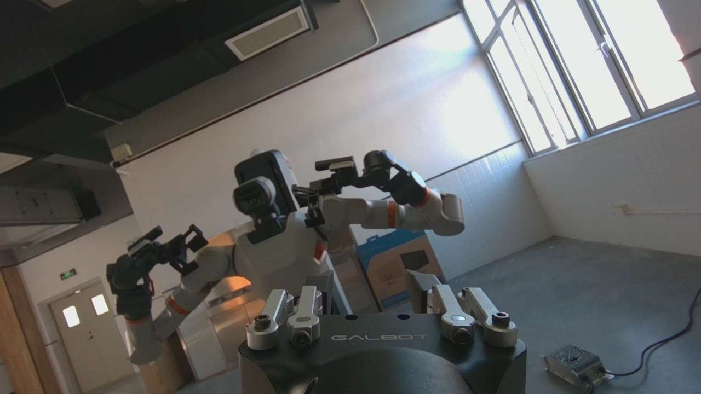
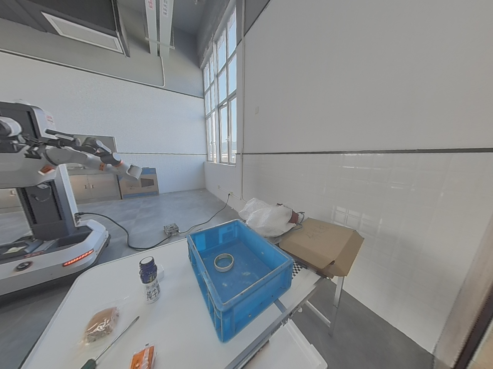

# 10_10 10_9 真机运动成功！！ SmolVLA v2 梳理真机验证框架问题

- 归档编号：`01a12099-d1f4-7580-9b1d-cecda1b997d0`
- 项目：VLA G1 项目
- 创建时间：2026-10-09T20:18:34.105000+08:00
- 更新时间：2026-10-15T15:01:07.530000+08:00
- 状态：活动
- 导出范围：用户可见消息与助手可见回复；不含隐藏推理和工具原始输出

## 1. 用户

<external_codex_apps_open_page>{"page_id":null}</external_codex_apps_open_page>

## 2. 用户

在”10_9 模型真机验证框架搭建“ 的基础上我们继续，给我梳理一下问题先，不要行动

## 3. 助手（进展）

我先读取「10_9 模型真机验证框架搭建」的聊天记录，只梳理问题，不执行修改或真机操作。

## 4. 助手

根据「10_9 模型真机验证框架搭建」的完整记录，**当前主要卡点是 SDK 实时数据接收不稳定，完整模型预览尚未通过。** 模型曾成功推理，但还没有进入真机运动验收。

本次只读取了聊天记录，没有修改代码、运行测试或操作机器人。下面是截至上一轮结束的情况。

**1. 框架已经搭建，但完成程度要分开看**

- 运行结构：**PC 模型服务 ↔ PC SDK 控制程序 ↔ G1**，无须连接 GP001，也不需要把模型部署到机器人。
- 已实现 `preview`、`step`、`closed-loop` 三种模式，以及通道选择、动作预算、超时和停止保护。
- 主验证模型固定为 **`milk-v2-best`，SmolVLA v2 累计 2,200 步权重**。
- 上一轮记录为 **61 项离线测试通过**；真实预览、单次运动、短程闭环仍未全部通过。

**2. 首要问题：相同的传感器配置，在不同运行路径下表现不同**

已有对照非常关键：

| 已做的对照 | 观察结果 | 能说明什么 |
|---|---|---|
| 独立主进程＋默认 SDK 初始化 | 50 次关节采样，50 个不同时间戳 | SDK 可以持续接收关节反馈 |
| 独立主进程＋模型的四路传感器初始化，只读关节 | 约 4 秒后冻结，最终反馈年龄约 6 秒 | 不运行模型、不使用多进程，也能触发冻结 |
| 独立主进程＋四路传感器＋持续取图 | 关节 50/50 更新；头左、左腕、深度各 151 个时间戳，环视 100 个 | 这轮持续取图时，冻结没有复现 |
| 完整预览工作进程＋持续取图 | 腕部 RGB、深度各只有 1 个时间戳，约 15 秒不再更新 | 独立诊断成功的行为，还没有在完整框架中复现 |

所以，**不能简单归因于“多进程有问题”，也不能认定“加了持续取图就修好了”**。目前确定的是 SDK 接收行为与初始化、取图和运行上下文有关；具体机制仍未定位。

**3. 腕部配对失败是当前直接报错，但源帧冻结更靠前**

最新一轮：

- SDK 初始化和首次关节反馈成功。
- 腕部 RGB、深度时间戳相差 **66.9 ms**，之后均不推进。
- 出现 **88 次配对失败**，没有进入模型推理。
- 所有运动命令计数为 **0**。

之前确实存在“重复返回旧配对帧”的缓存缺陷，上一轮已修正。但最新记录进一步说明：**即使缓存逻辑修正，SDK 本身返回的帧仍可能不更新。** 放宽配对时间差无法解决这个问题。

上一轮最后已把 SDK 启动方式从 `multiprocessing.spawn` 改成独立 Python 程序，**这项修改只有离线测试结果，还没有真机复测证据**。

**4. 还有两个独立问题，不能被接收修复掩盖**

| 问题 | 已有证据 | 影响 |
|---|---|---|
| 右前环视延迟偏大 | 图像年龄约 **400–483 ms**；模型往返约 **147 ms**，曾在推理后超过 **600 ms** 限制 | 即使所有流持续更新，预测仍可能因输入过期被拒收 |
| SDK 退出清理卡住 | 曾卡在 `wait_for_shutdown()`；多轮 `cleanup_confirmed=false`，诊断轮次退出码为 137 | 当前有超时强制退出兜底，但正常释放资源尚未验证通过 |

这里还要区分：预览报告中的 `stop_acknowledged=false`、`stationary_verified=false`，**不等于机器人停止失败**。这些轮次没有发送运动指令，也没有完成运动停止验收。

**5. 模型效果和运动能力，目前都还不能下结论**

早先一轮完整预览曾完成 **7 次推理、2 次接受**，另有 **90 次输入拒收**。这说明真实观测到模型的链路曾接通，但不稳定。

模型本身还留有独立风险：历史离线评估中 **74/713 个窗口首步关节预测越界**，夹爪也有较大误差。不过，当前首先暴露的是输入链路问题，还没有足够稳定的真实输入来评估模型的闭环表现。

实际动作方向、位移、停止、夹爪保持、断链行为和任务成功率，均仍待真机验证；现有路径也没有碰撞检查。

我认为后续应按这个问题顺序推进：**先解释并解决数据为何冻结，再处理环视时效和正常退出，随后完成稳定预览，最后才评估单次动作与短程闭环。** 当前最需要验证的具体事项，是上一轮“独立 Python SDK 进程”的改动能否复现独立诊断中持续更新的结果。

## 5. 用户

好的，我们开始推进解决，如果没有真机运动的命令就不要叫我，直到问题完全解决

## 6. 助手（进展）

我会接手只读诊断、代码修复和预览复测，先定位 SDK 数据冻结，再检查图像时效与退出清理。涉及真实运动的命令仍交给你执行；其余步骤我自主推进。

## 7. 助手（进展）

第一轮只读复测卡在 SDK 初始化，尚未进入取图。独立 Python 启动方式还不能判定有效；我会用独立 SDK 诊断对照，并检查是否有残留客户端或运行环境差异。

## 8. 助手（进展）

独立 SDK 对照也出现了异常：启用四路图像后，初始化结束时没有可用关节反馈；默认初始化则能持续收到反馈。SDK 日志还记录了大量图像丢样。我会保留底层日志，继续区分传输丢包与客户端接收阻塞。

## 9. 助手（进展）

重复对照中，四路图像和关节又能持续更新了，但退出仍卡住。这说明问题具有间歇性，单次成功不足以验收。完整预览正在复测；接下来我会抓取本地 SDK 的线程栈，查清接收和清理分别卡在哪里。

## 10. 助手（进展）

刚有一轮完整预览持续运行了 10 秒，已接受 64 次预测，期间没有拒收。但前一轮仍出现中途冻结，退出清理也尚未解决。我会继续查间歇性故障，不把这次成功当作修复完成。

## 11. 助手（进展）

目前仍有“完整预览成功”和“启动后无反馈”两种结果交替出现，超时保护都正常拦截了失败轮次。完整 SDK 日志现在会随每轮报告保存；我正检查线程阻塞原因，暂时没有修改时效或配对限制。

## 12. 助手（进展）

退出卡住的原因找到了：当前 SDK 的 `request_shutdown()` 会向本进程发送 `SIGINT`，而我们的工作进程把它设成了忽略，诊断入口也覆盖了 SDK 的处理器，导致真正的清理流程没有触发。我会保留 SDK 的退出信号处理，并把工作进程隔离到独立会话，再复测清理结果。

## 13. 助手（进展）

退出修复已在真机只读诊断中通过：报告为 `cleanup_confirmed=true`，进程正常退出码为 0。数据冻结仍会复现，我正在单独定位这一问题，随后再做连续预览验收。

## 14. 助手（进展）

线程栈诊断下，接收连续运行了 18 秒，没有出现冻结。我发现一个值得验证的差异：原入口使用宿主网络，但容器每次会重复使用很小的进程 ID，可能影响 DDS 对客户端的识别。目前正在只改变 PID 配置做 30 秒对照；这仍是待验证的假设。

## 15. 助手（进展）

PID 对照仍出现了冻结，已撤回这项改动。现在可以确认，退出信号覆盖是一个独立缺陷；数据冻结还需要另一项修复。我已准备好可用的原生调试环境，正在抓普通预览失败时的线程栈。

## 16. 助手（进展）

完整预览的正常退出也已通过。较长复测中，数据先稳定运行约 12 秒，随后再次冻结；因此后续验收需要覆盖更长时间和重复启动。我正在捕捉冻结阶段的线程状态，并核对该时刻的网络接收记录。

## 17. 助手（进展）

发现了更具体的网络线索：本机 IP 分片重组失败计数很高，重组缓冲上限只有 4 MiB，未完成分片会保留 30 秒。大图像传输可能因此耗尽接收资源。我正在同步记录预览与内核计数，确认冻结时是否发生缓冲耗尽；确认后再做可回滚的本机参数对照。

## 18. 助手（进展）

已确认冻结与内核缓冲耗尽同时发生：重组缓冲达到约 4 MiB 后，成功重组数停在 372，而失败数在十秒内增长到约 84 万。这解释了为什么 SDK 轮询仍在运行，却拿不到新数据。我会保存原值，临时调整本机接收参数，然后对比复测。

## 19. 助手（进展）

调整后首轮 40 秒预览没有再冻结：266 次观测、输入拒收为 0，退出清理正常。右前环视的输入年龄也从此前约 400–483 ms 降到了约 100–190 ms。

剩下 6 次预测拒收都因深度图在推理结束时过期。我会在采集时预留推理耗时，等待更新的同时间戳腕部帧，保留原来的最终时效检查。

## 20. 助手（进展）

第一轮修复后的 40 秒完整预览通过了：输入和预测拒收均为 0，退出清理正常；63 项离线回归测试也全部通过。

我会把已验证的本机网络参数写入持久配置并加入启动检查，再做独立重启和更长预览，确认结果可重复。

## 21. 助手（进展）

60 秒复测没有再冻结，但仍有深度时效拒收。检查发现 GPU 上新增了另一个约 13 GiB 的计算进程，当前模型推理时间随之升高。我会按当前负载调整采集时的预留预算，不干预另一个进程，最终深度时效上限仍保持 300 ms。

## 22. 用户

要不我们现在先到这里，我要下班了，明天再继续

## 23. 助手（进展）

好，今天先到这里。我会结束当前只读预览，保存修复和验证记录，明天从剩余的时效问题继续。

## 24. 助手

好，今天先暂停，当前只读预览已结束，全程没有发送运动命令。

- **已修复**：网络分片缓冲耗尽导致的数据冻结、SDK 退出清理卡住。
- **明天继续**：并行 GPU 负载下的推理时效。最后一轮 30 秒接受 148 次、输入拒收 0 次、预测超时拒收 1 次，尚未完全验收通过。

[交接记录已保存](<../../assets/16a1747679ab07aa--handoff.json>)，明天直接接着推进。

[附件：16a1747679ab07aa--handoff.json](../../assets/16a1747679ab07aa--handoff.json)

## 25. 用户

<external_codex_apps_open_page>{"page_id":null}</external_codex_apps_open_page>

## 26. 用户

我们现在继续

## 27. 助手（进展）

我们接着昨天的进度。我先核对网络参数、模型服务和 GPU 负载，再复测剩余的推理时效问题。只读诊断和修复我会自主推进；真实运动命令仍交给你执行。

## 28. 助手（进展）

昨天的网络参数和清理修复仍然有效，今天也能持续收到真实观测。当前 GPU 仍有其他计算任务，首轮预览再次出现少量推理后过期。我会先检查模型服务的耗时来源，同时补齐三个 SDK 客户端并存时的只读验证。

## 29. 助手（进展）

模型服务的对照结果已出来：使用固定推理线程后，离线预测数值完全一致，耗时有小幅下降；真实输入预览正在验证。三个 SDK 客户端的诊断入口也已准备好，只允许读取反馈和清理，禁止发送运动或停止指令。

## 30. 助手（进展）

三个 SDK 客户端并存的只读验证已通过：三路反馈持续推进，三个进程都正常清理退出，没有发送运动指令。

预览还暴露了一个采集顺序问题：腕部帧已经选好时，环视帧可能刚好偏旧，程序会立即拒收。我会让相机新鲜度检查在选定腕部帧前一起完成，短暂等待更新帧，并继续保留推理后的过期检查。

## 31. 助手（进展）

新的 60 秒完整预览通过了：输入和预测拒收均为 0，SDK 正常退出；68 项离线测试也全部通过。

我会把已验证的服务更新应用到默认端口，再做一次独立重启后的预览复测。通过后，下一步就是由你执行单次受限运动。

## 32. 助手

_工具输出图片（原始工具文本未纳入归档）。_







## 33. 助手（进展）

默认服务重启后的第二轮 60 秒预览也通过了，两轮正式采样均为零拒收、零运动命令，并完成正常清理。我正在保存最终验收记录；接下来可以交给你做左臂单次受限动作验证。

## 34. 助手

**只读链路已通过验收，可以进入你现场执行的单次运动验证。**

- 两轮各 60 秒预览：接受 **393／382 次预测**，正式采样零拒收。
- 往返延迟中位数约 **147／150 ms**。
- 三个 SDK 客户端并存、反馈更新和清理全部通过。
- **68 项离线测试通过，全程未发送运动命令。**

[验收记录](<../../assets/745e99790c118567--acceptance.json>)

确认左臂空载、运动区域清空、现场可操作急停后，运行：

```bash
cd '/home/lsy03/文档/ChatGPT/VLA G1 项目'
export G1_POLICY_TOKEN_FILE=/tmp/g1_policy_control_20261009.token
bash g1_policy_control/run_pc.sh --mode step --channels arm --seconds 5 --execute
```

看到 `READY` 后检查目标，输入 `ARM` 才会执行一次受限左臂动作。夹爪不动作；运行后再检查实际位移与停稳结果。

[附件：745e99790c118567--acceptance.json](../../assets/745e99790c118567--acceptance.json)

## 35. 用户

lsy03@lsy03-System-Product-Name:~/文档/ChatGPT/VLA G1 项目$ cd '/home/lsy03/文档/ChatGPT/VLA G1 项目'
export G1_POLICY_TOKEN_FILE=/tmp/g1_policy_control_20261009.token
bash g1_policy_control/run_pc.sh --mode step --channels arm --seconds 5 --execute
{"urdf_verified": true, "g1_minus_pc_ms": 24.51433, "runtime": "lerobot_runs/model_20261010_082950_807445/runtime.json"}
SDK observe: worker_entered (0.00s)
SDK observe: backend_constructing (0.00s)
SDK observe: sdk_import_begin (0.02s)
SDK observe: sdk_import_complete (0.03s)
SDK observe: robot_construct_begin (0.03s)
SDK observe: robot_construct_complete (0.03s)
SDK observe: sdk_init_begin (0.03s)
SDK observe: sdk_init_complete (1.82s)
SDK observe: feedback_wait_begin (1.82s)
SDK observe: backend_ready (1.82s)
SDK observe: metadata_feedback_read (1.82s)
SDK execute: worker_entered (0.00s)
SDK execute: backend_constructing (0.00s)
SDK execute: sdk_import_begin (0.02s)
SDK execute: sdk_import_complete (0.03s)
SDK execute: robot_construct_begin (0.03s)
SDK execute: robot_construct_complete (0.03s)
SDK execute: sdk_init_begin (0.03s)
A new version 1.10.0 is available. Visit https://github.com/GalaxyGeneralRobotics/GalbotSDK/releases for upgrade instructions
SDK execute: sdk_init_complete (2.76s)
SDK execute: feedback_wait_begin (2.76s)
SDK execute: backend_ready (2.76s)
SDK execute: metadata_feedback_read (2.76s)
SDK stop: worker_entered (0.00s)
SDK stop: backend_constructing (0.00s)
SDK stop: sdk_import_begin (0.02s)
SDK stop: sdk_import_complete (0.03s)
SDK stop: robot_construct_begin (0.03s)
SDK stop: robot_construct_complete (0.03s)
SDK stop: sdk_init_begin (0.03s)
A new version 1.10.0 is available. Visit https://github.com/GalaxyGeneralRobotics/GalbotSDK/releases for upgrade instructions
SDK stop: sdk_init_complete (1.62s)
SDK stop: feedback_wait_begin (1.62s)
SDK stop: backend_ready (1.62s)
SDK stop: metadata_feedback_read (1.62s)
READY step | arm | measured=[0.7260516881942749, -0.9816761016845703, -0.6254823207855225, -1.1627312898635864, -0.1582873910665512, -0.2539925277233124, 0.17142100632190704, 0.05] | prediction=[0.7245466709136963, -0.9931051731109619, -0.6151626110076904, -1.1614844799041748, -0.15543590486049652, -0.25983381271362305, 0.17821232974529266, 0.0007195872603915632] | limited=[0.7245466709136963, -0.9846761016845703, -0.6224823207855225, -1.1614844799041748, -0.15543590486049652, -0.2569925277233124, 0.17442100632190705, 0.05]
输入 ARM 开始；之后输入 STOP 或 Ctrl+C 停止
> ARM
step elapsed=0.2s accepted=1 rejected=0 commands=1 latency=181.8ms target=[0.7239620685577393, -0.9846761016845703, -0.6225050301551819, -1.1613292694091797, -0.15531176328659058, -0.2570169656276703, 0.17446986722946167, 0.05]
日志：/workspace/lerobot_runs/model_20261010_082950_807445/events.jsonl
{
  "log": "/home/lsy03/文档/ChatGPT/VLA G1 项目/lerobot_runs/model_20261010_082950_807445/events.jsonl",
  "mode": "step",
  "channels": "arm",
  "model": "milk-v2-best",
  "execute_requested": true,
  "sdk_attempts": 1,
  "arm_command_attempts": 1,
  "gripper_command_attempts": 0,
  "acknowledged_commands": 1,
  "prediction_rejections": 0,
  "abort_count": 0,
  "input_rejections": 0,
  "cleanup_unconfirmed": 0,
  "cleanup_confirmed": 2,
  "session_completed": true,
  "stationary_verified": true,
  "stop_acknowledged": true,
  "roundtrip_ms_median": 181.78784698829986,
  "roundtrip_ms_max": 181.78784698829986,
  "event_counts": {
    "start": 1,
    "sdk_startup_stage": 42,
    "preflight": 1,
    "observation": 1,
    "sdk_rpc_attempt": 1,
    "arm_command_attempt": 1,
    "command": 1,
    "accepted_prediction": 1,
    "inference": 1,
    "stop": 3,
    "supervisor_stop": 2,
    "stationary": 1,
    "sdk_cleanup_confirmed": 2,
    "session_summary": 1,
    "completed": 1
  },
  "final_displacement_deg": [
    -0.0947005728422268,
    -0.1359993116587089,
    0.13590027391574372,
    0.06179955161027537,
    0.05079953195196984,
    -0.08519977970673906,
    0.07140023626237454
  ],
  "final_gripper_change_mm": 0.0,
  "scope": "Evidence from this run only; SDK acknowledgement does not establish task success"
}
Run report: /home/lsy03/文档/ChatGPT/VLA G1 项目/lerobot_runs/model_20261010_082950_807445/report.json
lsy03@lsy03-System-Product-Name:~/文档/ChatGPT/VLA G1 项目$

看下有没有问题，我这没看到机器人动

## 36. 助手（进展）

从摘要看，这次发送并确认了一次左臂指令，反馈记录的最大关节变化约为 0.136°，肉眼可能很难看出来。我先核对原始指令、前后反馈和停止记录，确认这次小幅运动是否符合预期。

## 37. 助手

**这次单步链路通过了。关节反馈表明机器人确实有微小运动，只是幅度很难用肉眼看出来。**

- 只发送了 **1 次左臂指令**，夹爪没有动作。
- 最大实测变化：J2 **−0.136°**、J3 **＋0.136°**。
- 指令发出约 **130 ms 后请求停止**，停止确认和停稳检查均通过。
- 没有输入拒收、预测拒收或异常中止。

**为什么这么小？** 当前首步受到加速度限制，目标变化最多约 **0.003 rad＝0.172°**。之前说的 **0.5° 是累计上限，不是每次必走的角度**。

另外，`--seconds 5` 是运行时间上限；`step` 模式执行一次便停止，**不会持续运动 5 秒**。

`cleanup_confirmed: 2` 也符合当前设计：执行进程在停止时被主动终止以阻止迟到指令，其余两个进程正常清理。

下一步可以在现有限速下验证**最多 3 次动作的短程闭环**。这次结果尚不代表完整模型目标跟踪或抓取任务已经通过。

## 38. 用户

要不时间设定长一点，我想看到肉眼可见的变化，如何？

## 39. 助手

可以，但要切换到 **短程闭环**。`step` 始终只执行一次，单纯延长 `--seconds` 不会增加动作。

建议先用：**最多 3 秒、10 次动作，每个关节相对起点最多变化 2°**，保持原低速，夹爪不动作。

现场确认左臂空载、运动区域清空、急停可用后，由你运行：

```bash
bash g1_policy_control/run_pc.sh \
  --mode closed-loop --channels arm \
  --seconds 3 --max-commands 10 \
  --max-joint-travel-deg 2 --execute
```

检查 `READY` 后输入 `ARM`。这次有机会看到更明显的变化，但 **2° 是上限，实际动作取决于模型输出**；任何保护触发都会提前停止。运行后把报告发我，我们核对实际位移和停稳结果。

## 40. 用户

别搞这些输入ARM确认的脚本了，我还是没看到肉眼可见的运动，还可以给我做更长时间或者幅度更大的运动再停止

## 41. 助手（进展）

我会去掉终端里的 `ARM` 输入确认，保留显式 `--execute`、停止和位移保护。先核对你刚才那轮日志，判断是运行时间太短、保护提前停止，还是模型本身只给了很小的目标，再准备更长的受限运动命令；真机运动仍由你执行。

## 42. 助手（进展）

查到了：刚才那轮确实执行了 10 次动作，但约 1.3 秒就发完，最大实测变化只有约 0.99°，随后正常停稳。

我已去掉 `ARM` 输入确认。下一轮准备改为最多 8 秒、60 次动作、每个关节相对起点最多 5°，保持原低速和自动停止保护；正在验证修改。

## 43. 助手

已去掉 `ARM` 确认，**现在预检通过后会直接开始运动**。22 项相关回归测试通过。

上一轮约 1.3 秒就发完了 10 次动作，最大实测变化仅约 0.99°。这次扩大到 **最多 8 秒、60 次动作、每关节相对起点最多 5°**，保持原低速，夹爪不动。

现场备好急停后，由你运行：

```bash
bash g1_policy_control/run_pc.sh \
  --mode closed-loop --channels arm \
  --seconds 8 --max-commands 60 \
  --max-joint-travel-deg 5 --execute
```

达到任一限制或出现异常会提前停止，也可按 **Ctrl+C**。5° 是上限，实际位移仍由模型输出决定。我没有代你运行运动命令。

## 44. 用户

lsy03@lsy03-System-Product-Name:~/文档/ChatGPT/VLA G1 项目$ bash g1_policy_control/run_pc.sh \
  --mode closed-loop --channels arm \
  --seconds 8 --max-commands 60 \
  --max-joint-travel-deg 5 --execute
{"urdf_verified": true, "g1_minus_pc_ms": 36.221358, "runtime": "lerobot_runs/model_20261010_090910_825385/runtime.json"}
SDK observe: worker_entered (0.00s)
SDK observe: backend_constructing (0.00s)
SDK observe: sdk_import_begin (0.02s)
SDK observe: sdk_import_complete (0.03s)
SDK observe: robot_construct_begin (0.03s)
SDK observe: robot_construct_complete (0.03s)
SDK observe: sdk_init_begin (0.03s)
A new version 1.10.0 is available. Visit https://github.com/GalaxyGeneralRobotics/GalbotSDK/releases for upgrade instructions
SDK observe: sdk_init_complete (1.81s)
SDK observe: feedback_wait_begin (1.81s)
SDK observe: backend_ready (1.81s)
SDK observe: metadata_feedback_read (1.81s)
SDK execute: worker_entered (0.00s)
SDK execute: backend_constructing (0.00s)
SDK execute: sdk_import_begin (0.02s)
SDK execute: sdk_import_complete (0.03s)
SDK execute: robot_construct_begin (0.03s)
SDK execute: robot_construct_complete (0.03s)
SDK execute: sdk_init_begin (0.03s)
A new version 1.10.0 is available. Visit https://github.com/GalaxyGeneralRobotics/GalbotSDK/releases for upgrade instructions
SDK execute: sdk_init_complete (2.05s)
SDK execute: feedback_wait_begin (2.05s)
SDK execute: backend_ready (2.06s)
SDK execute: metadata_feedback_read (2.06s)
SDK stop: worker_entered (0.00s)
SDK stop: backend_constructing (0.00s)
SDK stop: sdk_import_begin (0.02s)
SDK stop: sdk_import_complete (0.03s)
SDK stop: robot_construct_begin (0.03s)
SDK stop: robot_construct_complete (0.03s)
SDK stop: sdk_init_begin (0.03s)
A new version 1.10.0 is available. Visit https://github.com/GalaxyGeneralRobotics/GalbotSDK/releases for upgrade instructions
SDK stop: sdk_init_complete (2.07s)
SDK stop: feedback_wait_begin (2.07s)
SDK stop: backend_ready (2.07s)
SDK stop: metadata_feedback_read (2.07s)
STOPPED: Wrench observation became stale during inference
{
  "log": "/home/lsy03/文档/ChatGPT/VLA G1 项目/lerobot_runs/model_20261010_090910_825385/events.jsonl",
  "mode": "closed-loop",
  "channels": "arm",
  "model": "milk-v2-best",
  "execute_requested": true,
  "sdk_attempts": 0,
  "arm_command_attempts": 0,
  "gripper_command_attempts": 0,
  "acknowledged_commands": 0,
  "prediction_rejections": 0,
  "abort_count": 1,
  "input_rejections": 0,
  "cleanup_unconfirmed": 0,
  "cleanup_confirmed": 3,
  "session_completed": false,
  "stationary_verified": false,
  "stop_acknowledged": false,
  "roundtrip_ms_median": null,
  "roundtrip_ms_max": null,
  "event_counts": {
    "start": 1,
    "sdk_startup_stage": 42,
    "supervisor_stop": 1,
    "stop": 3,
    "sdk_cleanup_confirmed": 3,
    "session_summary": 1,
    "abort": 1
  },
  "scope": "Evidence from this run only; SDK acknowledgement does not establish task success"
}
Run report: /home/lsy03/文档/ChatGPT/VLA G1 项目/lerobot_runs/model_20261010_090910_825385/report.json
lsy03@lsy03-System-Product-Name:~/文档/ChatGPT/VLA G1 项目$


给我确定一下是否是能够驱动真机运动？

## 45. 助手

**确定能够驱动真机，已有实际关节反馈变化作为证据。但连续模型控制还没有稳定通过验收。**

| 已执行测试 | 运动指令 | 最大实测关节变化 | 停止与停稳 |
|---|---:|---:|---|
| 单次动作 | 1 次 | **0.136°** | 通过 |
| 上一轮短程闭环 | 10 次 | **0.991°** | 通过 |
| 这次 8 秒测试 | **0 次** | 未执行运动 | 运动前退出 |

所以，前两轮不是仅仅打印了目标：日志同时记录了指令确认、关节位置变化和停稳反馈。

**这次没有动，是因为启动预检时，六维力数据在推理结束后超过了 300 ms 时效限制。** 程序因此没有进入运动阶段，三个 SDK 进程都正常清理退出。`stop_acknowledged=false` 在本轮不代表停止失败，因为根本没有发送运动指令。

现在需要解决的是**六维力输入与推理的时效稳定性**。这个问题处理完，再继续你要求的较长运动测试；单纯增加时间或幅度无法解决本次拦截。

## 46. 用户

推理结束后超过了 300 ms 时效限制  给我排查一下什么问题

## 47. 助手（进展）

我会拆开检查六维力数据的采集年龄、模型推理耗时和预检流程，确认这 300 ms 是在哪一段耗尽的。诊断只读，不会代你发送运动命令。

## 48. 助手（进展）

先找到一个明确的代码缺口：图像采集已经预留了推理时间，六维力采集却仍允许接近 300 ms 的旧样本进入模型。该轮保存的首份观测中，六维力年龄已约 165 ms，留给后续处理的余量很小。

不过，失败发生在第二份预检观测，旧日志没有保存它的年龄和推理耗时，因此还不能给出精确分摊。我会补齐这些记录，用只读对照确认。

## 49. 助手（进展）

只读对照中，六维力本身在持续更新：采集年龄约 2–44 ms，采集后到推理检查约 136–162 ms，最终年龄均未超过 189 ms。这次没有复现超限，说明它不是持续冻结。

我已补上六维力的采集预算：旧样本先等待更新，再与图像一起进入模型；300 ms 最终限制保持不变。后续即使再失败，日志也会直接列出“采集年龄＋处理耗时＝最终年龄”。

## 50. 助手

**查到一个明确缺口：六维力采集没有预留推理时间，旧样本可能在推理结束前过期。300 ms 指的是数据总年龄，不是模型单独推理耗时。**

该轮保存的首份观测中，六维力已经约 **165 ms** 旧，再经过约 150 ms 处理就可能超限。不过，失败使用的是第二份观测，旧日志缺少其详细计时，无法精确还原。

已修复：

- 等待真正更新的六维力样本，与图像一起满足新鲜度后才推理。
- 保留原始力值、时间戳和 **300 ms 最终限制**。
- 补充预检失败时的完整耗时分解。

验证结果：三客户端只读对照通过；30 秒预览接受 **199 次预测、零拒收**，六维力最终年龄最大约 **216 ms**；**70 项测试通过**。

[排查记录](<../../assets/429d73719db5d468--assessment.json>)。未发送运动命令；可以由你重跑上一条 8 秒命令。

[附件：429d73719db5d468--assessment.json](../../assets/429d73719db5d468--assessment.json)

## 51. 用户

看下好像确实可以动了，现在使用的是什么模型？ 为什么我感觉抖动非常厉害？

[附件：a87d41737c98c04f--已粘贴的文本.txt](../../assets/a87d41737c98c04f--%E5%B7%B2%E7%B2%98%E8%B4%B4%E7%9A%84%E6%96%87%E6%9C%AC.txt)

## 52. 助手（进展）

我先读取这轮日志，确认实际模型版本，并对照每次目标、实测关节变化和指令间隔，排查抖动来自预测、发送节奏还是底层轨迹执行。

## 53. 助手

现在用的是 **SmolVLA v2：`milk-v2-best`，累计训练 2,200 步**。输入包括三路 RGB、关节/夹爪状态、原始深度和六维力；本轮只控制左臂。

这次确实产生了明显位移：**J7 约＋4.91°，J3 约＋2.85°**。共执行 42 次指令，接近 5° 位移上限后触发保护，停止和停稳检查通过。

**抖动的首要嫌疑是控制节奏与轨迹衔接，另有模型目标波动：**

1. **轨迹只有 100 ms，下一条指令却晚于这个时间到达。**
   实测发送间隔为 **139–290 ms，中位数 144 ms**。因此轨迹段之间存在时间空隙，容易产生一段一段走、顿挫的感觉。

2. **每次都从实测位置重新覆盖一小段轨迹。**
   当前使用两点线性插值，没有把前后轨迹的速度、加速度连续地衔接起来。现有限速、加速度保护不能等同于平滑轨迹控制。

3. **部分模型目标频繁小幅反向。**
   例如 J1 的目标方向在本轮出现约 20 次反转（排除了小于 0.01° 的变化），可能叠加出细碎抖动。

日志采样频率不足以确定你看到的实际振动频率，因此还不能排除底层控制因素。**这轮通过了位移与停止检查，但运动平滑性没有通过。**

先不要继续增加时间、幅度或速度。下一步应把**模型推理与固定频率执行分开，并加入连续轨迹插值和小幅目标波动抑制**，再做短程验证。[本轮记录](<../../assets/ea7c8d8f9bd71aa8--report.json>)

[附件：ea7c8d8f9bd71aa8--report.json](../../assets/ea7c8d8f9bd71aa8--report.json)
