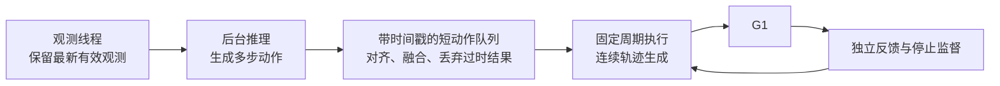

# 继续梳理真机 抖动问题 SmolVLA 验证框架

- 归档编号：`01a124e6-24ff-7b90-8ca1-7504b9d57a04`
- 项目：VLA G1 项目
- 创建时间：2026-10-12T13:33:14.550000+08:00
- 更新时间：2026-10-14T11:10:49.560000+08:00
- 状态：活动
- 导出范围：用户可见消息与助手可见回复；不含隐藏推理和工具原始输出

## 1. 用户

<external_codex_apps_open_page>{"page_id":null}</external_codex_apps_open_page>

## 2. 用户

我们在“10_10 10_9 真机运动成功！！ 梳理真机验证框架问题” 这个对话的基础上继续

## 3. 助手（进展）

我先读取这个对话的近期记录，接上已完成的真机验证工作和待处理问题。

## 4. 助手

已读取该对话，接下来以它的最新进展为基础继续：

- **真机已确认能动**：最近一轮发送 42 次左臂指令，J7 约＋4.91°、J3 约＋2.85°，停止与停稳检查通过。
- **使用模型**：SmolVLA v2，`milk-v2-best`，累计训练 2,200 步。
- **已解决并验证**：SDK 数据冻结、退出清理，以及六维力未预留推理时间导致的 300 ms 超时问题。
- **当前主要问题是明显抖动**：轨迹时长只有 100 ms，但发送间隔为 139–290 ms；轨迹衔接不连续，部分模型目标还频繁小幅反向。

后续重点是**分离模型推理与固定频率执行，改善轨迹连续性，并抑制小幅目标波动**。仍沿用之前的安排：我负责排查、修改和验证，真机运动命令由你现场执行。

## 5. 用户

给我检查一下发送间隔长的原因是什么？是否是模型计算的速度问题？

## 6. 助手（进展）

我会对照这轮日志和控制代码，拆分模型推理、观测采集与指令发送的耗时，确认发送间隔主要花在哪里。

## 7. 助手

**是的，模型推理是常态发送间隔偏长的主要原因；但最长的 290 ms 间隔主要来自观测采集延迟。更根本的问题是：当前发送指令必须等待整轮推理完成。**

我拆分了这轮 42 次指令的日志：

| 环节 | 中位耗时 | 最大耗时 |
|---|---:|---:|
| 服务端推理处理 | **128.8 ms** | 135.0 ms |
| 完整控制循环 | **143.8 ms** | 289.6 ms |
| 推理以外的全部开销 | 14.6 ms | 154.5 ms |
| 执行进程收到请求到调用发布接口 | **0.48 ms** | 0.65 ms |

这里的“服务端推理处理”包含图像/深度解码、预处理、模型计算和输出转回 CPU，**不能把 129 ms 全部算成 GPU 计算时间**；现有日志还没有细分这些部分。

当前[控制循环](</home/lsy03/文档/ChatGPT/VLA G1 项目/g1_policy_control/client.py:146>)按顺序执行：

**采集观测 → 等待模型预测 → 检查反馈与保护 → 发送一次指令 → 下一轮。**

因此：

- 虽然配置周期是 **100 ms（10 Hz）**，单推理就已超过 100 ms，实际只能达到约 **6.6 Hz**。
- 每次都重新计算一整段动作，但客户端只取预测的**第一步**发送，然后重新采集、推理。
- 日志中的最长一轮约 **290 ms**，其中推理仍只有 **135 ms**；约 **145 ms** 花在上一轮结束到本轮观测就绪之间。结合代码，这一段包含等待新鲜腕部 RGB/深度配对、六维力更新、编码和进程通信；现有日志无法进一步确定是哪项等待。

**所以，常态慢主要是推理耗时，偶发长间隔主要是观测等待，SDK 发布调用本身很快。** 100 ms 的轨迹段却约每 144 ms 才收到下一段，这与顿挫现象相符。

优先应把**推理更新频率与轨迹执行频率分开**，让执行端连续衔接轨迹；单纯降低推理耗时仍无法消除采集等待造成的间隔波动。本次只读取日志和代码，没有修改或发送运动命令。

## 8. 用户

把**推理更新频率与轨迹执行频率分开**，让执行端连续衔接轨迹
目前的主流方法是怎么处理这个问题的？

## 9. 助手（进展）

我查一下主流 VLA 的异步推理、动作分块和轨迹衔接方案，再结合我们当前的 G1 控制链路说明适用方式。

## 10. 助手

**主流做法是“异步推理＋动作序列缓存＋连续轨迹执行”。模型负责不断更新未来计划，执行端按固定节奏运行，并在新旧计划之间平滑衔接。** LeRobot 的异步推理就是这个思路。[官方说明](https://huggingface.co/docs/lerobot/async)

对我们而言，要分别解决两个问题：**推理期间不断档，以及新预测到来时不突然改变运动。**

| 方法 | 怎么处理 | 解决的问题 |
|---|---|---|
| **动作分块（Action Chunking）** | 一次预测未来多步动作，执行其中一部分后重新规划 | 不必每发一个动作都重新推理 |
| **异步推理＋动作队列** | 执行当前序列时，后台计算下一段；队列快用完前提前请求 | 避免等待推理造成停顿 |
| **重叠动作融合** | 将不同预测对同一未来时刻的目标进行加权融合 | 减小目标跳变和小幅反向 |
| **实时分块（RTC）** | 生成新动作段时，考虑推理期间仍会执行的旧计划，并约束衔接 | 同时处理推理延迟与段间不连续 |
| **连续轨迹生成** | 根据位置、速度、加速度状态生成受限轨迹 | 改善实际执行时的顿挫 |

动作分块是 ACT 的核心设计；LeRobot 异步方案还会聚合重叠动作段。[ACT 项目](https://tonyzhaozh.github.io/aloha/)、[LeRobot 异步推理](https://huggingface.co/docs/lerobot/async)

**异步推理是我们最先需要做的一层。**

例如，模型正在计算下一段动作的 150 ms 内，执行端继续沿当前有效计划运动。新计划到达后，按它的观测时间和动作时间步对齐，只采用仍对应未来的部分。

这里不能直接把“新预测的第 0 步”当成当前动作：它对应的是较早的观测，推理期间机器人已经继续移动。也不能堆积观测请求，否则模型会越来越晚地处理旧画面。通常采用**最新观测覆盖旧观测、限制在途请求、按时间对齐动作队列**。

**随后要处理新旧计划的衔接。**

简单方案是在重叠时间段融合关节目标；更进一步的 RTC 则在模型生成过程中引导新动作段延续旧计划。LeRobot 明确区分：异步推理解决等待空档，RTC 解决动作段之间的不连续。[RTC 文档](https://github.com/huggingface/lerobot/blob/main/docs/source/rtc.mdx)

不过，我们当前的 SmolVLA 是自定义推理实现，不能仅打开一个官方 RTC 开关就认为已经接入，需要修改并验证其生成过程。

**执行端还需要独立的轨迹生成器。**

它保留运动中的位置、速度、加速度状态，在目标更新时连续重规划，并限制速度、加速度及 jerk（加速度变化率）。Ruckig 是这类在线轨迹生成工具的代表。[官方文档](https://docs.ruckig.com/index.html)

这比每轮“从实测位置重新生成一段两点线性轨迹”更适合连续运动。但具体怎样发送给 G1，要先确认 SDK 的轨迹覆盖、缓存和插值语义；**提高发布频率本身不保证平滑。**

结合我们现在的代码，我建议按这个顺序落地：

1. **保留模型输出的多步动作**，核对训练动作时间间隔，恢复每步的时间含义。
2. **分离观测、推理与执行**，执行线程不等待模型或相机。
3. **建立有时间戳的短动作队列**，提前补充，丢弃过时结果；队列耗尽或反馈异常时受控停止。
4. **加入连续轨迹生成和有限的重叠融合**，验证位置、速度与加速度衔接。
5. 仍有明显段间波动时，再接入 **RTC**。

我们目前已经预测整段动作，却只用了第一步。因此第一阶段可以先改部署框架、使用现有权重；能否达到平滑运动和任务成功，仍需分别验证。

## 11. 用户

1. **保留模型输出的多步动作**，核对训练动作时间间隔，恢复每步的时间含义。
2. **分离观测、推理与执行**，执行线程不等待模型或相机。
3. **建立有时间戳的短动作队列**，提前补充，丢弃过时结果；队列耗尽或反馈异常时受控停止。
4. **加入连续轨迹生成和有限的重叠融合**，验证位置、速度与加速度衔接。
5. 仍有明显段间波动时，再接入 **RTC**。

是否是异步的架构？会比之前的同步推理要流畅是吧

## 12. 助手

**对，这是异步架构，预期会比当前同步推理更流畅。**

之前每轮都是：**采集 → 等待推理 → 发一次指令**。推理和采集耗时直接决定发送间隔，所以 100 ms 的轨迹段可能要等约 144 ms 才收到下一段。

改成异步后：

- **观测端**持续提供最新观测。
- **推理端**后台更新未来多步动作。
- **执行端**按固定节奏运行有效动作队列，推理期间继续执行。
- 新计划到达时，通过时间对齐、有限融合和连续轨迹生成衔接。

**异步负责减少等待停顿，连续轨迹负责减少切换顿挫，两者需要一起做。** 仅把推理放到后台线程，仍可能在切换目标时抖动。

它不会让模型本身算得更快，也不会消除约 150 ms 的感知到预测延迟；它让这段时间内机器人仍有连续、有效的轨迹可执行。若队列耗尽或反馈异常，就受控停止。

因此，对我们已发现的“发送间隔超过轨迹时长”问题，这个改法有直接针对性；最终改善多少，要通过发送间隔、速度/加速度连续性和现场运动来验证。

## 13. 用户

给我方案计划，明确目标。 在需要运动真机的步骤标记上，让我来执行命令

## 14. 助手（进展）

我先核对模型动作序列的长度、训练时间间隔和 G1 轨迹接口，再给你分阶段计划、验收目标，并标明所有需要你执行的真机运动步骤。

## 15. 助手

**目标：把当前“约 144 ms 才发送一次”的同步控制，改为后台更新动作计划、执行端固定节奏连续运行，减少等待停顿和轨迹切换抖动。**

第一阶段保留现有 `milk-v2-best` 权重、低速限制和左臂控制范围，夹爪保持不动。先验收控制平滑性，再评估抓取任务效果。

所有需要运动真机的步骤均标为 **【你执行：真机运动】**。我负责代码、离线测试和只读验证，完成后提供具体命令与停止条件；不代你执行运动命令。

### 架构与验收目标



| 项目 | 目标 |
|---|---|
| 执行节奏 | 不等待相机或模型；固定周期由 SDK 能力验证后确定 |
| 动作时间含义 | 明确训练动作间隔、首步对应时刻和实际预测长度 |
| 轨迹衔接 | 新计划到来时保持位置连续，并限制速度、加速度及其变化 |
| 延迟处理 | 丢弃过时动作，不执行已过去的时间段，不积压观测请求 |
| 停止行为 | 队列耗尽、反馈过期、推理故障或用户停止时受控停止 |
| 效果证据 | 对比发送间隔、轨迹空档、目标反向、实测速度及现场顿挫 |

目前代码默认预测 **10 步**，但部署客户端只使用第一步。训练数据时间间隔和当前权重的实际配置还要核实，不能直接把这 10 步按任意频率播放。

### 分阶段计划

| 阶段 | 工作与交付 | 通过条件 | 真机运动 |
|---|---|---|---|
| **1. 核对动作与接口契约** | 检查权重配置、数据时间戳、首步标签；确认 SDK 轨迹覆盖和插值行为 | 得到明确的动作时间轴，以及可实现的轨迹发送方式 | 无 |
| **2. 建立异步框架** | 分离观测、推理、执行和停止监督；保留完整动作序列；加入请求与会话身份检查 | 模拟推理变慢、采集阻塞时，执行线程仍按周期运行；旧会话结果无法进入队列 | 无 |
| **3. 实现时间队列与连续轨迹** | 按观测时间对齐预测；提前补充队列；有限融合重叠关节目标；连续重规划 | 离线验证无时间倒退、无目标位置跳变，速度与加速度满足限制 | 无 |
| **4. 故障测试与真实只读验证** | 注入延迟、断链、乱序和队列耗尽；使用真实观测运行“影子执行”，记录拟发送轨迹 | 实际运动调用为零；故障能触发预期停止；真实输入下队列与调度稳定 | 无 |
| **5. 验证执行端自身平滑性** | 使用小幅、确定性的关节轨迹，排除模型预测波动 | 指令节奏稳定，轨迹覆盖符合预期，反馈跟踪与停止通过 | **【你执行：真机运动】** |
| **6. 验证异步模型控制** | 接入现有模型，先短程，再在上一轮通过后扩大到原测试范围 | 没有等待空档，切换无明显跳变，位移预算和停止均通过 | **【你执行：真机运动】** |
| **7. 判断是否需要 RTC** | 对照残余抖动与动作段切换；必要时修改自定义模型推理接入 RTC | 有证据证明问题来自段间预测不一致，并验证 RTC 带来改善 | 离线验证后，**【你执行：真机运动】** |

阶段 5 很关键：**先证明执行端能把确定性轨迹走顺，再判断模型输出是否平滑。** 否则很难区分 SDK 轨迹衔接与模型预测造成的抖动。

### 初始参数与运动顺序

下面是实施起点，最终值在阶段 1–4 验证后确定：

- **执行周期**：先以 **50 ms（20 Hz）**为候选，验证 SDK 是否支持稳定覆盖与衔接；模型动作仍按训练时间轴插值。
- **推理更新**：单个请求在途，完成后取最新观测继续推理，预期约 **6–7 Hz**。
- **队列长度**：根据实际预测覆盖时间、端到端延迟高分位和有效期设置，不默认执行完整 10 步。
- **保护**：保留现有数据新鲜度限制；重新区分“观测采集是否过期”和“未来动作是否仍有效”，不简单取消 300 ms 检查。
- **轨迹限速**：沿用现有 **0.05 rad/s** 与 **0.3 rad/s²**，按实际执行周期计算约束。

你执行的运动分三次，前一次通过才进入下一次：

1. **【你执行：真机运动】确定性轨迹**：最多 3 秒、相对起点最多 1°，验证执行端与停止。
2. **【你执行：真机运动】异步模型短程**：最多 3 秒、相对起点最多 2°，验证模型计划切换。
3. **【你执行：真机运动】原范围对照**：最多 8 秒、相对起点最多 5°，与此前抖动日志对比。

**最终交付**包括异步控制代码、配置、离线与只读验收报告，以及每一步可直接运行的真机命令。命令条数预算会按新的执行频率重新计算，持续时间和累计位移仍作为明确的停止上限。

本轮只完成方案核对，尚未修改代码或执行真机运动。

## 16. 用户

**1. 核对动作与接口契约**检查权重配置、数据时间戳、首步标签；确认 SDK 轨迹覆盖和插值行为得到明确的动作时间轴，以及可实现的轨迹发送方式无**2. 建立异步框架**分离观测、推理、执行和停止监督；保留完整动作序列；加入请求与会话身份检查模拟推理变慢、采集阻塞时，执行线程仍按周期运行；旧会话结果无法进入队列无**3. 实现时间队列与连续轨迹**按观测时间对齐预测；提前补充队列；有限融合重叠关节目标；连续重规划离线验证无时间倒退、无目标位置跳变，速度与加速度满足限制无**4. 故障测试与真实只读验证**注入延迟、断链、乱序和队列耗尽；使用真实观测运行“影子执行”，记录拟发送轨迹实际运动调用为零；故障能触发预期停止；真实输入下队列与调度稳定无

先开始执行这些吧

## 17. 助手（进展）

我开始执行这四个阶段：先核实动作时间轴和 SDK 契约，再实现异步队列与连续轨迹，最后做故障测试和真实只读验证。整个过程不发送真机运动命令。

## 18. 用户

明确一下这些修改能够使用git保存，能进行版本回退

## 19. 助手（进展）

可以。我会先检查当前 Git 状态，把修改前的版本保存为可回退基线，再分阶段提交这次异步改造。你现有的未提交文件会先单独保存，不会混进改造提交；之后会给你基线和各阶段的提交编号。

## 20. 用户

不论是在G1中的修改还是在本机主机上的修改

## 21. 助手（进展）

包括 G1 和本机主机。此次改造代码放在本机，G1 侧目前只读取配置、时间和传感器，不计划修改文件。若后续需要改 G1 文件或本机系统配置，我会先保存原件、校验值和恢复方式；Git 保存源码与配置，SDK、权重及系统设置另外记录版本，避免把“代码回退”误当成“整个环境已恢复”。

本机改造前基线已保存：`c662274`，标签 `g1-sync-baseline-20261010`，当前在 `codex/g1-async-control` 分支继续。

## 22. 助手（进展）

已核实关键时间含义：当前权重输出 10 步，训练动作间隔为 100 ms，标签是当时“SDK 已接受的绝对目标”，不是下一步实测位置。新框架会按这个时间轴对齐，并丢弃推理期间已经过去的部分。

SDK 提供覆盖模式及线性、三次、五次插值枚举，但仅凭接口定义还不能证明覆盖时会保持连续。我会先实现并验证连续参考轨迹的只读版本；实际发布后的衔接效果留到你执行运动测试时确认。

## 23. 助手（进展）

异步核心和只读入口已写好：观测、推理、反馈分别运行，执行参考按 50 ms 周期推进；完整动作序列会按时间对齐，并丢弃过时或旧会话结果。只读入口只允许启动 `observe`、`feedback` 两类 SDK 进程，没有运动命令入口。

接下来做延迟、断链、乱序和队列耗尽测试，并检查目标反向时参考轨迹的位置、速度、加速度是否连续。

## 24. 助手（进展）

离线测试中，慢推理和相机阻塞没有拖住 50 ms 执行参考循环；断链、反馈超时和队列耗尽也触发了停止。

首轮真实只读验证尚未启动执行参考：环视图像约有 400–480 ms 延迟，原来的 220 ms 推理预留使它无法通过采集预算。我正在对照 160 ms 预留；最终 RGB 600 ms、深度和六维力 300 ms 限制保持不变，推理后仍会检查，超限结果会被拒收。

## 25. 助手（进展）

真实只读测试已构造出连续轨迹消息，执行参考间隔稳定在约 50 ms；但还没通过持续运行验收：一份环视观测在邮箱中等待后，推理结束时超过了 600 ms，队列随后到期并触发停止。

我已补上推理前的剩余预算检查，并让采集端使用实测推理耗时预留，正在复测。两轮失败测试都没有发布轨迹，观测和反馈进程均正常退出。

## 26. 助手（进展）

目前还发现一个队列设计问题：我最初把未来动作也截断在旧同步框架的 500 ms 限制内。观测反馈本身可能已延迟约 80–110 ms，再扣除推理和轨迹提前量，一次新观测被拒收就容易耗尽队列。

接下来会只在影子验证中，对照一个独立的未来动作窗口：结果进入队列仍须满足原来的推理和传感器时效限制，但未来动作按训练的 100 ms 时间轴保留。原同步运动配置不变；较长窗口的效果和风险会单独记录，不直接用于真机运动。

## 27. 用户

<external_codex_apps_open_page>{"page_id":null}</external_codex_apps_open_page>

## 28. 用户

现在是哦副已经完成？如果没有可以继续

## 29. 用户

现在是否已经完成？如果没有可以继续

## 30. 助手（进展）

还没有全部完成。异步框架和只读入口已实现，但上次真实观测测试暴露了一个问题：轨迹虽未超速，剩余加速度却可能使后续制动超速。我已加入制动余量约束并通过专项测试；现在继续完成回归、真实只读复测和 Git 提交。仍不发送真机运动命令。

## 31. 助手（进展）

最新回归已通过：90 项测试全部通过，包括随机目标反向、制动余量、慢推理、采集阻塞和故障停止。

真实只读复测目前卡在连接：G1 原地址 `192.168.1.88` 的 SSH 预检失败，本机原有线接口也处于断开状态。我先完成真实目标日志回放、Git 保存和回退说明；当前这一步不会冒充真实只读验收通过。

## 32. 助手

**尚未全部完成：第 1–3 阶段已完成，第 4 阶段还差修复后的真实只读验收。**

- **90 项测试通过**；真实目标日志回放也通过，连续性、速度、加速度和制动检查正常。
- 已保存 Git：最新提交 `0bf5639`；同步基线 `c662274`，标签 `g1-sync-baseline-20261010`。
- **没有发送真机运动命令，也没有修改 G1 文件或主机系统配置。**

当前阻碍是 G1 原地址 `192.168.1.88` 无法连接。需要恢复连接或提供新 IP，才能继续真实只读复测。

[详细进度与验收记录](<../../assets/3703bd262fb44283--assessment.json>)

[附件：3703bd262fb44283--assessment.json](../../assets/3703bd262fb44283--assessment.json)

## 33. 用户

<external_codex_apps_open_page>{"page_id":null}</external_codex_apps_open_page>

## 34. 用户

现在看下是否能链接

## 35. 助手（进展）

我检查 G1 原地址 `192.168.1.88` 的连接，并做只读 SSH、URDF 和时钟校验，不发送运动命令。

## 36. 助手（进展）

现在能连接了：SSH 正常，G1 的 URDF 校验通过，时钟偏差约 −24.7 ms。我接着完成待验收的 30 秒异步只读测试，轨迹只构造、不发布。

## 37. 助手（进展）

30 秒异步只读测试通过了：构造了 601 次参考轨迹，周期中位数约 50.0 ms、最大约 54.8 ms；没有发布轨迹，两个 SDK 进程正常退出。模型推理中位耗时约 125 ms。

期间有少量观测未通过新鲜度预算，被拒收后队列仍保持连续。我再对照原来的 500 ms 未来动作窗口，并把结果保存进 Git。

## 38. 助手（进展）

连接已恢复，800 ms 窗口的 30 秒测试通过。不过，500 ms 对照轮在启动后发现反馈年龄达到约 317 ms，触发了原有 300 ms 保护，正常停止并退出；因此还不能判断它是队列窗口的问题。

我会补查反馈启动稳定性，并核对独立反馈缓存使用的时间戳，避免把旧样本的“读取时间”当成采样时间。

## 39. 助手（进展）

修复后的 800 ms 窗口复测也通过了：30 秒构造 600 次轨迹参考，周期中位数约 50.0 ms、最大约 56.6 ms，运动调用为零，两个 SDK 进程正常退出。

500 ms 窗口仍会在补充延迟时耗尽并停止，因此当前通过的是 **800 ms 窗口的只读配置**。我正在保存结果和 91 项测试记录；真机运动平滑性仍留给你后续执行命令验证。

## 40. 助手

**现在可以连接 G1，SSH、URDF 和时钟校验均通过。**

我也继续完成了只读验收：

- **800 ms 动作窗口**：30 秒通过，600 次轨迹参考，周期中位 **50.0 ms**。
- **91 项测试通过**。
- **未发送运动命令**；500 ms 窗口仍会耗尽，尚未通过持续运行。
- 已保存 Git：`8058a96`，可回退。

[验收记录](<../../assets/2a7333264072c2ab--readonly_acceptance_20261012.json>)。真机运动平滑性仍待你执行命令验证。

[附件：2a7333264072c2ab--readonly_acceptance_20261012.json](../../assets/2a7333264072c2ab--readonly_acceptance_20261012.json)

## 41. 用户

下一步是啥

## 42. 助手

**下一步是第 5 阶段：先验证执行端能否让真机平滑运动。**

先用确定性轨迹排除模型预测波动：

1. 我准备异步运动入口，完成离线检查并保存 Git。
2. **【你执行：真机运动】** 左臂小幅往返：最多 **3 秒、相对起点最多 1°**，保持低速，夹爪不动。
3. 我检查实际发送间隔、关节反馈、轨迹衔接、停止与停稳结果。
4. 通过后，再由你执行 **异步 SmolVLA 短程控制：3 秒、最多 2°**。

目前通过的是只读轨迹生成；**SDK 发布后的平滑性还没验证**。现有运动命令仍走旧同步路径，因此先准备新入口，再给你可执行命令。

## 43. 用户

<external_codex_apps_open_page>{"page_id":null}</external_codex_apps_open_page>

## 44. 用户

现在是否能链接上 G1？

## 45. 助手（进展）

我检查 G1 原地址 `192.168.1.88` 的 SSH 连接，并做只读校验，不发送运动命令。

## 46. 助手

**现在能连接上 G1（`192.168.1.88`）。**

SSH 正常，URDF 校验通过；当前 G1 与主机时钟偏差约 **407 ms**，后续运行会使用新测得的偏差补偿。

本次仅做只读检查，未发送运动命令。

## 47. 用户

如果可以就继续“先准备新入口，再给可执行命令”

## 48. 助手（进展）

我继续准备异步运动入口：先接入小幅确定性轨迹、停止保护和运行报告，完成离线检查并保存 Git，再给你现场执行的命令。我不会代你运行运动测试。

## 49. 助手（进展）

新入口先测试 J7 的确定性往返轨迹：目标幅度 0.8°，相对起点保护上限 1°，总时长最多 3 秒，夹爪不动。它不调用模型或相机，便于单独检查 SDK 轨迹衔接。

执行端会使用独立反馈和停止进程；反馈过期、指令超时、超过位移预算或按 Ctrl+C 都会触发停止，并检查停稳。

## 50. 助手（进展）

新入口的检查已通过：102 项测试全部通过，包含阻塞发布时的独立停止、位移上限、过期指令拒绝和非交互终端禁用运动。

真实只读预览也通过了：3 秒生成 60 次轨迹参考，周期中位数约 50.0 ms，最大约 50.1 ms，运动调用为零。现在保存 Git 和使用说明，然后给你运动命令。

## 51. 助手

**新入口已准备好**：102 项测试通过，3 秒真实只读预览通过，已保存 Git：`5b6f5fa`。我未执行运动。

**【你执行：真机运动】** 确认左臂空载、周围清空、急停可操作后，在本机终端运行：

```bash
cd '/home/lsy03/文档/ChatGPT/VLA G1 项目'

bash g1_policy_control/run_pc.sh --trajectory-test --execute \
  --joint 7 --amplitude-deg 0.8 --seconds 3 \
  --max-joint-travel-deg 1
```

预检完成后直接开始：**J7 向＋0.8°运动，再返回起点，最多 3 秒，夹爪不动**。按 Ctrl+C 或输入 `STOP` 并回车可停止。

本轮验证执行端和 SDK 轨迹衔接。运行后把末尾 JSON 报告发来，并告诉我是否仍有明显顿挫。

入口前回退标签：`g1-before-trajectory-test-20261013`。

## 52. 用户

<external_codex_apps_open_page>{"page_id":null}</external_codex_apps_open_page>

## 53. 用户

lsy03@lsy03-System-Product-Name:~$ cd '/home/lsy03/文档/ChatGPT/VLA G1 项目'

bash g1_policy_control/run_pc.sh --trajectory-test --execute \
  --joint 7 --amplitude-deg 0.8 --seconds 3 \
  --max-joint-travel-deg 1
{"urdf_verified": true, "g1_minus_pc_ms": -10.81109, "runtime": "lerobot_runs/model_20261013_102325_1988343/runtime.json"}
SDK feedback: worker_entered (0.00s)
SDK feedback: backend_constructing (0.00s)
SDK feedback: sdk_import_begin (0.02s)
SDK feedback: sdk_import_complete (0.03s)
SDK feedback: robot_construct_begin (0.03s)
SDK feedback: robot_construct_complete (0.03s)
SDK feedback: sdk_init_begin (0.03s)
SDK feedback: sdk_init_complete (1.08s)
SDK feedback: feedback_wait_begin (1.08s)
SDK feedback: backend_ready (1.08s)
SDK feedback: metadata_feedback_read (1.08s)
SDK trajectory: worker_entered (0.00s)
SDK trajectory: backend_constructing (0.00s)
SDK trajectory: sdk_import_begin (0.02s)
SDK trajectory: sdk_import_complete (0.03s)
SDK trajectory: robot_construct_begin (0.03s)
SDK trajectory: robot_construct_complete (0.03s)
SDK trajectory: sdk_init_begin (0.03s)
A new version 1.10.0 is available. Visit https://github.com/GalaxyGeneralRobotics/GalbotSDK/releases for upgrade instructions
A new version 1.10.0 is available. Visit https://github.com/GalaxyGeneralRobotics/GalbotSDK/releases for upgrade instructions
SDK trajectory: sdk_init_complete (2.44s)
SDK trajectory: feedback_wait_begin (2.44s)
SDK trajectory: backend_ready (2.44s)
SDK trajectory: metadata_feedback_read (2.44s)
SDK stop: worker_entered (0.00s)
SDK stop: backend_constructing (0.00s)
SDK stop: sdk_import_begin (0.02s)
SDK stop: sdk_import_complete (0.03s)
SDK stop: robot_construct_begin (0.03s)
SDK stop: robot_construct_complete (0.03s)
SDK stop: sdk_init_begin (0.03s)
A new version 1.10.0 is available. Visit https://github.com/GalaxyGeneralRobotics/GalbotSDK/releases for upgrade instructions
SDK stop: sdk_init_complete (2.16s)
SDK stop: feedback_wait_begin (2.17s)
SDK stop: backend_ready (2.17s)
SDK stop: metadata_feedback_read (2.17s)
{
  "passed": false,
  "fault": "ControlledStop: Feedback worker fault: FeedbackUnavailable: G1\u5168\u8eab\u53cd\u9988\u65f6\u95f4\u6233\u8fc7\u671f\uff1a\u8fd4\u56de\u6570\u91cf=21\uff0c\u8865\u507f\u540e\u5e74\u9f84=+308.9ms\uff0c\u672a\u6765=-308.9ms\uff0c\u8f74\u95f4\u8de8\u5ea6=0.0ms\uff0c\u65f6\u949f\u8865\u507f=-10.811ms",
  "arm_command_attempts": 0,
  "gripper_command_attempts": 0,
  "sdk_publish_attempts_observed": 0,
  "acknowledged_commands": 0,
  "cleanup_confirmed": 3,
  "cleanup_unconfirmed": 0
}
Trajectory test report: /home/lsy03/文档/ChatGPT/VLA G1 项目/lerobot_runs/model_20261013_102325_1988343/trajectory_test_report.json
lsy03@lsy03-System-Product-Name:~/文档/ChatGPT/VLA G1 项目$


这是啥？我怎么没看到动？

## 54. 助手（进展）

这轮在运动前就被反馈过期保护拦截了，所有运动尝试都是 0，所以没有动。我检查完整日志，确认反馈是在启动哪个阶段停止更新的，再处理这个启动问题。

## 55. 用户

继续

## 56. 助手（进展）

我继续。已找到启动时序缺口：反馈监控先启动，随后两个 SDK 客户端还要初始化约 4.6 秒；期间一次反馈过期会被永久记为故障，即使后来恢复更新，也不会进入运动。

我会把运动前的稳定反馈检查放到三个客户端都初始化完成之后，并按完整三客户端结构做只读复测。300 ms 限制保持不变，运动开始后的反馈故障仍立即停止。另外，模型配置和服务脚本有其他未提交修改，我会保留它们。

## 57. 用户

现在我们运行到哪里？

## 58. 助手

现在在**第 5 阶段：准备并验证确定性轨迹的真机执行入口**。

- 第 1–4 阶段已完成；800 ms 窗口的异步只读验收通过。
- 你刚才的运动测试在启动阶段被反馈过期保护拦截，**发送了 0 条运动指令**，尚未开始验证真机平滑性。
- 我已修改启动顺序：三个 SDK 客户端准备完，再确认反馈持续更新，之后才允许运动。目前正在做回归检查，接下来做三客户端只读复测。

通过后，我给你重新执行的命令。**这轮修复没有放宽 300 ms 保护，也没有代你运动真机。**

## 59. 用户

<external_codex_apps_open_page>{"page_id":null}</external_codex_apps_open_page>

## 60. 用户

我们继续

## 61. 助手（进展）

我接着完成启动时序修复：检查回归结果，再用三个只读 SDK 客户端复测反馈稳定性。通过后保存 Git，给你重跑的运动命令；我不会代你运动真机。

## 62. 助手（进展）

首次三客户端只读复测通过了：3 秒生成 60 次参考，周期约 50 ms，三个 SDK 客户端正常退出，运动调用为零。

我正在重复同样的启动测试，并补上回归检查：启动期可等待新鲜反馈恢复，运动期的过期故障不能被清除。通过后只提交这次修复涉及的文件。

## 63. 助手

**启动时序修复已完成，两轮三客户端只读复测均通过**，未发送运动命令。300 ms 保护保持不变，Git 已保存：`8124a4a`。

**【你执行：真机运动】** 确认左臂空载、周围清空、急停可操作后，重跑：

```bash
cd '/home/lsy03/文档/ChatGPT/VLA G1 项目'

bash g1_policy_control/run_pc.sh --trajectory-test --execute \
  --joint 7 --amplitude-deg 0.8 --seconds 3 \
  --max-joint-travel-deg 1
```

三个客户端就绪、反馈检查通过后，J7 会向＋0.8°运动再返回，最多 3 秒。Ctrl+C 或输入 `STOP` 回车可停止。

把末尾报告发来，并告诉我是否看到运动、是否有顿挫。

## 64. 用户

lsy03@lsy03-System-Product-Name:~/文档/ChatGPT/VLA G1 项目$ cd '/home/lsy03/文档/ChatGPT/VLA G1 项目'

bash g1_policy_control/run_pc.sh --trajectory-test --execute \
  --joint 7 --amplitude-deg 0.8 --seconds 3 \
  --max-joint-travel-deg 1
{"urdf_verified": true, "g1_minus_pc_ms": 90.404104, "runtime": "lerobot_runs/model_20261014_110456_2096537/runtime.json"}
SDK feedback: worker_entered (0.00s)
SDK feedback: backend_constructing (0.00s)
SDK feedback: sdk_import_begin (0.02s)
SDK feedback: sdk_import_complete (0.06s)
SDK feedback: robot_construct_begin (0.06s)
SDK feedback: robot_construct_complete (0.06s)
SDK feedback: sdk_init_begin (0.06s)
SDK feedback: sdk_init_complete (2.01s)
SDK feedback: feedback_wait_begin (2.01s)
SDK feedback: backend_ready (2.01s)
SDK feedback: metadata_feedback_read (2.01s)
SDK trajectory: worker_entered (0.00s)
SDK trajectory: backend_constructing (0.00s)
SDK trajectory: sdk_import_begin (0.02s)
SDK trajectory: sdk_import_complete (0.03s)
SDK trajectory: robot_construct_begin (0.03s)
SDK trajectory: robot_construct_complete (0.03s)
SDK trajectory: sdk_init_begin (0.03s)
A new version 1.10.0 is available. Visit https://github.com/GalaxyGeneralRobotics/GalbotSDK/releases for upgrade instructions
SDK trajectory: sdk_init_complete (1.09s)
SDK trajectory: feedback_wait_begin (1.09s)
SDK trajectory: backend_ready (1.09s)
SDK trajectory: metadata_feedback_read (1.09s)
SDK stop: worker_entered (0.00s)
SDK stop: backend_constructing (0.00s)
A new version 1.10.0 is available. Visit https://github.com/GalaxyGeneralRobotics/GalbotSDK/releases for upgrade instructions
SDK stop: sdk_import_begin (0.02s)
SDK stop: sdk_import_complete (0.03s)
SDK stop: robot_construct_begin (0.03s)
SDK stop: robot_construct_complete (0.03s)
SDK stop: sdk_init_begin (0.03s)
A new version 1.10.0 is available. Visit https://github.com/GalaxyGeneralRobotics/GalbotSDK/releases for upgrade instructions
SDK stop: sdk_init_complete (2.30s)
SDK stop: feedback_wait_begin (2.30s)
SDK stop: backend_ready (2.30s)
SDK stop: metadata_feedback_read (2.30s)
READY EXECUTE | J7 | out-and-back 0.8deg | 3.0s | relative limit 1.0deg | gripper held
已通过 --execute 启用运动；输入 STOP 并回车或 Ctrl+C 停止。
{
  "mode": "reference-test-execute",
  "passed": false,
  "session_completed": false,
  "fault": "ValueError: ValueError: Reference tracking error exceeds .5 degrees",
  "ticks": 18,
  "publish_interval_ms": {
    "min": 49.63900800794363,
    "median": 49.99816091731191,
    "p95": 50.113086006604135,
    "max": 50.113086006604135
  },
  "arm_command_attempts": 19,
  "gripper_command_attempts": 0,
  "stop_acknowledged": true,
  "stop_reason": "test fault",
  "stop_error": null,
  "stationary_verified": true,
  "motion_observed": false,
  "max_measured_displacement_deg": [
    0.0026979247221550367,
    0.005498302281860264,
    0.002701339816740043,
    0.002800377559705228,
    0.00269963226944754,
    0.002800377559705228,
    0.004099821049300153
  ],
  "final_displacement_deg": [
    -0.0012977359423024227,
    0.001400188779852614,
    -0.001400188779852614,
    -0.0014070189690226268,
    -0.00269963226944754,
    -0.001299443489594926,
    0.001399761893029488
  ],
  "final_gripper_change_mm": 0.0,
  "analytic_maxima": {
    "speed_rad_s": 0.017453292519943295,
    "acceleration_rad_s2": 0.03582813558981171,
    "jerk_rad_s3": 0.24822460472808244
  },
  "plan": {
    "origin": [
      0.8206310868263245,
      -1.0764474868774414,
      -0.6380888819694519,
      -1.1614850759506226,
      -0.14695148169994354,
      -0.20481088757514954,
      0.09115156531333923,
      0.05
    ],
    "joint": 7,
    "amplitude_deg": 0.8,
    "seconds": 3.0,
    "max_travel_deg": 1.0
  },
  "execution_period_s": 0.05,
  "smoothness_verified": false,
  "scope": "SDK status and sampled feedback only; visual smoothness and hardware interpolation need field assessment.",
  "sdk_publish_attempts_observed": 18,
  "acknowledged_commands": 18,
  "cleanup_confirmed": 2,
  "cleanup_unconfirmed": 0,
  "commission_clients_only": false
}
Trajectory test report: /home/lsy03/文档/ChatGPT/VLA G1 项目/lerobot_runs/model_20261014_110456_2096537/trajectory_test_report.json
lsy03@lsy03-System-Product-Name:~/文档/ChatGPT/VLA G1 项目$


给我看下这个是什么问题？

## 65. 助手（进展）

这次已进入发布阶段：18 条指令获得 SDK 确认，间隔稳定在约 50 ms，但实测 J7 只变化了约 0.004°；目标与实测偏差超过 0.5°后触发停止，停稳检查通过。我会核对原始日志和 SDK 插值配置，查明为何指令被确认却几乎没有运动。

## 66. 助手（进展）

本轮发送节奏已经正常，当前问题在发布后的执行链路。日志显示参考位置持续增加，关节反馈也在更新，但位置几乎不变，因此不是反馈冻结，也不是模型计算问题——这轮没有调用模型。

我正在查 G1 控制器端的拒收日志。`publish_target` 返回成功只证明 SDK 发布调用成功，不能证明控制器接受并执行了轨迹。

## 67. 助手

**这次是“指令已发布，但机器人没有有效跟踪目标”，随后保护正常停止。**

日志显示：

- 18 条发布获得 SDK 确认，间隔稳定在 **约 50 ms**。
- 约 0.85 秒时，J7 参考目标已变化 **＋0.499°**，实测仅 **＋0.0014°**。
- 下一步偏差超过 **0.5°**，程序停止；停止确认、停稳检查均通过。

所以你没看到运动与日志一致。**发送节奏已正常，问题在新轨迹消息到实际执行的链路。** 这轮没有模型推理。

首要嫌疑是新用的**五次样条插值及覆盖方式**没有在当前控制器上有效执行。之前确认能动的路径使用线性插值。不过，现有日志还不足以确定具体原因，SDK 返回成功不能证明控制器已执行。

下一步应保持相同幅度、频率和保护，用已验证的线性插值做对照，定位差异。**不应放宽 0.5° 跟踪保护来掩盖问题。**

[排查记录](<../../assets/469d6bc0c9376551--assessment.json>)

[附件：469d6bc0c9376551--assessment.json](../../assets/469d6bc0c9376551--assessment.json)
