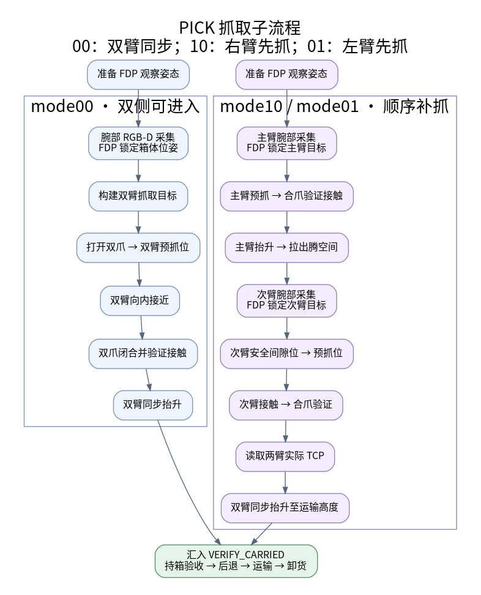
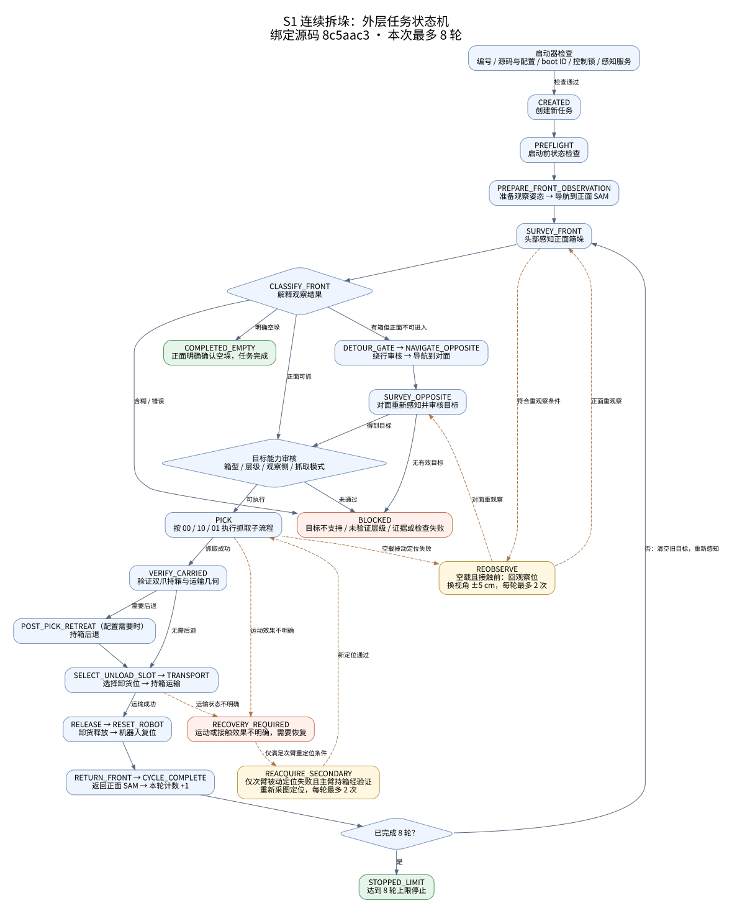

# 检查 10.34.216.13 连接

- 归档编号：`01a12e0e-f292-7f80-a148-2d34aa10fd97`
- 项目：VLA G1 项目
- 创建时间：2026-10-12T11:16:56.071000+08:00
- 更新时间：2026-10-12T13:31:10.906000+08:00
- 状态：活动
- 导出范围：用户可见消息与助手可见回复；不含隐藏推理和工具原始输出

## 1. 用户

<external_codex_apps_open_page>{"page_id":null}</external_codex_apps_open_page>

## 2. 用户

现在你能连上 10.34.216.13 ？

## 3. 助手（进展）

我会按 10.34.216.13 的 SSH 技能说明做一次连接检查。

## 4. 助手（进展）

本地凭据文件和 `sshpass` 都可用，但沙箱内 SSH 被网络权限拦住了。我按技能要求用同一条只读握手检查申请一次受限连接。

## 5. 助手

可以，已成功通过 SSH 连上 `10.34.216.13`。远端主机名是 `c-MS-7E07`，登录用户为 `c`，当前目录是 `/home/c`。

## 6. 用户

能不能给我找一下里面最近最新的S1 执行完整流程的程序是啥？

## 7. 助手（进展）

我会在 10.34.216.13 上只读查找名称或内容与 S1“完整流程”相关的程序，并按最近修改时间筛选。先检查常见工作目录和匹配文件。

## 8. 助手

查到最新的完整流程记录是 **`head_rigid_fullflow_20261010_06`**，记录日期为 2026-10-10。

- 机器人上的启动封装程序：`/home/galbot/ie_lab/services/s1_head_lidar_20261010/head_rigid_fullflow_20261010_06/launch_recorded_mission.py`
- 它调用的实际运动入口：`bash deploy/run.sh dev-run head_rigid_fullflow_20261010_06`（项目在 FDP 主机 `10.34.216.13` 的 `/home/c/workspace/s1_continuous_destack`）
- 留存记录显示：完成卸货 6 箱后进入 `RECOVERY_REQUIRED`，原因是运输阶段运动状态不明确；退出码为 4。

我只检查了文件和归档记录，没有启动机器人。

## 9. 用户

给我命令，我来执行

## 10. 助手

记录中的启动命令是：

```bash
ssh galbot@10.34.216.17 'python3 /home/galbot/ie_lab/services/s1_head_lidar_20261010/head_rigid_fullflow_20261010_06/launch_recorded_mission.py --stage /home/galbot/ie_lab/services/s1_head_lidar_20261010/head_rigid_fullflow_20261010_06 --execute'
```

**注意：这个 `RUN_ID` 已经执行过。** 启动器会因重复编号或已有 `launch.json` 拒绝重跑；不要直接重复执行。要再跑一轮，需要先准备一个新的实验编号和对应阶段目录。

## 11. 用户

lsy03@lsy03-System-Product-Name:~$ ssh galbot@10.34.216.17 'python3 /home/galbot/ie_lab/services/s1_head_lidar_20261010/head_rigid_fullflow_20261010_06/launch_recorded_mission.py --stage /home/galbot/ie_lab/services/s1_head_lidar_20261010/head_rigid_fullflow_20261010_06 --execute'
galbot@10.34.216.17's password:
[REDACTED] (most recent call last):
  File "/home/galbot/ie_lab/services/s1_head_lidar_20261010/head_rigid_fullflow_20261010_06/launch_recorded_mission.py", line 122, in <module>
    raise SystemExit(main())
  File "/home/galbot/ie_lab/services/s1_head_lidar_20261010/head_rigid_fullflow_20261010_06/launch_recorded_mission.py", line 100, in main
    raise ValueError('launch already reserved; do not repeat')
ValueError: launch already reserved; do not repeat
lsy03@lsy03-System-Product-Name:~$
给我看下什么问题

## 12. 助手（进展）

报错提示这个实验编号已经被预留。我会按 S1 主机的只读检查流程查看它的 `launch.json`、退出记录和状态文件，确认是已执行完、曾启动失败，还是只是预留过。

## 13. 助手

这不是 SSH 或密码问题，而是启动器的防重复保护触发了。

我检查了 S1 上的记录：这个编号在 **10 月 10 日 16:43** 已经启动过，目录里已有 `launch.json` 和 `fullflow.log`。启动器发现它们后，会拒绝再次启动同一个 `RUN_ID`，以免重复执行机器人动作。

那次流程后来在第 6 箱的 `transport` 阶段停止，状态是 `RECOVERY_REQUIRED`，原因码为 `MOTION_STATE_AMBIGUOUS:transport`；退出码是 4。这表示程序无法确认运输动作的状态，不能把它当作一次正常完成的运行。

**不要重复运行这条命令，也不要只改编号后直接启动。** 当前检查只读了历史记录，没有读取机器人此刻的实际状态。

## 14. 用户

如果我想另外新建一个任务，我应该如何操作？

## 15. 助手（进展）

我先核对一下项目里“准备新实验编号/阶段目录”的正式流程，避免把旧目录里的编号手动改掉后误以为已经生成了新的启动配置。

## 16. 助手

新建一轮需要**新的 `RUN_ID` 和一份重新生成的阶段目录**。不能只把旧目录改名，或手动改 `prepared.json`：它绑定了源码、配置、机器人启动标识和运行目录的哈希。

我查了项目记录，当前找到的是 10 月 10 日那份一次性启动包，没有找到生成新启动包的通用命令。因此现在还不能给你一个可直接执行的新任务命令；需要先让负责准备实验的人生成新的阶段目录和 `prepared.json`。

另外，旧任务停在运输状态不明确，记录中载荷状态为 `lifted`。开始新一轮前，先让现场操作员确认机器人和载荷当前状态，并处理好上一轮的恢复问题。

新阶段准备好后，启动器支持先做**不运动的检查**（命令末尾不加 `--execute`）：

```bash
ssh galbot@10.34.216.17 'python3 <新阶段目录>/launch_recorded_mission.py --stage <新阶段目录>'
```

检查通过、现场确认可执行后，再由你手动启动：

```bash
ssh galbot@10.34.216.17 'python3 <新阶段目录>/launch_recorded_mission.py --stage <新阶段目录> --execute'
```

执行会驱动双臂、夹爪和底盘，具体任务轮数与运动参数由新阶段的配置决定。

## 17. 用户

<新阶段目录> 给我用现在的时间给我编一个好了

## 18. 助手

按当前北京时间 **2026-10-12 11:14:55**，可以用这个新编号和阶段目录：

```text
RUN_ID: head_rigid_fullflow_20261012_111455
阶段目录: /home/galbot/ie_lab/services/s1_head_lidar_20261010/head_rigid_fullflow_20261012_111455
```

这只是新名字，目录和 `prepared.json` 还没生成；不能直接拿它启动。需要先为这个编号准备新的阶段文件。

## 19. 用户

给我命令我来执行

## 20. 助手

现在还没有能启动这轮任务的有效命令：刚才编的是目录名，S1 上这个新目录及其 `launch_recorded_mission.py`、`prepared.json` 都还没准备好。直接把新路径填进启动命令会报“文件不存在”；复用旧目录又会触发防重跑保护。

需要先生成并部署新的阶段包。并且旧任务停在 `RECOVERY_REQUIRED`，要先确认机器人和载荷的当前状态。准备完成后，我再给你对应的检查和启动命令。

## 21. 用户

新的阶段包 如何部署？

## 22. 助手（进展）

我会对照旧阶段包的部署记录和项目里的启动说明，确认新包应该从哪生成、包含哪些文件，以及哪些步骤会实际改动 S1。这里只查部署流程，不会上传或启动任务。

## 23. 用户

能不能把一整套完整的代码流程给我讲一下，我需要达到运行拆垛流程的目的

## 24. 用户

别和我扯别的，我需要达到运行拆垛流程的目的

## 25. 助手（进展）

明白，你要的是把新一轮拆垛准备到能运行。我会检查 S1 当前部署，准备新的任务目录，并把实际可用的启动命令交给你执行。

## 26. 助手（进展）

S1 当前的 145 个源码和配置文件与上次运行版本一致，三个感知服务也已就绪。机器人期间重启过，我正在读取当前状态；随后会为新编号重新生成启动记录，保留原来最多 8 箱的配置。

## 27. 用户

<send_user_message_question_reply>
[{"questionItemId":"[\"request_user_input_async\",\"call_cd01e68bf9cd47ea97f025b05c3df1bd\",0]","question":"新任务正在准备。请现场确认：S1 双爪现在是否空载，箱垛和卸货区已摆好、运动范围无人且物理急停可用？遥测显示机器人静止，但无法确认夹爪内是否有箱子。","answer":"已确认，空载且现场就绪"}]
</send_user_message_question_reply>

## 28. 助手

**新任务已部署，启动检查通过。** 你已确认空载和现场就绪，直接执行下面这条命令，开始最多 **8 箱**的拆垛、运输、卸货和返回流程：

```bash
ssh galbot@10.34.216.17 'python3 /home/galbot/ie_lab/services/s1_head_lidar_20261010/head_rigid_fullflow_20261012_111455/launch_recorded_mission.py --stage /home/galbot/ie_lab/services/s1_head_lidar_20261010/head_rigid_fullflow_20261012_111455 --execute'
```

返回 `wrapper_pid` 表示后台任务已提交，**执行一次即可**。日志和计时记录会自动保存。

## 29. 用户

<external_codex_apps_open_page>{"page_id":null}</external_codex_apps_open_page>

## 30. 用户

给我总结一下这个命令的 状态机的流程图是啥？给我画一下行不行，或者我本机有上一个版本的状态机也行

## 31. 助手（进展）

我会按这次命令实际绑定的源码画流程图，同时找一下本机已有的旧版状态机图，标出正常拆垛循环和故障停止分支。

## 32. 助手（进展）

源码确认了：每轮成功搬走一个箱子并返回正面后，才计为一轮完成，然后重新感知；这次上限是 8 轮。抓取分为 `00` 双臂同步和 `10/01` 主臂先抓、次臂补抓两条路线。我会把这两层分别画出来。

## 33. 助手

_工具输出图片（原始工具文本未纳入归档）。_




## 34. 助手

画好了，按这次命令绑定的实际源码 `8c5aac3` 整理。

整体流程是：**启动检查 → 正面感知 → 选择抓取方式（必要时绕到对面）→ 抓箱 → 持箱验证 → 运输卸货 → 复位返回 → 重新感知下一箱**。返回正面后才计为完成一轮，本次最多 **8 轮**。


`PICK` 内部有三种模式：**00 双臂同步抓取；10 右臂先抓；01 左臂先抓**。


图中合并了部分相邻状态，虚线表示条件重试或异常分支。四种停止结果需要区分：

- `COMPLETED_EMPTY`：正面感知明确确认空垛。
- `STOPPED_LIMIT`：完成 8 轮后停止。
- `BLOCKED`：目标能力、层级或检查未通过。
- `RECOVERY_REQUIRED`：运动或接触效果不明确，需要恢复；其他运动阶段也可能进入此状态。

图已保存本机：[主流程 SVG](../../assets/8f0d12fa08b23396--outer.svg)、[可编辑 Mermaid](/home/lsy03/文档/ChatGPT/VLA G1 项目/reports/s1_fsm_20261012/outer.mmd)。本机也找到了 [9 月 30 日实验目录中的旧版状态机源码](/home/lsy03/文档/ChatGPT/S1/experiments/20260930_fdp_unified_api/evidence/scenario_source/src/s1_destack/fsm/mission.py)。



