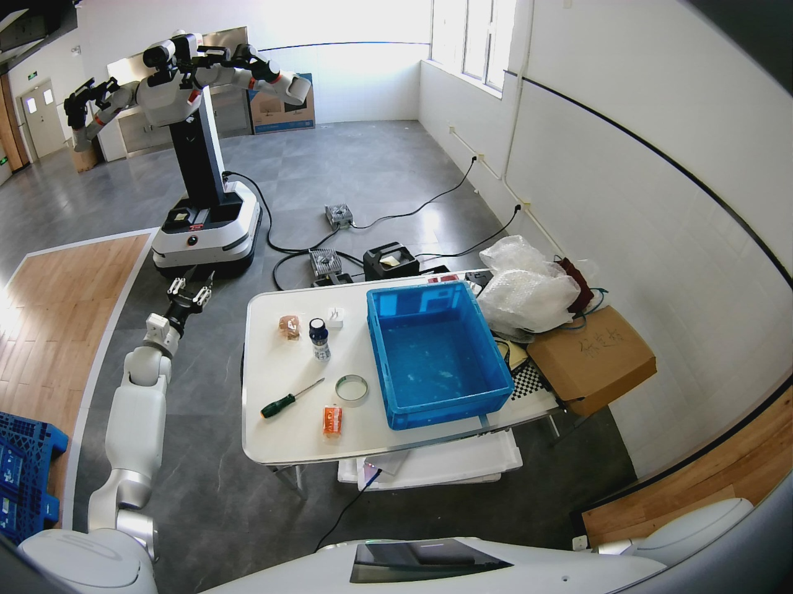
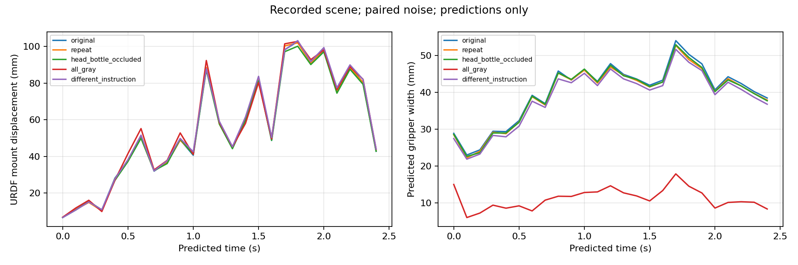
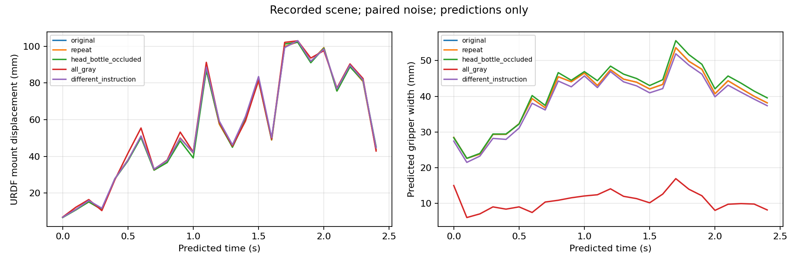
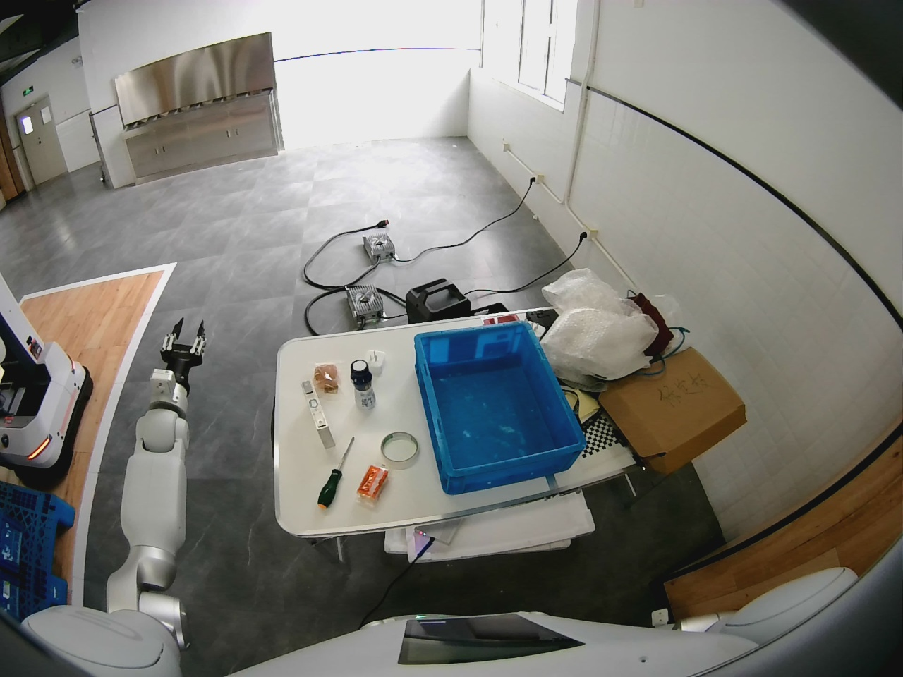
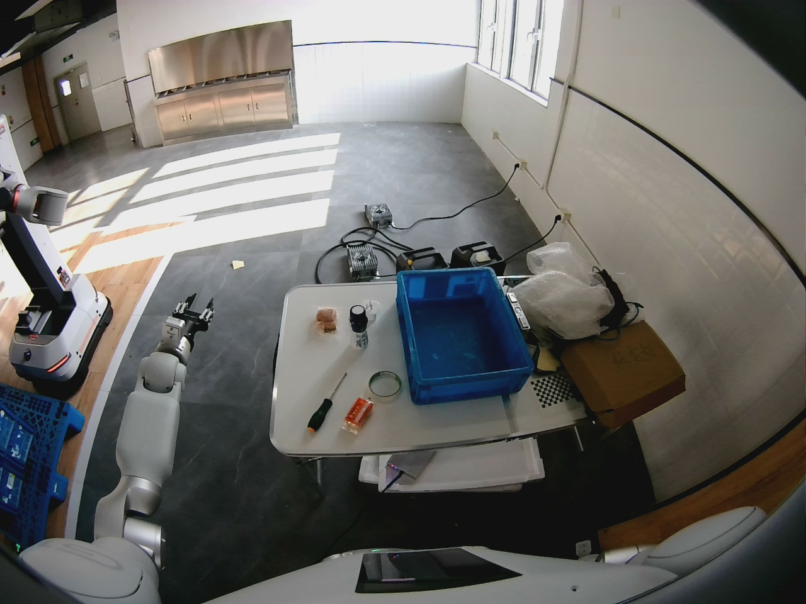
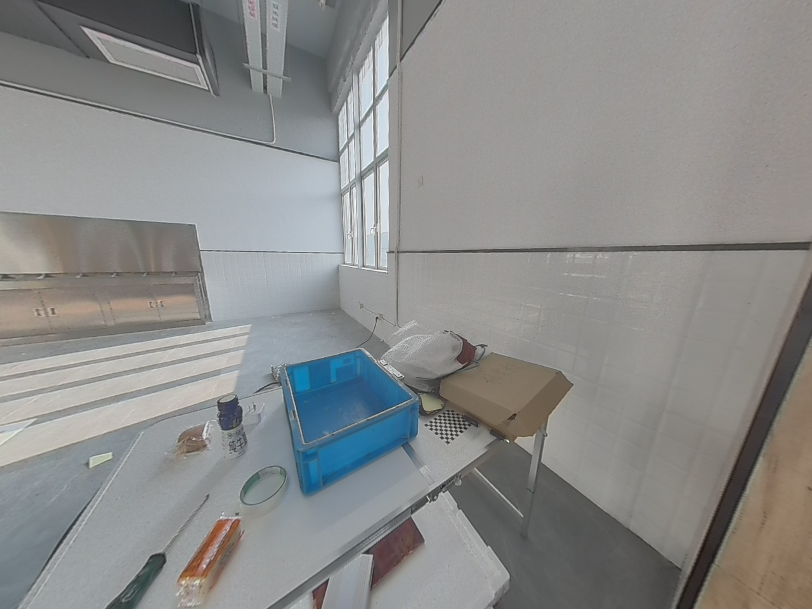
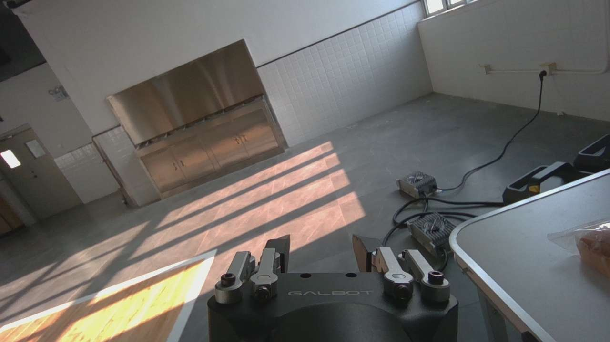
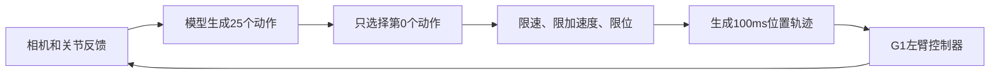

# 10_15 lingbot_vla_2_0｜G1 原始预训练权重抓牛奶验证

- 归档编号：`01a12f39-9b78-7d52-b841-83cc19db6f83`
- 项目：VLA G1 项目
- 创建时间：2026-10-13T10:10:20.008000+08:00
- 更新时间：2026-10-16T16:28:39.690000+08:00
- 状态：活动
- 导出范围：用户可见消息与助手可见回复；不含隐藏推理和工具原始输出

## 1. 用户

<external_codex_apps_open_page>{"page_id":null}</external_codex_apps_open_page>

## 2. 用户

问一下，直接下载下来的原始权重预训练权重lingbotVLA2.0是否能进行G1机器人的控制，感觉它预训练中就有G1的数据？如果可以，后训练的作用和效果会如何？

## 3. 助手（进展）

我会先核对 LingBot VLA 2.0 官方说明里预训练数据、动作输出和部署接口，再对照你们 G1 项目的硬件与控制链路，区分“模型见过 G1 数据”和“原始权重能直接控制 G1”。

## 4. 助手（进展）

官方材料确认它用约 20 种机器人配置预训练，但公开的真机部署示例仍以“后训练 checkpoint”运行。关键还要核实：论文里提到的 G1 究竟是哪一家、哪种末端执行器，以及是否公开了对应的配置和归一化统计。

## 5. 助手

**你的判断是对的：LingBot-VLA 2.0 的预训练数据明确包含 Galbot G1。**论文还分别列出了 AgiBot G1 和 Unitree G1；其中 Galbot G1 是双臂夹爪配置，记录的策略频率为 30 Hz。这里的“G1”确实包括你们项目使用的 Galbot G1，并非只是在泛指其他厂商的同名机器人。[论文预训练数据表](https://arxiv.org/html/2607.06403v1)

但**原始预训练权重不能下载后就把动作直接发给当前 G1 SDK**。模型使用统一的 55 维状态和动作空间；实际控制仍要确定相机对应关系、关节顺序、动作是绝对目标还是相对增量、单位、归一化与反归一化统计，以及控制频率。官方部署示例使用后训练 checkpoint；公开仓库目前也没有现成的 Galbot G1 配置。[官方说明](https://github.com/Robbyant/lingbot-vla-v2#post-training-example) · [公开配置目录](https://github.com/Robbyant/lingbot-vla-v2/tree/main/configs/robot_configs)

对**你们这台只控制左臂七关节和左夹爪**的机器，后训练主要是把预训练得到的视觉、语言和操作先验，适配为当前相机视角、任务、动作定义及夹爪开度下可执行的预测。它有望提高目标动作精度和任务成功率，但效果必须实测，不能从“预训练见过 Galbot G1”直接推断。你们当前的 [LingBot 接入配置](/home/lsy03/文档/ChatGPT/VLA%20G1%20项目/g1_policy_control/configs/models.json:61)里，checkpoint、状态字段和动作索引仍未填好；现有 [微调实验说明](/home/lsy03/文档/ChatGPT/VLA%20G1%20项目/lingbot_finetune/README.md:1)使用的起点则是 **RoboTwin 后训练权重**，并非原始通用预训练权重，也尚无 G1 真机任务成功率结论。

最有说服力的下一步是：用**同一套 G1 输入输出映射和保护条件**，分别评估原始预训练权重与 G1 后训练权重，先看离线动作误差和只读实时预览，再看受限真机任务成功率。这样才能回答“预训练权重本身能做到多少、后训练实际带来多少提升”。

[附件：6b0de2df1d1b634e--models.json](../../assets/6b0de2df1d1b634e--models.json)

[附件：cfaeff55ce3de95b--README.md](../../assets/cfaeff55ce3de95b--README.md)

## 6. 用户

有没有办法我们可以验证一下？ 给我方案计划，明确目标

## 7. 助手（进展）

可以验证。我会先对照现有数据、权重和 G1 控制接口，把实验目标、对照组、每阶段的通过标准和停止条件写成可执行的计划。

## 8. 助手

可以。建议把验证分成两个明确的问题：**原始预训练权重在我们的 Galbot G1 上能做到什么程度？用同一批 G1 数据后训练，任务成功率能提高多少？**

目前有两个准备缺口：本机模型目录里有 RoboTwin 后训练权重，尚未看到原始 `lingbot-vla-v2-6b` 权重；现有 [G1 控制配置](<../../assets/6b0de2df1d1b634e--models.json#L61>)也还缺 LingBot 的状态字段和动作索引。现有 32 个训练 episode、7 个验证 episode 可以用于起步，但评估后训练收益需要另留一批**从未用于训练或挑选权重**的数据。

| 阶段 | 要做的事 | 明确产出与通过条件 |
| --- | --- | --- |
| 1. 接通模型 | 下载并固定原始权重版本；核对左臂七关节、夹爪、三路相机、动作单位和归一化统计；验证输出到 SDK 目标的往返映射 | 留下可复现的配置及校验记录，逐项确认关节顺序和动作含义 |
| 2. 离线测原始权重 | 在保留的 G1 轨迹上运行推理，**不更新权重**；记录首步关节与夹爪误差、越界比例、推理延迟，并与“保持当前姿态”基线比较 | 回答“预训练模型是否给出有用的 G1 动作”。无非法数值、无映射错误，且表现优于保持基线，才进入下一阶段 |
| 3. 实时只读预览 | 接入真实相机和状态，但只记录预测及拟发送目标，不执行运动 | 检查图像时效、预测延迟、目标范围和连续预测的稳定性；任一映射或时效问题先修正 |
| 4. 同起点后训练对照 | 从**同一份原始预训练权重**出发，用现有 G1 牛奶任务数据训练；固定输入、动作定义和评估集，再与第 2 阶段的原始权重比较 | 得到后训练前后的逐项误差和拒收率。现有 RoboTwin 起点的实验可作第三组参考，但不能代替这个对照 |
| 5. 受限真机任务 | 先单次左臂、再夹爪、再短程闭环；通过后，在相同初始条件下交替测试两个模型 | 以“完成抓取并放到目标区域”的比例为主指标，同时记录停止、越界、超时和实际轨迹；建议每个模型先做 3 种起始位置、各 10 次，差距不清楚再增加次数 |

这里需要区分两种结论：原始权重**能够产生可映射的动作**，不等于它**能够稳定完成抓放任务**。后训练的收益以相同条件下的真机成功率为准，离线误差只用于筛选和诊断。现有 [LingBot 微调实验](<../../assets/cfaeff55ce3de95b--README.md#L1>)尚未完成这个原始权重对照，也未取得 G1 真机成功率，因此现在不宜预估提升幅度。

我建议先完成阶段 1–2。它们不需要机器人运动，就能判断原始权重是否值得进入真机预览，并给后训练建立可信的基线。

[附件：6b0de2df1d1b634e--models.json](../../assets/6b0de2df1d1b634e--models.json)

[附件：cfaeff55ce3de95b--README.md](../../assets/cfaeff55ce3de95b--README.md)

## 9. 用户

<external_codex_apps_open_page>{"page_id":null}</external_codex_apps_open_page>

## 10. 用户

现在我们是否有原始版本的预训练权重？

## 11. 助手（进展）

我查一下当前模型目录和项目配置，确认今天是否已经下载了原始 `lingbot-vla-v2-6b`，并区分它与现有的 RoboTwin 后训练权重。

## 12. 助手

**目前在本机已检查的模型目录和缓存中，没有找到 LingBot-VLA 2.0 的原始预训练权重 `robbyant/lingbot-vla-v2-6b`。**

现有的是 `robbyant/lingbot-vla-v2-6b-robotwin`，即 **RoboTwin 后训练权重**；[本地模型清单](../../assets/221f5df5379e69d2--model-manifest.json)和 [G1 微调说明](<../../assets/cfaeff55ce3de95b--README.md#L8>)都标明了这一点。目录中的 `Qwen3-VL-4B-Instruct` 也不是 LingBot 原始权重。

所以，前面计划中的“原始权重与 G1 后训练权重对照”目前还缺第一组权重；这次检查不涵盖其他远程服务器。

[附件：221f5df5379e69d2--model-manifest.json](../../assets/221f5df5379e69d2--model-manifest.json)

[附件：cfaeff55ce3de95b--README.md](../../assets/cfaeff55ce3de95b--README.md)

## 13. 用户

看下另一个项目“蚂蚁灵波具身大模型挑战赛” 有没有预训练的权重，方不方便借用一下？

## 14. 助手（进展）

我会查看“蚂蚁灵波具身大模型挑战赛”项目里的模型文件和下载记录，确认是否是 LingBot-VLA 2.0 原始预训练权重，以及能否直接复用到当前 G1 实验。

## 15. 助手（进展）

找到了：比赛项目的 `models/lingbot-vla-v2-6b` 下确实有六个原始模型分片，项目记录的模型 ID 也是官方通用预训练版。我再核对下载完整性、版本号和现有容器加载方式，判断能否只读复用，避免再复制一份约 25 GB 的权重。

## 16. 助手

找到了，可以借用。**“蚂蚁灵波具身大模型挑战赛”项目保存了原始通用预训练权重** `robbyant/lingbot-vla-v2-6b`，与 G1 项目现有的 RoboTwin 后训练权重是不同版本。

权重在 [比赛项目的模型目录](</home/lsy03/文档/ChatGPT/蚂蚁灵波具身大模型挑战赛/models/lingbot-vla-v2-6b>)，版本固定为 `11c703bf6a5c1f45b3b69168482da11fdbba53d7`。我核对了下载清单：23 个模型文件均存在、大小匹配；六个权重分片合计约 25.5 GB。比赛项目的[验收记录](<../../assets/955f0b41269a2cb1--setup-status.json>)还记录了完整模型加载成功。

**复用很方便**：G1 实验容器可以把该目录只读挂载进去，直接加载，不需要再下载或复制 25 GB，也不会改动比赛项目。当前 G1 训练脚本把 RoboTwin 权重路径写死了，开始原始权重对照实验时，需要为它增加独立的模型路径配置，并保持两组实验的数据和评估方式一致。

[附件：955f0b41269a2cb1--setup-status.json](../../assets/955f0b41269a2cb1--setup-status.json)

## 17. 用户

现在是否有脚本，可以直接调用预训练权重来控制G1运行抓牛奶的任务？我想试试

## 18. 助手（进展）

我会核对现有控制入口能否加载比赛项目的原始权重、是否已有 Galbot G1 的输入输出映射，以及抓牛奶任务需要的控制参数。这个结论要以代码和配置为准。

## 19. 助手

**现在没有可以直接用原始 LingBot-VLA 2.0 权重，让 Galbot G1 执行抓牛奶任务的脚本。**权重虽然已在比赛项目中，但当前 [LingBot G1 配置](<../../assets/6b0de2df1d1b634e--models.json#L61>)的 checkpoint、状态字段和动作索引仍为空；[加载器](</home/lsy03/文档/ChatGPT/VLA G1 项目/g1_policy_control/adapters.py:145>)会因此明确拒绝启动。

还需要验证归一化、关节相对动作转 SDK 绝对目标、夹爪宽度和相机映射。现有 G1 LingBot 微调脚本只完成了离线训练与预测验证，没有真机抓取验收；当前控制入口默认使用的是另一款 `milk-v2-best` 模型。[微调记录](<../../assets/cfaeff55ce3de95b--README.md#L67>) · [控制入口说明](<../../assets/613efb365313e824--README.md#L1>)

如果要试**原始 LingBot 权重**，下一步应先用现有牛奶数据完成离线推理和动作映射校验，再接真实 G1 做只读预测预览；通过后才能依次试单次受限动作和抓取闭环。目前我不能给你一个可直接执行抓牛奶的 LingBot 命令。

[附件：6b0de2df1d1b634e--models.json](../../assets/6b0de2df1d1b634e--models.json)

[附件：cfaeff55ce3de95b--README.md](../../assets/cfaeff55ce3de95b--README.md)

[附件：613efb365313e824--README.md](../../assets/613efb365313e824--README.md)

## 20. 用户

我的意思是你可以给我把那边的预训练权重复制过来这边自己改改不就行了

## 21. 助手（进展）

明白，你是让我实际把原始权重接进 G1 项目并改脚本。我先检查目标磁盘空间和现有推理接口，再复制权重、补齐 G1 映射，先完成离线预测与只读预览验证。真机运动要等输出语义和限位检查通过后才能接入。

## 22. 助手（进展）

目录空间足够，原始模型约 27 GB（含深度和视频教师文件）。我会复制到 G1 项目自己的模型目录，并把大文件排除在 Git 之外；之后校验六个权重分片与比赛项目的下载清单一致。

## 23. 助手（进展）

权重已复制并校验通过。代码里还有一道关键保护：`g1_policy_control` 只允许标记为 G1 任务权重的模型执行真机运动，而原始预训练权重不属于这一类。我会把它接成可离线评估、可实时只读预览的独立配置，并先验证动作转换；不会把原始权重伪装成已验收的任务权重来绕过这道检查。

## 24. 助手（进展）

原始权重已经在隔离的 GPU 容器中成功加载，G1 的八维输入输出配置也能初始化。下一步我会用现有牛奶验证集跑实际离线预测，检查输出范围、首步误差和延迟；这些结果会决定只读预览是否值得启动。

## 25. 助手（进展）

离线脚本已经接上现有牛奶数据集，容器正在加载原始权重并跑首个验证窗口。加载本身已通过；现在要看的是真实 G1 图像与状态进入模型后，能否稳定得到物理单位正确的八维动作。

## 26. 助手（进展）

七个不同验证 episode 的首轮结果已经出来：原始权重能输出 G1 八维动作，但首步关节误差平均约 0.48°，比“保持当前关节位置”的 0.36°更大；夹爪误差较保持基线小。预热后单次推理约 0.37–0.40 秒，且有一个窗口的夹爪预测略低于物理下限。我要扩大离线样本并保留原始越界记录，再决定是否启动真机只读预览。

## 27. 助手（进展）

目前这七段里，夹爪方向有一定信号，但关节预测尚未优于简单保持基线。控制程序当前还要求预测足够新鲜；模型预热后的离线耗时已接近该时间预算。我正在用更多窗口确认这不是个别片段造成的结论，随后会给你可运行的离线命令和明确的真机试验边界。

## 28. 助手（进展）

70 个验证窗口的结果更明确了：原始权重首步关节误差 0.368°，保持当前姿态是 0.263°；70 段中有 62 段关节更差。夹爪误差从保持基线的 35.2 mm 降到 13.0 mm，但 10 段的动作块含越界夹爪值。它适合继续做只读预览，目前不适合直接让机器人完成抓牛奶。我会再验证新的模型服务入口能独立启动，确保你能实际看到实时预测。

## 29. 助手（进展）

新的模型服务已在本机独立端口启动，并确认使用原始权重、真机执行标记为关闭。我现在做一次 10 秒的 G1 实时只读预览：它只读取传感器、显示拟发送目标，不调用手臂或夹爪运动接口。这样能验证离线数据之外的相机、状态和时延。

## 30. 助手（进展）

实时只读预览已经跑通：10 秒内接受了 26 次预测，输入和预测拒收均为零，运动接口调用为零，预热后往返中位时延约 378 ms。手臂通道这一步通过了数据链路验收。我再单独预览夹爪通道，确认离线发现的越界情况在当前真机画面下是否出现。

## 31. 助手（进展）

复制、适配和试验都已完成。原始模型确实能在当前 G1 上读取实时相机与状态并输出动作；手臂、夹爪各 10 秒只读预览都通过。与此同时，70 段离线数据表明关节预测整体弱于保持基线，所以我保留了“禁止真机执行”的保护。临时模型服务已停止并释放显存，原有牛奶模型服务仍在运行。

## 32. 助手

你说得对。我已经把比赛项目的**原始 LingBot-VLA 2.0 预训练权重**复制到 [G1 项目模型目录](</home/lsy03/文档/ChatGPT/VLA G1 项目/models/lingbot-vla-v2-6b>)，六个权重分片均通过 SHA-256 校验，并接好了 G1 的相机、左臂和夹爪映射。模型没有做梯度更新。

现在**可以在真机上试只读预测**：[操作命令](<../../assets/93acaba299e1edc3--README.md>)已写好，我也实际跑通了手臂和夹爪各 10 秒的预览，两轮各接受 26 次预测、零运动指令。临时服务已停止以释放显存，原有牛奶模型服务仍在运行。

**抓牛奶的真机运动目前没有开放。**[70 段离线结果](<../../assets/e0447256e5f1d666--report.json>)显示，原始权重的首步关节误差为 0.368°，比保持当前姿态的 0.263°更大；10 段动作块还出现夹爪越界预测。因此我保留了控制程序对原始权重的执行拦截。当前验证证明它能接入 G1 并实时预测，还不能证明它能完成抓取。

[附件：93acaba299e1edc3--README.md](../../assets/93acaba299e1edc3--README.md)

[附件：e0447256e5f1d666--report.json](../../assets/e0447256e5f1d666--report.json)

## 33. 用户

好的，我们继续，给我方案计划，明确目标

## 34. 用户

好的，我们继续，给我方案计划，明确目标

## 35. 助手（进展）

接下来把目标定为：在当前 G1 上验证原始权重是否能产生有效的抓牛奶行为，并量化后训练带来的提升。我会先整理已完成的验证和剩余缺口，再给出每一步的通过标准、停止条件和交付物。

## 36. 助手

接下来建议先做一次**原始权重的受控真机试验**，明确回答：它能否根据牛奶瓶的位置，驱动左臂完成靠近、抓取和抬起；随后用相同条件评估后训练的提升。

目前模型加载和实时只读预览已经通过。还要补查一个关键问题：**当前归一化统计来自我们自己的牛奶数据，是否符合原始预训练模型的动作语义尚未确认。**因此，现有离线误差不能全部归因于模型能力；而且“保持姿态”误差较小，也不能单独证明模型无法抓取。

| 阶段 | 明确目标 | 工作内容与通过标准 |
| --- | --- | --- |
| 1. 核对适配 | 确认模型输出被正确解释 | 查清原始 Galbot G1 的状态、动作和归一化定义；核对关节增量、夹爪单位及动作块时间。输出一份确定配置；无法确认的部分明确标为实验假设 |
| 2. 验证动作是否响应场景 | 判断模型是否会朝牛奶瓶行动 | 将瓶子放在左、中、右三个位置，重复只读预测，观察末端运动方向、夹爪时机和重复预测波动。输出轨迹可视化，确认变化与瓶子位置相关 |
| 3. 单次受限运动 | 验证预测到实际运动的链路 | 增加独立的“预训练权重实验”入口；先手臂、再夹爪，每次沿用现有 **0.5°／2 mm** 目标预算。检查实际反馈、跟踪误差和停止结果，现场由你执行 |
| 4. 短程闭环 | 验证执行后能继续修正动作 | 先运行最多三次手臂动作，逐步增加经过验证的预算。依据实际轨迹检查靠近方向和反馈修正；核对约 378 ms 推理延迟与动作时间的关系 |
| 5. 完整任务试验 | 测出原始权重的抓取成功率 | 前四阶段通过后，确定任务工作空间和运动预算。先测试“抓起并保持”，再测试“放入蓝色箱子并释放”；每次保存视频、原始预测、实际反馈和失败原因 |
| 6. 后训练对照 | 测出后训练实际收益 | 从同一原始权重微调，采用相同输入、控制方式和测试场景，与原始模型比较成功率、完成时间和中断次数 |

完整任务的成功定义建议固定为：**牛奶瓶离开桌面至少 5 cm、保持 2 秒，随后放入蓝色箱子并释放。**正式比较先做三个起始位置、每个位置十次，共每个模型 30 次；人工接管或保护中断计为失败，并报告成功率的不确定范围。

现有 `g1_task_weights=false` 保留其真实含义。实验运动入口应单独授权受限试验，并继续执行限位、时效和停止检查，不能靠把原始模型标成“已训练任务权重”来开放运动。

**下一轮先完成阶段 1–3**，交付确定的适配配置、场景响应结果，以及你能在现场执行的单次受限动作脚本。是否进入完整抓牛奶闭环，以实际运动和停止验收结果决定。

## 37. 用户

<external_codex_apps_open_page>{"page_id":null}</external_codex_apps_open_page>

## 38. 用户

好的，我们开始执行，在遇到需要真机真正运动的时候，给我脚本，我来执行

## 39. 助手（进展）

我会按阶段 1–3 开始：先核对动作和归一化定义，再做场景响应分析，最后准备单次受限运动脚本。需要真正发送运动指令时，我会停在可审阅、可执行的脚本处，由你在现场运行。

## 40. 助手

_工具输出图片（原始工具文本未纳入归档）。_



## 41. 助手（进展）

官方公开资料支持“关节相对增量、夹爪绝对开度”的适配方式，但公开发布中没有找到 Galbot G1 原始归一化统计。我会把这项缺口写入试验记录：当前只能评价“原始权重＋本地标定”的组合。单次运动入口会保留这个事实，并单独限制为一个手臂或夹爪动作，不开放任务闭环。

## 42. 助手（进展）

发现一个会影响单步试验的问题：原控制流程在预检后还会重新推理一次，而 LingBot 约 0.38 秒的推理时间可能触发 0.3 秒反馈超时。已改为单步执行预检时展示的同一份预测，发送前再次检查新鲜度；这样实际执行目标也与终端显示一致。闭环模式仍保持拦截。

## 43. 助手

_工具输出图片（原始工具文本未纳入归档）。_



## 44. 助手（进展）

转换审计已通过，归一化再还原的最大误差为零。记录画面的分析还发现：遮住牛奶瓶后，关节变化与相同输入重复推理的浮点波动接近；暂时不能据此说模型识别并追踪了瓶子。我正在换用更稳定的推理路径重做这项比较，同时把单步入口的身份、预算和超时限制纳入回归测试。

## 45. 助手

_工具输出图片（原始工具文本未纳入归档）。_



## 46. 助手（进展）

稳定推理路径下，相同输入与相同采样噪声的重复预测已完全一致；遮挡瓶子或改变指令会引起小幅变化，全画面置灰则明显改变夹爪预测。这说明模型会使用视觉输入，但“瓶子换位置后是否朝正确方向移动”仍需左、中、右实景比较。单步脚本已准备好，正在做最后一次只读时延验证。

## 47. 助手（进展）

最后一次只读验证发现，稳定推理路径加上传感器画面年龄后，部分预测超过了现有 600 ms 图像时效上限。我会保留稳定路径用于离线对比，现场单步使用已通过预览的快速路径；时效上限保持原值，超时就拒绝发送动作。单步仍执行终端已展示的那份预测。

## 48. 助手（进展）

最终现场配置的只读预览已通过：10 秒内接受 26 次预测，零拒收、零运动指令，往返中位时延约 383 ms。58 项回归测试和最终 11 项单步专项测试通过。现在到需要你现场执行真正运动的环节；我会给出仅手臂的一次受限动作脚本，执行后再检查反馈与停稳日志。

## 49. 助手

**单次真实运动脚本已准备好，由你现场执行。**转换审计、58 项回归测试和最终只读预览已通过；真实运动与停稳仍待验证。[验证记录](<../../assets/2e33b171c8025467--verification_20261013.json>)

先验证左臂一次受限动作，夹爪保持不动。下面的命令**会真正移动左臂**；预检通过后直接执行：

```bash
cd '/home/lsy03/文档/ChatGPT/VLA G1 项目'
bash lingbot_pretrain_g1/run_step.sh arm
```

[脚本](</home/lsy03/文档/ChatGPT/VLA G1 项目/lingbot_pretrain_g1/run_step.sh>)会自动启动、预热模型，只发送一个正常动作命令，然后停止并检查反馈。目标预算每关节最多 **0.5°**，速度上限 **0.05 rad/s**；超时或越界会拒绝执行。实际位移以反馈为准。

执行前清空手臂附近的人员和障碍物，保持急停可用。输入 `STOP` 并回车或按 `Ctrl+C` 可停止。

这一步验证动作执行链路；原始 Galbot 归一化和真实三位置响应仍未完全确认。**执行完回复“已执行”**，我读取自动保存的日志，确认运动与停稳结果后再进入夹爪测试。

[附件：2e33b171c8025467--verification_20261013.json](../../assets/2e33b171c8025467--verification_20261013.json)

## 50. 用户

<external_codex_apps_open_page>{"page_id":null}</external_codex_apps_open_page>

## 51. 用户

目前写的控制任务的提示词是啥？

## 52. 助手（进展）

我查一下当前控制入口和预热脚本里的任务提示词。

## 53. 助手

当前控制任务提示词是：

> **Pick up the milk bottle from the table and place it into the blue bin.**

中文意思：**把桌上的牛奶瓶拿起来，放进蓝色箱子。**

定义在 [控制入口](</home/lsy03/文档/ChatGPT/VLA G1 项目/g1_policy_control/client.py:238>)，单步脚本和模型预热都使用这句话。单步执行时，模型仍接收完整任务提示词，控制程序只执行一次受限动作。

## 54. 用户

先给我检查一下现在是否有执行以下任务的环境条件？

“”
cd '/home/lsy03/文档/ChatGPT/VLA G1 项目'
bash lingbot_pretrain_g1/run_step.sh arm
“”

## 55. 助手（进展）

我先做只读检查，核对脚本、权重与配置、GPU 和端口、SDK、机器人连接及当前反馈，不运行这条运动命令。

## 56. 助手（进展）

本机条件目前正常：GPU 空闲约 20.5 GiB，所需镜像、权重、SDK 和令牌均在，配置哈希一致；8092 端口空闲，控制锁也可用。接下来核对机器人 URDF、时钟和实时传感器反馈，再用零运动预览确认今天的推理时效。

## 57. 助手（进展）

机器人网络连接、部署 URDF 和接收缓冲检查通过，时钟偏移也已重新测量，脚本会使用新值。原始模型已成功加载并预热。现在做 10 秒实时只读预览，检查当前关节反馈、相机更新和预测时效。

## 58. 助手（进展）

实时检查在启动前被拦住了：第二次时钟测量的偏移波动超过 5 ms，未进入 SDK 预览，也没有发送运动指令。第一次测量虽通过，但当前还不能判定环境稳定可执行。我继续做只读时钟诊断，确认是瞬时抖动还是持续问题。

## 59. 助手

_工具输出图片（原始工具文本未纳入归档）。_



## 60. 助手（进展）

重测后时钟预检通过，10 秒只读预览也通过：26 次预测全部接受，零拒收、零运动指令，往返中位时延约 382 ms。当前相机能看到牛奶瓶和蓝箱；现场净空与急停状态仍需你确认。我会停止检查用模型服务，释放 8092 端口，避免影响你运行单步脚本。

## 61. 助手

**当前具备运行这条单次受限左臂命令的软件和通信条件。**本次检查未发送运动指令。

- 权重、配置哈希、SDK、镜像和令牌检查通过。
- GPU 空闲约 **20.4 GiB**；8092 端口空闲，控制锁可用。
- 机器人连接、URDF 和实时反馈通过检查。
- 10 秒只读预览接受 **26 次预测**，零拒收，往返中位时延约 **382 ms**。

检查中曾出现一次时钟不稳定，随后三次预检均通过。脚本执行时会重新检查，失败便停止。

你还需现场确认**手臂附近净空、急停可用**；当前程序没有环境避障。确认后可从本地交互终端运行你给的命令，预检通过后会直接执行一次受限动作。

[本次检查记录](<../../assets/309b5b569c300604--readiness.json>)

[附件：309b5b569c300604--readiness.json](../../assets/309b5b569c300604--readiness.json)

## 62. 用户

确认**手臂附近净空、急停可用 给我运行脚本**

## 63. 助手

在本机交互终端运行，**预检通过后会真实移动左臂一次**：

```bash
cd '/home/lsy03/文档/ChatGPT/VLA G1 项目'
bash lingbot_pretrain_g1/run_step.sh arm
```

脚本自动启动并预热模型，每关节目标预算最多 **0.5°**，夹爪保持当前开度，随后停止并检查反馈。

输入 `STOP` 并回车或按 `Ctrl+C` 可停止。结束后回复“已执行”，我检查自动保存的运动和停稳日志。

## 64. 用户

lsy03@lsy03-System-Product-Name:~/文档/ChatGPT/蚂蚁灵波具身大模型挑战赛$ cd '/home/lsy03/文档/ChatGPT/VLA G1 项目' '
bash lingbot_pretrain_g1/run_step.sh arm
Real-motion experiment: arm; one command; <=0.5deg per joint / 2mm gripper; <=5s.
This tests one bounded model action; it does not perform a milk grasp.
7c7057e3b2eb81629212758026f16b2238650330e7c3fc89ef945a741e669091
Traceback (most recent call last):
  File "/usr/lib/python3.10/runpy.py", line 196, in _run_module_as_main
    return _run_code(code, main_globals, None,
  File "/usr/lib/python3.10/runpy.py", line 86, in _run_code
    exec(code, run_globals)
  File "/home/lsy03/文档/ChatGPT/VLA G1 项目/lingbot_pretrain_g1/warm_service.py", line 55, in <module>
    main()
  File "/home/lsy03/文档/ChatGPT/VLA G1 项目/lingbot_pretrain_g1/warm_service.py", line 30, in main
    meta = client.start()
  File "/home/lsy03/文档/ChatGPT/VLA G1 项目/g1_policy_control/client.py", line 36, in start
    meta=self.call("/reset",{})
  File "/home/lsy03/文档/ChatGPT/VLA G1 项目/g1_policy_control/client.py", line 30, in call
    with urlopen(Request(self.url+path,data=data,headers=headers),timeout=self.timeout) as response:
  File "/usr/lib/python3.10/urllib/request.py", line 216, in urlopen
    return opener.open(url, data, timeout)
  File "/usr/lib/python3.10/urllib/request.py", line 525, in open
    response = meth(req, response)
  File "/usr/lib/python3.10/urllib/request.py", line 634, in http_response
    response = self.parent.error(
  File "/usr/lib/python3.10/urllib/request.py", line 563, in error
    return self._call_chain(*args)
  File "/usr/lib/python3.10/urllib/request.py", line 496, in _call_chain
    result = func(*args)
  File "/usr/lib/python3.10/urllib/request.py", line 643, in http_error_default
    raise HTTPError(req.full_url, code, msg, hdrs, fp)
urllib.error.HTTPError: HTTP Error 502: Bad Gateway
lsy03@lsy03-System-Product-Name:~/文档/ChatGPT/VLA G1 项目$


给我看下什么问题？

## 65. 助手（进展）

报错发生在模型预热阶段，还没进入机器人运动入口。我会检查本机 HTTP 请求是否经过了代理，以及模型服务的启动状态，修复后先用只读方式验证。

## 66. 用户

等一下，我没搞懂，直接使用我本机的GPU为什么要走代理？

## 67. 助手（进展）

本机 GPU 计算不需要代理。这里模型运行在本机 Docker 容器里，控制脚本通过 `http://127.0.0.1:8092` 调用它；**可能受代理影响的是这次 HTTP 请求**。

Python 的 `urlopen` 默认读取终端中的 `HTTP_PROXY`、`NO_PROXY`。如果本机地址没有被排除，请求也可能被送到代理。502 提示有网关环节，但仅凭报错还不能确定来源。我会让本机模型请求强制直连，不依赖这些环境变量。

## 68. 助手（进展）

已在测试中复现：设置 HTTP 代理、未排除本机地址时，请求可以得到代理返回的 502。脚本已改为让 `127.0.0.1`、`localhost` 和 `::1` 强制直连，62 项测试通过。现在正用故意配置错误代理的环境验证真实模型预热，不连接机器人运动接口。

## 69. 助手

**GPU 计算在本机进行。**之前脚本调用本机模型时，会继承终端的 HTTP 代理设置，这可能导致 502。

我已修复：本机模型请求现在强制直连。62 项测试通过，故意配置错误代理时，真实模型预热也成功。你刚才的失败发生在预热阶段，**没有发送运动指令**。

现在可以重试：

```bash
cd '/home/lsy03/文档/ChatGPT/VLA G1 项目'
bash lingbot_pretrain_g1/run_step.sh arm
```

预检通过后会执行一次受限左臂运动。

## 70. 用户

lsy03@lsy03-System-Product-Name:~/文档/ChatGPT/VLA G1 项目$ cd '/home/lsy03/文档/ChatGPT/VLA G1 项目'
bash lingbot_pretrain_g1/run_step.sh arm
Real-motion experiment: arm; one command; <=0.5deg per joint / 2mm gripper; <=5s.
This tests one bounded model action; it does not perform a milk grasp.
b0ee763795483f1baaed3aa753b38d63d73c62c934d7ad0c32943009b37b24cf
^CTraceback (most recent call last):
  File "/home/lsy03/文档/ChatGPT/VLA G1 项目/lingbot_pretrain_g1/warm_service.py", line 30, in main
    meta = client.start()
  File "/home/lsy03/文档/ChatGPT/VLA G1 项目/g1_policy_control/client.py", line 44, in start
    meta=self.call("/reset",{})
  File "/home/lsy03/文档/ChatGPT/VLA G1 项目/g1_policy_control/client.py", line 38, in call
    with self.opener.open(Request(self.url+path,data=data,headers=headers),timeout=self.timeout) as response:
  File "/usr/lib/python3.10/urllib/request.py", line 519, in open
    response = self._open(req, data)
  File "/usr/lib/python3.10/urllib/request.py", line 536, in _open
    result = self._call_chain(self.handle_open, protocol, protocol +
  File "/usr/lib/python3.10/urllib/request.py", line 496, in _call_chain
    result = func(*args)
  File "/usr/lib/python3.10/urllib/request.py", line 1377, in http_open
    return self.do_open(http.client.HTTPConnection, req)
  File "/usr/lib/python3.10/urllib/request.py", line 1352, in do_open
    r = h.getresponse()
  File "/usr/lib/python3.10/http/client.py", line 1404, in getresponse
    response.begin()
  File "/usr/lib/python3.10/http/client.py", line 323, in begin
    version, status, reason = self._read_status()
  File "/usr/lib/python3.10/http/client.py", line 284, in _read_status
    line = str(self.fp.readline(_MAXLINE + 1), "iso-8859-1")
  File "/usr/lib/python3.10/socket.py", line 705, in readinto
    return self._sock.recv_into(b)
ConnectionResetError: [Errno 104] Connection reset by peer

During handling of the above exception, another exception occurred:

Traceback (most recent call last):
  File "/usr/lib/python3.10/runpy.py", line 196, in _run_module_as_main
    return _run_code(code, main_globals, None,
  File "/usr/lib/python3.10/runpy.py", line 86, in _run_code
    exec(code, run_globals)
  File "/home/lsy03/文档/ChatGPT/VLA G1 项目/lingbot_pretrain_g1/warm_service.py", line 55, in <module>
    main()
  File "/home/lsy03/文档/ChatGPT/VLA G1 项目/lingbot_pretrain_g1/warm_service.py", line 37, in main
    time.sleep(2)
KeyboardInterrupt
Model service log: /home/lsy03/文档/ChatGPT/VLA G1 项目/lingbot_pretrain_g1/service_runs/g1-pretrain-step-arm-20261014_105437-2092465/model_service.log

lsy03@lsy03-System-Product-Name:~/文档/ChatGPT/VLA G1 项目$
看下现在是什么情况，是否验证完成？

## 71. 助手（进展）

这次停在模型启动和预热阶段，你按下 Ctrl+C 时还没进入运动入口。我会查看保存的模型日志和本轮运行记录，确认服务是在加载中还是启动失败，以及是否产生过运动指令。

## 72. 助手（进展）

日志显示模型停在 `Initializing model...`，没有记录到启动错误；这一轮约 31 秒时被 Ctrl+C 终止。首次加载通常需要几十秒，期间连接重置会被脚本捕获并重试。**单步真机验证尚未完成，也没有发送运动指令。**我会补上等待进度和清晰的取消提示，避免把正常启动等待看成故障。

## 73. 助手

**单步真机验证还没完成。**[本轮日志](</home/lsy03/文档/ChatGPT/VLA G1 项目/lingbot_pretrain_g1/service_runs/g1-pretrain-step-arm-20261014_105437-2092465/model_service.log>)显示：

- 模型容器已启动，仍在初始化。
- 约 31 秒时被 Ctrl+C 终止；没有记录到模型启动错误。
- 尚未进入 G1 运动入口，**没有发送运动指令**。

`ConnectionResetError` 在启动等待中已被捕获并重试；最后的 `KeyboardInterrupt` 表示你取消了等待。

我已补上启动进度和清晰的取消提示，14 项测试通过。重新运行后，先等待出现“模型服务已就绪”，最长等待 90 秒：

```bash
cd '/home/lsy03/文档/ChatGPT/VLA G1 项目'
bash lingbot_pretrain_g1/run_step.sh arm
```

预热、机器人预检通过后才会执行一次受限动作。

## 74. 用户

如果有需要等待的时候，在脚本输出的时候给点提示吧

## 75. 助手（进展）

我会把单步脚本中需要等待的阶段都加上提示：模型加载、GPU 预热、机器人预检、SDK 初始化和停稳确认。较长等待会定期显示已等待时间，完成或失败也会明确说明。

## 76. 助手

已加好。[运行脚本](</home/lsy03/文档/ChatGPT/VLA G1 项目/lingbot_pretrain_g1/run_step.sh>)现在会显示：

- 模型加载、GPU 预热、机器人预检和 SDK 初始化阶段。
- 较长等待约每 **5 秒**显示已等待时间。
- 停稳确认、清理退出，以及完成、失败或取消的明确提示。

65 项软件测试通过。继续运行原来的命令即可。

## 77. 用户

<external_codex_apps_open_page>{"page_id":null}</external_codex_apps_open_page>

## 78. 用户

给我命令我来执行

## 79. 助手

在本机终端运行：

```bash
cd '/home/lsy03/文档/ChatGPT/VLA G1 项目'
bash lingbot_pretrain_g1/run_step.sh arm
```

首次模型加载需要几十秒，现在会显示等待进度。**预检通过后会真实移动左臂一次**，夹爪保持当前开度。

输入 `STOP` 并回车或按 `Ctrl+C` 可停止。完成后回复“已执行”，我检查日志。

## 80. 用户

现在什么情况给我看看

[附件：13e6372176d7c5dd--已粘贴的文本.txt](../../assets/13e6372176d7c5dd--%E5%B7%B2%E7%B2%98%E8%B4%B4%E7%9A%84%E6%96%87%E6%9C%AC.txt)

## 81. 助手（进展）

我先读你贴出的终端输出，再核对本轮日志，确认是否发出过动作，以及停止、停稳和清理检查是否通过。

## 82. 助手（进展）

这次已经发出了 **1 次手臂动作请求，并得到 SDK 确认**，随后停止请求也得到确认。但停稳验证失败：读取到的全身反馈已过期约 849 ms。**这一轮单步验收未通过，不能据此确认机械臂已经停稳。**我继续核对动作和停止后的时间线，先不推进夹爪或闭环测试。

## 83. 助手（进展）

动作目标经过限幅，单关节最大目标变化约 **0.172°**，夹爪目标保持 50 mm；实际位移仍缺少有效的动作后反馈来确认。代码里还发现：停稳检查遇到第一条过期反馈就立即退出，没有用完原定的 2 秒确认窗口。我会让它在这 2 秒内继续等待新鲜反馈，仍要求连续有效样本；随后做只读反馈复查，不发送新动作。

## 84. 助手

**这次手臂目标已发送并获得 SDK 确认，但单步验收未通过。**

- 正常手臂命令：**1 次**；最大目标变化约 **0.172°**，夹爪保持 50 mm。
- 停止请求：已获确认。
- 停稳检查：反馈过期约 **849 ms**，无法核验实际位移和停稳，所以 `single_step_validation_passed=false`。[本轮报告](<../../assets/9374cf7875539872--report.json>)

我已修复停稳检查提前退出的问题：在原有 **2 秒**窗口内等待新鲜反馈，过期数据仍不计入验收。61 项相关测试通过。

随后只读复查中，三个 SDK 客户端各收到 25 个持续更新的反馈，零运动指令。**这仍不能替代动作后的停稳验收**；下一步需要由你重测同样的单次手臂动作，通过后再验证夹爪。

[附件：9374cf7875539872--report.json](../../assets/9374cf7875539872--report.json)

## 85. 用户

现在到底是什么问题，需要我重新运行脚本吗？给我命令我来执行

## 86. 助手

问题出在**动作后的停稳确认**：手臂目标和停止请求都获 SDK 确认，但反馈过期约 849 ms，无法确认实际停稳。

我已修复“首条反馈过期就立即退出”的问题，现在会在原有 **2 秒窗口**内等待新鲜反馈。反馈为什么短时停顿还未确定，需要重测同一次单步动作。

**请重新运行，预检通过后会真实移动左臂一次：**

```bash
cd '/home/lsy03/文档/ChatGPT/VLA G1 项目'
bash lingbot_pretrain_g1/run_step.sh arm
```

等待模型加载时会显示进度。输入 `STOP` 并回车或按 `Ctrl+C` 可停止。结束后回复“已执行”，我检查日志。

## 87. 用户

看下什么问题？

[附件：120e4ecfafc48d60--已粘贴的文本.txt](../../assets/120e4ecfafc48d60--%E5%B7%B2%E7%B2%98%E8%B4%B4%E7%9A%84%E6%96%87%E6%9C%AC.txt)

## 88. 助手（进展）

我先读取这次终端输出和对应日志，确认失败在哪个阶段，以及是否发出过动作、停稳检查是否通过。

## 89. 助手（进展）

这次在**动作预检阶段被拦住，没有发送运动指令**。右前相机画面在取帧时已约 180.2 ms，再加约 421.5 ms 的推理等待，总年龄达到 601.8 ms，超过 600 ms 上限。因此这次还没进入停稳验证。

我会保留这个时效上限，改为推理前等待更鲜的新帧；若预测完成后仍过期，只在发动作前做有次数上限的重试，避免你反复重启整个模型。

## 90. 用户

等一下，我们先回顾一下现在的问题到底是啥？

## 91. 助手

目前卡在**单步控制链路的验收**，还没进入完整抓牛奶任务。模型加载、预热和推理已经能正常工作，但两轮真机尝试遇到了不同问题：

| 尝试 | 实际发生了什么 | 失败原因 |
|---|---|---|
| 第一轮 | 发出 1 次手臂目标，SDK 确认；停止请求也获确认 | 停止后反馈过期约 **849 ms**，无法证明物理停稳 |
| 第二轮 | **没有发出动作**，在预检阶段退出 | 相机画面年龄 **180.2 ms＋推理等待421.5 ms＝601.8 ms**，超过600 ms上限 |

所以现在有两个需要查清的问题：

1. **停止阶段的反馈为什么短时中断。**已改为在原有2秒窗口内等待新鲜反馈，但这个修改还没通过真机停止复测。
2. **取帧与推理的时间预算太紧。**当前链路没有充分适配 LingBot 约420 ms的推理耗时，稍有抖动就会超龄。刚加入的新帧等待和有限重试逻辑还没验证。

另外，**原始权重是否能正确抓牛奶仍然未知**：当前使用本地数据做输入输出标定，原始 Galbot 标定尚未取得，瓶子位置响应测试也未完成。

我们先停在这里。下一步应先用只读诊断查清反馈和时延问题，再安排一次受限动作复测，避免让你反复碰运气重跑。

## 92. 用户

<external_codex_apps_open_page>{"page_id":null}</external_codex_apps_open_page>

## 93. 用户

给我查一下

## 94. 助手（进展）

我会继续查这两个问题：停止时 SDK 客户端退出是否影响反馈，以及相机取帧与推理的时间预算。先做代码、日志和只读诊断；真正的运动测试仍交给你执行。

## 95. 助手（进展）

审查发现了两个具体缺陷：真实 SDK 返回的旧帧错误带有 `ValueError:` 前缀，新增重试逻辑没有识别；另外，阻塞调用返回后还需再次检查总等待期限。我先修正这两处。同时，停止日志提示反馈延迟在推理期间就已出现，尚不能把原因单独归结为停止命令。

## 96. 助手（进展）

只读基线已通过：三个 SDK 客户端同时存在时，反馈能持续更新。接下来我会对比“保持客户端、强制退出、正常关闭”，再加入一次模型推理负载，检查哪种条件下会出现反馈停顿。全程只使用读取角色。

## 97. 助手（进展）

目前三组无推理对照都通过：保持、强制退出和正常关闭一个只读客户端，都没有让其余反馈中断。相机时效问题的代码缺陷已修正，新增的 10 项模拟测试通过；现在用真实相机做连续只读预检，检查等待新帧后能否留出足够的推理时间。

## 98. 助手（进展）

相机时效问题已有验证结果：在三个只读 SDK 客户端同时运行的条件下，新取帧逻辑完成了 **8/8 轮预检**，动作范围和时效检查都通过，运动指令为零。停止反馈中断还没复现；我正在补测一次模型推理后的客户端退出，以及主程序暂时不读取关节反馈的情况。

## 99. 助手（进展）

相机方面已定位到右前环视延迟偏高：基线中位数约 171 ms，最高约 223 ms。等待更鲜画面后，8 轮预测完成时的图像总年龄都在 600 ms 内，最高约 546 ms。

反馈方面，加入模型推理、强制退出客户端，并模拟约 1.4 秒不读取关节反馈后，仍未复现 849 ms 过期。这样还无法确定真实停止阶段的根因。我会补充停止调用和反馈恢复的时间戳，保留这个未解决项。

## 100. 助手（进展）

目前已完成只读排查：图像超时这一项，修正后连续 8 次检查通过；此前停机后的反馈过期，暂时还没有复现。我正在核对最后的日志和测试结果，本轮没有发送机器人运动指令。

## 101. 助手

查完了，目前是两个问题：

| 问题 | 排查结果 |
|---|---|
| **动作前图像超时** | 原图已经旧约 180ms，加上约 421ms 推理处理，超过 600ms 上限。已修改为等待更新的图像再推理，连续 **8/8 次只读预检通过**，最大图像年龄约 546ms，安全上限未放宽。 |
| **停止后反馈过期，无法确认停稳** | 做了 **5 组只读检查，均未复现**。因此根因尚未确定，不能认定已解决。已增加停止耗时、反馈时间戳日志，供下一次现场单步定位。 |

相关 **92 项回归测试通过**。本轮没有发送机器人运动指令，临时模型服务已清理。

**当前还没有完成真机单步验收，更没有验证抓牛奶成功。** 下一步需要由你执行一次受限单步，检查实际停止后的反馈。

[查看排查汇总](<../../assets/e7efdfe07cf00be0--summary.json>)

[附件：e7efdfe07cf00be0--summary.json](../../assets/e7efdfe07cf00be0--summary.json)

## 102. 用户

<external_codex_apps_open_page>{"page_id":null}</external_codex_apps_open_page>

## 103. 用户

现在能不能给我腾出显存，我需要有别的任务用显卡

## 104. 助手（进展）

我先查看当前 GPU 占用和模型服务，把本项目占用显存的推理服务停掉。

## 105. 用户

给我命令，我来执行

## 106. 助手

目前还有一个模型服务占用约 **1.8GB 显存**。执行：

```bash
docker stop g1-policy-milk-v2-20261009
nvidia-smi
```

停止后预计可用显存约 **22GB**，模型文件和权重会保留。

## 107. 用户

现在应该我们可以继续使用显存了，我们把服务重新启动，给我命令，我来执行

## 108. 助手

恢复刚才停止的模型服务，执行：

```bash
docker start g1-policy-milk-v2-20261009
docker ps --filter name=g1-policy-milk-v2-20261009
nvidia-smi
```

这是恢复 **8091 端口的牛奶任务模型服务**。LingBot 原始预训练权重的单步测试服务会由 `run_step.sh` 自动启动。

## 109. 用户

这个任务名字能不能给我加上 lingbot_vla_2_0 这种标识，这样比较直观一一点

## 110. 助手

已改为：**lingbot_vla_2_0｜G1 原始预训练权重抓牛奶验证**。

## 111. 用户

给我命令我来执行

## 112. 助手（进展）

我核对一下 LingBot 原始权重的单步入口，然后给你执行命令。

## 113. 用户

docker start g1-policy-milk-v2-20261009
docker ps --filter name=g1-policy-milk-v2-20261009
nvidia-smi

我的意思是这个代码的name 能不能加上  lingbot_vla_2_0

## 114. 助手

可以，执行下面命令重命名并启动。**这只修改容器名称，不会切换其中的模型权重。**

```bash
docker rename g1-policy-milk-v2-20261009 g1-policy-milk-v2-lingbot_vla_2_0-20261009

docker start g1-policy-milk-v2-lingbot_vla_2_0-20261009

docker ps --filter name=g1-policy-milk-v2-lingbot_vla_2_0-20261009

nvidia-smi
```

## 115. 用户

给我看下，这个


| 问题                 | 排查结果                                                                                             |
| ------------------ | ------------------------------------------------------------------------------------------------ |
| **动作前图像超时**        | 原图已经旧约 180ms，加上约 421ms 推理处理，超过 600ms 上限。已修改为等待更新的图像再推理，连续 **8/8 次只读预检通过**，最大图像年龄约 546ms，安全上限未放宽。 |
| **停止后反馈过期，无法确认停稳** | 做了 **5 组只读检查，均未复现**。因此根因尚未确定，不能认定已解决。已增加停止耗时、反馈时间戳日志，供下一次现场单步定位。<br>                             |

目前这两个问题到底解决了没有？

## 116. 助手

**第一个已修复并通过只读验证；第二个还不能算解决。**

| 问题 | 当前状态 | 还缺什么 |
|---|---|---|
| 动作前图像超时 | 已修改取帧与重试逻辑，连续 **8/8 次只读预检通过**，时效上限未放宽。 | 需要在下一次真实单步中确认通过。偶发超时仍会拒绝执行。 |
| 停止后反馈过期 | 已修复“第一条反馈过期就提前退出”的确认逻辑，但**造成反馈过期的根因尚未确定**。 | 需要真实单步后的停止、停稳反馈验证；5 组只读检查没有覆盖实际运动和停止过程。 |

因此，**现在可以进入由你执行的受限单步复测，但还不能宣称真机控制验证完成，更不能直接开始完整抓牛奶任务。**

## 117. 用户

受限单步复测 给我命令我来执行

## 118. 助手

确认手臂附近净空、急停可用后，在本机终端执行：

```bash
cd '/home/lsy03/文档/ChatGPT/VLA G1 项目'
bash lingbot_pretrain_g1/run_step.sh arm
```

脚本自动启动并预热 LingBot 原始权重，**预检通过后会真实发送一次手臂指令**，每关节目标变化不超过 **0.5°**，夹爪保持不动，随后停止并检查停稳。

等待期间会打印进度；需要中止时按 `Ctrl+C`。运行结束后，把**完整终端输出**发我，核对图像时效和停稳验收结果。

## 119. 用户

你应该也能看到日志，给我看下啥问题？

[附件：87c22fe272e87a83--已粘贴的文本.txt](../../assets/87c22fe272e87a83--%E5%B7%B2%E7%B2%98%E8%B4%B4%E7%9A%84%E6%96%87%E6%9C%AC.txt)

## 120. 助手（进展）

我先读取你贴的输出和这次运行日志，确认卡在哪个阶段、是否发出了运动指令。

## 121. 助手

已核对实际日志，**这次受限单步复测通过，没有报错**：`single_step_validation_passed: true`。

| 检查项 | 本次结果 |
|---|---|
| 动作前图像超时 | 等待更新画面后，发送动作时最大图像年龄约 **517ms**，低于 600ms 上限，通过。 |
| 停止后反馈过期 | **没有出现过期反馈**；停止请求约 **35ms** 返回，随后约 **203ms** 内取得连续三次合格反馈，确认停稳。 |
| 实际动作 | 发送 **1 次手臂指令**，反馈测得最大关节位移约 **0.158°**；夹爪变化 **0mm**。 |
| 退出清理 | 正常完成，无异常中止、无预测拒收。 |

**图像修复已得到本次真机验证，停止和停稳流程也首次通过。** 但单次成功还不能证明此前偶发的反馈问题已彻底消除，也没有验证完整抓牛奶任务。

[查看本次报告](<../../assets/ea8b7e4bcc56b70d--report.json>)

[附件：ea8b7e4bcc56b70d--report.json](../../assets/ea8b7e4bcc56b70d--report.json)

## 122. 用户

我们继续验证，我觉得我们下一步可以开始进行更长时间的，肉眼可见的运动测试了，至少5s，如何？

## 123. 助手（进展）

可以往这个方向推进。我先检查现有单步控制的时效、停止和位移限制，设计一个持续约 5 秒、能观察到位移的分级测试；真机仍由你运行脚本。

## 124. 助手

**可以，下一步建议做固定 5 秒的受限连续运动测试。** 本轮目标是验证持续控制、实际位移和停止可靠性。

注意：现有 `run_step.sh` 虽然写着 `--seconds 5`，**实际只发送一次指令、动作段约 100ms**，需要新增连续测试入口。

建议参数如下：

| 项目 | 首轮设置 |
|---|---|
| 持续时间 | 5 秒，异常时提前停止 |
| 运动范围 | 仅左臂，夹爪保持当前开度 |
| 位移限制 | 每关节相对起点最大偏移 **2°** |
| 速度限制 | 每关节最高 **0.5°/秒** |
| 时效检查 | 保持图像 600ms、反馈 300ms 上限 |
| 结束条件 | 自动停止，并取得连续三次合格停稳反馈 |

**关键改动是让反馈监测独立于模型推理运行。** 当前推理约 400ms，已有反馈看门狗为 300ms，直接循环调用现有单步逻辑会触发停止。

先准备专用脚本并完成同参数只读预览，再由你执行真机。验收看：是否完成 5 秒、运动是否平顺、反馈是否持续新鲜、是否正常停止。实际幅度取决于模型输出，**2°是上限，不能保证一定达到肉眼可见的幅度**。

## 125. 用户

运动限制我觉得可以参考之前数采时候的限制，你先看看

## 126. 助手（进展）

我先查之前数采脚本实际使用的关节速度、加速度、位移范围和停止条件，再和当前模型控制限制对照。

## 127. 助手（进展）

找到了：牛奶和白色胶带数采入口的默认关节上限都是 **1.0 rad/s（约 57.3°/秒）**，夹爪指令速度是 **60 mm/s**，明显高于当前模型验证参数。我再核对历史运行日志中的实际配置，以及哪些保护已经在控制代码里实现。

## 128. 助手

查到了，而且核对了 **7 次牛奶数采的实际运行配置**，与当前脚本一致。[历史配置记录](<../../assets/200b306615811bc1--control.metadata.json>)

| 限制项 | 之前数采使用的设置 |
|---|---|
| 七关节速度上限 | **1.0 rad/s，约 57.3°/秒** |
| 夹爪指令速度 | **60 mm/s** |
| 手臂目标更新 | 每 **100ms** 一段 |
| 断流保护 | 目标更新或反馈超过 **300ms** 则停止 |
| 关节范围 | 两份 URDF 限位交集，内缩 **3°**；J7 额外限制 **−45°～45°** |
| 跟踪偏差 | 已发目标与实测位置相差超过 **15°** 则停止 |
| 实测超速 | 超过设定速度 **1.2 倍**立即停止；超过 **1.1 倍持续150ms**停止 |
| 加速度、避障 | 当时没有额外加速度/jerk 限幅器，也没有环境碰撞检查 |

**15°是跟踪误差阈值，不是单次运动幅度限制。** 数采也没有当前单步这种“相对起点最多移动0.5°”的预算。[控制说明](<../../assets/f0b147dc6518fd7c--ARM7_DIRECT_USAGE.md#L43>)

我的建议是：**参考数采的关节范围和保护机制，首轮连续测试保留当前已验证的速度上限**：

- 持续 **5秒**，仅左臂，夹爪保持。
- 关节速度 **0.05 rad/s≈2.86°/秒**，为数采设置的 **5%**。
- 每关节相对起点最大偏移扩大到 **5°**，保留加速度限制。
- 图像、反馈时效和停止后停稳确认继续保留。

这比我前面建议的 **0.5°/秒**更适合观察连续位移。数采的 **1.0 rad/s**由人实时操纵，原始模型目前只通过一次小幅动作验证，还不足以支持直接采用该速度。

[附件：200b306615811bc1--control.metadata.json](../../assets/200b306615811bc1--control.metadata.json)

[附件：f0b147dc6518fd7c--ARM7_DIRECT_USAGE.md](../../assets/f0b147dc6518fd7c--ARM7_DIRECT_USAGE.md)

## 129. 用户

给我脚本我来执行原始模型 运动验证

## 130. 助手（进展）

我来补一个原始模型的 5 秒连续运动验证脚本，按刚才讨论的范围：仅左臂、夹爪保持，速度上限 0.05 rad/s，每关节相对起点最多偏移 5°。我会先检查控制逻辑并做离线验证，真机运动由你执行。

## 131. 助手（进展）

现有脚本只支持一次 100ms 动作，我会保留它，另加 5 秒入口。新入口会独立监测反馈，在测试窗口内反复使用新鲜图像进行预测；图像或预测过期时拒绝执行，超过时间、位移预算或反馈失效时停止。

## 132. 助手（进展）

脚本已写好，新增的离线测试已通过。`execute` 入口会先跑 5 秒只读预览，预览通过后才重新预检并进入真实运动。我再检查一次本机推理和反馈链路，确认这个入口能跑通。

## 133. 助手（进展）

只读联调发现了一个需要先修的问题：等待新相机帧时，原来的取帧间隔会让连续模式触发 600ms 指令看门狗并提前退出，尚未进入真实运动。我正在调整取帧等待的调度，图像 600ms、反馈 300ms 的上限保持不变。

## 134. 助手（进展）

修正后，5 秒只读联调已通过：推理与反馈监测跑满了测试窗口，三个 SDK 客户端正常退出，零运动指令。脚本也会打印等待和运行进度；我正在做最后的回归核对，随后给你真机执行命令。

## 135. 助手

脚本已准备好，**5 秒只读预览已通过，接受了 13 次新预测，零运动指令**。

刚检查到空闲显存约 **11.5GiB**，需要先释放到 **18000MiB 以上**；不足时脚本会提前退出。

确认手臂附近净空、急停可用后执行：

```bash
cd '/home/lsy03/文档/ChatGPT/VLA G1 项目'
bash lingbot_pretrain_g1/run_motion.sh execute
```

脚本先做只读预览，通过后**自动进入真实运动验证**：5 秒测试窗口、仅左臂、限速 **0.05rad/s**、每关节相对起点偏移不超过 **5°**，夹爪保持。两次预测之间保持位置。

输入 `STOP` 并回车或按 `Ctrl+C` 可中止。结束后把完整输出发我。

## 136. 用户

给我看下什么问题，你应该能看到日志

[附件：237c4253597a560a--已粘贴的文本.txt](../../assets/237c4253597a560a--%E5%B7%B2%E7%B2%98%E8%B4%B4%E7%9A%84%E6%96%87%E6%9C%AC.txt)

## 137. 助手（进展）

我先读取你贴的输出和对应运行日志，确认失败阶段、是否发送了运动指令，以及停止和停稳结果。

## 138. 用户

先这样吧，今天先到这里，我们明天继续

## 139. 助手

好的，今天先到这里。

今天的**原始模型 5 秒运动验证已通过**：13 次手臂指令获确认，最大实测关节偏移约 **3.63°**，夹爪未动，正常停止并确认停稳。

[本次验证报告](<../../assets/be6082623319e5e0--pretrained_motion_report.json>)

明天从这次结果继续，重点验证运动方向与牛奶位置是否对应。

[附件：be6082623319e5e0--pretrained_motion_report.json](../../assets/be6082623319e5e0--pretrained_motion_report.json)

## 140. 用户

<external_codex_apps_open_page>{"page_id":null}</external_codex_apps_open_page>

## 141. 用户

我们今天重启了电脑，是不是服务也需要重启？

## 142. 助手（进展）

我看一下重启后 Docker 和模型服务的状态，确认哪些需要重新启动。

## 143. 助手

**是，模型需要重新加载，但不用手动重启 Docker。** 我刚检查到：

- Docker 已运行，目前没有运行中的容器。
- 原始 LingBot 模型服务未启动，测试脚本会自动启动并预热。
- 昨天放在 `/tmp` 的认证文件已丢失，需要重新生成。

建议先执行下面的**只读预览，不会运动**，并把认证文件保存到长期目录：

```bash
cd '/home/lsy03/文档/ChatGPT/VLA G1 项目'

mkdir -p "$HOME/.config/g1_policy_control"
export G1_POLICY_TOKEN_FILE="$HOME/.config/g1_policy_control/model.token"

if [ ! -s "$G1_POLICY_TOKEN_FILE" ]; then
  (umask 077; python3 -c 'import secrets; print(secrets.token_hex(32))' > "$G1_POLICY_TOKEN_FILE")
fi
chmod 600 "$G1_POLICY_TOKEN_FILE"

bash lingbot_pretrain_g1/run_motion.sh preview
```

它会自动加载权重、预热并进行只读验证，结束后关闭本轮模型服务。**无需重新下载权重或训练。**

## 144. 用户

lsy03@lsy03-System-Product-Name:~$ cd '/home/lsy03/文档/ChatGPT/VLA G1 项目'

mkdir -p "$HOME/.config/g1_policy_control"
export G1_POLICY_TOKEN_FILE="$HOME/.config/g1_policy_control/model.token"

if [ ! -s "$G1_POLICY_TOKEN_FILE" ]; then
  (umask 077; python3 -c 'import secrets; print(secrets.token_hex(32))' > "$G1_POLICY_TOKEN_FILE")
fi
chmod 600 "$G1_POLICY_TOKEN_FILE"

bash lingbot_pretrain_g1/run_motion.sh preview
LingBot VLA 2.0 original weights: preview; left arm only; 5s control window.
Joint speed <=0.05rad/s; displacement from start <=5deg per joint; gripper held.
Each fresh prediction supplies one 100ms segment; holds between predictions; no milk-grasp certification.
execute first runs a 5s read-only preview; only a passing preview enters real motion automatically.
[1/5] 启动 LingBot VLA 2.0 原始权重；首次加载通常需要几十秒。
38fc1bda4b239f6dff8f7548ca4f498f199bc95f1b9e83c9ce69bf62b82286a4
[2/5] 等待本机模型服务就绪并预热 GPU。
正在等待本机模型服务启动，首次加载通常需要几十秒；最长等待 90 秒。
模型仍在启动：已等待 6 秒 / 90 秒。此阶段不启动机器人运动入口。
模型仍在启动：已等待 12 秒 / 90 秒。此阶段不启动机器人运动入口。
模型仍在启动：已等待 18 秒 / 90 秒。此阶段不启动机器人运动入口。
模型仍在启动：已等待 24 秒 / 90 秒。此阶段不启动机器人运动入口。
模型仍在启动：已等待 30 秒 / 90 秒。此阶段不启动机器人运动入口。
模型仍在启动：已等待 36 秒 / 90 秒。此阶段不启动机器人运动入口。
模型服务已就绪，正在预热 GPU 推理；预热完成后，单步脚本才进入机器人预检。
正在等待：GPU 推理预热，首次可能需要编译内核。
GPU 推理预热，首次可能需要编译内核完成（1.9 秒）。
{"status": "warmed", "profile_id": "6b72892d99d5e95279bb37c36d55f0e88d945f6ab8074cd2abd5c93d925fe6e0", "roundtrip_ms": 1939.4174979988748, "action_rows": 25, "robot_commands_sent": false}
[3/5] 进行5秒只读预览及独立反馈监测；不发送运动或停止指令。
正在核对机器人部署 URDF 和 PC/G1 时钟；网络连接较慢时需要等待。
正在等待：读取机器人部署文件哈希，单次最长 15 秒。
读取机器人部署文件哈希，单次最长 15 秒：已等待 5 秒。
读取机器人部署文件哈希，单次最长 15 秒：已等待 10 秒。
读取机器人部署文件哈希，单次最长 15 秒失败（10.0 秒）。
Traceback (most recent call last):
  File "/usr/lib/python3.10/runpy.py", line 196, in _run_module_as_main
    return _run_code(code, main_globals, None,
  File "/usr/lib/python3.10/runpy.py", line 86, in _run_code
    exec(code, run_globals)
  File "/home/lsy03/文档/ChatGPT/VLA G1 项目/g1_policy_control/preflight_pc.py", line 74, in <module>
    if __name__=='__main__': main()
  File "/home/lsy03/文档/ChatGPT/VLA G1 项目/g1_policy_control/preflight_pc.py", line 30, in main
    result=subprocess.run(ssh_command(args.host,args.password_file,shlex.join(['sha256sum',*[remote_root+'/'+n for n in names]])),
  File "/usr/lib/python3.10/subprocess.py", line 526, in run
    raise CalledProcessError(retcode, process.args,
subprocess.CalledProcessError: Command '['sshpass', '-f', '/home/lsy03/.config/galbot-136/ssh-password', 'ssh', '-o', 'StrictHostKeyChecking=yes', '-o', 'ConnectTimeout=10', '-o', 'ControlMaster=no', '-o', 'ControlPath=none', '-o', 'ControlPersist=no', 'galbot@192.168.1.88', 'sha256sum /userdata/user_config/base/pns_galbot_description/galbot_one_golf_description/galbot_one_golf.urdf /userdata/user_config/base/pns_galbot_description/galbot_one_golf_description/galbot_one_golf_cali.urdf']' returned non-zero exit status 255.
[清理] 正在保存模型日志并关闭本轮模型服务，请稍候。
Model service log: /home/lsy03/文档/ChatGPT/VLA G1 项目/lingbot_pretrain_g1/service_runs/lingbot_vla_2_0-motion-5s-20261016_140543-113351/model_service.log
lsy03@lsy03-System-Product-Name:~/文档/ChatGPT/VLA G1 项目$


看下是否有问题？

## 145. 助手（进展）

有问题，但发生在连接机器人时：本机模型已成功加载和预热，随后 SSH 预检失败，还没进入机器人 SDK 或运动阶段。我查一下重启后的网卡、路由，以及机器人地址是否可达。

## 146. 用户

<external_codex_apps_open_page>{"page_id":null}</external_codex_apps_open_page>

## 147. 用户

现在应该插上网线了

## 148. 助手（进展）

我再检查一下到 G1 的网络和 SSH 连接，确认插上网线后预检能否通过。

## 149. 助手

**现在连接正常了，可以重新跑只读预览。** 已确认：

- 有线网卡地址：`192.168.1.99`，到机器人走有线网络。
- 机器人 `192.168.1.88`：Ping 成功、SSH 登录成功。
- 机器人 URDF 与本地副本一致。
- 网络接收配置、长期认证文件均正常。

执行：

```bash
cd '/home/lsy03/文档/ChatGPT/VLA G1 项目'
export G1_POLICY_TOKEN_FILE="$HOME/.config/g1_policy_control/model.token"
bash lingbot_pretrain_g1/run_motion.sh preview
```

这次仍是**只读预览，不会让机器人运动**。

## 150. 用户

`192.168.1.99` 这个我不知道是啥？  我记得`192.168.1.88` 是G1有线网络，你看看

## 151. 助手

你记得对，**`192.168.1.88` 是 G1 的有线地址**。

刚才查到的对应关系是：

| 设备 | 有线 IP |
|---|---|
| 你当前这台电脑，网卡 `eno1` | **192.168.1.99** |
| G1 机器人 | **192.168.1.88** |

本机路由输出为：

```text
192.168.1.88 dev eno1 src 192.168.1.99
```

意思是：**电脑从自己的 `.99` 地址，经网线访问 G1 的 `.88` 地址**。测试脚本连接的机器人地址就是 `192.168.1.88`。

## 152. 用户

现在有线链接G1机器人是否有 skill？ssh galbot@192.168.1.88 这个密码是 [REDACTED]

## 153. 助手（进展）

我查一下现有 G1 SSH 技能是否支持这个有线地址；密码不会在回复中复述。

## 154. 助手

目前**没有专门针对 G1 有线地址的 Skill**。

- 现有 `galbot-136-ssh`：连接 `galbot@10.34.216.136`。
- 本项目脚本：已支持 `galbot@192.168.1.88`，刚才已成功验证 SSH 和 URDF。

可以新增独立的 **`galbot-g1-wired-ssh`** Skill，固定使用有线地址、本机凭据文件和主机密钥校验，方便其他项目复用。机器人运动仍由你执行脚本。

## 155. 用户

DK feedback: sdk_import_complete (0.03s)
SDK feedback: robot_construct_begin (0.03s)
SDK feedback: robot_construct_complete (0.03s)
SDK feedback: sdk_init_begin (0.03s)
SDK feedback: sdk_init_complete (2.27s)
SDK feedback: feedback_wait_begin (2.27s)
SDK feedback: backend_ready (2.27s)
SDK feedback: metadata_feedback_read (2.27s)
G1 SDK [feedback] 初始化完成（2.3 秒）。
正在等待：G1 SDK [feedback] 初始化。
SDK feedback: worker_entered (0.00s)
SDK feedback: backend_constructing (0.00s)
SDK feedback: sdk_import_begin (0.02s)
SDK feedback: sdk_import_complete (0.03s)
SDK feedback: robot_construct_begin (0.03s)
SDK feedback: robot_construct_complete (0.03s)
SDK feedback: sdk_init_begin (0.03s)
A new version 1.10.0 is available. Visit https://github.com/GalaxyGeneralRobotics/GalbotSDK/releases for upgrade instructions
SDK feedback: sdk_init_complete (1.80s)
SDK feedback: feedback_wait_begin (1.80s)
SDK feedback: backend_ready (1.80s)
SDK feedback: metadata_feedback_read (1.80s)
G1 SDK [feedback] 初始化完成（1.8 秒）。
正在等待三客户端初始化后的连续新鲜反馈；此阶段没有运动。
正在等待更新的相机画面：当前最旧 180.0 ms，需为推理预留 450 ms。尚未发送动作。
READY PREVIEW | 原始权重 | 左臂 | 5秒 | 速度≤0.05rad/s | 起点偏移≤5° | 夹爪保持
每次仅执行新预测的首个100ms动作段；两次预测之间保持，不重复旧预测。
5秒只读预览验证：0.0/5.0秒，已接受1次新预测。
正在等待更新的相机画面：当前最旧 161.6 ms，需为推理预留 450 ms。本次预测尚未执行。
5秒只读预览验证：0.5/5.0秒，已接受2次新预测。
正在等待更新的相机画面：当前最旧 161.9 ms，需为推理预留 450 ms。本次预测尚未执行。
5秒只读预览验证：1.0/5.0秒，已接受3次新预测。
5秒只读预览验证：1.5/5.0秒，已接受4次新预测。
5秒只读预览验证：2.0/5.0秒，已接受5次新预测。
5秒只读预览验证：2.5/5.0秒，已接受6次新预测。
正在等待更新的相机画面：当前最旧 164.2 ms，需为推理预留 450 ms。本次预测尚未执行。
正在等待更新的相机画面：当前最旧 216.3 ms，需为推理预留 450 ms。本次预测尚未执行。
5秒只读预览验证：3.0/5.0秒，已接受8次新预测。
5秒只读预览验证：3.5/5.0秒，已接受9次新预测。
5秒只读预览验证：4.1/5.0秒，已接受10次新预测。
正在等待更新的相机画面：当前最旧 160.2 ms，需为推理预留 450 ms。本次预测尚未执行。
5秒只读预览验证：4.6/5.0秒，已接受11次新预测。
正在等待更新的相机画面：当前最旧 154.7 ms，需为推理预留 450 ms。本次预测尚未执行。
正在等待：G1 SDK [feedback] 清理与退出。
G1 SDK [feedback] 清理与退出完成（0.9 秒）。
正在等待：G1 SDK [feedback] 清理与退出。
G1 SDK [feedback] 清理与退出完成（0.9 秒）。
正在等待：G1 SDK [observe] 清理与退出。
G1 SDK [observe] 清理与退出完成（0.9 秒）。
{
  "control_completed": true,
  "control_elapsed_s": 5.004151873999945,
  "accepted_predictions": 12,
  "late_predictions_discarded": 0,
  "planner_joined": true,
  "error": null,
  "mode": "pretrained-motion-preview",
  "passed": true,
  "execute_requested": false,
  "g1_task_weights": false,
  "seconds": 5.0,
  "max_speed_rad_s": 0.05,
  "max_origin_displacement_deg": 5.0,
  "acknowledged_commands": 0,
  "gripper_command_attempts": 0,
  "stop_acknowledged": false,
  "stationary_verified": false,
  "motion_observed": false,
  "max_measured_displacement_deg": null,
  "final_gripper_change_mm": 0.0,
  "cleanup_confirmed": 3,
  "cleanup_unconfirmed": 0,
  "scope": "5s control window with fresh first-action predictions and 100ms segments; holds between predictions. Does not certify visible motion duration, collision avoidance or milk grasp."
}
本轮报告：/workspace/lerobot_runs/model_20261016_144943_126544/pretrained_motion_report.json
Pretrained 5s motion report: /home/lsy03/文档/ChatGPT/VLA G1 项目/lerobot_runs/model_20261016_144943_126544/pretrained_motion_report.json
[4/5] 只读预览完成。
[5/5] 本轮验证结束，请查看 pretrained_motion_report.json；通过范围仅为本轮运动验证。
[清理] 正在保存模型日志并关闭本轮模型服务，请稍候。
Model service log: /home/lsy03/文档/ChatGPT/VLA G1 项目/lingbot_pretrain_g1/service_runs/lingbot_vla_2_0-motion-5s-20261016_144905-126115/model_service.log
lsy03@lsy03-System-Product-Name:~/文档/ChatGPT/VLA G1 项目$

给我看下机器人是否有肉眼可见的运动？ 反正我没看到

## 156. 助手

**这轮没有发送运动指令，你没看到运动是正常的。** 日志显示：

- `mode: pretrained-motion-preview`：只读预览。
- `execute_requested: false`：没有启用运动。
- `acknowledged_commands: 0`：实际运动指令为零。

12 次接受的是**模型预测**，没有发送给机器人执行。

要进行真实运动复测，确认手臂附近净空、急停可用后执行：

```bash
cd '/home/lsy03/文档/ChatGPT/VLA G1 项目'
export G1_POLICY_TOKEN_FILE="$HOME/.config/g1_policy_control/model.token"
bash lingbot_pretrain_g1/run_motion.sh execute
```

它会**先做只读预览，通过后自动进入真实运动**。看到 `READY EXECUTE` 和“5秒运动验证”才是实际运动阶段；限速 0.05rad/s、每关节起点偏移不超过 5°，夹爪保持。

## 157. 用户

"scope": "5s control window with fresh first-action predictions and 100ms segments; holds between predictions. Does not certify visible motion duration, collision avoidance or milk grasp."
}
本轮报告：/workspace/lerobot_runs/model_20261016_145604_131523/pretrained_motion_report.json
Pretrained 5s motion report: /home/lsy03/文档/ChatGPT/VLA G1 项目/lerobot_runs/model_20261016_145604_131523/pretrained_motion_report.json
[5/5] 本轮验证结束，请查看 pretrained_motion_report.json；通过范围仅为本轮运动验证。
[清理] 正在保存模型日志并关闭本轮模型服务，请稍候。
Model service log: /home/lsy03/文档/ChatGPT/VLA G1 项目/lingbot_pretrain_g1/service_runs/lingbot_vla_2_0-motion-5s-20261016_145511-130823/model_service.log
lsy03@lsy03-System-Product-Name:~/文档/ChatGPT/VLA G1 项目$
看下结果如何，我依然没看到肉眼可见的运动

## 158. 助手（进展）

我读取这次报告和逐条动作、反馈日志，核对是否实际发出了指令，以及反馈测得的位移有多大。

## 159. 助手（进展）

这次确实发出了 13 次手臂指令，SDK 反馈显示 J1、J3 分别变化约 3.55°、3.72°。但 `motion_observed: true` 只代表反馈角度有变化，不能证明现场肉眼可见。我再核对反馈来源和运动幅度，先不扩大运动限制。

## 160. 助手

**这次进入了真实执行模式，但“肉眼可见运动”这一目标还没有确认。**

我核对了逐条日志：

| 项目 | 本次结果 |
|---|---|
| SDK 确认的手臂指令 | **13 次** |
| J1 反馈角度 | 46.88° → 43.34°，变化约 **−3.55°** |
| J3 反馈角度 | −32.04° → −28.32°，变化约 **＋3.72°** |
| 夹爪 | 开度保持不变 |
| 停止、停稳 | 均确认通过 |

有两个关键点：

- **5 秒是控制窗口**。每隔约 400ms 执行一个 100ms 动作段，中间保持位置，并非持续运动整整 5 秒。
- 当前 `motion_observed: true` 只要求 **SDK 反馈角度变化超过 0.05°**，不能代表肉眼可见。我之前把“运动验证通过”表述得过宽了。

按反馈和 URDF 推算，夹爪安装点位移约 **4.4cm**，但这不是画面测量。你仍未看到运动，下一步应先核对**机器人自身左臂的录像与反馈是否一致**，再决定是否扩大幅度。面对机器人时，它的左臂通常在你的右侧。

[本次报告](<../../assets/2644a6c2f7ca81db--pretrained_motion_report.json>)

[附件：2644a6c2f7ca81db--pretrained_motion_report.json](../../assets/2644a6c2f7ca81db--pretrained_motion_report.json)

## 161. 用户

可以给我核对一下

## 162. 助手（进展）

我会用 `galbot-g1-wired-ssh` 技能做只读核对：检查 SDK 连接目标、反馈来源，以及是否有这次测试的图像或视频能与关节日志对照。

## 163. 助手（进展）

DDS 日志显示，反馈来自 G1 的 `galbot-xcu` 控制节点；有线 `.88` 和无线 `.136` 也确认属于同一台机载主机。这次测试目录没有保存图像或视频，我现在取一组当前的静态画面和关节读数，进一步核对设备与反馈。

## 164. 助手

_工具输出图片（原始工具文本未纳入归档）。_







## 165. 助手

核对完成，**设备和反馈链路一致，但还不能补证那 5 秒的肉眼可见运动**。

| 核对项 | 结果 |
|---|---|
| 连接设备 | G1，设备序列号末尾 **0592** |
| 关节反馈来源 | G1 的 `galbot-xcu` 控制节点 |
| 独立客户端复查 | 取得 **93 个不同时间戳**的反馈 |
| 当前姿态与测试结束姿态 | 各关节最大差约 **0.04°**，支持手臂保持在测试后的姿态 |
| 历史画面 | 本轮测试没有保存同步图像或录像，无法回看运动过程 |

下面是**刚才只读抓拍的当前画面**。受控左臂在画面左下方，夹爪悬在桌子左侧：


目前反馈支持“小幅运动已发生”，但你的现场观察仍需画面对照。**下一步应在相同限幅下同步录像，再核对实际位移；暂不扩大速度和幅度。** 本次核对没有发送运动指令。

[查看核对记录](<../../assets/31d09008b411e2f4--snapshot.json>)


[附件：31d09008b411e2f4--snapshot.json](../../assets/31d09008b411e2f4--snapshot.json)

## 166. 用户

好的，**先只评估。目前只读取了脚本，没有修改文件或启动服务。**

## 评估结论

**可以改成常驻服务，而且适合现在反复验证的需求。** 现有 HTTP 推理服务本身已经支持持续接收请求，主要需要调整启动脚本的生命周期。

### 为什么现在每次都要等

当前脚本每次都会：

1. 创建新模型容器。
2. 加载权重，最近日志约 **30～40 秒**。
3. 首次 GPU 推理预热，约 **2 秒**。
4. 测试结束后停止容器，释放模型和 GPU 工作区。

所以主要等待时间来自**反复加载模型**，不只是预热。[当前脚本](</home/lsy03/文档/ChatGPT/VLA G1 项目/lingbot_pretrain_g1/run_motion.sh>)

## 建议方案

| 项目       | 常驻后的行为             |
| -------- | ------------------ |
| 首次使用     | 启动服务、加载模型、预热一次     |
| 后续测试     | 检查模型身份和就绪状态，直接复用   |
| 测试结束     | 关闭本轮机器人 SDK，模型继续驻留 |
| 需要显存时    | 单独停止模型服务           |
| 电脑或服务重启后 | 重新加载、预热一次          |

预计每次后续测试可以省掉约 **30～40 秒的加载和首次预热等待**。机器人连接、时钟检查、传感器预检和只读预览仍需要时间。

## 改造时需要处理的关键点

- **显存检查**：18000MiB 空闲要求应只用于首次加载；复用服务时，模型已经占着显存，不能再次按这个条件拦截。
- **就绪判断**：区分“模型已加载”和“预热已完成”，不能只看端口是否打开。
- **会话隔离**：状态查询使用 `/health`。当前 `/reset` 会使旧会话失效，需要避免与正在执行的测试冲突。
- **服务身份**：确认连接的是原始 LingBot 权重及对应配置，防止误用其他模型服务。

**建议采用常驻模型、按次建立机器人控制会话的方式。** 验收可以先用连续两轮只读预览完成：容器和模型进程保持相同，第二轮不重新加载、不重复预热，两轮均正常通过。


给我看看这个如何？

## 167. 助手（进展）

我对照一下现有 `/health`、`/reset` 和脚本的清理逻辑，确认这份方案是否有遗漏；这轮只做评估。

## 168. 助手

**方案可行，适合目前反复测试的需求。** 我核对了源码，主要等待确实来自每次重新加载权重；HTTP 服务已有常驻推理线程。

建议补齐以下细节：

| 项目 | 需要明确的实现 |
|---|---|
| 预热状态 | 当前 `/health` **只返回模型和会话信息，没有“预热完成”标记**。需要增加服务实例 ID、预热状态；进程重启后重新预热。 |
| 会话互斥 | 当前服务只有一个有效 `session_id`。预热程序和测试程序都会调用 `/reset`，需要用共享锁覆盖“创建会话→测试→SDK 清理”的全过程。 |
| 清理逻辑 | 测试退出时保留常驻模型，只清理本轮 SDK；单独提供模型启动、状态查询和停止入口。停止入口也要检查是否正在测试。 |
| 身份与认证 | 校验 `profile_id`、模型版本及配置，不能只看容器名称。默认使用长期认证文件，避免再次依赖 `/tmp`。 |
| 显存与故障 | 18000MiB 检查仅用于首次加载。模型异常退出时，本轮控制中止，重启后建立新会话。 |

另外，**常驻与开机自启可以分开**。考虑你经常需要腾显存，建议先实现手动启动、持续驻留、手动停止。

验收建议保留“两轮只读预览”，并明确：

- 两轮容器 ID、模型进程和服务实例相同。
- 第二轮使用**新的会话**，但不重新加载、不重复预热。
- 两轮均通过，测试后模型继续驻留。
- 测试占用期间，其他启动、预热或停止操作不能干扰该会话。

**建议按这个方案实施。** 本轮仅核对源码，没有修改文件或启动服务。

## 169. 用户

给我脚本，一个脚本我来启动模型服务，另一个我来启动机器人调用模型服务

## 170. 助手（进展）

我来把模型服务和机器人调用拆成两个入口：模型服务启动并预热后常驻；机器人脚本检查并复用它，测试结束只清理本轮 SDK。真机运动仍由你执行脚本。

## 171. 助手（进展）

服务端已补上实例标识和预热状态，首次预热也不再借用机器人控制会话。接下来会加共享锁，避免机器人测试期间被另一条启动或停止命令打断，并把认证文件默认路径改为长期目录。

## 172. 助手（进展）

第一轮本地测试已通过：同一模型实例可创建两次新会话而只预热一次，健康查询不会重置会话，测试占用期间停止操作会被拒绝。我再核对启动时的显存判断和脚本间锁的传递。

## 173. 助手

已拆好，**110 项本地测试通过**。真实 GPU 常驻复用还需你运行验证。

### 1．启动模型服务

```bash
bash '/home/lsy03/文档/ChatGPT/VLA G1 项目/lingbot_pretrain_g1/model_service.sh' start
```

等待出现 **`MODEL READY`**。服务随后常驻，重复启动会直接复用。

### 2．调用模型，进行机器人运动验证

确认手臂附近净空、急停可用后执行：

```bash
bash '/home/lsy03/文档/ChatGPT/VLA G1 项目/lingbot_pretrain_g1/run_robot.sh' execute
```

先只读预览，通过后**自动执行 5 秒真实左臂测试**：限速 0.05rad/s、各关节起点偏移 ≤5°、夹爪保持。结束后模型继续驻留。

只想预览时，把 `execute` 改成 `preview`。

### 需要释放显存时

```bash
bash '/home/lsy03/文档/ChatGPT/VLA G1 项目/lingbot_pretrain_g1/model_service.sh' stop
```

## 174. 用户

SDK stop: backend_ready (2.15s)
SDK stop: metadata_feedback_read (2.15s)
G1 SDK [stop] 初始化完成（2.2 秒）。
正在等待三客户端初始化后的连续新鲜反馈；此阶段没有运动。
正在等待更新的相机画面：当前最旧 214.1 ms，需为推理预留 450 ms。尚未发送动作。
READY EXECUTE | 原始权重 | 左臂 | 5秒 | 速度≤0.05rad/s | 起点偏移≤5° | 夹爪保持
每次仅执行新预测的首个100ms动作段；两次预测之间保持，不重复旧预测。
5秒运动验证：0.0/5.0秒，已接受1次新预测。
5秒运动验证：0.5/5.0秒，已接受2次新预测。
正在等待更新的相机画面：当前最旧 216.4 ms，需为推理预留 450 ms。本次预测尚未执行。
5秒运动验证：1.0/5.0秒，已接受3次新预测。
正在等待更新的相机画面：当前最旧 208.1 ms，需为推理预留 450 ms。本次预测尚未执行。
5秒运动验证：1.5/5.0秒，已接受4次新预测。
正在等待更新的相机画面：当前最旧 214.9 ms，需为推理预留 450 ms。本次预测尚未执行。
正在等待更新的相机画面：当前最旧 210.4 ms，需为推理预留 450 ms。本次预测尚未执行。
5秒运动验证：2.0/5.0秒，已接受6次新预测。
正在等待更新的相机画面：当前最旧 210.3 ms，需为推理预留 450 ms。本次预测尚未执行。
5秒运动验证：2.5/5.0秒，已接受7次新预测。
5秒运动验证：3.0/5.0秒，已接受8次新预测。
正在等待更新的相机画面：当前最旧 207.2 ms，需为推理预留 450 ms。本次预测尚未执行。
5秒运动验证：3.5/5.0秒，已接受9次新预测。
正在等待更新的相机画面：当前最旧 216.1 ms，需为推理预留 450 ms。本次预测尚未执行。
本轮已停止：RuntimeError: continuous feedback protection: ValueError: Measured joint speed exceeds configured cap
正在等待连续反馈确认停稳，请稍候。
停稳反馈已确认。
正在等待：G1 SDK [stop] 清理与退出。
G1 SDK [stop] 清理与退出完成（0.9 秒）。
正在等待：G1 SDK [observe] 清理与退出。
G1 SDK [observe] 清理与退出完成（0.9 秒）。
{
  "control_completed": false,
  "control_elapsed_s": 3.7121096920000127,
  "accepted_predictions": 10,
  "late_predictions_discarded": 0,
  "planner_joined": true,
  "error": "RuntimeError: continuous feedback protection: ValueError: Measured joint speed exceeds configured cap",
  "mode": "pretrained-motion-execute",
  "passed": false,
  "execute_requested": true,
  "g1_task_weights": false,
  "seconds": 5.0,
  "max_speed_rad_s": 0.05,
  "max_origin_displacement_deg": 5.0,
  "acknowledged_commands": 10,
  "gripper_command_attempts": 0,
  "stop_acknowledged": true,
  "stationary_verified": true,
  "motion_observed": true,
  "max_measured_displacement_deg": [
    2.7768031617849287,
    0.46139976900187135,
    2.888000349020029,
    0.45460373077770866,
    1.082099613129127,
    0.004100247936123279,
    0.7209998914284235
  ],
  "final_gripper_change_mm": 0.0,
  "cleanup_confirmed": 2,
  "cleanup_unconfirmed": 0,
  "scope": "5s control window with fresh first-action predictions and 100ms segments; holds between predictions. Does not certify visible motion duration, collision avoidance or milk grasp."
}
本轮报告：/workspace/lerobot_runs/model_20261016_153453_150850/pretrained_motion_report.json
Pretrained 5s motion report: /home/lsy03/文档/ChatGPT/VLA G1 项目/lerobot_runs/model_20261016_153453_150850/pretrained_motion_report.json
lsy03@lsy03-System-Product-Name:~$

可以的，好像我能看到运动了

## 175. 助手（进展）

这次你在现场看到了运动，是一个新的验证结果。不过日志显示，本轮在约 3.71 秒因实测关节速度超限而停止，还没有跑满 5 秒。我先核对触发前后的反馈和停止记录。

## 176. 助手（进展）

已确认常驻复用生效：预览和真实执行用了同一个模型实例，加载、预热计数都为 1。速度保护的阈值是 `0.05 × 1.2 = 0.06 rad/s`，但旧日志没有保留越限那一帧的关节名和速度。我会补上这些诊断数值，保持限速和停止规则不变。

## 177. 助手

这次有两个进展：

- **你现场初步看到了运动**，与关节反馈变化相符。
- **常驻复用已验证**：预览和执行使用同一模型实例，加载、预热均只有一次。

但本轮**没有通过完整 5 秒验收**：约 **3.71 秒**时触发实测速度保护，已执行 10 次指令，最大关节偏移约 **2.89°**；随后正常停止并确认停稳。

保护阈值为 **0.06rad/s**。原日志缺少越限关节和具体速度，我已补上这些诊断数值，相关 **11 项测试通过**，保护参数未改动。

当前应记为：**可见运动初步确认，持续运行稳定性仍待验证。** 下一轮先定位速度峰值，再决定如何改善动作衔接。

## 178. 用户

给我对比一下之前的数采的速度保护和现在模型运动的速度保护，是否现在设置的过于保守了？

## 179. 助手（进展）

我把两套代码实际执行的速度限制、超速阈值和持续时间条件逐项对照，再判断当前设置是否过于保守。

## 180. 助手

**当前速度设置明显偏保守，只有数采时的 1/20；但这次超速停止是否属于保护过于敏感，还缺触发瞬间的具体速度。**

我核对了数采运行配置和两套保护代码：

| 项目 | 之前牛奶数采 | 当前模型运动 |
|---|---:|---:|
| 指令速度上限 | **1.0 rad/s，约57.3°/秒** | **0.05 rad/s，约2.86°/秒** |
| 实测速度立即停止阈值 | **1.2 rad/s** | **0.06 rad/s** |
| 超过指令上限的允许余量 | 0.2 rad/s | **0.01 rad/s** |
| 持续超速保护 | 超过1.1 rad/s持续150ms停止 | **尚未实现这一级判断** |
| 额外指令加速度限制 | 没有 | 0.3 rad/s² |
| 动作发送方式 | 100ms动作段，连续跟随 | 100ms动作段，约400ms发一次 |

这些是配置上限，不代表数采时始终以该速度运动。依据：[数采实际配置](<../../assets/200b306615811bc1--control.metadata.json>)、[数采保护](</home/lsy03/文档/ChatGPT/VLA G1 项目/teleoperation/arm7_follow_collision.py:163>)、[模型保护](</home/lsy03/文档/ChatGPT/VLA G1 项目/g1_policy_control/safety.py:62>)。

**两套代码都采用“实测速度超过指令上限的1.2倍就立即停止”。** 当前的主要区别是绝对余量缩小到了 **0.01rad/s**，因此较小的跟踪速度峰值也可能触发。上一轮触发帧没有记录具体数值，目前不能判断是轻微瞬时峰值还是更大的偏差。

运动不明显还有一个原因：当前大约每400ms执行一个100ms动作段，中间保持位置。这既降低了整体运动速度，也存在反复起停；是否由此产生速度峰值，需要进一步验证。

我的判断是：

- **作为首次原始模型验证，0.05rad/s合理；作为后续连续动作测试，确实偏慢。**
- **不建议直接恢复数采的1.0rad/s**，目前模型动作方向和连续执行能力还没有完成验证。
- 下一步应先根据新增日志确定超速峰值，再分别调整“指令速度”和“实测保护阈值”，同时改善动作衔接。单纯提高保护阈值可能掩盖实际跟踪问题。

[附件：200b306615811bc1--control.metadata.json](../../assets/200b306615811bc1--control.metadata.json)

## 181. 用户

0.05 rad/s 先给我开到0.5，然后给我看一下，模型生成的应该是一个 action chunck 有一系列的模型指导轨迹，但是机器人实际上执行运动命令又是如何跟踪这个轨迹？

## 182. 助手（进展）

我会把当前 5 秒模型运动实验的指令速度上限改为 0.5rad/s，并检查相关校验和提示是否一致。也会沿着模型输出到 SDK 下发的代码，说明 action chunk 中哪些动作实际被执行、机器人如何跟踪。真机运动仍由你运行脚本。

## 183. 助手（进展）

核对结果很明确：模型返回 25 个动作，但当前入口每次只取 `action[0]`，经过限幅后生成一个 100ms 的两点位置轨迹；后面的 24 个动作没有执行。速度上限已改为 0.5rad/s，对应实测超速停止阈值为 0.6rad/s。我也补了完整 chunk 和实际选中动作的日志，方便后续直接对照。

## 184. 助手

已把当前 5 秒实验的指令速度上限改成 **0.5rad/s（约28.6°/秒）**，实测超速停止阈值随原规则变为 **0.6rad/s**。55 项本地测试通过，新速度尚未真机验证。下一次机器人调用就会生效，常驻模型无需重新加载。

加速度限制仍为 0.3rad/s²，各关节相对起点的 **5°位移预算**仍生效，因此实际速度不一定达到0.5，也可能因位移预算提前停止。[当前配置](<../../assets/983cd9cc313f2186--pretrained_motion.json>)

**你对 action chunk 的理解是对的，但当前程序没有执行完整 chunk。** 本地适配后的输出是 **25×8**：25个有序动作，每个动作包含7个左臂绝对关节角和1个夹爪开度。当前代码明确只取第0行：

```python
result, rows, raw = self.predict_chunk(observation)
return result, rows[0], raw[0]
```

也就是说，**后面的24个动作没有进入执行队列**。[对应源码](</home/lsy03/文档/ChatGPT/VLA G1 项目/g1_policy_control/client.py:66>)

实际执行流程是：



控制端重新读取当前关节角 `q_now`，将模型首个目标裁到允许范围，得到 `q_goal`，然后向 SDK 发布两个点：

```text
t = 0ms：   q_now
t = 100ms： q_goal
```

这段指令要求**关节位置线性插值**，采用覆盖模式交给 `left_arm_pvt_ctrl`。底层控制器跟踪这段位置参考，PC 持续检查实际速度、跟踪误差和反馈时效。这里的0.5rad/s通过限制目标点距离发挥作用，并不是直接向电机发送“始终以0.5rad/s转动”的命令。

目前模型约每400ms产生一次结果，所以表现为：**执行一个100ms短段，随后等待下一次预测，再执行新短段**。提高速度上限不会自动变成整段轨迹跟踪。

要执行完整 chunk，下一步需要确认动作点的时间间隔，接入动作队列、处理推理期间已经过期的点，并做好新旧 chunk 的衔接。**不能直接认定25个点就是25×100ms的轨迹。** 我已把完整 chunk、选中的第0行和最终下发目标加入日志，方便下一轮对照。

[附件：983cd9cc313f2186--pretrained_motion.json](../../assets/983cd9cc313f2186--pretrained_motion.json)
