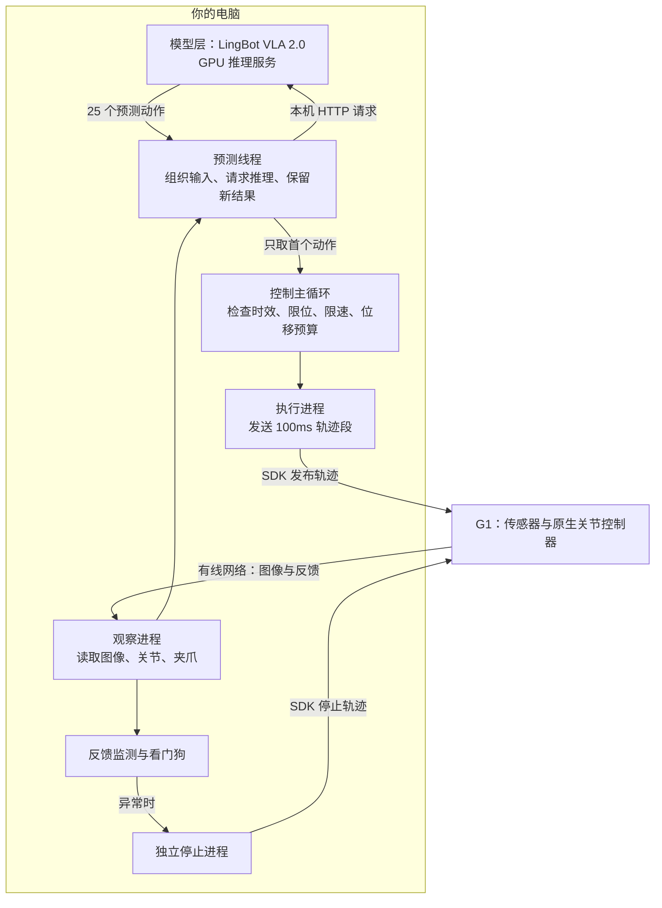

# 10_15 lingbot_vla_2_0｜G1 原始预训练权重抓牛奶验证 (2)

- 归档编号：`01a14380-0e4e-77a3-ab58-9fcd2d6d7c3e`
- 项目：VLA G1 项目
- 创建时间：2026-10-16T14:57:08.174000+08:00
- 更新时间：2026-10-16T15:45:27.425000+08:00
- 状态：活动
- 导出范围：用户可见消息与助手可见回复；不含隐藏推理和工具原始输出

## 1. 用户

<external_codex_apps_open_page>{"page_id":null}</external_codex_apps_open_page>

## 2. 用户

给我看下这个脚本为什么每次运行模型都需要进行模型预热，模型能否有一个常驻的服务直接可供调用，这样就不需要每次都重新预热浪费时间

## 3. 助手（进展）

我先检查脚本里模型容器的启动、预热和退出逻辑，看看怎样保留常驻服务，让后续验证直接复用已加载的模型。

## 4. 助手（进展）

可以。原因已经确认：测试脚本每次都新建容器，并在退出时执行 `docker stop`，所以模型权重和 GPU 工作区无法保留。

我会改成独立的常驻服务：首次启动时加载并预热，后续测试检查服务状态后直接复用；另提供停止命令来释放显存。每次真机测试的传感器预检和运动限制仍会执行。

## 5. 用户

先给我评估，不要行动

## 6. 助手

好的，**先只评估。目前只读取了脚本，没有修改文件或启动服务。**

## 评估结论

**可以改成常驻服务，而且适合现在反复验证的需求。** 现有 HTTP 推理服务本身已经支持持续接收请求，主要需要调整启动脚本的生命周期。

### 为什么现在每次都要等

当前脚本每次都会：

1. 创建新模型容器。
2. 加载权重，最近日志约 **30～40 秒**。
3. 首次 GPU 推理预热，约 **2 秒**。
4. 测试结束后停止容器，释放模型和 GPU 工作区。

所以主要等待时间来自**反复加载模型**，不只是预热。[当前脚本](</home/lsy03/文档/ChatGPT/VLA G1 项目/lingbot_pretrain_g1/run_motion.sh>)

## 建议方案

| 项目 | 常驻后的行为 |
|---|---|
| 首次使用 | 启动服务、加载模型、预热一次 |
| 后续测试 | 检查模型身份和就绪状态，直接复用 |
| 测试结束 | 关闭本轮机器人 SDK，模型继续驻留 |
| 需要显存时 | 单独停止模型服务 |
| 电脑或服务重启后 | 重新加载、预热一次 |

预计每次后续测试可以省掉约 **30～40 秒的加载和首次预热等待**。机器人连接、时钟检查、传感器预检和只读预览仍需要时间。

## 改造时需要处理的关键点

- **显存检查**：18000MiB 空闲要求应只用于首次加载；复用服务时，模型已经占着显存，不能再次按这个条件拦截。
- **就绪判断**：区分“模型已加载”和“预热已完成”，不能只看端口是否打开。
- **会话隔离**：状态查询使用 `/health`。当前 `/reset` 会使旧会话失效，需要避免与正在执行的测试冲突。
- **服务身份**：确认连接的是原始 LingBot 权重及对应配置，防止误用其他模型服务。

**建议采用常驻模型、按次建立机器人控制会话的方式。** 验收可以先用连续两轮只读预览完成：容器和模型进程保持相同，第二轮不重新加载、不重复预热，两轮均正常通过。

## 7. 用户

是否能给我详细讲讲，现在采用的模型运行和机器人控制的双层控制方案的架构是如何的？实现流程上是如何进行的？每个环节的控制频率分别是多少？ 仔细教一下我好吧

## 8. 助手（进展）

我会结合当前代码和昨天通过的 5 秒真机日志来讲，重点区分“模型多久算一次”“指令多久发一次”和“机器人底层如何执行”，把设定频率与实测频率分别说明。

## 9. 用户

<external_codex_apps_open_page>{"page_id":null}</external_codex_apps_open_page>

## 10. 用户

SDK stop: backend_ready (2.15s)
SDK stop: metadata_feedback_read (2.15s)
G1 SDK [stop] 初始化完成（2.2 秒）。
正在等待三客户端初始化后的连续新鲜反馈；此阶段没有运动。
正在等待更新的相机画面：当前最旧 214.1 ms，需为推理预留 450 ms。尚未发送动作。
READY EXECUTE | 原始权重 | 左臂 | 5秒 | 速度≤0.05rad/s | 起点偏移≤5° | 夹爪保持
每次仅执行新预测的首个100ms动作段；两次预测之间保持，不重复旧预测。
5秒运动验证：0.0/5.0秒，已接受1次新预测。
5秒运动验证：0.5/5.0秒，已接受2次新预测。
正在等待更新的相机画面：当前最旧 216.4 ms，需为推理预留 450 ms。本次预测尚未执行。
5秒运动验证：1.0/5.0秒，已接受3次新预测。
正在等待更新的相机画面：当前最旧 208.1 ms，需为推理预留 450 ms。本次预测尚未执行。
5秒运动验证：1.5/5.0秒，已接受4次新预测。
正在等待更新的相机画面：当前最旧 214.9 ms，需为推理预留 450 ms。本次预测尚未执行。
正在等待更新的相机画面：当前最旧 210.4 ms，需为推理预留 450 ms。本次预测尚未执行。
5秒运动验证：2.0/5.0秒，已接受6次新预测。
正在等待更新的相机画面：当前最旧 210.3 ms，需为推理预留 450 ms。本次预测尚未执行。
5秒运动验证：2.5/5.0秒，已接受7次新预测。
5秒运动验证：3.0/5.0秒，已接受8次新预测。
正在等待更新的相机画面：当前最旧 207.2 ms，需为推理预留 450 ms。本次预测尚未执行。
5秒运动验证：3.5/5.0秒，已接受9次新预测。
正在等待更新的相机画面：当前最旧 216.1 ms，需为推理预留 450 ms。本次预测尚未执行。
本轮已停止：RuntimeError: continuous feedback protection: ValueError: Measured joint speed exceeds configured cap
正在等待连续反馈确认停稳，请稍候。
停稳反馈已确认。
正在等待：G1 SDK [stop] 清理与退出。
G1 SDK [stop] 清理与退出完成（0.9 秒）。
正在等待：G1 SDK [observe] 清理与退出。
G1 SDK [observe] 清理与退出完成（0.9 秒）。
{
  "control_completed": false,
  "control_elapsed_s": 3.7121096920000127,
  "accepted_predictions": 10,
  "late_predictions_discarded": 0,
  "planner_joined": true,
  "error": "RuntimeError: continuous feedback protection: ValueError: Measured joint speed exceeds configured cap",
  "mode": "pretrained-motion-execute",
  "passed": false,
  "execute_requested": true,
  "g1_task_weights": false,
  "seconds": 5.0,
  "max_speed_rad_s": 0.05,
  "max_origin_displacement_deg": 5.0,
  "acknowledged_commands": 10,
  "gripper_command_attempts": 0,
  "stop_acknowledged": true,
  "stationary_verified": true,
  "motion_observed": true,
  "max_measured_displacement_deg": [
    2.7768031617849287,
    0.46139976900187135,
    2.888000349020029,
    0.45460373077770866,
    1.082099613129127,
    0.004100247936123279,
    0.7209998914284235
  ],
  "final_gripper_change_mm": 0.0,
  "cleanup_confirmed": 2,
  "cleanup_unconfirmed": 0,
  "scope": "5s control window with fresh first-action predictions and 100ms segments; holds between predictions. Does not certify visible motion duration, collision avoidance or milk grasp."
}
本轮报告：/workspace/lerobot_runs/model_20261016_153453_150850/pretrained_motion_report.json
Pretrained 5s motion report: /home/lsy03/文档/ChatGPT/VLA G1 项目/lerobot_runs/model_20261016_153453_150850/pretrained_motion_report.json
lsy03@lsy03-System-Product-Name:~$


最好是分析我这个最新的脚本，如何

## 11. 助手（进展）

这次在约 3.71 秒触发了“实测关节速度超限”保护，随后停止并确认停稳。我会以这次最新日志为例，检查触发前后的指令与反馈，并据此讲清当前架构、执行流程和各环节频率。

## 12. 助手（进展）

本轮日志显示，新动作大约每 398ms 下发一次，也就是约 2.5 次/秒；每条指令只覆盖 100ms，所以中间会保持位置。超速保护实际检查的是实测速度是否超过 `0.05 × 1.2 = 0.06 rad/s`。当前错误日志没有保存触发瞬间的关节编号和速度，我正在核对能否从其他日志补出。

## 13. 助手

可以，就用你这次 **15:34:53 的最新运行记录**来讲。它把模型预测、动作执行、反馈监测和保护停止这几部分都体现出来了。

先说这次的结果：**机器人确实运动了，但约 3.71 秒时触发实测速度保护，提前结束；停止请求和停稳确认都成功了。** 最大采样关节偏移约 **2.89°**，夹爪没有运动。这轮没有完成原定的 5 秒验收。[本轮报告](<../../assets/80c1b9f005a6a9e0--pretrained_motion_report.json>)

下面这些分析来自当前代码和这轮日志，本次没有修改控制程序。

你可以先记住三个职责：

> **模型提出下一步目标；PC 控制程序检查、限制并下发目标；G1 自己的控制器负责让关节跟踪轨迹。**

我们说的“双层”，主要指前面的**模型层**和**机器人控制层**。机器人控制层内部，又包含 PC 上的控制程序和 G1 上的原生控制器。



**模型服务和 SDK 控制程序都运行在你的电脑上。** 模型请求走本机 `127.0.0.1:8092`；机器人通信走电脑的有线网卡，到 G1 的 `192.168.1.88`。

另外，你这轮日志已经明确记录了常驻服务信息：

```text
resident_protocol: lingbot-pretrain-resident/1
model_load_count: 1
warmup_count: 1
warmed: true
```

因此，**这轮实际使用的是已经加载、预热好的常驻模型**。当前文件里也已有常驻模式的 [run_robot.sh](</home/lsy03/文档/ChatGPT/VLA G1 项目/lingbot_pretrain_g1/run_robot.sh>)。旧的 `run_motion.sh` 仍保留临时容器方式，理解架构时需要区分这两个入口。

先沿着一次动作，把整个流程走一遍。

1. **开始一轮机器人会话**

   控制程序先核对机器人 URDF、测量 PC 与 G1 的时钟偏差，然后初始化 SDK。

   真机执行时有三个独立 SDK 进程：

   | 进程 | 职责 |
   |---|---|
   | `observe` | 读取图像、关节位置、速度和夹爪状态 |
   | `execute` | 发布左臂轨迹 |
   | `stop` | 接收停止请求并调用机器人停止接口 |

   将停止进程独立出来，是为了让停止请求能够绕过正在等待的观察或执行调用。你看到的三段 SDK 初始化日志，就是这三个客户端分别建立连接。

   常驻模型可以省掉重复加载和预热，但每轮机器人会话仍会重新核对实时反馈。

2. **取得适合推理的观测**

   当前模型输入包括：

   - 头部左相机 RGB；
   - 左腕相机 RGB；
   - 右前环视相机 RGB；
   - 左臂七个关节角度；
   - 左夹爪开度；
   - 任务文字：“把桌上的牛奶瓶放进蓝色料箱”。

   当前配置没有把深度和腕部力传感器作为模型输入。

   读取图像时，程序会检查图像有多旧。当前给推理预留 **450ms**，而最终图像年龄上限是 **600ms**，所以开始推理前希望最旧图像满足：

   ```text
   图像当前年龄 ≤ 600 − 450 = 150ms
   ```

   因此你看到：

   ```text
   当前最旧 214.1ms，需为推理预留 450ms
   ```

   表示这张图如果再经过一次推理，预计会太旧，程序正在等待下一张。**这条等待提示本身不是故障。**

   本轮真正用于下发动作的图像，最大年龄约 **538ms**，通过了 600ms 检查。

3. **模型计算一组动作**

   预测线程将观测通过本机 HTTP 发送给模型服务。服务内部使用一个长期存在的推理线程，顺序处理请求。

   适配后的输出可以理解为一个 **25 × 8** 的数组：

   ```text
   第 1 行：七个关节目标 + 一个夹爪目标
   第 2 行：七个关节目标 + 一个夹爪目标
   ...
   第25行：七个关节目标 + 一个夹爪目标
   ```

   经过模型适配与反归一化后，控制程序拿到的是**关节绝对角度，单位 rad，以及夹爪绝对开度，单位 m**。

   **当前验证只使用第 1 行。** 后面 24 行没有下发，也没有根据它们构造持续轨迹。`25` 是输出序列长度，不能解释成 25Hz。[首动作提取代码](</home/lsy03/文档/ChatGPT/VLA G1 项目/g1_policy_control/client.py:66>)

   由于本轮只允许手臂运动，模型算出的夹爪目标也不会执行。

4. **把模型目标变成允许发送的小步动作**

   模型目标进入控制层后，会先检查：

   - 预测是否过期；
   - 原始目标是否超出关节范围；
   - 目标距离当前姿态是否过大；
   - 实测位置、速度是否正常；
   - 本轮相对起点的位移是否超过 5°。

   然后再限制本次轨迹段的位移。

   例如，假设某关节当前为 `1.000 rad`，模型希望到 `1.020 rad`。当前速度上限为 `0.05 rad/s`，一段轨迹长 `0.1s`，那么单段按速度允许的最大变化为：

   ```text
   0.05 rad/s × 0.1s = 0.005 rad ≈ 0.286°
   ```

   起步时还受指令速度变化限制：

   ```text
   0.3 rad/s² × 0.1s = 0.03 rad/s
   0.03 rad/s × 0.1s = 0.003 rad ≈ 0.172°
   ```

   所以忽略采样间的小变化，第一段可能只下发到 `1.003 rad`，后续单段最多推进约 `0.005 rad`。

   这解释了为什么模型可能提出较远目标，机器人实际只走小步。[动作过滤代码](</home/lsy03/文档/ChatGPT/VLA G1 项目/g1_policy_control/safety.py:75>)

5. **G1 执行这段轨迹**

   执行进程会再次读取反馈、检查动作，然后构造两个轨迹点：

   ```text
   t = 0ms：当前关节位置
   t = 100ms：受限后的目标位置
   ```

   SDK 消息指定位置目标和线性插值，再交给 G1 当前的 `left_arm_pvt_ctrl` 控制器处理。[轨迹构造代码](</home/lsy03/文档/ChatGPT/VLA G1 项目/teleoperation/arm7_follow_collision.py:240>)

   **100ms 是这条轨迹段覆盖的时间。相邻两条新指令的间隔，本轮约为 398ms。**

   因此当前执行节奏大致是：

   ```text
   0.00s：发送第1段 → 约100ms轨迹 → 保持
   0.39s：发送第2段 → 约100ms轨迹 → 保持
   0.78s：发送第3段 → 约100ms轨迹 → 保持
   ...
   ```

   G1 在保持期间仍由自己的底层控制器维持位置。PC 此时继续计算下一次预测、读取反馈和检查异常。

   这也说明：当前“5秒运动验证”指 **5秒控制窗口**，里面包含短轨迹段和等待间隔。它还没有形成整段连续、平滑的模型轨迹。

你问的各环节频率，可以按下面这张表理解。表中的“约”很重要：Python、Linux 调度和 SDK 调用都会带来额外耗时，不能当成硬实时保证。

| 环节 | 当前设置或本轮实测 | 具体含义 |
|---|---|---|
| 头部 RGB 接收 | SDK 统计约 **15Hz** | 每秒收到约15张图 |
| 左腕 RGB 接收 | SDK 统计约 **15Hz** | 每秒收到约15张图 |
| 右前环视 RGB 接收 | SDK 统计约 **10Hz** | 每秒收到约10张图 |
| 等待新鲜图像 | 每次等待 **10ms** 后重试 | 不会让相机变成100Hz |
| 模型一次预测 | 中位约 **383ms** | 包含服务端预处理、模型计算和后处理 |
| 新动作下发 | 平均间隔 **398ms，约2.5Hz** | 本轮共下发10条 |
| 控制主循环 | 每轮等待 **10ms** | 约100Hz检查新结果和退出条件；不代表100Hz发动作 |
| 关节反馈监测 | 每轮等待 **20ms** | 背景轮询约50Hz量级，另加 SDK 调用耗时 |
| 看门狗检查 | 每轮等待 **10ms** | 约100Hz检查超时与反馈年龄 |
| 停稳确认 | 每轮间隔 **50ms** | 约20Hz取样，要求连续三次合格 |
| 终端进度输出 | 每 **0.5s** | 约2Hz显示进度 |
| G1 内部伺服控制 | **当前资料未确认准确频率** | 不能从上述 Python 周期推导出来 |

相机数据来自 SDK 本轮接收统计；模型和指令间隔来自实际事件时间戳。**SDK 接收频率、PC 读取频率、G1 内部电机控制频率，分别对应不同环节。**

还有一个容易误解的数字：反馈线程虽然约每20ms读取一次，但程序限制了日志写入频率，所以这轮保存的 `continuous_feedback` 平均约 **61ms一条**。日志约16Hz，并不表示后台只检查了16次/秒。

接下来用这轮超速事件，说明为什么反馈监测要独立运行。

模型一次预测要约380～400ms。如果反馈检查也排在模型计算之后，那么这段时间就无法及时判断机器人状态。现在的反馈线程在模型等待期间继续工作，看门狗也继续检查。

当前主要的时间限制分别是：

| 限制 | 检查对象 |
|---|---|
| **600ms 图像年龄** | 图像从源时间戳到使用时，是否已经太旧 |
| **500ms 预测年龄** | 从本次取观测开始到使用预测，是否超时 |
| **300ms 反馈年龄** | 关节、夹爪反馈是否仍然新鲜 |
| **600ms 新指令看门狗** | 是否太久没有成功更新指令 |
| **5秒总预算** | 本轮是否已经到达时间上限 |

它们同时存在，各管一件事。本轮最终触发的是**速度保护**；已接受动作的图像和预测都没有因为过期而被拒收。

具体到速度保护，配置中的 `0.05 rad/s` 是**指令段速度上限**。实测速度检查留了1.2倍阈值：

```text
实测速度保护阈值 = 0.05 × 1.2
                  = 0.06 rad/s
                  ≈ 3.44°/秒
```

本轮触发错误，说明某次 SDK 反馈中，至少一个左臂关节的速度绝对值超过了这个阈值。[实测速度检查](</home/lsy03/文档/ChatGPT/VLA G1 项目/g1_policy_control/safety.py:62>)

我把最后一条指令附近的事件排了一下：

| 相对本轮开始的时间 | 事件 |
|---|---|
| **3.581s** | 下发第10条指令 |
| **3.600s** | 保存的反馈速度还是零 |
| **3.661s** | 保存的反馈中，J1约−0.0398rad/s，J3约+0.0377rad/s |
| **3.702s** | 某次反馈触发实测速度超限 |
| **3.713s** | 停止请求获得确认 |
| **3.968s** | 开始停稳取样，该条反馈速度为零 |
| **4.069s** | 连续三次合格反馈，确认停稳 |

从检测到超限到停止请求获确认，约 **11ms**。这是软件停止链路的耗时，**物理停稳另由后面的连续反馈确认**。

停止时的实现顺序是：取消后续预测使用、关闭执行权限、终止执行进程以阻断迟到发布，再通过独立 `stop` 进程请求停止轨迹。然后等待预测线程退出、检查停稳并清理 SDK。

这轮也暴露了一个明确的诊断缺口：**超限样本在底层检查时就抛出了异常，错误只写了“速度超限”，没有保存具体关节编号和速度值。** 因此，现有日志不能确定是哪一轴触发，也不能告诉我们峰值到底是 `0.061` 还是更高。前面保存的正常样本不能替代被拒绝的那一条。

我另外核算了10条已发送轨迹的“位移÷100ms”，都没有超过 `0.05 rad/s`。第10条中，J1与J3分别为 `−0.05` 和 `+0.05 rad/s`。这说明**发送的线性轨迹斜率符合设置，但实际跟踪过程中出现了超过保护阈值的速度反馈**。

目前值得继续核查的是轨迹段起停时的实际跟踪、速度估计，以及短段之间的衔接。当前使用线性位置段，段与段之间还有保持间隔；代码里的 `0.3 rad/s²` 是生成指令时的速度变化约束，尚不能据此认定真实关节加速度始终受同样的上限约束。是否由这种衔接造成瞬态超速，还需要触发样本来证实。

我建议下一步先补齐**超限关节、实测速度、源时间戳、最近轨迹目标和起止时间**的记录，再据此决定是否调整轨迹生成方式。在取得这些数据之前，保留当前速度保护阈值更有利于定位问题。

[附件：80c1b9f005a6a9e0--pretrained_motion_report.json](../../assets/80c1b9f005a6a9e0--pretrained_motion_report.json)
