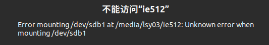

# 查明问题原因

- 归档编号：`01a0e5fb-6408-7993-951d-92d6a6b829dd`
- 项目：无项目对话
- 创建时间：2026-09-28T11:07:32.744000+08:00
- 更新时间：2026-09-28T11:08:13.733000+08:00
- 状态：活动
- 导出范围：用户可见消息与助手可见回复；不含隐藏推理和工具原始输出

## 1. 用户

给我查一下这是什么问题，不要乱动



## 2. 助手（进展）

我先只读检查这个分区、挂载状态和系统报错，不会修改磁盘、修复文件系统或重新挂载。

## 3. 助手

查到了：**这个盘的 NTFS 文件系统被标记为“脏状态（dirty）”，Linux 因此拒绝挂载。**

系统日志明确报错：
```text
ntfs3: sdb1: volume is dirty and "force" flag is not set!
ntfs3: sdb1: It is recommened to use chkdsk.
```

对应的是 SanDisk USB 盘，分区 `/dev/sdb1`，卷名 `ie512`，容量约 460 GiB。

这说明文件系统没有处于正常、干净的状态，通常与未安全弹出、写入中断或文件系统错误有关。**目前不能据此认定硬盘坏了或文件丢了**，也无法仅凭日志确定最初原因。

后续处理方向是先保护重要数据，再检查文件系统；日志建议使用 Windows 的 `chkdsk`。

我只读取了设备信息和日志，**没有挂载、修复、格式化或修改盘内数据**。
