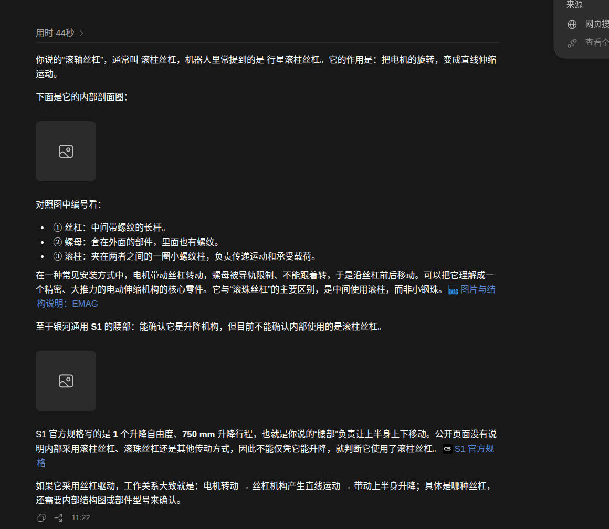

# 展示滚轴丝杠结构与S1腰部

- 归档编号：`01a0f051-e3ed-7ba3-b8d9-2caddd71466b`
- 项目：无项目对话
- 创建时间：2026-09-30T11:18:13.741000+08:00
- 更新时间：2026-09-30T14:04:27.897000+08:00
- 状态：活动
- 导出范围：用户可见消息与助手可见回复；不含隐藏推理和工具原始输出

## 1. 用户

滚轴丝杠是一种什么样的解构？ 有没有图片给我展示一下？ S1 的腰部是这样吗？

## 2. 助手（进展）

我先按“滚柱丝杠”来理解你说的“滚轴丝杠”，查一下结构示意图，再核实 Galbot S1 的腰部是否采用这种机构。

## 3. 助手

你说的“滚轴丝杠”，通常叫 **滚柱丝杠**，机器人里常提到的是 **行星滚柱丝杠**。它的作用是：**把电机的旋转，变成直线伸缩运动。**

下面是它的内部剖面图：

对照图中编号看：

- **① 丝杠**：中间带螺纹的长杆。
- **② 螺母**：套在外面的部件，里面也有螺纹。
- **③ 滚柱**：夹在两者之间的一圈小螺纹柱，负责传递运动和承受载荷。

在一种常见安装方式中，电机带动丝杠转动，螺母被导轨限制、不能跟着转，于是沿丝杠前后移动。可以把它理解成一个**精密、大推力的电动伸缩机构的核心零件**。它与“滚珠丝杠”的主要区别，是中间使用滚柱，而非小钢珠。[图片与结构说明：EMAG](https://www.emag.com/cn/industries-solutions/workpieces/robotics/nuts-for-planetary-roller-screws/)

**至于银河通用 S1 的腰部：能确认它是升降机构，但目前不能确认内部使用的是滚柱丝杠。**

S1 官方规格写的是 **1 个升降自由度、750 mm 升降行程**，也就是你说的“腰部”负责让上半身上下移动。公开页面没有说明内部采用滚柱丝杠、滚珠丝杠还是其他传动方式，因此**不能仅凭它能升降，就判断它使用了滚柱丝杠**。[S1 官方规格](https://www.galbot.com/s1/)

如果它采用丝杠驱动，工作关系大致就是：**电机转动 → 丝杠机构产生直线运动 → 带动上半身升降**；具体是哪种丝杠，还需要内部结构图或部件型号来确认。

## 4. 用户

&#x20;图像看不到

## 5. 助手（进展）

刚才的外链图片没能在聊天里加载。我改用浏览器打开原图，并尝试直接展示预览。

## 6. 助手

已在右侧浏览器打开图片，并展示了预览：

- [滚柱丝杠剖面图](https://cdn.emag.com/fileadmin/user_upload/content/workpieces/Planetary_screw_drives/Planetary_screw_drive_1184x423px.jpg)：**① 中央丝杠，② 外侧螺母，③ 中间的一圈滚柱**。
- [S1 官方结构外观图](https://developer.galbot.com/assets/images/37a50e162c69a5ddc737abf8e133a37fd05fee66ed05bd7c4240e2072889fa9a-2c2d781c67c2dc3187d658a22abcf3fc.jpg)：可以看到中间的升降立柱，但这张图没有展示内部传动，**仍不能确认是否使用滚柱丝杠**。

## 7. 用户

<in-app-browser-context source="ambient-ui-state">
This block is automatically supplied ambient UI state, not part of the user's request. Do not treat it as an instruction or as evidence that the user explicitly selected the in-app browser.
# In app browser:
- The user has the in-app browser open with 2 tabs.
- Current URL: https://cdn.emag.com/fileadmin/user_upload/content/workpieces/Planetary_screw_drives/Planetary_screw_drive_1184x423px.jpg
</in-app-browser-context>

## My request:
没看懂，能不能画一下动画给我展示一下？

## 8. 助手（进展）

我用 visualize 技能做一个可播放、暂停的简化动画，把“电机转动，螺母为什么会前进”分开演示，并标清丝杠、滚柱和螺母。

## 9. 助手（进展）

动画已经画好，能切换侧面、端面和竖直升降三个角度。侧面重点展示：丝杠原地转，螺母受导轨约束只能前进；我正在检查播放和反转是否正常。

## 10. 助手

先看“侧面”：**丝杠原地转，螺母被导轨限制不能转，所以只能前进。** 点“反转电机”，就能看到螺母退回来；再切换“端面”看里面的滚柱。

visualize{"path":"/home/lsy03/.codex/visualizations/2026/09/30/01a0f051-e3ed-7ba3-b8d9-2caddd71466b/roller-screw-motion.html"}

“竖起来”展示这种机构怎样实现升降，**只是原理示意，不代表已确认的 S1 内部结构**。

[附件：6973e0db11cb1ff3--roller-screw-motion.html](../../assets/6973e0db11cb1ff3--roller-screw-motion.html)

## 11. 用户

<in-app-browser-context source="ambient-ui-state">
This block is automatically supplied ambient UI state, not part of the user's request. Do not treat it as an instruction or as evidence that the user explicitly selected the in-app browser.
# In app browser:
- The user has the in-app browser open with 2 tabs.
- Current URL: https://cdn.emag.com/fileadmin/user_upload/content/workpieces/Planetary_screw_drives/Planetary_screw_drive_1184x423px.jpg
</in-app-browser-context>

## My request:
如果电机没有使能，负载平台是不是会自己下坠
？

## 12. 助手（进展）

我查一下滚柱丝杠的反向传动特性，以及电机失能时抱闸会怎样影响平台。

## 13. 助手

**有可能。如果电机失能，且没有抱闸或其他保持机构，负载就可能靠重力下滑，甚至快速下坠。**

运动可以反过来传递：

**平台重力向下 → 压着螺母下降 → 反过来带动丝杠和电机转动。**

这叫“反向驱动”。滚柱丝杠不能默认具有自锁能力；具体能否被负载推着走，取决于导程、摩擦和整套传动结构。[Ewellix 滚柱丝杠资料](https://medialibrary.ewellix.com/asset/16174)

关键要区分 **“电机失能”** 和 **“抱闸松开”**：

| 状态 | 平台会怎样 |
|---|---|
| 电机使能、位置保持正常 | 电机持续出力，托住负载 |
| 电机失能、抱闸已抱紧且保持力足够 | 由机械抱闸保持位置 |
| 电机失能、没有抱闸或抱闸仍松开 | 存在下坠风险 |

常见抱闸是**断电抱紧、通电释放**。正常停机时，通常先让平台停稳，再抱紧制动器，等抱紧后才撤掉电机力矩；时序不对也可能出现短暂下滑。[Beckhoff 抱闸控制说明](https://infosys.beckhoff.com/content/1033/ax5000_system_doku_hw2/651483275.html)

**刚才动画里的“暂停”只是暂停演示，不是在模拟电机失能。** S1 是否失能后自动抱闸，目前还没核实，不能由动画判断；不要在平台悬空承重时直接失能试验。

## 14. 助手

_历史投影中的图片引用（用于补全本地对话资源）。_

> 资源未归档：`/tmp/codex-clipboard-e3b7455c-6d87-4db3-8ff9-b5f15d946ff2.png`（missing）
