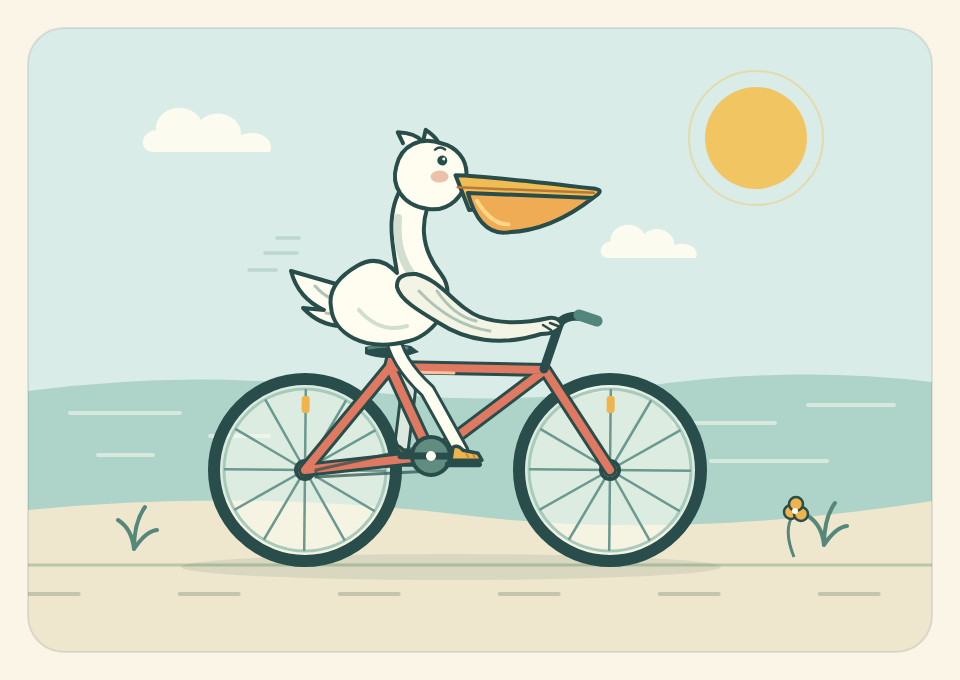

# 生成骑车鹈鹕SVG动画

- 归档编号：`01a11fdb-000d-7911-9ff6-2d7d2da642c6`
- 项目：无项目对话
- 创建时间：2026-10-09T16:50:08.527000+08:00
- 更新时间：2026-10-09T16:56:02.398000+08:00
- 状态：活动
- 导出范围：用户可见消息与助手可见回复；不含隐藏推理和工具原始输出

## 1. 用户

<external_codex_apps_open_page>{"page_id":null}</external_codex_apps_open_page>

## 2. 用户

生成一个骑自行车的鹈鹕的SVG动画

## 3. 助手（进展）

我会做成可直接打开的 SVG 循环动画，让鹈鹕踩着踏板、车轮转动，并配上轻微起伏的骑行动作。

## 4. 助手（进展）

主体和动画已经完成：海边配色、长喙鹈鹕、珊瑚红自行车，双脚与曲柄同步踩踏。我正在检查实际显示效果，确认画面和循环动作正常。

## 5. 助手

_工具输出图片（原始工具文本未纳入归档）。_

## 6. 助手（进展）

画面已检查，鹈鹕和自行车的比例、配色都正常。文件是独立 SVG，无需外部图片或脚本；我会同时提供浏览器预览页，方便查看动画。

## 7. 助手

已生成，包含车轮旋转、双脚交替踩踏和身体轻微起伏。

[下载 SVG 动画](/home/lsy03/Documents/Codex/2026-10-09/svg/outputs/pelican-cycling.svg) · [打开预览页](/home/lsy03/Documents/Codex/2026-10-09/svg/outputs/preview.html)

