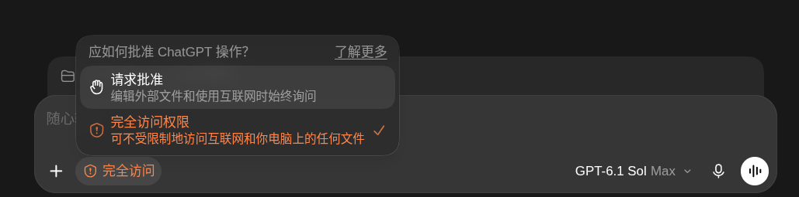

# 查找消失的帮我批准

- 归档编号：`01a14334-cf3e-7891-9eb7-6e4a1633bd10`
- 项目：无项目对话
- 创建时间：2026-10-16T13:34:56.831000+08:00
- 更新时间：2026-10-16T13:45:59.423000+08:00
- 状态：活动
- 导出范围：用户可见消息与助手可见回复；不含隐藏推理和工具原始输出

## 1. 用户

<external_codex_apps_open_page>{"page_id":null}</external_codex_apps_open_page>

## 2. 用户

给我查一下，这个帮我批准怎么没了？

## 3. 助手（进展）

我先查一下当前 Codex 的审批选项和近期改动，确认你说的“帮我批准”为什么不见了。

## 4. 助手（进展）

我会用 OpenAI Docs 核对官方说明，再检查本机客户端里这个选项的显示条件。

## 5. 助手（进展）

官方文档里“帮我批准”仍然存在，本机也留有之前使用自动审批的记录。我继续检查菜单的显示条件，定位这次为什么被隐藏。

## 6. 助手（进展）

本机的自动审批引擎仍然开启，配置文件也没有禁用它。客户端代码还保留着这个菜单项，但显示它需要额外的功能开关；我再核对日志，看能否确认是开关变化还是加载异常。

## 7. 助手（进展）

找到一条相关异常：今天 12:17，客户端记录了功能配置服务 Statsig 的加载超时。结合菜单的显示逻辑，这更像是功能开关没有正常加载；目前还不能把它确定为唯一原因。

## 8. 助手

查过了，**“帮我批准”功能仍然存在，你这里更像是客户端加载功能开关异常，导致入口被隐藏。**[官方说明](https://learn.chatgpt.com/docs/permission-modes)

本机检查发现：

- 客户端仍包含这个菜单项，底层自动审批功能也处于开启状态。
- 今天 **12:17** 日志出现了 **Statsig 功能配置加载超时**；菜单是否显示“帮我批准”，正好依赖这套配置。

这支持“配置加载异常”的判断，但还不能完全排除账号功能开关变化。

建议先**彻底退出客户端后重新打开**，让它重试加载；若仍不显示，再检查应用更新。这也是[官方针对该选项缺失的排查方向](https://learn.chatgpt.com/docs/reference/troubleshooting#approve-for-me-is-missing-or-disabled)。
