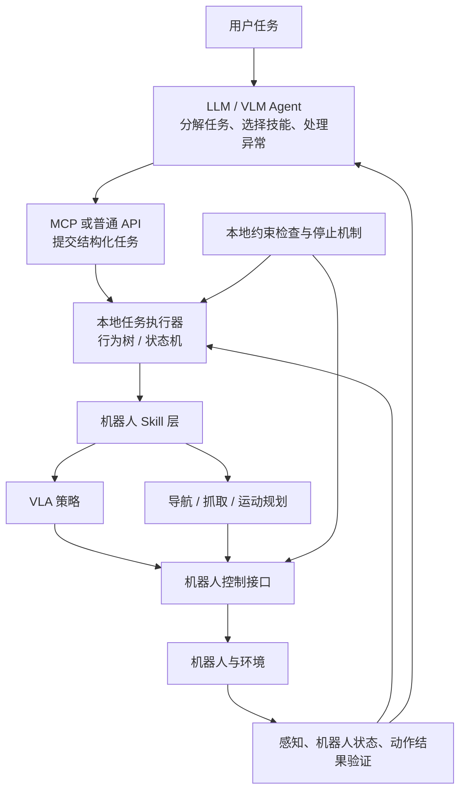

# 梳理机器人 Agent 与 LLM Harness

- 归档编号：`01a11f6b-8664-70a2-85d2-765dfdc8236f`
- 项目：机器人 Agent 架构整理
- 创建时间：2026-10-09T14:48:22.885000+08:00
- 更新时间：2026-10-09T14:56:48.327000+08:00
- 状态：活动
- 导出范围：用户可见消息与助手可见回复；不含隐藏推理和工具原始输出

## 1. 用户

<external_codex_apps_open_page>{"page_id":null}</external_codex_apps_open_page>

## 2. 用户

你先看一下这个

[附件：f312aa1db4974159--已粘贴的文本.txt](../../assets/f312aa1db4974159--%E5%B7%B2%E7%B2%98%E8%B4%B4%E7%9A%84%E6%96%87%E6%9C%AC.txt)

## 3. 助手（进展）

我先读一下你贴的内容，梳理它的核心观点和机器人 Agent 与语言模型 harness 的关系。

## 4. 助手

看完了。这份材料的主线是：**用“观察 → 决策 → 执行 → 反馈”的闭环，把语言模型 Agent 和机器人 Agent 放在同一个系统框架里理解。**

它主要区分了三个角色：

- **LLM/VLM**：理解任务、选择技能、决定是否重新规划。
- **Harness**：组织运行流程，管理上下文、状态、工具调用和失败处理。
- **技能与控制层**：由 Nav2、VLA、运动规划器和控制器完成实际动作。

其中最值得保留的观点是：**VLA 是一种动作策略，不能直接等同于完整的机器人 Agent；模型与运行框架也需要分开讨论。**

不过，文中“机器人只是把软件工具换成机器人技能”“区别仅仅是环境”说得过于简化。机器人还涉及持续变化的状态、异步执行、实时控制，以及多个层级同时运行的反馈闭环。安全也需要贯穿执行过程，不能只画成动作前的一次检查。

所以，这份内容适合作为概念入门；如果继续讨论实际架构，需要进一步明确：**谁保存任务状态、谁判断动作成功、谁触发重试、谁能中断动作，以及各层如何交换反馈。**

## 5. 用户

现阶段有没有什么推荐的机器人agent架构？ 我现在正在进行实验或者有没有什么推荐的实验，我现在有一些IT软件的同事可能有agent方面的支持。之后的我们看下是如何把 VLA或者一些规划控制做成skill 或者MCP来进行长程任务的处理，给我推荐一下如何？

## 6. 助手（进展）

我会先查一下现有机器人任务编排和 Agent 接口方案，再结合你要接入 VLA、规划控制和长程任务的目标，给你一个适合当前实验阶段的架构与实验路线。

## 7. 助手（进展）

目前查到的方案支持一个比较明确的选择：让语言模型负责任务分解，让本地执行器管理技能的运行、验证和恢复。MCP 可以连接 IT 同事的 Agent 与机器人能力；长程任务能否可靠完成，关键还在于动作后的状态验证，以及失败后如何继续。

## 8. 助手

有。**结合你现在做实验、又有 IT 同事支持的情况，我最推荐先搭一个“LLM/VLM 任务规划 + 本地行为树/状态机执行 + 统一机器人 Skill 接口”的分层系统。** VLA、传统规划和控制都可以接入同一套 Skill 接口，MCP 用来连接上层 Agent。

下面先按“已有机械臂操作能力，可能使用 ROS 2”的情况推荐；导航是否加入，取决于你现在导航的成熟度。这是我的工程建议，并不是某个公认唯一的标准架构。

**1. 架构上，先把“决定做什么”和“保证动作执行完”分开**



这里各层的职责要明确：

- **Agent**：理解目标、选择技能、提出步骤；收到失败信息后决定换目标、换技能或重新规划。
- **任务执行器**：跟踪当前步骤，管理运行、超时、取消和有限次重试；执行预先定义的恢复流程。
- **Skill**：完成一个有明确边界、能验证结果的子任务。
- **控制层**：持续运行机器人所需的控制闭环。
- **状态与验证层**：告诉系统实际发生了什么，判断子目标是否达成。

上层模型在步骤完成或出现重要异常时再参与决策；VLA 推理、轨迹执行和控制循环留在机器人侧运行。

BehaviorTree.CPP 的官方 ROS 2 集成文档就推荐集中式协调节点，并提供异步、可中断的 ROS Action 包装，适合承担本地执行器的角色。[BehaviorTree.CPP ROS 2 集成](https://behaviortree.dev/docs/ros2_integration/)

**2. 具体选型，我建议按这个优先级来**

| 部分 | 当前推荐 | 选择理由 |
|---|---|---|
| 上层 Agent | 优先复用 IT 同事已有框架 | 先验证机器人闭环，减少框架迁移工作 |
| 本地执行器 | ROS 2/C++ 团队选 BehaviorTree.CPP；Python 原型可选 py_trees；极简实验也可以先用状态机 | 管理执行状态、条件检查和恢复分支 |
| 技能后端 | ROS 2 Action，或机器人 SDK 的异步任务接口 | 长动作需要反馈、结果和取消机制 |
| Agent 接口 | MCP 或普通 API，包装相同的 Skill 后端 | 可以更换 Agent，同时复用机器人能力 |
| 任务状态 | 结构化状态表 + 执行日志 | 支持结果验证、故障定位和中断恢复 |

[py_trees_ros](https://py-trees-ros.readthedocs.io/en/release-2.1.x/features.html) 已提供 Action Client 与黑板状态组件。如果 IT 同事尚未选框架，可以考虑支持状态持久化的 [LangGraph](https://docs.langchain.com/oss/python/langgraph/persistence)，但机器人动作的执行状态仍应由本地执行器保存。

等任务中出现较多明确的前置条件、资源约束和步骤依赖，再考虑 **LLM 解释目标 + PDDL 规划 + 行为树执行**。例如 [PlanSys2](https://plansys2.github.io/design/index.html) 能把规划结果转换为行为树。第一阶段可以先用人工定义的任务模板，避免同时引入太多变量。

**3. “做成 Skill”和“做成 MCP”是不同层的工作**

这是你与 IT 同事最需要先统一的概念：

> **Skill 是机器人实际能完成的能力；MCP 是让 Agent 发现和调用这个能力的接口。**

例如：

```text
MCP 工具：pick_object(object_id="red_block")
                    ↓
机器人 Skill：检查条件 → 执行抓取 → 验证结果
                    ↓
后端实现：VLA 或感知 + 抓取规划 + 控制
```

如果同事说的 Agent skill 是说明文档、提示词或 `SKILL.md`，它可以教模型什么时候调用工具，但机器人侧仍需要可执行的 Skill 后端。

我建议第一批能力保持小而明确：

| 能力 | 作用 |
|---|---|
| `observe_scene()` | 获取物体、区域和可操作状态 |
| `pick_object(object_id)` | 抓取指定物体 |
| `place_object(target_region)` | 将手中物体放到指定区域 |
| `get_robot_state()` | 查询机械臂、夹爪、持物及运行状态 |
| `navigate_to(station_id)` | 导航已成熟时再加入 |

每个动作 Skill 都需要一个“契约”。以抓取为例：

```yaml
name: pick_object
inputs: [object_id]
preconditions: [目标状态足够新, 目标在可操作区域, 夹爪空闲]
resources: [arm, gripper]
backend: vla_pick 或 planned_grasp
success_condition: 目标已被持住
failure_codes: [OBJECT_NOT_FOUND, UNREACHABLE, GRASP_FAILED, TIMEOUT]
supports_cancel: true
```

**最关键的是成功条件：VLA 输出完一个动作 chunk、轨迹执行结束，都不能直接代表抓取成功。** 应结合夹爪状态、视觉、力反馈等可用证据判断；证据不足时返回“未知”，再观察。

这种“根据任务需要与当前可执行性共同选择技能”的思路，可以参考 [SayCan](https://say-can.github.io/)。初期用规则检查前置条件即可，后续有执行数据后，再研究学习型技能成功率预测。

**4. VLA 的包装重点，是补齐它外围的执行逻辑**

你可以把一个已训练好的抓取 VLA 包成 `pick_object()`，把放置 VLA 包成 `place_object()`。如果同一个模型支持两种操作，也可以共用模型，通过经过验证的子任务指令切换。

机器人侧的包装器需要负责：

- 对齐训练时的相机、机器人状态、动作表示和归一化方式。
- 持续提供新观测，执行动作 chunk。
- 检查结束条件、超时和异常。
- 响应取消，并确认机器人已进入约定的停止状态。
- 输出结构化结果和失败证据。

传统规划也使用同一个契约。这样，你就能在上层流程相同的情况下，对比 **VLA 抓取**与**规划抓取**。

同时需要修正前面材料的一点：VLA 的能力边界不能一概定义为短动作。例如 π₀.₅ 包含高层子任务预测与低层动作生成。你现在把 VLA 放到 Skill 后端，是为了便于实验、验证和替换。[π₀.₅ 原论文](https://www.physicalintelligence.company/download/pi05.pdf)

**5. MCP 接口要适合“动作需要时间”这件事**

建议先采用异步任务形式：

```text
start_skill(name, args, request_id) → execution_id
get_execution(execution_id)        → 状态、结果、失败原因
cancel_execution(execution_id)     → 请求取消
```

这里是你们设计的应用接口，不是 MCP 固定要求的工具名称。MCP 已有长任务机制，但客户端与服务端需要匹配能力和版本；你们可以先使用自己的任务 ID，再对接协议机制。[MCP Tasks 扩展](https://tasks.extensions.modelcontextprotocol.io/specification/2026-07-28/tasks)

有三件事必须由后端处理：

- **重复请求**：网络超时后再次提交同一个 `request_id`，应查询已有执行，避免重复抓取或放置。
- **资源占用**：机械臂、夹爪等资源由本地执行器协调。
- **取消确认**：收到取消请求与机器人实际停止，要分别记录。

可以参考现成的 [ROS-MCP Server](https://github.com/robotmcp/ros-mcp-server) 学习 ROS 与 MCP 的连接方式。对于你的实验任务，我建议主要暴露上述语义 Skill，让模型使用受控的动作接口。

**6. 实验上，先做一个固定桌面的闭环任务**

我的首选任务是：

> “把红块放入左侧盒子，再把蓝块放入右侧盒子。”

它包含观察、抓取、验证、放置和再次验证，可以逐渐增加物体、区域与顺序要求。如果导航已经稳定，再扩展为“到取料工位 → 取物 → 到交付工位 → 放物”。

建议分三阶段：

| 阶段 | 实验内容 | 要回答的问题 |
|---|---|---|
| 单技能 | 随机改变物体位置，重复测试抓取与放置 | Skill 本身成功率怎样？能否准确判断失败？ |
| 多步任务 | 用相同 Skill 完成多个物体的任务 | 状态是否正确传递？执行器是否可靠？ |
| 扰动与恢复 | 加入未抓住、目标缺失、通信中断等情况 | 是否能发现问题、恢复或合理终止？ |

通信中断、重复提交和取消等接口故障，可以先在 mock 后端验证。IT 同事因此可以在真机技能尚未完成时就开始开发。

对比实验建议至少保留三组：

| 组别 | 方法 |
|---|---|
| A | 人工定义的行为树/状态机 + 相同 Skill |
| B | LLM 生成步骤，按顺序执行 |
| C | LLM + 状态反馈 + 结果验证 + 失败重规划 |

**A 组也应该保留正常的条件检查和恢复能力。** 固定任务中行为树表现更好很正常；Agent 的价值应重点测在新指令、新技能组合和需要改变计划的场景中。

每个条件先做约 20–30 次试运行，使用相同初始配置比较，记录：

- 完整任务成功率、子任务成功率。
- **误报成功率**：实际没完成，却宣称完成。
- 扰动后的恢复成功率、人工干预次数。
- 完成时间、重试次数、模型调用次数。
- 失败发生在感知、规划、技能执行还是验证环节。

长程任务会放大单步的不稳定性：假设每步独立且成功率为 90%，十步全部成功只有约 35%。这只是示意计算，但说明技能可靠性、验证和恢复应该优先做。

如果之后需要公开仿真任务作补充，可以参考 [RoboCasa 的组合任务](https://robocasa.ai/docs/build/html/tasks/composite_tasks.html)；它与真机实验应分别报告。

**你和 IT 同事的第一个共同交付物，我建议定为：一套 Skill 契约、一个可模拟失败的后端、一个桌面多步任务，以及 A/B/C 三组的执行日志。** 你负责机器人能力和成功判据，同事负责 Agent、MCP、任务状态与日志。先把这个闭环跑通，再接导航、更多 VLA 和更复杂的规划，实验结果会更容易解释。
