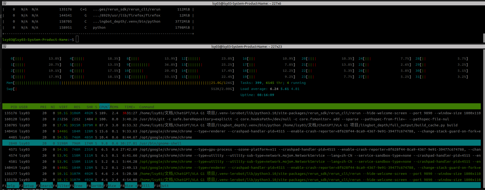
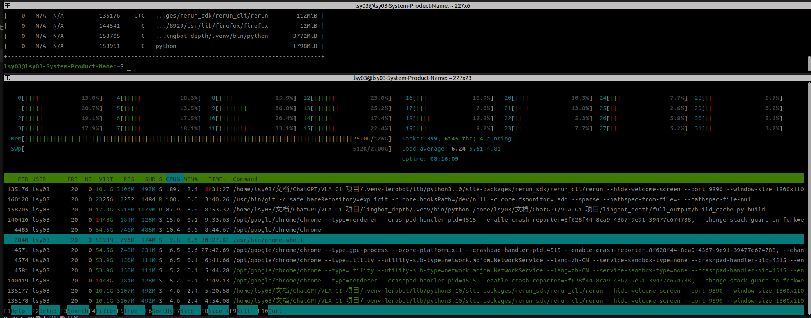

# 检查内存是否占满

- 归档编号：`01a11ac3-1918-7923-a31e-cf8a612d5324`
- 项目：知识地图整理
- 创建时间：2026-10-08T17:05:55.993000+08:00
- 更新时间：2026-10-08T17:06:23.244000+08:00
- 状态：活动
- 导出范围：用户可见消息与助手可见回复；不含隐藏推理和工具原始输出

## 1. 用户

<external_codex_apps_open_page>{"page_id":null}</external_codex_apps_open_page>

## 2. 用户

给我检查一下现在内存是否沾满？

## 3. 助手（进展）

我检查一下当前系统内存和显存占用，确认截图里接近满格的是实际占用还是缓存。

## 4. 助手

**内存没有占满，目前很充裕。** 刚检查到：

| 项目 | 当前数值 |
|---|---:|
| 总内存 | 125 GiB |
| 实际已用 | 24 GiB，约 19% |
| 可用内存 | **98 GiB** |
| 缓存 | 96 GiB |
| Swap 使用 | 约 512 KiB，几乎没用 |

截图里长长的**黄色部分主要是文件缓存**，程序需要内存时，系统会自动回收。虽然完全空闲只有 4.4 GiB，但可用还有 98 GiB，**不需要手动清缓存**。

当前没有检测到内存压力。显存的实时占用在当前执行环境中无法读取，上述结论针对系统内存。

## 5. 助手

_历史投影中的图片引用（用于补全本地对话资源）。_

