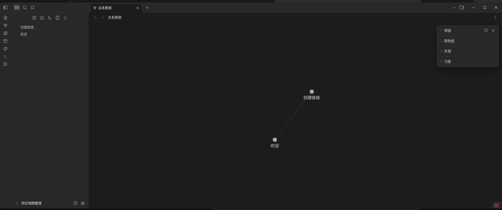
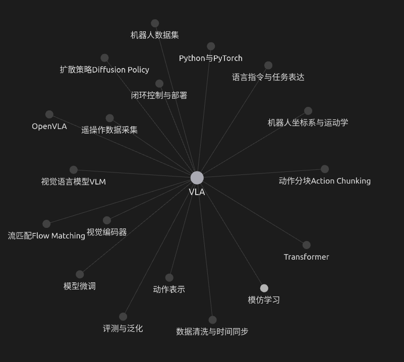
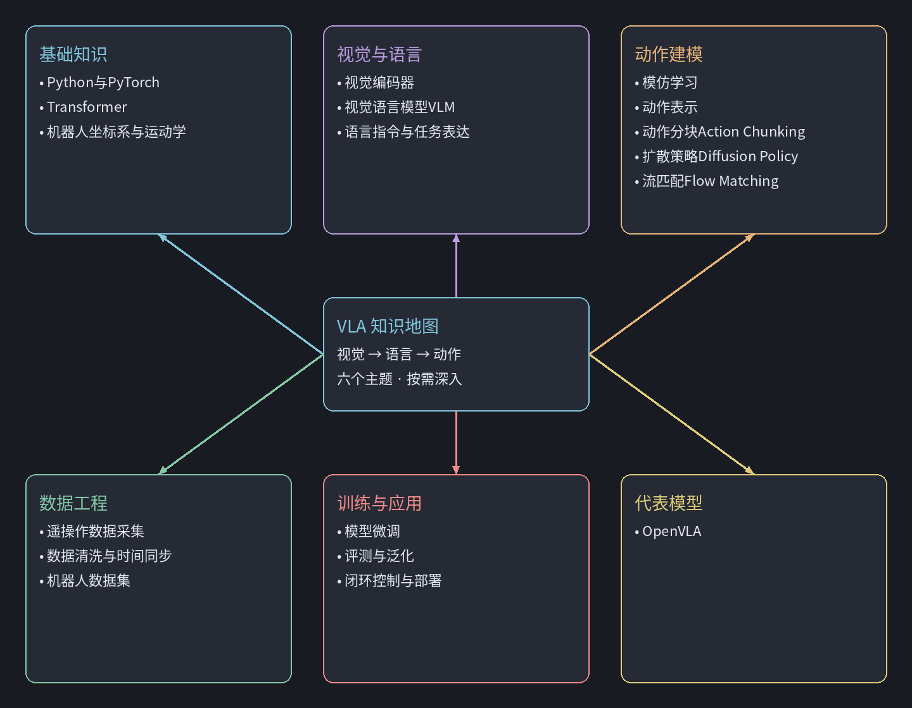

# 绘制 VLA 学习与知识地图

- 归档编号：`01a11ac6-1d59-75c1-a76a-a9a1fd503412`
- 项目：知识地图整理
- 创建时间：2026-10-08T17:09:13.690000+08:00
- 更新时间：2026-10-08T17:19:05.852000+08:00
- 状态：活动
- 导出范围：用户可见消息与助手可见回复；不含隐藏推理和工具原始输出

## 1. 用户

<external_codex_apps_open_page>{"page_id":null}</external_codex_apps_open_page>

## 2. 用户

教一下我这个怎么用？我想画一个 VLA的学习地图和知识地图



## 3. 助手（进展）

你截图里是 Obsidian 的“关系图谱”。我先结合它的用法，给你搭一个 VLA 学习路线和知识关联的入门示例，让你能照着建出自己的地图。

## 4. 助手

你截图里是 **Obsidian 的“关系图谱”**，很适合整理 VLA（视觉—语言—动作模型）的知识。

**它的基本用法是：写笔记 → 在笔记里建立链接 → 自动生成图谱。** 每个圆点代表一篇笔记，连线代表笔记之间的链接。你现在的“欢迎”和“创建链接”，就是两篇互相连接的笔记。[官方说明](https://obsidian.md/help/plugins/graph)

针对你的目标，我建议这样分工：

| 内容 | 回答的问题 | 使用方式 |
|---|---|---|
| VLA 学习地图 | 我先学什么、后学什么？ | 一篇路线笔记，配合勾选框；需要自由排版时用白板 |
| VLA 知识地图 | 有哪些概念，它们有什么关系？ | 多篇概念笔记，通过双向链接形成图谱 |

**先用下面这个小例子，把操作跑通。**

**1．创建你的第一篇地图笔记**

在截图左侧文件列表上方，点击“新建笔记”（纸和笔的图标），也可以按 `Ctrl + N`。

把笔记命名为 **VLA知识地图**，然后把下面内容粘贴到正文：

```markdown
# VLA知识地图

VLA 的核心问题：如何让机器人根据视觉观察和语言指令，生成动作？

## 基础知识
- [[Python与PyTorch]]
- [[Transformer]]
- [[机器人坐标系与运动学]]

## 视觉与语言
- [[视觉编码器]]
- [[视觉语言模型VLM]]
- [[语言指令与任务表达]]

## 动作建模
- [[模仿学习]]
- [[动作表示]]
- [[动作分块Action Chunking]]
- [[扩散策略Diffusion Policy]]
- [[流匹配Flow Matching]]

## 数据
- [[遥操作数据采集]]
- [[数据清洗与时间同步]]
- [[机器人数据集]]

## 代表模型
- [[OpenVLA]]

## 训练与应用
- [[模型微调]]
- [[评测与泛化]]
- [[闭环控制与部署]]
```

这里最关键的是 **`[[笔记名称]]`**：它会指向对应笔记，即使那篇笔记还没创建，也可以先写链接。[链接用法](https://obsidian.md/help/links)

上面是一个起步框架，可以边学边补，不需要一次写完。

**2．点开一个链接，创建概念笔记**

比如点击 `[[OpenVLA]]`；如果当前在编辑模式，可以按住 `Ctrl` 再点击。创建后，写入：

```markdown
# OpenVLA

## 一句话理解
OpenVLA 将视觉观察和语言指令作为输入，预测机器人动作。

## 它由什么组成
- 用视觉编码器处理图像：[[视觉编码器]]
- 基于预训练的视觉语言模型：[[视觉语言模型VLM]]
- 将动作编码成 token，再解码成连续动作：[[动作表示]]

## 我需要补的知识
- [[Transformer]]
- [[模仿学习]]
- [[模型微调]]

## 我的疑问
- 动作 token 是如何定义的？
- 换一台机器人，需要调整哪些部分？

## 来源
https://openvla.github.io/
```

这段示例对应 OpenVLA 论文介绍的基本结构。[OpenVLA 项目页](https://openvla.github.io/)

回到关系图谱，就能逐步看到这些连接：

```text
VLA知识地图 ── OpenVLA ── 视觉语言模型VLM
                  ├──── 视觉编码器
                  ├──── 动作表示
                  └──── 模型微调
```

**知识地图的价值就在这些具体联系里。** 除了在首页列目录，还要在概念笔记里写清楚“用到了什么”“依赖什么”“和谁有什么区别”。

例如，Diffusion Policy 可以作为动作生成方法的学习节点；它本身是视觉运动策略，不应把所有这类方法都直接归为 VLA。[Diffusion Policy 项目页](https://diffusion-policy.cs.columbia.edu/)

**3．另建一篇“VLA学习地图”，安排学习顺序**

同样新建笔记，命名为 **VLA学习地图**，粘贴：

```markdown
# VLA学习地图

目标：理解一个 VLA 模型，并完成一个小型复现实验。

- [ ] 1. 基础：[[Python与PyTorch]]
  - 完成：能加载数据、训练并保存一个小模型。

- [ ] 2. 机器人基础：[[机器人坐标系与运动学]]、[[动作表示]]
  - 完成：能解释关节动作与末端位姿动作的区别。

- [ ] 3. 模型基础：[[Transformer]]、[[视觉语言模型VLM]]
  - 完成：能画出图像和文字进入模型的过程。

- [ ] 4. 策略学习：[[模仿学习]]、[[动作分块Action Chunking]]
  - 完成：能解释如何从示范数据学习动作。

- [ ] 5. 读一个模型：[[OpenVLA]]
  - 完成：能说明输入、输出、数据和训练目标。

- [ ] 6. 做一次实验：[[模型微调]]、[[评测与泛化]]
  - 完成：记录实验配置、结果及失败案例。

后续专题：[[扩散策略Diffusion Policy]]、[[流匹配Flow Matching]]
```

这是建议的入门顺序；已经掌握的部分直接勾选跳过。**两张地图链接到同一批概念笔记，就不用重复维护内容。**

**4．想手动摆放方框、画箭头，就用“白板”**

Obsidian 的 **Canvas／白板** 支持拖入笔记、移动卡片和连接箭头，适合把学习路线摆成从左到右的流程。[白板说明](https://obsidian.md/help/plugins/canvas)

按 `Ctrl + P` 打开命令面板，搜索“白板”或 `Canvas`，找到创建白板的命令。然后：

1. 将左侧的概念笔记拖入白板。
2. 按学习顺序排列卡片。
3. 从卡片连接点拖出箭头，连接下一张卡片。

**关系图谱中的联系靠正文里的 `[[链接]]` 建立；白板里的箭头用来表达你安排的流程。**

你现在先建 **“VLA知识地图”“VLA学习地图”“OpenVLA”** 这三篇，再补“动作表示”和“视觉语言模型VLM”。这样既能看到图谱长出来，也有明确的学习入口。

## 5. 用户

这个看起来好乱，给我整理一下



## 6. 助手（进展）

现在所有知识点都直接连到 VLA，形成了一大圈，层次不容易看出来。我会把它们整理成几个主题分支，再做一张位置固定的白板，让知识结构和学习顺序都更清楚。

## 7. 助手（进展）

我看了你的笔记：标题已经分了组，但 Obsidian 不会把标题变成图谱节点，所以所有链接仍然挤在同一层。我会把六个主题各建成一篇目录笔记，让图谱形成“VLA → 主题 → 知识点”，并新增两张白板，分别展示知识结构和学习路线。

## 8. 助手

_工具输出图片（原始工具文本未纳入归档）。_



## 9. 助手（进展）

六个主题分支和两张白板都已做好，图谱也加上了主题配色。链接目标和白板文件已检查，卡片位置没有重叠；整理前的文件已备份。接下来在 Obsidian 中打开新白板，就能按固定布局浏览。

## 10. 助手

已经直接帮你整理好了：**VLA → 六个主题 → 具体知识点**，并按主题配色。


在 **Obsidian 左侧文件列表**中打开：

- **[VLA知识地图.canvas](/home/lsy03/文档/ChatGPT/知识地图整理/知识地图整理/VLA知识地图.canvas)**：固定布局，查看知识结构。
- **[VLA学习地图.canvas](/home/lsy03/文档/ChatGPT/知识地图整理/知识地图整理/VLA学习地图.canvas)**：按编号学习，每一步都有完成目标。

打开白板后，按 **`Shift + 1`** 显示全图，双击卡片查看内容。[白板操作说明](https://obsidian.md/help/plugins/canvas)

原来的关系图谱也已调整成分层结构。整理前的内容保存在 [备份文件](../../assets/c0d020adfa32b060--%E6%95%B4%E7%90%86%E5%89%8D%E5%A4%87%E4%BB%BD.zip)。


[附件：c0d020adfa32b060--整理前备份.zip](../../assets/c0d020adfa32b060--%E6%95%B4%E7%90%86%E5%89%8D%E5%A4%87%E4%BB%BD.zip)

## 11. 助手

_历史投影中的图片引用（用于补全本地对话资源）。_

> 资源未归档：`/tmp/codex-clipboard-489fa197-5a68-49af-bb76-d4972e96b154.png`（missing）

> 资源未归档：`/tmp/codex-clipboard-ea2310bf-388e-4e34-9ccd-0fc9c6ec9e08.png`（missing）
