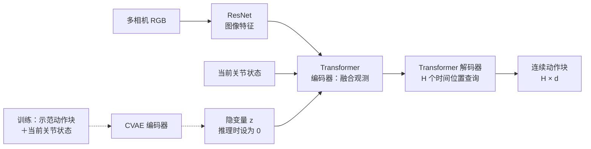
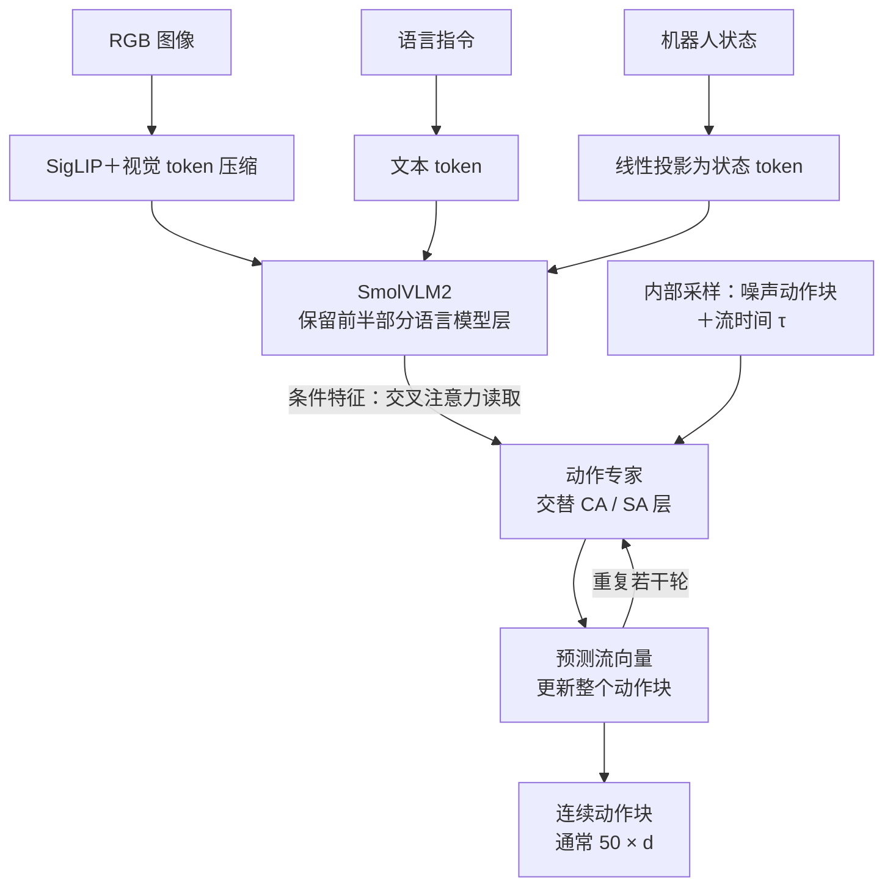
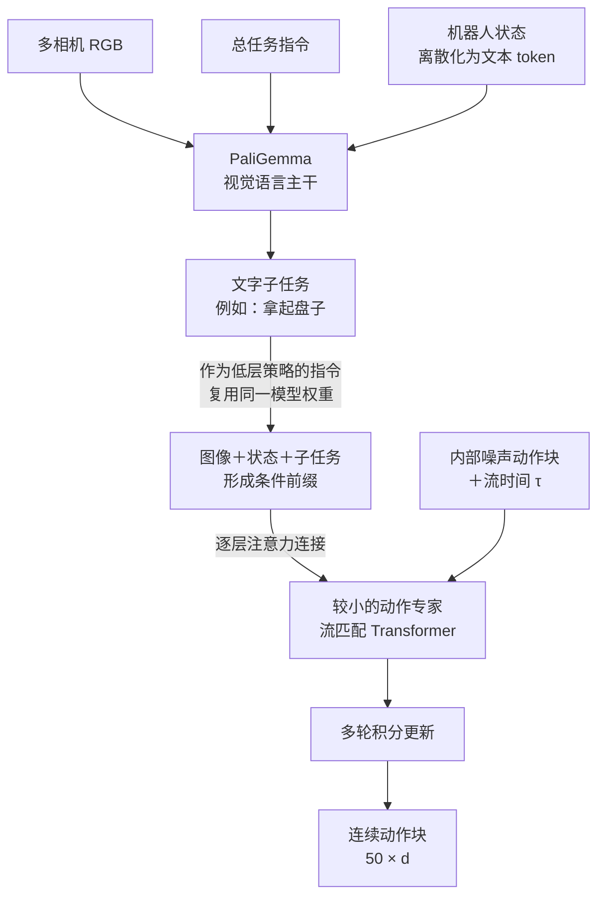
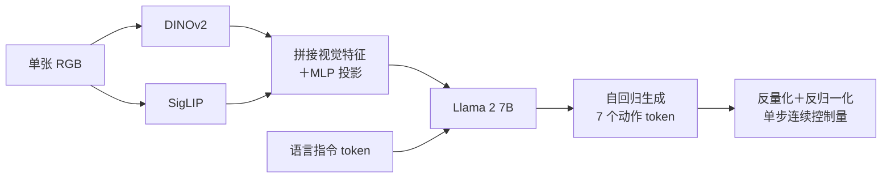
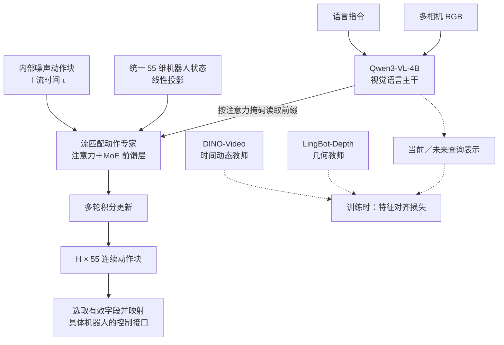
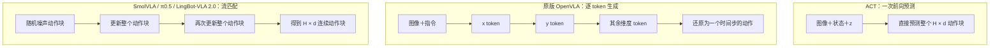

# 对比四种 VLA 模型架构

- 归档编号：`01a11b95-883d-7b02-baa3-1451c029dbfb`
- 项目：知识地图整理
- 创建时间：2026-10-08T20:55:47.006000+08:00
- 更新时间：2026-10-08T20:59:05.589000+08:00
- 状态：活动
- 导出范围：用户可见消息与助手可见回复；不含隐藏推理和工具原始输出

## 1. 用户

<external_codex_apps_open_page>{"page_id":null}</external_codex_apps_open_page>

## 2. 用户

ACT  SmolVLA  pi0.5  openVLA  lingbotVLA2.0   的输入输出和模型的各个架构的区别是什么？ 给我画图说明一下

## 3. 助手（进展）

我会先核对这几种模型的论文和官方架构说明，再用对照图解释它们的输入、输出，以及视觉、语言和动作模块之间的区别。也会确认你说的 lingbotVLA2.0 对应哪个官方版本。

## 4. 助手（进展）

我会使用可视化技能把架构画成流程图。对比会重点区分三件事：是否接收语言指令、怎样融合视觉和机器人状态，以及动作是直接回归、逐个 token 生成，还是通过流匹配生成整段轨迹。

## 5. 助手（进展）

已确认你指的是 LingBot‑VLA 2.0。两个容易混淆的点是：原版 ACT 不接收语言指令；原版 OpenVLA 逐个生成动作 token，而另外几种通常输出整段动作。LingBot 2.0 还增加了动作专家内部的 MoE，以及当前／未来视觉特征蒸馏，我会把训练分支单独标出来。

## 6. 助手

**核心区别是：ACT 直接从视觉和状态预测动作；OpenVLA 把动作当成 token 逐个生成；SmolVLA、π0.5 和 LingBot‑VLA 2.0 则使用专门的动作模块，通过流匹配生成一整段连续动作。** 后三者的区别主要在于模型如何连接、怎样训练，以及是否加入任务分解或时空监督。

下面按原版 ACT、原版 OpenVLA、SmolVLA、π0.5 论文架构，以及官方 LingBot‑VLA 2.0 说明；OpenVLA‑OFT 等后续改版不在此列。

先统一两个概念：**状态**是机器人“现在在哪里”，例如关节角和夹爪开度；**动作**是机器人“接下来怎么动”，例如目标关节角、末端位姿增量。动作块 `H × d` 表示一次预测未来 `H` 步，每步有 `d` 个控制量。

| 模型 | 推理时的主要输入 | 最终输出 | 主要架构区别 |
|---|---|---|---|
| **ACT** | 多相机 RGB＋关节状态；原版无语言 | 连续动作块；原始 ALOHA 为双臂目标关节位置 | CNN＋Transformer 编码器/解码器；CVAE 训练 |
| **SmolVLA** | RGB＋语言指令＋机器人状态 | 连续动作块；论文使用 50 步 | 小型 VLM＋交替自注意力/交叉注意力的流匹配动作专家 |
| **π0.5** | 多相机 RGB＋语言指令＋机器人状态 | 连续动作块；论文层级推理还生成文字子任务 | PaliGemma＋动作专家；离散动作预训练与连续动作后训练结合 |
| **OpenVLA** | 单张 RGB＋语言指令；原版无显式状态输入 | 单步 7 维末端控制动作 | DINOv2＋SigLIP＋Llama 2；自回归动作 token |
| **LingBot‑VLA 2.0** | 多相机 RGB＋语言指令＋统一机器人状态 | 统一 55 维表示的连续动作块，再映射到具体机器人 | Qwen3‑VL＋含稀疏 MoE 的流匹配动作专家；双查询蒸馏 |

表中细节分别来自 [ACT 论文](https://www.roboticsproceedings.org/rss19/p016.pdf)、[SmolVLA 论文](https://arxiv.org/html/2506.01844v1)、[π0.5 论文](https://arxiv.org/html/2504.16054v1)、[OpenVLA 论文](https://arxiv.org/html/2406.09246v1)和 [LingBot‑VLA 2.0 官方仓库](https://github.com/Robbyant/lingbot-vla-v2)。

**① ACT：视觉和关节状态 → 一次预测整段动作**



ACT 有两层“编码器/解码器”概念，容易混淆：

- **CVAE 编码器**只在训练时使用，把示范动作压缩成隐变量 `z`，帮助处理人类示范的不同动作风格。
- **实际策略网络**包含图像 CNN、Transformer 编码器和 Transformer 解码器；推理时令 `z=0`，直接输出整段动作。

它不需要像语言模型一样逐个生成动作 token，也不需要多轮流匹配积分。原论文还用**时间集成**，把不同预测时刻对同一执行时刻的动作加权融合，减少抖动。原版没有语言理解模块。[ACT 架构与推理流程](https://www.roboticsproceedings.org/rss19/p016.pdf)

**② SmolVLA：小型视觉语言模型负责理解，动作专家负责生成轨迹**



这里两个注意力模块分工不同：

- **CA，交叉注意力**：让动作表示读取视觉、语言和状态信息。
- **SA，自注意力**：让动作序列内部交换信息，协调不同时间位置。

SmolVLA 的状态先投影成 token，进入 VLM；动作专家再读取 VLM 特征。它通过减少视觉 token、截掉 VLM 后半部分层等方式降低计算量，发布模型约 **450M 参数**。异步推理是其执行系统设计，可以在执行已有动作时计算下一段动作。[SmolVLA 官方介绍](https://huggingface.co/blog/smolvla)、[架构细节](https://arxiv.org/html/2506.01844v1)

**③ π0.5：同一个模型兼顾“下一件事做什么”和“具体怎么动”**



图中的高层与低层是**同一模型的两种调用方式**，不是两个互不相关的模型。论文中的层级推理先生成“拿起盘子”等子任务，再条件化生成低层动作；具体部署也可以直接提供子任务指令。

与 SmolVLA 相比，π0.5 的关键特点是：

- **连接方式不同**：VLM 和动作专家用不同参数处理各自 token，通过逐层注意力连接；动作专家可以读取视觉语言前缀。
- **状态编码不同**：π0.5 将状态离散化为文本 token。
- **训练方式不同**：预训练采用离散动作 token，包括 FAST 表示；后训练加入连续动作专家。最终控制时可以通过流匹配产生连续动作，不能简单把它归为“只生成离散动作”的模型。[π0.5 方法与技术附录](https://arxiv.org/html/2504.16054v1)

**④ OpenVLA：把一个动作的各个维度，当成一串 token 生成**



原版 OpenVLA 用 DINOv2 和 SigLIP 提取互补视觉特征，再交给 Llama 2。它没有单独的流匹配动作专家，而是让语言模型直接预测动作 token。[OpenVLA 官方架构](https://openvla.github.io/)

其典型单步输出为：

```text
[Δx, Δy, Δz, Δroll, Δpitch, Δyaw, gripper]
```

每个动作维度量化到 **256 个区间**，生成 token 后再还原成连续控制量。因此，**内部是离散 token，机器人最终收到的仍是数值动作**。

还要区分：这 7 个 token 通常表示**同一个时间步的 7 个动作维度**，不是未来 7 步。原版输入也没有显式关节状态；加入状态、多视角和动作块的后续版本需要单独比较。[OpenVLA 动作表示](https://arxiv.org/html/2406.09246v1)

**⑤ LingBot‑VLA 2.0：流匹配动作专家内部加入 MoE，并用时空教师辅助训练**



它有两个需要分开理解的“专家”概念：

- **动作专家**：与视觉语言主干分开的动作 Transformer。
- **MoE 子专家**：位于动作专家内部，用路由器为每个 token 选择部分前馈网络，并结合共享专家；不是手工规定“左臂一个专家、右臂一个专家”。

双查询蒸馏让模型学习当前与未来的几何、视频特征。**未来图像是训练监督，推理时不需要提供真实未来画面**；这也不意味着模型对外必须输出未来视频。[LingBot‑VLA 2.0 论文](https://arxiv.org/html/2607.06403v1)

其官方实现采用 Qwen3‑VL‑4B 主干，状态通过线性投影进入动作侧；动作采样接口接收图像、语言和状态，迭代生成动作块。[官方模型实现](https://github.com/Robbyant/lingbot-vla-v2/blob/main/lingbotvla/models/vla/lingbot_vla/modeling_lingbot_vla_v2.py)

55 维是跨机器人使用的统一容器：

```text
双臂关节 14 ＋ 双末端位姿 14 ＋ 夹爪 2 ＋ 灵巧手 12
＋ 腰部 4 ＋ 头部 2 ＋ 移动底盘 3 ＋ 保留 4 ＝ 55
```

**55 维不等于每台机器人有 55 个独立关节**：它同时包含关节和末端表示，机器人没有的部件会填充，执行时按机器人配置映射有效字段。[统一动作空间](https://github.com/Robbyant/lingbot-vla-v2#unified-action-representation)

最后，用下面这张图区分三种动作生成机制：



流匹配里的“多轮更新”发生在**模型计算过程中**，不是让机器人先执行噪声动作；生成动作块后，执行系统再决定执行多少步、何时重新观察和预测。
