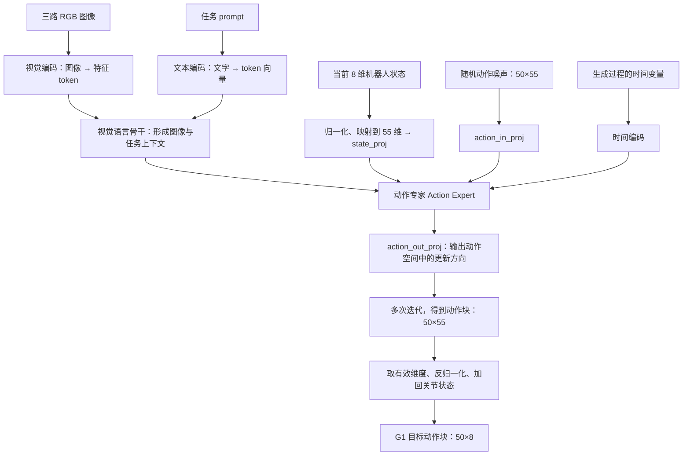
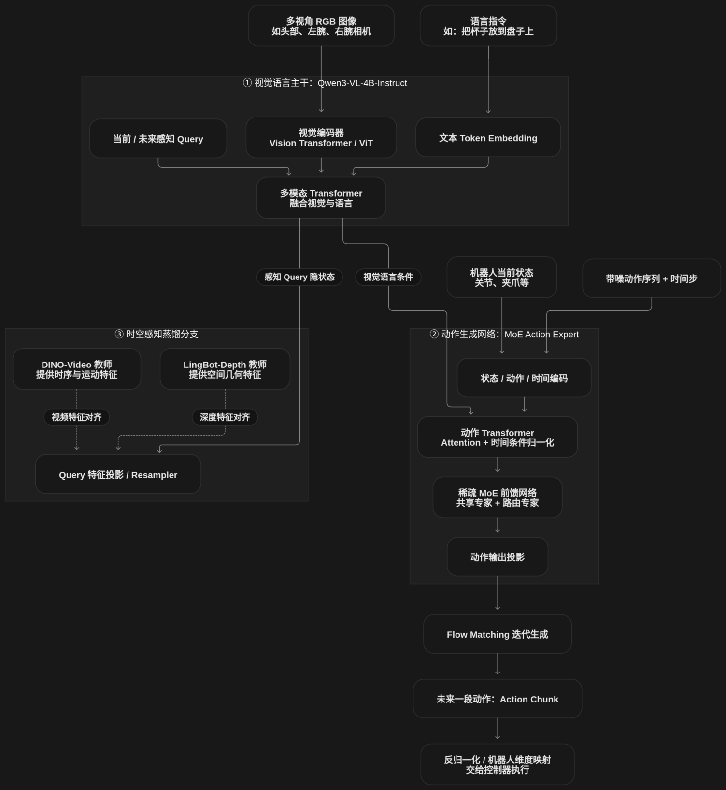

# 学习笔记2 建立 VLA G1 知识与实际训练 部署 验证 学习与实验笔记 (2)

- 归档编号：`01a13978-5abf-7282-bb30-4dabd99c84fe`
- 项目：知识地图整理
- 创建时间：2026-10-14T16:12:31.298000+08:00
- 更新时间：2026-10-16T16:17:23.673000+08:00
- 状态：活动
- 导出范围：用户可见消息与助手可见回复；不含隐藏推理和工具原始输出

## 1. 用户

<external_codex_apps_open_page>{"page_id":null}</external_codex_apps_open_page>

## 2. 用户

我感觉我们现在的速度太慢了，你的教学计划是啥？我看看，我想快速进入模型内部的模块分析原理，以及模型的调优方式

## 3. 助手

可以，我们加快。**前面我把时间花在逐题确认基础上，与你想尽快理解模型和调优的目标不匹配。** 你已经理解输入、监督目标、动作块和闭环，可以进入模型内部了。

接下来改成：**每次讲清一个模块，结合项目代码和张量形状，最后说明它与调优的关系。** 不再每讲一句就出一道判断题；遇到必要的基础知识再补。

以你正在使用的 **LingBot-VLA 2.0＋G1 牛奶任务**为主线，安排五讲：

| 顺序 | 核心问题 | 具体内容 | 对调优的帮助 |
|---|---|---|---|
| **1. 模型全景与一次前向计算** | 图像、指令和关节状态怎样变成动作？ | 视觉编码器、语言与视觉骨干、状态投影、动作专家、动作输出；跟踪各处张量 | 知道每个模块负责什么，以及你究竟在训练哪里 |
| **2. 动作专家与 Flow Matching** | 为什么动作生成需要噪声和多次迭代？ | 参考动作怎样构造训练样本；网络预测什么；损失怎样计算；推理怎样生成动作块 | 理解训练 loss、采样步数和动作误差为什么不等价 |
| **3. LoRA 与参数更新** | 你的微调究竟改了哪些参数？ | 冻结、反向传播、LoRA 的 A/B 矩阵、rank、alpha、学习率；结合项目实际配置 | 区分学习率、训练容量和可训练模块范围的问题 |
| **4. 训练诊断与评估** | loss 降了，为什么动作仍不好？ | 训练/验证曲线、逐关节误差、夹爪误差、动作块首步与后半段误差、图像依赖性 | 根据证据区分数据、优化、过拟合和部署适配问题 |
| **5. 制订一次调优实验** | 现在最值得改什么？ | 固定基线、提出假设、选择变量、确定评价指标、比较检查点 | 得到你能解释、能执行、能判断结果的实验方案 |

**前三讲先连续推进，让你建立模型内部的完整认识，再进入调参。** 每讲按约 15～25 分钟的阅读与讨论量组织，你可以随时要求展开某个模块。

调优部分不会只讲“rank 大一点、学习率小一点”，而是按这个顺序：

> **观察到什么问题 → 怀疑哪个环节 → 有什么证据 → 修改什么 → 怎样判断有效。**

例如，你项目已有“关节 Flow Matching＋独立夹爪 head”的方案。我们会解释：**为什么要把夹爪单独处理、监督目标怎样定义、这样改变了什么，以及该用什么指标判断它是否改善。** 这比孤立地背参数含义更有用。

另外，我需要提前修正之前教学例子的适用范围：**“预测 23°，与标签 25°直接比较”只是简单回归的入门示例，不是你当前关节 Flow Matching 训练的完整机制。** 第二讲会把真实的训练目标和推理过程讲清楚。

**下一讲就从第一讲开始：沿你项目的一次前向计算，画出模型模块图，并标出冻结部分、LoRA 部分及其他可训练投影层。** 以项目固定版本的代码为准，避免把官方最新实现、你的微调版本和夹爪改版混在一起。

## 4. 用户

<external_codex_apps_open_page>{"page_id":null}</external_codex_apps_open_page>

## 5. 用户

好的，我们开始学习

## 6. 助手（进展）

我们开始第一讲：从你项目的输入一路追到动作输出。我先核对固定版本的代码，把模型原本的模块和你实际微调的部分对应起来。

## 7. 助手

今天先建立一张模型内部地图：**你的 LingBot-VLA 如何把三路图像、任务指令和关节状态，变成 `50×8` 的动作块，以及微调实际改变了哪里。**

我核对了项目代码。这一讲以 `lingbot_finetune/acceptance_core.py` 的基础 LoRA 版本为准，独立夹爪 head 的改版留到后面对比。

**① 先看完整的信息流**

下面是简化的推理图，省略辅助查询等细节：



这里最值得注意的是：**动作专家除了接收观测条件，还会接收正在生成中的动作和生成时间。** 它不是简单地把图像一次转换成最终关节角。固定版本的源码中，`sample_actions()` 负责完整采样，`action_out_proj` 输出 Flow Matching 的向量场。[固定版本源码](https://github.com/Robbyant/lingbot-vla-v2/blob/4144e9c35c7ab490927cc3743e777f95433f953d/lingbotvla/models/vla/lingbot_vla/modeling_lingbot_vla_v2.py)

我们逐块拆开。

**② 视觉语言部分：把“看到的东西”和“任务要求”变成可计算的特征**

你的输入是头左、左腕、右前环视三路图像，以及任务文字。

图片最初是一堆像素数值。视觉编码器把它转换成一组特征向量；文本也会转换成向量。这里的 **token**，可以先理解为“一个参与网络计算的信息单元”，并不一定是一个汉字。

视觉语言骨干进一步处理这些信息，供动作专家使用。它传递的是**数值特征**，并不需要先生成一句“牛奶在左边”，再把这句话交给机械臂。

对你的项目而言，期望这些特征帮助区分：

- 牛奶和背景在哪里；
- 夹爪与牛奶是什么相对关系；
- 指令要求抓取哪个物体、做什么动作。

这是模块承担的功能，**不意味着当前模型一定已经准确理解了每个场景**。

**③ 状态投影：把关节数值接入动作网络**

当前状态原本只有 8 个数：

```text
[左臂关节1, ……, 左臂关节7, 夹爪开度]
```

项目先归一化，再映射到模型统一的 55 维表示。有效槽位是 **0～6 和 28**。

**55 维不意味着你的 G1 控制了 55 个关节。** 这是模型适配不同机器人时使用的统一表示，你的任务只使用其中 8 维。[项目映射代码](/home/lsy03/文档/ChatGPT/VLA%20G1%20项目/lingbot_finetune/prepare.py:20)

之后，`state_proj` 将状态向量转换成动作网络使用的特征：

\[
h_s = W_s s + b_s
\]

这里：

- \(s\)：归一化、映射后的状态；
- \(W_s,b_s\)：可以学习的参数；
- \(h_s\)：供后续网络处理的状态特征。

**归一化和投影是两件事。** 归一化调整数值尺度；投影是带参数的变换，学习怎样表示这些状态。

**④ 动作专家：结合观测，逐步生成动作**

动作专家是负责动作生成的网络。在这一步，你先区分两种“步”：

| 名称 | 含义 |
|---|---|
| 动作时间步 | `50×8` 中的 50 行，对应机器人未来的动作序列 |
| 生成迭代步 | 模型在内部更新动作数组的次数 |

**一次生成迭代会更新整个动作块，并不是只生成一个机器人时间步。**

可以把推理过程理解为：

```text
先准备一个随机的 50×55 数组
           ↓
模型结合图像、指令、状态，计算如何更新它
           ↓
更新整个数组，多次重复
           ↓
得到预测动作块
```

这里的更新方向是**动作生成空间中的变化方向，不是机械臂物理运动速度**。下一讲我们用 Flow Matching 的公式把它讲准确。

你的本地推理入口明确创建了 `[1,50,55]` 的噪声，并检查输出形状，再还原成 `[50,8]`。最前面的 `1` 表示这次只有一个样本。[推理代码](/home/lsy03/文档/ChatGPT/VLA%20G1%20项目/lingbot_finetune/acceptance_core.py:102)

**⑤ 你的微调到底改了什么？**

这是第一讲与调优直接相关的部分。根据本地代码：

| 部分 | 基础 LoRA 方案是否更新 | 对应作用 |
|---|---|---|
| 视觉编码器与视觉语言骨干 | 冻结 | 提供图像、语言特征 |
| 动作专家原有权重，包括 MoE 参数 | 冻结 | 保留已有动作建模能力 |
| 动作专家注意力中的 LoRA 参数 | **更新** | 调整动作网络的信息处理 |
| `state_proj` | **更新** | 调整状态如何进入网络 |
| `action_in_proj` | **更新** | 调整生成中的动作如何进入网络 |
| `action_out_proj` | **更新** | 调整内部特征如何映射回动作空间 |

代码在动作专家的 **144 个 q/k/v/o 投影模块**中加入 LoRA，然后仅开放 LoRA 和上述三个投影层的参数更新。[参数设置代码](/home/lsy03/文档/ChatGPT/VLA%20G1%20项目/lingbot_finetune/acceptance_core.py:83)

这意味着，你的基础微调方案主要是在学习：

> **如何利用已有视觉语言特征和机器人状态，生成适合 G1 牛奶任务的动作。**

还有一个容易误解的点：**冻结不等于不计算。** 每次换一张图片，冻结的视觉网络仍会产生不同特征；只是训练时不更新它的权重。

这也解释了为什么调优不能只盯学习率：如果问题是动作专家没有学好如何利用现有特征，调整它的训练可能有效；如果所需视觉信息在现有表示中不足，仅延长动作侧训练未必能解决。需要实验区分，不能仅凭抓取失败下结论。

今天先记住三个对应关系：

- **图像、语言骨干**提供观测与任务特征。
- **动作专家**根据这些特征、状态和生成中的动作，预测更新方向。
- **你的 LoRA 微调**主要更新动作侧的部分参数，最终还原为 G1 的目标动作块。

接下来直接进入第二讲的核心问题：**训练时已经有参考动作，为什么还要加噪声？网络究竟在预测什么，loss 又在比较什么？** 这一步会把前面“23° 与 25°比较”的入门例子，替换为你项目真正采用的训练机制。

## 8. 用户

等一下，你得作为一个好老师，你要会判断学生的知识理解情况吧

## 9. 助手

对。我刚才从“每句话都出题”跳到了“一次讲很多”，**没有先判断你对神经网络、张量和注意力机制理解到哪一步**，也没有检查你是否真正理解就准备进入下一讲。这需要调整。

你前面已经展示出对动作还原、闭环和执行延迟的理解；但这不能证明你已经理解模型内部。接下来我会在每个关键模块后，用一个需要解释或迁移的问题检查理解，再决定继续、换个例子还是补基础。**答错时先看思路，不直接让你记结论。**

现在暂停新内容，用三个问题判断刚才那一讲的效果。按自己的理解回答，不确定或没学过就直接说，不用查资料：

1. **冻结与输入变化**
   视觉编码器被冻结了。换一张牛奶位置不同的图片，它输出的特征会不会变化？“冻结”的究竟是什么？

2. **动作块与生成迭代**
   假设模型输出 50 步动作，内部做了 10 次生成迭代。这两个数字分别描述什么？是不是每次迭代生成 5 步动作？

3. **投影层与学习**
   对于 \(h = Ws+b\)，你能说清哪些是输入、哪些是训练要更新的参数吗？你对矩阵乘法目前是“能算”“知道大意”还是“还没学过”？

这三题分别帮我判断你对**参数与计算、动作生成过程、数学基础**的理解。根据你的回答，我们再确定从哪里继续。

## 10. 用户

视觉编码器被冻结了，在训练前后，如果换了一张新的牛奶位置不同的照片，他的输出特征依然会变化，如果使用同样一张图片，输出特征不会变化。我还是没搞懂 ViT的输入是prompt 和 图片，输出的到底是啥？输出给 多模态TF融合视觉与语言还是输出给动作专家？



## 11. 助手

你对“冻结”的理解基本正确：**固定预处理、关闭随机性时，冻结的视觉编码器对同一张图像会给出相同特征；换一张图像，特征通常会变化。** 冻结的是参数，不是输出。

你现在卡住的地方也很明确：**把整个视觉语言模型的输入，当成了 ViT 单独这个模块的输入。** 我们先只解决这一点。

**1. ViT 接收图像，不接收任务 prompt**

沿着你图里的两条箭头看：

```text
图片 → 视觉编码器 ViT → 视觉特征向量 ─┐
                                    ├→ 多模态 Transformer
指令 → 文本 Token Embedding → 文本向量 ┘
```

**“图片＋prompt”是整个视觉语言主干的输入。** 其中，ViT 处理图像，文本 Embedding 处理指令，两条信息流随后进入多模态 Transformer。

**2. ViT 输出的究竟是什么？**

它输出的是**一组数值向量，也叫视觉 token 特征**，不是一句描述，不是关节动作，也不直接是“牛奶的 XYZ 坐标”。

例如，为了理解，假设图像被处理成 4 个视觉 token，每个 token 用 6 个数表示：

```text
             特征维度
视觉 token 1  [0.2, -0.7, 0.1,  …]
视觉 token 2  [0.8,  0.3, -0.4, …]
视觉 token 3  [ …                 ]
视觉 token 4  [ …                 ]
```

这就是一个 **`4×6` 的特征矩阵**。这里只是教学尺寸，不是你模型的真实尺寸。一般写作：

\[
[N_{\text{视觉 token}}, D_{\text{特征维度}}]
\]

可以先把这些向量理解为：图像内容经过网络编码后的表示。**每一维通常没有“这一列就是颜色、那一列就是牛奶位置”这样的人工定义。** 而且经过 ViT 的注意力计算，一个 token 可以包含其他图像区域的信息，不只是一个孤立的小块。

**3. 这些特征先给谁？**

按你图中的主要路径，**先进入多模态 Transformer，与文字信息一起处理，再为动作专家提供条件。**

例如，同一张图片里有牛奶和杯子：

- 指令 A：“抓起牛奶。”
- 指令 B：“抓起杯子。”

图像没变，所以在固定处理条件下，**ViT 的图像特征不变**。但文本向量变了，多模态 Transformer 处理后的视觉语言表示就可以不同，进而影响动作预测。

动作专家读取的是这些内部数值表示；不需要视觉语言主干先生成一段自然语言回答。具体实现通过注意力和缓存等机制传递信息，图里的箭头是功能上的简化。

因此，你现在可以把两者分开记：

> **ViT 编码“图像里有什么视觉信息”；多模态 Transformer 将这些视觉信息与“任务要求”结合。**

检查一下这个区别是否清楚：**如果图片完全相同，只把指令从“抓牛奶”改成“抓杯子”，你认为变化最早发生在图中的哪个模块？**

## 12. 用户

ViT的具体结构是什么

## 13. 助手（进展）

我先讲清标准 ViT 的结构，再指出它与你图里的 Qwen3-VL 视觉编码器有哪些区别。

## 14. 助手

**ViT（Vision Transformer）的主体结构是：把图像分成小块，把每块变成向量，再用多层 Transformer 让这些向量交换信息。** 最终输出一组包含图像信息的特征向量。

先讲标准 ViT 的结构，再对应你项目里的 Qwen3-VL。下面的尺寸是教学示例，不是你项目的实际配置。

**1. 从图片到视觉 token**

假设输入是一张 **224×224 的 RGB 图像**，每个小块（patch）大小是 **16×16**：

```text
RGB 图像：224×224×3
        ↓ 切成 16×16 的小块
14×14 = 196 个 patch
        ↓ 每块展开
每块有 16×16×3 = 768 个像素数值
        ↓ 可学习的线性投影 Patch Embedding
196 个向量，每个向量 D 维
        ↓ 加入位置信息
送入 Transformer Blocks
```

这里有两个不同的量：

- **196**：有多少个 token。
- **D**：每个 token 用多少个数表示。

例如选择 \(D=768\)，得到的是 `[196, 768]` 的矩阵。这个例子中，展开后的像素数与特征维度恰好都是 768，**但二者不要求相等**。

Patch Embedding 是带参数的变换：

\[
z_i = W_{\text{patch}}x_i+b
\]

\(x_i\) 是第 \(i\) 个小块的像素，\(z_i\) 是它的特征向量。不同小块使用同一套投影参数。

为什么还需要位置编码？因为网络不仅需要知道小块里有什么，还需要知道它在图像的哪个位置。标准 ViT 会为 token 加入位置向量。[ViT 官方文档](https://huggingface.co/docs/transformers/model_doc/vit)

**2. 一个 Transformer Block 内部有什么？**

它主要包含两部分：**多头自注意力（Attention）和前馈网络（MLP）**，搭配归一化与残差连接。

```text
输入特征 X
    │
    ├──────────────────┐
    ↓                  │
LayerNorm              │
    ↓                  │
多头自注意力             │
    ↓                  │
相加 ←─────────────────┘  残差连接
    │
    ├──────────────────┐
    ↓                  │
LayerNorm              │
    ↓                  │
MLP                    │
    ↓                  │
相加 ←─────────────────┘  残差连接
    ↓
输出特征
```

这样的 Block 会重复多层，**每层有自己的参数**。[标准 ViT 实现](https://github.com/huggingface/transformers/blob/main/src/transformers/models/vit/modeling_vit.py)

我们重点分清 Attention 和 MLP 的作用：

| 模块 | 在做什么 | 对牛奶图像的直观理解 |
|---|---|---|
| **Attention** | 让不同 token 之间交换信息 | 牛奶瓶身区域可以结合瓶盖、桌面、夹爪等区域的信息 |
| **MLP** | 对每个 token 的特征做非线性变换 | 进一步加工该 token 已经收集到的信息 |

MLP 通常是：

```text
D 维 → 更宽的隐藏维度 → 激活函数 → D 维
```

同一层的 MLP 会分别作用于每个 token，使用共享参数；**它本身不直接在不同 token 之间传递信息**。

残差连接则把输入加回变换结果，让模块能在原有表示上学习修正；LayerNorm 帮助稳定特征的数值尺度。

**3. Attention 究竟怎样“交换信息”？**

每个 token 的特征通过三个线性变换，产生：

\[
Q=XW_Q,\qquad K=XW_K,\qquad V=XW_V
\]

先不用背公式，可以这样理解：

- **Q（Query）**：这个 token 用什么条件寻找相关信息。
- **K（Key）**：其他 token 用什么特征与它匹配。
- **V（Value）**：匹配后，实际传递的信息。

Q 与各个 K 的匹配分数经过 softmax，变成权重，再对 V 加权求和：

\[
\operatorname{Attention}(Q,K,V)
=\operatorname{softmax}\left(\frac{QK^\top}{\sqrt{d_k}}\right)V
\]

所以，**输出 token 不再只表示原来那个小块，而是融合了其他位置的信息。**

“多头”表示同时使用多套这样的计算，再合并结果。各个头可以学习不同的信息关系，但不能预先认定“这个头专门看颜色，那个头专门找牛奶”。

**4. 最后输出什么，如何接回你的模型？**

标准分类 ViT 通常加入一个额外的 `[CLS]` token，用它的最终特征做分类。因此，上面例子包含它时，序列长度是 **197**。

而你关心的是为 VLA 提供视觉信息：需要保留一组视觉特征，让后续网络使用，不能把 ViT 简单理解为“输出一个物体类别”。

你图里的 Qwen3-VL 视觉编码器在这一基本结构上还有扩展，例如视觉 token 的合并与维度映射，以及 **DeepStack**：将视觉编码器不同深度的特征送入语言模型的不同层。所以我之前说“ViT 输出给多模态 Transformer”，方向正确，但省略了多层特征传递。[Qwen3-VL 官方文档](https://huggingface.co/docs/transformers/model_doc/qwen3_vl)

你现在先把主体记成：

```text
图像
 → Patch Embedding：像素变向量
 → 位置信息：保留空间位置
 → 多层 Attention＋MLP：交换信息并加工特征
 → 视觉特征序列
 → 后续视觉语言处理
```

检查一个关键点就够了：**一个小块最初只拍到了牛奶瓶身，经过几层 ViT 后，它对应的 token 为什么可能包含瓶盖或夹爪的信息？主要是哪一个模块让这件事发生的？**

## 15. 用户

一个小块最初只拍到了牛奶瓶身 ，但是 attention 经过训练，QKV中就可能了解到了这一小块所对应的瓶盖信息和抓取的信息，看看我讲的对不对，或者你也可以补充

## 16. 助手

**核心理解是对的：Attention 让瓶身对应的 token 能结合其他区域的信息。** 需要把“训练学到了什么”和“看这张图时计算了什么”再分清。

训练学到的是生成 Q、K、V 的参数矩阵 **\(W_Q、W_K、W_V\)**；而 **Q、K、V 是每次根据当前输入特征计算出来的**，并不是固定存着瓶盖或抓取知识。

以当前图片为例：

1. 瓶身 token 产生自己的 **Q**。
2. 它的 Q 与其他 token 的 **K** 计算匹配分数，包括瓶盖、夹爪和背景等区域。
3. 分数变成权重，对各 token 的 **V** 加权求和。
4. 得到的瓶身 token 新特征，就可能融合瓶盖、夹爪等区域的信息。

因此，你的表述可以改成：

> **训练让 Attention 学会怎样建立图像区域之间的联系；处理当前图片时，瓶身 token 根据这些联系聚合其他区域的特征。**

这里还有一个重要区别：**“夹爪的信息”和“抓取动作的信息”不是一回事。** ViT 可以提取夹爪的外观、位置以及它与牛奶的视觉关系；但它没有收到任务 prompt，不能仅凭这一步就认定“任务要求抓取牛奶”，更不会直接输出抓取动作。任务条件由后续视觉语言处理引入，动作由动作专家生成。

你已经抓住了 Attention 的主要作用。接下来我们可以往内部再走一步：**为什么需要 Q、K、V 三种表示，而不是直接拿原来的 token 向量互相比较？**

## 17. 助手

_历史投影中的图片引用（用于补全本地对话资源）。_

> 资源未归档：`/tmp/codex-clipboard-3d70c5e4-9d08-451f-8da3-7f5512631664.png`（missing）
