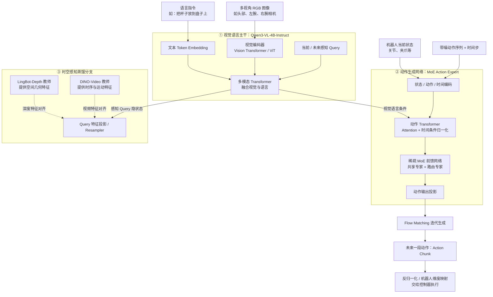
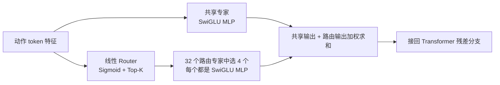

# 10_10 梳理 lingbotVLA 2.0 模型架构

- 归档编号：`01a12372-6a74-70c0-b77b-266a7ec6299a`
- 项目：蚂蚁灵波具身大模型挑战赛
- 创建时间：2026-10-10T09:34:23.352000+08:00
- 更新时间：2026-10-13T10:10:48.285000+08:00
- 状态：活动
- 导出范围：用户可见消息与助手可见回复；不含隐藏推理和工具原始输出

## 1. 用户

<external_codex_apps_open_page>{"page_id":null}</external_codex_apps_open_page>

## 2. 用户

给我画一下 lingbotVLA 2.0 就是我们比赛需要微调的模型的架构 就是分为几块，然后有哪些网络架构组成的？

## 3. 助手（进展）

我先查一下 LingBot-VLA 2.0 的官方资料和比赛说明，确认需要微调的版本，再画出各模块和内部网络的关系。

## 4. 助手（进展）

官方资料确认了三部分：Qwen3-VL 视觉语言主干、带 MoE 的动作生成网络，以及训练时使用的深度／视频蒸馏分支。我会把推理数据流和训练监督分别画出来，方便理解比赛微调涉及哪些模块。

## 5. 助手

**LingBot-VLA 2.0 可以按功能分成三大块：①视觉语言主干，②动作生成网络，③时空感知蒸馏分支。** 我们要微调的是整个 VLA 策略模型；其视觉语言底座是 **Qwen3-VL-4B-Instruct**，官方发布的 VLA 权重名为 `lingbot-vla-v2-6b`。[官方仓库](https://github.com/Robbyant/lingbot-vla-v2)

下面是模块级架构图。实线表示主要数据流，虚线表示训练监督；省略了逐层注意力连接。

三块里面具体有哪些网络：

| 模块 | 网络组成 | 负责什么 |
|---|---|---|
| **视觉编码器** | ViT：图像 patch 编码、Transformer、视觉特征合并／投影 | 把相机画面变成视觉 token |
| **视觉语言主干** | Qwen3-VL 的多模态 Transformer；4B 底座的文本部分为 **36 层** | 理解“画面里是什么、指令要求做什么” |
| **动作专家** | 编码／投影层、动作 Transformer、时间条件 AdaNorm、MoE、输出投影 | 根据画面、指令和当前状态，生成连续动作 |
| **蒸馏投影头** | Cross-Attention／Resampler 等特征对齐模块 | 从主干的感知 Query 中预测当前和未来特征 |
| **训练教师网络** | LingBot-Depth；DINO-Video＝DINOv3 主干＋因果时序注意力＋3D-RoPE | 分别提供几何和运动监督 |

视觉主干细节来自 [Qwen 官方配置](https://huggingface.co/Qwen/Qwen3-VL-4B-Instruct/blob/main/config.json)；动作与蒸馏结构来自 [官方训练配置](https://github.com/Robbyant/lingbot-vla-v2/blob/main/configs/vla/Training_Config.md) 和 [技术报告](https://arxiv.org/html/2607.06403v1#S4)。

**动作专家中的 MoE，内部可以再展开成这样：**

官方示例在动作专家的 **36 层中都启用 MoE，每层有 1 个共享专家和 32 个路由专家，每个 token 激活其中 4 个路由专家**。这些专家由网络学习分工，并没有预先指定成“抓取专家”“放置专家”。[配置](https://github.com/Robbyant/lingbot-vla-v2/blob/main/configs/vla/robotwin/robotwin.yaml)、[实现](https://github.com/Robbyant/lingbot-vla-v2/blob/main/lingbotvla/models/vla/lingbot_vla/qwen2_action_expert.py)

与我们比赛微调直接相关的三个要点：

- **动作采用 Flow Matching 生成**：从噪声逐步得到未来一段连续动作，而不是逐字输出动作指令。[训练说明](https://github.com/Robbyant/lingbot-vla-v2/blob/main/configs/vla/Training_Config.md)
- **统一状态／动作空间是 55 维**：覆盖双臂、末端位姿、夹爪、灵巧手、腰、头和底盘；具体机器人通过映射和填充适配这些维度。[官方说明](https://github.com/Robbyant/lingbot-vla-v2#unified-action-representation)
- **深度和视频教师提供训练监督**：未来图像用于训练目标；实际执行时依据当前观测预测未来。微调哪些主干参数、是否保留蒸馏损失，需要看我们最终采用的比赛配置。[技术报告](https://arxiv.org/html/2607.06403v1#S4.SS2)
