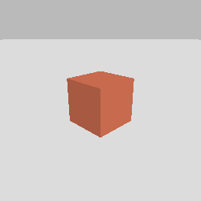
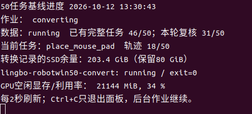

# 10_12 10_10 梳理本地环境搭建方案

- 归档编号：`01a12375-ec8b-7910-a3fb-d76005404aec`
- 项目：蚂蚁灵波具身大模型挑战赛
- 创建时间：2026-10-10T09:38:13.263000+08:00
- 更新时间：2026-10-13T09:08:29.887000+08:00
- 状态：活动
- 导出范围：用户可见消息与助手可见回复；不含隐藏推理和工具原始输出

## 1. 用户

<external_codex_apps_open_page>{"page_id":null}</external_codex_apps_open_page>

## 2. 用户

你应该知道我们要参加的这个比赛吧，我看现在是不是可以我们先吧环境给搭好？看下我这的本地环境怎么搭建？是否需要一个单独的docker容器来运行？

## 3. 助手（进展）

我先查看项目里的比赛资料和这台机器的开发环境，再判断适合直接安装还是使用独立 Docker 容器。

## 4. 助手（进展）

确认了，我们参加的是以 LingBot-VLA 2.0 为基座、包含 RoboTwin 2.0 仿真任务的比赛。你本地已有 G1 项目的模型和仿真相关目录，我会检查哪些可以复用；比赛环境建议独立隔离。

刚才 GPU 和 Docker 的检查受到当前沙箱访问限制，还不能据此判断宿主机驱动有问题，我继续核实。

## 5. 助手

**可以先搭环境，而且我建议给比赛建立独立 Docker 环境。** 我已经检查了本机：基础设施齐全，可以复用已有镜像，不用从零安装。

我们参加的是基于 **LingBot-VLA 2.0、包含 RoboTwin 2.0 仿真任务**的比赛。[比赛官网](https://tianchi.aliyun.com/competition/entrance/532514/introduction)

本机实际情况如下：

| 项目 | 检查结果 |
|---|---|
| 系统 | Ubuntu 22.04 |
| GPU | **RTX 4090，24GB 显存** |
| 内存 | 约 128GB |
| 项目所在磁盘 | 剩余约 367GB |
| Docker | 已安装，服务正常 |
| NVIDIA 容器运行时 | 已配置 |
| 已有环境 | LingBot-VLA 2.0 推理镜像、G1 LoRA 镜像、RoboTwin 学习镜像 |

**这台本机查到的是 4090 24GB；此前讨论的 PRO 5000 48GB 没有出现在本机 GPU 列表中。** 最初的 GPU 报错来自沙箱限制，宿主机驱动正常。

我的建议是采用两个独立容器：

| 容器 | 用途 | 搭建方式 |
|---|---|---|
| 比赛模型容器 | LingBot 推理、数据处理、微调 | 从现有 LingBot 镜像派生，建立比赛专用配置 |
| 比赛仿真容器 | RoboTwin 场景、物理仿真、闭环评测 | 从现有仿真镜像派生，补齐完整 benchmark |

这样安排是因为模型侧使用 Python 3.12、PyTorch 2.8，而仿真侧有另一套 SAPIEN、运动规划和 NumPy 依赖。官方也要求区分推理环境与仿真环境；Docker 是我针对你现有环境的建议，并非赛事硬性要求。[官方环境与评测说明](https://github.com/Robbyant/lingbot-vla-v2/blob/main/experiment/robotwin/README.md)

**目前最需要补的是完整 RoboTwin 评测环境。** 你已有的 `robotwin-learning` 是简化可视化学习场景，可以显示机器人、调用模型预测，但还没有完整任务闭环、全部物体资产和评测依赖，不能直接拿它跑比赛成绩。

实际搭建按这个顺序进行：

1. 在当前比赛目录建立独立源码、配置、数据和结果目录，固定代码版本。
2. 复用已有镜像和模型文件；共享模型文件时只读挂载，比赛输出单独保存。
3. 补齐官方兼容版本的 RoboTwin、依赖和资产。
4. 先验证一个任务的“相机图像 → 模型动作 → 仿真执行 → 成功判断”，保存日志和视频。
5. 跑通后再接入比赛允许的训练数据，测试微调和批量评测。

还要注意 **24GB 显存的评测边界**：官方说明，其当前环境下一个 FP32 推理服务加仿真约需 32GB，24GB 卡通常要用 BF16 跑通流程；BF16 可能影响成功率，不能直接当作官方 FP32 结果的复现。[官方显存说明](https://github.com/Robbyant/lingbot-vla-v2/blob/main/experiment/robotwin/README.md)

因此，**本机适合先搭环境、跑单任务闭环和小规模微调实验；完整训练及正式评测再按实测需求安排更大显存算力。** 本轮已完成环境检查，还没有创建比赛容器或安装新依赖。

## 6. 用户

我们现在开始搭建，给我方案计划，明确目标 。你还有什么需要问我的吗

## 7. 助手（进展）

我先把搭建目标、阶段验收和需要你确定的事项列清楚，并核对比赛对模型初始化和数据的限制，让环境方案与正式参赛要求一致。

## 8. 助手（进展）

发现一个关键点：现有缓存是 RoboTwin 后训练权重，而比赛指定使用通用预训练权重 `lingbot-vla-v2-6b`；训练数据只允许 50 个任务的 clean 数据，共 2,500 条。比赛环境需要补齐指定权重，不能直接沿用 G1 的训练初始化。

你目录里的提交模板我也已读过。我先建立独立目录和规则配置；算力、存储路径与 GPU 时段的三个问题已经发给你，后续下载和运行安排会按你的回答确定。

## 9. 助手

**开始搭建。第一阶段的明确目标是：在本机建立独立、可复现的比赛环境，跑通一个 RoboTwin 任务的训练与闭环评测，再扩展到全部 50 个任务。**

比赛要求从指定的 `lingbot-vla-v2-6b` 预训练权重出发，只使用 **50 个任务 × 50 条 clean 轨迹**训练；最终评测 clean、randomized 两种环境，每个任务各 100 次，共 **10,000 次测试**。[官方规则](https://tianchi.aliyun.com/competition/entrance/532514/information)

现有缓存是 RoboTwin 后训练权重，因此需要补齐比赛指定的基础权重。

方案采用 **两个独立 Docker 容器**：模型容器负责训练、推理；仿真容器负责 RoboTwin 和评测。复用已有镜像基础层，比赛源码、配置和输出放在当前项目中。

| 阶段 | 工作内容 | 完成标准 |
|---|---|---|
| 1. 固定环境 | 锁定源码版本、依赖、镜像和目录挂载 | 两个容器能启动，GPU 与仿真渲染正常，版本有记录 |
| 2. 准备资产 | 指定预训练权重、Qwen 主干、完整仿真资产，先准备一个任务的数据 | 文件完整；数据可读取；图像、状态、动作映射正确 |
| 3. 跑通闭环 | 单任务、小批量 episode，先用 BF16 验证 | 模型动作驱动仿真，得到成功/失败判断、日志和视频 |
| 4. 验证微调 | 使用 clean 数据做短程训练，保存并重新加载 checkpoint | 梯度与损失正常，恢复训练成功，新权重能进入闭环评测 |
| 5. 扩展参赛流程 | 补齐 50 个任务，批量训练评测、汇总官方 JSON | 支持断点继续，结果可追溯到对应权重与配置 |

**“环境搭建完成”以第 4 阶段验收通过为准。** 第 5 阶段进入正式实验和比赛结果生产，成功率提升另行设目标。

本机 4090 24GB 先承担 BF16 流程验证；正式评测精度和全量微调算力，需要结合规则与实测显存确定。Docker 隔离依赖，但两个容器仍共享同一张 GPU。

已经完成的准备：

- 建立独立源码、数据、模型、缓存、结果目录。
- 写入[比赛规则配置](../../assets/b4ba876585185514--competition.json)。
- 添加[宿主机检查脚本](/home/lsy03/文档/ChatGPT/蚂蚁灵波具身大模型挑战赛/scripts/check_host.sh)，通过语法检查。
- 阅读你提供的官方提交模板。

**需要你回答的只有三项，已通过选择题发给你：**

1. **算力**：先用本机 4090，还是现在接入 PRO 5000 48GB？后者在哪台机器？
2. **存储**：模型和数据放当前磁盘，还是另一块大容量硬盘？当前剩余约 366GB。
3. **GPU 时段**：保留现有 G1 工作、等空闲验收，还是安排比赛专用时段？

这些答案决定大文件下载位置和 GPU 运行安排；源码、依赖与镜像准备可以先推进。

[附件：b4ba876585185514--competition.json](../../assets/b4ba876585185514--competition.json)

## 10. 用户

> 第一阶段算力按哪种安排？目前本机是 RTX 4090 24GB；此前提到的 PRO 5000 48GB 在哪里、是否可以使用？


先在本机 4090 搭建，其他算力后续接入


> 完整模型、数据和仿真资产放在哪里？当前项目所在磁盘剩余约 366GB，完整下载和转换前需要核算容量。


先看看需要下载的数据有多大？

## 11. 助手（进展）

先按本机 4090 搭建。我会核算比赛所需的 2,500 条 clean 数据、指定模型和仿真资产的下载量，并区分已有缓存、解压空间和格式转换空间，再确定存储位置。

## 12. 助手（进展）

已精确汇总：比赛需要的 50 个 clean 数据压缩包合计 **23.78GB（22.15GiB）**。指定模型完整仓库约 **28.24GB**，仿真资产压缩包约 **14.93GB**。

基础下载量约 **67GB**；解压、格式转换、训练检查点和评测视频还需额外空间。我继续核查解压量，判断当前磁盘能否容纳。

## 13. 助手

**先在本机 4090 搭建。已核算：比赛训练数据下载约 23.78GB，加上指定模型和仿真资产，基础下载量约 67GB。**

下面大小来自官方仓库文件元数据，GB 按十进制计算：

| 内容 | 下载大小 | 说明 |
|---|---:|---|
| 50 个任务的 clean 数据 | **23.78GB** | 50 个压缩包，共 2,500 条轨迹，任务清单与比赛模板一致 |
| LingBot-VLA 2.0 指定预训练仓库 | **28.24GB** | 模型权重约 25.50GB，其余包含深度、视频教师等文件 |
| 仿真物体资产 | **3.74GB** | 解压后约 4.64GB |
| 随机背景纹理 | **10.97GB** | randomized 仿真评测使用 |
| 机器人资产 | **0.22GB** | 已有旧缓存，需核对版本后决定是否复用 |
| **合计** | **66.95GB** | 尚未计新增环境依赖、补充教师文件 |

来源：[官方训练数据及资产仓库](https://huggingface.co/datasets/TianxingChen/RoboTwin2.0/tree/main)、[指定模型仓库](https://huggingface.co/robbyant/lingbot-vla-v2-6b/tree/main)。

**下载量不等于最终磁盘占用。** 还要留出解压、LeRobot 转换、检查点和评测视频空间。抽查两个任务，解压大小分别约为压缩包的 **1.32 倍、1.72 倍**，但完整解压量和转换量尚未实测。

我建议第一阶段先预留 **150–200GB 工作空间**，这是规划预算。当前剩余约 **366GiB**，足够开始单任务搭建；后续分批转换、控制检查点和视频保留数量，再核算完整实验的空间。

接下来先准备指定模型、仿真资产和一个小任务，跑通后再补齐全部 clean 数据。randomized 测试场景由仿真生成，无需下载 randomized 演示数据包。

详细清单已保存到[空间核算报告](../../assets/2ce6a255093a1500--download-size-audit.json)。目前只读取了文件元数据，**还没有开始大文件下载**。

[附件：2ce6a255093a1500--download-size-audit.json](../../assets/2ce6a255093a1500--download-size-audit.json)

## 14. 用户

有没有什么建议我来进行数据上的安排？要不我先下载在固态硬盘上？后面空间不够了再说

## 15. 助手（进展）

可以，先放固态硬盘。我会核对当前目录所在磁盘，并把数据目录分开安排，方便以后迁移，也避免下载缓存、解压数据和转换结果重复占空间。

## 16. 助手

**可以，先下载到固态硬盘是合理的。** 当前比赛目录就在 Kingston 1TB NVMe SSD 上，剩余约 **366GiB**，足够第一阶段搭建。

建议这样安排：

| 内容 | 安排 |
|---|---|
| 下载压缩包 | 放 `data/archives`，保留到解压、转换校验通过 |
| 解压原始数据 | 放 `data/raw`，逐任务转换，避免重复中间副本 |
| LeRobot 训练数据 | 放 `data/lerobot`，优先一直留在 SSD |
| 模型、仿真资产 | 分别放 `models`、`data/assets` |
| 检查点、评测视频 | 放 `outputs`，控制保留数量，避免持续膨胀 |

**先按 200GiB 工作预算安排，磁盘剩余接近 80GiB 时就处理空间，不等到写满。** 后续优先迁移压缩包、旧检查点和历史视频；训练数据与当前模型继续留在 SSD。

本机还检测到一块约 **18TB 的机械硬盘**，以后可以考虑用于归档，届时再核实挂载路径和可用空间。

我已建立这些目录，并写入[存储配置](../../assets/9ce3daa8289577ec--storage.json)。后续容器使用固定内部路径，换存储盘时只需调整挂载位置。大文件下载尚未开始。

[附件：9ce3daa8289577ec--storage.json](../../assets/9ce3daa8289577ec--storage.json)

## 17. 用户

现在有哪些文件需要下载的？什么方式下载比较快？给我命令还是我上浏览器去下载？

## 18. 助手（进展）

我会把要下载的文件列成清单，并检查本机可用的下载工具。建议用支持断点续传的命令行工具，方便校验文件和后续补齐 50 个任务的数据。

## 19. 助手

**建议用命令行下载。** 浏览器适合下单个小文件；这次有多个模型分片和 50 个数据包，用官方 `hf` 工具更方便筛选、继续下载和避免重复。实际速度取决于网络，官方工具支持 Xet 加速。[官方说明](https://huggingface.co/docs/huggingface_hub/guides/download#faster-downloads)

当前需要这些文件：

| 内容 | 大小 | 下载安排 |
|---|---:|---|
| 指定预训练模型 `lingbot-vla-v2-6b` | 28.24GB | 完整下载，包含深度和视频教师文件 |
| `objects.zip` | 3.74GB | 仿真物体 |
| `background_texture.zip` | 10.97GB | 随机环境评测背景 |
| `embodiments.zip` | 0.22GB | 机器人资产 |
| 50 个 `aloha-agilex_clean_50.zip` | 23.78GB | 比赛允许的训练数据 |
| **合计** | **约 67GB** | |

完整教师训练需要的 MoGe 等补充文件，后续按训练配置补齐；现有 Qwen 配置和 tokenizer 可以先复用。

我已经准备好[下载脚本](/home/lsy03/文档/ChatGPT/蚂蚁灵波具身大模型挑战赛/scripts/download_resources.sh)，会筛选指定数据，保存到当前 SSD，下载前检查剩余空间。**还没有启动下载。**

先安装官方下载工具，本机目前没有 `hf`：

```bash
curl -LsSf https://hf.co/cli/install.sh -o /tmp/install-hf-cli.sh
bash /tmp/install-hf-cli.sh --exclude-skill
export PATH="$HOME/.local/bin:$PATH"
hf --help
```

这是官方安装方式，跳过额外技能安装。[安装文档](https://huggingface.co/docs/huggingface_hub/guides/cli#standalone-installer-recommended)

然后进入项目，先预览下载清单：

```bash
cd "/home/lsy03/文档/ChatGPT/蚂蚁灵波具身大模型挑战赛"
bash scripts/download_resources.sh all --dry-run
```

**如果准备一次下齐约 67GB，执行：**

```bash
bash scripts/download_resources.sh all
```

如果先跑通一个任务，执行下面这条即可，下载约 **43.3GB**：

```bash
bash scripts/download_resources.sh smoke
```

两种方式选一种。之后从 `smoke` 切换到 `all`，或下载中断后重新执行，工具会检查已有文件并继续补齐。下载期间保留目标目录里的 `.cache/huggingface` 元数据。

## 20. 用户

[INFO] Exclude skill: true
[INFO] Using Python: Python 3.10.12
[INFO] Creating directories...
[INFO] Creating virtual environment...
The virtual environment was not created successfully because ensurepip is not
available.  On Debian/Ubuntu systems, you need to install the python3-venv
package using the following command.

    apt install python3.10-venv

You may need to use sudo with that command.  After installing the python3-venv
package, recreate your virtual environment.

Failing command: /home/lsy03/.hf-cli/venv/bin/python3

[ERROR] Failed to create virtual environment at /home/lsy03/.hf-cli/venv
[ERROR] Command: python3 -m venv /home/lsy03/.hf-cli/venv
[ERROR] Re-run with --verbose for detailed output.
hf：未找到命令
lsy03@lsy03-System-Product-Name:~$

## 21. 助手（进展）

安装失败是因为系统缺少 Python 3.10 的 `venv` 支持，导致 `hf` 的独立环境没能创建。我先核对软件包状态，再给你继续安装的命令。

## 22. 助手

确认了：本机缺少 `python3.10-venv`。先在你的终端执行：

```bash
sudo apt update
sudo apt install -y python3.10-venv
```

`sudo` 会要求输入本机登录密码，输入时不会显示字符。

安装完成后，重新运行已有的安装脚本：

```bash
bash /tmp/install-hf-cli.sh --exclude-skill
export PATH="$HOME/.local/bin:$PATH"
hf --help
```

看到 `hf` 帮助信息就表示安装成功。然后先预览下载清单：

```bash
cd "/home/lsy03/文档/ChatGPT/蚂蚁灵波具身大模型挑战赛"
bash scripts/download_resources.sh all --dry-run
```

预览正常后，启动约 67GB 的完整下载：

```bash
bash scripts/download_resources.sh all
```

## 23. 用户

这样会和我本机python 环境冲突吗？为什么？

## 24. 助手

**通常不会和现有 Python 项目冲突。** 这两步的作用不同：

- `apt install python3.10-venv`：给系统 Python 3.10 补上创建虚拟环境的功能。它不会往你的 G1、Conda 或 Docker 环境里安装 Hugging Face 依赖。
- 安装 `hf`：在 **`/home/lsy03/.hf-cli/venv`** 创建独立环境，下载工具及其依赖都装在那里，与项目依赖隔离。
- `export PATH=...`：让终端找到 `hf` 命令；它没有激活那个虚拟环境，也不会把你的默认 `python3` 切换过去。

唯一需要说明的是：**APT 可能顺带更新系统 Python 3.10 的配套软件包**，让它们版本一致。正常情况下是 Ubuntu 官方维护更新；你现有 Docker 容器里的 Python 不受影响。

因此，这个方案适合本机使用：**系统补齐虚拟环境功能，下载工具装进自己的独立环境。**

## 25. 用户

给我方案计划，明确目标

## 26. 助手

**目标：在本机 RTX 4090 上搭好比赛专用环境，完成“指定模型加载 → clean 数据短程微调 → RoboTwin 闭环评测 → 结果保存”的完整链路。**

使用两个独立 Docker 容器：一个负责模型训练与推理，一个负责仿真。模型、数据和输出先放当前 NVMe SSD，目录结构已建立。

| 阶段 | 工作内容 | 验收标准 |
|---|---|---|
| 1. 下载工具 | 补齐 `python3.10-venv`，安装独立的 `hf` 工具 | `hf --help` 正常，下载清单预览成功 |
| 2. 下载资源 | 下载指定预训练模型、仿真资产、50 个任务的 clean 数据，约 67GB | 文件大小、校验信息正确，资源清单完整 |
| 3. 构建容器 | 复用已有镜像基础层，固定源码和依赖版本 | 模型容器可访问 GPU；仿真容器能正常渲染 |
| 4. 单任务闭环 | 先用 `click_bell`，以 BF16、小批量测试流程 | 图像进入模型，动作驱动仿真，保存成功判断、日志和视频 |
| 5. 微调验收 | 从比赛指定预训练权重出发，用 clean 数据做短程训练 | 完成参数更新、保存、恢复训练；新 checkpoint 能加载评测 |
| 6. 扩展实验 | 补齐数据转换，运行 50 个任务的批量训练与评测 | 支持中断续跑，结果能追溯到权重、代码和配置 |

**第 5 阶段通过，才算“环境搭建完成”。** 这时我们验证的是训练和评测链路，后续再通过实验提高成功率。

数据安排按以下原则执行：

- 只使用比赛允许的 **2,500 条 clean 轨迹**训练。
- 压缩包、原始数据、LeRobot 数据分开存放，逐任务转换。
- 第一阶段按 **200GiB 工作预算**安排，剩余空间接近 **80GiB** 时处理归档。
- 控制旧检查点和评测视频数量，避免持续占满磁盘。

本机先承担流程验证和小规模实验。正式评测精度、完整微调方式及是否接入大显存机器，在测出实际显存和运行时间后确定。

**现在的下一步是修复 `hf` 安装并预览下载清单，再启动资源下载。** 目前目录、配置和下载脚本已准备好，比赛容器尚未构建，大文件下载尚未启动。GPU 验收前还需要确定运行时段；在此之前可以推进下载和容器准备。

## 27. 用户

好的，给我开始执行

## 28. 助手（进展）

我开始执行：先安装独立下载工具、固定资源版本并启动下载，再准备两个比赛容器。GPU 验收先等本机空闲，保留现有 G1 任务。

## 29. 助手（进展）

宿主机的 `venv` 组件仍未安装，而且安装需要 sudo 密码。不过已有 LingBot 镜像内的 Python、Hugging Face 下载库和 Xet 都可用；我会用一个不占 GPU 的独立下载容器继续执行，资源直接保存到比赛目录。

## 30. 助手（进展）

下载容器直连外网时被重置，我已让它继承本机现有代理，并加入重试和 SHA256 校验。模型源码已有干净副本，RoboTwin 正在克隆；两者都会固定版本，避免后续更新改变评测行为。

## 31. 助手（进展）

76 个资源文件已进入下载流程，小文件已校验通过，大文件正在传输。比赛模型镜像正在构建，源码已固定；仿真侧采用官方 LingBot 文档推荐的 RoboTwin 版本，并补齐运动规划依赖。下载和构建都暂不使用 GPU。

## 32. 助手（进展）

模型镜像中的 Python 3.12、PyTorch 2.8 和 FlashAttention 检查已通过，正在完成镜像封装。仿真镜像的基础依赖也在准备。下载已进入大文件写入阶段；67GB 资源还需要较长时间，尚不能进行完整模型验收。

## 33. 助手（进展）

比赛模型镜像已构建完成，GPU 导入和小型 CUDA 矩阵运算检查通过。仿真侧发现 Vulkan 驱动发现问题：容器里有 NVIDIA 图形库，但仍无法创建 Vulkan 实例。我正在检查清单和库路径；目前没有改动宿主机驱动。

## 34. 助手（进展）

Vulkan 问题已修复：补齐两个 NVIDIA 驱动清单的只读挂载后，容器已正确识别 RTX 4090 图形设备，无需重装驱动。模型侧 CUDA 检查也已通过；目前主要等待大文件下载和仿真依赖安装。

## 35. 助手（进展）

仿真依赖安装遇到了 PyTorch 软件源下载超时。我已测试国内软件源直连可用，并切换重试；模型资源仍通过原代理继续下载。CuRobo 固定版本源码已取回，基础运行时构建成功后会自动继续编译运动规划依赖。

## 36. 助手

_工具输出图片（原始工具文本未纳入归档）。_



## 37. 助手（进展）

小型 SAPIEN 场景已成功渲染并保存图片，CUDA、Vulkan 和渲染基础检查都已通过。完整 RoboTwin 任务还未验收；当前大文件下载和仿真依赖安装仍在进行，我会把后续构建交给持久的一次性后台任务，并保留状态文件。

## 38. 助手

**已开始执行，下载与构建正在后台运行。**

- **已完成**：独立比赛模型镜像；GPU 导入、CUDA 运算检查通过。
- **已通过**：Vulkan 和小型 SAPIEN 场景渲染检查。
- **进行中**：约 67GB 资源下载及校验；仿真依赖安装、CuRobo 构建。
- **尚未完成**：完整模型加载、RoboTwin 单任务闭环和短程微调验收。

宿主机 Python 未改动，原有 G1 服务继续运行，SSD 剩余约 **362GiB**。

查看进度：

```bash
cd "/home/lsy03/文档/ChatGPT/蚂蚁灵波具身大模型挑战赛"
bash scripts/download_job.sh status
```

[搭建状态记录](../../assets/955f0b41269a2cb1--setup-status.json)

[附件：955f0b41269a2cb1--setup-status.json](../../assets/955f0b41269a2cb1--setup-status.json)

## 39. 用户

lsy03@lsy03-System-Product-Name:~/文档/ChatGPT/蚂蚁灵波具身大模型挑战赛$ cd "/home/lsy03/文档/ChatGPT/蚂蚁灵波具身大模型挑战赛"
bash scripts/download_job.sh status
Download: downloading
Verified files: 10 / 76
Verified GB: 2.72 / 66.95
Failed files: 0
SSD free GiB: 357.2
lingbo-competition-download Up 39 minutes
lingbo-competition-model:be969b8 41GB
ActiveState=active
SubState=running
lsy03@lsy03-System-Product-Name:~/文档/ChatGPT/蚂蚁灵波具身大模型挑战赛$

当前下载的如何了？ 网速多少？是否能给我进行实时显示？

## 40. 助手（进展）

我先测一下当前实际下载速度，并核对已落盘和已校验的进度，再给你一个终端实时显示命令。

## 41. 助手（进展）

当前已校验 **10/76 个文件，2.72GB**；模型目录实际占盘约 **6.2GiB**，其中包含尚未下完的大文件，所以校验进度会滞后。

容器累计接收约 8.24GB，过去约 42 分钟平均约 **3.3MB/s（26Mbps）**。日志里有一个模型分片正在因连接错误重试，暂未记为最终失败。我会加一个每 2 秒刷新的终端面板，同时显示网速、占盘量和校验进度。

## 42. 助手

下载还在进行。刚测得网速约 **3.0–3.5MB/s（24–28Mbps）**。

- 已校验：**2.72 / 66.95GB，约 4.1%**
- 已校验文件：**10 / 76**
- 资源占盘：约 **6.24GiB**，包含未完成的大文件
- 有连接错误正在自动重试，最终失败数仍为 **0**

实时面板已做好，在终端执行：

```bash
bash scripts/download_job.sh live
```

它会**每 2 秒刷新**网速、占盘量、校验进度、SSD 余量和构建状态。按 **Ctrl+C** 只退出面板，后台下载继续。

按当前速度，剩余资源传输粗估还需 **5–6 小时**；网络重试可能延长时间。

## 43. 用户

现在下载方式是从哪个路由进行的？ 要不给我切换一个路由 从10.34.216 这个wifi来走下载如何？ 可以先暂停吗，给我脚本续下载，我来执行

## 44. 助手（进展）

我先暂停本次资源下载和联网构建，并核对它们当前使用的代理及路由。然后给你可续传的脚本；Wi‑Fi 切换由你执行，我不会更改本机网络连接。

## 45. 助手（进展）

已暂停：资源下载容器已停止，仿真联网构建已冻结，G1 服务仍在运行，已有文件保留。

当前下载经过的是 **`192.168.42.129:7890` 代理**，到代理的路由走“有线连接 3”。你的 `robot` Wi‑Fi 已连接，地址是 **`10.34.216.132`**、网关是 **`10.34.216.1`**，但优先级低于另外两条网络。

我会给续传脚本加上路由检查并禁用旧代理，避免你切换后仍走原来的出口。

## 46. 助手

**已暂停下载和联网构建，已有文件保留，G1 服务正常运行。**

之前的路径是：

`下载容器 → 有线连接 3 → 192.168.42.129:7890 代理 → 外网`

你的 `robot` Wi‑Fi 已连接：IP **10.34.216.132**，网关 **10.34.216.1**，但目前不是优先出口。可以切过去试速度。

在终端依次执行：

```bash
cd "/home/lsy03/文档/ChatGPT/蚂蚁灵波具身大模型挑战赛"

# 临时将本机 IPv4 默认出口优先切到 Wi-Fi
sudo ip route replace default via 10.34.216.1 dev wlp7s0 metric 50

# 检查：输出应包含 dev wlp7s0
ip -4 route get 1.1.1.1

# 禁用旧代理，续传已有下载
bash scripts/resume_download_wifi.sh

# 实时查看网速
bash scripts/download_job.sh live
```

[续传脚本](/home/lsy03/文档/ChatGPT/蚂蚁灵波具身大模型挑战赛/scripts/resume_download_wifi.sh)会检查出口、测试 Hugging Face 直连，再复用已有文件和未完成缓存。如果 Wi‑Fi 无法直连，脚本会报错并保持下载停止。**仿真构建暂时保持暂停。**

恢复之前的默认出口：

```bash
sudo ip route del default via 10.34.216.1 dev wlp7s0 metric 50
```

## 47. 用户

我的意思是只有当前脚本使用这个 10.34.216.1 WIFI来进行下载，其他的方式不变，如何？是否能做到？

## 48. 助手（进展）

可以做到。上一条命令会改变全机默认出口，范围比你想要的大；先不要执行它。

我会改成只绑定下载进程到 Wi‑Fi 的方案，并检查当前路由是否已被改动。下载和构建继续保持暂停。

## 49. 助手（进展）

确认默认路由没有被改动。可以给下载容器单独建一个网络，再让这个网络的流量走 Wi‑Fi；其他程序继续使用原来的路由和代理。

Wi‑Fi 直连 Hugging Face 的测试失败了，但通过 `hf-mirror.com` 成功读取了一个 1MiB 模型片段。这个短样本速度约 **0.46MB/s**，暂时比原来的代理慢。我会修正续传脚本，保持暂停，等你执行后再看持续速度。

## 50. 用户

你现在在干啥，为什么还没搞好？这不是很困难吧

## 51. 助手（进展）

我刚才在验证单独出口和 Wi‑Fi 连通性，脚本还没落地，处理得过于复杂了。当前下载仍暂停，默认路由也未改动。

现在直接把下载容器单独分流到 Wi‑Fi，其他程序保持原样。我马上把可执行脚本给你。

## 52. 助手

刚才把分流处理得过于复杂，耽误了。**脚本现在已改好：只让下载容器走 Wi‑Fi，其他程序的路由和代理保持原样。**

已验证 Wi‑Fi 请求使用 **10.34.216.132**，返回 HTTP 200。当前下载仍暂停。

你执行：

```bash
cd "/home/lsy03/文档/ChatGPT/蚂蚁灵波具身大模型挑战赛"
bash scripts/resume_download_wifi.sh
```

会要求 sudo 密码，用于添加**下载容器专用**的路由规则。不要执行之前修改全机默认路由的命令。

然后查看速度：

```bash
bash scripts/download_job.sh live
```

Wi‑Fi 直连 Hugging Face 不通，因此脚本使用 `hf-mirror.com`，下载后仍按官方文件 SHA256 校验。

## 53. 用户

lsy03@lsy03-System-Product-Name:~/文档/ChatGPT/蚂蚁灵波具身大模型挑战赛$ cd "/home/lsy03/文档/ChatGPT/蚂蚁灵波具身大模型挑战赛"
bash scripts/resume_download_wifi.sh
scripts/resume_download_wifi.sh: 行 18: rg: 未找到命令
lsy03@lsy03-System-Product-Name:~/文档/ChatGPT/蚂蚁灵波具身大模型挑战赛$

## 54. 助手（进展）

脚本用了你终端里没有的 `rg`。我会改成系统自带的 `grep`，避免额外安装依赖，并确认报错后下载仍暂停。

## 55. 助手

已修复，改用系统自带的 `grep`，无需安装 `rg`，检查已通过。刚才报错没有改变路由，下载仍暂停。

重新执行：

```bash
bash scripts/resume_download_wifi.sh
```

启动后查看实时进度：

```bash
bash scripts/download_job.sh live
```

## 56. 用户

比赛资源下载  14:00:43 CST  每 2 秒刷新
状态：paused_by_user    最终失败：0 个
网速（近10秒接收均值）：0.00 MB/s  |  0.0 Mbps
容器累计网络接收：0.00 GB（含协议开销和重试）
资源文件占盘：9.17 GiB（含未完成文件）
已校验：2.72 / 66.95 GB  [#-----------------------------] 4.1%
已校验文件：10 / 76
SSD 剩余：353.8 GiB
仿真构建：paused_by_user
Ctrl+C 退出面板；下载容器继续运行。已校验进度只在整文件校验后更新。
确认一下这个是否能下载？

## 57. 助手（进展）

这个面板还不能证明下载已恢复。我先检查容器日志和实际网络出口，确认是否连通、是否在传输；如果有问题就直接修复。

## 58. 助手（进展）

确认刚才没有在下载：容器启动后访问镜像源时收到 HTTP 403，已经退出，面板还没清楚显示这个错误。

已定位原因：镜像源拒绝了 Python 默认的请求标识。同一个 Wi‑Fi 网络下，调整请求标识后 API 返回 200，下载工具也成功取回了配置文件。我现在修复脚本并重新启动，再检查实际传输。

## 59. 助手

**现在已确认正在下载。** 刚才容器因 HTTP 403 退出，我已修复并重启。

实测约 **6.1MB/s（49Mbps）**，网络接收量和文件占盘量都在持续增加。只有下载容器走 **10.34.216.1 Wi‑Fi**，其他程序的出口不变。

退出旧面板后重新打开：

```bash
bash scripts/download_job.sh live
```

应看到 `状态：downloading`、`容器实际状态：running`。校验进度仍为 4.1%，需等整个大文件下载并校验完成后才会增加。

## 60. 用户

现在应该下载完了，下一步我们做啥？

## 61. 助手（进展）

我先确认下载与校验是否全部完成，并检查仿真镜像的状态。资源齐备后，下一步是解压仿真资产和一个任务的数据，跑通 `click_bell` 的模型加载与闭环评测。

## 62. 助手

**下载已全部完成：76/76 个文件，66.95GB，全部校验通过，失败数为 0。**

下一步是完成仿真环境，再跑通一个任务：

| 顺序 | 工作 | 完成标准 |
|---|---|---|
| 1 | 恢复暂停的仿真构建，补齐 CuRobo 等依赖 | 完整仿真镜像构建成功 |
| 2 | 解压机器人、物体、背景资产及 `click_bell` clean 数据 | 场景能加载，数据能读取 |
| 3 | 配置模型、动作映射和归一化，运行少量闭环测试 | 保存任务成功/失败、日志与视频 |
| 4 | 做短程微调，保存并重载 checkpoint | 训练后的模型能重新进入评测 |

**当前明确目标：让指定预训练模型在 `click_bell` 中完成“看图 → 输出动作 → 仿真执行 → 判断结果”的闭环。** 跑通后再扩展到 50 个任务。

模型镜像已经做好，但完整仿真镜像仍未完成——切换网络时，这部分构建一直保留在暂停状态。现在应先推进第 1 步。

## 63. 用户

好的，我们开始

## 64. 助手（进展）

我开始补齐仿真环境，然后解压资产和 `click_bell` 数据。先完成依赖与场景检查，再进入模型闭环评测；现有 G1 服务会保持运行。

## 65. 助手（进展）

解压后的三类仿真资产合计约 **15.5GiB**，`click_bell` 数据约 **0.17GiB**，磁盘空间充足。我会保留压缩包，把解压内容接入比赛目录。

当前 GPU 空闲显存约 **8GB**，完整模型加载要等 G1 任务释放显存；依赖构建和数据准备可以先完成。

## 66. 助手（进展）

资产和 `click_bell` 的 50 条 clean 轨迹已解压完成。数据检查确认有三路相机、双臂关节和夹爪信息，可以按官方的“当前状态预测下一时刻动作”方式转换。

仿真构建正在补齐 PyTorch 和 CUDA 依赖。我先完成 LeRobot 数据转换及该任务的归一化统计，让后续训练和评测使用同一套配置。

## 67. 助手（进展）

50 条轨迹已转换为 **3,855 帧 LeRobot v3 数据**，重新加载检查通过，clean 数据的归一化统计也已生成。我正在核对模型输入和动作还原是否一致；仿真依赖的几个大包已下载完成，构建继续进行。

## 68. 助手（进展）

数据预处理检查已通过：输入状态为 55 维、动作块为 `50×55`，还原回原始动作的最大误差约 **1.6×10⁻⁷**。

仿真构建的 Torch 大包再次下载超时。我会保存已完成的依赖缓存，让本次比赛构建的下载也使用已有的 Wi‑Fi 专用网络，并延长超时；全机默认路由和其他任务保持不变。

## 69. 助手（进展）

空闲显存现在已恢复到约 **21GB**，可以开始完整模型检查。我会先加载指定预训练权重，用真实 `click_bell` 观测验证一次动作预测；仿真镜像完成后再接入闭环。其他 GPU 任务不作改动。

## 70. 助手（进展）

指定预训练模型已成功加载。用真实观测调用后，返回了 **`50×14` 动作块**，数值全部有限，首轮请求约 **1.83 秒**。这验证了模型推理链路，还没有执行仿真动作或测得任务成功率。

我先释放这次检查占用的显存；接下来完成 CuRobo 构建，再运行闭环。

## 71. 助手（进展）

Torch 和 CUDA 依赖已安装成功，当前在处理仿真包的 Python 版本兼容性。我会把相关依赖固定到支持 Python 3.10 的版本，再继续编译 CuRobo。资产、数据转换和模型预测检查均已完成。

## 72. 助手（进展）

仿真依赖已安装完成，CuRobo 正在编译。趁这一步使用 CPU，我会准备两步 LoRA 训练和检查点重载测试，用来验证训练链路，不作为正式调优结果。

## 73. 助手（进展）

完整仿真镜像已构建成功，PyTorch 2.4.1、SAPIEN、MPLib 和 CuRobo 的基础导入检查通过。现在进入实际场景加载检查；短程训练入口缺少的 Qwen3 初始化步骤也已补齐。

## 74. 助手

_工具输出图片（原始工具文本未纳入归档）。_


## 75. 助手（进展）

完整 `click_bell` 场景已加载成功：机器人状态为 14 维，三路相机均输出正常的 `240×320` 图像。现在正在跑第一个 clean 仿真 episode，检查动作是否能驱动仿真，并保存任务判断和视频。

## 76. 助手（进展）

clean 闭环已跑完 **400 步**，日志和视频已保存，任务结果为 **0/1**。这次使用的是尚未针对比赛数据微调的基座；模型、动作执行和结果判断链路已跑通。

现在检查 randomized 场景，随后完成两步训练及检查点重载验收。

## 77. 助手（进展）

randomized 闭环也已完整跑完，结果为 **0/1**，视频和任务判断均已保存。

训练检查在 eager 注意力计算处触及 24GB 显存上限。我会切换到官方训练配置中的 `flex_cached` 实现，减少注意力矩阵占用，继续验证这台 4090 上的训练配置。

## 78. 助手（进展）

两步 LoRA 训练已通过：梯度有效、参数确实更新，冻结参数保持不变，检查点已保存。验收使用 **256×256 输入**，峰值 PyTorch 显存约 **13.8GiB**；原始数据仍保留为 640×480。

我接着在新容器中重载检查点，核对优化器状态和固定噪声下的预测，再确认它能接入仿真评测。

## 79. 助手（进展）

检查点在新容器中重载通过：优化器状态已恢复，固定噪声预测的最大差异为 **0**。重载后的 LoRA 权重也跑完了一个 clean 闭环 episode，视频和结果已保存，任务结果为 **0/1**。

至此，数据读取、模型推理、仿真执行、短程训练、保存重载和新权重评测的链路都已跑通。我正在汇总验收记录并释放测试资源。

## 80. 助手

**第一阶段环境验收已完成。**

- 完整仿真镜像、资产和 `click_bell` 的 50 条数据已准备好。
- 基座模型在 clean、randomized 各跑完一个闭环 episode。
- 两步动作专家 LoRA 训练通过；新容器重载预测误差为 **0**，新权重也接入了闭环评测。

**三个仿真样例结果均为 0/1**，目前验证的是运行链路，尚未建立有效的任务性能基线。

训练验收采用 **256×256 输入**，峰值 PyTorch 显存约 **13.8GiB**；原始 640×480 数据完整保留。G1 服务正常，测试显存已释放。

[验收报告](../../assets/e16d49233b94c91a--environment-acceptance.json)

下一步：转换其余 49 个任务，计算统一的 clean 数据统计，开始正式 LoRA 基线训练。

[附件：e16d49233b94c91a--environment-acceptance.json](../../assets/e16d49233b94c91a--environment-acceptance.json)

## 81. 用户

好的我们开始

## 82. 助手（进展）

我开始准备全部 50 个任务：先核算解压与转换空间，再把其余 clean 数据转换成可续跑的训练集，计算统一统计。正式训练前会确认数据完整性、训练与验证划分，以及当前 GPU 余量。

## 83. 助手（进展）

容量核算完成：50 个 clean 数据包共约 22.15 GiB，全部解压约 33.22 GiB。目前空间足够。我会直接从压缩包读取并转换，避免额外保留一份解压数据；按每个任务 45 条训练、5 条本地验证划分，归一化统计只使用训练部分。

## 84. 助手（进展）

转换脚本已经写好，支持按任务恢复，并会校验源文件和每条轨迹的动作对齐。另外发现原训练代码没有在损失计算中排除动作补齐帧，我会显式屏蔽这些帧，避免末尾补齐部分影响训练。

## 85. 助手（进展）

全量转换已经在后台运行。第一版训练配置也已确定：LoRA rank 8、256×256 输入、有效 batch 4、最多 5,000 次更新，每 250 次保存可恢复检查点。接下来先实测新训练脚本，确认多条轨迹读取、补齐屏蔽和验证流程正常，再安排全量数据完成后自动启动。

## 86. 助手（进展）

新训练脚本的预检已通过：真实反向传播和 5 条本地验证轨迹均正常，峰值显存约 13.75 GiB。数据转换已完成第一个任务，正在处理第二个。我会把“转换完成 → 校验全部数据 → 检查显存 → 启动训练”接成后台流程，关闭终端后也能继续运行。

## 87. 助手

已开始，后台流程正在运行：

- **数据**：转换并校验全部 50 个任务；每任务 45 条训练、5 条验证。
- **训练**：数据完成后自动启动 5,000 步 LoRA 基线，每 250 步保存检查点。
- **预检已通过**：峰值显存约 13.75 GiB，现有 G1 服务继续运行。

目前正在转换第二个任务，SSD 剩余约 323 GiB。

在项目目录执行实时查看：

```bash
bash scripts/robotwin50_job.sh live
```

暂停与恢复：

```bash
bash scripts/robotwin50_job.sh stop
bash scripts/robotwin50_job.sh start
```

关闭进度面板或终端不影响后台作业。

## 88. 用户

lsy03@lsy03-System-Product-Name:~$ bash scripts/robotwin50_job.sh live
bash: scripts/robotwin50_job.sh: 没有那个文件或目录
lsy03@lsy03-System-Product-Name:~$
项目目录是哪个？

## 89. 助手

项目目录是：

```text
/home/lsy03/文档/ChatGPT/蚂蚁灵波具身大模型挑战赛
```

复制下面两行执行：

```bash
cd "/home/lsy03/文档/ChatGPT/蚂蚁灵波具身大模型挑战赛"
bash scripts/robotwin50_job.sh live
```

你刚才在主目录 `~` 下执行，所以没找到脚本；后台任务不受影响。

## 90. 用户

<external_codex_apps_open_page>{"page_id":null}</external_codex_apps_open_page>

## 91. 用户

现在看看是不是完成了

## 92. 助手（进展）

我检查一下数据转换、训练进度和后台作业状态，确认是否完成。

## 93. 助手（进展）

还没完成：已校验 46/50 个任务，在第 47 个任务转换时触发了 80 GiB 磁盘余量保护，正式训练尚未启动。

我发现项目缓存也占了约 125 GiB，正在确认其中是否有可安全清理的转换副本，以便保留现有数据并恢复任务。

## 94. 助手（进展）

原因确认了：读取 LeRobot 数据时生成了约 125 GiB 的重复 Arrow 缓存，原始压缩包和已转换数据都还在。我已修改读取方式，训练将直接读取现有 Parquet 文件；验证一致性后，只清理这些可重新生成的缓存，再继续剩余转换。

## 95. 助手（进展）

已释放约 125 GiB 缓存，SSD 空闲恢复到约 205 GiB，后台任务已重新启动。直接读取与原 LeRobot 读取的图像、状态、动作和文本一致性检查也已通过。

目前会先复核已有的 46 个完整任务，再补齐剩余 4 个；全量校验完成后才会启动训练。

## 96. 助手

**还没完成，我已修复中断原因并恢复运行。**

- 数据已完成 **46/50 个任务**，正在复核并补齐剩余部分。
- 因重复缓存占用约 **125 GiB** 触发空间保护；已清理缓存，SSD 空闲恢复到约 **204 GiB**。
- 修复后的训练预检已通过，正式训练将在全部数据校验完成后自动启动。

实时查看：

```bash
cd "/home/lsy03/文档/ChatGPT/蚂蚁灵波具身大模型挑战赛"
bash scripts/robotwin50_job.sh live
```

## 97. 用户

没看懂啊，这个进度现在到底到那里了？怎么有些是46 有些是 30 ？



## 98. 助手

截图里的数字是 **三个不同层级的进度**，面板确实写得不够清楚：

- **46/50 个完整任务**：上次已经转换好的任务，还有 4 个需要补齐。
- **本轮复核 31/50**：恢复后重新检查已有数据，目前已有 31 个任务通过复核。之前的 46 个没有丢失，也没有重新下载。
- **轨迹 18/50**：正在检查 `place_mouse_pad` 这个任务内部的第 18 条轨迹，每个任务有 50 条。

所以截图当时的状态是：**已有 46 个任务完成转换，现在正在重新校验；正式训练还没开始。** 等复核和剩余转换全部完成，才会自动进入训练。

## 99. 用户

看下现在是否完成？

## 100. 助手（进展）

我查看当前数据校验和训练状态，确认是否已经全部完成。

## 101. 助手

**已完成：全量数据处理和第一版 LoRA 基线训练都正常结束。**

- 数据：**50/50 个任务**转换、校验完成，共 2,250 条训练轨迹、250 条验证轨迹。
- 训练：**5,000/5,000 步**完成，检查点已保存。
- 最佳检查点：第 **4,500 步**，本地验证损失约 **0.07994**。
- SSD 剩余约 **196 GiB**。

下一步是加载最佳检查点进行 **RoboTwin 仿真评测**，测实际任务成功率；目前的验证损失还不能代表比赛成绩。

## 102. 用户

可以，我们开始

## 103. 助手（进展）

我开始加载第 4,500 步的最佳检查点做仿真评测。先确认模型能独立恢复，再跑一小批 clean 和 randomized 任务，记录成功率与失败视频。

## 104. 助手（进展）

这轮先跑 5 个任务，每个任务分别做 2 次 clean 和 2 次 randomized，共 20 个回合，使用未见过的指令。所有回合都会保存结果和视频，便于判断操作失败原因；这轮属于小样本诊断，还不是正式比赛评分。

## 105. 助手（进展）

最佳检查点已独立加载成功，训练时使用的全局归一化统计也已核对。当前正在运行 `click_bell` 的 clean 回合，模型已返回动作并进入仿真执行，其余任务会按顺序自动运行。

## 106. 助手

已开始仿真评测，最佳检查点加载正常，**首个 `click_bell` clean 回合成功**。

本轮共 **20 个回合**，其余正在后台自动运行，结果和视频会保存下来。首个成功只是初步结果，还不能代表整体成功率。

查看实时进度：

```bash
cd "/home/lsy03/文档/ChatGPT/蚂蚁灵波具身大模型挑战赛"
bash scripts/robotwin50_eval_status.sh live
```

## 107. 用户

<external_codex_apps_open_page>{"page_id":null}</external_codex_apps_open_page>

## 108. 用户

给我看下结果如何

## 109. 助手（进展）

我查看这轮 20 个仿真回合的完成情况和各任务成功率。

## 110. 助手

**20 个回合全部完成，总成功率 40%（8/20）。**

| 任务 | clean | randomized |
|---|---:|---:|
| 按铃 `click_bell` | 2/2 | 2/2 |
| 按订书机 `press_stapler` | 2/2 | 2/2 |
| 调整瓶子 `adjust_bottle` | 0/2 | 0/2 |
| 物品放篮子 `place_object_basket` | 0/2 | 0/2 |
| 交接方块 `handover_block` | 0/2 | 0/2 |
| **合计** | **4/10** | **4/10** |

第一版模型能完成这次测试中的按压任务，但另外三个任务均失败。每种设置每任务只有 2 次，**还不能代表全部 50 个任务的比赛成绩**。

下一步应先检查三个失败任务的视频，定位抓取、移动还是交接环节出了问题，再决定如何调整训练。

[查看完整结果](../../assets/97a2290510aa1ff2--robotwin50-initial-evaluation.json)

[附件：97a2290510aa1ff2--robotwin50-initial-evaluation.json](../../assets/97a2290510aa1ff2--robotwin50-initial-evaluation.json)

## 111. 用户

能否有可视化场景给我演示？

## 112. 助手（进展）

可以。每个评测回合都保存了仿真视频，我先选一个成功案例和一个失败案例，直接展示给你。

## 113. 助手

可以，下面是模型实际运行的仿真录像，点击播放即可观看。

**成功案例：按铃（clean 场景）**


**失败案例：物品放入篮子（clean 场景）**


这两段可以对比模型在简单按压和抓取放置任务中的表现。
