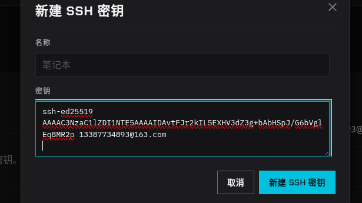

# 解释 SSH 密钥保存路径提示

- 归档编号：`01a132e6-6769-7972-9868-b5567d1af310`
- 项目：蚂蚁灵波具身大模型挑战赛
- 创建时间：2026-10-13T09:35:22.986000+08:00
- 更新时间：2026-10-13T09:44:23.045000+08:00
- 状态：活动
- 导出范围：用户可见消息与助手可见回复；不含隐藏推理和工具原始输出

## 1. 用户

<external_codex_apps_open_page>{"page_id":null}</external_codex_apps_open_page>

## 2. 用户

lsy03@lsy03-System-Product-Name:~$ ssh-keygen -t ed25519 -C "13387734893@163.com"
Generating public/private ed25519 key pair.
Enter file in which to save the key (/home/lsy03/.ssh/id_ed25519):
这是什么意思？

## 3. 助手

它在问：**新生成的 SSH 密钥要保存在哪里？**

括号里的 `/home/lsy03/.ssh/id_ed25519` 是默认路径。直接按 **Enter** 就使用这个路径；如果那里已有密钥，后面可能提示是否覆盖，**不要随意覆盖**，以免影响现有登录。想另存一把，可以输入不同的文件名，例如 `/home/lsy03/.ssh/id_ed25519_new`，再按 Enter。

接下来通常会询问是否设置密钥口令。

## 4. 用户

lsy03@lsy03-System-Product-Name:~$ ssh-keygen -t ed25519 -C "13387734893@163.com"
Generating public/private ed25519 key pair.
Enter file in which to save the key (/home/lsy03/.ssh/id_ed25519):
Enter passphrase (empty for no passphrase):
这是啥？

## 5. 助手

它在问你是否给 **SSH 私钥设置密码**（passphrase）。

- 输入一段密码并按 Enter：以后使用这把密钥时，可能需要输入这个密码。输入时屏幕不会显示字符，这是正常的。
- 直接按 Enter：不设置密码。之后还会再让你确认一次，继续按 Enter 即可。

如果这把密钥用于个人电脑，建议设置密码并妥善保存。

## 6. 用户

lsy03@lsy03-System-Product-Name:~$ cat ~/.ssh/id_ed25519.pub
ssh-ed25519 AAAAC3NzaC1lZDI1NTE5AAAAIDAvtFJr2kIL5EXHV3dZ3g+bAbHSpJ/G6bVglEq8MR2p 13387734893@163.com
lsy03@lsy03-System-Product-Name:~$
我没搞懂这里面应该填啥？

## 7. 助手

这里填两项：

- **名称**：随你取，用来认出这把密钥，例如 `lsy03 的电脑`。
- **密钥**：填 `cat ~/.ssh/id_ed25519.pub` 输出的**整行公钥**，从 `ssh-ed25519` 开始，到邮箱结束。

你截图里 `ssh-ed25519` 和后面的 `AAAAC...` 看起来被分成了两行。请确认它们之间是**一个空格**，不要手动按 Enter 换行；输入框因宽度不够而自动折行是正常的。填好后点「新建 SSH 密钥」。

## 8. 用户

邮箱也填吗

## 9. 助手

对，**邮箱也一起填**。把 `cat ~/.ssh/id_ed25519.pub` 输出的整行原样粘贴进去，包括开头的 `ssh-ed25519` 和末尾的 `13387734893@163.com`。邮箱只是这把密钥的备注。
