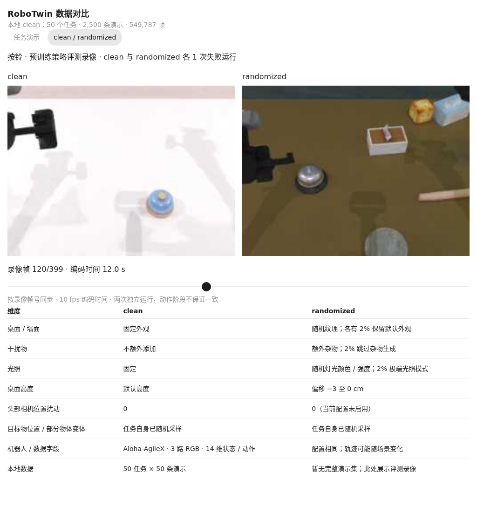
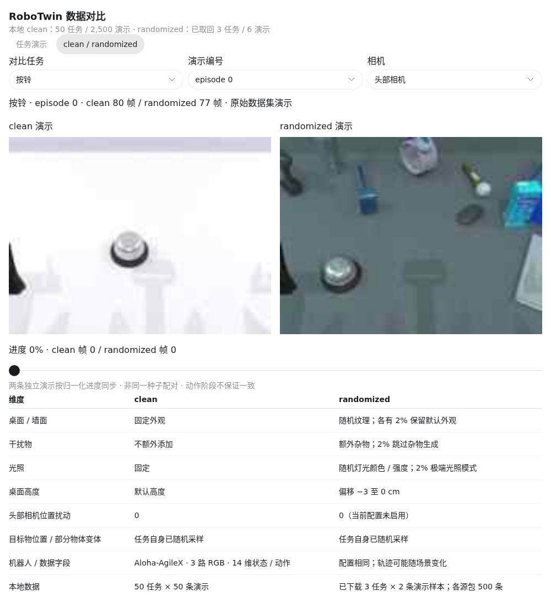
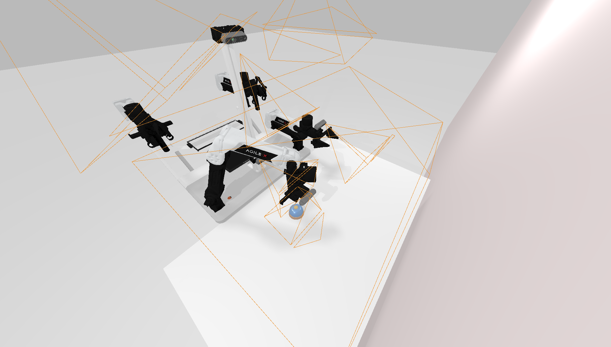
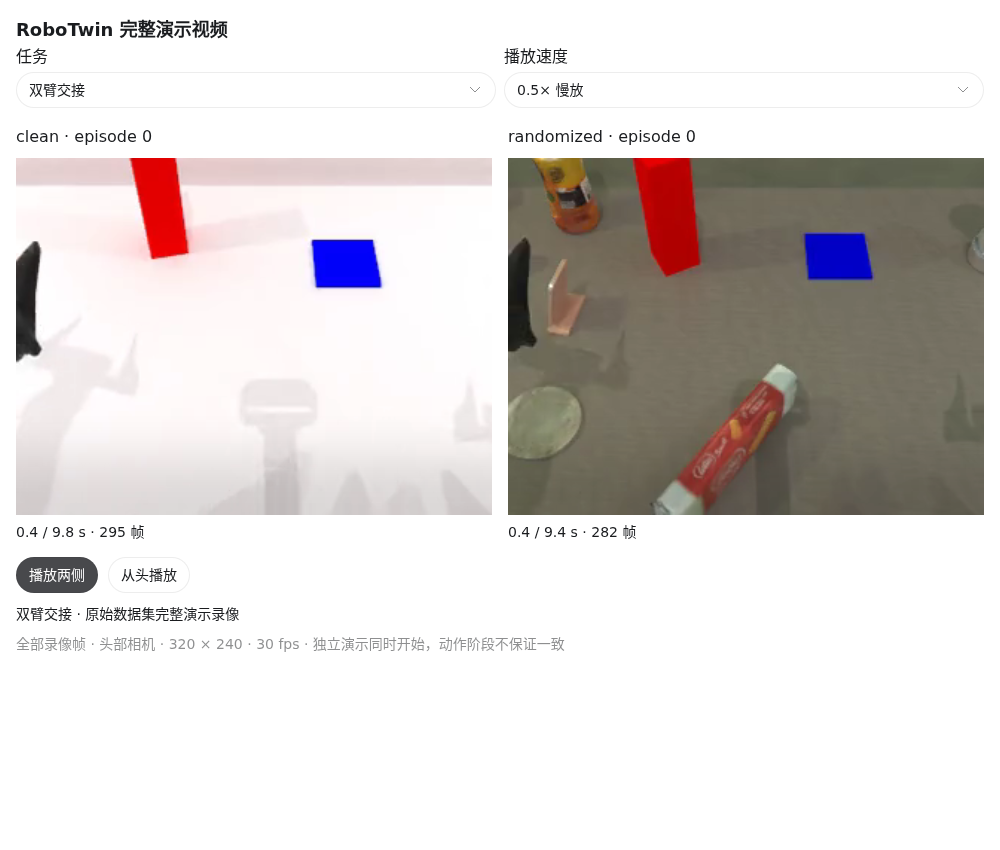
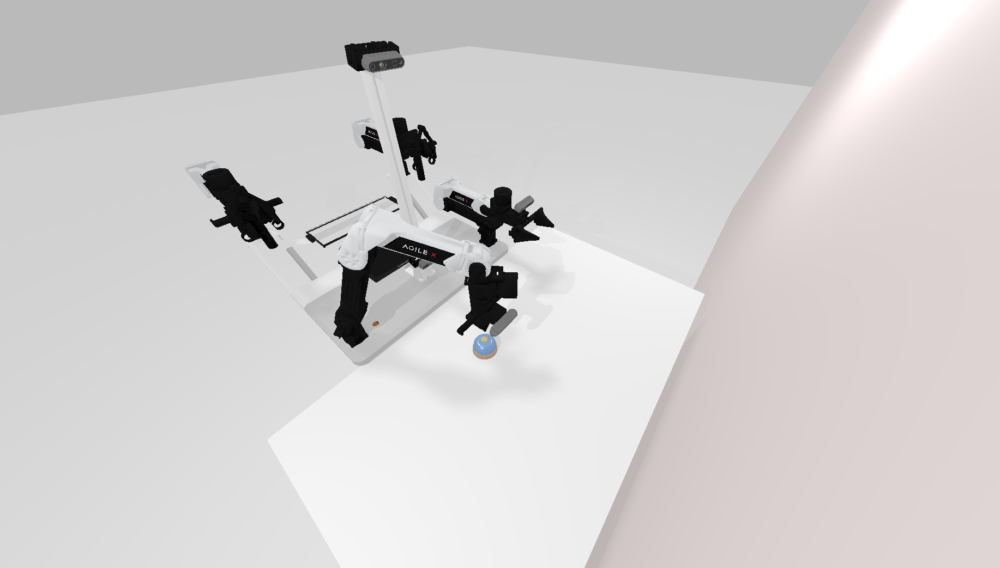

# 可视化对比 clean 与 randomized 数据

- 归档编号：`01a134d2-03de-7ac2-b1f0-2302cd467dbe`
- 项目：蚂蚁灵波具身大模型挑战赛
- 创建时间：2026-10-13T18:32:21.220000+08:00
- 更新时间：2026-10-14T16:55:16.039000+08:00
- 状态：活动
- 导出范围：用户可见消息与助手可见回复；不含隐藏推理和工具原始输出

## 1. 用户

<external_codex_apps_open_page>{"page_id":null}</external_codex_apps_open_page>

## 2. 用户

现在有没有办法可以给我直观的看一下，或者使用rerun还是别的什么，可以看几个任务的数据信息，以及clean 和 randomized 的数据的差别有哪些

## 3. 助手（进展）

我先看看项目里已有的数据、任务说明和可视化工具，再确定怎样直观对比 clean 和 randomized，包括画面、轨迹和数据统计。

## 4. 助手（进展）

本地已经有 50 个任务的 clean 数据，每个任务 50 条演示，也有 click_bell 的 clean / randomized 评测录像。可以先用这些真实数据做一个可拖动时间轴的查看器；我正在核对随机化配置，区分画面变化和轨迹数据的变化。

## 5. 助手（进展）

我会用 visualize 技能做交互对比，先选“按铃、叠积木、双臂交接”三个任务，查看相机画面、关节和夹爪随时间的变化。当前下载的是 clean 演示数据；randomized 有按铃任务的评测录像，因此会标明两种来源，避免把评测运行当成训练演示。

## 6. 助手（进展）

差异已经核实：randomized 会改变桌面和墙面纹理、增加干扰物、随机光照，并让桌面高度向下变化最多 3 厘米；当前配置没有启用相机位置随机化。clean 本身也会随机放置任务物体，因此它并不是每条演示都完全相同。按铃的两段评测录像可以并排查看，但都只是一次失败运行，不能据此判断成功率差异。

## 7. 助手（进展）

三个任务各两条演示的三路相机画面已经取出，状态与下一步动作的对应关系也校验通过。现在把它们接到同一条时间轴上，并加入按铃的 clean / randomized 并排画面，方便你直接看纹理、杂物和光照的区别。

## 8. 助手（进展）

查看器已接好：可以切换任务和演示、拖动关键帧，并查看 14 个状态／动作分量；对比页可以同步拖动 clean 和 randomized 的评测画面。我正在检查显示和交互，确保切换时画面与数值对应正确。

## 9. 助手

_工具输出图片（原始工具文本未纳入归档）。_




## 10. 助手

可以，已经用本地真实数据做了交互查看器：

- **任务演示**：按铃、叠积木、双臂交接，每个任务两条演示，可拖动关键帧，查看三路相机及关节／夹爪状态和动作。
- **clean / randomized**：并排查看按铃评测画面，并列出具体随机化差异。

visualize{"path":"/home/lsy03/.codex/visualizations/2026/10/13/01a134d2-03de-7ac2-b1f0-2302cd467dbe/robotwin-data-compare.html"}

注意：randomized 当前展示的是评测录像，本地尚无完整 randomized 演示集。[Rerun](https://rerun.io/docs/getting-started) 也适合后续做完整连续回放；上面可以先直接查看，无需安装。

[附件：4be0f511629c8840--robotwin-data-compare.html](../../assets/4be0f511629c8840--robotwin-data-compare.html)

## 11. 用户

<external_codex_apps_open_page>{"page_id":null}</external_codex_apps_open_page>

## 12. 用户

randomized 是不是没有下载下来？现在在我给你的链接里面能找到吗，在链接里，如果有可以下载下来看一下

## 13. 助手（进展）

我先核对本地下载清单和之前的数据链接，确认 randomized 是否可用；如果有，就先下载少量样本做对比。

## 14. 助手（进展）

确认了：此前确实只下载了 clean，randomized 没在下载清单中。原数据仓库里能看到 `aloha-agilex_randomized_500.zip`；我先取三个任务各两条演示，接到查看器里。这样能直接比较两种演示数据。

## 15. 助手（进展）

三个任务都有 randomized 包。下载接口支持按范围读取 ZIP，我正在取出选定演示的 HDF5、视频和指令，并做完整性校验。样本会单独保存，不会加入现有 clean 训练数据。

## 16. 助手（进展）

样本已下载并校验通过：按铃、叠积木、双臂交接各两条 randomized 演示，共约 117 MB。每条都包含 HDF5、视频和指令，三个源包各有 500 条演示。查看器现在会用这些下载下来的演示做对比。

## 17. 助手

_工具输出图片（原始工具文本未纳入归档）。_



## 18. 助手

是的，之前只下载了 **clean**。你此前的 [RoboTwin2.0 数据链接](https://huggingface.co/datasets/TianxingChen/RoboTwin2.0/tree/main/dataset)里有 `aloha-agilex_randomized_500.zip`，每个任务包含 500 条演示。

现在已下载**按铃、叠积木、双臂交接各两条 randomized 演示**，约 **117 MB**，包含 HDF5、视频和指令，校验已通过。目前取的是样本，没有下载完整包。

下面已更新为真实演示对比：切换 **clean / randomized**，可以选择任务、相机并拖动进度查看。

visualize{"path":"/home/lsy03/.codex/visualizations/2026/10/13/01a134d2-03de-7ac2-b1f0-2302cd467dbe/robotwin-data-compare.html"}

[附件：4be0f511629c8840--robotwin-data-compare.html](../../assets/4be0f511629c8840--robotwin-data-compare.html)

## 19. 用户

意思就是 clean 的任务和 randomized 的任务完全不同？

## 20. 助手

不是，**clean 和 randomized 是同一批任务，在不同场景条件下的数据。**

例如 `handover_block` 都要求“左臂抓取积木，交给右臂，再放到目标垫上”：

- **clean**：背景和光照固定，没有额外杂物；任务物体的位置仍可能随机变化。
- **randomized**：目标相同，但加入随机纹理、杂物、光照和桌面高度变化。

所以，**任务目标相同，具体场景和动作轨迹可能不同**。查看器中两边的 `episode 0` 是各自独立采集的第一条演示，并不是同一个场景只换了背景。

## 21. 用户

<external_codex_apps_open_page>{"page_id":null}</external_codex_apps_open_page>

## 22. 用户

现在的这些roboTwin 的仿真环境到底有没有完整的仿真视频或者好查看一些的可视化环境或者平台可以运行？你给我看的这几个跳变的画面说实话真的不太直观

## 23. 助手（进展）

你说得对，之前每条只抽了 8 帧，动作看起来会跳。数据里已有完整演示视频，我先把它们做成可以连续播放的对比，并检查本地能否运行 RoboTwin 的交互仿真窗口。

## 24. 助手（进展）

本地有两种更直观的方式：完整 MP4 可以连续看动作；RoboTwin 自带的 SAPIEN 三维窗口可以旋转、缩放视角，查看场景和专家动作。仿真镜像和桌面显示条件都已具备，我会打开播放对比，并验证三维窗口是否能正常启动。

## 25. 助手（进展）

完整视频已逐帧检查通过，都是 30 fps 的连续录像，按铃约 3 秒，叠积木和双臂交接约 10 秒。三维窗口也支持本地显示；我正在加上“播放专家动作、切换任务、切换 clean/randomized”的按钮，方便直接操作。

## 26. 助手（进展）

连续视频已经验证能正常播放、慢放和切换任务。三维窗口也已成功显示在桌面上，我还在检查专家动作播放；下面会提供完整视频播放器，便于直接看动作过程。

## 27. 助手

_工具输出图片（原始工具文本未纳入归档）。_





## 28. 助手（进展）

三维查看器已跑通，按铃专家动作执行成功。窗口里可以重播动作、切换三个任务和 clean/randomized，也能自由调整视角；我还关掉了默认的相机辅助线，让场景更清楚。

## 29. 助手

有。之前的跳变是因为我只抽了 8 帧，**原始数据有完整连续视频，RoboTwin 也有真正的三维仿真窗口**。

我已经在桌面打开 **SAPIEN 三维窗口**，并验证按铃专家动作执行成功。在 `RoboTwin Expert Demo` 面板中：

- **Play / Replay Expert**：播放、重播专家动作。
- **Next Task**：切换按铃、叠积木、双臂交接。
- **Clean / Randomized**：切换场景条件。

可以用鼠标和滚轮调整视角。关闭后，可通过[启动脚本](/home/lsy03/文档/ChatGPT/蚂蚁灵波具身大模型挑战赛/scripts/run_robotwin_3d_viewer.sh)重新打开。

下面是完整连续录像，支持播放、慢放和全屏：

visualize{"path":"/home/lsy03/.codex/visualizations/2026/10/13/01a134d2-03de-7ac2-b1f0-2302cd467dbe/robotwin-continuous-video.html"}

[附件：5187b38da6296e2f--robotwin-continuous-video.html](../../assets/5187b38da6296e2f--robotwin-continuous-video.html)

## 30. 用户

这个 RoboTwin 是否还占用 GPU？ 如果有的话，给我命令我先停一下

## 31. 助手（进展）

我确认一下三维查看器是否还在运行、是否仍占用 GPU，再给你对应的停止命令。

## 32. 助手

是的，RoboTwin 三维查看器还在运行，其 Python 进程占用约 **3.8 GiB GPU 显存**。

执行下面命令即可停止：

```bash
docker stop lingbo-robotwin-3d-viewer
```

只停止这个查看器，不影响其他容器。聊天里的视频播放器不占用这部分仿真显存。

## 33. 助手

_历史投影中的图片引用（用于补全本地对话资源）。_



> 资源未归档：`/tmp/robotwin-demo-preview.png`（missing）

> 资源未归档：`/tmp/robotwin-comparison-preview.png`（missing）

> 资源未归档：`/tmp/robotwin-randomized-compare.png`（missing）

> 资源未归档：`/tmp/robotwin-continuous-playback.png`（missing）
