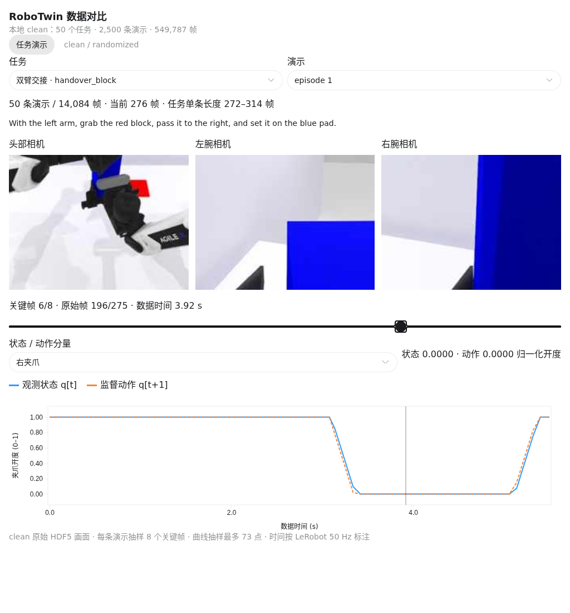

# 可视化对比 clean 与 randomized 数据

- 归档编号：`01a134d2-03de-7ac2-b1f0-2302cd467dbe`
- 项目：蚂蚁灵波具身大模型挑战赛
- 创建时间：2026-10-13T18:32:21.220000+08:00
- 更新时间：2026-10-14T10:03:09.473000+08:00
- 状态：活动
- 导出范围：用户可见消息与助手可见回复；不含隐藏推理和工具原始输出

## 1. 用户

<external_codex_apps_open_page>{"page_id":null}</external_codex_apps_open_page>

## 2. 用户

现在有没有办法可以给我直观的看一下，或者使用rerun还是别的什么，可以看几个任务的数据信息，以及clean 和 randomized 的数据的差别有哪些

## 3. 助手（进展）

我先看看项目里已有的数据、任务说明和可视化工具，再确定怎样直观对比 clean 和 randomized，包括画面、轨迹和数据统计。

## 4. 助手（进展）

本地已经有 50 个任务的 clean 数据，每个任务 50 条演示，也有 click_bell 的 clean / randomized 评测录像。可以先用这些真实数据做一个可拖动时间轴的查看器；我正在核对随机化配置，区分画面变化和轨迹数据的变化。

## 5. 助手（进展）

我会用 visualize 技能做交互对比，先选“按铃、叠积木、双臂交接”三个任务，查看相机画面、关节和夹爪随时间的变化。当前下载的是 clean 演示数据；randomized 有按铃任务的评测录像，因此会标明两种来源，避免把评测运行当成训练演示。

## 6. 助手（进展）

差异已经核实：randomized 会改变桌面和墙面纹理、增加干扰物、随机光照，并让桌面高度向下变化最多 3 厘米；当前配置没有启用相机位置随机化。clean 本身也会随机放置任务物体，因此它并不是每条演示都完全相同。按铃的两段评测录像可以并排查看，但都只是一次失败运行，不能据此判断成功率差异。

## 7. 助手（进展）

三个任务各两条演示的三路相机画面已经取出，状态与下一步动作的对应关系也校验通过。现在把它们接到同一条时间轴上，并加入按铃的 clean / randomized 并排画面，方便你直接看纹理、杂物和光照的区别。

## 8. 助手（进展）

查看器已接好：可以切换任务和演示、拖动关键帧，并查看 14 个状态／动作分量；对比页可以同步拖动 clean 和 randomized 的评测画面。我正在检查显示和交互，确保切换时画面与数值对应正确。

## 9. 助手

_工具输出图片（原始工具文本未纳入归档）。_

## 10. 助手

可以，已经用本地真实数据做了交互查看器：

- **任务演示**：按铃、叠积木、双臂交接，每个任务两条演示，可拖动关键帧，查看三路相机及关节／夹爪状态和动作。
- **clean / randomized**：并排查看按铃评测画面，并列出具体随机化差异。

visualize{"path":"/home/lsy03/.codex/visualizations/2026/10/13/01a134d2-03de-7ac2-b1f0-2302cd467dbe/robotwin-data-compare.html"}

注意：randomized 当前展示的是评测录像，本地尚无完整 randomized 演示集。[Rerun](https://rerun.io/docs/getting-started) 也适合后续做完整连续回放；上面可以先直接查看，无需安装。

[附件：05e84bda0819c21a--robotwin-data-compare.html](../../assets/05e84bda0819c21a--robotwin-data-compare.html)

## 11. 用户

<external_codex_apps_open_page>{"page_id":null}</external_codex_apps_open_page>

## 12. 用户

randomized 是不是没有下载下来？现在在我给你的链接里面能找到吗，在链接里，如果有可以下载下来看一下

## 13. 助手（进展）

我先核对本地下载清单和之前的数据链接，确认 randomized 是否可用；如果有，就先下载少量样本做对比。

## 14. 助手（进展）

确认了：此前确实只下载了 clean，randomized 没在下载清单中。原数据仓库里能看到 `aloha-agilex_randomized_500.zip`；我先取三个任务各两条演示，接到查看器里。这样能直接比较两种演示数据。

## 15. 助手

_历史投影中的图片引用（用于补全本地对话资源）。_

