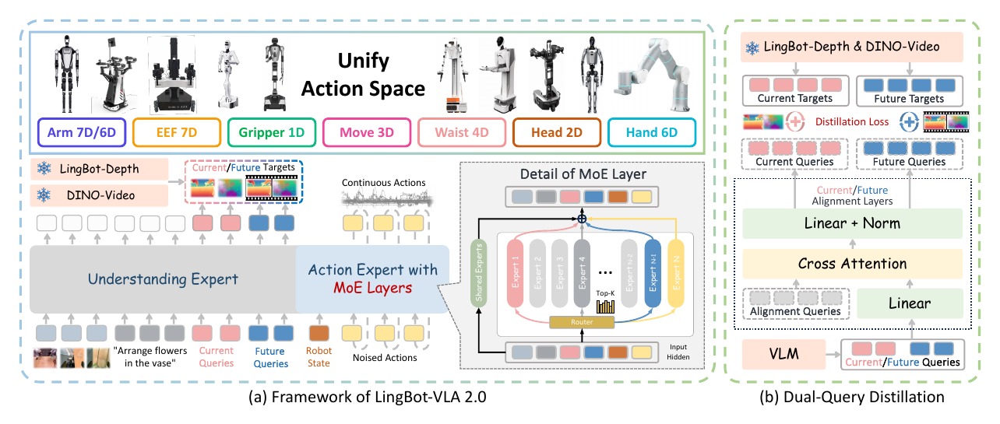

# 梳理 RoboTwin 后训练方式

- 归档编号：`01a1386e-c1bc-7a20-bfcf-be18823fd812`
- 项目：蚂蚁灵波具身大模型挑战赛
- 创建时间：2026-10-14T11:22:25.086000+08:00
- 更新时间：2026-10-14T11:27:06.941000+08:00
- 状态：活动
- 导出范围：用户可见消息与助手可见回复；不含隐藏推理和工具原始输出

## 1. 用户

<external_codex_apps_open_page>{"page_id":null}</external_codex_apps_open_page>

## 2. 用户

| 权重                           | 类型                                    |
| ---------------------------- | ------------------------------------- |
| `lingbot-vla-v2-6b`          | 通用预训练权重，作为我们微调的起点                     |
| `lingbot-vla-v2-6b-robotwin` | 已针对 RoboTwin 后训练的权重，对应此前介绍的高成功率模型  |

给我看下这个robotwin的后训练到底是怎么做的？到底是用了什么方式微调还是全量微调来动作专家还是整个包括VLA或者教师啥的？

结合`lingbot-vla-v2-6b` 的架构图，来进行说明

## 3. 助手（进展）

我会先查官方代码和技术报告，核实 RoboTwin 后训练更新了哪些模块，再结合 `lingbot-vla-v2-6b` 的架构说明训练流程。

## 4. 助手

_工具输出图片（原始工具文本未纳入归档）。_

## 5. 助手（进展）

官方配置显示，RoboTwin 后训练保留了深度和视频蒸馏，也没有冻结视觉编码器。我正在核对代码里的参数冻结和优化器分组，确认 VLM、动作专家和教师各自是否更新。

## 6. 助手

**结论：按官方公开的 RoboTwin 后训练配置和代码，它采用的是 VLA 主体的全参数微调，包括视觉编码器、语言理解骨干和 MoE 动作专家；同时继续进行深度／视频特征蒸馏，但两个教师模型保持冻结。不是只训练动作专家，也不是 LoRA。**

这里要区分证据范围：下面能直接核实的是**官方当前公开的训练方案和代码行为**；发布权重当次训练的完整日志没有在这些材料中呈现，不能把当前配置的每个超参数都当成历史运行记录。[官方训练配置](https://github.com/Robbyant/lingbot-vla-v2/blob/main/configs/vla/robotwin/robotwin.yaml)

**对照架构图，看哪些地方在训练**

下面是官方 `lingbot-vla-v2` 架构原图：

[原图来源：官方仓库](https://github.com/Robbyant/lingbot-vla-v2/blob/main/assets/lingbot_vla2_framework.png)

图中的 **Understanding Expert + Action Expert 合起来才是 VLA 主体**。教师位于旁边，负责提供监督目标。

| 图中的模块 | RoboTwin 后训练是否更新 | 具体含义 |
|---|---|---|
| 图像编码器 | **更新** | 当前相机图像的视觉特征提取部分也适应 RoboTwin |
| **Understanding Expert** | **更新** | Qwen3-VL 的理解骨干参与训练，并非只输出固定特征 |
| **Action Expert with MoE Layers** | **更新** | 动作 Transformer、MoE 路由器、共享专家和路由专家都属于可训练主体 |
| 状态／动作输入输出投影、时间条件模块 | **更新** | 学习机器人状态和连续动作之间的映射 |
| **Current / Future Queries** | **更新** | 学习当前场景及未来场景的表示 |
| 右图的 **Alignment Layers** | **更新** | 将学生表示映射到教师特征空间 |
| ❄️ **LingBot-Depth** | **冻结** | 只生成几何特征监督 |
| ❄️ **DINO-Video** | **冻结** | 只生成时序视觉特征监督 |
| 深度教师链路中的 MoGe | **冻结** | 辅助生成深度监督目标 |

这里的代码证据很直接：

- `freeze_vision_encoder: false`：视觉编码器不冻结。
- `train_expert_only` 默认是 `false`，RoboTwin 配置没有将它开启：理解骨干不冻结。
- 当前／未来 queries 和对齐投影显式设置为可训练。
- 深度与视频教师设置 `requires_grad=False`，教师前向计算放在 `torch.no_grad()` 下。

来源：[V2 主体冻结逻辑](https://github.com/Robbyant/lingbot-vla-v2/blob/main/lingbotvla/models/vla/lingbot_vla/modeling_lingbot_vla_v2.py#L197)、[训练开关默认值](https://github.com/Robbyant/lingbot-vla-v2/blob/main/tasks/vla/train_lingbotvla.py#L120)、[对齐模块实现](https://github.com/Robbyant/lingbot-vla-v2/blob/main/lingbotvla/models/vla/lingbot_vla/modeling_lingbot_vla.py#L790)、[深度教师冻结](https://github.com/Robbyant/lingbot-vla-v2/blob/main/lingbotvla/models/vla/vision_models/module_utils.py#L71)、[视频教师冻结](https://github.com/Robbyant/lingbot-vla-v2/blob/main/lingbotvla/models/vla/vision_models/dino_video/teacher.py#L60)。

**它到底怎么学：动作模仿 + 双教师蒸馏，一起更新学生**

可以沿着图分成三条训练路径：

**① 动作路径：用 RoboTwin 示范轨迹学习动作。**

输入当前多视角图像、文字指令、机器人状态；对真实示范动作加噪，然后让动作专家预测 Flow Matching 的向量场。官方设置是 `L1_fm`，即使用 L1 的 Flow Matching 训练目标。

所以，这里的后训练本质上是**基于示范数据的监督式策略学习／模仿学习**。公开流程没有用奖励函数做 PPO 等强化学习。[动作损失实现](https://github.com/Robbyant/lingbot-vla-v2/blob/main/lingbotvla/models/vla/lingbot_vla/modeling_lingbot_vla.py#L1239)

**② 几何路径：让学生学会表示当前和未来的几何。**

图中粉色的 Current Queries、蓝色的 Future Queries，经过理解骨干和右侧 Alignment Layers 后，分别对齐：

- 当前帧经 LingBot-Depth 提取的特征；
- 未来帧经 LingBot-Depth 提取的特征。

**③ 视频路径：让学生学会表示当前及未来的时序视觉信息。**

同样的学生 query 表示，还接受 DINO-Video 的当前／未来特征监督。

关键区别是：**训练数据中的真实未来画面用于生成教师目标；学生学习从当前观测预测未来表示。部署时不需要提前得到真实未来画面。** 论文把这个设计称为 Dual-Query Distillation。[论文 §4.2](https://arxiv.org/html/2607.06403v1#S4.SS2)

整体目标可以概括为：

\[
L =
L_{\text{动作 Flow Matching}}
+\lambda_d L_{\text{当前/未来深度}}
+\lambda_v L_{\text{当前/未来视频}}
+L_{\text{MoE 路由正则}}
\]

这些损失共同反向传播到学生的可训练模块；**教师只提供目标，不被这次后训练更新**。[训练时教师前向与学生调用](https://github.com/Robbyant/lingbot-vla-v2/blob/main/tasks/vla/train_lingbotvla.py#L763)

**“动作专家”与“MoE 专家”不是同一级概念**

图中整个蓝色大块叫 **Action Expert**；放大图中的多个小专家，是这个动作网络内部 FFN 的 **MoE experts**。

官方 RoboTwin 配置在动作专家的 36 层中使用 MoE，每层有 32 个路由专家，每个 token 选 Top-4，另有共享专家。因此：

> “每个 token 只激活几个专家”是稀疏计算机制，不代表只微调几个指定专家，更不代表冻结整个 VLM。

路由专家在被选中时获得相应梯度，路由器、共享专家及其他主体模块也参与训练。[MoE 架构说明](https://arxiv.org/html/2607.06403v1#S4.SS1)、[官方配置](https://github.com/Robbyant/lingbot-vla-v2/blob/main/configs/vla/robotwin/robotwin.yaml#L34)

**与 `lingbot-vla-v2-6b-robotwin` 对应的训练设置**

官方公开方案使用 **RoboTwin 2.0 的 50 个任务，将 clean 与 randomized 数据混合训练一个策略**。当前配置采用 Muon，global batch 为 1024，训练 50,000 steps；动作学习之外仍开启当前／未来深度和视频蒸馏。官方报告该方案达到 Clean **93.52%**、Randomized **92.80%**。[官方训练与结果说明](https://github.com/Robbyant/lingbot-vla-v2#post-training-example)

因此，如果我们从 `lingbot-vla-v2-6b` 出发，选择“冻结 VLM，只微调动作专家”，或者选择 LoRA，那就是**我们自行采用的低成本适配方案**；官方公开的 RoboTwin 高成功率方案对应的是 **VLA 主体全参数适配 + 冻结教师持续蒸馏**。

## 7. 助手

_历史投影中的图片引用（用于补全本地对话资源）。_

> 资源未归档：`/tmp/lingbot-v2-inspect/assets/lingbot_vla2_framework.png`（missing）
