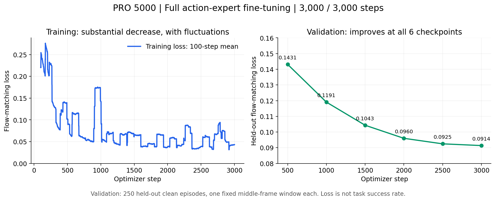
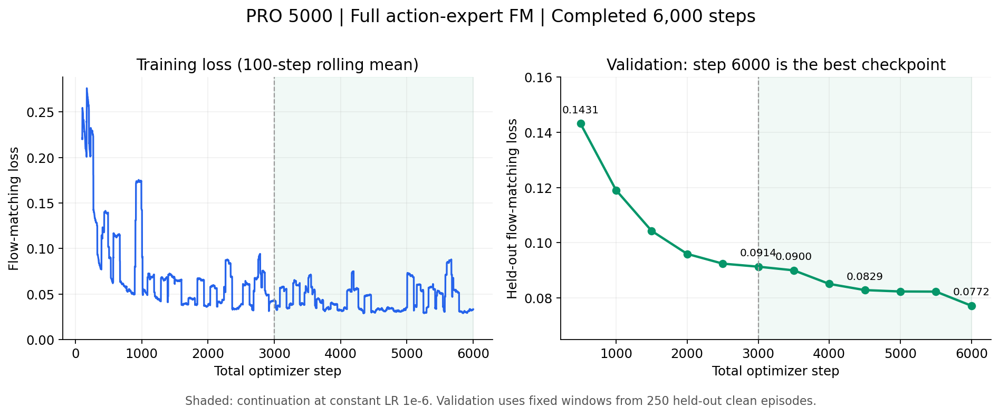
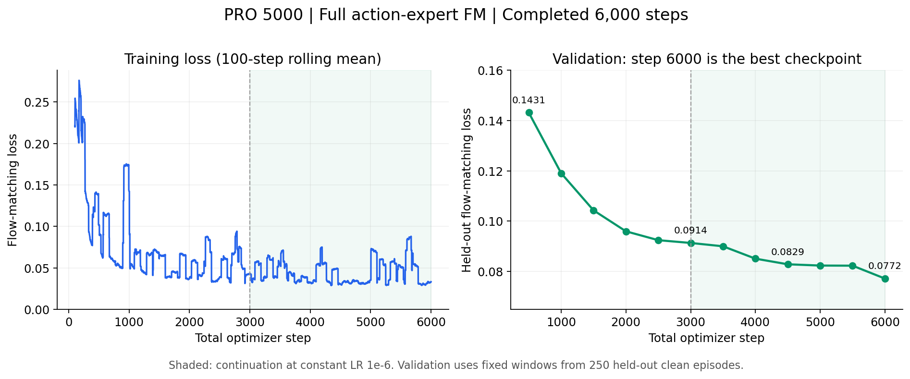

# 10_16 10_15 检查 Pro 5000 3k 全量 训练结果 以及6K继续训练

- 归档编号：`01a13d8a-8658-7691-88f4-c30b3ed1d38b`
- 项目：蚂蚁灵波具身大模型挑战赛
- 创建时间：2026-10-15T11:10:50.974000+08:00
- 更新时间：2026-10-16T12:19:48.333000+08:00
- 状态：活动
- 导出范围：用户可见消息与助手可见回复；不含隐藏推理和工具原始输出

## 1. 用户

<external_codex_apps_open_page>{"page_id":null}</external_codex_apps_open_page>

## 2. 用户

我们在“10_13 Pro 5000 训练，后续计划”的基础上继续。现在我们3000步是不是已经完成，给我看下这个 训练结果如何？

## 3. 助手（进展）

我先查看“10_13 Pro 5000 训练，后续计划”的记录，再用 Pro 5000 的 SSH 技能核对训练步数和结果。

## 4. 助手（进展）

确认了：正式训练已完成 3,000/3,000 步，正常退出，最佳检查点也是第 3,000 步。我继续核对各阶段的训练和验证损失，看看下降是否稳定，并检查这版模型有没有仿真成功率结果。

## 5. 助手

_工具输出图片（原始工具文本未纳入归档）。_



## 6. 助手

**是的，3,000 步已经全部完成，训练正常结束。损失明显下降，但这版模型还没有仿真成功率结果。**

我刚核对了 PRO 5000 上的日志和检查点：

| 项目 | 结果 |
|---|---|
| 训练时间 | 今天（10月15日）09:31–10:43，约 **72分钟** |
| 完成进度 | **3,000 / 3,000 步** |
| 训练方式 | 全动作专家及输入输出投影微调，视觉语言骨干冻结 |
| 训练损失 | 前100步均值 **0.2206** → 最后100步均值 **0.0431**，下降约 **80.5%** |
| 最佳检查点 | **第3,000步**，权重与优化器状态已保存 |
| 峰值显存 | 约 **38.1 GiB** |


**更值得关注的是右侧验证曲线：六次验证都在改善。** 验证使用未参与训练的250条 clean 轨迹，每条取固定的中间帧窗口。

| 步数 | 验证损失，越低越好 |
|---:|---:|
| 500 | 0.1431 |
| 1,000 | 0.1191 |
| 1,500 | 0.1043 |
| 2,000 | 0.0960 |
| 2,500 | 0.0925 |
| **3,000** | **0.0914** |

我的判断是：**这轮训练有效，验证损失没有出现持续反弹，但后期改善已经放缓。** 最后500步的验证损失只再下降约1.2%；训练曲线虽然有波动，整体下降趋势明确。

不过，**损失下降不能直接换算成机器人任务成功率**。之前的 clean **13.6%**、randomized **14.4%** 属于旧的4,500步 LoRA，与本次训练不同。

下一步应先用这次 **3,000步最佳检查点做同条件仿真评测**，与原始权重、旧 LoRA 对比实际成功率，再决定是否继续加步数。


## 7. 用户

给我训练脚本，我想先继续续训练

## 8. 助手（进展）

我先检查这轮训练的恢复逻辑，准备一个从第 3,000 步继续训练的脚本和启动命令，确保权重、优化器状态和学习率能正确衔接。

## 9. 助手（进展）

原脚本不能只把“3,000”改成更大数字：这样会触发恢复校验失败，还会让学习率突然升高。我会默认再训练 3,000 步、累计到 6,000 步，沿用结束时的较小学习率，并将续训结果保存到新目录。原来的 3,000 步检查点会保留。

## 10. 助手（进展）

续训脚本已准备好：默认从第 3,001 步跑到第 6,000 步，每500步验证并保存，也支持暂停后恢复。我正在检查恢复状态和后台启动命令；完成后会同步到 PRO 5000，留给你手动启动。

## 11. 助手（进展）

PRO 5000 上的预检已通过：源检查点完整，GPU 和磁盘空间都足够。学习率衔接和中断恢复检查也已通过；我再核验一次源检查点里保存的优化器状态，然后给你可直接复制的启动命令。

## 12. 助手

**续训脚本已写好并同步到 PRO 5000，尚未启动。** 默认从 **3,000 步续训到累计 6,000 步**，再跑约1–1.5小时。

在你本机终端复制执行：

```bash
SCRIPT="/home/lsy03/文档/ChatGPT/蚂蚁灵波具身大模型挑战赛/scripts/expert_fm_continue_remote.sh"

bash "$SCRIPT" start
bash "$SCRIPT" live
```

- 恢复权重、AdamW 优化器及随机状态。
- 沿用末段学习率 `1e-6`，每500步验证并保存。
- 结果保存到新目录，保留原3,000步检查点。
- `live` 界面按 **Ctrl+C** 或关闭终端，后台训练继续。

需要暂停时执行；之后重新执行 `start` 即可恢复：

```bash
bash "$SCRIPT" stop
```

已通过语法检查、源检查点与优化器状态检查，以及远端资源预检。

[查看训练代码](/home/lsy03/文档/ChatGPT/蚂蚁灵波具身大模型挑战赛/scripts/train_expert_fm_continue.py) · [查看续训配置](../../assets/79362a1dca30e4b9--robotwin50-expert-fm-continuation.json)

[附件：79362a1dca30e4b9--robotwin50-expert-fm-continuation.json](../../assets/79362a1dca30e4b9--robotwin50-expert-fm-continuation.json)

## 13. 用户

看下现在是不是训练完了，给我看下训练结果如何？

## 14. 助手（进展）

我用 Pro 5000 的 SSH 技能检查续训进度、检查点和验证损失，再和原来第 3,000 步的结果对比。

## 15. 助手

_工具输出图片（原始工具文本未纳入归档）。_



## 16. 助手

**训练已经完成，累计 6,000/6,000 步，正常退出。这次续训继续带来了改善。**

今天 **14:18–15:25** 完成新增3,000步，耗时约 **68分钟**。最佳检查点是 **第6,000步**，权重和优化器状态均已保存。

| 指标 | 第3,000步 | 第6,000步 | 改善 |
|---|---:|---:|---:|
| 验证损失，越低越好 | 0.09136 | **0.07721** | **下降15.5%** |
| 最后100步平均训练损失 | 0.04307 | **0.03326** | **下降22.8%** |



图中绿色阴影是这次续训。**六次验证损失都在下降，没有出现验证损失反弹的迹象**，说明继续训练在当前验证集上有效。

验证仍使用未参与训练的250条 clean 轨迹，每条取固定窗口。**第6,000步尚未进行仿真成功率评测**，所以目前能确认动作预测损失改善，实际任务成功率还需要测试。

我建议下一步对比 **3,000步和6,000步的同条件仿真成功率**，再决定是否继续加步数。

[查看各检查点指标](../../assets/250bb8d328a82010--checkpoint-metrics.csv)


[附件：250bb8d328a82010--checkpoint-metrics.csv](../../assets/250bb8d328a82010--checkpoint-metrics.csv)

## 17. 用户

能否给我编写脚本，我想再续训练一段到 10k，训练完了，统一对 两个阶段中的比较优秀的模型进行评估。然后再试试Lora方案从头开始训练到 10k,然后进行评测。所有的训练和评测都在 Pro 5000 上进行。给我方案计划，并明确目标，先不要行动

## 18. 助手

可以。建议把它做成 **Pro 5000 上顺序执行的一条实验流水线**。下面先给方案，等你确认后再编写脚本。

**目标是回答两个问题：继续全动作专家训练到10k，实际成功率是否提高；相同数据和10k训练步数下，LoRA能否取得更好的效果，同时节省训练资源。**

这里将“两个阶段”定义为：**已经完成的0–6k阶段，以及接下来的6k–10k阶段**。每个阶段按验证损失选择一个最佳模型，再统一评测。当前第一阶段最佳模型是第6,000步。

### 1. 实验顺序

| 顺序 | 工作 | 明确产出 |
|---|---|---|
| ① | 全动作专家从6k续训到10k | 新增4,000步，保留该阶段验证集最佳检查点 |
| ② | 统一评测两个阶段的最佳模型 | 全专家6k阶段与10k阶段的成功率对比 |
| ③ | 从原始预训练权重重新开始LoRA，训练到10k | 独立的LoRA实验及最佳检查点 |
| ④ | 使用相同评测条件测试LoRA最佳模型 | 全专家与LoRA的最终对比报告 |

所有模型加载、训练、验证和仿真评测都在 **Pro 5000** 上进行，按顺序占用GPU。

### 2. 全动作专家：6k → 10k

继续使用当前已经跑通的训练方式：

- 从第6,000步完整恢复权重、AdamW优化器和随机状态。
- 动作专家学习率保持 **`1e-6`**，router保持 **`1e-7`**。
- 每 **500步** 验证并保存，共新增8个检查点。
- 使用独立的6k→10k输出目录，保留此前结果。

模型选择依据固定验证集的最低损失。例如，新阶段第9,000步最好，就评测第9,000步，而不是强制选第10,000步。若新阶段始终没有超过6k，也照实比较两个阶段的最佳结果。

根据刚完成的训练速度，这部分预计约 **1.5–2小时**。每个完整检查点约20 GiB，新增8个约占 **160 GiB**。

### 3. LoRA：从原始预训练权重训练到10k

这里“从头开始”指 **从原始预训练模型新建LoRA适配器**，重新初始化优化器；随机初始化的是LoRA参数。

建议先复用此前已跑通的结构：

| 项目 | 设置 |
|---|---|
| LoRA范围 | 动作专家注意力层的 `q/k/v/o` 投影 |
| LoRA参数 | rank＝8，alpha＝16 |
| 同时训练 | 状态、动作输入和动作输出投影 |
| 损失 | 与全专家相同的动作 flow matching |
| 训练长度 | 10,000次参数更新 |
| 验证与保存 | 每500步一次 |

LoRA采用独立的学习率设置。编写脚本时先核对此前已跑通的LoRA配置，再明确10k的warmup和衰减计划。**相同数据、训练步数和评测条件保持一致；两种参数更新方式分别使用适合自己的学习率。**

数据条件统一沿用当前设置：50个任务、2,250条训练轨迹、250条验证轨迹、256×256三路图像、50步动作块、有效batch＝4。randomized场景用于测试泛化能力。

这属于“同数据、同更新步数”的比较；同时记录耗时和峰值显存，用来比较训练成本。

### 4. 统一评测方式

主评测包含三个模型：

| 模型 | 选择方式 | 评测规模 |
|---|---|---:|
| 全专家：0–6k最佳 | 当前为第6,000步 | 500回合 |
| 全专家：6k–10k最佳 | 新阶段最低验证损失 | 500回合 |
| LoRA：0–10k最佳 | LoRA最低验证损失 | 500回合 |

每个模型均测试 **50个任务 × clean/randomized两种场景 × 每种5回合＝500回合**，共 **1,500回合**。

**这次要预先固定实际可运行的场景种子清单。** 此前评测存在可行性筛选后实际种子不一致的问题，这次让三个模型使用同一组场景、指令及推理设置，才能做配对比较。仿真基础设施报错的回合单独补跑。

最终报告包含：

- clean、randomized及总体成功率。
- 各任务的提升、退化和配对差值。
- 训练耗时、峰值显存、验证损失和检查点大小。
- 成功与失败视频样例。

每任务5回合适合第一轮筛选；若结果接近，再对关键任务增加回合。参考此前500回合约8–9小时的速度，**完整评测会是主要耗时，三组暂按约24–30小时预算**。

### 5. 脚本与完成标准

计划提供一个总控脚本，支持 `check / start / status / live / stop / resume`。它负责按上述顺序运行，失败时保存状态，恢复后从未完成阶段继续，并输出一份汇总报告。

本轮完成标准是：

1. 全专家累计完成10k，LoRA独立完成10k。
2. 三个候选模型均完成相同条件的500回合评测。
3. 明确给出 **继续全专家训练是否值得、全专家与LoRA哪个更适合后续投入** 的结论。

建议按这个方案实施，先完成一次完整对比，再决定下一轮训练规模。

## 19. 用户

LoRA 我记得之前是不是有训练过一小段

## 20. 助手（进展）

我核对一下之前 LoRA 的训练记录和检查点，确认跑到了多少步，以及和刚才计划里的新实验有什么关系。

## 21. 助手

**是的，LoRA实际上已经累计训练到10,000步了。** 我刚才的方案漏掉了这轮续训记录，需要据此调整。

| 阶段 | 已完成情况 | 最佳验证损失 |
|---|---|---:|
| 第一轮LoRA | 10月12日完成5,000步，最佳为第4,500步 | **0.07994** |
| LoRA续训 | 10月14日在本机4090上，从5,000续训到10,000步 | **0.04664** |

这轮使用 **rank＝8、alpha＝16**，训练动作专家注意力层的LoRA，以及状态、动作输入输出投影。续训完整恢复了优化器和随机状态。

另外，要区分训练和评测：

- **第4,500步已完成500回合评测**：clean **13.6%**，randomized **14.4%**。
- **第10,000步检查点已经保存，是该轮最佳模型**；目前尚无已确认的仿真成功率结果。

因此，后续应把**已有的LoRA 10k模型纳入统一评测候选**。如果主要目标是比较效果，可以先在Pro 5000评测它；你提出的“在Pro 5000重新从预训练权重跑LoRA到10k”，则作为一次新的复现实验。

[查看已有LoRA 10k训练记录](../../assets/2ccac5f776016210--robotwin50-continuation.json)

[附件：2ccac5f776016210--robotwin50-continuation.json](../../assets/2ccac5f776016210--robotwin50-continuation.json)

## 22. 用户

给我总结一下，目前的模型版本有哪些？哪些是经过评测的，评测结果如何？哪些没有经过评测验证？

## 23. 助手（进展）

我会把本机和 Pro 5000 上的训练检查点、评测记录对齐，整理成一张模型版本表，并区分完整评测与单任务验收。

## 24. 助手（进展）

查到两个需要补充的点：原始权重的异常场景已补跑完成，最终可以按500回合统计；全动作专家3k版除了按铃单回合验收，还在本机4090上做过部分评测。后者覆盖不完整、推理精度也不同，我会单独标明。

## 25. 助手

**目前完成500回合开发评测的，只有“原始预训练权重”和“LoRA第4,500步”。LoRA 10k、全动作专家6k都已训练完成，但还缺完整的仿真效果验证。**

按主要检查点整理如下，中间保存的检查点归入对应训练阶段：

| 模型版本 | 训练状态 | 验证损失↓ | 仿真评测情况 |
|---|---|---:|---|
| **原始预训练权重** | 未做我们的后训练 | — | **500回合完成** |
| **LoRA 4,500步** | 首轮0–5k中的最佳模型 | **0.07994** | **500回合完成** |
| LoRA 5,000步 | 首轮训练终点 | 0.08005 | 未单独评测；首轮选用了4.5k |
| **LoRA 10,000步** | 本机4090续训完成，当前LoRA最佳 | **0.04664** | **尚未仿真评测** |
| **全动作专家3,000步** | Pro 5000训练完成 | **0.09136** | 单回合验收通过，另有部分评测 |
| **全动作专家6,000步** | Pro 5000续训完成，当前专家最佳 | **0.07721** | **尚未仿真评测** |

**已经完成的500回合评测结果：**

每个模型均覆盖50个任务，clean和randomized各250回合。

| 模型 | clean | randomized | 合计 |
|---|---:|---:|---:|
| 原始预训练权重 | **27/250＝10.8%** | **31/250＝12.4%** | **58/500＝11.6%** |
| LoRA 4,500步 | **34/250＝13.6%** | **36/250＝14.4%** | **70/500＝14.0%** |

原始组之前报过11.0%，当时是27/245；异常场景补跑完成后，最终为 **27/250＝10.8%**。两组实际场景种子并未全部一致，因此总成功率差只能作参考，严格收益应看配对场景。这些属于内部开发评测。

**全动作专家3k目前只有局部结果：**

| 评测 | 覆盖 | 已完成部分的结果 |
|---|---|---|
| Pro 5000验收 | clean按铃，1回合 | **1/1成功** |
| 本机4090快速评测 | clean的5个任务 | **7/25＝28%** |
| 同一快速评测 | randomized仅完成按铃 | **2/5＝40%** |

4090快速评测目前因剩余显存不足暂停，计划50回合中仅完整完成30回合。它使用BF16专家权重，任务子集和渲染设置也不同，**28%不能直接与上面的50任务成绩比较**。

此外，早期还有一个 **click_bell单任务、仅更新2步的LoRA调通版本**，用于检查训练和恢复链路，不作为主要效果候选。

**当前最需要补评测的是LoRA 10k和全动作专家6k。** LoRA 10k的验证损失最低，但目前还不能据此认定它的任务成功率最好。全动作专家10k，以及你提出的“在Pro 5000重新训练LoRA到10k”，仍处于方案阶段。

## 26. 用户

我们的pro 5000 脚本这样安排如何：按照顺序

1.全动作专家续训到10k步 &#x20;

2. 按照顺序 分别 500 回合评测 全动作专家10,000步  LoRA 10,000步  全动作专家6,000步

给我看下这个安排如何？给我估算各个部分的时间和总时间

## 27. 助手（进展）

这个顺序适合做一轮集中对比。我先核对已有训练和500回合评测的实际耗时，再估算各阶段及总时间。

## 28. 助手

**这个安排合理，能直接比较“全专家继续训练的收益”和“全专家与LoRA的效果差异”。** 按你指定的三个检查点评测：全专家10k、已有LoRA 10k、全专家6k。

全部在Pro 5000上顺序执行，每组评测为 **50个任务 × clean/randomized两种场景 × 各5回合＝500回合**，共1,500回合。

| 顺序 | 工作 | 预计耗时 |
|---|---|---:|
| 准备 | 同步已有LoRA 10k权重，检查资源并固定评测条件 | **15–30分钟** |
| 1 | 全动作专家从6k续训到10k，包含验证和保存 | **1.5–2小时** |
| 2 | 全动作专家10k，评测500回合 | **8–12小时** |
| 3 | 已有LoRA 10k，评测500回合 | **8–10小时** |
| 4 | 全动作专家6k，评测500回合 | **8–12小时** |
| **总计** | 正常连续运行 | **约26–37小时，中心估计约30小时** |

建议给整轮实验预留 **36–48小时**，容纳异常场景补跑。

这些估算有实际运行记录作依据：

- **训练**：刚完成的3k→6k用了67.8分钟，平均每步1.23秒。新增4,000步仅参数更新约82分钟，加验证、保存和加载，预计1.5–2小时。
- **LoRA评测**：此前4.5k模型的500回合实际用了 **8.54小时**。
- **评测参考**：原始权重500回合的有效场景耗时合计 **9.22小时**。
- **全专家评测**：目前还没有完整500回合记录，因此给出更宽的8–12小时区间。模型成功得越早，回合通常越快；失败并跑满步数的任务会更慢。

我建议脚本固定以下行为：

1. **三组使用同一份实际场景种子清单**，统一输入、指令、推理精度和渲染设置，确保结果可比较。
2. **每完成一组立即保存成绩和视频索引**，再切换下一个模型；异常场景可单独补跑。
3. **训练完成后直接进入评测队列**，每次只运行一组GPU任务。
4. **LoRA使用已经完成的10k检查点**，这轮安排无需增加LoRA训练时间。

最终将得到一张三模型对比表，分别回答：**全专家10k是否优于6k，以及已有LoRA 10k是否优于全专家10k。**
