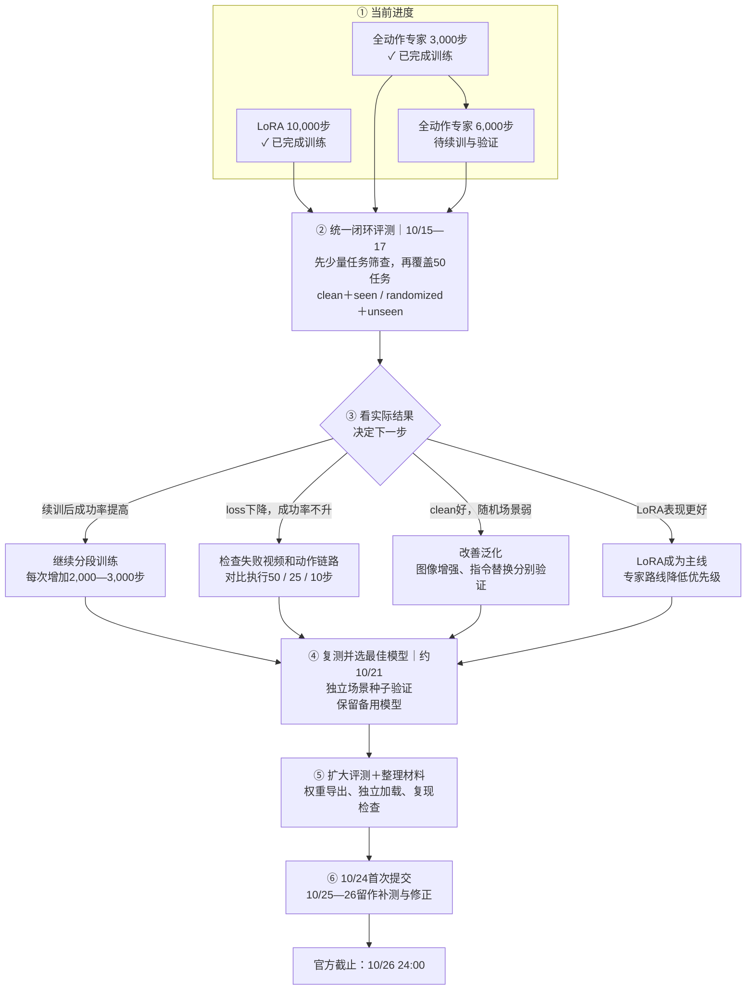

# 10_15 你现在应该也指导我这个比赛的目标和当前的项目进展，给我制定一下后续的训练计划或者根据之后的可能情形进行计划

- 归档编号：`01a13e2a-b4f9-70f3-ac18-4749c515ebf1`
- 项目：蚂蚁灵波具身大模型挑战赛
- 创建时间：2026-10-15T14:05:48.667000+08:00
- 更新时间：2026-10-15T14:50:50.462000+08:00
- 状态：活动
- 导出范围：用户可见消息与助手可见回复；不含隐藏推理和工具原始输出

## 1. 用户

<external_codex_apps_open_page>{"page_id":null}</external_codex_apps_open_page>

## 2. 用户

你现在应该也指导我这个比赛的目标和当前的项目进展，给我制定一下后续的训练计划或者根据之后的可能情形进行计划

## 3. 助手（进展）

我先查看项目记录和相关聊天，确认比赛目标、已完成的实验和当前进度，再制定后续训练计划，并列出不同结果下的调整方案。

## 4. 助手（进展）

目前已确认：PRO 5000 上的全动作专家微调完成了 3,000 步，验证损失持续下降；这版模型还没有闭环成功率结果。因此后续计划会同时推进小幅续训和同条件评测，用实际任务表现决定是否继续投入算力。

## 5. 助手（进展）

还发现两点会影响计划：LoRA 已续训到 10,000 步，但已有成功率对应的是旧的 4,500 步版本；旧评测的 clean 场景也使用了 unseen 指令，属于内部开发结果。接下来应把 LoRA 10,000 步和专家 3,000／6,000 步放到统一评测条件下比较，重点检查抓取、放置和双臂交接能否改善。

## 6. 助手

我已经结合项目文件和最近几次训练、评测聊天核对过了。**现在建议把主线定为：比较已有模型的实际能力 → 分段续训 → 根据失败类型做针对性改进 → 提前完成提交。**

当前已经具备本地训练和仿真的基础，接下来最需要的是**可靠的闭环成功率，以及据此决定算力投向**。

比赛的主要目标是：从指定 LingBot-VLA 2.0 基座出发，只使用官方 clean 示范训练，提高全部50个任务在 clean、randomized 两种环境下的成功率，并提交可复现的代码、权重和结果。真机 Demo 是补充材料。官方初赛截止时间为 **2026年10月26日24:00**，我建议把 **10月24日作为首次提交目标**。[赛事说明](https://tianchi.aliyun.com/competition/entrance/532514/information)

**先把目前进展对齐：**

| 项目 | 已确认状态 | 对后续计划的意义 |
|---|---|---|
| 数据 | 50个任务、2,500条 clean 轨迹；2,250条训练、250条验证 | 数据准备已经完成，可以持续做受控实验 |
| LoRA 4,500步 | 内部评测 clean **13.6%**、randomized **14.4%** | 已有可运行的参考模型，但复杂操作仍较弱 |
| LoRA 10,000步 | 已训练完成，验证损失 **0.0466** | **需要补闭环评测，不能忽略这个现成候选** |
| 全动作专家3,000步 | 已完成，约72分钟，峰值显存约38.1 GiB；验证损失降至 **0.0914** | 大显存卡上的训练路线已跑通，实际成功率待验证 |
| 全动作专家6,000步 | 续训配置已准备 | 尚无我已核实的完成结果 |

依据：[LoRA续训记录](../../assets/2ccac5f776016210--robotwin50-continuation.json)、[专家训练记录](../../assets/258f3c784764a5b5--snapshot.json)。

这里有两个重要区别：**全动作专家微调仍然冻结视觉语言骨干，并不是整个6B模型全量微调；专家模型也还没有证明比LoRA更好。** 两者训练预算不同，不能只比较 loss 大小选模型。

另外，旧评测的 clean 场景实际也使用了 unseen 指令，部分实际场景种子不一致。因此上述成功率属于内部开发参考；下一轮应统一为 **clean＋seen、randomized＋unseen**，记录实际场景种子和指令，并固定推理与渲染条件。[旧评测配置](/home/lsy03/文档/ChatGPT/蚂蚁灵波具身大模型挑战赛/scripts/run_full_baseline.py:73)

**后续按下面的顺序推进，日期作为工作窗口，是否进入下一阶段由结果决定。**

| 时间 | 主要工作 | 进入下一阶段的条件 |
|---|---|---|
| **10月15—17日** | 专家3,000→6,000受控续训；补测LoRA 10,000和专家3,000，再加入专家6,000 | 获得统一条件下的模型比较、失败视频及异常记录 |
| **10月17—19日** | 对领先模型比较动作执行长度 **50／25／10步**；保持预测长度50不变 | 确认更频繁重新观察是否改善抓取、接触和放置 |
| **10月19—21日** | 根据结果只选择一到两个训练改进方向，做消融对照 | 改进能在更多任务、独立种子上复现 |
| **10月21日起** | 锁定主要候选，扩大50任务评测；保留一个备用模型 | 成绩、覆盖率和失败原因清楚，模型选择稳定 |
| **10月22—24日** | 完整导出、独立加载复测、整理结果JSON与复现材料，首次提交 | 提交权重与报告中的评测结果对应 |
| **10月25—26日** | 处理必要修正、补测和上传问题 | 留出提交缓冲 |

第一轮续训建议直接沿用已经准备好的方案：**有效batch 4、256×256、原数据划分，专家学习率 `1e-6`、路由器 `1e-7`，恢复优化器与随机状态，每500步验证并保存。** 这轮只回答“继续训练有没有收益”，暂时保持其他条件不变。按上一轮速度，新增3,000步暂估约1—1.5小时，实际取决于验证、存盘和机器占用。[续训配置](../../assets/79362a1dca30e4b9--robotwin50-expert-fm-continuation.json)

**之后出现不同结果，就走不同分支：**

| 观察到的情况 | 下一步训练或调优安排 |
|---|---|
| **专家6,000比3,000的验证和闭环都改善** | 保持配方，再延长2,000—3,000步；逐段判断，保留闭环最好的检查点 |
| **loss继续下降，成功率基本不变** | 优先检查失败视频、动作归一化与对齐、执行长度；暂缓继续堆步数 |
| **LoRA 10,000比专家模型更好** | 将LoRA作为提交主线，专家作为研究支线；按照实测结果分配算力 |
| **clean改善，randomized明显落后** | 先试温和亮度／颜色增强，再单独试官方同任务seen指令池替换；逐项比较收益 |
| **能接近物体，但抓不稳、放不准** | 先测试短动作段重规划；仍无改善，再考虑基于示范自身夹爪变化、动作变化的片段加权 |
| **训练loss下降，验证和闭环持续退化** | 回退最佳检查点，缩短训练或降低学习率，检查过拟合 |
| **很多任务始终零成功** | 先选抓取、堆叠、交接的代表任务定位共同问题；确认输入和动作链路正确后，再考虑更高分辨率或扩大解冻范围 |

其中，**短动作段重规划值得优先试**：当前实现会连续执行预测的50步动作，再重新观察。若误差主要发生在接触和抓取阶段，更早重新观察可能有帮助，而且可以先用已有权重验证。是否有效仍要看对照结果。[当前执行逻辑](/home/lsy03/文档/ChatGPT/蚂蚁灵波具身大模型挑战赛/sources/RoboTwin/script/eval_policy_client_lingbot_smoke.py:313)

训练增强继续限定在官方clean数据内；片段权重来自示范本身的统计量，不把仿真失败轨迹、环境评分或randomized数据回流训练。[你此前保存的规则正文](../../assets/3b15bfed59afca11--%E5%B7%B2%E7%B2%98%E8%B4%B4%E7%9A%84%E6%96%87%E6%9C%AC.txt#L650)

**评测采用逐级扩大，避免每个候选都消耗完整评测预算：**

- **快速筛查：**5个代表任务 × 2种环境 × 5次＝50回合，检查流程和明显问题。
- **候选比较：**全部50任务 × 2种环境 × 5次＝500回合；领先候选再增加次数。
- **最终评测：**优先覆盖全部任务，再向每任务、每环境100次扩展。使用另外保留的场景种子，降低反复调参对同一批测试场景的依赖。

每任务只有5次时，增减一次就差20个百分点，不能把小幅波动当成稳定提升。工程异常也要单列，修复后按固定规则补测。你保存的规则允许未测满提交，但必须如实报告实际次数。[评测细则](../../assets/3b15bfed59afca11--%E5%B7%B2%E7%B2%98%E8%B4%B4%E7%9A%84%E6%96%87%E6%9C%AC.txt#L732)

算力安排沿用宁德现有设备，但按实际空闲情况执行：

| 设备 | 建议职责 |
|---|---|
| **PRO 5000 48GB** | 全动作专家训练，以及当前专家评测；两者顺序排队 |
| **第一张4090** | LoRA改进和小规模训练对照 |
| **第二张4090** | 经环境与显存验收后的闭环评测、失败视频检查 |
| **可能可用的5090** | 到位后增加评测吞吐，主计划不依赖它 |

当前专家训练峰值约38.1 GiB，不能直接照搬到24GB的4090；专家评测脚本也要求PRO 5000。要把专家推理迁到其他卡，需要先验证低显存加载方式、输出一致性和仿真共存条件。

**眼前最值得完成的三个结果，是LoRA 10,000步、专家3,000步、专家6,000步的同条件闭环对比。** 拿到这组证据后，再决定主攻训练长度、泛化增强，还是动作执行策略。全模型解冻、双教师和大规模结构改造暂时后置；真机Demo在仿真提交已有可靠版本、真机接口已成熟的条件下安排。

[附件：2ccac5f776016210--robotwin50-continuation.json](../../assets/2ccac5f776016210--robotwin50-continuation.json)

[附件：258f3c784764a5b5--snapshot.json](../../assets/258f3c784764a5b5--snapshot.json)

[附件：79362a1dca30e4b9--robotwin50-expert-fm-continuation.json](../../assets/79362a1dca30e4b9--robotwin50-expert-fm-continuation.json)

[附件：3b15bfed59afca11--已粘贴的文本.txt](../../assets/3b15bfed59afca11--%E5%B7%B2%E7%B2%98%E8%B4%B4%E7%9A%84%E6%96%87%E6%9C%AC.txt)

> 资源未归档：`codex-home/attachments/e5b3c4d3-1dbc-4875-a4ba-08b05bbe5533/已粘贴的文本.txt:650)`（missing）

> 资源未归档：`codex-home/attachments/e5b3c4d3-1dbc-4875-a4ba-08b05bbe5533/已粘贴的文本.txt:732)`（missing）

## 7. 用户

给我画个图，展示一下，直观一点

## 8. 助手（进展）

我会画成一张训练路线图，标出当前进度、接下来的模型对比，以及不同评测结果对应的调整方向。

## 9. 助手（进展）

我会用 visualize 技能把它整理成流程图，让“已完成什么、下一步做什么、何时调整方向”一眼能看清。

## 10. 助手

**先比较三个候选，再根据实际成功率决定怎么训练。** 图中日期是建议安排，训练状态沿用刚才核对的记录。

**算力分工：PRO 5000负责专家训练与评测，顺序排队；两张4090分别承担LoRA实验和已验收的评测任务；5090到位后补充吞吐。**
