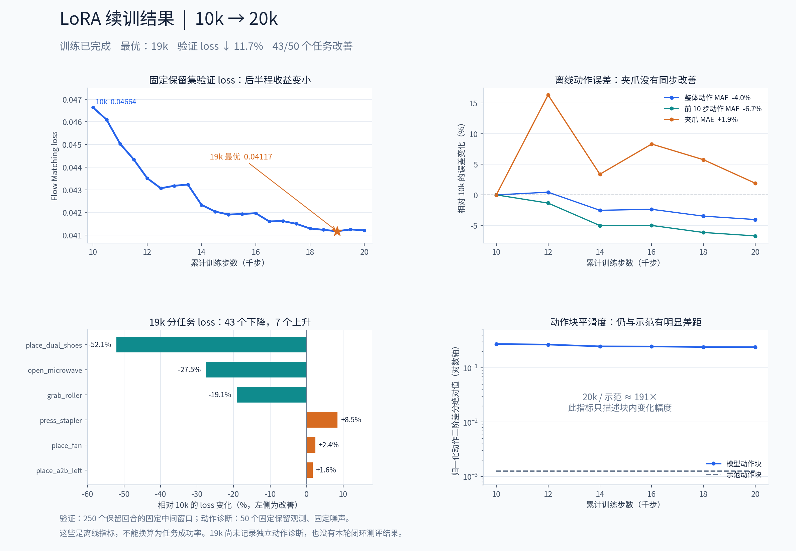

# 确认本机 4090 微调能力

- 归档编号：`01a13ee4-43ff-7da1-aa73-3ae0b7544ebc`
- 项目：蚂蚁灵波具身大模型挑战赛
- 创建时间：2026-10-15T17:28:29.443000+08:00
- 更新时间：2026-10-16T13:44:41.244000+08:00
- 状态：活动
- 导出范围：用户可见消息与助手可见回复；不含隐藏推理和工具原始输出

## 1. 用户

<external_codex_apps_open_page>{"page_id":null}</external_codex_apps_open_page>

## 2. 用户

我有点忘记了，现在我本机 4090 到底能不能使用 动作专家全量微调 还是只能使用lora微调动作专家？

## 3. 助手（进展）

我先检查这个项目里已有的模型配置和显存记录，确认你这台 4090 对动作专家全量微调的实际限制。

## 4. 用户

我们之前对 lingbotVLA2.0 已经进行过的微调方式有哪些？

## 5. 助手（进展）

已经找到 LoRA 和动作专家全量微调两套记录。我再核对正式训练和续训的检查点，把之前做过哪些微调、分别在哪台机器上运行，以及本机 4090 的限制一起说明。

## 6. 助手

核对项目记录后，**我们两种都做过：动作专家 LoRA 微调，以及动作专家全量微调。**

| 方式 | 实际更新的参数 | 已完成的正式训练 | 使用硬件 |
|---|---|---|---|
| **LoRA 微调** | 动作专家注意力层的 rank 8 LoRA，加上状态、动作输入输出投影层，共约 **396 万参数** | 先训练 5000 步，再续训至 **10000 步**。[记录](../../assets/2ccac5f776016210--robotwin50-continuation.json#L2) | 本机 RTX 4090 |
| **动作专家全量微调** | 整个动作专家，包括注意力、MoE 专家、路由器，以及上述投影层，共约 **17.87 亿参数** | 先训练 3000 步，再续训至 **6000 步**，本地留档确认完成。[记录](../../assets/85fdedce46c9a022--snapshot.json) | 远端 RTX PRO 5000 |

早期还做过 `click_bell` 的 **2 步 LoRA 训练与检查点回放验收**。两条正式路线都采用 RoboTwin 50 个 clean 任务、256×256 输入和 Flow Matching 动作损失，**视觉语言主干始终冻结**。

对应你前一个问题：**按现有已验证方案，本机 4090 用来训练 LoRA；动作专家全量训练放在 PRO 5000 上。** LoRA 实测峰值约 **13.8 GiB**，全量训练约 **38.1 GiB**，超过 4090 的 24GB 显存。4090 后来运行完整动作专家检查点的记录，是将权重以 BF16 加载做推理和评测。

[附件：2ccac5f776016210--robotwin50-continuation.json](../../assets/2ccac5f776016210--robotwin50-continuation.json)

[附件：85fdedce46c9a022--snapshot.json](../../assets/85fdedce46c9a022--snapshot.json)

## 7. 用户

我们之前的训练是否有归档模型，就是归档最优的模型或者是最后训练出来的模型，我也不知道如果不进行测评除了看val loss 还有什么其他办法来判断模型的好和坏？能否给我编写脚本，我们在本机继续进行LoRA 微调 到 20k，

## 8. 助手（进展）

我先核对已有最优模型、最终模型和续训状态，再把本机 LoRA 从 10k 续训到 20k 的脚本补齐。也会检查保存策略，确保后续能同时保留验证集最优模型和最后一步模型。

## 9. 助手（进展）

确认有归档：首轮 LoRA 保留了第 4500 步最优模型和第 5000 步最终模型；续训后，第 10000 步同时是当前验证集最优和最终模型，val loss 为 0.04664。

我会从第 10000 步恢复权重、优化器和随机状态，续训到累计 20000 步。新脚本会保留旧模型，每 500 步保存检查点，并记录分任务验证损失、固定观测下的动作误差和抖动等离线指标，帮助筛选候选模型。

## 10. 助手（进展）

续训核心已写好：学习率从 10k 结束时的 `1e-5` 平滑降到 `1e-6`，当前 10k 最优模型也会带入新一轮比较；如果后续没有更好的检查点，`best` 会继续指向它。

现有 LoRA 归档保存的是增量权重和优化器状态，使用时还需要基础模型和归一化配置。新检查点会一起保存归一化配置与校验值。接下来做完整性检查和 GPU 单步训练、重新加载验证。

## 11. 助手（进展）

CPU 完整性检查已通过：10k 权重、优化器状态、数据划分和归一化配置一致。GPU 预检遇到容器用户名解析问题，启动配置已修正，正在重跑。

离线指标可以帮助筛选模型，但动作有多种正确解法，误差更小或更平滑都不能直接证明任务成功率更高。新脚本的 `best` 会明确按固定验证集 loss 选择，其他指标一并留档供比较。

## 12. 助手（进展）

GPU 单步训练和独立进程重新加载验证都已通过，固定输入下的回放动作完全一致；显存峰值约 13.8 GiB。

我现在启动后台正式续训，目标是累计 20000 步。启动后会先复现 10k 的验证损失，确认基线一致后再继续更新。

## 13. 助手（进展）

后台服务和训练容器已正常运行，目前正在用全部 250 个保留验证回合复现 10k 基线。10k 父模型已在新输出目录中保存快照，后续的 `best`、`latest` 和 20k `final` 都会单独保留。

## 14. 用户

给我脚本我来执行训练命令好吧

## 15. 助手（进展）

好，由你来执行。我先停止刚才启动的后台续训，保留脚本、检查点和已通过的预检结果。

## 16. 助手

脚本已写好：[lora20k_job.sh](/home/lsy03/文档/ChatGPT/蚂蚁灵波具身大模型挑战赛/scripts/lora20k_job.sh)。

**后台训练已停止，由你手动启动。** 刚才已运行到 **10013 步**并保存检查点，下面命令会继续到累计 **20000 步**；原来的 10k 模型保留。

```bash
LORA20K_SCRIPT="/home/lsy03/文档/ChatGPT/蚂蚁灵波具身大模型挑战赛/scripts/lora20k_job.sh"

# 启动或恢复后台训练
bash "$LORA20K_SCRIPT" start

# 实时查看进度，Ctrl+C 仅退出显示
bash "$LORA20K_SCRIPT" live
```

暂停训练：

```bash
bash "$LORA20K_SCRIPT" stop
```

脚本已通过完整性检查、GPU 单步训练和独立回放验证。每 **500 步保存并验证**，分别保留 `best`、`latest` 和最终的 `final`；每 **2000 步记录离线动作误差和抖动指标**，辅助筛选模型。

## 17. 用户

给我看下效果如何？

## 18. 助手（进展）

我先查看这次 LoRA 续训的进度和验证结果，再对比 10k 基线、最优检查点与最后一步，看看是否有改善。

## 19. 助手（进展）

20k 已完成，按验证损失，最优检查点是 19k：相比 10k 降低了约 11.7%，50 个任务中有 43 个改善。

离线动作指标的提升较温和：20k 的整体动作误差下降约 4.0%，夹爪误差反而上升约 1.9%。我把曲线整理出来，方便你看收敛趋势和这些差异。

## 20. 助手

_工具输出图片（原始工具文本未纳入归档）。_


## 21. 助手

**20k 已完成，离线指标有改善；按验证损失，最优模型是 19k。**

| 检查点 | 验证 loss | 相比 10k |
|---|---:|---:|
| 10k 基线 | 0.046635 | — |
| **19k 最优** | **0.041167** | **降低 11.7%** |
| 20k 最终 | 0.041208 | 降低 11.6% |

19k 的 **43/50 个任务**验证损失下降。20k 相比 10k，整体动作误差下降 **4.0%**、前 10 步动作误差下降 **6.7%**；夹爪误差上升 **1.9%**，动作平滑度仍与示范有明显差距。



后半程收益已经变小。接下来适合比较 **10k 与 19k 的闭环表现**；目前这轮还没有任务成功率数据，不能把 loss 的改善换算成成功率提升。

[19k 最优模型归档](/home/lsy03/文档/ChatGPT/蚂蚁灵波具身大模型挑战赛/outputs/robotwin50_lora_continue_10000_to20000/checkpoints/step_019000) · [完整分析数据](../../assets/4d3a4014c328cfb8--summary.json)


[附件：4d3a4014c328cfb8--summary.json](../../assets/4d3a4014c328cfb8--summary.json)
