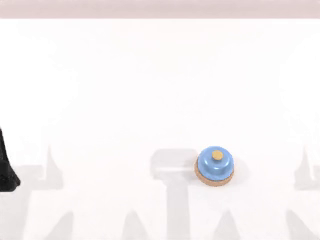

# 评估双4090 LoRA仿真

- 归档编号：`01a142fb-9b0f-78b1-b8fe-4e7795773e27`
- 项目：蚂蚁灵波具身大模型挑战赛
- 创建时间：2026-10-16T12:32:27.925000+08:00
- 更新时间：2026-10-16T13:44:16.285000+08:00
- 状态：活动
- 导出范围：用户可见消息与助手可见回复；不含隐藏推理和工具原始输出

## 1. 用户

<external_codex_apps_open_page>{"page_id":null}</external_codex_apps_open_page>

## 2. 用户

给我看下当前本地的两个显卡4090能否来给我进行lora 10k 步骤 的 快速仿真环境评测，如何可以，给我编写脚本然后执行，我最后来验收结果。

## 3. 助手（进展）

我先检查本机两张 4090 的可用显存、项目里的 LoRA 训练配置和仿真评测入口，确认“10k 步”对应的流程后，编写并运行可验收的脚本。

## 4. 助手（进展）

两张本地 RTX 4090 都可用：0 号卡约空闲 22.6 GiB，1 号卡约空闲 23.5 GiB，当前没有计算任务。项目里也已有训练到第 10,000 步的 LoRA 检查点；我会用它做快速闭环仿真评测，保存成功率、逐回合视频和日志供你验收。

## 5. 助手（进展）

本机的模型镜像、仿真镜像和 10k LoRA 权重都已齐备。我会先跑单回合验证显存和仿真链路，再执行 5 个任务、clean/randomized 各 5 回合，共 50 回合；两张卡分别承担模型推理和仿真渲染。

## 6. 助手（进展）

已核对 10k 权重的 SHA256，与项目中保存的身份记录一致。上一轮本地评测曾因推理和仿真共用一张卡而触发显存保护；这次把它们固定到不同显卡，并保留原始任务步数上限和渲染条件。

## 7. 助手（进展）

脚本已启动，后台任务正在加载模型。脚本检查也已通过，涵盖结果与视频一致性、重复回合排除、实际种子校验，以及不干预其他容器；接下来确认真实 GPU 推理和首个仿真回合。

## 8. 助手（进展）

真实推理已通过：144 个 LoRA 模块及全部 294 个更新张量已加载，能输出有效的 50×14 动作块。推理卡当前约占 12.6 GiB、仍空闲 10.9 GiB；正在验证独立仿真卡上的首个回合。

## 9. 助手

_工具输出图片（原始工具文本未纳入归档）。_

## 10. 助手（进展）

首个闭环仿真回合已成功完成，视频也能正常解码。正式 50 回合评测已经开始，目前 click_bell 的前两回合均成功；双卡仍有充足显存余量。

## 11. 助手（进展）

clean 场景下的 click_bell 已完成 5/5，全部成功，正在评测 open_laptop。当前单次模型推理约需 0.5 秒；报告会只统计完整完成的场景，保留进行中的视频。

## 12. 助手（进展）

open_laptop 的首回合成功，第二回合仍在运行。这个任务保留了原始 700 步上限，因此比按铃耗时更长；目前没有仿真异常或显存不足。

## 13. 助手（进展）

open_laptop 已结束两回合，结果为 1 次成功、1 次失败，第三回合进行中。失败回合的视频已保留；这类任务失败会如实计入成功率。

## 14. 助手（进展）

open_laptop 已完成三回合，其中两回合成功，第四回合进行中。已核查两个容器分别绑定了指定的物理显卡，两张卡的空闲显存均保持在 10 GiB 以上。

## 15. 助手（进展）

open_laptop 的前四回合为 2 成功、2 失败，最后一回合正在运行。当前主要耗时在仿真执行，模型单次推理中位数约 0.50 秒，显存占用稳定。

## 16. 助手（进展）

open_laptop 最后一回合已到 600/700 步，运行正常。完成后将继续搬放和堆叠任务，已有场景结果会保存在报告中。

## 17. 助手（进展）

已完成 10/50 回合：clean 的 click_bell 为 5/5，open_laptop 为 2/5。现在评测 place_a2b_left，尚未出现运行异常。

## 18. 助手（进展）

place_a2b_left 已完成两回合，1 次成功、1 次失败，第三回合进行中。此前完成的 10 回合已汇总，失败视频也已保存。

## 19. 助手（进展）

place_a2b_left 的前四回合为 1 成功、3 失败，最后一回合正在运行。设备状态稳定，当前模型在这项任务上的成功率较低。

## 20. 助手（进展）

已完成 15/50 回合，clean 的 place_a2b_left 最终为 1/5，接下来是堆叠任务。按目前速度，完整评测预计总共需要约 45–60 分钟；50 回合会保留原始任务步数上限。

## 21. 助手（进展）

堆叠任务的第一回合未成功，后续回合继续运行。我也会检查视频报告的页面显示和播放情况，方便你最后直接验收。

## 22. 助手（进展）

内置浏览器的自动审批拒绝了本地报告预览，原因是该地址未获授权。我会继续做本地文件和视频校验，仿真评测不受影响。

## 23. 助手（进展）

堆叠任务已完成两回合，均未成功，第三回合进行中。仿真和动作输出检查均正常，这两次失败会计入模型评测结果。

## 24. 助手（进展）

堆叠任务前三回合均未成功，第四回合已开始。当前已完成的场景仍为 15/50 回合，另有堆叠任务的 3 段完整失败视频。

## 25. 助手（进展）

堆叠任务第四回合已到 700/800 步，接近结束。推理卡仍空闲约 10.9 GiB，仿真卡空闲约 16.6 GiB，未触发显存保护。

## 26. 助手（进展）

堆叠任务前四回合均未成功，最后一回合正在运行。接下来是 clean 场景的麦克风交接任务，之后进入 randomized 场景。

## 27. 助手（进展）

已完成 20/50 回合。clean 的堆叠任务为 0/5，五段失败视频均已保存；现在评测麦克风交接。

## 28. 助手（进展）

麦克风交接的首回合未成功，第二回合正在运行。当前累计已保存 21 个正式回合的视频，已有完整场景的成功率仍按 20 回合汇总。

## 29. 助手（进展）

麦克风交接前两回合均未成功，第三回合正在准备场景。模型服务和仿真进程正常，暂未出现需要重试的运行错误。

## 30. 助手（进展）

麦克风交接第三回合已到 450/600 步，仍在执行。这一场景完成后，clean 组的 25 回合结果就能汇总。

## 31. 助手（进展）

麦克风交接第三回合也未成功，第四回合正在运行。当前双卡的显存占用保持稳定，评测继续按固定配置执行。

## 32. 助手（进展）

clean 组只剩麦克风交接的最后一回合，目前到 400/600 步；此前四回合均未成功。随后将用同一检查点评测 randomized 场景。

## 33. 助手（进展）

clean 组 25 回合已全部完成，成功 8/25（32%）：按铃 5/5、开盖 2/5、搬放 1/5、堆叠 0/5、麦克风交接 0/5。现在开始 randomized 组的 25 回合。

## 34. 助手（进展）

randomized 的按铃任务前两回合均成功，第三回合正在运行。随机场景仍使用相同权重、精度和任务步数上限。

## 35. 助手（进展）

已完成 30/50 回合，randomized 的按铃任务最终为 5/5，全部成功。现在开始 randomized 的开盖任务。

## 36. 助手（进展）

randomized 的开盖首回合已到 300/700 步，尚未结束。当前 30 个已完成场景回合的视频和实际种子均已保存，运行状态正常。

## 37. 助手（进展）

randomized 的开盖任务已完成三回合，2 次成功、1 次失败，第四回合正在准备。视频报告中的逐回合结果已更新。

## 38. 助手（进展）

randomized 的开盖第四回合已到 500/700 步，仍在运行。当前推理卡空闲约 10.9 GiB，仿真卡空闲约 16.2 GiB。

## 39. 助手（进展）

已完成 35/50 回合，randomized 的开盖任务最终为 3/5。剩下随机场景中的搬放、堆叠和麦克风交接，共 15 回合。

## 40. 助手（进展）

randomized 的搬放首回合成功，第二回合已到 350/400 步。到目前为止，各场景都在首次运行中正常推进，未发生容器异常退出。

## 41. 助手（进展）

randomized 的搬放任务已完成三回合，1 次成功、2 次失败，第四回合进行中。当前已完整完成 35/50 回合的场景汇总。

## 42. 助手（进展）

randomized 的搬放任务前四回合为 1 成功、3 失败，最后一回合已接近步数上限。完成后只剩堆叠和麦克风交接两项。

## 43. 助手（进展）

已完成 40/50 回合，randomized 的搬放任务最终为 1/5。剩余 10 回合正在继续执行，当前累计成功 17/40。

## 44. 助手（进展）

randomized 的堆叠首回合未成功，第二回合正在运行。完成这两项剩余任务后，我会核对全部 50 回合的结果文件、视频和实际种子。

## 45. 助手（进展）

randomized 的堆叠任务前两回合均未成功，第三回合已开始。模型服务正常，已有视频持续保存在本地报告目录。

## 46. 助手（进展）

randomized 的堆叠任务前三回合均未成功，第四回合正在准备。当前没有缺失结果或仿真异常退出。

## 47. 助手（进展）

randomized 的堆叠第四回合已到 600/800 步。结束后还剩该任务最后一回合，以及麦克风交接的 5 回合。

## 48. 助手（进展）

randomized 的堆叠任务最后一回合已到 400/800 步，前四回合均未成功。之后只剩最后 5 回合麦克风交接。

## 49. 助手（进展）

已完成 45/50 回合，randomized 的堆叠任务最终为 0/5。最后 5 回合麦克风交接已开始；随后会校验视频完整性、汇总结果并释放评测占用的显卡。

## 50. 助手（进展）

最后一项任务的首回合已到 550/600 步，运行正常。完整结果汇总和逐回合视频已持续写入本地目录。

## 51. 助手（进展）

最后一项任务首回合未成功，第二回合正在运行。全部回合结束后，我会再做一次视频解码检查，确认保存的 MP4 文件能正常读取。

## 52. 助手（进展）

最后一项任务前两回合均未成功，第三回合进行中。我正在补上可重复运行的视频解码校验入口，验收时可以一条命令检查全部 50 段视频。

## 53. 助手（进展）

视频校验入口已加入脚本的 `verify` 操作，会核对结果、种子和权重，并完整解码全部 50 段视频。当前仍在执行最后一项任务的第三回合。

## 54. 助手（进展）

最后一项任务已结束三回合，均未成功，第四回合正在运行。剩余两回合完成后就进入最终校验。

## 55. 助手（进展）

只剩最后一个正式回合：randomized 的麦克风交接第五回合已开始。前四回合均未成功，完成后将核对最终成功率并完整解码视频。

## 56. 助手（进展）

最后一回合已到 500/600 步，接近结束。接下来只剩视频解码和结果核对，评测容器随后会自动退出。

## 57. 助手（进展）

50 回合已全部完成：clean 为 8/25，randomized 为 9/25，总成功率 17/50（34%）。评测任务正常退出；我现在做最后的视频完整解码和权重校验。

## 58. 助手

可以，已实际跑完。使用 **第 10,000 步 LoRA 检查点**，1 号 4090 推理、0 号 4090 仿真，50 回合耗时约 **55 分钟**，无显存溢出。

| 任务 | clean | randomized |
|---|---:|---:|
| 按铃 | 5/5 | 5/5 |
| 打开笔记本 | 2/5 | 3/5 |
| 搬放 | 1/5 | 1/5 |
| 堆叠 | 0/5 | 0/5 |
| 麦克风交接 | 0/5 | 0/5 |

**总成功率：17/50（34%）**。50 段视频均完整解码通过，原始权重未改动。本次覆盖 5 个任务。

[验收报告（含视频）](../../assets/b0cbf74ef9e16f74--index.html) · [运行脚本](/home/lsy03/文档/ChatGPT/蚂蚁灵波具身大模型挑战赛/scripts/quick_eval_lora10k_4090.sh) · [视频校验记录](../../assets/810f9f5e5d4acf3f--video-decode-audit.json)

内置浏览器预览被自动审批拒绝，原因是本地地址未获授权；报告和视频已保存，可直接打开验收。

[附件：b0cbf74ef9e16f74--index.html](../../assets/b0cbf74ef9e16f74--index.html)

[附件：810f9f5e5d4acf3f--video-decode-audit.json](../../assets/810f9f5e5d4acf3f--video-decode-audit.json)
